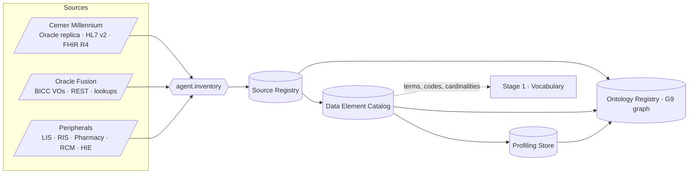

---
title: Stage 0 — Metadata and Inventory
module: 02-ontology-pipeline
doc_id: ONT-01
version: 0.1.0
status: draft
owners: [Data Governance Lead, Enterprise Ontology Team]
depends_on: [ARC-01, SRC-00, GOV-01]
last_updated: 2026-10-17---
# Stage 0 — Metadata and Inventory

## 1. Purpose and the metadata-first principle

Stage 0 answers one question for every byte that will ever enter the platform: *what is this, where does it come from,
who owns it, and how sensitive is it?* The Ontology Pipeline framework places the metadata inventory first because
every later stage — vocabulary, taxonomy, thesaurus, ontology, graph — is only as trustworthy as the catalogue of
things it describes. In HEALIX this is enforced mechanically: a Kafka connector, a mapping, a DQ rule or a graph load
that references a data element absent from the **Data Element Catalog** is rejected at CI time (ONT-INV-001).

The principle has four consequences:

1. **Registration precedes extraction.** A source system has a `source_id`, a steward and a PHI posture before any
   connector is deployed (module 07) or any mapping is written (module 03/06).
2. **Elements, not tables, are the unit of governance.** A Cerner `CLINICAL_EVENT.RESULT_VAL` column, an HL7 v2
   `OBX-5` field and a FHIR `Observation.value[x]` element are three *elements* that Stage 1 will later recognise as
   expressions of one concept. Stage 0 records them separately and records their lineage; it does not yet unify them.
3. **Metadata is itself data in the platform.** The Source Registry and Data Element Catalog are published as RDF
   (DCAT 3 + Dublin Core + schema.org `DataCatalog`), live in group **G9 Metadata, Quality & Governance**, and are
   queryable in the knowledge graph alongside clinical facts.
4. **Profiling is evidence, not description.** Every element carries machine-computed profile statistics (null rate,
   distinct count, value-pattern histogram, code-set membership) so that Stage 1 term harvesting and Stage 4 cardinality
   axioms are derived from observed data, not from vendor documentation alone.

## 2. Artefacts

### 2.1 Source Registry schema

One record per registered system or interface. Expressed as a `dcat:Catalog` of `dcat:Dataset`s; stored relationally
in `edw_g9_governance.ref_source_system` and as RDF under `<base>graph/governance/source-registry`.

| Field | Type | Required | Notes |
|-------|------|----------|-------|
| `source_id` | string, pattern `src.<vendor>.<system>[.<interface>]` | MUST | e.g. `src.cerner.millennium.oracle`, `src.cerner.millennium.hl7v2.adt`, `src.cerner.millennium.fhir`, `src.oracle.fusion.bicc.gl`, `src.sunquest.lis.hl7v2.oru` |
| `system` | enum from scheme `source-system-type` | MUST | `ehr`, `erp`, `hcm`, `scm`, `lis`, `ris-pacs`, `pharmacy`, `rcm`, `clearinghouse`, `hie`, `portal`, `device-gateway`, `payer`, `crm`, `platform` |
| `vendor`, `product`, `product_version` | string | MUST | `Oracle Health`, `Millennium`, `2018.01+`; `Oracle`, `Fusion Cloud ERP`, `25C` |
| `interface_type` | enum | MUST | `oracle-cdc`, `hl7v2-mllp`, `fhir-r4`, `bicc-extract`, `rest`, `x12`, `ccda`, `file` |
| `environment_binding` | map env → endpoint | MUST | `dev/test/uat/prod` endpoints; prod endpoints MUST NOT appear in non-prod records |
| `steward` | person/role IRI | MUST | Business steward (G-group steward) |
| `technical_owner` | person/role IRI | MUST | Integration or DBA team |
| `phi_posture` | enum | MUST | `phi`, `phi-limited-dataset`, `de-identified`, `no-phi` (module 11 taxonomy) |
| `groups` | list of G1–G9 | MUST | Groups this source feeds |
| `refresh_mode`, `refresh_cadence` | enum, ISO 8601 duration | MUST | `stream`, `cdc`, `batch`; e.g. `PT15M` for BICC |
| `authoritative_for` | list of entity IRIs | SHOULD | e.g. Cerner authoritative for `clinical/Encounter`; Oracle HCM for `party/Employee` |
| `dcterms:*` | title, description, publisher, license, accrualPeriodicity, temporal, spatial | MUST | Dublin Core / DCAT |
| `status` | `proposed`, `registered`, `active`, `deprecated`, `retired` | MUST | |

### 2.2 Data Element Catalog schema

One record per physical element (column, HL7 field/component, FHIR element path, BICC VO attribute, file column).
Expressed as `dcat:Dataset` → `dcat:Distribution` → element records typed `healix:DataElement` (G9 class).

| Field | Type | Required | Notes |
|-------|------|----------|-------|
| `element_id` | string `<source_id>/<container>/<element>` | MUST | `src.cerner.millennium.oracle/CLINICAL_EVENT/RESULT_VAL` |
| `source_id` | FK → Source Registry | MUST | |
| `system` | copied from source | MUST | denormalised for query |
| `schema` | string | MUST | Oracle schema (`V500`), FHIR server base, BICC offering (`FscmTopModelAM`), HL7 message type (`ADT^A01`) |
| `container` | string | MUST | table / segment / resource / view object, e.g. `ENCOUNTER`, `PV1`, `Encounter`, `GeneralLedgerJournalLinesPVO` |
| `element` | string | MUST | column / field path / FHIR path / attribute: `ENCNTR_TYPE_CD`, `PV1-2`, `Encounter.class`, `JournalLineAccountedDr` |
| `datatype` | source-native type + XSD mapping | MUST | `NUMBER(18)` → `xsd:decimal`; HL7 `CWE` → complex; FHIR `Coding` |
| `phi_class` | enum from module 11 | MUST | `direct-identifier`, `quasi-identifier`, `sensitive-clinical`, `financial`, `none`, `unknown` (transitional only) |
| `steward` | role IRI | MUST | Inherits from source unless overridden |
| `cardinality` | `min..max` observed + declared | MUST | e.g. declared `0..1`, observed `0..1` at 99.97 % |
| `nullable`, `is_key`, `is_code` | boolean | MUST | `is_code` flags Cerner `*_CD` columns, Oracle lookup codes, HL7 coded fields |
| `code_set_ref` | string | SHOULD | Cerner `CODE_VALUE.CODE_SET` number (e.g. `71` encounter type, `72` encounter class, `4` admit source); Oracle `LOOKUP_TYPE`; FHIR binding URL |
| `example_values_policy` | enum | MUST | `store-top-k` (non-PHI codes), `store-pattern-only` (regex/shape), `store-none` (direct identifiers). Default is `store-none`; agent MUST NOT store raw PHI examples |
| `example_values` | list ≤ 10 | per policy | Only when policy allows |
| `profile_ref` | IRI | MUST once profiled | Pointer to latest profiling snapshot |
| `lineage` | PROV-O fragment | MUST | `prov:wasDerivedFrom` physical object IRI; for views, derivation to base tables |
| `semantic_binding` | IRI, nullable | — | Filled in by Stage 1/4; empty at Stage 0 |
| `dcterms:modified`, `recorded_at`, `valid_from/to` | timestamps | MUST | Bitemporal per CONVENTIONS §4 |

### 2.3 Vocabulary usage (DCAT / Dublin Core / schema.org)

| Need | Term |
|------|------|
| Catalogue of all sources | `dcat:Catalog` with `dcat:dataset` |
| A source or interface | `dcat:Dataset`; `dcterms:publisher` = vendor org; `dcat:theme` = group IRI |
| A physical extract/endpoint | `dcat:Distribution`; `dcat:accessService` = `dcat:DataService` for FHIR/REST; `dcat:mediaType` for files |
| Element-level description | `healix:DataElement` ⊑ `schema:PropertyValueSpecification`; `schema:valueRequired`, `schema:valuePattern`, `schema:maxValue/minValue` from profiling |
| Discoverability for web catalogue | `schema:DataCatalog`, `schema:Dataset` JSON-LD mirror generated from DCAT |
| Stewardship | `dcterms:rightsHolder` (steward org), `prov:wasAttributedTo` (steward role) |
| Sensitivity | `dcterms:accessRights` with PHI class IRI; `odrl:hasPolicy` link to module 11 policy |

## 3. Harvesting by `agent.inventory`

The agent runs on a schedule (daily full reconciliation, hourly delta) and on demand when module 07 detects schema
drift. It uses read-only metadata credentials and never reads row data except through the profiling tool, which
enforces the example-values policy.

### 3.1 Cerner Millennium

| Surface | Method | What is harvested | Notes |
|---------|--------|-------------------|-------|
| Oracle database (read replica) | `ALL_TAB_COLUMNS`, `ALL_CONSTRAINTS`, `ALL_COMMENTS`, Cerner data-dictionary tables (`DM_TABLES`, `DM_COLUMNS`, `DM_INFO`) | Tables, columns, PK/FK, comments | Core tables in first scope: `PERSON`, `PERSON_ALIAS`, `PERSON_NAME`, `ADDRESS`, `PHONE`, `ENCOUNTER`, `ENCNTR_ALIAS`, `ENCNTR_LOC_HIST`, `ENCNTR_PRSNL_RELTN`, `PRSNL`, `ORGANIZATION`, `LOCATION`, `CLINICAL_EVENT`, `CE_BLOB`, `CE_CODED_RESULT`, `ORDERS`, `ORDER_DETAIL`, `ORDER_ACTION`, `DIAGNOSIS`, `PROBLEM`, `PROCEDURE`, `ALLERGY`, `MEDICATION`, `CHARGE`, `CHARGE_EVENT`, `SCH_APPT`, `SCH_EVENT`, `CODE_VALUE`, `CODE_VALUE_SET`, `NOMENCLATURE`, `NOMEN_CONCEPT` |
| `CODE_VALUE` | Full extract of `CODE_SET`, `CODE_VALUE`, `DISPLAY`, `DESCRIPTION`, `MEANING`, `CDF_MEANING`, `ACTIVE_IND`, `BEGIN/END_EFFECTIVE_DT_TM` | Local code sets (e.g. 71 encounter type, 72 encounter class, 8 person type, 4002 clinical event, 200 order catalog, 14003 result status, 12 marital status) | Feeds Stage 1 as candidate local concept schemes; `CDF_MEANING` is a strong hint for enterprise meaning |
| `NOMENCLATURE` / `NOMEN_CONCEPT` | Extract of `SOURCE_VOCABULARY_CD`, `SOURCE_IDENTIFIER`, `SOURCE_STRING`, `CONCEPT_CKI`, `PRINCIPLE_TYPE_CD` | Local-to-standard links (SNOMED CT, ICD-10-CM, CPT, Multum/RxNorm) | Harvested as *evidence* for Stage 1/3 mappings; never trusted without TS validation |
| HL7 v2 (MLLP interfaces) | Interface engine conformance profiles + 7-day message sample metadata | Message types (`ADT^A01/A03/A08`, `ORM^O01`, `ORU^R01`, `SIU^S12`, `DFT^P03`, `MDM^T02`), segments, fields, Z-segments | Each field becomes an element: `PV1-2 Patient Class`, `OBX-3 Observation Identifier`, `OBX-6 Units` |
| Millennium FHIR R4 | `GET [base]/metadata` CapabilityStatement; StructureDefinitions for supported resources | Supported resources (Patient, Encounter, Condition, Observation, MedicationRequest, Procedure, AllergyIntolerance, Immunization, DiagnosticReport, DocumentReference, Appointment, Practitioner, Location, Organization, Coverage, Account, ChargeItem), search params, must-support elements | Elements are FHIR paths; bindings recorded in `code_set_ref` |

### 3.2 Oracle Fusion Cloud (ERP, HCM, SCM)

| Surface | Method | What is harvested | Notes |
|---------|--------|-------------------|-------|
| BICC view objects | BICC console export of offerings + `*_PVO` metadata (`EXTRACT` manifest, column list, data types, PK flags) | Offerings and VOs. First scope: **GL** `GeneralLedgerJournalHeadersPVO`, `GeneralLedgerJournalLinesPVO`, `GeneralLedgerCodeCombinationsPVO`, `GeneralLedgerBalancesPVO`; **AP** `PayablesInvoiceHeadersPVO`, `PayablesInvoiceLinesPVO`, `PayablesPaymentsPVO`; **AR** `ReceivablesTransactionHeadersPVO`, `ReceivablesReceiptsPVO`, `HzCustAccountsPVO`; **PO** `PurchaseOrderHeadersPVO`, `PurchaseOrderLinesPVO`, `PurchaseRequisitionLinesPVO`, `PozSuppliersPVO`; **INV** `InvOnhandQuantitiesPVO`, `InvTransactionsPVO`, `EgpSystemItemsPVO`; **HCM** `PER_ALL_PEOPLE_F`, `PER_PERSON_NAMES_F`, `PER_ALL_ASSIGNMENTS_M`, `HR_ALL_POSITIONS_F`, `HR_ALL_ORGANIZATION_UNITS_F`, `PER_JOBS_F`, `PER_GRADES_F` (via HCM Extracts or BICC HCM offering) | Effective-dated tables (`_F`, `_M`) carry `EFFECTIVE_START_DATE/END_DATE`; agent records this as source valid time for module 08 |
| Lookups | `FND_LOOKUP_TYPES`/`FND_LOOKUP_VALUES` (via BICC `FndLookupValuesPVO` or REST `/fscmRestApi/resources/latest/standardLookupsLOV`) | Lookup types such as `INVOICE_TYPE`, `PO_DOCUMENT_TYPE`, `EMP_CAT`, `PER_ETHNICITY`, `MAR_STATUS`, `SEX`, `INV_TRANSACTION_TYPE` | Feeds Stage 1 as candidate local schemes |
| Chart of accounts | `GL_CODE_COMBINATIONS`, `FND_FLEX_VALUE_SETS`, `FND_FLEX_VALUES_VL`, segment labels (`GL_BALANCING`, `GL_ACCOUNT`, `FA_COST_CTR`) | COA structure, segments, value sets, hierarchies (trees) | Segment value sets become Stage 1 schemes; trees become Stage 2 hierarchies (cost-centre, natural account) |
| REST | `/describe` on each resource used | Resource metadata for near-real-time sources (e.g. `receivingReceiptRequests`, `workers`) | |

### 3.3 Peripheral systems

Harvested per interface spec supplied by module 03; typical surfaces: LIS (`ORU^R01`, LOINC-coded OBX-3, local test
codes), RIS/PACS (`ORM/ORU`, DICOM metadata via DICOMweb QIDO-RS attributes, not pixels), pharmacy (`RDE^O11`,
`RAS^O17`, NDC/RxNorm), RCM/clearinghouse (X12 837P/837I/835/270/271/278 loops and segments), HIE (C-CDA 2.1 section
templates), payer eligibility files, device gateways (IEEE 11073 / FHIR `Observation`), patient portal, CRM.

### 3.4 Profiling outputs

For each element, the profiler (read-only, PHI-aware) emits a snapshot stored in the Profiling Store and summarised in
the catalogue:

| Metric | Applies to | Use downstream |
|--------|------------|----------------|
| `row_count`, `null_rate`, `distinct_count`, `distinct_ratio` | all | DQ completeness thresholds (09), cardinality axioms (Stage 4) |
| `min/max/mean/stddev`, percentiles | numeric, date | Range constraints (SHACL `sh:minInclusive`) |
| `pattern_histogram` (top 20 regex shapes) | string | Identifier formats (MRN, NPI, invoice number) |
| `top_k_values` with counts | `is_code = true`, non-PHI | Term harvesting (Stage 1); value-set coverage |
| `code_set_hit_rate` | coded | % of values found in `CODE_VALUE` / lookup / external code system via TS `$validate-code` |
| `fk_integrity_rate` | keyed | Referential DQ rules |
| `temporal_profile` (first/last seen, update frequency) | all | Refresh cadence validation |
| `drift_delta` vs. previous snapshot | all | Triggers change request when schema or distribution shifts |

Profiling MUST run against masked non-production replicas unless the module 11 policy grants production profiling
for the element class; direct identifiers are profiled for pattern only.

## 4. Requirements

| ID | Priority | Verification | Requirement |
|----|----------|--------------|-------------|
| **ONT-INV-001** | P0 | test | CI MUST reject any connector manifest (07), mapping spec (03/06), DQ rule (09) or RML mapping (Stage 5) that references an `element_id` not present and `active` in the Data Element Catalog. |
| **ONT-INV-002** | P0 | test | Every Source Registry record MUST have a `steward`, `technical_owner`, `phi_posture` and at least one group before status may move to `registered`. |
| **ONT-INV-003** | P0 | test | Every Data Element Catalog record MUST have a `phi_class` other than `unknown` before the element may be consumed by any later stage; `unknown` MUST expire after 10 business days and raise an issue to `agent.privacy_guardian`. |
| **ONT-INV-004** | P0 | test | `agent.inventory` MUST NOT persist raw values for elements with `example_values_policy = store-none`; the evaluator MUST scan catalogue payloads for identifier patterns (MRN, SSN, NPI, DOB) and fail the run on a hit. |
| **ONT-INV-005** | P0 | test | The catalogue MUST record for each Cerner Millennium coded column its `CODE_SET` number, and for each Oracle Fusion coded attribute its `LOOKUP_TYPE` or flexfield value-set name. |
| **ONT-INV-006** | P0 | inspection | The Source Registry and Data Element Catalog MUST be published as DCAT 3 / Dublin Core RDF in named graph `<base>graph/governance/source-registry/<yyyy-mm-dd>/<batch-ulid>` and as a schema.org `DataCatalog` JSON-LD mirror. |
| **ONT-INV-007** | P0 | test | Every element MUST carry a PROV-O lineage fragment linking it to its physical object; for Oracle Fusion PVOs and Cerner views the agent MUST resolve lineage to base tables where metadata permits. |
| **ONT-INV-008** | P1 | test | `agent.inventory` MUST harvest the Millennium FHIR R4 CapabilityStatement and record each supported resource, must-support element and search parameter as catalogue elements. |
| **ONT-INV-009** | P1 | test | `agent.inventory` MUST harvest HL7 v2 conformance profiles and a message-sample metadata window (≥ 7 days) and register every populated field and Z-segment, including repetition and component structure. |
| **ONT-INV-010** | P1 | test | Profiling snapshots MUST be produced for ≥ 95 % of active elements every 7 days and MUST be bitemporal (snapshot valid time = profiling window; transaction time = run time). |
| **ONT-INV-011** | P1 | test | A `drift_delta` exceeding the configured threshold (new column, dropped column, datatype change, `code_set_hit_rate` drop > 5 pp) MUST open a typed change request `CR-INVENTORY-DRIFT` within one scheduling cycle. |
| **ONT-INV-012** | P1 | test | Oracle Fusion effective-dated tables (`*_F`, `*_M`) MUST be registered with `EFFECTIVE_START_DATE/END_DATE` flagged as source valid-time columns for module 08. |
| **ONT-INV-013** | P2 | demo | The catalogue SHOULD expose a search UI/API (`GET /registry/v1/elements?q=`) returning elements with steward, PHI class, profile summary and current semantic binding. |
| **ONT-INV-014** | P2 | analysis | Catalogue coverage (registered elements ÷ physical elements discoverable) SHOULD be ≥ 98 % for Cerner core tables and Oracle Fusion first-scope PVOs, reported monthly. |

## 5. Exit criteria (restated for the gate)

Stage 0 is `released` for a group when ONT-INV-001..007 pass, coverage per ONT-INV-014 is met for that group's
sources, and the group steward has signed the Source Registry entries. Only then may `agent.vocabulary_curator`
begin term harvesting for that group.
