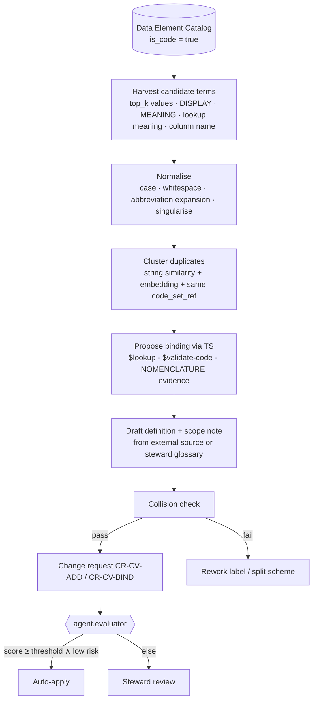

# Stage 1 — Controlled Vocabularies

## 1. Purpose

Stage 1 turns the raw terms discovered in Stage 0 — Cerner `CODE_VALUE` displays, Oracle Fusion lookup meanings,
HL7 table values, column names, FHIR bindings — into **controlled vocabularies**: SKOS concept schemes in which every
concept has exactly one preferred label per language, a definition, a notation and, wherever one exists, a binding to
an external standard code system. No hierarchy is asserted yet. The deliverable is a set of flat, de-duplicated,
well-defined concept schemes that Stage 2 can arrange and Stage 4 can formalise.

Why flat first: a term that is ambiguous ("Visit" meaning both a Cerner encounter type and an Oracle Fusion travel
expense category) cannot be placed in a hierarchy. Stage 1 forces disambiguation through labels, definitions and
scheme membership before structure is attempted.

## 2. Modelling standard

Vocabularies are expressed in **SKOS** (W3C) and conform to **ISO 25964-1** (thesauri) for term form, and to
**ISO 25964-2** for mapping types used later in Stage 3. FHIR `CodeSystem`/`ValueSet` are *generated projections* of
SKOS schemes (module 06), never authored independently.

### 2.1 Concept scheme

| Property | Cardinality | Rule |
|----------|-------------|------|
| IRI | 1 | `<base>scheme/<scheme-slug>`; slug is kebab-case, ≤ 40 chars, e.g. `encounter-class`, `admit-source`, `gl-natural-account`, `po-document-type`, `worker-assignment-status` |
| `dcterms:title`, `dcterms:description` | 1 each | |
| `dcterms:creator`, `dcterms:publisher` | 1 | publisher = HEALIX Ontology Governance Board |
| `dcterms:created`, `dcterms:modified` | 1 | |
| `owl:versionInfo` | 1 | `vYYYY.MM.N` (see ONT-07) |
| `healix:group` | 1..n | G1–G9 |
| `healix:steward` | 1 | role IRI |
| `healix:sourceCodeSet` | 0..n | provenance: `cerner:CODE_SET/72`, `ofusion:LOOKUP_TYPE/INVOICE_TYPE`, `hl7v2:Table/0004` |
| `skos:hasTopConcept` | 0..n | empty at Stage 1; set in Stage 2 |

### 2.2 Concept

| Property | Cardinality | Rule |
|----------|-------------|------|
| IRI | 1 | `<base>concept/<scheme-slug>/<local-id>`; `local-id` is an opaque, stable, lowercase token (ULID-derived or notation-derived, never the label) |
| `skos:inScheme` | 1..n | Primary scheme first |
| `skos:prefLabel` | exactly 1 per language | `@en` mandatory; `@es` recommended for patient-facing schemes; ISO 25964 term form (singular noun phrase, no abbreviations unless universal, sentence case) |
| `skos:altLabel` | 0..n | Synonyms, source display strings, abbreviations (`ED`, `IP`, `OP`) |
| `skos:hiddenLabel` | 0..n | Misspellings, legacy displays, raw Cerner `DISPLAY_KEY` (upper-case no-space form), used for search only |
| `skos:definition` | exactly 1 per language | Genus–differentia form; ≥ 15 words; MUST NOT be the label restated |
| `skos:scopeNote` | 0..n | Usage boundaries, e.g. "Do not use for observation-only ED visits; see *Emergency observation*" |
| `skos:example` | 0..n | Examples classed `internal` or `public` only |
| `skos:historyNote`, `skos:changeNote` | 0..n | Populated by the registry on every CR |
| `skos:notation` | 0..n, typed | `"72^EMERGENCY"^^cerner:CodeValueMeaning`, `"EMER"^^hl7:ActCode`, `"INVOICE_TYPE:STANDARD"^^ofusion:Lookup` |
| `healix:bindingStatus` | 1 | `bound`, `local-only`, `pending`, `unbindable` |
| `healix:sourceEvidence` | 1..n | element IRIs and profiling snapshot IRIs that justify the concept |
| `dcterms:created/modified`, `prov:wasGeneratedBy` | 1 | CR activity |

## 3. Binding to external code systems

Binding is an `skos:exactMatch`/`closeMatch` to a concept in an external code system, validated through the FHIR
Terminology Service (`$validate-code`, `$lookup`). Stage 1 records the *binding*; Stage 3 governs richer mappings.

| Code system | Canonical IRI / FHIR `system` | Typical HEALIX schemes bound | Version pinning |
|-------------|------------------------------|------------------------------|-----------------|
| SNOMED CT (US edition) | `http://snomed.info/sct` with edition/version URI | Condition, procedure, specimen type, body site, allergy substance, encounter type (where `ActCode` is insufficient) | `http://snomed.info/sct/731000124108/version/YYYYMMDD` |
| LOINC | `http://loinc.org` | Lab test, vital sign, document type, survey question | `2.78+` |
| ICD-10-CM / ICD-10-PCS | `http://hl7.org/fhir/sid/icd-10-cm`, `http://www.cms.gov/Medicare/Coding/ICD10` | Billing diagnosis, inpatient procedure | Fiscal year |
| CPT | `http://www.ama-assn.org/go/cpt` | Professional procedure/charge | Annual; AMA licence |
| HCPCS Level II | `https://www.cms.gov/Medicare/Coding/HCPCSReleaseCodeSets` | Supplies, drugs administered, DME | Quarterly |
| RxNorm | `http://www.nlm.nih.gov/research/umls/rxnorm` | Medication (clinical drug, ingredient) | Monthly |
| NDC | `http://hl7.org/fhir/sid/ndc` | Dispensed/inventory drug product | Daily (FDA) |
| CVX / MVX | `http://hl7.org/fhir/sid/cvx`, `http://hl7.org/fhir/sid/mvx` | Vaccine, manufacturer | |
| UCUM | `http://unitsofmeasure.org` | Units for Observation, inventory UOM, dose units | Case-sensitive |
| NUCC Provider Taxonomy | `http://nucc.org/provider-taxonomy` | Practitioner specialty, PractitionerRole.specialty | Semi-annual |
| NPI | `http://hl7.org/fhir/sid/us-npi` | Identifier system (not a vocabulary) | — |
| X12 code sets (005010) | `https://x12.org/codes/<set>` e.g. claim adjustment reason (CARC), remittance advice remark (RARC), place of service, claim frequency type | Revenue cycle schemes | Per X12 release |
| HL7 v2 tables / v3 vocab | `http://terminology.hl7.org/CodeSystem/v2-0004`, `v3-ActCode`, `v3-ActPriority` | Patient class, encounter class, order priority | THO version |
| FHIR R4 code systems | `http://hl7.org/fhir/<name>` | Status fields (`encounter-status`, `observation-status`) | R4 4.0.1 |
| Oracle Fusion lookups | `https://ontology.healix.example.org/codesystem/ofusion/lookup/<LOOKUP_TYPE>` | Invoice type, PO document type, assignment status, ethnicity | Fusion release (`25C`) |
| Oracle Fusion COA segments | `<base>codesystem/ofusion/coa/<segment>` (e.g. `natural-account`, `cost-center`, `balancing-entity`) | G3 finance schemes; also conformed dimension Cost Center | Value-set version |
| Cerner `CODE_VALUE` | `<base>codesystem/cerner/code-set/<CODE_SET>` | All local clinical/operational code sets | Extract date; `END_EFFECTIVE_DT_TM` honoured |
| Cerner `NOMENCLATURE` | `<base>codesystem/cerner/nomenclature` | Evidence for SNOMED/ICD/CPT/Multum links | Extract date |

Binding rules:

- A HEALIX concept bound `exactMatch` to an external concept inherits that concept's definition if the harvested
  source has none; the inherited definition is marked `healix:definitionSource`.
- A local source code (Cerner `CODE_VALUE`, Oracle lookup) is recorded as a `skos:notation` on the HEALIX concept, not
  as a separate concept, when the steward confirms it denotes the same thing. When it denotes something narrower or
  broader, it becomes its own concept with `closeMatch`/`broadMatch` recorded in Stage 3.
- Bindings to SNOMED CT and CPT MUST carry the licence flag so that exports to unlicensed consumers suppress them.

## 4. Local-code governance

Local codes are unavoidable: Cerner sites define thousands of `CODE_VALUE`s; Oracle Fusion lookups are customised per
business unit. Rules:

| Rule | Detail |
|------|--------|
| Local-only is explicit | `healix:bindingStatus = local-only` with a `skos:scopeNote` explaining why no standard binding exists (e.g. `ENCNTR_TYPE_CD = Pre-admit` has no SNOMED equivalent; bound only to HL7 `v2-0004 P`). |
| One enterprise concept per meaning | Two Cerner code values in different facilities with the same `CDF_MEANING` and same steward-confirmed definition collapse into one HEALIX concept with two notations. |
| Inactive codes retained | `ACTIVE_IND = 0` or `END_EFFECTIVE_DT_TM` past → HEALIX concept gets `owl:deprecated true` and `healix:validTo`; never deleted (historical records reference it). |
| Site-specific labels are altLabels | Facility display strings become `skos:altLabel` with a `healix:facility` qualifier, never prefLabels. |
| Unbindable needs a reason | `unbindable` is permitted only for pure operational codes (e.g. Cerner `CODE_SET 4` admit source sub-types used for workflow routing) and MUST be reviewed yearly. |

## 5. Term harvesting by `agent.vocabulary_curator`

Harvesting rules:

1. Candidate terms come only from catalogue elements flagged `is_code` or from column/attribute names; free-text
   columns are never harvested (PHI risk; ONT-INV-004).
2. Each candidate carries evidence: element IRI, observed frequency, Cerner `CODE_SET`/`CDF_MEANING`, Oracle
   `LOOKUP_TYPE`/`MEANING`, `NOMENCLATURE` links, TS lookup result and confidence.
3. The agent proposes a scheme for the term using the `code_set_ref` → scheme mapping table maintained by stewards
   (e.g. Cerner `CODE_SET 72` → `encounter-class`, `CODE_SET 71` → `encounter-type`, Oracle `INVOICE_TYPE` →
   `ap-invoice-type`). Unknown code sets create a new `pending` scheme for steward triage.
4. Definitions are drafted from (in priority order) the external code system's definition, the steward glossary,
   Cerner `DESCRIPTION`, Oracle `DESCRIPTION`; LLM-authored definitions MUST be flagged `healix:definitionSource =
   agent-draft` and are never auto-approved.
5. Risk class is `low` when: scheme exists, binding confidence ≥ 0.9, no PHI element involved, label passes all
   collision rules. Everything else is `medium` or `high` and requires steward review.

## 6. Collision rules

| ID | Rule | Action on hit |
|----|------|---------------|
| COL-1 | New `prefLabel` equals (case-insensitive, whitespace-normalised, diacritic-folded) an existing `prefLabel` in the same scheme | Reject (ONT-CV-004) |
| COL-2 | New `prefLabel` equals an existing `altLabel`/`hiddenLabel` in the same scheme | Reject; propose merge |
| COL-3 | New `prefLabel` equals a `prefLabel` in another scheme of the same group | Allow only with distinguishing qualifier in parentheses, e.g. `Visit (encounter)` vs `Visit (expense category)`; scope note mandatory |
| COL-4 | Same `skos:notation` (same datatype) on two concepts | Reject |
| COL-5 | Same external `exactMatch` target on two concepts in one scheme | Reject; propose merge |
| COL-6 | Label is a bare abbreviation (≤ 4 upper-case letters) | Move to `altLabel`; require expanded prefLabel |
| COL-7 | Definition Jaccard similarity ≥ 0.9 with another concept in scheme | Flag for duplicate review |

## 7. ISO 25964 compliance checklist

| ISO 25964-1 clause (topic) | HEALIX implementation |
|---------------------------|-----------------------|
| Concepts vs terms | SKOS concept with prefLabel/altLabel; SKOS-XL used only where term-level provenance is needed (clinical schemes with licensed source terms) |
| Preferred term form | Singular noun phrase; natural word order; sentence case; no trailing qualifiers except disambiguation in parentheses |
| Scope notes | `skos:scopeNote` required where label alone is ambiguous or where a near-synonym exists elsewhere |
| Definitions | `skos:definition`, cited source |
| Equivalence (USE/UF) | prefLabel/altLabel within one concept; cross-language via language-tagged prefLabel |
| Compound equivalence | Not modelled in Stage 1; thesaurus stage decides whether to split |
| Notations | `skos:notation` with datatype per code system |
| Management data | `dcterms:created/modified`, `skos:changeNote`, status |
| Identifiers | Opaque, stable IRIs (never label-derived) |

## 8. Requirements

| ID | Priority | Verification | Requirement |
|----|----------|--------------|-------------|
| **ONT-CV-001** | P0 | test | Every concept MUST have exactly one `skos:prefLabel` with language tag `en` and MUST NOT have more than one `skos:prefLabel` per language tag. |
| **ONT-CV-002** | P0 | test | Every concept MUST have a `skos:definition@en` of at least 15 words that is not string-equal to any of its labels. |
| **ONT-CV-003** | P0 | test | Every concept MUST have `skos:inScheme` to at least one released or review-status scheme; a concept MUST NOT exist outside a scheme. |
| **ONT-CV-004** | P0 | test | The vocabulary service MUST reject a new preferred label that collides case-insensitively (after whitespace and diacritic normalisation) with an existing preferred label in the same concept scheme. |
| **ONT-CV-005** | P0 | test | Every concept harvested from a coded source element MUST carry a typed `skos:notation` for each contributing source code (Cerner `CODE_SET^MEANING` or `CODE_VALUE`, Oracle `LOOKUP_TYPE:LOOKUP_CODE`, HL7 table value). |
| **ONT-CV-006** | P0 | test | Every concept MUST have `healix:bindingStatus`; a `bound` status MUST be backed by an `skos:exactMatch` or `skos:closeMatch` that the Terminology Service validated (`$validate-code` result = true) at the pinned code-system version. |
| **ONT-CV-007** | P0 | test | Concepts derived from inactive source codes MUST be marked `owl:deprecated true` with `healix:validTo`, and MUST NOT be deleted. |
| **ONT-CV-008** | P0 | inspection | `agent.vocabulary_curator` MUST NOT harvest terms from elements with `phi_class` in {`phi:direct`, `phi:quasi`} or from free-text elements. |
| **ONT-CV-009** | P1 | test | A concept bound to SNOMED CT or CPT MUST carry `healix:licenceRequired true`, and registry exports for consumers without the licence flag MUST omit the binding. |
| **ONT-CV-010** | P1 | test | Agent-drafted definitions MUST carry `healix:definitionSource = agent-draft` and MUST NOT be auto-approved regardless of evaluator score. |
| **ONT-CV-011** | P1 | test | Candidate terms clustered as duplicates (string similarity ≥ 0.92 or identical `CDF_MEANING` within one `CODE_SET`) MUST be presented as a single merge proposal, not as separate concepts. |
| **ONT-CV-012** | P1 | test | Every Oracle Fusion chart-of-accounts segment value set in scope MUST be published as a concept scheme whose concepts carry the segment value as `skos:notation` and the Fusion description as `skos:prefLabel`. |
| **ONT-CV-013** | P1 | test | Every scheme MUST be exportable as a FHIR R4 `CodeSystem` (`content = complete`) and the binding set as a FHIR `ConceptMap`, round-trippable without loss of prefLabel, definition, notation or status. |
| **ONT-CV-014** | P1 | analysis | For each group, ≥ 90 % of concepts in clinical (G2), finance (G3) and workforce (G5) schemes MUST have `bindingStatus = bound` or an approved `local-only` scope note before Stage 2 release. |
| **ONT-CV-015** | P2 | test | Schemes serving patient-facing content (G6 SDOH, portal) SHOULD carry `skos:prefLabel@es` and MAY carry further languages per organisational policy. |
| **ONT-CV-016** | P2 | demo | The registry SHOULD offer a steward UI showing each proposed concept with its evidence trail (source elements, frequencies, TS lookup, NOMENCLATURE evidence) and one-click merge/split/approve. |

## 9. Exit criteria

A scheme is `released` from Stage 1 when ONT-CV-001..008 pass for every concept, ONT-CV-014 holds for its group, the
steward has approved all `medium`/`high` risk concepts, and the scheme has a version tag. Stage 2 operates only on
released schemes.
