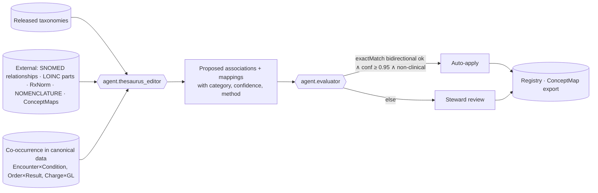

---
title: Stage 3 — Thesaurus
module: 02-ontology-pipeline
doc_id: ONT-04
version: 0.1.0
status: draft
owners: [Enterprise Taxonomist, Clinical Informatics, Terminology Stewards]
depends_on: [ONT-03, IOP-04]
last_updated: 2026-10-17---
# Stage 3 — Thesaurus

## 1. Purpose

Stage 3 enriches released taxonomies into a **thesaurus**: it adds **associative** relations (`skos:related`) between
concepts that are connected but not hierarchically, and **equivalence** relations (`skos:exactMatch`, `skos:closeMatch`,
`skos:broadMatch`, `skos:narrowMatch`, `skos:relatedMatch`) between concepts in *different* schemes or code systems.
It also produces **relation-type precursors**: an annotated list of the associative relations that occur often enough,
and with a consistent meaning, to deserve promotion to typed OWL object properties in Stage 4.

This is the stage where the enterprise learns that "Hemoglobin A1c" (LOINC 4548-4) *is a measurement relevant to*
"Type 2 diabetes mellitus" (SNOMED 44054006), that Cerner `CODE_SET 72 INPATIENT` *is equivalent to* HL7 `v3-ActCode
IMP`, and that Oracle Fusion natural account `4110 Inpatient Revenue` *is funded by* claim type `837I`. None of these
are hierarchy; all of them are needed before the ontology can give them formal semantics.

## 2. Relation types

### 2.1 Associative (`skos:related`)

`skos:related` is symmetric and MUST NOT be used where a hierarchical relation already exists (SKOS integrity
condition S27). HEALIX qualifies every associative relation with a **relation category** so that Stage 4 can promote it.
Categories (modelled as `healix:relationCategory` on a reified `healix:Association` node, since `skos:related` itself
cannot be annotated in plain RDF without RDF-star; RDF-star annotation is used in the KG):

| Category | Meaning | Healthcare examples (A `related` B) |
|----------|---------|-------------------------------------|
| `cause-effect` | A causes or results in B | Procedure *Coronary artery bypass* — Condition *Post-operative atrial fibrillation* |
| `process-agent` | A is performed by role B | Procedure *Medication administration* — Party role *Registered nurse* |
| `process-instrument` | A uses B | Procedure *MRI brain* — Asset category *MRI scanner* |
| `process-product` | A yields B | Order catalog *CBC with differential* — Lab test panel *CBC* |
| `object-property` | A is characterised by B | Encounter class *Inpatient* — Discharge disposition *Home health* |
| `measures` | A is a measurement for B | Lab test *HbA1c* — Condition *Type 2 diabetes* |
| `treats` | A is a therapy for B | Medication class *Statin* — Condition *Hyperlipidaemia* |
| `indicates` | A is an indication for B | Condition *Sepsis* — Order catalog *Blood culture* |
| `occurs-in` | A takes place in setting/location B | Encounter type *Emergency* — Location type *Emergency department* |
| `funded-by` / `bills-to` | A generates or is settled by B | Charge category *Room & board* — GL natural account *Inpatient revenue*; Claim type *837I* — Payer class *Medicare Part A* |
| `supplied-for` | Item A is consumed by procedure B | Item category *Orthopaedic implant* — Procedure category *Joint replacement* |
| `requires-credential` | Role A requires credential B | Position type *Staff pharmacist* — Licence type *State pharmacist licence* |
| `staffed-by` | Location/service A is staffed by job family B | Service line *Critical care* — Job family *Intensivist* |
| `reported-to` | A contributes to measure B | Observation category *Blood pressure* — Measure *CMS165 Controlling high BP* |
| `discipline-object` | A is the discipline for object B | Clinical domain *Oncology* — Condition category *Neoplasm* |
| `other` | Steward-explained | Requires `skos:editorialNote` |

### 2.2 Equivalence and mapping (`skos:*Match`)

Used **only across schemes or code systems** (SKOS S46: mapping properties are for different schemes). Mapping types
follow ISO 25964-2 (`=EQ` exact, `~EQ` inexact, `BM` broader, `NM` narrower, `RM` related):

| SKOS property | ISO 25964-2 | Use in HEALIX | Example |
|---------------|-------------|---------------|---------|
| `skos:exactMatch` | `=EQ` | Interchangeable for retrieval and translation; transitive | `encounter-class/inpatient` ↔ `v3-ActCode IMP`; Cerner `CODE_SET 72 INPATIENT` notation already on the concept |
| `skos:closeMatch` | `~EQ` | Near-equivalent, usable in some contexts; not transitive | `admit-source/transfer-from-snf` ↔ `v2-0023 5` (transfer from SNF or ICF) |
| `skos:broadMatch` | `BM` | Target is broader | `lab-test/hba1c-poc` → LOINC 4548-4 (HbA1c in blood) when the local test is a point-of-care variant |
| `skos:narrowMatch` | `NM` | Target is narrower | Oracle `INVOICE_TYPE STANDARD` → HEALIX `ap-invoice-type/vendor-invoice` → narrower local subtypes |
| `skos:relatedMatch` | `RM` | Associatively related across schemes | `gl-natural-account/4110` ↔ `charge-category/room-and-board` |

Every mapping carries, on a reified `healix:Mapping` node (ISO 25964-2 mapping record, also exported as FHIR
`ConceptMap.group.element.target`):

| Attribute | Rule |
|-----------|------|
| `healix:source`, `healix:target` | concept IRIs; target may be external |
| `healix:mappingType` | one of the five above |
| `healix:confidence` | 0.00–1.00; agent-derived; human-confirmed mappings get 1.00 |
| `healix:method` | `lexical`, `nomenclature-evidence` (Cerner `NOMENCLATURE`), `ts-translate` (`$translate` via existing ConceptMaps), `embedding`, `steward` |
| `healix:direction` | `bidirectional` (exact) or `source-to-target` |
| `healix:comment` | FHIR `ConceptMap.element.target.comment` |
| `healix:verifiedBy`, `prov:wasGeneratedBy` | steward IRI; CR activity |
| `healix:codeSystemVersion` | pinned external version |

Rules: `exactMatch` MUST be validated in both directions (A→B and B→A resolve to the same pair) and MUST NOT form
`exactMatch` chains that imply equivalence between two concepts of the *same* scheme (that would be a Stage 1
duplicate). `closeMatch` MUST NOT be used as a stand-in for an unresolved `exactMatch`; "we are not sure" is recorded
as low `confidence` on a `pending` mapping, not as `closeMatch`.

## 3. Cross-scheme mapping programme

The thesaurus stage produces the mapping sets that modules 06 (Terminology Service `$translate`) and 09 (DQ
validity rules) consume:

| Mapping set | From | To | Primary method | Owner |
|-------------|------|----|----------------|-------|
| Cerner encounter codes | `CODE_SET 71/72/4/19` schemes | HL7 `v3-ActCode`, `v2-0004`, `v2-0023`, `v2-0112` | lexical + `CDF_MEANING` + steward | Clinical informatics |
| Cerner event codes → LOINC | `CODE_SET 72`-independent `CLINICAL_EVENT.EVENT_CD` (`CODE_SET 4002`) scheme | LOINC | `NOMENCLATURE` evidence + lexical + unit agreement (UCUM) | Laboratory steward |
| Cerner diagnosis/problem → SNOMED CT / ICD-10-CM | `NOMENCLATURE` with `SOURCE_VOCABULARY_CD` | SNOMED CT, ICD-10-CM | `nomenclature-evidence`, `ts-translate` (SNOMED→ICD map) | Clinical informatics / HIM |
| Cerner order catalog → CPT/HCPCS/LOINC | `order-catalog` (`CODE_SET 200`) | CPT, HCPCS, LOINC | lexical + charge master cross-walk | Revenue integrity |
| Cerner medication (Multum) → RxNorm/NDC | `medication` scheme | RxNorm, NDC | `ts-translate` via RxNorm API mappings | Pharmacy |
| Cerner charge codes → GL | `charge-category` | `gl-natural-account` (Oracle COA) | steward (charge-master to GL cross-walk) | Finance |
| Oracle lookups → HEALIX | `ofusion/lookup/*` | HEALIX enterprise schemes | lexical + steward | Finance / HR / Supply stewards |
| Oracle item categories → UNSPSC / GS1 | `item-category` | UNSPSC, GPC | lexical + supplier catalogue | Supply chain |
| Oracle HCM jobs → NUCC / SOC | `job-family`, `position-type` | NUCC taxonomy, SOC | lexical + credentialing data | HR / Medical staff office |
| X12 CARC/RARC → HEALIX adjustment reasons | X12 code sets | `adjustment-reason` | lexical | Revenue cycle |
| Peripheral local codes → LOINC/SNOMED/NDC | LIS, RIS, pharmacy local schemes | LOINC, SNOMED, NDC | as above | Department stewards |

## 4. Relation-type precursors

A precursor is a report, regenerated each release, listing every `healix:relationCategory` with: count of
associations, participating schemes (domain/range candidates), consistency score (share of associations where the
pair's taxonomy roots match the modal roots), and the suggested OWL property name. Promotion criteria for Stage 4:

| Criterion | Threshold |
|-----------|-----------|
| Occurrences | ≥ 10 associations in released schemes |
| Domain/range consistency | ≥ 90 % of pairs have source in one FHIR-family root and target in one root |
| Stability | Unchanged category meaning across ≥ 2 consecutive releases |
| Steward endorsement | Lead Ontologist marks `promote: true` in the CR |

Categories meeting the threshold appear in `05-ontology.md` as object properties (e.g. `measures` →
`healix:isMeasurementOf`; `treats` → `healix:treats`; `funded-by` → `healix:postsToAccount`; `requires-credential` →
`healix:requiresCredential`). Categories below threshold remain `skos:related` only.

## 5. Agent behaviour

`agent.thesaurus_editor` (L2):

1. Derives candidate `skos:related` from (a) SNOMED CT defining relationships of mapped concepts (e.g. `363702006
   Has focus`, `405813007 Procedure site`, `47429007 Associated with`), (b) LOINC parts (component, system, method),
   (c) RxNorm ingredient/dose-form relations, (d) **de-identified co-occurrence statistics** from `hc.canonical.*`
   (e.g. order codes that co-occur with a diagnosis in ≥ 5 % of encounters with that diagnosis, minimum count 50) —
   never from record-level PHI, (e) steward glossaries.
2. Derives candidate mappings from Cerner `NOMENCLATURE`/`NOMEN_CONCEPT`, TS `$translate` over published ConceptMaps
   (SNOMED→ICD-10-CM, RxNorm↔NDC), lexical matching of normalised labels, and embedding similarity with a hard
   requirement that units (UCUM) agree for measurement concepts.
3. Checks SKOS integrity (S27: no `related` where `broaderTransitive` holds; S46: mapping properties only
   cross-scheme), bidirectionality for `exactMatch`, and the §2.2 rules.
4. Emits `CR-THS-RELATED`, `CR-THS-MAP`, `CR-THS-RETIRE` change requests. Clinical mappings (SNOMED, LOINC, RxNorm,
   ICD, CPT) are **never** auto-applied; operational and finance lookups may be auto-applied at confidence ≥ 0.95.

## 6. Requirements

| ID | Priority | Verification | Requirement |
|----|----------|--------------|-------------|
| **ONT-THS-001** | P0 | test | No pair of concepts MAY be linked by both `skos:related` and `skos:broaderTransitive`/`skos:narrowerTransitive` (SKOS S27). |
| **ONT-THS-002** | P0 | test | `skos:related` MUST be materialised symmetrically, and every association MUST carry exactly one `healix:relationCategory`. |
| **ONT-THS-003** | P0 | test | SKOS mapping properties (`exactMatch`, `closeMatch`, `broadMatch`, `narrowMatch`, `relatedMatch`) MUST only link concepts in different concept schemes or external code systems (SKOS S46). |
| **ONT-THS-004** | P0 | test | Every `skos:exactMatch` MUST validate bidirectionally and MUST NOT, via `exactMatch` chains, imply equivalence of two concepts within one scheme. |
| **ONT-THS-005** | P0 | test | Every mapping MUST have a `healix:Mapping` record with `mappingType`, `confidence`, `method`, `codeSystemVersion` and `prov:wasGeneratedBy`. |
| **ONT-THS-006** | P0 | inspection | Mappings to SNOMED CT, LOINC, RxNorm, ICD-10-CM/PCS, CPT and HCPCS MUST NOT be auto-applied; they MUST be approved by the designated clinical, pharmacy or HIM steward. |
| **ONT-THS-007** | P0 | test | Co-occurrence-derived association candidates MUST be computed from aggregate counts with a minimum cell size of 50 and MUST NOT retain record-level identifiers in the evidence trail. |
| **ONT-THS-008** | P1 | test | Every mapping set in §3 MUST be exportable as a FHIR R4 `ConceptMap` whose `equivalence` codes correspond to the SKOS mapping type (`equivalent`, `wider`, `narrower`, `inexact`, `relatedto`). |
| **ONT-THS-009** | P1 | test | Measurement-concept mappings (LOINC, vital signs) MUST fail validation when the HEALIX concept's UCUM unit is incompatible with the target's example units/property. |
| **ONT-THS-010** | P1 | analysis | The relation-type precursor report MUST be regenerated on every release and MUST list each category's occurrence count, domain/range consistency and promotion recommendation. |
| **ONT-THS-011** | P2 | test | A `closeMatch` SHOULD carry a `healix:comment` explaining the inexactness; `closeMatch` records lacking a comment for more than one release MUST be flagged for review. |

## 7. Exit criteria

The thesaurus layer for a group is `released` when ONT-THS-001..007 hold, every mapping set in §3 that the group owns
has steward sign-off, the ConceptMap export round-trips, and the precursor report has been reviewed by the Lead
Ontologist. Stage 4 promotes only relation categories marked `promote: true`.
