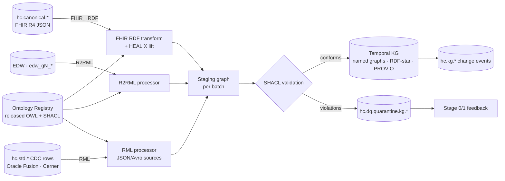

---
title: Stage 5 — Knowledge Graph Instantiation
module: 02-ontology-pipeline
doc_id: ONT-06
version: 0.1.0
status: draft
owners: [KG Product Owner, Enterprise Ontology Team, Data Platform]
depends_on: [ONT-05, TKG-01, STR-02, IOP-01, EDW-00]
last_updated: 2026-10-17---
# Stage 5 — Knowledge Graph Instantiation

## 1. Purpose

Stage 5 populates the **temporal knowledge graph** with instances that conform to the released ontology and SHACL
shapes. It defines *how* data becomes triples — the mapping technologies, the IRI policy for instances, the named-graph
layout and the provenance envelope — and leaves the *temporal semantics* (valid time, transaction time, RDF-star
annotation, as-of queries) to module 08 (`08-temporal-knowledge-graph/01-temporal-model.md`), which this document
references and does not redefine.

Stage 5 is the point where the Ontology Pipeline's earlier rigour pays off: a record that cannot be typed against a
class, coded against a released scheme or validated by a shape does not enter the graph; it is quarantined and fed back
to Stage 0/1 as evidence.

## 2. Instantiation paths

| Path | Source | Technology | Used for | Owner |
|------|--------|------------|----------|-------|
| **A. FHIR→RDF** | `hc.canonical.<domain>.<resource>.fhir.v1` | HL7 FHIR RDF (R4 Turtle rendering, `fhir:` vocabulary) followed by a **HEALIX lift** (SPARQL CONSTRUCT / SHACL-AF rules) that asserts `healix:` classes, roles, coded values and cross-resource properties | All clinical (G2), party (G1), and FHIR-fitting finance/supply/workforce resources; primary streaming path | `agent.kg_builder` |
| **B. R2RML** | EDW tables (`dim_*`, `fact_*`, `bridge_*`) | W3C R2RML mappings generated from `healix:edwBinding` annotations | Historical back-load; nightly reconciliation (ADR-07); aggregates (G6 measures, budgets) | `agent.kg_builder` with `agent.schema_architect` |
| **C. RML** | `hc.std.*` CDC and BICC records (Avro/JSON) that have no FHIR canonical form | RML (JSON/CSV logical sources) with the same term maps as R2RML | Oracle Fusion GL journals, PO lines, positions (HEALIX-ERP extension model) when the canonical FHIR-style profile is not yet released; metadata (G9) | `agent.kg_builder` |
| **D. Registry sync** | Ontology Registry releases | Direct load of SKOS/OWL/SHACL releases into `<base>graph/ontology/<versionIRI>` | Schema/vocabulary graphs | `agent.release_manager` |

Rules of precedence: if a FHIR canonical form exists for an entity, path A is authoritative and paths B/C MAY only add
properties not present in FHIR (e.g. GL posting on a ChargeItem). The same business key MUST resolve to the same
instance IRI on all paths (§3), which is what makes the dual projection (KG + EDW) reconcilable.

## 3. Identity and IRIs for instances

Instance IRIs are **opaque, stable and derived from governed business keys**, never from source surrogate keys that
differ per environment or replica.

| Class family | IRI template | Business key rule |
|--------------|--------------|-------------------|
| Person / roles | `<base>id/person/{ulid}`; roles `<base>id/patient-role/{ulid}` | Enterprise Person ID issued by entity resolution (module 08 §ER) after matching MRN, Oracle HCM Person Number, NPI, demographics; Cerner `PERSON_ID` and MRN become `healix:Identifier` instances, not IRIs |
| Encounter | `<base>id/encounter/{source_id}/{encounter_bk}` | `encounter_bk` = Cerner FIN (`ENCNTR_ALIAS` type FIN) or FHIR `Encounter.identifier` with system `urn:oid:<org FIN OID>`; `source_id` distinguishes facilities when FIN is not globally unique |
| Clinical events | `<base>id/{resource-slug}/{source_id}/{bk}` | FHIR `Resource.identifier` (Cerner `EVENT_ID`, `ORDER_ID`), hashed with SHA-256 when source identifiers are PHI-bearing accession numbers |
| Finance | `<base>id/gl-journal/{ledger_id}/{je_header_id}`; `<base>id/claim/{clearinghouse}/{icn}` | Oracle Fusion `JE_HEADER_ID`+`LEDGER_ID` are stable business keys in Fusion; claim uses payer ICN or clearinghouse control number |
| Supply | `<base>id/item/{item_number}`; `<base>id/po/{po_number}`; `<base>id/po-line/{po_number}/{line}` | Fusion `ITEM_NUMBER`, `SEGMENT1` (PO number) |
| Workforce | `<base>id/worker/{person_number}`; `<base>id/position/{position_code}` | Fusion HCM `PERSON_NUMBER`, `POSITION_CODE` |
| Organization / Location | `<base>id/organization/{org_bk}`; `<base>id/location/{location_bk}` | Conformed dimension keys from module 05 (NPI/EIN for external orgs; Fusion `ORGANIZATION_ID`/Cerner `LOCATION_CD` cross-walked by the taxonomy) |
| Coded values | `<base>id/code/{codesystem-slug}/{version}/{code}` | Deterministic; shared across all instances |
| Identifiers | Blank-node-free: `<base>id/identifier/{sha256(system|value)}` | Allows uniqueness checks without exposing the value in the IRI |

Rules:

- IRIs MUST NOT embed direct identifiers in clear text (MRN, SSN, DOB, name). Where a business key is a direct
  identifier the IRI uses a keyed hash (HMAC-SHA-256 with a KMS key per environment).
- Entity resolution merges produce `owl:sameAs` only within the ER graph (module 08); the canonical IRI survives, the
  merged IRI is retained with `healix:mergedInto` for audit, never deleted.
- Every instance MUST have `rdf:type` to exactly one most-specific `healix:` class per path and MAY have `fhir:` type
  from path A.

## 4. Named graphs

Named graphs follow CONVENTIONS §3: `<base>graph/<source>/<yyyy-mm-dd>/<batch-ulid>`. Stage 5 adds a *layer* prefix
so consumers can select by purpose:

| Graph | Template | Content |
|-------|----------|---------|
| Ontology | `<base>graph/ontology/{versionIRI-slug}` | Released OWL + SKOS + SHACL (read-only) |
| Instance batch | `<base>graph/instance/{source_id}/{yyyy-mm-dd}/{batch-ulid}` | Asserted triples from one batch of one source (A/B/C paths) |
| Inferred | `<base>graph/inferred/{yyyy-mm-dd}/{batch-ulid}` | ELK/forward-chaining materialisation for the batch; regenerable |
| Entity resolution | `<base>graph/er/{yyyy-mm-dd}/{batch-ulid}` | `owl:sameAs`, `healix:mergedInto`, match evidence |
| Provenance | `<base>graph/prov/{yyyy-mm-dd}/{batch-ulid}` | PROV-O bundle for the batch (§5) |
| DQ | `<base>graph/dq/{yyyy-mm-dd}/{batch-ulid}` | SHACL validation reports (`sh:ValidationReport`) linked to instances |
| Governance | `<base>graph/governance/{artefact}/{yyyy-mm-dd}/{batch-ulid}` | Source Registry, catalogue, CRs |

Bitemporal annotation (valid time, transaction time, supersession) is applied per the module 08 RDF-star model to
assertions *inside* instance graphs; the named graph itself records the transaction batch. This document does not
specify the annotation vocabulary — see `TKG-TIME-*`.

## 5. Provenance (PROV-O)

Every batch produces a PROV-O bundle. Minimum content:

| PROV element | HEALIX usage |
|--------------|--------------|
| `prov:Activity` | One per batch: `healix:KGLoadActivity ⊑ prov:Activity ⊑ healix:LineageActivity`; `prov:startedAtTime/endedAtTime`; `healix:path` (A/B/C/D); `healix:mappingVersion` (RML/R2RML Git SHA); `healix:ontologyVersion` (versionIRI); `healix:shapesVersion` |
| `prov:Entity` (source) | The Kafka record(s) or EDW partition consumed: `healix:kafkaTopic`, `healix:partition`, `healix:offsetStart/End`, `hc-event-time`, `hc-source-time`; EDW: table + `load_batch_id` |
| `prov:Entity` (output) | The instance named graph |
| `prov:used`, `prov:wasGeneratedBy`, `prov:wasDerivedFrom` | Output graph `wasGeneratedBy` activity; `used` source entities; each instance `wasDerivedFrom` its source record entity |
| `prov:Agent` | `agent.kg_builder` (`prov:SoftwareAgent`) with model/version; `prov:actedOnBehalfOf` the KG Product Owner |
| `prov:wasInvalidatedBy` | Set on superseded assertions (coordinated with transaction-time supersession in module 08) |
| OpenLineage bridge | The same activity is emitted as an OpenLineage `RunEvent` (module 11 lineage API) with the PROV activity IRI as `run.facets.healix.provActivity` |

Every assertion in the KG MUST be traceable to a `prov:Activity` IRI (`prov_activity_iri` in CONVENTIONS §4); the DQ
engine refuses records whose provenance bundle is missing.

## 6. Mapping generation by `agent.kg_builder`

1. **Read** the released ontology (`healix:fhirResource`, `healix:fhirPath`, `healix:edwBinding` annotations) and
   SHACL shapes from the registry at a pinned `versionIRI`.
2. **Generate** (a) the HEALIX lift rules for each FHIR resource: a SPARQL CONSTRUCT template per class mapping
   `fhir:` paths to `healix:` properties and resolving `fhir:Coding` to `<base>id/code/...` IRIs via the Terminology
   Service `$lookup`; (b) R2RML `TriplesMap`s per EDW table from `edwBinding`; (c) RML for `hc.std.*` records lacking
   canonical form. Mappings are committed to Git (`kg/mappings/<module>/<versionIRI>/`) and are themselves registered
   as `prov:Plan`s.
3. **Test** each mapping against fixture records (golden FHIR bundles per profile from module 06; sample EDW rows)
   and the SHACL shapes; a mapping that produces any `sh:Violation` on fixtures is rejected.
4. **Deploy** as Flink jobs (path A, streaming) and scheduled R2RML/RML batch jobs (paths B/C), publishing
   `hc.kg.<domain>.<entity>.rdf.v1` change events (N-Quads payload, Schema Registry `FULL` compatibility).
5. **Reconcile** nightly: count and checksum business keys per class in KG vs EDW (`ADR-07`); publish the variance
   to `hc.ops.kg.reconciliation.v1` and open a CR when variance exceeds 0.1 %.

Autonomy: L3 — the agent deploys mapping changes that pass fixtures and SHACL without human approval, except when the
ontology version changes major (`vYYYY.MM.0` with breaking diff) or when a mapping touches PHI-classified elements
(`agent.privacy_guardian` review).

## 7. Validation at load

| Check | Mechanism | Failure action |
|-------|-----------|----------------|
| Typing | Every subject has `rdf:type` to a released `healix:` class | Quarantine record |
| Shape conformance | SHACL (shapes at pinned version) on the staging graph | `sh:Violation` → quarantine; `sh:Warning` → load + DQ result; `sh:Info` → load |
| Code membership | `healix:concept` resolves in registry at `codeSystemVersion`; unknown code | Load with `healix:unresolvedCode` + CR `CR-CV-ADD` to Stage 1 |
| IRI policy | Regex and hash checks on minted IRIs; no clear-text identifiers | Reject batch |
| Provenance | PROV bundle complete (§5) | Reject batch |
| Temporal | Module 08 checks (valid-time interval well-formed, transaction time ≤ now) | Reject assertion |
| Reconciliation | KG vs EDW business-key parity | CR to `agent.schema_architect`/`agent.kg_builder` |

## 8. Requirements

| ID | Priority | Verification | Requirement |
|----|----------|--------------|-------------|
| **ONT-KG-001** | P0 | test | No triple MAY be loaded into an instance graph unless its subject is typed to a class of a released ontology version and the staging batch passes SHACL with zero `sh:Violation`. |
| **ONT-KG-002** | P0 | test | Instance IRIs MUST follow the §3 templates and MUST NOT contain clear-text direct identifiers; keyed hashing MUST use an environment-specific KMS key. |
| **ONT-KG-003** | P0 | test | The same business key MUST yield the same instance IRI on the FHIR→RDF, R2RML and RML paths; the nightly reconciliation MUST show ≥ 99.9 % parity of business keys between KG and EDW per class. |
| **ONT-KG-004** | P0 | test | Every batch MUST produce a PROV-O bundle with the §5 minimum content, and every asserted triple MUST be traceable to the batch `prov:Activity` IRI. |
| **ONT-KG-005** | P0 | test | Named graphs MUST follow the §4 templates; ontology graphs MUST be read-only to all agents except `agent.release_manager`. |
| **ONT-KG-006** | P0 | inspection | Bitemporal annotation of assertions MUST follow module 08 (`TKG-TIME-*`); this module MUST NOT introduce an alternative temporal vocabulary. |
| **ONT-KG-007** | P0 | test | FHIR `Coding` values MUST be resolved to `<base>id/code/...` IRIs via the Terminology Service; an unresolvable code MUST be loaded with `healix:unresolvedCode` and MUST open a `CR-CV-ADD` change request within one cycle. |
| **ONT-KG-008** | P1 | test | R2RML mappings MUST be generated from `healix:edwBinding` annotations and MUST be regenerated and re-tested on every ontology or EDW DDL release. |
| **ONT-KG-009** | P1 | test | The HEALIX lift from FHIR RDF MUST preserve the original `fhir:` triples alongside `healix:` assertions so that FHIR-native SPARQL remains possible. |
| **ONT-KG-010** | P1 | test | Mapping artefacts (lift rules, R2RML, RML) MUST be versioned in Git, registered as `prov:Plan`, and referenced from every load activity by commit SHA. |
| **ONT-KG-011** | P1 | test | Path A streaming load MUST sustain the platform throughput target (ARC-NFR-002) with p95 canonical→KG latency ≤ 60 s. |
| **ONT-KG-012** | P1 | test | Entity-resolution merges MUST retain the merged IRI with `healix:mergedInto` and MUST NOT delete or rewrite historical assertions. |
| **ONT-KG-013** | P2 | demo | `hc.kg.*` change events SHOULD allow a downstream consumer to rebuild any instance graph from Kafka alone within the retention window. |

## 9. Exit criteria

Stage 5 is `released` for a group when ONT-KG-001..007 pass on a 24-hour production-shaped sample, SHACL conformance
is ≥ 99.5 % (violations quarantined, not dropped), reconciliation parity meets ONT-KG-003, and module 08 confirms
temporal checks. The feedback loop to Stage 0/1 (`unresolvedCode`, quarantine evidence) MUST be demonstrably active.
