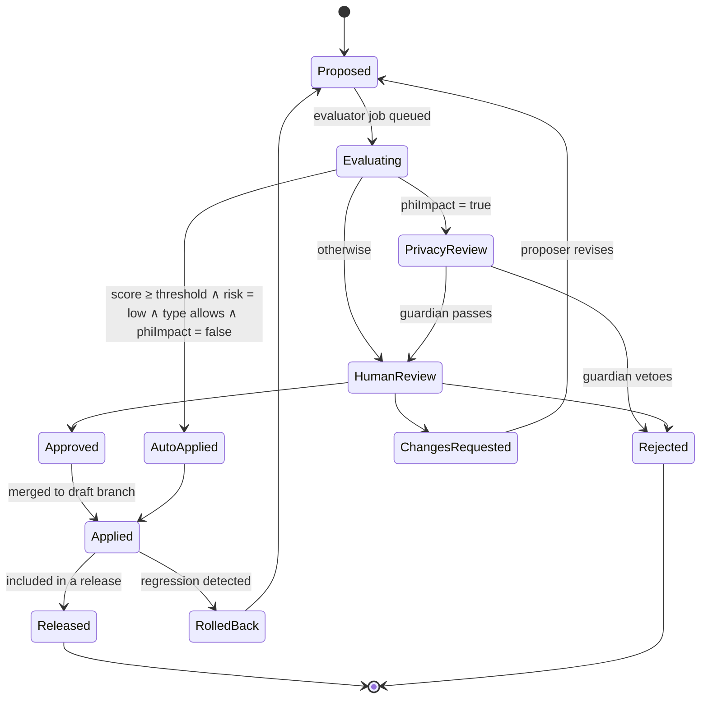

# Ontology Governance, Registry API and Versioning

## 1. Purpose

This document is the cross-module contract named in ARC-01 §6 ("Ontology Registry API"). It specifies the registry
service that stores and serves every Stage 1–4 artefact, the typed change requests through which agents and people
alter those artefacts, the review workflow and autonomy levels, release cadence and version IRIs, the deprecation
policy, and the quality metrics that gate releases.

## 2. Ontology Registry API

### 2.1 Principles

- **Git is the source of truth; the registry is the serving layer.** Every release is a signed Git tag; the registry
  loads tags into a triple store and exposes them. Writes go through change requests, never direct SPARQL UPDATE.
- **Versioned reads everywhere.** Every read accepts `version=<versionIRI>` or `asOf=<ISO timestamp>`; omitting both
  returns the latest `released` version.
- **Content negotiation.** `application/ld+json` (default), `text/turtle`, `application/rdf+xml`, `application/fhir+json`
  (for scheme/mapping projections as `CodeSystem`/`ValueSet`/`ConceptMap`).
- **Access control.** Reads of released artefacts are open to all authenticated platform principals; draft artefacts
  and licensed bindings (SNOMED CT, CPT) are filtered per module 11 policy and the caller's licence claims.

### 2.2 Endpoints (base path `/registry/v1`)

| Method & path | Purpose | Key parameters | Response |
|---------------|---------|----------------|----------|
| `GET /schemes` | List concept schemes | `group`, `status` (`draft|review|released|deprecated`), `stage`, `q`, `page` | Array of scheme summaries: IRI, title, group, steward, version, counts (concepts, bound, local-only), `dcterms:modified` |
| `GET /schemes/{slug}` | Scheme detail incl. top concepts | `version`, `asOf`, `depth` | Scheme + top concepts; `Link` headers to FHIR `CodeSystem` projection |
| `GET /schemes/{slug}/concepts` | Concepts in scheme | `facet`, `broader=<iri>`, `bindingStatus`, `includeDeprecated` | Paged concept summaries |
| `GET /concepts/{iri}` | Full concept | `version`, `asOf`, `expand=mappings,related,evidence` | SKOS concept with labels, definition, notations, broader/narrower, related, mappings, binding status, evidence, change history |
| `GET /concepts/resolve` | Code → concept | `system` (code-system IRI or FHIR system URL), `code`, `version` | Concept IRI(s) with mapping type; 404 with `CR-CV-ADD` hint if unknown |
| `GET /concepts/search` | Label search | `q`, `scheme`, `group`, `lang`, `fuzzy` | Ranked matches over pref/alt/hidden labels |
| `GET /ontologies` | List OWL modules | `profile`, `status` | Module IRIs, versionIRI, profile, reasoner status, class/property counts |
| `GET /ontologies/{module}` | OWL module | `version`, `closure=true` (include imports) | OWL document in requested serialisation |
| `GET /ontologies/{module}/classes/{localName}` | Class card | `version` | Class with axioms, annotations, `edwBinding`, `fhirResource`, derived shapes, CQs touching it |
| `GET /shapes/{shapeGraph}` | SHACL shape graph | `version`, `severity` | Shapes graph; `Link` to derived `DQR-*` rule IDs |
| `GET /mappings` | Mapping sets | `sourceScheme`, `targetSystem`, `mappingType`, `minConfidence` | `healix:Mapping` records; `Accept: application/fhir+json` → `ConceptMap` |
| `POST /change-requests` | Propose change | Body = typed CR (§3), JSON | `201` with CR IRI, computed risk class, evaluator job id |
| `GET /change-requests/{id}` | CR status | — | CR, evaluator report, reviewers, decision, applied version |
| `POST /change-requests/{id}/decision` | Approve / reject / request-changes | `decision`, `comment`, reviewer identity (OIDC) | Updated CR |
| `GET /diff` | Diff two versions | `from`, `to` (versionIRIs), `scope` (`scheme|module|shapes|all`), `format` (`json|markdown|turtle`) | Added/removed/changed axioms, concepts, labels, mappings; breaking-change flags |
| `POST /releases` | Cut a release | Body: `scope`, `versionIRI`, `notes`; caller MUST be `agent.release_manager` or Board member | Release record; triggers Git tag, signing, store load, TS sync, registry release event (see below) |
| `GET /releases` | List releases | `scope`, `since` | Release records with changelog links |
| `GET /metrics` | Quality metrics (§7) | `scope`, `version` | Metric values and thresholds |
| `GET /health`, `GET /openapi.json` | Operational | — | — |

Registry events: every applied CR is published as a CR lifecycle event on `hc.ops.agent.changerequest.v1` (the module 07
catalog topic for typed change requests), and every release on `hc.ops.registry.release.v1` (module 07 catalog §6.6: compacted,
keyed by version IRI, Avro, Schema Registry `FULL` compatibility) so modules 05, 06, 08 and 09 can react (regenerate R2RML, re-sync the Terminology Service, re-derive DQ
rules).

## 3. Change request types

A change request (CR) is the only write path. CRs conform to the module 10 Change Request schema
(`10-agentic-pipeline/03-orchestration-and-workflows.md`) and add the ontology-specific `type` and `payload`.

| Type | Stage | Payload (summary) | Default risk | Auto-apply allowed? |
|------|-------|-------------------|--------------|---------------------|
| `CR-INVENTORY-REGISTER` | 0 | Source Registry record | low | yes (`agent.inventory`, L3) |
| `CR-INVENTORY-DRIFT` | 0 | Element delta, profile delta | medium | no |
| `CR-CV-ADD` | 1 | New concept(s) with labels, definition, notations, evidence | low if scheme exists and binding conf ≥ 0.9 | yes |
| `CR-CV-BIND` | 1 | Binding to external concept, TS validation result | low (non-clinical) / high (SNOMED, LOINC, RxNorm, ICD, CPT, HCPCS) | non-clinical only |
| `CR-CV-RELABEL` | 1 | Pref/alt label change | medium (prefLabel) / low (alt/hidden) | alt/hidden only |
| `CR-CV-MERGE`, `CR-CV-SPLIT` | 1 | Concept merge/split with redirect map | high | no |
| `CR-CV-DEPRECATE` | 1 | Deprecation with replacement | medium | no |
| `CR-CV-NEW-SCHEME` | 1 | New concept scheme | high | no |
| `CR-TAX-ADD-BROADER` | 2 | New `broader` edge + justification | low (leaf, non-G2) / medium | leaf non-G2 only |
| `CR-TAX-MOVE`, `CR-TAX-SPLIT`, `CR-TAX-FACET` | 2 | Re-parenting, scheme split, facet definition | high | no |
| `CR-THS-RELATED` | 3 | Association with category and evidence | low (non-clinical) / medium | non-clinical only |
| `CR-THS-MAP` | 3 | Mapping record | low (lookups) / high (clinical) | lookups only |
| `CR-THS-RETIRE` | 3 | Retire relation/mapping | medium | no |
| `CR-OWL-CLASS`, `CR-OWL-PROPERTY`, `CR-OWL-AXIOM` | 4 | OWL change set (OWL functional syntax diff) + reasoner report | high | never (L1) |
| `CR-SHACL-SHAPE` | 4 | Shape addition/tightening (steward-authored) | high | never |
| `CR-KG-MAPPING` | 5 | RML/R2RML/lift change + fixture results | low / medium (PHI) | yes unless PHI or major ontology bump |
| `CR-RELEASE` | — | Release manifest | per diff: low (patch) / medium (minor) / high (major) | patch only |

Every CR carries: `id`, `type`, `proposer` (agent or person IRI), `stage`, `group(s)`, `payload`, `evidence[]`,
`riskClass` (computed, may be raised by `agent.privacy_guardian`, never lowered by the proposer), `phiImpact`
(boolean, computed from element PHI classes touched), `dependsOn[]` (other CR ids), `targetVersion`.

## 4. Review workflow and autonomy

| Autonomy level | Who | What it means here |
|----------------|-----|--------------------|
| L1 propose only | `agent.ontologist`, `agent.schema_architect` | Every CR goes to HumanReview; evaluator report attached |
| L2 propose, auto-apply low risk | `agent.vocabulary_curator`, `agent.taxonomist`, `agent.thesaurus_editor`, `agent.release_manager` (patch releases) | AutoApplied path when evaluator score ≥ threshold (initially 0.90, tuned per module 10 acceptance), risk = low, type permits, `phiImpact = false` |
| L3 act within policy | `agent.inventory`, `agent.kg_builder` | Applies within type table; reports; drift and PHI cases escalate |
| L4 veto | `agent.privacy_guardian` | May reject any CR or raise its risk class; cannot approve |

Human reviewers by stage: Stage 1 — group terminology steward; Stage 2/3 — Enterprise Taxonomist (+ clinical
informaticist for G2); Stage 4 — Lead Ontologist (+ privacy guardian when PHI-touching); releases — Ontology
Governance Board (quorum of three: Lead Ontologist, one clinical steward, one finance/operations steward).

Evaluator rubric (module 10) for this module scores: integrity checks per stage (ONT-CV/TAX/THS/OWL blockers),
evidence sufficiency, label/definition quality, reasoner and SHACL results, CQ regression, and explanation quality.
Scores and human decisions are logged to compute evaluator–human agreement (VIS-00 §8), which drives threshold tuning
and autonomy promotion/demotion per module 10.

SLA: low-risk CRs complete within 1 h; human review queues target 5 business days; CRs older than 15 business days
are escalated to the Board.

## 5. Release cadence and version IRIs

| Scope | Cadence | Version pattern | Trigger |
|-------|---------|-----------------|---------|
| Concept schemes (Stage 1–3) | Monthly minor; patch on demand | `vYYYY.MM.N` | Steward sign-off; external code-system update (e.g. SNOMED US March/September, ICD-10-CM October 1, CPT January 1, LOINC Feb/Aug) |
| OWL modules + SHACL (Stage 4) | Quarterly minor; major only with Board approval | `vYYYY.MM.N` | CQ suite pass; reasoner pass; module 05/09 impact analysis accepted |
| Enterprise release (all) | Quarterly, aligned with OWL | `vYYYY.MM.N` | Board approval |
| Hotfix | On demand | patch `N+1` | Blocking defect (e.g. incorrect binding affecting DQ) |

Version IRI scheme:

- Ontology IRI (stable): `https://ontology.healix.example.org/ontology/g2-clinical`
- Version IRI: `https://ontology.healix.example.org/ontology/g2-clinical/v2026.11.0`
- Scheme version: `<base>scheme/encounter-class` with `owl:versionInfo "v2026.11.0"` and
  `owl:versionIRI <base>scheme/encounter-class/v2026.11.0`
- Every release also sets `dcterms:modified`, `owl:priorVersion`, `owl:backwardCompatibleWith` or
  `owl:incompatibleWith` (computed from diff), and a signed Git tag `ontology/v2026.11.0`.

Breaking change classification (drives `N` vs `MM` vs Board approval and `vN` bumps on topics/EDW):

| Breaking | Non-breaking |
|----------|--------------|
| Removing or deprecating a class/property/concept; narrowing a range; adding a `minCount`/tightening a shape; changing a `prefLabel` of a bound concept; changing `exactMatch` target; changing an instance IRI template | Adding a concept, class, property, altLabel, mapping, related relation, non-blocking shape (`sh:Warning`/`sh:Info`); loosening a shape; editorial notes |

Breaking releases MUST ship a **migration note** per affected consumer (05 DDL, 06 ConceptMap, 08 mapping, 09 rules)
and a redirect map (`healix:replacedBy`).

## 6. Deprecation policy

| Rule | Detail |
|------|--------|
| Never delete | Concepts, classes and properties are marked `owl:deprecated true` with `healix:deprecatedOn`, `healix:deprecationReason`, and `dcterms:isReplacedBy` / `healix:replacedBy` where a successor exists. IRIs remain resolvable forever. |
| Grace period | Deprecated artefacts remain in releases for ≥ 2 minor releases (≥ 6 months for OWL) before being moved to the `deprecated` graph; consumers see a `Deprecation` header on reads. |
| Historical data | Instances referencing deprecated codes remain valid; SHACL shapes accept deprecated concepts for records whose valid time precedes `deprecatedOn`, and flag (`sh:Warning`) later records. |
| Source-driven | Inactive Cerner `CODE_VALUE`s and end-dated Oracle lookups deprecate automatically via `CR-CV-DEPRECATE` raised by `agent.vocabulary_curator`; steward confirms replacement. |
| External version retirement | When a pinned external version is retired (e.g. an ICD-10-CM fiscal year), bindings are re-validated against the new version; unchanged codes keep their mapping record with updated `codeSystemVersion`; changed codes raise `CR-CV-BIND`. |

## 7. Quality metrics

Computed by `agent.evaluator` on every CR (delta) and every release (full); exposed at `GET /metrics` and on the
module 13 scorecard. Thresholds are release gates.

| Metric | Definition | Release threshold |
|--------|------------|-------------------|
| Element coverage | Data Element Catalog elements with `semantic_binding` ÷ active elements, per group | ≥ 95 % (G-01) |
| EDW attribute coverage | EDW columns bound to a property IRI ÷ EDW columns | ≥ 95 % |
| FHIR element coverage | Must-support elements of in-scope profiles bound to `healix:fhirPath` ÷ total | ≥ 98 % |
| Binding coverage | Concepts `bound` or approved `local-only` ÷ concepts, per scheme | ≥ 90 % (G2/G3/G5 schemes); ≥ 80 % others |
| Label completeness | Concepts/classes with prefLabel@en, definition@en, and (for coded) notation ÷ total | 100 % |
| Definition quality | Definitions ≥ 15 words, not label-equal, with cited source | ≥ 98 % |
| Hierarchy integrity | Cycles + orphans + facet crossings | 0 |
| Polyhierarchy ratio | Concepts with > 1 broader ÷ concepts | ≤ 15 % per scheme (report-only beyond) |
| Mapping confidence | Mean confidence of released mappings; share < 0.8 | mean ≥ 0.9; < 0.8 share ≤ 5 % |
| Logical consistency | HermiT + ELK consistent; unsatisfiable classes | consistent; 0 |
| Profile conformance | Modules within declared OWL 2 profile | 100 % |
| SHACL conformance (data) | Conforming canonical records ÷ records on 24 h sample | ≥ 99.5 % |
| CQ pass rate | Competency questions correct ÷ registered | ≥ 90 % |
| Evaluator–human agreement | Decisions where evaluator recommendation matched human decision | ≥ 85 % rolling 90 days (drives autonomy tuning) |
| Change velocity | CRs applied / proposed; median time-to-apply | reported |
| Rollback rate | Releases or auto-applied CRs rolled back ÷ total | ≤ 2 % |

## 8. Requirements

| ID | Priority | Verification | Requirement |
|----|----------|--------------|-------------|
| **ONT-GOV-001** | P0 | test | The registry MUST accept writes only through `POST /change-requests`; direct SPARQL UPDATE or file upload to released graphs MUST be disabled and audited. |
| **ONT-GOV-002** | P0 | test | Every read endpoint MUST accept `version` and `asOf` and MUST return the artefact state as of the requested release or timestamp. |
| **ONT-GOV-003** | P0 | test | Every CR MUST carry a computed `riskClass` and `phiImpact`; a CR with `phiImpact = true` MUST NOT be auto-applied and MUST be routed to `agent.privacy_guardian` before human review. |
| **ONT-GOV-004** | P0 | test | Auto-apply MUST occur only when evaluator score ≥ the configured threshold, `riskClass = low`, the CR type permits it (§3) and `phiImpact = false`; all four conditions MUST be logged with the decision. |
| **ONT-GOV-005** | P0 | test | `CR-OWL-*` and `CR-SHACL-SHAPE` MUST never be auto-applied and MUST record Lead Ontologist approval identity (OIDC subject) before application. |
| **ONT-GOV-006** | P0 | test | `GET /concepts/resolve` MUST answer in ≤ 50 ms p95 for cached released versions and MUST return a structured `CR-CV-ADD` hint for unknown codes. |
| **ONT-GOV-007** | P0 | inspection | Every applied CR MUST be published to `hc.ops.agent.changerequest.v1` and every release to the registry release topic `hc.ops.registry.release.v1` (see §2) with the diff reference and version IRI. |
| **ONT-GOV-008** | P1 | test | `GET /diff` MUST classify every change as breaking or non-breaking per §5 and MUST list affected consumers derived from `edwBinding`, `fhirPath`, derived shapes and DQ rule links. |
| **ONT-GOV-009** | P1 | test | Reads MUST filter SNOMED CT and CPT bindings for callers lacking the corresponding licence claim and MUST return `healix:bindingStatus = bound-licensed-hidden` in their place. |
| **ONT-GOV-010** | P1 | test | The registry MUST serve scheme and mapping projections as FHIR R4 `CodeSystem`, `ValueSet` and `ConceptMap` that validate against the FHIR R4 schema, and the Terminology Service (06) MUST be re-synced within 15 min of a release. |
| **ONT-GOV-011** | P1 | analysis | Evaluator–human agreement MUST be computed per CR type monthly; a type whose agreement falls below 85 % MUST have auto-apply disabled until re-approved by the Board. |
| **ONT-GOV-012** | P2 | demo | The registry SHOULD provide a reviewer UI showing CR payload, evidence, evaluator report, reasoner explanations and diff side by side. |
| **ONT-REL-001** | P0 | test | Every release MUST be a signed Git tag whose contents are byte-identical to the artefacts served for that `versionIRI`. |
| **ONT-REL-002** | P0 | test | Every released ontology module and scheme MUST carry `owl:versionIRI`, `owl:versionInfo`, `dcterms:modified`, `owl:priorVersion` and either `owl:backwardCompatibleWith` or `owl:incompatibleWith`. |
| **ONT-REL-003** | P0 | test | A release containing a breaking change MUST be a minor (`MM`) or Board-approved major and MUST include migration notes and a `healix:replacedBy` redirect map; patch releases MUST contain no breaking change. |
| **ONT-REL-004** | P0 | test | Deprecated concepts, classes and properties MUST remain resolvable with `owl:deprecated true` and MUST NOT be removed from the registry. |
| **ONT-REL-005** | P1 | test | All §7 release-gate metrics MUST meet their thresholds before `POST /releases` succeeds; the response MUST include the metric report. |
| **ONT-REL-006** | P1 | test | External code-system version updates (SNOMED US, ICD-10-CM, CPT, LOINC, RxNorm, HCPCS) MUST trigger re-validation of all bindings within 10 business days of availability and a scheme patch or minor release. |
| **ONT-REL-007** | P1 | test | Rollback of a release MUST be possible by re-pointing `latest` to `owl:priorVersion` without data loss, and MUST emit a release event with `rollback = true`. |
| **ONT-REL-008** | P2 | inspection | Release notes SHOULD be generated automatically from the diff, grouped by stage, group and consumer impact, and published alongside the release. |

## 9. Definition of done for this document

The registry is deployed in `test` with OpenAPI published, the §3 CR types registered in the module 10 CR schema,
the `encounter-class` skeleton scheme released as `v2026.11.0` through the full workflow, and metrics in §7
computed for that release.
