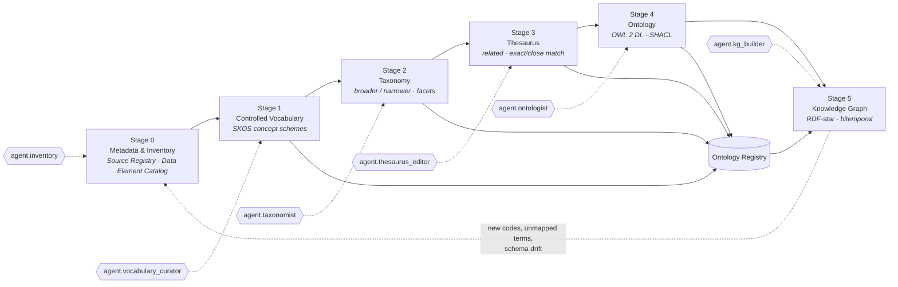

# Module 02 — Ontology Pipeline

## 1. Scope

This module specifies how the HEALIX platform builds, validates, publishes and governs the **enterprise healthcare
ontology** by walking the six stages of the *Ontology Pipeline* (Talisman): **metadata inventory → controlled
vocabulary → taxonomy → thesaurus → ontology → knowledge graph**. Each stage is a governed product with its own
artefacts, owner, agent, exit criteria and release cadence. Later stages consume only the *released* output of
earlier stages; nothing is promoted out of order.

In scope:

- The semantic artefacts for all nine subject-area groups G1–G9 (ARC-01 §4): SKOS concept schemes, taxonomies,
  thesaurus relations, OWL 2 DL modules, SHACL shapes, and the instantiation contracts for the knowledge graph.
- Binding local Cerner Millennium, Oracle Fusion and peripheral codes to external code systems (SNOMED CT, LOINC,
  ICD-10-CM/PCS, CPT, HCPCS, RxNorm, NDC, CVX, UCUM, NUCC, NPI, X12).
- The **Ontology Registry API** consumed by modules 05, 06, 08, 09 and 10.
- The behaviour, inputs and outputs of the Stage 0–5 agents: `agent.inventory`, `agent.vocabulary_curator`,
  `agent.taxonomist`, `agent.thesaurus_editor`, `agent.ontologist`, `agent.kg_builder`, plus `agent.release_manager`
  for publication.

Out of scope (owned elsewhere): source extraction mechanics (03), FHIR profile authoring and the Terminology Service
runtime (06), the bitemporal graph model and store (08), DQ rule execution (09), agent runtime and change-request
schema (10), PHI policy (11).

## 2. The six stages

Feedback is deliberate: instances that fail SHACL or arrive with unknown codes re-enter the pipeline as Stage 0/1
observations, never as ad-hoc edits to later stages.

## 3. Stage summary

| Stage | Document | Primary input | Primary output | Human owner | Agent | Autonomy |
|-------|----------|---------------|----------------|-------------|-------|----------|
| 0 Metadata & Inventory | [01-metadata-and-inventory.md](01-metadata-and-inventory.md) | Source schemas (Cerner Oracle tables, HL7 v2 conformance profiles, Millennium FHIR capability statement, Oracle Fusion BICC view objects, peripheral interface specs) | Source Registry, Data Element Catalog (DCAT/Dublin Core), profiling reports | Data Governance Lead; group stewards | `agent.inventory` | L3 |
| 1 Controlled Vocabulary | [02-controlled-vocabularies.md](02-controlled-vocabularies.md) | Data Element Catalog, Cerner `CODE_VALUE`/`NOMENCLATURE`, Oracle Fusion lookup types, external code systems | SKOS concept schemes with labels, definitions, notations, code bindings | Terminology Steward per group | `agent.vocabulary_curator` | L2 |
| 2 Taxonomy | [03-taxonomy.md](03-taxonomy.md) | Released concept schemes | `skos:broader/narrower` hierarchies, facets, top concepts per G1–G9 | Enterprise Taxonomist | `agent.taxonomist` | L2 |
| 3 Thesaurus | [04-thesaurus.md](04-thesaurus.md) | Released taxonomies | `skos:related`, `skos:exactMatch/closeMatch`, cross-scheme mappings, relation-type candidates | Enterprise Taxonomist; Clinical Informaticist | `agent.thesaurus_editor` | L2 |
| 4 Ontology | [05-ontology.md](05-ontology.md) | Released thesaurus, FHIR R4 StructureDefinitions, SNOMED CT concept model | OWL 2 DL core + G1–G9 modules, SHACL shapes, competency-question test suite | Lead Ontologist | `agent.ontologist` | L1 |
| 5 Knowledge Graph | [06-knowledge-graph.md](06-knowledge-graph.md) | Released ontology + shapes, `hc.canonical.*`, EDW/CDC | R2RML/RML mappings, FHIR→RDF transforms, named-graph layout, PROV-O bundles | KG Product Owner | `agent.kg_builder` | L3 |
| Governance | [07-governance-and-versioning.md](07-governance-and-versioning.md) | Change requests from all stages | Ontology Registry API, releases, version IRIs, quality metrics | Ontology Governance Board | `agent.release_manager`, `agent.evaluator` | L2 |

## 4. Exit criteria per stage

A stage artefact MAY be released to the next stage only when every criterion below holds. `agent.evaluator` computes
the measurable criteria; the stage owner confirms the judgement criteria.

| Stage | Exit criteria |
|-------|---------------|
| 0 | 100 % of in-scope sources registered with steward and PHI class; ≥ 95 % of elements profiled; no element with `phi_class = unknown`; lineage to physical object recorded for every element |
| 1 | Every concept has exactly one `skos:prefLabel` per language, a `skos:definition`, a `skos:notation` where a source code exists, and `skos:inScheme`; zero label collisions; ≥ 90 % of concepts with a clinical/financial external binding mapped or explicitly marked `local-only` |
| 2 | Every non-top concept has ≥ 1 `skos:broader`; zero cycles; zero orphans; polyhierarchy justified by facet; depth within guideline; SNOMED CT / FHIR family alignment report accepted |
| 3 | All `skos:related` pairs are non-hierarchical and symmetric; every `exactMatch` passes bidirectional validation; mapping confidence recorded; relation-type candidate list reviewed |
| 4 | OWL 2 DL profile check passes; HermiT (core) and ELK (full) report consistency and no unsatisfiable class; SHACL shapes compile; ≥ 90 % of competency questions answer correctly on the test graph; human approval recorded |
| 5 | SHACL conformance ≥ 99.5 % on a 24 h canonical sample; every named graph carries PROV-O bundle; IRIs resolve via registry; reconciliation with EDW business keys ≥ 99.9 % |

## 5. Interfaces to other modules

### 5.1 Ontology Registry API (contract summary)

Full specification in [07-governance-and-versioning.md](07-governance-and-versioning.md) §2. Base path
`/registry/v1`. All responses are JSON-LD by default and Turtle on `Accept: text/turtle`.

| Operation | Path | Consumers |
|-----------|------|-----------|
| List concept schemes | `GET /schemes?group=G2&status=released` | 06 (TS sync), 09, 10 |
| Get concept | `GET /concepts/{iri}` with `?asOf=` and `?version=` | 05, 06, 08, 09 |
| Resolve code → concept | `GET /concepts/resolve?system=<codeSystemIRI>&code=<code>` | 06, 08, 09 |
| Get ontology module | `GET /ontologies/{module}?version=` | 05, 08, 09 |
| Get shapes | `GET /shapes/{shapeGraph}?version=` | 08, 09 |
| Propose change | `POST /change-requests` (typed CR, see 07 §3) | 10 (all agents) |
| Diff | `GET /diff?from=<versionIRI>&to=<versionIRI>` | 05, 10, 13 |
| Release | `POST /releases` (gated; `agent.release_manager`) | 10 |

### 5.2 Dependencies on other modules

| Needs from | What | Used in |
|------------|------|---------|
| 03 Source Systems | Physical schemas, interface specs, BICC view-object manifests | Stage 0 |
| 06 Interoperability | FHIR TS `$lookup/$validate-code/$translate/$expand`; US Core and HEALIX profiles | Stages 1, 4, 5 |
| 08 Temporal KG | Bitemporal model and named-graph conventions (`TKG-TIME-*`) | Stage 5 |
| 10 Agentic Pipeline | Change Request schema, evaluator rubrics, autonomy policy | All stages |
| 11 Governance | PHI classification taxonomy, access policy for registry reads | Stages 0, 5, 7 |

### 5.3 Provided to other modules

| Provides to | What |
|-------------|------|
| 05 EDW Schema | Class/property IRIs that every `dim_*`/`fact_*` column binds to; conformed-dimension concept schemes |
| 06 Interoperability | Enterprise value sets as SKOS → FHIR `ValueSet`/`ConceptMap` generated from schemes and mappings |
| 08 Temporal KG | OWL modules, SHACL shapes, R2RML/RML and FHIR→RDF mapping contracts, instance IRI policy |
| 09 Data Quality | SHACL shapes and OWL cardinality/range axioms from which `DQR-*` rules are derived |
| 10 Agentic Pipeline | Stage definitions, exit criteria and evaluator checks for the Stage 0–5 agents |

## 6. Machine-readable artefacts in this module

| File | Purpose | Validation |
|------|---------|------------|
| [skeleton.skos.ttl](skeleton.skos.ttl) | Reference concept scheme `encounter-class` showing every mandatory SKOS property | Turtle parse; SKOS integrity (one prefLabel per language) |
| [skeleton.owl.ttl](skeleton.owl.ttl) | Core OWL module with import structure for the G1–G9 modules | Turtle parse; OWL 2 DL profile; reasoner consistency |
| [skeleton.shacl.ttl](skeleton.shacl.ttl) | Node shapes for Patient, Encounter, Observation, Practitioner | Turtle parse; SHACL-SHACL validation |

## 7. Requirement index

| Area | Document | Requirement IDs |
|------|----------|-----------------|
| `INV` Metadata & inventory | ONT-01 | ONT-INV-001 … ONT-INV-014 |
| `CV` Controlled vocabulary | ONT-02 | ONT-CV-001 … ONT-CV-016 |
| `TAX` Taxonomy | ONT-03 | ONT-TAX-001 … ONT-TAX-013 |
| `THS` Thesaurus | ONT-04 | ONT-THS-001 … ONT-THS-011 |
| `OWL` Ontology | ONT-05 | ONT-OWL-001 … ONT-OWL-016 |
| `KG` Knowledge graph instantiation | ONT-06 | ONT-KG-001 … ONT-KG-013 |
| `GOV` Registry & governance | ONT-07 | ONT-GOV-001 … ONT-GOV-012 |
| `REL` Release & versioning | ONT-07 | ONT-REL-001 … ONT-REL-008 |

Module-level requirements:

> **ONT-PIPE-001** (P0, inspection) — No artefact of stage *n* MUST be released while any artefact of stage *n−1* that
> it depends on is in `draft` or `review` status.

> **ONT-PIPE-002** (P0, test) — Every IRI minted by this module MUST begin with `https://ontology.healix.example.org/`
> and MUST resolve through the Ontology Registry API.

> **ONT-PIPE-003** (P1, analysis) — The pipeline MUST be re-runnable end to end from the Source Registry for any
> released version IRI, producing byte-identical SKOS/OWL/SHACL artefacts (deterministic agents, pinned prompts, pinned
> external code-system versions).

## 8. Definition of done (module)

In addition to CONVENTIONS.md §6: all three skeleton files parse and validate; every P0 requirement above and in
ONT-01..ONT-07 is referenced by an evaluator check in module 10; the Ontology Registry API is deployed in `test` with
the `encounter-class` scheme released as `v2026.11.0`.
