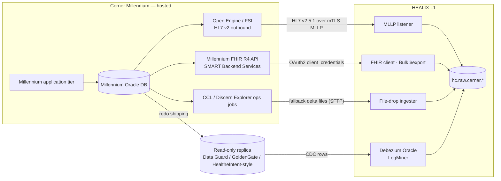

# Cerner Millennium (Oracle Health)

Cerner Millennium is the **system of record for clinical care**: registration/ADT, scheduling, orders, results,
pharmacy, clinical documentation, surgery, emergency department, and the charge events that seed revenue cycle.
HEALIX consumes Millennium through three complementary channels and one fallback. Object names below (tables,
columns, code sets, FHIR endpoints) reflect common Millennium conventions and are **illustrative**; the site's own
data dictionary (DCP Tools / Discern Explorer `dm_info`, `CODE_VALUE` exports) is authoritative and is harvested
into the Source Registry by `agent.inventory`.

## 1. Domains

| Domain | Millennium solution (illustrative) | Core tables | Primary HL7 v2 feed | Primary FHIR R4 resources | Group |
|--------|-----------------------------------|-------------|---------------------|---------------------------|-------|
| Registration / ADT | PMOffice, Patient Access | PERSON, PERSON_ALIAS, ENCOUNTER, ENCNTR_ALIAS, ENCNTR_LOC_HIST, ADDRESS, PHONE | ADT A01–A08, A11–A13, A31, A40 | Patient, Encounter, RelatedPerson, Coverage | G1, G2, G3 |
| Scheduling | Scheduling Management (ESM) | SCH_APPT, SCH_EVENT, SCH_BOOKING, SCH_RESOURCE | SIU S12–S26 | Appointment, Schedule, Slot | G4 |
| Orders | PowerOrders, CareNet | ORDERS, ORDER_DETAIL, ORDER_ACTION, ORDER_CATALOG, ORDER_CATALOG_SYNONYM | ORM O01 / OMP O09 (inbound copy), ORU R01 | ServiceRequest, MedicationRequest | G2 |
| Results | PathNet GL/AP/Micro, RadNet | CLINICAL_EVENT, CE_EVENT_PRSNL, CE_BLOB, DISCRETE_TASK_ASSAY, CE_SPECIMEN_COLL | ORU R01 | Observation, DiagnosticReport, Specimen | G2 |
| Pharmacy | PharmNet, Medication Process | ORDERS (activity type Pharmacy), MED_ADMIN_EVENT, CE_MED_RESULT, ORDER_INGREDIENT, MED_IDENTIFIER, MED_DISPENSE | RDE O11, RDS O13, RAS O17 | MedicationRequest, MedicationDispense, MedicationAdministration | G2 |
| Documentation | PowerNote, Dynamic Documentation, PowerForms | CLINICAL_EVENT (document events), CE_BLOB, DCP_FORMS_ACTIVITY | MDM T02 | DocumentReference, Composition (optional) | G2 |
| Problems / Diagnoses / Allergies | PowerChart | PROBLEM, DIAGNOSIS, NOMENCLATURE, ALLERGY, ALLERGY_COMMENT, REACTION | ADT (DG1), PPR (rare) | Condition, AllergyIntolerance | G2 |
| Immunizations | PowerChart Immunization | CLINICAL_EVENT (immunization events), MED_ADMIN_EVENT | VXU V04 | Immunization | G2, G6 |
| Charges / Revenue | Charge Services, Patient Accounting (if hosted) | CHARGE, CHARGE_MOD, CHARGE_EVENT, BILL_ITEM, BILL_ITEM_MODIFIER | DFT P03, BAR P01/P05 | ChargeItem, Account, Claim (seed) | G3 |
| Surgery | SurgiNet | SURGICAL_CASE, SURG_CASE_PROCEDURE, CASE_TIMES, SURG_CASE_PRSNL | SIU (OR schedule), ORU (times) | Procedure, Appointment, Encounter (surgical) | G2, G4 |
| Emergency | FirstNet | TRACKING_ITEM, TRACKING_EVENT, TRACKING_CHECKIN, TRACKING_LOCATOR | ADT A04/A08/A10 | Encounter (emergency class), Observation (triage) | G2 |
| PowerChart core | Chart, PRSNL, Provider | PRSNL, PRSNL_ALIAS, PRSNL_GROUP, ORGANIZATION, LOCATION, LOCATION_GROUP | MFN M02/M05 (where enabled) | Practitioner, PractitionerRole, Organization, Location | G1, G4 |

## 2. Extraction architecture

Channel precedence per entity is declared in the mapping spec (`SRC-04`): **CDC is primary** for state tables
(PERSON, ENCOUNTER, ORDERS, CLINICAL_EVENT, CHARGE), **HL7 v2 is primary** for event semantics and legacy-consumer
parity (ADT movements, SIU, DFT), **FHIR is primary** for documents and for reconciliation/backfill, **CCL** only
where the others are unavailable.

## 3. Channel A — HL7 v2 outbound feeds

Millennium emits HL7 v2.x (site version typically 2.3–2.5.1) from the integration engine. HEALIX subscribes to a
mirrored copy per facility. Z-segments (`ZPV`, `ZCH`, `ZOR`, `ZEI`) are site-specific and are registered as elements.

### 3.1 Trigger events

| Message | Trigger | Meaning | Key segments | Canonical target | Raw topic |
|---------|---------|---------|--------------|------------------|-----------|
| ADT | A01 | Admit / visit notification (inpatient) | MSH, EVN, PID, PD1, NK1, PV1, PV2, DG1, GT1, IN1–IN3, ZPV | Encounter (in-progress), Patient, Coverage | `hc.raw.cerner.adt.hl7v2.v1` |
| ADT | A02 | Transfer | PV1-3/PV1-6 | Encounter.location (period) | same |
| ADT | A03 | Discharge / end visit | PV1-36, PV1-45 | Encounter (finished), hospitalization.dischargeDisposition | same |
| ADT | A04 | Register outpatient / ED arrival | PV1-2 = O/E | Encounter (ambulatory/emergency) | same |
| ADT | A05 | Pre-admit | PV1-2 = P | Encounter (planned) | same |
| ADT | A06 / A07 | Change outpatient→inpatient / inpatient→outpatient | PV1-2 | Encounter.class change (new period) | same |
| ADT | A08 | Update patient / visit information | all | Patient, Encounter, Coverage merge-update | same |
| ADT | A11 / A13 | Cancel admit / cancel discharge | EVN-4 | Encounter status reversal | same |
| ADT | A31 | Update person information (demographics only) | PID, PD1, NK1 | Patient | same |
| ADT | A40 | Merge patient (MRG) | MRG-1 | Patient.link (replaced-by), EMPI merge event | `hc.raw.cerner.adt.hl7v2.v1` (merge evidence flows via `hc.std.cerner.adt.hl7v2-parsed.v1` to entity resolution, module 08; resulting link events on `hc.kg.er.link.v1`) |
| SIU | S12–S15, S17, S26 | New / rescheduled / modified / cancelled / deleted / no-show appointment | SCH, PID, PV1, RGS, AIS, AIG, AIL, AIP | Appointment, Slot | `hc.raw.cerner.siu.hl7v2.v1` |
| ORM / OMP | O01 / O09 | Order copy (new, cancel, discontinue, status change) | ORC, OBR, RXO, NTE | ServiceRequest, MedicationRequest | `hc.raw.cerner.orm.hl7v2.v1` |
| ORU | R01 | Result (lab, micro, rad report, vitals, documents in OBX-5 ED/TX) | OBR, OBX, NTE, SPM | Observation, DiagnosticReport, Specimen | `hc.raw.cerner.oru.hl7v2.v1` |
| DFT | P03 | Charge / financial transaction (post, credit) | FT1, PR1, DG1 | ChargeItem | `hc.raw.cerner.dft.hl7v2.v1` |
| BAR | P01 / P05 | Add / update account | PV1, GT1, IN1 | Account, Coverage | `hc.raw.cerner.bar.hl7v2.v1` (**proposed** — not yet in `07-streaming-platform/topics.yaml`; requires a topic CR before activation) |
| MDM | T02 | Document notification with content | TXA, OBX | DocumentReference (+ Binary) | `hc.raw.cerner.mdm.hl7v2.v1` |
| RDE | O11 | Pharmacy order | RXE, RXR, RXC | MedicationRequest | `hc.raw.cerner.rde.hl7v2.v1` |
| RDS | O13 | Pharmacy dispense | RXD | MedicationDispense | `hc.raw.pharmacy.rds.hl7v2.v1` (catalog pharmacy-domain dispense topic shared with ADC feeds; `hc-source-id` distinguishes Millennium PharmNet) |
| RAS | O17 | Medication administration | RXA, RXR | MedicationAdministration | `hc.raw.cerner.rde.hl7v2.v1` (catalog topic shared by RDE^O11 and RAS^O17) |
| VXU | V04 | Immunization record | RXA, RXR, OBX (CVX, lot) | Immunization | `hc.raw.cerner.vxu.hl7v2.v1` |
| MFN | M02 / M05 | Staff / location master file (if enabled) | MFI, MFE, STF, LOC | Practitioner, Location | `hc.raw.cerner.mfn.hl7v2.v1` |

HL7 v2 → FHIR mapping follows the HL7 **v2-to-FHIR Implementation Guide** segment maps as the baseline; Cerner
deviations (for example `PV1-19` carrying the FIN NBR, `PID-3` repeating MRN/CMRN with `CX.4` assigning authority
from the alias pool) are recorded in the conformance profile referenced by the registry.

### 3.2 Processing rules

- ACK handling: HEALIX returns `AA`/`AE`/`AR` to the engine copy only; `AR` is never sent for semantic failures
  (those go to quarantine after `std`).
- Ordering: partition by `PID-3` (MRN with assigning authority) so a patient's movements serialise; A40 merges are
  re-keyed to both the surviving and retired MRN.
- Replay: `MSH-10` + `MSH-7` + sending facility is the idempotency key; duplicates are flagged, not dropped, in `std`.

## 4. Channel B — CDC from the Millennium Oracle replica

### 4.1 Key tables

| Table | Meaning | Business key | Temporal / change columns | Notes |
|-------|---------|--------------|---------------------------|-------|
| PERSON | Person master (patients, and also personnel rows) | PERSON_ID | ACTIVE_IND, UPDT_DT_TM, UPDT_CNT, BEG/END_EFFECTIVE_DT_TM | Filter `ACTIVE_IND=1`; PERSON_TYPE_CD distinguishes patient/personnel |
| PERSON_ALIAS | Identifiers (MRN, CMRN, SSN, driver licence) | PERSON_ALIAS_ID; (PERSON_ID, ALIAS, ALIAS_POOL_CD) | same | PERSON_ALIAS_TYPE_CD → code set 4; ALIAS_POOL_CD → code set 263 (illustrative) |
| ENCOUNTER | Visit | ENCNTR_ID | ARRIVE/DEPART_DT_TM, REG_DT_TM, DISCH_DT_TM, ACTIVE_IND, UPDT_CNT | ENCNTR_TYPE_CD (cs 71), ENCNTR_TYPE_CLASS_CD (cs 69), LOC_FACILITY_CD/LOC_NURSE_UNIT_CD (cs 220), ADMIT_SRC_CD (cs 2), DISCH_DISPOSITION_CD (cs 19), MED_SERVICE_CD (cs 34) |
| ENCNTR_ALIAS | Encounter identifiers (FIN NBR, visit id) | ENCNTR_ALIAS_ID | same | ENCNTR_ALIAS_TYPE_CD → cs 319 |
| CLINICAL_EVENT | Every result, document, vital, med result | EVENT_ID; EVENT_CD; PARENT_EVENT_ID | EVENT_END_DT_TM, VALID_FROM/UNTIL_DT_TM, RESULT_STATUS_CD (cs 8), UPDT_CNT | Row-level versioning via VALID_UNTIL_DT_TM; latest = `VALID_UNTIL_DT_TM > sysdate`. EVENT_CD → cs 72; RESULT_UNITS_CD → cs 54 |
| ORDERS | Orders of all activity types | ORDER_ID | ORIG_ORDER_DT_TM, CURRENT_START_DT_TM, ORDER_STATUS_CD (cs 6004), UPDT_CNT | CATALOG_CD → cs 200; ACTIVITY_TYPE_CD → cs 106; CATALOG_TYPE_CD → cs 6000 |
| ORDER_DETAIL | Order detail name/value pairs (frequency, dose, priority) | (ORDER_ID, OE_FIELD_ID, ACTION_SEQUENCE, DETAIL_SEQUENCE) | ACTION_SEQUENCE increments | Pivot to typed fields in `std` |
| DIAGNOSIS | Encounter diagnoses | DIAGNOSIS_ID | BEG/END_EFFECTIVE_DT_TM, ACTIVE_IND | NOMENCLATURE_ID → NOMENCLATURE; DIAG_TYPE_CD, DIAG_PRIORITY, CONFIRMATION_STATUS_CD |
| PROCEDURE | Coded procedures | PROCEDURE_ID | PROC_DT_TM, ACTIVE_IND | NOMENCLATURE_ID; PROC_PRIORITY |
| PROBLEM | Problem list | PROBLEM_ID | ONSET_DT_TM, LIFE_CYCLE_STATUS_CD, BEG/END_EFFECTIVE_DT_TM | NOMENCLATURE_ID (SNOMED/IMO) |
| ALLERGY | Allergies/intolerances | ALLERGY_ID | ONSET_DT_TM, REACTION_STATUS_CD, ACTIVE_IND | SUBSTANCE_NOM_ID → NOMENCLATURE; SUBSTANCE_TYPE_CD; SEVERITY_CD |
| MED_ADMIN_EVENT | Medication administrations (MAR) | EVENT_ID (joins CLINICAL_EVENT) | BEG/END_DT_TM, UPDT_CNT | ADMIN_DOSAGE, DOSAGE_UNIT_CD, ADMIN_ROUTE_CD, ADMIN_SITE_CD |
| CODE_VALUE | All code sets | CODE_VALUE | ACTIVE_IND, BEGIN/END_EFFECTIVE_DT_TM, UPDT_DT_TM | See §4.2 |
| NOMENCLATURE | Terminology bridge (ICD-10, SNOMED, CPT, IMO) | NOMENCLATURE_ID | ACTIVE_IND, BEG/END_EFFECTIVE_DT_TM | See §4.3 |
| PRSNL | Personnel / providers | PERSON_ID | ACTIVE_IND, UPDT_DT_TM | PRSNL_ALIAS carries NPI, DEA, DOCNBR (PRSNL_ALIAS_TYPE_CD → cs 320) |
| ORGANIZATION | Organisations (facilities, payers, employers) | ORGANIZATION_ID | ACTIVE_IND, UPDT_DT_TM | ORG_CLASS_CD; ORG_ALIAS for payer ids |
| LOCATION | Facilities, buildings, units, rooms, beds | LOCATION_CD (joins CODE_VALUE cs 220) | ACTIVE_IND | LOCATION_TYPE_CD (cs 222); LOCATION_GROUP gives hierarchy |
| CHARGE | Charge events | CHARGE_ITEM_ID | SERVICE_DT_TM, POSTED_DT_TM, ACTIVE_IND | BILL_ITEM_ID → BILL_ITEM (CDM); ITEM_QUANTITY, ITEM_PRICE; CHARGE_MOD for modifiers |

Supporting tables harvested read-only for context (not independently canonicalised): ENCNTR_PRSNL_RELTN
(attending/admitting), ENCNTR_PLAN_RELTN (insurance plan on encounter), ADDRESS, PHONE, PERSON_PATIENT,
CE_EVENT_PRSNL (verifying/performing personnel), CE_SPECIMEN_COLL, DISCRETE_TASK_ASSAY, ORDER_CATALOG,
BILL_ITEM, SCH_APPT/SCH_EVENT (scheduling), SURGICAL_CASE, TRACKING_ITEM.

### 4.2 The CODE_VALUE / code-set pattern

Millennium stores almost every coded attribute as a numeric `CODE_VALUE` foreign key into the single table
`CODE_VALUE`, partitioned logically by `CODE_SET` (`CODE_VALUE_SET` describes each set). Each row carries
`DISPLAY`, `DESCRIPTION`, `DEFINITION`, `CDF_MEANING` (a stable, site-independent mnemonic such as `INPATIENT`,
`AUTH`, `MRN`), activity flags and effective dates. `CODE_VALUE_ALIAS` (and `CODE_VALUE_OUTBOUND`) carry external
aliases per contributor source — this is where HL7 v2 output codes (for example `PV1-2` values) are configured.

Platform treatment:

- Each `CODE_SET` is registered as its own `CodeSystem`: `urn:healix:cs:cerner:code-value|<set>` with
  `CODE_VALUE` as `code`, `DISPLAY` as display, `CDF_MEANING` as a `property`, effective dates as `period`.
- `CDF_MEANING` is used as the **preferred mapping anchor** (it is stable across sites and upgrades); `DISPLAY` is
  secondary; the raw numeric is never mapped directly.
- New or changed `CODE_VALUE` rows arrive via CDC and are routed to `hc.std.cerner.cdc.code_value.typed.v1`,
  where `agent.vocabulary_curator` (Stage 1) creates candidate SKOS concepts with `skos:prefLabel = DISPLAY`,
  `skos:notation = CODE_VALUE`, `skos:note = DEFINITION`, and `agent.terminology_steward` proposes `ConceptMap`
  entries to the enterprise value set (for example cs 71 → `v3-ActEncounterCode` plus local Encounter.type).
- Event hierarchies (`V500_EVENT_SET_CANON` / `V500_EVENT_SET_CODE` / `V500_EVENT_CODE`, illustrative) are harvested
  as a ready-made **taxonomy input** for Stage 2: event sets become `skos:broader` of event codes.

### 4.3 NOMENCLATURE terminology bridge

`NOMENCLATURE` links Millennium records (DIAGNOSIS, PROBLEM, PROCEDURE, ALLERGY substances) to external
vocabularies: `SOURCE_IDENTIFIER` (external code), `SOURCE_STRING` (term text), `SOURCE_VOCABULARY_CD`
(cs 400: ICD-10-CM, ICD-10-PCS, SNOMED CT, CPT4, HCPCS, IMO, Multum), `PRINCIPLE_TYPE_CD` (cs 401: Disease,
Procedure, Finding), `CONCEPT_CKI` (Cerner Knowledge Index, for example `SNOMED!22298006`) and `VOCAB_AXIS_CD`.
Interface-terminology rows (IMO) often carry the *clinician's term* with mappings to ICD-10-CM and SNOMED CT; the
platform preserves the original `NOMENCLATURE_ID` as a `coding` with system `urn:healix:cs:cerner:nomenclature`,
adds the standard codings from `SOURCE_VOCABULARY_CD`, and records which coding was **asserted** versus **derived**
in `Coding.extension[healix-coding-derivation]`.

Feed to the Ontology Pipeline: Stage 1 harvests `SOURCE_STRING` as `skos:altLabel` for the standard concept;
Stage 3 uses `CONCEPT_CKI` equivalences as candidate `skos:exactMatch`; Stage 4 maps `PRINCIPLE_TYPE_CD` to
ontology class membership (`healix:Condition` vs `healix:Procedure`).

### 4.4 CDC processing rules

- Debezium Oracle connector on the replica with `snapshot.mode=initial`, per-table topics
  `hc.raw.cerner.cdc.<table>.avro.v1` (pattern: one catalog topic per table; Avro, Debezium envelope with `before`/`after`/`source.scn`).
- Soft deletes (`ACTIVE_IND=0`, `END_EFFECTIVE_DT_TM < now`) are emitted as logical deletes in `std`; physical
  deletes are rare but honoured.
- `CLINICAL_EVENT` versioning: a modified result inserts a new row and expires the old one via `VALID_UNTIL_DT_TM`;
  `std` reconstructs the version chain by `EVENT_ID` + `VALID_FROM_DT_TM`, which becomes the FHIR
  `Observation.meta.versionId` lineage and the KG valid-time interval.
- Reconciliation: nightly count/`max(UPDT_DT_TM)` comparison per table between replica and `std` compaction topic.

## 5. Channel C — Millennium FHIR R4 APIs

Oracle Health exposes FHIR R4 at `https://fhir-ehr.cerner.com/r4/{tenant}` (illustrative) with **SMART Backend
Services** (system scopes, `client_credentials` with signed JWT assertion, JWKS registered with the tenant).
Resource support that HEALIX uses: Patient, Encounter, Condition, Observation, DiagnosticReport, Procedure,
MedicationRequest, MedicationAdministration, Immunization, AllergyIntolerance, DocumentReference (+ Binary),
Appointment, Slot, Schedule, Practitioner, Location, Organization, Coverage, Account, ChargeItem, ServiceRequest,
Provenance; Bulk Data `$export` at `Group`/`Patient` level where licensed.

Uses: (1) **backfill** of history before CDC snapshot cut-over; (2) **reconciliation** sampling (compare canonical
resource with vendor resource weekly); (3) **documents** (DocumentReference + Binary, replacing MDM where available);
(4) **FHIR Subscriptions** where the tenant enables them. Rate limits and search constraints (for example required
`patient` or `_id` parameters on some resources) are recorded on the interface record; HEALIX never uses the FHIR API
as a bulk substitute for CDC.

## 6. Fallback — CCL / Discern Explorer extracts

Where no replica or API coverage exists (older code levels, tables not in the replica), scheduled **CCL** programs
produce delta files (`UPDT_DT_TM > :last_run`) to SFTP, ingested via `file_drop`. CCL programs are versioned in Git,
reviewed by the site's Millennium team, run in the operations job scheduler, and registered with
`fallback_for`/`fallback_reason` (`SRC-REG-010`). Target: ≤ 10 % of Cerner entities on CCL after phase 1.

## 7. PHI classification per domain

Classification values are module 11 tags (`hc-phi-class`, GOV-01 §3). A feed or table inherits the most restrictive
tag of its elements; sub-tags of `phi:sensitive-category/*` are applied per record by `security_label()` (SRC-04 §2.2).

| Domain | Classification | Notable sensitive elements | Minimisation rule |
|--------|---------------|----------------------------|-------------------|
| Registration / ADT | `phi:direct` | Name, DOB (`phi:quasi`), SSN (PERSON_ALIAS), address, phone, NK1, GT1, IN1 member ids | SSN hashed at `std`; never in canonical except as `Patient.identifier` with masked value in non-prod |
| Clinical results / documents | `phi:clinical`; subsets `phi:sensitive-category/{mental-health,hiv,genetic,sud,reproductive}` | Behavioural health, HIV, genetics, substance use, reproductive health (42 CFR Part 2, state law) | Confidentiality tags from `CLINICAL_EVENT.CONFID_LEVEL_CD` and event-set membership → FHIR `meta.security`; psychotherapy notes excluded (GOV-PHI-006) |
| Pharmacy | `phi:clinical`; `phi:sensitive-category/sud` (MAT, controlled substances), `phi:sensitive-category/mental-health` (psychiatric meds) | Drug names imply condition | Same security labels; DEA numbers in PRSNL_ALIAS are `pii:workforce` |
| Scheduling | `phi:direct` (PID on SIU); appointment dates `phi:quasi` | Appointment reason, location | — |
| Charges | `phi:direct` (FIN/account numbers on FT1) + `phi:clinical` (diagnosis, procedure); GL postings aggregated away from the patient are `confidential:financial` | Amounts, payer, diagnosis on FT1 | Finance consumers receive `deidentified:safe-harbor` or `pseudonymised` charge streams unless RCM role (`HPAYMT`) |
| Personnel / Org / Location | `pii:workforce` (PRSNL), `internal` (ORGANIZATION, LOCATION) | Provider NPI, DEA, home contact | Home contact excluded from canonical Practitioner |
| Code sets / Nomenclature | `internal` (local code sets); `public` (standard vocabularies) | none | freely replicated to non-prod |

## 8. Volume and latency assumptions (mid-size, 5-hospital system; illustrative)

| Stream | Typical / day | Peak factor | Latency target to `canonical` |
|--------|---------------|-------------|-------------------------------|
| ADT messages | 450 k | ×2 | p95 ≤ 5 s |
| ORU results (OBX rows) | 2.5 M OBX / 600 k messages | ×2 | p95 ≤ 5 s |
| CLINICAL_EVENT CDC rows | 4 M | ×3 at month-end abstraction | p95 ≤ 5 s |
| ORDERS / ORDER_DETAIL CDC | 1.2 M / 6 M | ×2 | p95 ≤ 5 s |
| DFT charges | 300 k | ×2 end of month | p95 ≤ 5 s |
| MDM / DocumentReference | 80 k docs, 2 TB/yr Binary | ×1.5 | p95 ≤ 60 s (binary fetch) |
| CODE_VALUE / NOMENCLATURE changes | < 1 k | go-lives | hourly batch acceptable |
| FHIR backfill | 10 M resources one-off | — | ≤ 14 days total |

## 9. Source-specific data-quality risks

| Risk | Where it shows | Detection (module 09 rule family) | Handling |
|------|----------------|-----------------------------------|----------|
| Duplicate persons (same human, two PERSON_IDs) | PERSON/PERSON_ALIAS; A40 merges lag | `DQR-UNIQUENESS-PATIENT-*` probabilistic match on name/DOB/sex/address/phone | Route to EMPI/entity resolution (module 08); emit `Patient.link` |
| Encounter alias collisions (FIN reused across facilities; alias pool misconfig) | ENCNTR_ALIAS | `DQR-UNIQUENESS-ENCOUNTER-*` (ALIAS unique per ALIAS_POOL_CD) | Qualify identifier with assigning authority = alias pool |
| Result status transitions out of order (Preliminary→Final→Corrected; late `In Error`) | CLINICAL_EVENT.RESULT_STATUS_CD, ORU OBX-11 | `DQR-CONSISTENCY-RESULT-STATUS-*` state machine check | Bitemporal supersession; never overwrite |
| Local codes without CDF_MEANING or unmapped to standard | CODE_VALUE new rows; NOMENCLATURE with vocab = "Other" | `DQR-CONFORMANCE-CODE-*` translate failure rate | Quarantine coded element, keep record; open vocabulary CR |
| Free-text results in OBX-2 = TX/FT where NM expected | CLINICAL_EVENT.RESULT_VAL vs EVENT_CLASS_CD | `DQR-VALIDITY-OBS-VALUE-*` | Parse numeric with units when safe; else keep as valueString |
| Unit inconsistency (local units not UCUM) | RESULT_UNITS_CD (cs 54) | `DQR-CONFORMANCE-UCUM-*` | ConceptMap cs 54 → UCUM; unmapped quarantined |
| Encounter without discharge for > 30 days (ghost admits) | ENCOUNTER.DISCH_DT_TM null | `DQR-TIMELINESS-ENCOUNTER-*` | Steward worklist |
| Clock skew between facilities / DST | EVENT_END_DT_TM vs UPDT_DT_TM | `DQR-TIMELINESS-SKEW-*` | Store UTC with facility TZ from LOCATION |
| Charges without matching encounter or with cancelled encounter | CHARGE.ENCNTR_ID | `DQR-REFERENTIAL-CHARGE-*` | Hold in G3 staging |
| Personnel rows in PERSON mistaken for patients | PERSON.PERSON_TYPE_CD | `DQR-VALIDITY-PERSON-TYPE-*` | Filter at `std`, route PRSNL to Practitioner |

## 10. Mapping targets to subject-area groups

| Group | Cerner contribution | Canonical topics (examples) |
|-------|---------------------|-----------------------------|
| G1 Party & Identity | Patient, RelatedPerson (NK1), Practitioner/PractitionerRole (PRSNL), Organization, Location, identifiers (MRN, FIN, NPI) | `hc.canonical.party.patient.fhir.v1`, `hc.canonical.party.practitioner.fhir.v1`, `hc.canonical.party.location.fhir.v1` |
| G2 Clinical Care | Encounter, Condition, Procedure, Observation, DiagnosticReport, Specimen, MedicationRequest/Dispense/Administration, AllergyIntolerance, Immunization, DocumentReference, ServiceRequest | `hc.canonical.clinical.encounter.fhir.v1`, `hc.canonical.clinical.observation.fhir.v1`, … |
| G3 Revenue Cycle & Finance | ChargeItem, Account, Coverage (IN1/ENCNTR_PLAN_RELTN), claim seeds | `hc.canonical.finance.chargeitem.fhir.v1`, `hc.canonical.finance.coverage.fhir.v1` |
| G4 Supply Chain & Operations | Appointment/Schedule/Slot, bed/room/unit Location, surgical case scheduling | `hc.canonical.supply.appointment.fhir.v1` |
| G5 Workforce | PRSNL attributes that join to Oracle HCM worker via NPI/employee id (no payroll) | via G1 Practitioner |
| G6 Population Health | Immunization, SDOH observations (PowerForms), problem lists feeding registries | derived |
| G7 Research | Consent (research) events, cohort source | derived |
| G8 Reference | CODE_VALUE code systems, NOMENCLATURE, ORDER_CATALOG, BILL_ITEM (CDM) | `hc.canonical.reference.codesystem.fhir.v1`, `hc.canonical.reference.conceptmap.fhir.v1` |
| G9 Governance | Source registry entries, DQ results, lineage for every Cerner interface | `hc.dq.result.v1`, `hc.dq.issue.v1` (filtered by `source_system`), `hc.ops.lineage.openlineage.v1` |

## 11. Requirements

> **SRC-CER-001** (P0, test) — All ADT trigger events in §3.1 MUST be captured byte-exact to `hc.raw.cerner.adt.hl7v2.v1`
> with `MSH-10` as idempotency key and `PID-3` (MRN + assigning authority) as partition key.

> **SRC-CER-002** (P0, test) — ADT A40 merges MUST produce a person-merge event consumed by entity resolution
> (module 08) and a `Patient.link` (`replaced-by`) on the retired record within the latency SLA.

> **SRC-CER-003** (P0, test) — CDC MUST be configured for every table in §4.1 with per-table raw topics and
> Debezium envelope schemas registered in the Schema Registry.

> **SRC-CER-004** (P0, test) — `std` processing of `CLINICAL_EVENT` MUST reconstruct the version chain by
> `EVENT_ID` + `VALID_FROM_DT_TM`/`VALID_UNTIL_DT_TM` and emit each version with explicit valid-time bounds.

> **SRC-CER-005** (P0, test) — Every `CODE_SET` referenced by a mapped element MUST be registered as a FHIR
> `CodeSystem` (`urn:healix:cs:cerner:code-value|<set>`) with `CDF_MEANING` as a code property.

> **SRC-CER-006** (P0, test) — Mapping specs MUST anchor Cerner code translations on `CDF_MEANING` first and
> `DISPLAY` second; direct mapping of numeric `CODE_VALUE` keys is rejected by the mapping linter.

> **SRC-CER-007** (P1, test) — New or changed `CODE_VALUE` and `NOMENCLATURE` rows MUST reach
> `hc.std.cerner.cdc.code_value.typed.v1` within one hour and generate Stage 1 candidate concepts.

> **SRC-CER-008** (P0, test) — Diagnoses, problems, procedures and allergies MUST carry the original
> `NOMENCLATURE_ID` coding plus all standard codings derivable from `SOURCE_VOCABULARY_CD`, with asserted/derived
> provenance per coding.

> **SRC-CER-009** (P0, test) — Soft deletes (`ACTIVE_IND=0`, expired `END_EFFECTIVE_DT_TM`) MUST be emitted as
> logical deletes and reflected as `valid_to` closure in KG and EDW, never as physical removal.

> **SRC-CER-010** (P0, inspection) — The FHIR client MUST authenticate with SMART Backend Services (asymmetric
> JWT client assertion) using system scopes limited to the resources in §5; user-context scopes are prohibited.

> **SRC-CER-011** (P1, test) — Historical backfill MUST use Bulk `$export` or paged `_lastUpdated` searches and
> MUST be reconciled against CDC snapshot counts per resource type (±0.1 %).

> **SRC-CER-012** (P1, test) — Weekly reconciliation MUST sample ≥ 1,000 canonical resources per major type and
> compare with the Millennium FHIR representation; discrepancies open DQ issues.

> **SRC-CER-013** (P0, test) — DocumentReference ingestion MUST fetch `Binary` content to governed object storage
> and publish only the reference (hash, URI, size, content type) on Kafka; binary bytes never transit topics.

> **SRC-CER-014** (P1, inspection) — CCL extracts MAY be used only as registered fallbacks; each MUST be
> version-controlled, use `UPDT_DT_TM` deltas, and be reviewed by the site Millennium team.

> **SRC-CER-015** (P0, test) — Result status transitions MUST be validated against the state machine
> (Pending → Preliminary → Final → Corrected/In Error); out-of-order arrivals are stored bitemporally and flagged.

> **SRC-CER-016** (P0, test) — Encounter identifiers MUST be qualified with assigning authority derived from
> `ALIAS_POOL_CD`; an unqualified FIN NBR is a `std` validation failure.

> **SRC-CER-017** (P0, test) — Elements tagged `phi:sensitive-category/*` (confidentiality level, sensitive event sets, Part 2
> locations) MUST carry FHIR `meta.security` labels before publication to `canonical`.

> **SRC-CER-018** (P0, inspection) — SSN and driver licence aliases MUST be hashed (keyed HMAC) at `std`; clear
> values exist only in `raw` under the restricted retention class.

> **SRC-CER-019** (P1, test) — Local result units (cs 54) MUST translate to UCUM via ConceptMap; untranslatable
> units quarantine the `Observation.valueQuantity` while preserving `valueString`.

> **SRC-CER-020** (P1, analysis) — The platform MUST sustain the §8 peak volumes with the `ARC-NFR-001` latency;
> load tests use replayed, de-identified production shapes.

> **SRC-CER-021** (P1, test) — Z-segments present in site feeds MUST be registered as elements and either mapped
> to FHIR extensions or explicitly marked `not_mapped` with a reason.

> **SRC-CER-022** (P1, test) — Charges (DFT/CHARGE) MUST reference a canonical Encounter and Patient; orphan
> charges are held in G3 staging and reported daily to the revenue-cycle steward.

> **SRC-CER-023** (P2, demo) — Where the tenant supports FHIR Subscriptions, HEALIX SHOULD subscribe for
> DocumentReference and Appointment to retire MDM/SIU dependence.

> **SRC-CER-024** (P0, inspection) — HEALIX MUST NOT send HL7 v2 messages, FHIR writes or CCL updates into
> Millennium; the integration is read-only in the first release (`00-vision-and-scope.md` §4).
