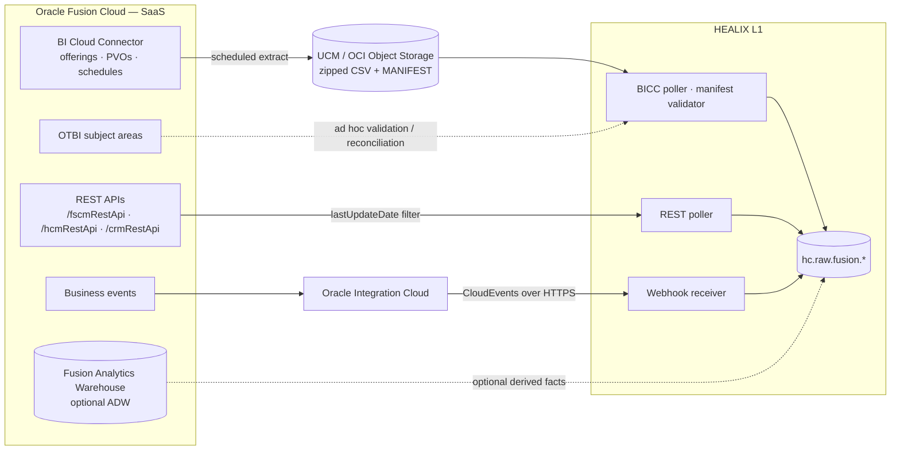

# Oracle Fusion Cloud (ERP · HCM · SCM)

Oracle Fusion Cloud is the **system of record for finance, workforce and supply chain**. It is SaaS: there is no
database access, so extraction uses Oracle's supported channels — BI Cloud Connector (BICC), REST APIs, OTBI and
Oracle Integration Cloud (OIC) business events — with Fusion Analytics Warehouse (FAW) as an optional accelerator.
View-object (PVO), table and REST names below follow Fusion naming conventions and are **illustrative**; the
BICC *Offerings* catalogue and the Fusion REST API documentation for the subscribed release are authoritative and are
harvested by `agent.inventory` into the Source Registry.

## 1. Pillars and domains

| Pillar | Domain | Core objects (illustrative Fusion tables / PVOs) | Canonical target | Group |
|--------|--------|--------------------------------------------------|------------------|-------|
| ERP | General Ledger | GL_LEDGERS, GL_JE_HEADERS, GL_JE_LINES, GL_BALANCES, GL_CODE_COMBINATIONS, GL_PERIODS | HEALIX-ERP `GLJournal`, `GLBalance`, `CostCenter` | G3, G8 |
| ERP | Payables (AP) | AP_INVOICES_ALL, AP_INVOICE_LINES_ALL, AP_INVOICE_DISTRIBUTIONS_ALL, AP_PAYMENT_SCHEDULES_ALL, AP_CHECKS_ALL (payments), AP_HOLDS_ALL | FHIR `Invoice` (payable), `PaymentReconciliation` | G3 |
| ERP | Receivables (AR) | RA_CUSTOMER_TRX_ALL, RA_CUSTOMER_TRX_LINES_ALL, AR_PAYMENT_SCHEDULES_ALL, AR_CASH_RECEIPTS_ALL, HZ_PARTIES / HZ_CUST_ACCOUNTS | FHIR `Invoice` (receivable), `Account`, `PaymentReconciliation` | G3 |
| ERP | Cash Management | CE_BANK_ACCOUNTS, CE_STATEMENT_HEADERS, CE_STATEMENT_LINES | HEALIX-ERP `BankStatement` | G3 |
| ERP | Fixed Assets | FA_ADDITIONS_B, FA_BOOKS, FA_DEPRN_SUMMARY, FA_LOCATIONS, FA_CATEGORIES_B | FHIR `Device` (clinical equipment) + HEALIX-ERP `FixedAsset` | G3, G4 |
| ERP | Projects | PJF_PROJECTS_ALL_B, PJF_TASKS_V, PJC_EXP_ITEMS_ALL, PJO_PLAN_VERSIONS | HEALIX-ERP `Project`, FHIR `ChargeItem` (billable expenditure) | G3 |
| ERP | Expenses | EXM_EXPENSE_REPORTS, EXM_EXPENSES | FHIR `Invoice` (expense claim) | G3, G5 |
| HCM | Core HR | PER_ALL_PEOPLE_F, PER_PERSON_NAMES_F, PER_PERSON_TYPES, PER_ALL_ASSIGNMENTS_M, HR_ALL_POSITIONS_F, PER_JOBS_F, PER_GRADES_F, HR_ALL_ORGANIZATION_UNITS_F, PER_DEPARTMENTS, HR_LOCATIONS_ALL_F | FHIR `Practitioner`/`PractitionerRole` (clinical workers), HEALIX-ERP `Worker`, `Position`, `Assignment` | G1, G5 |
| HCM | Absence | ANC_PER_ABS_ENTRIES, ANC_ABSENCE_TYPES_F | HEALIX-ERP `Absence` | G5 |
| HCM | Time & Labor | HWM_TM_REC, HWM_TM_REC_GRP (time cards, aggregates) | HEALIX-ERP `Timecard` (aggregated per assignment/day) | G5 |
| HCM | Payroll (aggregates only) | PAY_RUN_RESULTS / PAY_BALANCES → aggregated by cost centre & period | HEALIX-ERP `PayrollAggregate` | G3, G5 |
| HCM | Talent / Learning | HRT_PROFILE_ITEMS (competencies, licences/certifications content types), WLF_LEARNING_ITEMS / assignments | HEALIX-ERP `Competency`, `LearningRecord`; FHIR `Practitioner.qualification` | G5 |
| HCM | Credentials | HRT_PROFILE_ITEMS (LICENSES_CERTIFICATIONS), person document records | FHIR `Practitioner.qualification`, HEALIX-ERP `Credential` | G1, G5 |
| SCM | Procurement | PO_HEADERS_ALL, PO_LINES_ALL, PO_LINE_LOCATIONS_ALL, PO_DISTRIBUTIONS_ALL, POR_REQUISITION_HEADERS_ALL, POR_REQUISITION_LINES_ALL, POZ_SUPPLIERS, POZ_SUPPLIER_SITES_ALL_M | HEALIX-ERP `PurchaseOrder`; FHIR `SupplyRequest` (requisition), `Organization` (supplier) | G1, G4 |
| SCM | Inventory | EGP_SYSTEM_ITEMS_B, INV_ORG_PARAMETERS, INV_SECONDARY_INVENTORIES (subinventories), INV_ONHAND_QUANTITIES_DETAIL, INV_MATERIAL_TXNS, INV_LOT_NUMBERS | HEALIX-ERP `Item`, `InventoryBalance`; FHIR `SupplyDelivery` (issue to department), `Device` (UDI-tracked items) | G4 |
| SCM | Receiving | RCV_SHIPMENT_HEADERS, RCV_SHIPMENT_LINES, RCV_TRANSACTIONS | FHIR `SupplyDelivery` (receipt) | G4 |
| SCM | Sourcing & Contracts | PON_AUCTION_HEADERS_ALL, OKC_K_HEADERS_ALL_B, OKC_K_LINES_B | HEALIX-ERP `SupplierContract` | G4 |
| SCM | Cost Management | CST_ITEM_COSTS / CST_COST_DISTRIBUTIONS | HEALIX-ERP `ItemCost` | G3, G4 |

## 2. Extraction architecture

Channel precedence: **BICC is primary** for all state tables (completeness, bulk, deletes via PK extract);
**business events** add low-latency notifications for a short list of transactions (invoice approved, PO approved,
worker hired/terminated, item created); **REST** fills gaps (objects without PVOs, attachments, descriptive
flexfields) and serves reconciliation; **OTBI** is validation-only; **FAW** is optional and never a source of
record for HEALIX canonical data.

## 3. Channel details

### 3.1 BI Cloud Connector (BICC)

- Extracts are defined per **offering** (Financials, Procurement, Inventory, HCM) as lists of PVOs, for example
  `FscmTopModelAM.FinGlAM.JournalsAM.JournalLinePVO`, `FscmTopModelAM.FinApAM.InvoicesAM.InvoicePVO`,
  `FscmTopModelAM.PrcPoPublicViewAM.PurchaseOrderHeaderPVO`, `FscmTopModelAM.ScmExtractAM.EgpBiccExtractAM.ItemExtractPVO`,
  `HcmTopModelAnalyticsGlobalAM.PersonAM.GlobalPersonPVO`, `HcmTopModelAnalyticsGlobalAM.AssignmentAM.AssignmentPVO`,
  `HcmTopModelAnalyticsGlobalAM.PositionAM.PositionPVO` (all illustrative).
- **Incremental** extraction filters on `LAST_UPDATE_DATE` (`LastUpdateDate`) since the previous successful run
  with a configurable overlap (default 30 min) to absorb late commits; a weekly **full extract** per PVO and a daily
  **primary-key extract** detect hard deletes and purges.
- Output: zipped CSV per PVO in UCM (`fin_ucm_extract` account, illustrative) or OCI Object Storage, with
  `MANIFEST.MF` listing files, row counts and MD5. The poller validates the manifest before publishing each file
  row-by-row to `hc.raw.fusion.<pvo-slug>.bicc.v1` with the file hash and row number as idempotency key.
- Schedules: Finance every 30 min during business hours and hourly otherwise; HCM hourly; Inventory on-hand every
  15 min; reference data daily. Period-close and payroll-run windows get an additional triggered run via OIC.
- Effective-dated HCM objects (`_F` tables: `EFFECTIVE_START_DATE`/`EFFECTIVE_END_DATE`) and multi-row assignments
  (`PER_ALL_ASSIGNMENTS_M` with `EFFECTIVE_LATEST_CHANGE`, `EFFECTIVE_SEQUENCE`) are extracted with all rows;
  `std` derives valid time from effective dates, transaction time from `LAST_UPDATE_DATE`.

### 3.2 REST APIs

| API root | Resources used (illustrative) | Purpose |
|----------|-------------------------------|---------|
| `/fscmRestApi/resources/11.13.18.05/` | `invoices`, `payablesPayments`, `receivablesInvoices`, `purchaseOrders`, `purchaseRequisitions`, `suppliers`, `itemsV2`, `inventoryOnhandBalances`, `receivingReceiptRequests`, `fixedAssets`, `projects`, `expenseReports`, `ledgers`, `valueSets`, `standardLookupsLOV` | Gap fill, attachments, descriptive flexfields (DFF), reconciliation |
| `/hcmRestApi/resources/11.13.18.05/` | `workers`, `emps`, `positions`, `jobs`, `departments`, `locationsLovV2`, `absences`, `talentPersonProfiles`, `learningRecords` (illustrative) | Worker detail, credentials, near-real-time hires/terminations |
| `/crmRestApi/resources/11.13.18.05/` | `accounts`, `contacts` (if Fusion CX is licensed) | Vendor/customer party enrichment |

REST polling uses `q=lastUpdateDate>'<ts>'`, `orderBy=lastUpdateDate`, `limit`/`offset` paging, `expand` for
children, and `REST-Framework-Version: 4`. Row limits and 429 back-off are recorded per interface.

### 3.3 Business events via Oracle Integration Cloud

Subscribed events (illustrative): ERP `InvoiceApproved`, `PaymentCreated`, `JournalBatchPosted`,
`PurchaseOrderApproved`, `ReceiptCreated`; HCM Atom feeds / HCM events `WorkerCreated`, `WorkerTerminated`,
`AssignmentChanged`, `PositionChanged`; SCM `ItemCreated`, `ItemAttributeChanged`. OIC wraps each in a CloudEvents
envelope and POSTs to HEALIX with OAuth2 and an HMAC signature. Events carry keys only; the poller fetches the full
object via REST on receipt (`hc.raw.fusion.events.cloudevents.v1`).

### 3.4 OTBI and Fusion Analytics Warehouse (optional)

OTBI analyses (`/analytics-ws`) are used by `agent.dq_monitor` for **reconciliation counts and control totals**
(GL balances by period, AP invoice totals, headcount by department). FAW, if licensed, may feed pre-aggregated
facts to `hc.raw.fusion.faw.*` for G3/G5 KPIs, labelled `derived` in provenance and never used for G1 master data.

## 4. Key reference data

| Reference object | Fusion source (illustrative) | Platform treatment |
|------------------|------------------------------|--------------------|
| Chart of accounts structure and segments | `GL_CODE_COMBINATIONS`, `FND_KF_SEGMENTS`, `FND_VS_VALUES_B`, `FND_VS_VALUE_SETS` | Each segment value set (Company/Legal Entity, Cost Center, Natural Account, Department, Intercompany, Future) becomes a `CodeSystem`; hierarchies (`GL_SEG_VAL_HIER_CF`, tree versions) seed Stage 2 taxonomies for Cost Center and Natural Account |
| Lookup types | `FND_LOOKUP_TYPES`, `FND_LOOKUP_VALUES` (for example `INVOICE_TYPE`, `PO_DOCUMENT_TYPES`, `EMP_CAT`, `SEX`, `MAR_STATUS`) | One `CodeSystem` per lookup type: `urn:healix:cs:fusion:lookup|<LOOKUP_TYPE>`; ConceptMaps to FHIR value sets where applicable |
| Accounting calendars and periods | `GL_PERIODS`, `GL_PERIOD_SETS`, `GL_PERIOD_STATUSES` | G8 `ref_fiscal_period`; conformed Date dimension carries fiscal attributes |
| Currencies and rates | `FND_CURRENCIES_B`, `GL_DAILY_RATES` | ISO 4217 binding; `Money.currency` on all financial resources |
| Legal entities | `XLE_ENTITY_PROFILES`, `XLE_REGISTRATIONS` | FHIR `Organization` (type `legal-entity`) with EIN identifier |
| Business units | `FUN_ALL_BUSINESS_UNITS_V` | FHIR `Organization` (type `business-unit`), `partOf` legal entity |
| Organisations and departments | `HR_ALL_ORGANIZATION_UNITS_F`, `PER_DEPARTMENTS`, department/organisation trees | FHIR `Organization` hierarchy; G8 organisation hierarchy; joins Cerner `ORGANIZATION`/`LOCATION` via conformed Organization dimension |
| Inventory organisations and subinventories | `INV_ORG_PARAMETERS`, `INV_SECONDARY_INVENTORIES`, locators | FHIR `Location` (type `inventory-org`, `subinventory`), linked to Cerner nurse units via steward-maintained crosswalk |
| Item categories and UNSPSC | `EGP_ITEM_CATEGORIES`, `EGP_CATEGORIES_B` | Taxonomy input (Stage 2) for supply items; UNSPSC code system |
| Descriptive flexfields | `FND_DESCRIPTIVE_FLEXS`, DFF contexts | Registered as elements with `semantic_type` by steward; never auto-mapped |

## 5. Mapping to FHIR and HEALIX-ERP profiles

| Fusion object | Canonical resource / profile | Key mapping notes |
|---------------|------------------------------|-------------------|
| Legal entity, business unit, department, supplier, customer | FHIR `Organization` (`healix-organization`) | Identifiers: EIN (`urn:oid:2.16.840.1.113883.4.4`), supplier number (`urn:healix:id:fusion:supplier-number`), DUNS; `type` from Fusion classification; `partOf` from trees |
| Worker in clinical job family (NPI present) | FHIR `Practitioner` + `PractitionerRole` | `Practitioner.identifier[NPI]`, `qualification` from licences/certifications; `PractitionerRole.organization` = department, `.code` from job, `.period` from assignment effective dates; matches Cerner PRSNL via NPI / employee number |
| All workers (clinical and non-clinical) | HEALIX-ERP `Worker` (logical model) | Person number, person type, hire date, assignment status; no compensation |
| Position, Job, Grade | HEALIX-ERP `Position`, `Job`, `Grade` | Position hierarchy; FTE; headcount budget; cost centre segment |
| Assignment | HEALIX-ERP `Assignment` | Effective-dated; links Worker → Position → Department → Cost Center |
| HR location, inventory org, subinventory, asset location | FHIR `Location` | `physicalType`, `managingOrganization`; address from `HR_LOCATIONS_ALL_F` |
| AP invoice, AR transaction, expense report | FHIR `Invoice` (`healix-invoice-payable`, `-receivable`, `-expense`) | `Invoice.type`, `participant` (supplier/customer), `lineItem.priceComponent` (base, tax, discount), `totalNet/totalGross`, `account` → GL code combination |
| AR customer account | FHIR `Account` (`healix-account-receivable`) | `subject` Organization or Patient (patient-pay accounts via RCM crosswalk) |
| Project expenditure item (billable) | FHIR `ChargeItem` (`healix-chargeitem-project`) | `code` = expenditure type; `quantity`, `priceOverride` |
| Receipt / inventory issue to department | FHIR `SupplyDelivery` | `suppliedItem` → Item; `destination` Location; `type` receipt vs issue |
| Requisition | FHIR `SupplyRequest` | `requester` Practitioner/Worker; `deliverTo` Location |
| Purchase order | HEALIX-ERP `PurchaseOrder` | Header/lines/schedules/distributions; `supplier`, `buyer`, `status`, `amount`; links to Invoice via matching |
| Item (UDI / device items), fixed asset of medical-equipment category | FHIR `Device` + `DeviceDefinition` | `udiCarrier` from GTIN/UDI-DI; `type` GMDN/UNSPSC; serial/lot; asset tag identifier; `location` |
| GL journal, GL balance, cost centre, bank statement, item cost, supplier contract, absence, timecard, payroll aggregate, competency, learning record, credential | HEALIX-ERP logical models (module 06 `profiles/healix-erp/*.json`) | Published as FHIR-style JSON on `hc.canonical.finance.*`, `hc.canonical.supply.*`, `hc.canonical.workforce.*` with `resourceType` = profile name and `meta.profile` set |

HEALIX-ERP profiles are FHIR R4 **logical models** (`StructureDefinition.kind = logical`) with FHIR datatypes
(`Money`, `Period`, `Reference`, `CodeableConcept`, `Identifier`) so terminology binding, provenance and the FHIR → RDF
conversion (module 08) apply uniformly. Module 06 owns the definitions; this document fixes the required content.

## 6. PHI/PII classification (employee and financial data)

Fusion holds no clinical PHI, but HCM holds **sensitive employee PII** and ERP holds **confidential financial** data.

| Data | Classification | Minimisation rule |
|------|---------------|-------------------|
| National identifier (SSN/SIN), DOB, home address, personal phone/email, bank account, marital status, disability, ethnicity, religion, union membership (`PER_NATIONAL_IDENTIFIERS`, `PER_ADDRESSES_F`, `PER_PERSON_BANK_ACCOUNTS`) | PII-SENSITIVE | Not extracted except hashed national id for EMPI/worker matching; never on canonical topics |
| Compensation, salary, individual payroll results (`CMP_SALARY`, `PAY_RUN_RESULTS`) | PII-SENSITIVE / FINANCIAL | Aggregated to cost centre × period × earnings category before `std`; individual rows prohibited (`SRC-OFC-015`) |
| Worker name, person number, job, position, department, work location, work email, licences, NPI | PII | Allowed in canonical `Practitioner`/`Worker`; work contact only |
| Absence reasons (medical), occupational health records | PII-SENSITIVE | Absence type only; reason text and medical certificates excluded |
| Supplier bank details, tax ids | FINANCIAL-RESTRICTED | Tax id hashed; bank details excluded |
| GL, AP, AR, PO amounts | FINANCIAL | Role-restricted topics (`finance` domain ACLs) |
| Reference data (COA, lookups, calendars, currencies, legal entities) | OPERATIONAL/PUBLIC | Freely replicated |

Employees who are also patients: linkage between the HCM Worker and a Cerner Patient is **not** performed in
HEALIX except inside the EMPI/entity-resolution service under module 08/11 policy; the canonical streams carry
separate identifiers.

## 7. Volume and latency assumptions (illustrative)

| Stream | Typical | Peak | Target latency |
|--------|---------|------|----------------|
| GL journal lines | 2 M / month | ×4 at period close | ≤ 15 min after BICC run |
| AP invoices / lines | 40 k / 250 k per month | ×2 | ≤ 30 min |
| PO headers / lines | 15 k / 90 k per month | ×2 | ≤ 30 min |
| Inventory transactions | 400 k / month | ×2 | ≤ 15 min |
| On-hand balances snapshot | 1.5 M rows / day | — | ≤ 15 min |
| Worker / assignment changes | 3 k / day | ×10 at annual review | ≤ 60 min (events: ≤ 1 min) |
| Timecard aggregates | 150 k / pay period | — | ≤ 24 h after approval |
| Payroll aggregates | 5 k rows / pay run | — | ≤ 24 h after run completion |
| Reference data (COA values, lookups) | < 500 changes / day | go-lives | daily |

## 8. Source-specific data-quality risks

| Risk | Where | Detection | Handling |
|------|-------|-----------|----------|
| Late or missing BICC extracts (job failure, UCM purge) | manifest gaps, row counts vs OTBI | `DQR-COMPLETENESS-EXTRACT-*` | Re-run; alert; replay from UCM retention |
| Hard deletes invisible to incremental extracts | PK extract diff | `DQR-COMPLETENESS-DELETE-*` | Logical delete emitted; `valid_to` closure |
| Effective-dated overlaps / gaps on `_F` tables after corrections | assignments, positions | `DQR-CONSISTENCY-EFFDATE-*` | Rebuild version chain; steward alert |
| Duplicate suppliers (same tax id / name variants) | `POZ_SUPPLIERS` | `DQR-UNIQUENESS-SUPPLIER-*` | Entity resolution (module 08); `Organization` link |
| Workers duplicated across legal entities or rehires with new person number | `PER_ALL_PEOPLE_F` | `DQR-UNIQUENESS-WORKER-*` | Match on hashed national id + DOB |
| Invalid or disabled GL code combinations on transactions | `GL_CODE_COMBINATIONS.ENABLED_FLAG` | `DQR-VALIDITY-CCID-*` | Quarantine line; finance steward |
| Lookup values added without descriptions or with duplicate meanings | `FND_LOOKUP_VALUES` | `DQR-CONFORMANCE-LOOKUP-*` | Vocabulary CR |
| Currency and exchange-rate inconsistencies (functional vs transaction amounts) | AP/AR | `DQR-CONSISTENCY-FX-*` | Recompute and flag |
| Items without UDI/GTIN where device class requires it | `EGP_SYSTEM_ITEMS_B` | `DQR-COMPLETENESS-UDI-*` | Supply steward worklist |
| Clinical workers without NPI or with NPI mismatching NPPES | HCM credentials | `DQR-VALIDITY-NPI-*` (checksum + NPPES file) | Credentialing steward |

## 9. Requirements

> **SRC-OFC-001** (P0, test) — Every PVO in the registered BICC offerings MUST be extracted incrementally by
> `LAST_UPDATE_DATE` with a configurable overlap window and published to `hc.raw.fusion.<pvo-slug>.bicc.v1` with
> manifest validation (row count and checksum) before any row is published.

> **SRC-OFC-002** (P0, test) — A daily primary-key extract MUST be diffed against the compacted `std` state to
> emit logical deletes for purged or hard-deleted rows.

> **SRC-OFC-003** (P0, test) — A weekly full extract per PVO MUST reconcile to within 0.01 % of the incremental
> state; discrepancies trigger a targeted re-extract and a DQ issue.

> **SRC-OFC-004** (P0, test) — Effective-dated HCM objects MUST be emitted with valid time derived from
> `EFFECTIVE_START_DATE`/`EFFECTIVE_END_DATE` and transaction time from `LAST_UPDATE_DATE`; no row collapsing.

> **SRC-OFC-005** (P0, test) — Every chart-of-accounts segment value set and every used lookup type MUST be
> registered as a FHIR `CodeSystem` and loaded as a Stage 1 vocabulary before transactional mapping is approved.

> **SRC-OFC-006** (P1, test) — Segment and organisation tree hierarchies MUST be harvested as `skos:broader`
> relations for Cost Center, Natural Account and Department taxonomies, versioned by tree version.

> **SRC-OFC-007** (P0, test) — Legal entities, business units, departments and suppliers MUST map to FHIR
> `Organization` with `partOf` reflecting the Fusion hierarchy and identifiers qualified by system URI.

> **SRC-OFC-008** (P0, test) — Workers in clinical job families MUST map to `Practitioner`/`PractitionerRole` and be
> matched to Cerner PRSNL on NPI (primary) or employee number (secondary); unmatched records open a steward task.

> **SRC-OFC-009** (P0, test) — AP invoices, AR transactions and expense reports MUST map to FHIR `Invoice`
> profiles with `totalNet`, `totalGross`, currency and GL account reference; amounts MUST reconcile to source
> header totals per invoice.

> **SRC-OFC-010** (P1, test) — Purchase orders, GL journals, positions, assignments and other non-FHIR entities MUST
> be published as HEALIX-ERP logical-model instances with `meta.profile` and MUST validate against the module 06
> StructureDefinitions.

> **SRC-OFC-011** (P1, test) — Inventory receipts and departmental issues MUST map to `SupplyDelivery` with
> `destination` resolved to a canonical `Location` that is crosswalked to Cerner nurse units where one exists.

> **SRC-OFC-012** (P1, test) — Items carrying GTIN/UDI-DI and fixed assets in medical-equipment categories MUST
> map to `Device`/`DeviceDefinition` with `udiCarrier` populated.

> **SRC-OFC-013** (P1, test) — Business events received via OIC MUST be verified (OAuth2 + HMAC) and MUST trigger
> a REST fetch of the full object; event payloads alone are never canonicalised.

> **SRC-OFC-014** (P1, inspection) — REST polling MUST use `lastUpdateDate` filters and bounded paging, honour 429
> back-off, and run under a dedicated integration user with read-only duty roles.

> **SRC-OFC-015** (P0, test) — Individual compensation, payroll results and national identifiers MUST NOT appear in
> `std` or `canonical`; payroll MUST be aggregated to cost centre × period × earnings category before publication.

> **SRC-OFC-016** (P0, inspection) — Sensitive person attributes (ethnicity, religion, disability, marital status,
> bank accounts, home contact) MUST be excluded from extraction scope; BICC PVO column lists are reviewed by
> `agent.privacy_guardian` before activation.

> **SRC-OFC-017** (P0, test) — Worker–Patient linkage MUST NOT be computed or stored outside the governed EMPI /
> entity-resolution service; canonical Worker and Patient streams carry no shared identifier.

> **SRC-OFC-018** (P1, test) — Descriptive flexfield columns MUST be registered as elements with steward-assigned
> semantics before mapping; unregistered DFF columns are dropped at `std` with a drift notice.

> **SRC-OFC-019** (P1, test) — OTBI control totals (GL balances by period, AP totals, headcount) MUST be compared
> daily against EDW G3/G5 aggregates; variance > 0.1 % opens a DQ issue.

> **SRC-OFC-020** (P1, analysis) — Finance extracts MUST meet the §7 latency targets during period close; the
> period-close schedule is triggered by the `JournalBatchPosted` event rather than fixed timing.

> **SRC-OFC-021** (P2, demo) — FAW-derived facts MAY be ingested only with provenance `derived` and MUST NOT be
> used to populate G1 master data or conformed dimensions.

> **SRC-OFC-022** (P0, inspection) — HEALIX MUST NOT write to Oracle Fusion (no REST POST/PATCH, no FBDI
> imports); the integration is read-only in the first release.
