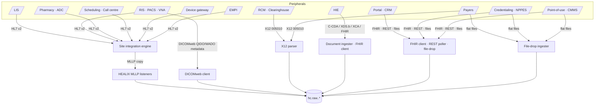

# Peripheral Systems

Peripheral systems surround Cerner Millennium and Oracle Fusion. Many of them *also* feed Millennium (lab results,
dispenses, device vitals), so HEALIX must decide per entity whether the **peripheral** or **Millennium** copy is the
canonical source of truth, and must detect disagreement between them. The rule: the system that *creates* the fact
is the source of record (LIS for the analytic result, ADC for the cabinet dispense, clearinghouse for the 835);
Millennium's copy is a secondary feed used for reconciliation unless the peripheral cannot be connected.

Each subsection follows the same structure: integration pattern, key message/resource types, code systems, target
groups, DQ risks, requirements. Vendor product names are examples; the registry holds the site's actual products.

## 1. Laboratory information system (LIS)

- **Pattern:** `hl7v2_mllp`. Inbound to HEALIX: ORU^R01 (results), OUL^R22 (specimen-centric results, if emitted),
  ORL^O22 (order acknowledgements), OML^O21/ORM (order copies from Millennium to LIS, mirrored for reconciliation).
  Microbiology uses parent/child OBR for culture → organism → susceptibility (OBX-4 sub-ids). Blood bank (BTS/BPS)
  and anatomic pathology (narrative ORU) are in scope as documents.
- **Key segments / resources:** OBR (test, specimen, ordering provider), OBX (LOINC in OBX-3, value, UCUM units,
  reference range, abnormal flags, status), SPM (specimen type, collection, body site, received time), NTE.
  Canonical: `Observation` (per OBX), `DiagnosticReport` (per OBR), `Specimen` (per SPM), `ServiceRequest`.
- **Code systems:** LOINC (OBX-3), local test codes (`urn:healix:cs:lis:test-code`), UCUM, SNOMED CT for specimen
  type and body site (SPM-4/SPM-8), HL7 v2 tables 0078 (abnormal flags) and 0085 (observation result status),
  organism codes (SNOMED CT), antibiotic codes (LOINC/local).
- **Target groups:** G2 (results, specimens), G8 (test compendium → vocabulary), G6 (lab-based quality measures).
- **DQ risks:** local test codes without LOINC; LOINC with wrong specimen/property axis; non-UCUM units; corrected
  results (OBX-11 = C) arriving before preliminary; microbiology sub-id collisions; specimen collection time after
  result time; LIS result differs from Millennium `CLINICAL_EVENT` copy.

> **SRC-PER-001** (P0, test) — LIS ORU^R01 MUST be captured as the system of record for analytic results; the
> Millennium copy MUST be reconciled nightly on (accession, OBX-3, OBX-5, OBX-11) with variance reported.

> **SRC-PER-002** (P0, test) — Every OBX-3 code MUST resolve to LOINC via the test compendium ConceptMap; untranslated
> codes quarantine the observation code while preserving the local coding, and open a vocabulary CR.

> **SRC-PER-003** (P0, test) — Microbiology parent/child results MUST preserve the organism–susceptibility hierarchy
> as `Observation.hasMember`/`derivedFrom` with OBX-4 sub-ids retained as identifiers.

## 2. Radiology / imaging (RIS, PACS, VNA)

- **Pattern:** `hl7v2_mllp` for ORM/OMI (orders), ORU^R01 (dictated reports with TX/FT OBX, or `DocumentReference`
  via MDM^T02), SIU (modality schedules); `dicomweb_metadata` (QIDO-RS study/series search, WADO-RS metadata) or
  DICOM C-FIND via gateway for study metadata; pixels remain in PACS/VNA (vision §4).
- **Key resources:** `ImagingStudy` (StudyInstanceUID, modality, series, instance counts, body site, procedure
  code, `endpoint` to WADO-RS), `DiagnosticReport` (radiology report with `imagingStudy`), `ServiceRequest`,
  `Procedure` (performed exam), `Observation` (radiation dose from RDSR where available).
- **Code systems:** DICOM (modality CID 29, body part), RadLex/RPID and LOINC/RSNA Playbook for procedure codes,
  SNOMED CT body site, CPT for billed procedure, local RIS exam codes, ACR BI-RADS/Lung-RADS as structured findings.
- **Target groups:** G2 (ImagingStudy metadata, reports, procedures), G3 (exam → charge), G4 (modality schedule and
  equipment utilisation), G8 (exam code catalogue).
- **DQ risks:** accession number mismatches between RIS and PACS; StudyInstanceUID reassignments after merges;
  patient misidentification across modality worklist; exam code without Playbook mapping; report addenda ordering.

> **SRC-PER-004** (P0, test) — Imaging ingestion MUST capture DICOM metadata only (no pixel data) and MUST publish
> `ImagingStudy` keyed on StudyInstanceUID with `identifier` carrying the RIS accession number.

> **SRC-PER-005** (P1, test) — Radiology procedure codes MUST translate to LOINC/RSNA Playbook via ConceptMap;
> body site MUST be SNOMED CT; modality MUST be the DICOM code system.

> **SRC-PER-006** (P1, test) — Report addenda MUST be versioned on the same `DiagnosticReport` with bitemporal
> supersession; an addendum never replaces the original narrative.

## 3. Pharmacy and automated dispensing cabinets (ADC)

- **Pattern:** `hl7v2_mllp`. Cabinets (for example Pyxis/Omnicell-class) receive RDE^O11 profiles and ADT and emit
  RDS^O13 (dispense/remove), RAS^O17 (where administration is cabinet-charted), DFT^P03 (charge on removal), and
  inventory/restock messages (often Z-segments or vendor flat files). Carousel and IV workflow systems emit RDS.
  Retail/outpatient pharmacy systems emit RDS plus NCPDP D.0 claims (treated under §4 as EDI).
- **Key segments / resources:** RXE (encoded order), RXD (dispense: drug, quantity, lot, expiry, dispensing
  device), RXA (administration), RXR (route), RXC (components), ORC. Canonical: `MedicationDispense`,
  `MedicationAdministration`, `MedicationRequest`, `Medication`, `ChargeItem`, `SupplyDelivery` (restock).
- **Code systems:** NDC (RXD-2 alternate), RxNorm (normalised ingredient/SCD/SBD), local formulary ids
  (Multum/Medi-Span/FDB via `MED_IDENTIFIER` in Millennium), UCUM dose units, HL7 0162 route → SNOMED CT route,
  DEA schedule.
- **Target groups:** G2 (dispense/administration), G3 (charge), G4 (cabinet inventory, par levels), G8 (formulary).
- **DQ risks:** NDC not in current FDA NDC directory (repackagers); override/waste/return events misread as
  dispenses; cabinet patient context from stale ADT; unit-of-measure mismatch (tablets vs mg); controlled-substance
  discrepancy counts.

> **SRC-PER-007** (P0, test) — Cabinet RDS^O13 MUST be the system of record for cabinet dispenses and MUST map to
> `MedicationDispense` with `type` distinguishing dispense, override, return and waste.

> **SRC-PER-008** (P0, test) — Every dispensed product MUST carry NDC and a derived RxNorm coding (SCD/SBD) via the
> terminology service; NDC not resolvable to RxNorm is flagged, not dropped.

> **SRC-PER-009** (P1, test) — Cabinet dispenses MUST reconcile daily to Millennium `MED_ADMIN_EVENT` /
> `CE_MED_RESULT` by patient, medication and ±4 h window; unreconciled controlled substances open a pharmacy DQ issue.

## 4. Revenue cycle and clearinghouse (X12 EDI)

- **Pattern:** `x12_edi` over SFTP/AS2/clearinghouse API; batch and real-time (27x). The site's patient accounting
  (Millennium Patient Accounting, or a separate RCM platform) submits 837s; HEALIX receives mirrored outbound and
  inbound interchanges from the clearinghouse. NCPDP D.0 pharmacy claims and 999/277CA acknowledgements included.
- **Transactions:** 837P/837I/837D (claims), 835 (remittance), 276/277 (claim status), 270/271 (eligibility),
  278 (prior authorisation request/response), 834 (enrolment, payer side), 820 (premium payment, rare), 277CA/999
  (acks). Canonical: `Claim`, `ClaimResponse`, `PaymentReconciliation`, `PaymentNotice`, `Coverage`,
  `CoverageEligibilityRequest/Response`, `ExplanationOfBenefit` (for payer-furnished EOB), `Account`, `Invoice`
  (patient statements).
- **Code systems:** ICD-10-CM/PCS, CPT/HCPCS with modifiers, revenue codes (NUBC UB-04), place of service (CMS),
  CARC/RARC adjustment reason codes (X12 external code lists), claim adjustment group codes, NUCC taxonomy, NPI,
  payer ids (X12 PI / CMS plan ids), DRG (MS-DRG/APR-DRG), condition/occurrence/value codes (NUBC).
- **Target groups:** G3 (primary), G1 (payer organisations, subscriber identity), G6 (attribution, utilisation).
- **DQ risks:** claim/encounter linkage (CLM01 patient control number ↔ FIN); 835 CLP splits/reversals; duplicate
  837 resubmissions; CARC/RARC codes outside current code list release; payer id drift; eligibility responses with
  partial coverage dates.

> **SRC-PER-010** (P0, test) — All X12 005010 interchanges MUST be captured byte-exact with `ISA13`/`GS06`/`ST02`
> as the idempotency key and MUST pass SNIP level 1–2 validation at `std`; failures are quarantined with the 999/TA1
> reason.

> **SRC-PER-011** (P0, test) — 837 claims MUST map to FHIR `Claim` and 835 remittances to `ClaimResponse` +
> `PaymentReconciliation`, linked by claim identifier (CLM01 / CLP01) and reconciled to Cerner `ChargeItem`
> totals per encounter.

> **SRC-PER-012** (P1, test) — CARC/RARC, revenue, place-of-service and DRG codes MUST bind to versioned code systems
> in the terminology service; a code absent from the release in force at the service date raises a DQ warning.

## 5. Payer and health-plan files

- **Pattern:** `file_drop` (SFTP/object storage, monthly or weekly) and `fhir_api` (Da Vinci PDex / Payer-to-Payer,
  Patient Access APIs where available). Files: eligibility/membership rosters, PCP attribution lists (ACO/MSSP,
  Medicare Advantage, commercial value-based contracts), claims extracts (medical, pharmacy), care-gap reports,
  risk-adjustment (HCC) files, quality measure results.
- **Resources:** `Coverage`, `Patient` (member demographics for matching), `Organization` (payer, plan),
  `ExplanationOfBenefit`, `Claim` (adjudicated), `Group` (attribution panel), `MeasureReport`, `Observation`
  (risk score), `CarePlan`/`DetectedIssue` (care gaps) in G6.
- **Code systems:** payer member id systems, plan/product codes, CMS HCC categories, HEDIS measure ids, NDC
  (pharmacy claims), ICD-10-CM, CPT/HCPCS, provider NPI/TIN for attribution.
- **Target groups:** G6 (primary), G3 (external claims), G1 (payer orgs, member identities for EMPI).
- **DQ risks:** member matching without MRN (needs EMPI); layout changes without notice; retroactive attribution;
  claims lag (90–180 days); duplicated members across products; file-level PHI exposure in transit.

> **SRC-PER-013** (P0, test) — Payer files MUST be registered with a layout version and manifest; a layout change
> MUST fail fast at `std` and open a drift CR rather than silently mis-parse.

> **SRC-PER-014** (P0, test) — Payer member records MUST be matched to patients only through the entity-resolution
> service (module 08) with match score and tier recorded; unmatched members stay in G6 staging.

> **SRC-PER-015** (P1, test) — Attribution lists MUST be modelled as `Group` with bitemporal membership so that
> retroactive changes are queryable as-of any date.

## 6. Health information exchange (HIE)

- **Pattern:** `ccda_document` via IHE XDS.b (ITI-18 Registry Stored Query, ITI-43 Retrieve Document Set), XCA
  (ITI-38/39 cross-community), Direct secure messaging, or national networks (Carequality/CommonWell/TEFCA QHIN);
  `fhir_api` where the HIE exposes FHIR R4 (US Core) or IHE MHD; ADT notifications (event notifications/ENS feeds)
  as HL7 v2 ADT or FHIR `Encounter` subscription.
- **Documents / resources:** C-CDA 2.1 CCD, Discharge Summary, Referral Note, Progress Note, Consultation Note;
  parsed sections → `Condition`, `MedicationStatement`, `AllergyIntolerance`, `Immunization`, `Procedure`,
  `Observation` (results, vitals, social history), `Encounter`, `DocumentReference` (the document itself).
- **Code systems:** C-CDA value sets (SNOMED CT, RxNorm, LOINC section/document codes, CVX, ICD-10-CM), HL7
  `ActCode` confidentiality, OIDs for assigning authorities; XDS metadata (classCode, typeCode, practiceSettingCode,
  healthcareFacilityTypeCode).
- **Target groups:** G2 (external clinical history), G6 (ENS-driven care transitions), G1 (external providers/orgs).
- **DQ risks:** duplicate documents (same content, new `setId` version); low-quality CCDs with nullFlavor sections;
  external patient demographics mismatch; missing or conflicting medication reconciliation; conflicting problem
  statuses between HIE and Millennium.

> **SRC-PER-016** (P0, test) — Every inbound C-CDA MUST be stored as `DocumentReference` + `Binary` (object store)
> before section parsing; parsed resources MUST carry `Provenance` pointing to the document and the external
> organisation as `agent`.

> **SRC-PER-017** (P0, test) — External clinical facts MUST be tagged `source-class = external` and MUST NOT
> overwrite Millennium-sourced facts; conflicts are represented as coexisting assertions in the KG with distinct
> provenance.

> **SRC-PER-018** (P1, test) — Document versions (`setId`/`versionNumber`) MUST be de-duplicated by content hash and
> linked with `relatesTo` (`replaces`).

## 7. Patient portal, engagement and CRM

- **Pattern:** `fhir_api` / `fhir_subscription` (portal vendor FHIR, questionnaire responses), `rest_api_poll` or
  `file_drop` (CRM campaign/outreach data, surveys such as HCAHPS/Press Ganey-class vendors).
- **Resources:** `QuestionnaireResponse` (intake, PROMs, SDOH screening), `Consent` (communication preferences,
  proxy access), `Communication`/`CommunicationRequest` (outreach), `Appointment` (self-scheduling requests),
  `RelatedPerson` (proxies), `Patient` (self-reported demographics, preferred language/pronouns), `Observation`
  (patient-reported vitals, satisfaction scores).
- **Code systems:** LOINC (PROM instruments, SDOH panels such as PRAPARE/AHC-HRSN), SNOMED CT, Gravity Project
  SDOH value sets, ISO 639 language, local campaign codes.
- **Target groups:** G6 (SDOH, engagement, experience), G2 (patient-reported observations), G1 (proxies,
  preferences), G9 (consents and directives).
- **DQ risks:** self-reported data contradicting EHR; proxy accounts attached to the wrong patient; survey vendor
  identifiers not linkable; consent scope ambiguity; free-text PHI in survey comments.

> **SRC-PER-019** (P0, test) — Patient-reported data MUST be published as `Observation`/`QuestionnaireResponse`
> with `performer` = Patient and MUST never update clinician-asserted facts; both coexist with provenance.

> **SRC-PER-020** (P0, inspection) — Communication preferences and proxy relationships MUST be modelled as `Consent`
> and `RelatedPerson` in G9/G1 and enforced by the module 11 policy engine for outreach consumers.

> **SRC-PER-021** (P1, test) — Free-text survey comments MUST pass PHI redaction before leaving `raw`.

## 8. Scheduling and call centre

- **Pattern:** `hl7v2_mllp` SIU^S12–S26 from enterprise or departmental scheduling systems that are not Millennium
  Scheduling (for example ambulatory, imaging, OR, infusion schedulers); `rest_api_poll` or `file_drop` for call
  centre/contact centre platforms (call records, referrals, waitlists, transfer centre).
- **Resources:** `Appointment`, `Schedule`, `Slot`, `HealthcareService`, `ServiceRequest` (referral),
  `Task` (call-centre work items), `Communication` (call summary), `Location`, `Practitioner`.
- **Code systems:** appointment type/reason (local → SNOMED CT), cancellation reasons (local), HL7 0276/0277,
  specialty (NUCC taxonomy), referral priority.
- **Target groups:** G4 (capacity, utilisation, access), G2 (referrals as ServiceRequest), G6 (access measures).
- **DQ risks:** duplicate appointments across schedulers; time-zone/DST errors; appointment-to-encounter linkage
  missing (`Encounter.appointment`); cancelled vs no-show semantics vary by vendor; call records with free-text PHI.

> **SRC-PER-022** (P0, test) — Appointments from non-Millennium schedulers MUST map to `Appointment` with
> `identifier` carrying the source system id and MUST be linked to the resulting `Encounter` when an ADT arrival with
> matching patient, location and ±2 h window is observed.

> **SRC-PER-023** (P1, test) — Appointment status transitions (booked → arrived → fulfilled / cancelled / noshow)
> MUST be validated against the FHIR `AppointmentStatus` state machine; invalid transitions are flagged.

## 9. Device integration (monitors, pumps, ventilators)

- **Pattern:** `hl7v2_mllp` from a medical device integration gateway (Capsule/Philips/GE-class) that converts
  IEEE 11073 (PoCD/MDC nomenclature) to ORU^R01 (device observations) and, for pumps, infusion status; some gateways
  expose FHIR `Observation`/`Device` directly (IHE PCD-01 / FHIR Devices on FHIR). Sampling rate configured per
  parameter (typically 1–5 min for continuous vitals; event-based for pumps). Alarm messages (PCD-04) optional.
- **Resources:** `Observation` (vitals with `device` reference and `component` for multi-value such as BP),
  `Device` (serial, model, UDI), `DeviceMetric` (calibration, units), `MedicationAdministration` updates from pump
  programming (rate/volume infused), `Location` (bed association from ADT).
- **Code systems:** IEEE 11073-10101 MDC codes (`urn:iso:std:iso:11073:10101`) mapped to LOINC vital-sign codes
  (US Core vital signs), UCUM, device type (GMDN/UDI), alarm codes (MDC).
- **Target groups:** G2 (observations, device use), G4 (device inventory and utilisation), G8 (MDC ↔ LOINC map).
- **DQ risks:** device-to-patient association errors (bed-based association after transfer); clock drift on
  devices; high-frequency duplicates; artefact values (SpO2 = 0, HR spikes); unit mismatches (kPa vs mmHg).

> **SRC-PER-024** (P0, test) — Device observations MUST carry `Observation.device` and the bed/location at the time
> of measurement; observations arriving for a bed with no active ADT occupancy are quarantined.

> **SRC-PER-025** (P0, test) — MDC codes MUST translate to LOINC via the MDC→LOINC ConceptMap for US Core vital
> signs; units MUST be UCUM; untranslatable parameters are retained with MDC coding only and flagged.

> **SRC-PER-026** (P1, test) — Device-time versus gateway-time skew > 60 s MUST be corrected using gateway time and
> recorded as a DQ observation; raw device time is retained in `raw`.

## 10. Credentialing and provider directory

- **Pattern:** `file_drop`/`rest_api_poll` from the credentialing system (MD-Staff/Cactus/symplr-class): privileges,
  appointments, licences, DEA, board certifications, malpractice; NPPES monthly full file and weekly incremental
  (public, `file_drop`); CAQH ProView extracts where licensed; state licence board verifications.
- **Resources:** `Practitioner` (identifiers NPI, DEA, state licence; `qualification`), `PractitionerRole`
  (privileges as `specialty`/`code`, `organization`, `period`), `Organization` (group practices, hospitals),
  `Endpoint`, `HealthcareService`; aligned to the Da Vinci PDex Plan-Net / National Directory profiles.
- **Code systems:** NPI, NUCC Provider Taxonomy, ABMS board certification, state licence systems, DEA registration,
  privilege categories (local), SNOMED CT specialty.
- **Target groups:** G1 (Practitioner master; conformed Practitioner dimension), G5 (credential expiry as workforce
  compliance), G8 (taxonomy code system).
- **DQ risks:** NPI check-digit failures; NPPES name/taxonomy differing from credentialing; expired privileges still
  active in Millennium PRSNL; multiple PRSNL rows per practitioner; mismatched practitioner across Cerner, HCM and
  credentialing.

> **SRC-PER-027** (P0, test) — The credentialing system MUST be the source of record for `Practitioner.qualification`
> and privilege periods; Cerner PRSNL and Oracle HCM contribute identifiers and roles, matched on NPI.

> **SRC-PER-028** (P1, test) — NPPES MUST be ingested monthly (full) and weekly (incremental) as a public reference
> source; every practitioner NPI MUST be validated against it (Luhn check and existence) with mismatches reported.

> **SRC-PER-029** (P1, test) — Credential expiries MUST be emitted as G5 compliance facts with valid time equal to
> the credential period so that "privileged as-of date" queries are answerable.

## 11. Supply-chain peripherals (point-of-use, biomed/CMMS)

- **Pattern:** `rest_api_poll` or `file_drop` from point-of-use supply cabinets and OR supply systems (item scans,
  implant logs with UDI), tissue/implant tracking, and biomedical engineering CMMS (asset master, preventive
  maintenance, work orders, recalls); HL7 v2 DFT^P03 for supply charges; GUDID lookups for UDI parsing.
- **Resources:** `SupplyDelivery` (issue/consumption to patient or department), `Device` (implant with UDI, asset),
  `DeviceUseStatement`/`Procedure.focalDevice` (implanted device), `ChargeItem` (billable supply), HEALIX-ERP
  `WorkOrder`, `MaintenanceEvent`, `Recall` (logical models), `Location`.
- **Code systems:** UDI (GS1 GTIN, HIBCC, ICCBBA), GMDN, UNSPSC, GUDID device attributes, FDA recall numbers,
  manufacturer catalog numbers, Oracle Fusion item numbers (crosswalk).
- **Target groups:** G4 (primary), G2 (implants on procedures), G3 (supply charges), G1 (manufacturer orgs).
- **DQ risks:** UDI not parseable; point-of-use item ids not in Fusion item master; implant recorded without
  procedure; CMMS asset ids not matching Fusion fixed assets; consumption after case close.

> **SRC-PER-030** (P0, test) — Implants MUST be captured with a parsed UDI (DI + PI components) and linked to the
> surgical `Procedure` and `Patient`; unparseable UDIs are retained raw and flagged.

> **SRC-PER-031** (P1, test) — Point-of-use item identifiers MUST crosswalk to Oracle Fusion items; unmatched items
> are reported to the supply steward and held in G4 staging.

> **SRC-PER-032** (P1, test) — CMMS assets MUST be matched to Fusion fixed assets by asset tag or serial; biomed
> work orders and recalls are published as HEALIX-ERP logical models referencing the canonical `Device`.

## 12. Enterprise Master Patient Index (EMPI)

- **Pattern:** `hl7v2_mllp` (ADT A28/A31/A40/A47 identity feeds; PIX/PDQ v2 ITI-8/ITI-9/ITI-21), `fhir_api`
  (IHE PIXm/PDQm `$ihe-pix`, `Patient` search, `Patient.link`), or vendor REST for match-score retrieval. Where
  the organisation runs a commercial EMPI (IBM InfoSphere MDM / NextGate / Verato-class) it is the authority for
  cross-source person identity; where none exists, module 08 entity resolution fills the role and this interface
  is the platform's own.
- **Resources:** `Patient` (golden record with `identifier` per source and `link` to source-level patients),
  `Person` (cross-domain linkage when needed), person-merge/unmerge events (`hc.std.party.person-merge.v1`),
  match-decision records (score, tier, rule set, reviewer) stored in G9.
- **Code systems:** identifier type codes (HL7 0203: MR, SS, DL, PPN, MB), assigning-authority OIDs for every MRN
  pool, match-tier vocabulary (auto-link, review, no-link).
- **Target groups:** G1 (golden Patient, conformed Patient dimension), G9 (match decisions, audit).
- **DQ risks:** false merges (critical patient-safety risk); unmerge not propagated to downstream facts; identifier
  pool OIDs missing; EMPI and Millennium disagreement on active MRN; stale demographics on golden record.

> **SRC-PER-033** (P0, test) — The EMPI (external or module 08 service) MUST be the sole producer of cross-source
> `Patient.link` assertions; no mapping spec may emit `Patient.link` from a single source.

> **SRC-PER-034** (P0, test) — Merge and unmerge events MUST be bitemporally recorded and replayed to KG and EDW so
> that every fact is re-attributed with full history and prior attribution remains queryable.

> **SRC-PER-035** (P0, inspection) — Every MRN assigning authority MUST have a registered OID/URI in the Source
> Registry before the identifier may appear in canonical `Patient.identifier`.

> **SRC-PER-036** (P1, test) — Match decisions MUST be published to G9 with score, algorithm version and reviewer
> (agent or human), and false-merge detections MUST page the clinical data steward.

## 13. Summary matrix

| Peripheral class | Pattern(s) | Primary resources | Primary code systems | Groups | System-of-record scope |
|------------------|-----------|-------------------|----------------------|--------|------------------------|
| LIS | hl7v2_mllp | Observation, DiagnosticReport, Specimen | LOINC, UCUM, SNOMED CT | G2, G8 | Analytic results |
| RIS/PACS/VNA | hl7v2_mllp, dicomweb_metadata | ImagingStudy, DiagnosticReport | DICOM, LOINC/Playbook, RadLex | G2, G4 | Imaging metadata, reports |
| Pharmacy/ADC | hl7v2_mllp | MedicationDispense, MedicationAdministration | NDC, RxNorm, UCUM | G2, G3, G4 | Cabinet dispenses |
| RCM/Clearinghouse | x12_edi | Claim, ClaimResponse, PaymentReconciliation | ICD-10, CPT/HCPCS, CARC/RARC, NUBC | G3 | Claims, remits, eligibility |
| Payers | file_drop, fhir_api | Coverage, EOB, Group, MeasureReport | HCC, HEDIS, payer ids | G6, G3 | Attribution, external claims |
| HIE | ccda_document, fhir_api | DocumentReference, Condition, MedicationStatement | C-CDA value sets | G2, G6 | External history |
| Portal/CRM | fhir_api, rest_api_poll | QuestionnaireResponse, Consent, Communication | LOINC PROM/SDOH | G6, G9 | Patient-reported, preferences |
| Scheduling/Call centre | hl7v2_mllp, rest_api_poll | Appointment, Task, ServiceRequest | NUCC, local | G4 | Non-Millennium schedules |
| Devices | hl7v2_mllp, fhir_api | Observation, Device, DeviceMetric | MDC, LOINC, UCUM | G2, G4 | Device vitals |
| Credentialing/NPPES | file_drop, rest_api_poll | Practitioner, PractitionerRole | NPI, NUCC, ABMS | G1, G5 | Qualifications, privileges |
| Supply peripherals/CMMS | rest_api_poll, file_drop | SupplyDelivery, Device, WorkOrder | UDI, GMDN, UNSPSC | G4, G2 | Consumption, implants, assets |
| EMPI | hl7v2_mllp, fhir_api | Patient (golden), Person | HL7 0203, OIDs | G1, G9 | Cross-source identity |
