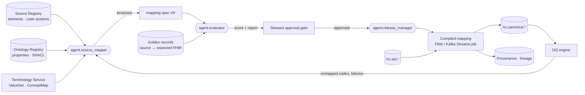
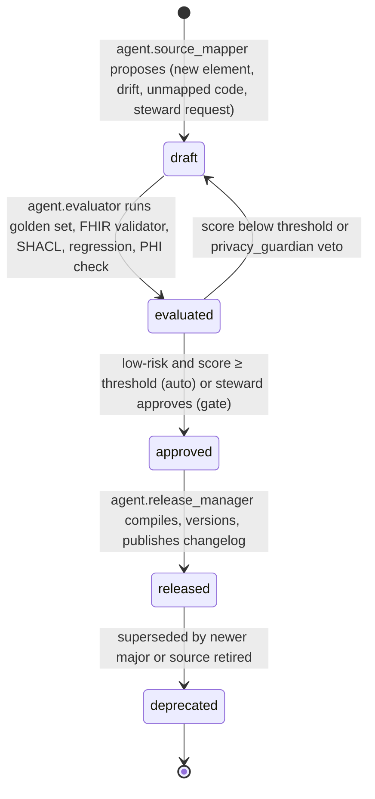

# Source-to-Canonical Mapping Specification

A **mapping spec** is the executable, versioned declaration of how a registered source element becomes a `std`
field and then a canonical FHIR R4 (or HEALIX-ERP logical model) element. Specs live in
`03-source-systems/mappings/<source_id>/<mapping_id>.yaml`, are proposed by `agent.source_mapper`, tested by
`agent.evaluator` against golden records, approved by the data steward, and compiled by module 06/07 into stream
processors. Prose in this document explains intent; the YAML schema (`mappings/schema/mapping-spec.schema.json`)
is normative.

## 1. Position in the flow



## 2. Mapping spec format (YAML)

```yaml
mapping_spec:
  mapping_id: map.cerner.encounter.cdc.fhir-encounter      # map.<source>.<entity>.<channel>.<target>
  version: 1.3.0                                           # semver; breaking target change => major
  status: approved                                         # draft | evaluated | approved | deprecated
  source:
    source_id: cerner-millennium-prod
    interface_id: cerner-cdc-core
    pattern: cdc_log
    containers: [ENCOUNTER, ENCNTR_ALIAS, ENCNTR_LOC_HIST, ENCNTR_PRSNL_RELTN]
    std_subject: hc.std.cerner.cdc.encounter.typed.v1-value  # Schema Registry subject of the input (topics.yaml)
  target:
    kind: fhir                                             # fhir | healix-erp
    resource: Encounter
    profiles:
      - http://hl7.org/fhir/us/core/StructureDefinition/us-core-encounter
      - https://ontology.healix.example.org/fhir/StructureDefinition/healix-encounter
    topic: hc.canonical.clinical.encounter.fhir.v1
    group: G2
  identity:
    business_key: [ENCOUNTER.ENCNTR_ID]
    resource_id: { fn: uuid5, args: { namespace: urn:healix:ns:cerner, value: "ENCOUNTER.ENCNTR_ID" } }
    identifiers:
      - { system: urn:healix:id:cerner:encntr-id, value: ENCOUNTER.ENCNTR_ID, use: secondary }
      - { system: "{alias_pool_uri(ENCNTR_ALIAS.ALIAS_POOL_CD)}", value: ENCNTR_ALIAS.ALIAS,
          where: "ENCNTR_ALIAS.ENCNTR_ALIAS_TYPE_CD.cdf_meaning == 'FIN NBR'", type: { system: http://terminology.hl7.org/CodeSystem/v2-0203, code: AN } }
  temporal:
    valid_from: ENCOUNTER.REG_DT_TM
    valid_to:   { fn: coalesce, args: [ENCOUNTER.DISCH_DT_TM, "9999-12-31T00:00:00Z"] }
    recorded_at: ENCOUNTER.UPDT_DT_TM
  provenance:
    activity_template: https://ontology.healix.example.org/prov/activity/mapping/{mapping_id}/{version}
    agent: https://ontology.healix.example.org/prov/agent/source/cerner-millennium-prod
  elements:                                                 # one block per target element
    - id: e010
      source: ENCOUNTER.ENCNTR_TYPE_CLASS_CD
      std_field: encntr_type_class_cd
      fhir_path: Encounter.class
      ontology_property: https://ontology.healix.example.org/clinical/encounterClass
      semantic_type: coded
      cardinality: "1..1"
      binding:
        source_code_system: "urn:healix:cs:cerner:code-value|69"
        target_value_set: http://terminology.hl7.org/ValueSet/v3-ActEncounterCode
        concept_map: https://ontology.healix.example.org/fhir/ConceptMap/cerner-cs69-to-actencountercode
        strength: required
        unmapped_policy: quarantine                         # quarantine | default | passthrough_extension | drop
        default_code: null
      transform:
        - { fn: code_value_lookup, args: { by: cdf_meaning } }
        - { fn: translate, args: { concept_map: "$binding.concept_map" } }
      null_rule: { when_null: fail, reason: "class is required by US Core" }
      phi_class: phi:clinical                                 # module 11 tag (GOV-01 §3)
      dq_rules: [DQR-CONFORMANCE-ENCOUNTER-003, DQR-COMPLETENESS-ENCOUNTER-001]
      evidence:
        rationale: "cs 69 is the encounter class axis; cs 71 holds finer local types mapped to Encounter.type"
        golden_cases: [gc-enc-0001, gc-enc-0042]
        confidence: 0.98
  tests:
    golden_set: golden/cerner/encounter/v3/
    regression_suite: tests/map.cerner.encounter.cdc.fhir-encounter.spec.yaml
    thresholds: { element_pass_rate: 0.995, required_element_pass_rate: 1.0, validator_pass_rate: 0.995 }
  lifecycle:
    proposed_by: agent.source_mapper
    proposed_at: 2026-10-17T10:14:00Z
    evaluated_by: agent.evaluator
    evaluation_report: reports/map.cerner.encounter.cdc.fhir-encounter/1.3.0.json
    approved_by: role:clinical-data-steward
    approved_at: 2026-10-17T15:02:00Z
    supersedes: 1.2.4
    change_request: CR-2026-10-0412
```

### 2.1 Element block fields (normative)

| Field | Required | Rule |
|-------|----------|------|
| `id` | yes | Stable within the spec; never reused after deletion |
| `source` | yes | `<container>.<field>` or HL7 path (`PV1-2`, `OBX-5.1`, `PID-3[*].CX.1`) or FHIR path or X12 element (`CLM01`, `SV1-01-02`) |
| `std_field` | yes | Field in the registered `std` schema; linter checks existence |
| `fhir_path` | yes | FHIRPath expression on the target resource; must resolve in the declared profiles |
| `ontology_property` | yes for P0 elements | IRI in the Ontology Registry; drives EDW column lineage and KG predicate |
| `semantic_type` | yes | Must equal the registry element's `semantic_type` unless a `transform` changes it |
| `cardinality` | yes | Target cardinality; checked against profile |
| `binding` | yes if coded | `source_code_system` must be a registered `CodeSystem`; `concept_map` must exist in the terminology service; `unmapped_policy` mandatory |
| `transform` | no | Ordered list of functions from the library (§2.2); no inline code |
| `null_rule` | yes | `when_null: fail | omit | default | data_absent_reason`; `data_absent_reason` emits the FHIR extension |
| `phi_class` | yes | Module 11 tag (`hc-phi-class` value, GOV-01 §3); must be ≥ the registry element's class (may escalate, never downgrade) |
| `dq_rules` | no | Rule ids this element participates in; `agent.dq_author` may add |
| `evidence` | yes | Rationale, golden cases, confidence ∈ [0,1]; confidence < 0.8 forces human review |

### 2.2 Transformation function library

| Function | Purpose | Notes |
|----------|---------|-------|
| `code_value_lookup(by)` | Resolve Cerner `CODE_VALUE` to `cdf_meaning`/`display` | Cerner only; cached from `hc.std.cerner.cdc.code_value.typed.v1` |
| `lookup_value(lookup_type)` | Resolve Oracle Fusion lookup code to meaning | Fusion only |
| `nomenclature_resolve()` | Expand `NOMENCLATURE_ID` to source and standard codings | Emits asserted/derived flags |
| `translate(concept_map, reverse?)` | Terminology Service `$translate` | Records equivalence; unmapped per policy |
| `validate_code(value_set)` | `$validate-code` | Fails or warns per binding strength |
| `to_instant(tz_source)` | HL7 DTM / Oracle DATE / CSV string → ISO 8601 UTC with original offset preserved | Facility TZ from `LOCATION` registry |
| `parse_hl7_name()` / `parse_hl7_address()` / `parse_hl7_cx()` | XPN/XAD/CX → HumanName/Address/Identifier | v2-to-FHIR IG datatype maps |
| `ucum_normalize(unit)` | Local unit → UCUM via ConceptMap | Quarantines on failure |
| `uuid5(namespace, value)` | Deterministic resource id | Required for all `resource_id` |
| `lookup_reference(registry, key_system)` | Resolve to canonical resource reference | Emits `Reference.identifier` fallback if not yet published |
| `hash_phi(key_id)` | Keyed HMAC-SHA-256 of a sensitive identifier | Key from KMS; non-reversible |
| `money(amount, currency)` | Build FHIR `Money` | ISO 4217 |
| `coalesce(...)`, `constant(v)`, `concat(...)`, `regex_extract(p)`, `split(sep)`, `map_table(t)` | General utilities | Pure functions, no I/O |
| `security_label(rule)` | Derive `meta.security` from confidentiality/sensitivity rules | Module 11 rule pack |

Any new function requires a module 06 PR with unit tests; mapping specs cannot embed code.

## 3. Mapping lifecycle



| Step | Actor | Inputs | Outputs / gate |
|------|-------|--------|----------------|
| Propose | `agent.source_mapper` | registry elements, profiles, ontology properties, existing ConceptMaps, sample `std` records, prior versions | spec `draft` with evidence and confidence per element; typed change request (module 10) |
| Evaluate | `agent.evaluator` | golden records (source payload ↔ expected canonical), FHIR validator, SHACL shapes, regression suite from previous version, PHI classification diff | evaluation report: element pass rate, required-element pass rate, validator pass rate, value-set translate rate, regressions, PHI impact |
| Guard | `agent.privacy_guardian` | spec diff | veto if any element lowers `phi_class`, adds a sensitive element to a non-restricted topic, or emits clear sensitive identifiers |
| Approve | steward (human) or auto | report, risk class | **Auto-approve** only when: risk class = low (no identifier, no `phi:sensitive-category/*`, no required-element change), all thresholds met, confidence ≥ 0.9 on every changed element. Otherwise steward approval |
| Release | `agent.release_manager` | approved spec | compiled job, Git tag, changelog, lineage registration (OpenLineage job + PROV-O activity) |
| Monitor | `agent.dq_monitor` | canonical + DQ streams | unmapped-code rate, validator failures, drift → new proposal |

Risk classes: **low** (display-only, optional element, additive ConceptMap entry), **medium** (coded required element,
reference resolution change, temporal rule change), **high** (identifier system, PHI class, business key, merge logic).
High always requires steward plus privacy sign-off.

## 4. Coverage and quality metrics

| Metric | Definition | Target (first release) | Published to |
|--------|-----------|------------------------|--------------|
| Element coverage | mapped registry elements / in-scope registry elements per interface | ≥ 90 % overall; 100 % of `criticality = critical` | G9 `fact_mapping_coverage`, `hc.dq.scorecard.v1` (scope = interface) |
| Required-element coverage | profile `min ≥ 1` elements with a mapping / all required elements | 100 % | same |
| Ontology binding coverage | elements with `ontology_property` / mapped elements | ≥ 95 % (goal G-01) | same |
| Value-set translate rate | `$translate` successes / coded values processed, per binding | ≥ 99 % required bindings; ≥ 95 % extensible | `hc.dq.result.v1` |
| Golden pass rate | golden cases producing expected canonical (deep-equal after canonical ordering) | ≥ 99.5 %; 100 % for required elements | evaluation report |
| Validator pass rate | FHIR validator (profiles) pass on canonical output | ≥ 99.5 % (goal G-02) | `hc.dq.result.v1` |
| Round-trip fidelity | canonical → HL7 v2 / source projection comparison for key fields | ≥ 99 % | evaluation report |
| Mapping staleness | days since last evaluation of a released spec | ≤ 30 | G9 |
| Unmapped-code backlog | distinct unmapped codes awaiting vocabulary CR, by age | 0 older than 14 days for required bindings | G9 |
| Auto-approval rate | approved without human / all approved | ≥ 80 % (goal G-06), with rollback rate ≤ 2 % | G9 |

## 5. Example mapping blocks

### 5.1 Cerner ENCOUNTER → FHIR Encounter (CDC)

Header, identity and temporal blocks are shown in §2. Representative elements:

```yaml
    - id: e030                                   # local type: extensible binding, keep local coding on miss
      source: ENCOUNTER.ENCNTR_TYPE_CD
      std_field: encntr_type_cd
      fhir_path: Encounter.type
      ontology_property: https://ontology.healix.example.org/clinical/encounterType
      semantic_type: coded
      cardinality: "0..*"
      binding: { source_code_system: "urn:healix:cs:cerner:code-value|71", target_value_set: https://ontology.healix.example.org/fhir/ValueSet/healix-encounter-type,
                 concept_map: https://ontology.healix.example.org/fhir/ConceptMap/cerner-cs71-to-healix-encounter-type, strength: extensible, unmapped_policy: passthrough_extension }
      transform: [ { fn: code_value_lookup, args: { by: cdf_meaning } }, { fn: translate, args: { concept_map: "$binding.concept_map" } } ]
      null_rule: { when_null: omit }
      phi_class: phi:clinical
    - id: e050                                   # derived status: rule table over several source columns
      source: [ENCOUNTER.ACTIVE_IND, ENCOUNTER.DISCH_DT_TM, ENCOUNTER.ENCNTR_STATUS_CD]
      std_field: encounter_status
      fhir_path: Encounter.status
      semantic_type: coded
      cardinality: "1..1"
      transform:
        - { fn: map_table, args: { table: { "ACTIVE_IND=1 & DISCH_DT_TM is null": in-progress, "ACTIVE_IND=1 & DISCH_DT_TM not null": finished,
                                            "ACTIVE_IND=0": entered-in-error, "ENCNTR_STATUS_CD.cdf_meaning=='PREADMIT'": planned } } }
      null_rule: { when_null: fail }
      dq_rules: [DQR-CONSISTENCY-ENCOUNTER-STATUS-001]
      phi_class: phi:clinical
```

### 5.2 Oracle Fusion AP invoice → FHIR Invoice (BICC)

```yaml
mapping_spec:
  mapping_id: map.fusion.ap-invoice.bicc.fhir-invoice
  version: 1.0.2
  status: approved
  source: { source_id: oracle-fusion-prod, interface_id: fusion-bicc-financials, pattern: bicc_extract,
            containers: [InvoicePVO, InvoiceLinePVO, InvoiceDistributionPVO, SupplierPVO],      # illustrative PVO names
            std_subject: hc.std.fusion.ap.invoice.typed.v1-value }
  target: { kind: fhir, resource: Invoice, profiles: [https://ontology.healix.example.org/fhir/StructureDefinition/healix-invoice-payable],
            topic: hc.canonical.finance.invoice.fhir.v1, group: G3 }
  identity:
    business_key: [InvoicePVO.InvoiceId]
    resource_id: { fn: uuid5, args: { namespace: urn:healix:ns:fusion, value: "InvoicePVO.InvoiceId" } }
    identifiers:
      - { system: urn:healix:id:fusion:ap-invoice-id, value: InvoicePVO.InvoiceId }
      - { system: urn:healix:id:fusion:ap-invoice-number, value: InvoicePVO.InvoiceNum, type: { system: http://terminology.hl7.org/CodeSystem/v2-0203, code: PLAC } }
  temporal: { valid_from: InvoicePVO.InvoiceDate, valid_to: { fn: coalesce, args: [InvoicePVO.CancelledDate, "9999-12-31T00:00:00Z"] }, recorded_at: InvoicePVO.LastUpdateDate }
  elements:
    - { id: e010, source: InvoicePVO.InvoiceTypeLookupCode, std_field: invoice_type, fhir_path: Invoice.type, semantic_type: coded, cardinality: "1..1",
        binding: { source_code_system: "urn:healix:cs:fusion:lookup|INVOICE TYPE", target_value_set: https://ontology.healix.example.org/fhir/ValueSet/healix-invoice-type,
                   concept_map: https://ontology.healix.example.org/fhir/ConceptMap/fusion-invoice-type-to-healix, strength: required, unmapped_policy: quarantine },
        transform: [ { fn: lookup_value, args: { lookup_type: "INVOICE TYPE" } }, { fn: translate, args: { concept_map: "$binding.concept_map" } } ],
        null_rule: { when_null: fail }, phi_class: confidential:financial }
    - { id: e020, source: InvoicePVO.ApprovalStatus, std_field: approval_status, fhir_path: Invoice.status, semantic_type: coded, cardinality: "1..1",
        transform: [ { fn: map_table, args: { table: { APPROVED: issued, "NEEDS REAPPROVAL": draft, CANCELLED: cancelled, INITIATED: draft, PAID: balanced } } } ],
        null_rule: { when_null: default, default: draft }, phi_class: confidential:financial }
    - { id: e030, source: SupplierPVO.VendorId, std_field: supplier_id, fhir_path: Invoice.participant.actor, semantic_type: reference, cardinality: "1..1",
        transform: [ { fn: lookup_reference, args: { registry: canonical.party.organization, key_system: urn:healix:id:fusion:supplier-id } } ],
        null_rule: { when_null: fail }, phi_class: confidential:operational, notes: "participant.role = v3-ParticipationType|PRF (supplier)" }
    - { id: e041, source: InvoiceLinePVO.Amount, std_field: line_amount, fhir_path: "Invoice.lineItem.priceComponent.where(type='base').amount", semantic_type: money, cardinality: "1..1",
        transform: [ { fn: money, args: { amount: "InvoiceLinePVO.Amount", currency: "InvoicePVO.InvoiceCurrencyCode" } } ], null_rule: { when_null: fail }, phi_class: confidential:financial }
    - { id: e050, source: InvoiceDistributionPVO.DistCodeCombinationId, std_field: gl_ccid, semantic_type: coded, cardinality: "1..*",
        fhir_path: "Invoice.lineItem.extension('https://ontology.healix.example.org/fhir/StructureDefinition/healix-gl-account').value",
        binding: { source_code_system: "urn:healix:cs:fusion:gl-code-combination", target_value_set: "urn:healix:vs:fusion:gl-code-combination:enabled", strength: required, unmapped_policy: quarantine },
        transform: [ { fn: validate_code, args: { value_set: "$binding.target_value_set" } } ], null_rule: { when_null: fail }, phi_class: confidential:financial }
    - { id: e060, source: InvoicePVO.InvoiceAmount, std_field: total_gross, fhir_path: Invoice.totalGross, semantic_type: money, cardinality: "1..1",
        transform: [ { fn: money, args: { amount: "InvoicePVO.InvoiceAmount", currency: "InvoicePVO.InvoiceCurrencyCode" } } ], null_rule: { when_null: fail },
        phi_class: confidential:financial, dq_rules: [DQR-CONSISTENCY-INVOICE-001] }       # sum(lines) + tax == totalGross
  tests: { golden_set: golden/fusion/ap-invoice/v1/, thresholds: { element_pass_rate: 0.995, required_element_pass_rate: 1.0, validator_pass_rate: 0.995 } }
```

### 5.3 LIS ORU^R01 → FHIR Observation (HL7 v2)

```yaml
mapping_spec:
  mapping_id: map.lis.oru-r01.hl7v2.fhir-observation
  version: 2.1.0
  status: approved
  source: { source_id: lis-prod, interface_id: lis-oru-hl7v2, pattern: hl7v2_mllp, containers: [MSH, PID, PV1, ORC, OBR, OBX, NTE, SPM], std_subject: hc.std.lis.oru.hl7v2-parsed.v1-value }
  target: { kind: fhir, resource: Observation, profiles: [http://hl7.org/fhir/us/core/StructureDefinition/us-core-observation-lab],
            topic: hc.canonical.clinical.observation.fhir.v1, group: G2,
            fan_out: "one Observation per OBX; one DiagnosticReport per OBR (map.lis.oru-r01.hl7v2.fhir-diagnosticreport)" }
  identity:
    business_key: ["OBR-3 (filler order number)", "OBX-3.1", "OBX-4 (sub-id)"]
    resource_id: { fn: uuid5, args: { namespace: urn:healix:ns:lis, value: "concat(OBR-3.1,'|',OBX-3.1,'|',OBX-4)" } }
    identifiers: [ { system: urn:healix:id:lis:filler-order, value: "OBR-3.1", type: { system: http://terminology.hl7.org/CodeSystem/v2-0203, code: FILL } } ]
  temporal:
    valid_from: { fn: to_instant, args: { value: "OBX-14 ?? OBR-7", tz_source: "MSH-4 facility" } }
    valid_to: "9999-12-31T00:00:00Z"
    recorded_at: { fn: to_instant, args: { value: "MSH-7", tz_source: "MSH-4 facility" } }
  elements:
    - { id: e010, source: "PID-3[*]", std_field: patient_identifiers, fhir_path: Observation.subject, semantic_type: reference, cardinality: "1..1",
        transform: [ { fn: parse_hl7_cx }, { fn: lookup_reference, args: { registry: canonical.party.patient, key_system: "{assigning_authority_uri(CX.4)}", prefer_type: MR } } ],
        null_rule: { when_null: fail }, phi_class: phi:direct }
    - { id: e020, source: "OBX-3", std_field: observation_code, fhir_path: Observation.code, ontology_property: https://ontology.healix.example.org/clinical/observationCode,
        semantic_type: coded, cardinality: "1..1",
        binding: { source_code_system: urn:healix:cs:lis:test-code, target_value_set: http://hl7.org/fhir/ValueSet/observation-codes,      # LOINC
                   concept_map: https://ontology.healix.example.org/fhir/ConceptMap/lis-test-code-to-loinc, strength: extensible, unmapped_policy: passthrough_extension },
        transform: [ { fn: translate, args: { concept_map: "$binding.concept_map" } } ],
        notes: "If OBX-3.3 == 'LN' use the LOINC directly and keep OBX-3.4-6 as the local alternate coding", null_rule: { when_null: fail }, phi_class: phi:clinical }
    - { id: e030, source: "OBX-5", std_field: observation_value, fhir_path: "Observation.value[x]", semantic_type: "quantity | coded | text (by OBX-2)", cardinality: "0..1",
        transform: [ { fn: map_table, args: { by: "OBX-2", table: { NM: valueQuantity, SN: valueQuantity_structured_numeric, CE: valueCodeableConcept, CWE: valueCodeableConcept,
                                                                     ST: valueString, TX: valueString, FT: valueString, DT: valueDateTime, TS: valueDateTime } } },
                     { fn: ucum_normalize, args: { unit: "OBX-6", when: "OBX-2 in [NM, SN]" } } ],
        null_rule: { when_null: data_absent_reason, reason: "OBX-11 == 'X' → not-performed; else unknown" }, phi_class: phi:clinical }
    - { id: e040, source: "OBX-11", std_field: result_status, fhir_path: Observation.status, semantic_type: coded, cardinality: "1..1",
        binding: { source_code_system: http://terminology.hl7.org/CodeSystem/v2-0085, target_value_set: http://hl7.org/fhir/ValueSet/observation-status,
                   concept_map: http://hl7.org/fhir/uv/v2mappings/ConceptMap/observation-status-v2-to-fhir, strength: required, unmapped_policy: quarantine },   # v2-to-FHIR IG
        transform: [ { fn: translate, args: { concept_map: "$binding.concept_map" } } ], null_rule: { when_null: fail },
        dq_rules: [DQR-CONSISTENCY-RESULT-STATUS-002], phi_class: phi:clinical }
    - { id: e070, source: "SPM-2", std_field: specimen_id, fhir_path: Observation.specimen, semantic_type: reference, cardinality: "0..1",
        transform: [ { fn: lookup_reference, args: { registry: canonical.clinical.specimen, key_system: urn:healix:id:lis:specimen-id } } ],
        null_rule: { when_null: omit }, notes: "Specimen.type (SPM-4) bound to SNOMED CT specimen hierarchy via lis-specimen-type-to-snomed", phi_class: phi:direct }
  tests: { golden_set: golden/lis/oru/v2/, thresholds: { element_pass_rate: 0.995, required_element_pass_rate: 1.0, validator_pass_rate: 0.995 } }
```

## 6. Source × Group coverage matrix

Legend: **●** primary source for the group's entities · **○** secondary / contributing · **—** none. Targets are for
the first release; the live matrix is generated from approved specs into `edw_g9_governance.fact_mapping_coverage`.

| Source | G1 Party | G2 Clinical | G3 Finance | G4 Supply/Ops | G5 Workforce | G6 PopHealth | G7 Research | G8 Reference | G9 Governance |
|--------|----------|-------------|------------|---------------|--------------|--------------|-------------|--------------|---------------|
| Cerner Millennium | ● | ● | ● (charges, coverage) | ○ (scheduling, beds) | ○ (PRSNL) | ○ | ○ (consents) | ● (CODE_VALUE, NOMENCLATURE, CDM) | ○ |
| Oracle Fusion ERP | ○ (legal entities, suppliers, customers) | — | ● | ○ (fixed assets, projects) | — | — | — | ● (COA, calendars, currencies) | ○ |
| Oracle Fusion HCM | ● (workers → practitioners) | — | ○ (payroll aggregates) | — | ● | — | — | ○ (lookups, org trees) | ○ |
| Oracle Fusion SCM | ○ (suppliers) | ○ (devices) | ○ (item cost) | ● | — | — | — | ○ (item categories, UNSPSC) | ○ |
| LIS | — | ● (results, specimens) | — | — | — | ○ | ○ | ○ (test compendium) | ○ |
| RIS / PACS / VNA | — | ● (imaging metadata, reports) | ○ | ○ (modality utilisation) | — | — | ○ | ○ (exam codes) | ○ |
| Pharmacy / ADC | — | ● (dispense/administration) | ○ | ○ (cabinet inventory) | — | — | — | ○ (formulary) | ○ |
| RCM / Clearinghouse | ○ (payers) | — | ● | — | — | ○ | — | ○ (CARC/RARC, NUBC) | ○ |
| Payers | ○ (payer orgs, members) | ○ (external claims) | ○ | — | — | ● | — | ○ | ○ |
| HIE | ○ (external orgs) | ● (external history) | — | — | — | ○ | — | — | ○ |
| Portal / CRM | ○ (proxies, preferences) | ○ (patient-reported) | — | — | — | ● | ○ | — | ● (consents) |
| Scheduling / Call centre | — | ○ (referrals) | — | ● | — | ○ | — | — | ○ |
| Devices | — | ● (device vitals) | — | ○ (device inventory) | — | — | — | ○ (MDC map) | ○ |
| Credentialing / NPPES | ● (practitioner qualifications) | — | — | — | ○ | — | — | ○ (NUCC) | ○ |
| Supply peripherals / CMMS | ○ (manufacturers) | ○ (implants) | ○ | ● | — | — | — | ○ (UDI/GMDN) | ○ |
| EMPI | ● (golden patient) | — | — | — | — | — | — | — | ● (match decisions) |
| Platform-generated | — | — | — | — | — | ○ (derived measures) | ○ (cohorts) | ○ | ● |

Every **●** cell must have at least one `approved` mapping spec before the module's definition of done; every **○**
cell must have either an approved spec or an explicit `not_in_release` note in the registry.

## 7. Requirements

> **SRC-MAP-001** (P0, test) — Every mapping spec MUST validate against `mapping-spec.schema.json`; every `source`
> MUST resolve to a registry element, every `std_field` to the registered `std` schema, and every `fhir_path` to the
> declared profiles.

> **SRC-MAP-002** (P0, test) — Every coded element MUST declare a `binding` with a registered source `CodeSystem`, a
> target value set, a strength and an `unmapped_policy`; `required` bindings MUST use `quarantine` or `default`.

> **SRC-MAP-003** (P0, test) — Mapping specs MUST contain no inline code; transformations are limited to the §2.2
> library, and the linter rejects unknown functions.

> **SRC-MAP-004** (P0, test) — Every spec MUST declare `identity.business_key`, deterministic `resource_id`
> (`uuid5`) and at least one qualified `Identifier`; two specs for the same source entity MUST produce the same
> `resource_id`.

> **SRC-MAP-005** (P0, test) — Every spec MUST declare `temporal.valid_from`, `valid_to` and `recorded_at`
> expressions and `provenance.activity_template`; canonical records lacking these headers are rejected by module 07.

> **SRC-MAP-006** (P0, test) — `agent.evaluator` MUST execute the golden set, FHIR validator, SHACL and regression
> suite for every proposed version and publish an evaluation report before any approval decision.

> **SRC-MAP-007** (P0, inspection) — Auto-approval MUST be limited to risk class `low` with all thresholds met and
> confidence ≥ 0.9 per changed element; `medium` requires steward approval; `high` requires steward and
> `agent.privacy_guardian` approval.

> **SRC-MAP-008** (P0, test) — A spec MUST NOT downgrade an element's `phi_class` below the registry value, and
> `agent.privacy_guardian` MUST be able to veto any evaluated spec before release.

> **SRC-MAP-009** (P0, test) — Required-element coverage MUST be 100 % and element pass rate ≥ 99.5 % on the golden
> set for a spec to become `approved`.

> **SRC-MAP-010** (P1, test) — Golden sets MUST contain de-identified or synthetic payloads only, versioned with the
> spec, and MUST include negative cases (unmapped codes, nulls, out-of-order status) for every `unmapped_policy` and
> `null_rule` branch.

> **SRC-MAP-011** (P1, test) — Coverage metrics in §4 MUST be computed daily per interface and published to
> `hc.dq.scorecard.v1` (scope = interface) and `edw_g9_governance.fact_mapping_coverage`.

> **SRC-MAP-012** (P1, test) — Unmapped codes encountered in production MUST be aggregated per binding and MUST open
> a vocabulary change request within 24 h; backlog older than 14 days for required bindings breaches the SLO.

> **SRC-MAP-013** (P0, test) — Released specs MUST be immutable; changes create a new version, and a breaking change
> to the target (resource, profile, business key) MUST bump the major version and the canonical topic version.

> **SRC-MAP-014** (P1, test) — Every element with `criticality = critical` MUST declare an `ontology_property`; the
> release is blocked if ontology binding coverage falls below 95 %.

> **SRC-MAP-015** (P1, test) — Each released spec MUST register an OpenLineage job and a PROV-O activity so that every
> canonical record's `Provenance` resolves to the spec version that produced it.

> **SRC-MAP-016** (P1, demo) — Round-trip projections (canonical → HL7 v2 for legacy consumers) MUST be tested for
> ADT, ORU and SIU against the inbound golden messages with ≥ 99 % key-field fidelity.

> **SRC-MAP-017** (P2, analysis) — `agent.source_mapper` SHOULD reuse existing ConceptMaps and element blocks across
> sources (for example LIS and Millennium ORU) and report the reuse ratio in its proposals.

> **SRC-MAP-018** (P0, inspection) — Every **●** cell of the §6 coverage matrix MUST have an approved spec, and every
> **○** cell an approved spec or a `not_in_release` note, before module 03 is declared done.
