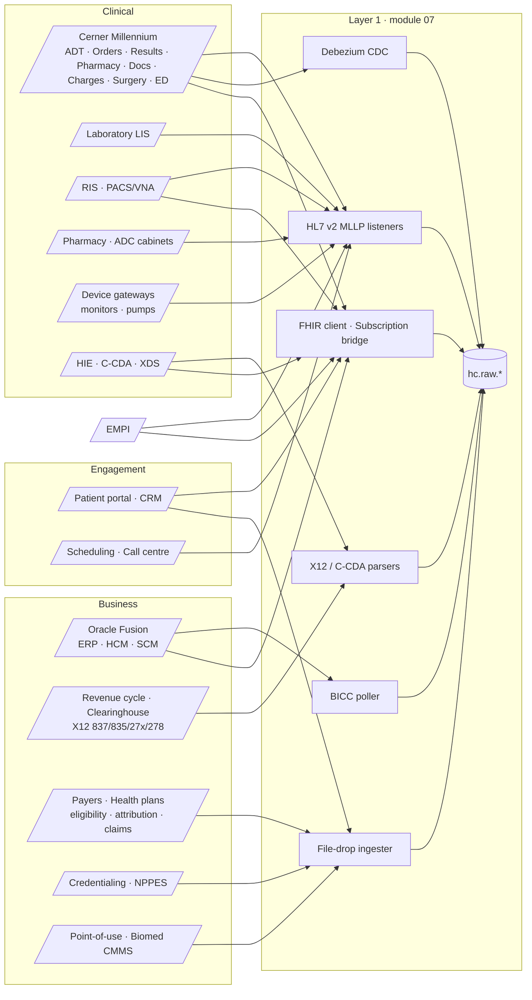

# Source Systems (Module 03)

## 1. Scope

This module specifies **every system that feeds HEALIX**, how each is extracted, how extractions are registered,
and how source elements are mapped to the `std` and `canonical` (FHIR R4 / HEALIX-ERP) layers. It owns two
cross-module contracts referenced in `01-architecture-overview.md` §6:

1. **Source Registry & Data Element Catalog** (§4 of this document) — the machine-readable inventory that
   Stage 0 of the Ontology Pipeline (module 02) consumes, that the EDW (05), DQ (09) and governance (11) modules
   key on, and that `agent.inventory` maintains.
2. **Mapping Specification** (`04-source-to-canonical-mapping.md`) — the format in which `agent.source_mapper`
   expresses source → `std` → FHIR mappings, and the lifecycle under which they are evaluated and approved.

In scope: Cerner Millennium (Oracle Health), Oracle Fusion Cloud ERP/HCM/SCM, and the peripheral classes listed in
`00-vision-and-scope.md` §6. Out of scope: Kafka topology and connector runtime (module 07), FHIR profile
authoring and terminology server behaviour (module 06), DQ rule semantics (module 09), entity resolution
algorithms (module 08), PHI policy text (module 11). This module *declares* what each source needs from those
modules; it does not re-specify them.

| Doc | Title | Prefix of requirements |
|-----|-------|------------------------|
| `README.md` (SRC-00) | This overview; Source Registry contract | `SRC-REG-NNN` |
| `01-cerner-millennium.md` (SRC-01) | Cerner Millennium clinical system of record | `SRC-CER-NNN` |
| `02-oracle-fusion.md` (SRC-02) | Oracle Fusion Cloud ERP · HCM · SCM | `SRC-OFC-NNN` |
| `03-peripheral-systems.md` (SRC-03) | LIS, RIS/PACS, pharmacy, RCM, payers, HIE, portal, devices, credentialing, supply peripherals, EMPI | `SRC-PER-NNN` |
| `04-source-to-canonical-mapping.md` (SRC-04) | Mapping specification contract, lifecycle, coverage | `SRC-MAP-NNN` |

## 2. Source landscape



Every arrow above is one or more **registered interfaces** in the Source Registry. An interface that is not in the
registry cannot have a topic in the topic catalog (module 07) nor a mapping spec (SRC-04).

## 3. Design principles for sources

1. **Capture faithfully, interpret later.** `hc.raw.*` holds the byte-exact message, row image or file with
   transport metadata. Nothing is dropped or re-coded before `std`.
2. **One business key per entity per source.** Each registered entity declares the source natural key (for example
   `ENCOUNTER.ENCNTR_ID`, `PO_HEADERS_ALL.PO_HEADER_ID`) used for idempotency, compaction and entity resolution.
3. **Local codes are first-class.** Every source code system (Cerner code sets, Fusion lookup types, LIS test
   codes) is registered as a `CodeSystem` with a stable URI so Stage 1 of the Ontology Pipeline can harvest it.
4. **PHI classification travels with the element.** Each data element carries a classification drawn from the
   module 11 taxonomy (GOV-01 §3, the `hc-phi-class` value set): `phi:direct`, `phi:quasi`, `phi:clinical`,
   `phi:sensitive-category/{sud,hiv,mental-health,reproductive,genetic}`, `pii:workforce`, `confidential:financial`,
   `confidential:operational`, `internal`, `public`, `deidentified:safe-harbor`, `deidentified:expert`,
   `pseudonymised`. The value is consumed by module 11 masking policy; unclassified elements default to `phi:direct`.
5. **Prefer vendor-supported channels; keep a fallback.** Vendor APIs and CDC are primary; CCL/SQL/file extracts
   are fallbacks declared in the registry with the reason they exist.

## 4. Source Registry contract

### 4.1 Purpose and consumers

The Source Registry is the system of record for *what exists upstream*. It is stored as versioned YAML in
`03-source-systems/registry/` (one file per source), loaded into the G9 `governance` subject area
(`edw_g9_governance.dim_source_system`, `dim_data_element`) and into the knowledge graph as
`healix:SourceSystem`, `healix:Interface` and `healix:DataElement` individuals.

| Consumer | What it reads |
|----------|---------------|
| Module 02 Stage 0 (metadata inventory) | Sources, interfaces, elements, local code systems, stewards |
| Module 05 EDW | `dim_source_system` conformed dimension; element → column lineage |
| Module 07 Streaming | Topic allocation requires `interface_id`; connector manifests reference `transport` |
| Module 09 DQ | Element classification, cardinality, criticality → rule derivation and thresholds |
| Module 11 Governance | PHI class per element, data-sharing basis, retention class |
| Module 10 Agents | `agent.inventory` writes; `agent.source_mapper` reads elements to propose mappings |

### 4.2 Registry record schema (YAML)

```yaml
# registry/cerner-millennium-prod.yaml  (abbreviated; field reference in §4.3)
source:
  source_id: cerner-millennium-prod            # stable slug; never reused
  display_name: Cerner Millennium (Oracle Health) — Production
  vendor: Oracle Health
  product: Millennium
  product_version: "2018.01 code level or later (illustrative)"
  system_class: ehr                            # ehr | erp | hcm | scm | lis | ris | pacs | pharmacy | rcm | payer | hie | portal | crm | device_gateway | credentialing | cmmss | empi | other
  system_of_record_for: [patient_demographics, encounter, order, result, medication_admin, clinical_document, charge]
  stewardship:
    business_steward: role:clinical-data-steward
    technical_owner: team:integration-engineering
    privacy_contact: role:privacy-officer
  environments:
    prod: { network_zone: clinical-dmz, vpn_or_link: expressroute-clinical, change_window: "Sun 02:00-06:00 local" }
    uat:  { network_zone: nonprod,      masked: true }
  interfaces:
    - interface_id: cerner-adt-hl7v2
      pattern: hl7v2_mllp                      # see §4.5 taxonomy
      direction: inbound                       # relative to HEALIX
      transport: { protocol: mllp, port: 2575, tls: mutual, ack_mode: original, max_msg_kb: 512 }
      hl7:
        version: "2.5.1"
        sending_application: CERNER
        sending_facility: "{FACILITY_MNEMONIC}"
        trigger_events: [ADT^A01, ADT^A02, ADT^A03, ADT^A04, ADT^A05, ADT^A06, ADT^A07, ADT^A08, ADT^A11, ADT^A13, ADT^A31, ADT^A40]
        conformance_profile: profiles/hl7v2/cerner-adt-2.5.1.xml
      ordering_key: PID-3[MRN] + PV1-19
      idempotency_key: MSH-10
      topics: { raw: hc.raw.cerner.adt.hl7v2.v1, std: hc.std.cerner.adt.hl7v2-parsed.v1 }
      phi_class: phi:direct                    # module 11 tag; most restrictive class carried (PID names, SSN)
      volume: { per_day_typical: 450000, per_day_peak: 900000 }
      latency_sla: { p95_seconds_to_canonical: 5 }
      schedule: continuous
      status: active
    - interface_id: cerner-cdc-core
      pattern: cdc_log
      direction: inbound
      transport: { connector: debezium-oracle, replica: millennium-ro-replica, mining: logminer, snapshot_mode: initial }
      cdc:
        schema: V500                           # illustrative Millennium schema owner
        tables: [PERSON, PERSON_ALIAS, ENCOUNTER, ENCNTR_ALIAS, CLINICAL_EVENT, ORDERS, ORDER_DETAIL,
                 DIAGNOSIS, PROCEDURE, PROBLEM, ALLERGY, MED_ADMIN_EVENT, CODE_VALUE, NOMENCLATURE,
                 PRSNL, ORGANIZATION, LOCATION, CHARGE]
        soft_delete_columns: [ACTIVE_IND, END_EFFECTIVE_DT_TM]
        optimistic_lock_column: UPDT_CNT
      ordering_key: table primary key
      idempotency_key: SCN + table + pk
      topics: { raw: hc.raw.cerner.cdc.<table>.avro.v1, std: hc.std.cerner.cdc.<table>.typed.v1 }   # pattern: one catalog topic per table, e.g. hc.raw.cerner.cdc.encounter.avro.v1
      phi_class: phi:direct                    # PERSON/ENCOUNTER carry direct identifiers; PRSNL is pii:workforce, CODE_VALUE/ORGANIZATION internal
      latency_sla: { p95_seconds_to_canonical: 5 }
      status: active
  code_systems:
    - { uri: "urn:healix:cs:cerner:code-value", display: "Millennium CODE_VALUE (all code sets)", kind: local, harvest: cdc }
    - { uri: "urn:healix:cs:cerner:nomenclature", display: "Millennium NOMENCLATURE", kind: local-bridge, harvest: cdc }
  data_elements_ref: registry/elements/cerner-millennium-prod.elements.yaml
  prov_agent_iri: https://ontology.healix.example.org/prov/agent/source/cerner-millennium-prod
  lifecycle: { status: active, registered_at: 2026-10-17, registered_by: agent.inventory, approved_by: role:clinical-data-steward }
```

A **data element record** (one per column, HL7 field, FHIR element or file column):

```yaml
- element_id: cerner.encounter.encntr_type_cd
  source_id: cerner-millennium-prod
  interface_id: cerner-cdc-core
  container: ENCOUNTER                          # table / segment / resource / file
  name: ENCNTR_TYPE_CD
  datatype: number(20)                          # source-native type
  semantic_type: coded                          # identifier | coded | quantity | datetime | text | reference | boolean | money
  code_system_ref: "urn:healix:cs:cerner:code-value|71"   # code set 71 = Encounter Type (illustrative)
  nullable: false
  business_key_part: false
  phi_class: phi:clinical                       # module 11 tag (GOV-01 §3): coded clinical attribute of an identifiable patient
  criticality: critical                         # critical | important | informational (drives DQ thresholds)
  description: "Encounter type as configured locally; feeds Encounter.class and Encounter.type"
  steward_notes: "Site adds new code values at go-lives; harvest weekly"
  ontology_binding: https://ontology.healix.example.org/clinical/encounterType
  first_seen: 2026-10-17
  last_profiled: 2026-10-17
  profile: { distinct: 38, null_pct: 0.0, top_values_ref: profiles/cerner.encounter.encntr_type_cd.json }
```

### 4.3 Field reference (normative)

| Field | Required | Rule |
|-------|----------|------|
| `source_id` | yes | `^[a-z0-9-]{3,48}$`; immutable; retirement sets `lifecycle.status: retired`, record is never deleted |
| `system_class` | yes | Closed enumeration (above); maps to `dim_source_system.system_class` |
| `stewardship.*` | yes | Role or team references resolvable in module 11 directory; a named person is not allowed |
| `interfaces[].pattern` | yes | One of the taxonomy codes in §4.5 |
| `interfaces[].ordering_key` / `idempotency_key` | yes | Expression over the raw payload; module 07 uses it for partitioning and exactly-once |
| `interfaces[].topics.raw` / `.std` | yes | Must follow `hc.<layer>.<domain>.<entity>.<format>.v<N>`; `domain` for raw and std is the source slug (`cerner`, `fusion`, `lis`, …); every concrete name MUST exist in `07-streaming-platform/topics.yaml` (placeholders such as `<table>` denote a per-table family of catalog topics) |
| `interfaces[].phi_class` | yes | Most restrictive module 11 tag (`hc-phi-class` value, GOV-01 §3) of any element carried; equals the `phi_class` of the interface's topics in `topics.yaml` |
| `interfaces[].latency_sla` | yes | Must be ≤ `ARC-NFR-001` for the pattern class |
| `code_systems[].uri` | yes if any coded element | Registered in the Terminology Service as a `CodeSystem` (module 06) before mapping approval |
| `data_elements_ref` | yes | Every element referenced by a mapping spec must exist here |
| `prov_agent_iri` | yes | PROV-O agent used as `prov:wasAttributedTo` on all facts from this source |

### 4.4 Registry lifecycle

```mermaid
stateDiagram-v2
  [*] --> discovered: agent.inventory finds schema / endpoint / feed
  discovered --> profiled: elements profiled, PHI auto-classified
  profiled --> proposed: registry record generated, steward assigned
  proposed --> approved: steward + privacy_guardian sign off
  approved --> active: topics allocated, connector deployed, first mapping approved
  active --> drifted: schema/code-set drift detected (agent.dq_monitor)
  drifted --> active: record revised, mappings re-evaluated
  active --> retired: source decommissioned; history retained
  retired --> [*]
```



### 4.5 Extraction pattern taxonomy

| Code | Pattern | Typical sources | Change detection | Ordering / idempotency | Raw format | Latency class |
|------|---------|-----------------|------------------|------------------------|------------|---------------|
| `hl7v2_mllp` | HL7 v2.x over MLLP (TLS) | Cerner feeds, LIS, RIS, pharmacy, ADC, devices, scheduling | Push per trigger event | `MSH-10` control id; `MSH-7` timestamp; per-patient key for partition | HL7 ER7 bytes + headers | real-time (≤ 5 s) |
| `cdc_log` | Log-based CDC (Debezium/LogMiner, GoldenGate) | Millennium Oracle replica | Redo log; `UPDT_DT_TM`/`UPDT_CNT` for reconciliation | SCN + PK | Debezium envelope (Avro) | real-time |
| `fhir_api` | FHIR R4 REST pull (search `_lastUpdated`, `$export` bulk) | Millennium FHIR, portal, HIE, EMPI | `_lastUpdated`, bulk since-timestamp | `Resource.id` + `meta.versionId` | FHIR JSON | near-real-time (1–15 min) |
| `fhir_subscription` | FHIR Subscription / webhook push | Partner FHIR servers, portal | Push | `Resource.id` + `meta.versionId` | FHIR JSON | real-time |
| `bicc_extract` | Oracle BI Cloud Connector view-object extracts to UCM/OCI Object Storage | Oracle Fusion ERP/HCM/SCM | Incremental by `LAST_UPDATE_DATE`; PK extract for deletes | PVO primary key + `LAST_UPDATE_DATE` | Zipped CSV + manifest | batch (15 min – 24 h) |
| `rest_api_poll` | Vendor REST API poll (Fusion `/fscmRestApi`, `/hcmRestApi`; CRM, CMMS) | Fusion, CRM, biomed | `lastUpdateDate` filter | Vendor id + updated timestamp | JSON | near-real-time |
| `business_event` | Vendor event bus (Oracle Integration Cloud / ERP business events) | Oracle Fusion | Push | Event id | JSON (CloudEvents envelope) | real-time |
| `x12_edi` | X12 005010 interchanges (SFTP/AS2/API) | Clearinghouse, payers | File arrival | `ISA13` + `ST02` | X12 EDI bytes | batch / daily |
| `ccda_document` | C-CDA 2.1 documents via IHE XDS.b / XCA / Direct | HIE, external providers | Document registry query or push | `ClinicalDocument/id` + `setId/versionNumber` | XML | near-real-time |
| `dicomweb_metadata` | DICOMweb QIDO-RS / WADO-RS metadata only | PACS/VNA | Study/series `StudyDate` + instance count | StudyInstanceUID | DICOM JSON | near-real-time |
| `file_drop` | Flat file (CSV/Parquet/fixed) via SFTP/object storage | Payer files, NPPES, biomed, credentialing | File arrival + manifest hash | File hash + row number | bytes | batch |

Every pattern lands in `hc.raw.*` with headers `hc-source-id`, `hc-interface-id`, `hc-source-time`,
`hc-event-time`, `hc-phi-class`, `hc-capture-ulid` (module 07 header contract).

### 4.6 Onboarding checklist for a new source

| # | Step | Owner | Artefact / gate |
|---|------|-------|-----------------|
| 1 | Discover candidate (schema crawl, API capability statement, interface spec) | `agent.inventory` | discovery report |
| 2 | Classify system class, system-of-record scope, overlaps with existing sources | `agent.inventory` + steward | registry draft |
| 3 | Profile elements (types, nulls, cardinality, sample values, code distributions) in non-prod with masking | `agent.inventory` | `profiles/*.json` |
| 4 | Auto-classify each element with a module 11 tag (`hc-phi-class` value); privacy review of classification | `agent.privacy_guardian` | PHI matrix signed |
| 5 | Register local code systems in Terminology Service | `agent.terminology_steward` | `CodeSystem` resources |
| 6 | Choose extraction pattern; document fallback; estimate volume and latency | Integration Engineer | interface record |
| 7 | Allocate topics and schema subjects; register Avro/JSON schemas | module 07 | topic catalog PR |
| 8 | Author mapping specs to `std` and canonical; run against golden records | `agent.source_mapper`, `agent.evaluator` | SRC-04 lifecycle |
| 9 | Derive DQ rules from element metadata and ontology constraints | `agent.dq_author` | rule pack entries |
| 10 | Connectivity: firewall, certificates, service account, least-privilege grants | Platform SRE + source owner | connectivity test report |
| 11 | Replay test: raw → canonical reprocessing idempotent | module 07 / 09 | test evidence |
| 12 | Steward approval; status → `active`; changelog published | steward, `agent.release_manager` | signed release |

### 4.7 Environment and connectivity assumptions

- Cerner Millennium is hosted (Oracle Health CernerWorks/remote hosted or on-premises); HL7 v2 feeds originate from
  the site's integration engine (Cerner Open Engine/FSI or a third-party engine). HEALIX receives a *copy* of the
  outbound feeds; it never sits in the clinical interface path and never ACKs on behalf of a clinical consumer.
- A **read-only Millennium Oracle replica** (Oracle Data Guard standby opened read-only, GoldenGate target, or a
  HealtheIntent/Oracle Health data replica) is available with supplemental logging sufficient for LogMiner. If no
  replica exists, CDC is replaced by scheduled CCL/SQL delta extracts (`SRC-CER-014`).
- Oracle Fusion Cloud is SaaS; connectivity is HTTPS only (BICC → UCM/OCI Object Storage, REST, OIC). No database
  access exists. Service accounts use OAuth2 (IDCS/IAM) or Fusion user credentials in a vault.
- Peripheral systems reach HEALIX through the site integration engine for HL7 v2 (one MLLP endpoint per source per
  environment) and through SFTP/object storage for files.
- Non-production environments carry **masked or synthetic** data only (`ARC-NFR-003`); production credentials are
  never present in `dev`/`test`.
- All inbound endpoints are mTLS; outbound calls pin the vendor CA; secrets rotate ≤ 90 days.

## 5. Requirements (registry)

> **SRC-REG-001** (P0, test) — Every interface producing to `hc.raw.*` MUST reference an `interface_id` present in
> the Source Registry with `lifecycle.status` ∈ {`approved`, `active`}; the topic-catalog linter rejects others.

> **SRC-REG-002** (P0, test) — Every registry record MUST validate against `registry/schema/source-registry.schema.json`
> (fields in §4.3) in CI before merge.

> **SRC-REG-003** (P0, inspection) — Every data element referenced by a mapping spec (SRC-04) MUST exist in the
> element catalog with `phi_class` (a module 11 tag, GOV-01 §3), `semantic_type` and `criticality` populated.

> **SRC-REG-004** (P0, test) — Every coded element MUST reference a `code_system_ref` whose URI is registered as a
> FHIR `CodeSystem` in the Terminology Service before the owning interface can become `active`.

> **SRC-REG-005** (P0, inspection) — `stewardship.business_steward`, `technical_owner` and `privacy_contact` MUST be
> role or team references; records naming individuals are rejected.

> **SRC-REG-006** (P1, test) — `agent.inventory` MUST re-profile every active interface at least weekly and raise a
> `drift` change request when a new column, segment, code set or ≥ 5 % distribution shift is detected.

> **SRC-REG-007** (P0, test) — Registry changes MUST be versioned in Git with a signed release; `retired` records are
> retained indefinitely and remain queryable in `dim_source_system`.

> **SRC-REG-008** (P1, demo) — The registry MUST be queryable from the knowledge graph (`healix:SourceSystem`,
> `healix:Interface`, `healix:DataElement`) and from `edw_g9_governance`, with identical `source_id` keys.

> **SRC-REG-009** (P0, inspection) — Each interface MUST declare `ordering_key`, `idempotency_key` and `latency_sla`;
> an SLA looser than `ARC-NFR-001` for its pattern class requires an approved exception in module 12.

> **SRC-REG-010** (P1, test) — Interfaces whose `pattern` is a fallback (`ccl_extract`, `file_drop` replacing an
> API) MUST record `fallback_for` and `fallback_reason`; the orchestrator reports fallback share monthly.

> **SRC-REG-011** (P0, inspection) — A new source MUST complete all twelve onboarding steps (§4.6); steps 4 and 12
> require human sign-off and cannot be auto-approved by any agent.

> **SRC-REG-012** (P2, analysis) — The registry SHOULD record for each interface the vendor's deprecation status
> (for example Millennium DSTU2 → R4 API migration) and a review date.

## 6. Requirement index for the module

| Range | Document | Count (initial) |
|-------|----------|-----------------|
| `SRC-REG-001`–`012` | README (registry) | 12 |
| `SRC-CER-001`–`024` | 01 Cerner Millennium | 24 |
| `SRC-OFC-001`–`022` | 02 Oracle Fusion | 22 |
| `SRC-PER-001`–`036` | 03 Peripheral systems | 36 |
| `SRC-MAP-001`–`018` | 04 Source-to-canonical mapping | 18 |

P0 requirements in this module are verified by: registry schema tests, topic-catalog linter, mapping golden-record
suites, connector replay tests and PHI classification review, as referenced in
`13-roadmap-and-acceptance/02-acceptance-criteria.md`.
