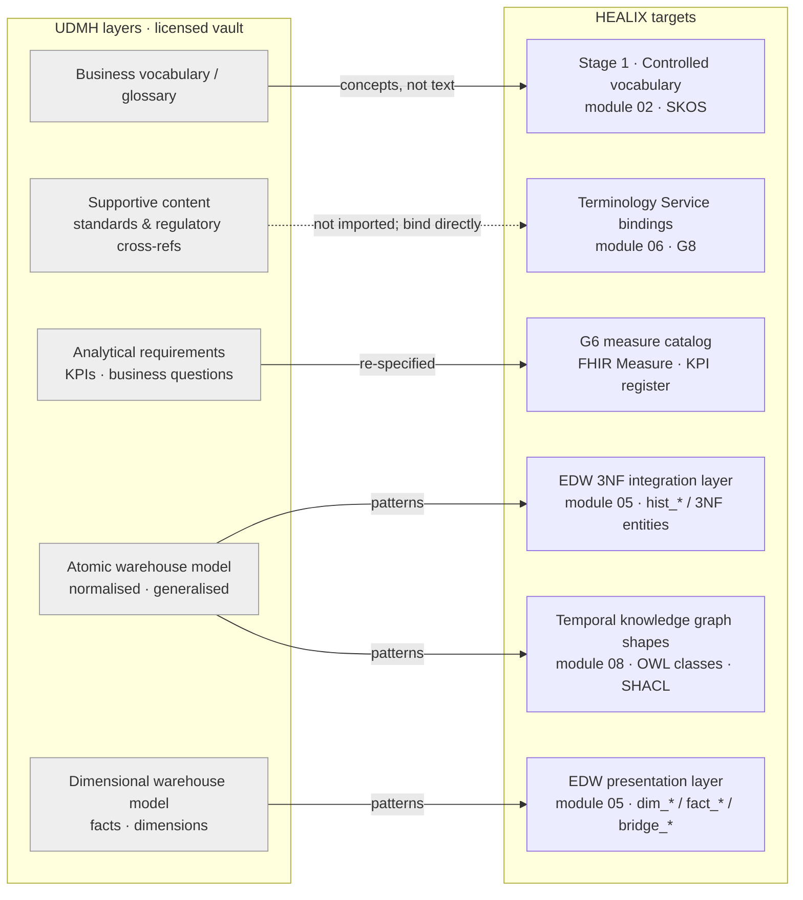

# IBM Unified Data Model for Healthcare (UDMH) as a Blueprint

> **IP notice.** UDMH is a commercial, licensed IBM product. This document describes its *publicly known structure*
> (layers, modelling style, intended use) and how HEALIX consumes that structure. It contains no proprietary entity,
> attribute, glossary or diagram content. All entity names below are illustrative, generic healthcare entities
> authored for HEALIX. A valid UDMH licence is required before any blueprint material is loaded into the model vault.

## 1. What UDMH is, structurally

UDMH belongs to the family of IBM industry data models. At the level relevant to this PRD it is a set of
**layered, pre-built modelling components** intended to accelerate the design of an enterprise healthcare data
warehouse and its analytical layer. The components are typically delivered for a vendor modelling tool and are
meant to be *customised* by the licensee rather than deployed as-is.

| Layer (publicly described) | Nature | Intended use in a conventional UDMH project |
|----------------------------|--------|---------------------------------------------|
| **Business vocabulary / glossary** | Hierarchically organised business terms with definitions, cross-referenced to model elements | Common language between business and IT; seed for a business glossary tool |
| **Supportive content** | Mappings and cross-references from the model to external standards and regulatory reporting needs | Show how model elements relate to industry standards and compliance reporting |
| **Analytical requirements** | Business questions, KPIs and report-level requirements grouped by analytical theme | Drive scope of marts; trace requirement → data element |
| **Atomic warehouse model (AWM)** | Normalised (3NF-leaning), enterprise-wide logical model with generalised supertypes and subtypes | Integration layer of the warehouse; system-of-record for history |
| **Dimensional warehouse model (DWM)** | Star/snowflake structures (facts, dimensions) derived from the atomic model | Presentation / mart layer for BI tooling |

Two modelling traits matter for harmonisation:

- **Generalisation.** UDMH-style models lean heavily on abstract supertypes (a party, an agreement, an event, a
  location, a classification) specialised into healthcare-specific subtypes. This is the trait we reuse most.
- **Requirement traceability.** Analytical requirements are traceable to atomic and dimensional elements. We reuse
  the *idea* (trace a KPI to its grain and its source attributes) in the G6 measure catalog, not the content.

## 2. Mapping UDMH layers to HEALIX pipeline stages

| UDMH layer | HEALIX stage / artefact | What crosses the boundary | What does not |
|------------|-------------------------|---------------------------|---------------|
| Business vocabulary | Stage 1 controlled vocabulary (`agent.vocabulary_curator`) | *Which* concepts need a governed term; their grouping; the fact that a definition is needed | Glossary text, definitions, term hierarchies as authored by the vendor |
| Supportive content | Terminology Service (module 06) and G8 reference | Awareness that an element is standard-bound (e.g. "diagnosis code is ICD-10-CM") | Vendor cross-reference tables; HEALIX binds to SNOMED CT, LOINC, ICD-10, X12 directly |
| Analytical requirements | G6 measure catalog; module 05 fact grain decisions | Analytical *themes* (utilisation, cost, quality, access, workforce) and the discipline of tracing a KPI to grain and attributes | KPI definitions as authored; HEALIX measures are FHIR `Measure` resources or HEALIX measure definitions with ontology IRIs |
| Atomic warehouse model | EDW 3NF integration layer; KG OWL class skeletons | Generalisation patterns listed in §4; subject-area intent | Entity/attribute lists, keys, domains, diagrams |
| Dimensional warehouse model | EDW presentation layer | Fact/dimension shaping heuristics (grain declaration, conformed dimension reuse, bridge for many-to-many) | Star schemas as authored |

## 3. UDMH-style subject areas → G1–G9

The left column lists subject areas in **generic terms** describing the *kind* of area a UDMH-style healthcare model
organises its content into; these are HEALIX descriptions, not the vendor's names or structure. Primary group = where
the area's core entities live; secondary = where projections or roles land.

| UDMH-style area (generic description) | Primary group | Secondary group(s) | Notes |
|---------------------------------------|---------------|--------------------|-------|
| Parties — individuals and organisations, their identifiers, contact points, relationships | **G1** Party & Identity | G5 (worker role), G3 (payer role) | Core of the party/role pattern |
| Healthcare roles — patient, member, provider, practitioner, caregiver | **G1** | G2, G3, G6 | Roles are time-bounded party roles, see RDM-03 §3.4 |
| Agreements — coverage, contracts, authorisations, consents | **G3** Revenue Cycle & Finance | G1 (party–agreement), G9 (consent & directive), G4 (supplier contract) | Agreement pattern is reused in three groups |
| Healthcare events — encounters, episodes, admissions, visits | **G2** Clinical Care | G3 (charges), G6 (utilisation) | Event/activity pattern |
| Clinical observations, conditions, procedures, medications | **G2** | G6, G7 | FHIR clinical resource family |
| Claims and adjudication, payments, remittances | **G3** | G6 (cost measures) | Claim lifecycle pattern taken from HCDM style (RDM-02 §4.3) |
| Products and services — plans, benefits, service catalogues, supply items | **G4** Supply Chain & Operations (items) and **G3** (plans/benefits) | G8 (service line) | Split by nature: tangible item vs insurance product |
| Resources and facilities — locations, beds, equipment, assets | **G4** | G1 (Location conformed dimension) | Location pattern |
| Finance and accounting — ledgers, cost centres, budgets | **G3** | G4 (procurement cost), G5 (payroll aggregates) | Oracle Fusion ERP primary |
| Workforce and staffing | **G5** Workforce | G1 (worker as party role) | Oracle Fusion HCM primary |
| Programs, campaigns, population segments, outreach | **G6** Population Health & Quality | G7 | Measures and registries |
| Research, studies, cohorts | **G7** Research & Analytics | G2, G9 (consent) | Thin in blueprint; FHIR `ResearchStudy` anchors |
| Classifications, code sets, calendars, geography | **G8** Reference & Terminology | all | Classification pattern |
| Metadata, data lineage, audit | **G9** Metadata, Quality & Governance | — | Mostly platform-native; blueprint contributes little |

**Rule.** Every area in this table has exactly one primary group (RDM-UDMH-003). If a future blueprint release
introduces an area not listed, `agent.schema_architect` **MUST** propose its placement through a change request;
G1–G9 are not extended.

## 4. What we take and what we leave

### 4.1 Patterns adopted

Each adopted pattern becomes a tag `pattern: <id>` on entities in the Logical Model Register (RDM-03 §5). The
description is HEALIX's own; the blueprint is credited as the *inspiration*.

| Pattern id | Shape (HEALIX description) | Groups where instantiated | Illustrative HEALIX entities (generic) |
|------------|---------------------------|---------------------------|----------------------------------------|
| `party-role` | One `Party` supertype (Person, Organization) plays zero or more time-bounded `PartyRole`s (Patient, Member, Practitioner, Payer, Employee, Supplier). Identifiers attach to party *and* to role where the issuer is role-specific (MRN, NPI, member id). | G1, G3, G5 | Party, Person, Organization, PartyRole, PartyIdentifier, PartyRelationship |
| `event-activity` | An `Event` supertype with timestamp, status and participants; healthcare subtypes (Encounter, Procedure, Observation, Administration) and business subtypes (Order, Claim submission, Receipt). Events reference the roles that participated, not raw parties. | G2, G3, G4 | Event, Encounter, ClinicalEvent, BusinessEvent, EventParticipation |
| `agreement` | An `Agreement` with parties-in-roles, term (valid period), terms/conditions as structured items; subtypes Coverage, Contract, Authorization, Consent. | G3, G4, G9 | Agreement, AgreementParty, AgreementTerm, Coverage, SupplierContract, Consent |
| `location` | A `Location` hierarchy (campus → building → unit → room → bed) plus postal/geo addresses as distinct from service locations; physical and logical locations separated. | G4, G1 (conformed) | Location, LocationHierarchy, Address, GeoPoint |
| `classification` | Any coded attribute references a `Concept` in a `ConceptScheme`, with version and mapping to external code systems through the Terminology Service; classifications are never free text. | G8, all | ConceptScheme, Concept, ConceptMapping, ClassificationAssignment |
| `measure` | A `MeasureDefinition` (numerator, denominator, exclusions, stratifiers, period) traced to source attributes and grain; `MeasureResult` per subject/population/period. | G6 | MeasureDefinition, MeasureResult, MeasurePopulation, Stratifier |

### 4.2 Left behind (deliberately)

| Blueprint element | Decision | Reason |
|-------------------|----------|--------|
| Entity and attribute lists, keys, domains | **Not used** | Licensed content; HEALIX authors its own with FHIR naming precedence |
| Glossary definitions | **Not used** | Licensed text; Stage 1 definitions are written by curators/agents and reviewed |
| Supportive-content standard cross-references | **Not imported** | HEALIX binds to standards through the Terminology Service; importing a vendor's crosswalk would create a second, stale source of truth (RDM-UDMH-009) |
| Pre-built dimensional star schemas | **Not used verbatim** | Presentation layer is generated from the register and KPI catalog; only shaping heuristics are reused (RDM-UDMH-006) |
| Modelling-tool-specific metadata and exchange formats | **Not used** | Register is YAML/JSON Schema; DDL is generated by module 05 |
| Payer-centric assumptions on member as the central party | **Adapted** | HEALIX is provider-centric with payer interactions; Person is central, Member and Patient are roles (RDM-03 §3.5) |

### 4.3 Pattern divergence log

Where a HEALIX entity knowingly departs from the blueprint pattern it was inspired by, the departure is recorded in
the register release notes:

| Field | Content |
|-------|---------|
| `divergence_id` | `DIV-UDMH-NNN` |
| `pattern` | pattern id from §4.1 |
| `healix_entity` | register entity id |
| `departure` | one sentence: what differs |
| `rationale` | FHIR alignment, bitemporal requirement, source reality, performance |
| `approved_by` | role, date |

## 5. Licensing and handling rules

1. UDMH material lives in a **licensed model vault** (document store with licence-seat ACLs) outside Git, outside
   the knowledge graph and outside Kafka.
2. Agents access the vault only through the `blueprint.lookup` tool (module 10), which returns **pattern summaries
   and subject-area placement** and refuses requests for entity/attribute enumerations; every call is logged with
   the licence seat used.
3. Persisted agent memory, evaluation traces and change requests **MUST NOT** contain blueprint text. The
   `agent.privacy_guardian` IP filter (module 11) scans change requests for licensed-content markers before merge.
4. Human reviewers who consult UDMH directly record only the *decision* in the register, never excerpts.
5. The UDMH release used is pinned in `register/meta.yaml` (`blueprints.udmh.release`, `licence_ref`,
   `vault_uri`) so that pattern provenance is auditable without exposing content.

## 6. Requirements

> **RDM-UDMH-001** (P0, inspection) — The repository, generated DDL, ontology artefacts and agent memory stores MUST NOT
> contain UDMH entity names, attribute lists, glossary definitions, cross-reference tables or diagrams. A repository
> linter MUST fail the build when a file matches the licensed-content marker set maintained by Legal/IP Review.

> **RDM-UDMH-002** (P0, inspection) — Access to UDMH material MUST be restricted to licensed seats through the model
> vault; agents MUST use the `blueprint.lookup` tool, which returns pattern-level summaries only, and every lookup MUST
> be logged with seat identity, requesting agent and change-request id.

> **RDM-UDMH-003** (P0, analysis) — Every UDMH-style subject area recognised by `agent.schema_architect` MUST be
> assigned exactly one primary group in G1–G9 and zero or more secondary groups in the harmonisation matrix
> (RDM-03 §2); no additional group MAY be created.

> **RDM-UDMH-004** (P1, test) — Concepts derived from the UDMH business vocabulary MUST enter Stage 1 as *candidate*
> SKOS concepts carrying `skos:editorialNote "derived-from: blueprint-pattern <id>"`, with a HEALIX-authored
> `skos:definition`; a candidate whose definition string matches licensed-content markers MUST be rejected.

> **RDM-UDMH-005** (P0, inspection) — Each atomic-model pattern adopted in §4.1 MUST be instantiated as one or more
> register entities tagged `pattern: <id>`; a register release MUST include at least one entity per pattern.

> **RDM-UDMH-006** (P1, analysis) — Dimensional-model heuristics MUST only inform `dim_*`, `fact_*` and `bridge_*`
> presentation objects; the EDW integration layer MUST remain 3NF with bitemporal history (RDM-HAR-004).

> **RDM-UDMH-007** (P1, inspection) — Analytical themes taken from UDMH-style analytical requirements MUST be
> re-specified as HEALIX measure definitions (FHIR `Measure` where expressible) with numerator, denominator,
> exclusions, grain and ontology IRI bindings, and registered in G6; no measure text MAY be copied.

> **RDM-UDMH-008** (P2, inspection) — Every knowing departure from an adopted pattern MUST be recorded as a
> `DIV-UDMH-NNN` entry in the register release notes with rationale and approver.

> **RDM-UDMH-009** (P1, test) — Supportive-content cross-references to external standards MUST NOT be imported; the
> register linter MUST verify that every standard-bound attribute declares a Terminology Service binding
> (`binding.value_set`) rather than a static crosswalk.

> **RDM-UDMH-010** (P1, inspection) — `register/meta.yaml` MUST record the UDMH release identifier, licence reference
> and vault URI used for the current register version; a register release without this metadata MUST be rejected by
> `agent.release_manager`.

## 7. Open questions

| # | Question | Owner | Target |
|---|----------|-------|--------|
| 1 | Does the licence permit storing *pattern summaries generated by agents* in the knowledge graph as governance metadata? | Legal/IP Review | Phase 1 gate |
| 2 | Which analytical themes are in scope for the first G6 measure catalog release (utilisation, readmission, cost per case, access)? | Clinical Quality, Finance | RMP phase 1 |
| 3 | Should the vault expose a diff between blueprint releases so `agent.schema_architect` can detect new areas automatically? | Data Platform | Phase 2 |
