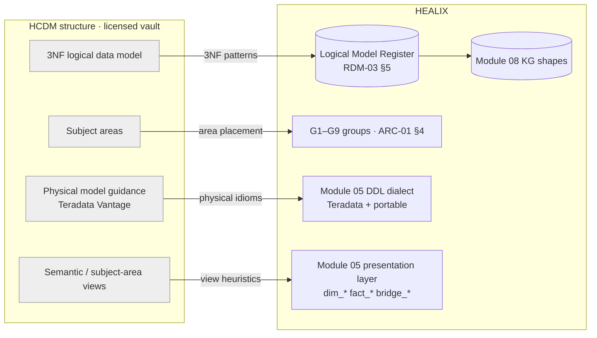
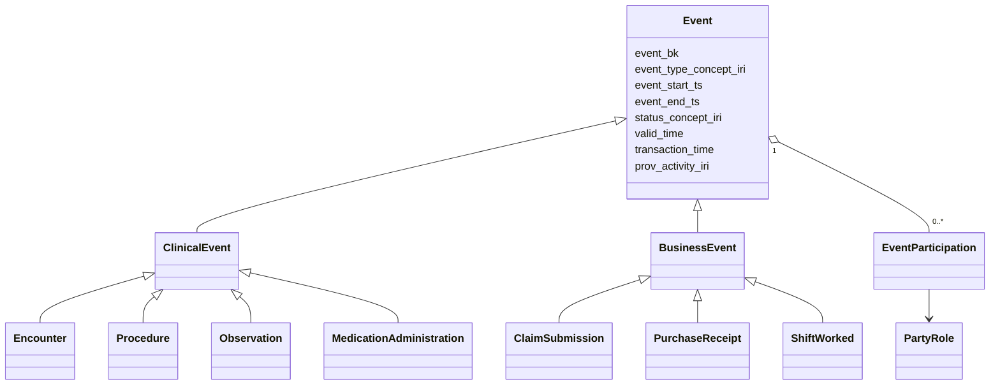
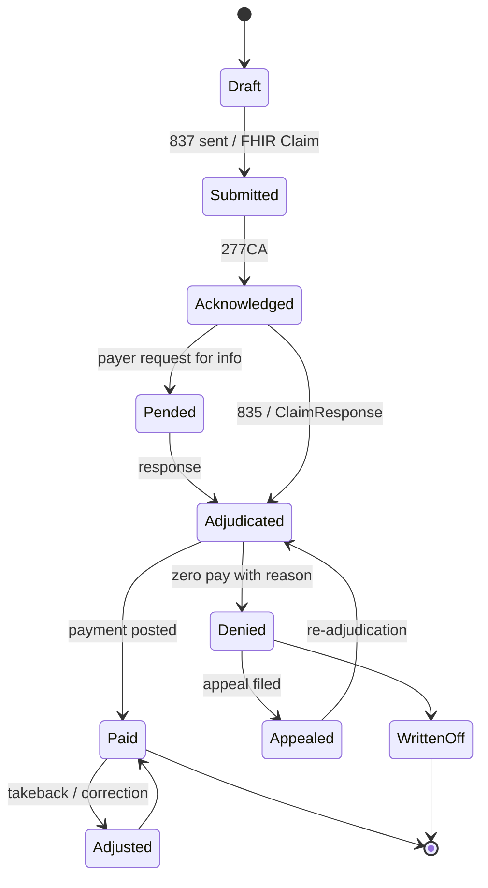

# Teradata Healthcare Data Model (HCDM) as a Blueprint

> **IP notice.** HCDM is a commercial, licensed Teradata product. This document describes its *publicly known
> structure* (normalisation style, subject-area organisation, intended physical implementation) and how HEALIX uses
> that structure. It contains no proprietary entity, attribute or diagram content. Entities named below are
> illustrative, generic healthcare entities authored for HEALIX. A valid HCDM licence is required before any blueprint
> material is loaded into the model vault.

## 1. What HCDM is, structurally

| Aspect (publicly described) | Description | Relevance to HEALIX |
|-----------------------------|-------------|---------------------|
| **Modelling style** | Third-normal-form (3NF) enterprise **logical data model** (LDM); application-neutral; designed to integrate payer and provider data in one model | Matches our 3NF integration layer (RDM-HAR-004) |
| **Organisation** | Healthcare **subject areas** such as party, member/patient, provider, claim, encounter, product/plan, financial, event, agreement, location, reference | Harmonised into G1–G9 (§3) |
| **Supertypes / subtypes** | Generalised party and event supertypes with healthcare subtypes; associative entities for many-to-many relationships; history captured via effective dating | Same party/role and event shapes as UDMH, which makes harmonisation tractable |
| **Physical implementation** | Intended to be instantiated as a **physical data model on Teradata (Vantage)**, exploiting the platform's primary-index distribution, MULTISET tables, partitioning and temporal features | Shapes our reference DDL dialect (§5) and its portable twin |
| **Views / semantic layer** | Subject-area and semantic views layered above the 3NF core for consumption | Mirrors our integration → presentation split |

The HCDM style is **integration-first**: the 3NF core is the system of record for the warehouse, and dimensional or
semantic structures are derived views. HEALIX adopts this stance and adds bitemporality and ontology binding on top.

## 2. Mapping HCDM structure to HEALIX layers



## 3. HCDM-style subject areas → G1–G9

Left column entries are **generic descriptions** of the kinds of subject area a 3NF healthcare LDM is organised into;
they are not the vendor's names or content.

| HCDM-style area (generic description) | Primary group | Secondary group(s) | Harmonisation note |
|---------------------------------------|---------------|--------------------|--------------------|
| Party (individuals, organisations, identifiers, contact mechanisms, relationships) | **G1** | — | Unified with UDMH party pattern into one HEALIX `party-role` instantiation |
| Member / patient (enrolment, eligibility, demographics as roles) | **G1** (roles) + **G3** (coverage) | G6 (attribution) | Member and Patient are roles of Person, never separate people (RDM-HAR-006) |
| Provider (practitioners, facilities, provider organisations, specialities, network participation) | **G1** (roles) | G3 (contracts), G4 (facility as location) | Provider network pattern §4.4 |
| Claim (header, lines, adjudication, payment, adjustment, appeal) | **G3** | G6 (cost/utilisation measures) | Claim lifecycle pattern §4.3; FHIR `Claim`, `ClaimResponse`, `ExplanationOfBenefit` |
| Encounter and clinical event (admissions, visits, diagnoses, procedures, results, medications) | **G2** | G3 (charge capture), G6 | Event hierarchy pattern §4.2 |
| Product / plan (insurance products, benefit packages, coverage tiers) | **G3** | G8 (product classification) | Product/plan pattern §4.5 |
| Financial (transactions, accounts, general ledger, cost allocation) | **G3** | G4, G5 | Financial transaction pattern §4.6; Oracle Fusion ERP primary |
| Agreement / contract (payer–provider contracts, supplier contracts, consents) | **G3** | G4, G9 | Shared `agreement` pattern with UDMH |
| Location / geography | **G4** (service locations) + **G8** (geography) | G1 (conformed dimension) | Physical vs geographic separation |
| Reference / code sets | **G8** | all | Classification pattern; bound through Terminology Service |
| Event (generic business events, outreach, campaign, case management) | **G2** / **G6** by nature | G9 (audit events) | Event supertype shared |
| Pharmacy / drug (prescriptions, fills, formulary) | **G2** (clinical) + **G4** (inventory) + **G3** (pharmacy claims) | G8 (RxNorm/NDC) | Split by nature of fact |

**Rule.** Exactly one primary group per area (RDM-HCDM-002). Where UDMH and HCDM styles place a similar area in
different groups, RDM-03 §3 tie-break rules apply; the resolution is logged.

## 4. Patterns adopted

Each pattern is a HEALIX-authored *shape* tagged on register entities as `pattern: <id>`.

### 4.1 Party / party role

Identical in intent to UDMH's `party-role` (RDM-01 §4.1); the two are **merged** into one HEALIX pattern. HCDM style
contributes the discipline of modelling *contact mechanisms* and *identifiers* as separate time-effective entities,
and *party relationships* (guarantor, employer, parent organisation) as typed, dated associations.

### 4.2 Event hierarchy



Rules: subtypes carry only attributes that are not common; `EventParticipation` links an event to a `PartyRole` with
a participation-type concept (attending, ordering, payer, receiving clerk). Encounter hierarchy (episode → encounter
→ visit segment) is modelled as self-referencing `part_of` on Encounter, aligned with FHIR `Encounter.partOf`.

### 4.3 Claim lifecycle



HEALIX keeps the HCDM-style separation of **claim header**, **claim line**, **adjudication result** (per line, per
adjudication pass) and **payment/remittance** (many-to-many with claims via a bridge), and adds a bitemporal
`ClaimStatusHistory` so "status as of" is answerable. Lifecycle states are a G8 controlled vocabulary
(`scheme/claim-status`) mapped to FHIR `Claim.status` / `ClaimResponse.outcome` and X12 277/835 codes
(RDM-HCDM-009).

### 4.4 Provider network

`ProviderNetwork` (owned by a Payer party role) ⟷ `NetworkParticipation` (time-bounded, with tier and contract
reference) ⟷ `Practitioner`/`ProviderOrganization` roles. Contracts are `Agreement` subtypes. Credentialing status is
*not* part of participation; it lives in G5 `Credential` and is referenced.

### 4.5 Product / plan

`InsuranceProduct` → `Plan` → `BenefitPackage` → `Benefit` (coded service category, cost-share terms). `Coverage`
(G3, FHIR `Coverage`) links a Member role to a Plan for a period. Supply items are **not** products in this sense;
they are G4 `Item` (FHIR-style `SupplyDelivery`/Oracle SCM item master).

### 4.6 Financial transaction

A generic `FinancialTransaction` (amount, currency, transaction-type concept, posting date, counter-party roles,
source document reference) with subtypes Charge, Payment, Adjustment, Refund, JournalLine, PurchaseInvoiceLine.
GL posting is a many-to-one from transaction to `GLJournalLine` via `cost_center`, `account`, `period`. This single
pattern serves Cerner charges, clearinghouse remittances and Oracle Fusion GL/AP/AR.

### 4.7 Left behind

| Element | Decision | Reason |
|---------|----------|--------|
| Entity/attribute lists, keys, domains, diagrams | Not used | Licensed content |
| Payer-centric member hierarchy as the root of identity | Adapted | Person is root; Member is a role (RDM-HAR-006) |
| Effective-dating only (uni-temporal history) | Extended | HEALIX requires bitemporal history (ADR-03) — valid *and* transaction time |
| Vendor semantic-view library | Not used | Presentation objects are generated from the register and G6 catalog |

## 5. Teradata physical considerations that shape the HEALIX DDL dialect

Module 05 publishes reference DDL in **Teradata dialect** with a **portable ANSI variant** (ARC-01 §3). The following
HCDM-style physical idioms are adopted as rules for the Teradata dialect and translated for the portable one.

| Concern | Teradata dialect rule | Portable translation |
|---------|-----------------------|----------------------|
| **Primary index (PI)** | Every table declares `UNIQUE PRIMARY INDEX` or `PRIMARY INDEX` explicitly on the business key or surrogate that drives joins; `NO PRIMARY INDEX` only for `stg_*` landing tables. PI choice MUST be justified by distribution (skew < 10 %) and join access path | Cluster/distribution key (Snowflake cluster by, Databricks liquid clustering, BigQuery clustering) on the same columns |
| **SET vs MULTISET** | `CREATE MULTISET TABLE` by default (no duplicate-row check cost); `SET` only for small reference tables with a justified uniqueness need | Plain `CREATE TABLE`; uniqueness via constraints or DQ rules |
| **Temporal / PERIOD** | `hist_*` and 3NF history entities use `PERIOD(TIMESTAMP(6) WITH TIME ZONE)` columns: `valid_period AS VALIDTIME` and `txn_period AS TRANSACTIONTIME` (system-maintained) — a **native bitemporal option** whose semantics MUST equal module 08's `valid_from/valid_to`, `recorded_at/superseded_at` | Four explicit columns `valid_from`, `valid_to`, `recorded_at`, `superseded_at` (`TIMESTAMP WITH TIME ZONE`, open end = `9999-12-31`) with the same closed-open interval semantics |
| **Partitioning** | Partitioned primary index `PARTITION BY RANGE_N(<date_col> BETWEEN ... EACH INTERVAL '1' MONTH)` on event/posting date for `fact_*`, `hist_*` and event tables; `PARTITION BY COLUMN` for wide, sparsely read analytical tables | Date partitioning (Snowflake micro-partitions by cluster key, Databricks partition/liquid cluster, BigQuery `PARTITION BY DATE`) |
| **Compression** | Multi-value compression on low-cardinality concept-code columns; block-level compression for cold history | Platform default columnar compression |
| **Identifiers** | Max 128 characters; snake_case; no reserved words (e.g. avoid `PERIOD`, `TYPE`, `VALUE`, `ACCOUNT` as bare names — suffix them) | Same naming; portability check against ANSI reserved word list |
| **Surrogates** | Surrogate keys generated by the loader (not `IDENTITY`) to keep KG/EDW keys reproducible | Same |
| **Statistics** | `COLLECT STATISTICS` on PI, partition column and join columns in every migration | Platform-equivalent or none |

### 5.1 Illustrative DDL (generic entity; not blueprint content)

```sql
-- Teradata dialect (module 05 ddl/teradata/edw_g2_clinical/hist_encounter.sql)
CREATE MULTISET TABLE edw_g2_clinical.hist_encounter (
  encounter_sk        BIGINT NOT NULL,
  encounter_bk        VARCHAR(64) NOT NULL,
  patient_sk          BIGINT NOT NULL,
  encounter_class_iri VARCHAR(256) NOT NULL,   -- https://ontology.healix.example.org/clinical/EncounterClass/...
  status_iri          VARCHAR(256) NOT NULL,
  period_start_ts     TIMESTAMP(6) WITH TIME ZONE,
  period_end_ts       TIMESTAMP(6) WITH TIME ZONE,
  source_system_sk    INTEGER NOT NULL,
  prov_activity_iri   VARCHAR(512) NOT NULL,
  valid_period        PERIOD(TIMESTAMP(6) WITH TIME ZONE) NOT NULL AS VALIDTIME,
  txn_period          PERIOD(TIMESTAMP(6) WITH TIME ZONE) NOT NULL AS TRANSACTIONTIME
)
PRIMARY INDEX (encounter_bk)
PARTITION BY RANGE_N(CAST(BEGIN(valid_period) AS DATE)
  BETWEEN DATE '2015-01-01' AND DATE '2035-12-31' EACH INTERVAL '1' MONTH);

COLLECT STATISTICS COLUMN (encounter_bk), COLUMN (patient_sk) ON edw_g2_clinical.hist_encounter;
```

```sql
-- Portable ANSI variant (module 05 ddl/portable/edw_g2_clinical/hist_encounter.sql)
CREATE TABLE edw_g2_clinical.hist_encounter (
  encounter_sk        BIGINT NOT NULL,
  encounter_bk        VARCHAR(64) NOT NULL,
  patient_sk          BIGINT NOT NULL,
  encounter_class_iri VARCHAR(256) NOT NULL,
  status_iri          VARCHAR(256) NOT NULL,
  period_start_ts     TIMESTAMP WITH TIME ZONE,
  period_end_ts       TIMESTAMP WITH TIME ZONE,
  source_system_sk    INTEGER NOT NULL,
  prov_activity_iri   VARCHAR(512) NOT NULL,
  valid_from          TIMESTAMP WITH TIME ZONE NOT NULL,
  valid_to            TIMESTAMP WITH TIME ZONE NOT NULL,
  recorded_at         TIMESTAMP WITH TIME ZONE NOT NULL,
  superseded_at       TIMESTAMP WITH TIME ZONE NOT NULL
);
-- clustering/partitioning expressed per target platform by the module 05 generator
```

Both variants are generated from the **same register entity**; the generator, not a human, chooses the idiom.

## 6. Licensing and handling rules

The rules of RDM-01 §5 apply identically to HCDM material: licensed vault, `blueprint.lookup` tool only,
no blueprint text in Git/KG/Kafka/agent memory, decisions-not-excerpts for human reviewers, and release pinning in
`register/meta.yaml` (`blueprints.hcdm.release`, `licence_ref`, `vault_uri`).

## 7. Requirements

> **RDM-HCDM-001** (P0, inspection) — The repository, generated DDL, ontology artefacts and agent memory stores MUST NOT
> contain HCDM entity names, attribute lists, keys, domains or diagrams; the licensed-content linter of RDM-UDMH-001
> MUST include HCDM markers.

> **RDM-HCDM-002** (P0, analysis) — Every HCDM-style subject area recognised by `agent.schema_architect` MUST be
> assigned exactly one primary group in G1–G9 in the harmonisation matrix (RDM-03 §2); conflicts with UDMH-style
> placement MUST be resolved by RDM-03 §3 rules and logged.

> **RDM-HCDM-003** (P0, inspection) — The patterns in §4.1–§4.6 MUST each be instantiated as register entities tagged
> `pattern: <id>`; the claim lifecycle MUST include header, line, adjudication result, payment bridge and a bitemporal
> status history entity.

> **RDM-HCDM-004** (P0, test) — Every table in the Teradata-dialect DDL MUST declare `UNIQUE PRIMARY INDEX`,
> `PRIMARY INDEX` or `NO PRIMARY INDEX` explicitly, with `NO PRIMARY INDEX` permitted only for `stg_*` tables; the
> register entity MUST carry `physical.teradata.primary_index` and a `distribution_rationale`. The DDL linter MUST fail
> on an implicit PI.

> **RDM-HCDM-005** (P1, test) — Teradata-dialect tables MUST be `MULTISET` unless the register entity sets
> `physical.teradata.set_table: true` with a `justification`; the DDL linter MUST fail a `SET` table without one.

> **RDM-HCDM-006** (P0, test) — Entities with temporal pattern `bitemporal-history` MUST be emitted in Teradata dialect
> with `PERIOD(TIMESTAMP(6) WITH TIME ZONE)` columns `valid_period AS VALIDTIME` and `txn_period AS TRANSACTIONTIME`,
> and in the portable variant with `valid_from/valid_to/recorded_at/superseded_at`; a conformance test MUST prove that
> an as-of query returns identical rows on both variants for the same loaded data.

> **RDM-HCDM-007** (P1, test) — `fact_*`, `hist_*` and event tables projected to exceed 100 M rows MUST declare range
> partitioning on the event/posting/valid-start date in the Teradata dialect and equivalent date partitioning or
> clustering in the portable variant; the register MUST carry `physical.partition_by`.

> **RDM-HCDM-008** (P1, test) — Physical identifiers MUST be snake_case, ≤ 128 characters, ≤ 63 characters where the
> portable target requires it, and MUST NOT be bare ANSI or Teradata reserved words; the DDL linter MUST enforce this.

> **RDM-HCDM-009** (P1, analysis) — Claim lifecycle states (§4.3) MUST be published as the G8 concept scheme
> `scheme/claim-status` with concept maps to FHIR `Claim.status`/`ClaimResponse.outcome` and X12 277/835 status codes.

> **RDM-HCDM-010** (P1, inspection) — `register/meta.yaml` MUST record the HCDM release identifier, licence reference
> and vault URI used for the current register version; a register release without it MUST be rejected by
> `agent.release_manager`.

## 8. Open questions

| # | Question | Owner | Target |
|---|----------|-------|--------|
| 1 | Do we use Teradata system-maintained `TRANSACTIONTIME` or loader-maintained periods to keep EDW and KG transaction time byte-identical? | Data Platform, module 08 owner | Phase 1 gate |
| 2 | Column partitioning vs row partitioning for wide `Observation` history — benchmark needed | Platform Engineering | Phase 2 |
| 3 | Is the HCDM licence seat count sufficient for agent tool access to be modelled as a named seat? | Legal/IP Review | Phase 1 gate |
