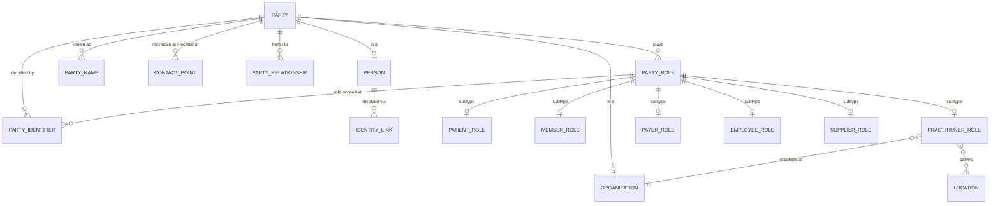
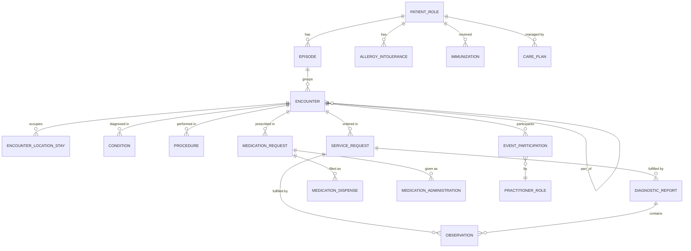
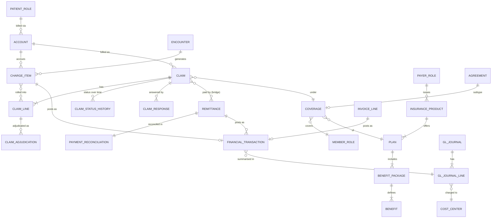
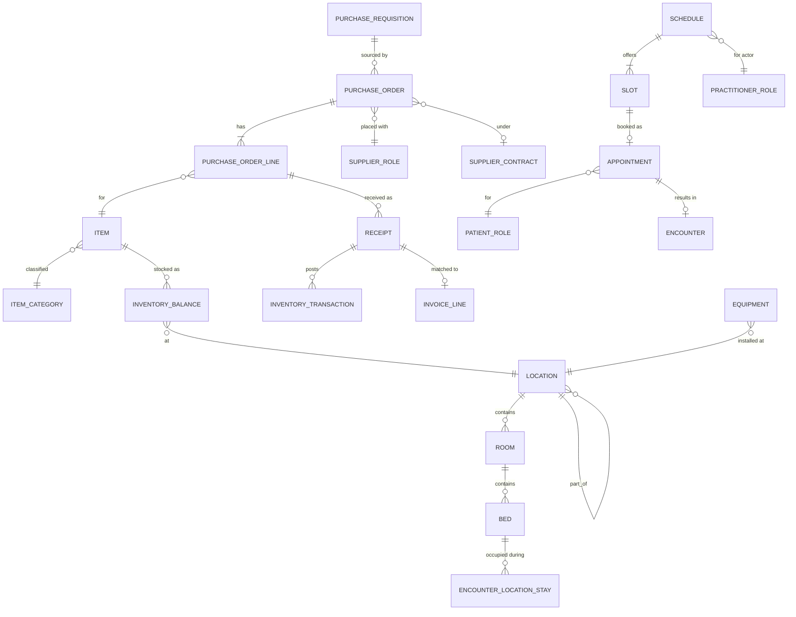

# Model Harmonisation

The contract between module 04 and its consumers: (1) the **harmonisation matrix** placing blueprint-style areas, FHIR
resource families and sources into G1–G9; (2) **conflict-resolution rules**; (3) **conceptual ER diagrams**; (4) the
**Logical Model Register** YAML that module 05 generates DDL from, module 08 derives graph shapes from and module 09
derives DQ rules from.

> All entity names in this document are **illustrative, generic healthcare entities authored for HEALIX**. They are
> not entities of IBM UDMH or Teradata HCDM.

## 1. Inputs and precedence

| Input | Role in harmonisation | Precedence (naming) |
|-------|-----------------------|---------------------|
| FHIR R4 / US Core 6.1 resources and HEALIX-ERP profiles (module 06) | Canonical interchange model (ADR-01); names and element semantics | **1 — highest** |
| HEALIX ontology labels (module 02) | Governed preferred labels; IRIs bound to every attribute | 2 (must agree with FHIR where a FHIR element exists) |
| UDMH-style and HCDM-style patterns (RDM-01, RDM-02) | Structure: supertypes, roles, lifecycle, grain discipline | 3 — structure only, never names |
| Source vocabularies (Cerner Millennium, Oracle Fusion, peripherals; module 03) | Lineage and business keys; surface alternate labels | 4 — `skos:altLabel` and lineage only |

## 2. Harmonisation matrix

| Group | UDMH-style area(s) (generic) | HCDM-style area(s) (generic) | FHIR R4 resource family | Cerner / Oracle Fusion primary sources | HEALIX logical entities (illustrative) |
|-------|------------------------------|------------------------------|-------------------------|----------------------------------------|----------------------------------------|
| **G1 Party & Identity** | Parties; healthcare roles | Party; member/patient; provider | `Patient`, `Person`, `RelatedPerson`, `Practitioner`, `PractitionerRole`, `Organization`, `OrganizationAffiliation`, `Location` (reference), `Group` | Cerner person/encounter-person, PRSNL, organisation tables; Oracle HCM worker; Oracle SCM supplier; payer eligibility (270/271) | Party, Person, Organization, PartyRole, PatientRole, MemberRole, PractitionerRole, PayerRole, EmployeeRole, SupplierRole, PartyIdentifier, PartyName, ContactPoint, Address, PartyRelationship, IdentityLink (entity-resolution cluster) |
| **G2 Clinical Care** | Healthcare events; clinical observations, conditions, procedures, medications | Encounter and clinical event; pharmacy (clinical) | `Encounter`, `EpisodeOfCare`, `Condition`, `Procedure`, `Observation`, `DiagnosticReport`, `Specimen`, `ImagingStudy`, `MedicationRequest`/`Dispense`/`Administration`/`Statement`, `AllergyIntolerance`, `Immunization`, `CarePlan`, `CareTeam`, `ServiceRequest`, `DocumentReference`, `DeviceUseStatement` | Cerner clinical events, orders, results, documents, pharmacy; LIS; RIS/PACS metadata; device gateways; HL7 v2 ADT/ORM/ORU/MDM/RDE | Episode, Encounter, EncounterLocationStay, Condition, Procedure, Observation, ObservationComponent, DiagnosticReport, Specimen, ImagingStudyMeta, ServiceRequest, MedicationRequest, MedicationDispense, MedicationAdministration, AllergyIntolerance, Immunization, CarePlan, CareTeamMembership, ClinicalDocument, DeviceUse, EventParticipation |
| **G3 Revenue Cycle & Finance** | Agreements; claims and adjudication; finance and accounting; products (plans/benefits) | Claim; product/plan; financial; agreement/contract | `Account`, `ChargeItem`, `Claim`, `ClaimResponse`, `ExplanationOfBenefit`, `Coverage`, `CoverageEligibilityRequest`/`Response`, `PaymentNotice`, `PaymentReconciliation`, `Invoice`, `Contract`, `InsurancePlan`; HEALIX-ERP: `GLJournal`, `CostCenter`, `Budget`, `FixedAsset`, `Project` | Cerner charge services, patient accounting; RCM/clearinghouse 837/835/277/270/271/278; Oracle Fusion GL, AR, AP, FA, PPM | Account, ChargeItem, Claim, ClaimLine, ClaimAdjudication, ClaimStatusHistory, ClaimResponse, Remittance, RemittanceClaimBridge, PaymentReconciliation, Coverage, EligibilityCheck, PriorAuthorization, InsuranceProduct, Plan, BenefitPackage, Benefit, Invoice, InvoiceLine, FinancialTransaction, GLJournal, GLJournalLine, CostCenter, Budget, FixedAsset, Project, Agreement, AgreementParty, AgreementTerm |
| **G4 Supply Chain & Operations** | Products and services (items); resources and facilities | Location; pharmacy (inventory); agreement (supplier) | `Location`, `Device`, `DeviceDefinition`, `SupplyRequest`, `SupplyDelivery`, `Schedule`, `Slot`, `Appointment`, `Medication` (product); HEALIX-ERP: `Item`, `PurchaseOrder`, `Requisition`, `Receipt`, `InventoryBalance` | Oracle Fusion SCM (item master, inventory, procurement, receiving); Cerner scheduling (SCH); biomedical asset registry; pharmacy inventory | Item, ItemCategory, InventoryBalance, InventoryTransaction, PurchaseRequisition, PurchaseOrder, PurchaseOrderLine, Receipt, SupplierContract (Agreement subtype), SupplyDelivery, Asset, Equipment, Location, LocationHierarchy, Bed, Room, Schedule, Slot, Appointment, Transport |
| **G5 Workforce** | Workforce and staffing | Party (worker role); provider (credentials) | `Practitioner`, `PractitionerRole` (qualification); HEALIX-ERP: `Worker`, `Position`, `Assignment`, `Credential`, `Timecard`, `PayrollSummary`, `Learning` | Oracle Fusion HCM (core HR, absence, time & labour, payroll aggregates, learning); credentialing systems; timekeeping | Worker (EmployeeRole link), Position, Assignment, Credential, Licence, Competency, Shift, Timecard, PayrollAggregate, LearningCompletion, OrgUnit (reference to G8 hierarchy) |
| **G6 Population Health & Quality** | Programs, campaigns, population segments; analytical requirements (measures) | Event (outreach, case management); member (attribution) | `Measure`, `MeasureReport`, `Group`, `RiskAssessment`, `Observation` (SDOH), `Goal`, `Task`, `Flag` | Derived from G1–G3; HIE; payer attribution and gap files; SDOH screening in Cerner | MeasureDefinition, MeasurePopulation, Stratifier, MeasureResult, Registry, RegistryMembership, RiskScore, CareGap, SdohObservation, Attribution, Program, ProgramEnrolment, OutreachEvent |
| **G7 Research & Analytics** | Research, studies, cohorts | — (thin) | `ResearchStudy`, `ResearchSubject`, `Consent` (research), `Group` (cohort), `EvidenceVariable` | Research systems (CTMS, REDCap-style); derived cohorts | ResearchStudy, ResearchSubject, Cohort, CohortMembership, ResearchConsent, FeatureSetReference, ModelRegistryLink |
| **G8 Reference & Terminology** | Classifications, code sets, calendars, geography | Reference / code sets; location (geography) | `CodeSystem`, `ValueSet`, `ConceptMap`, `NamingSystem`, `Organization` (hierarchy), `Location` (geo) | Terminology Service; Oracle Fusion reference data (currency, UOM, calendars, org hierarchy); Cerner code value sets | ConceptScheme, Concept, ConceptMapping, ValueSetVersion, Calendar, FiscalPeriod, Geography, Currency, UnitOfMeasure, OrganisationHierarchy, ServiceLine, SourceCodeCrosswalk |
| **G9 Metadata, Quality & Governance** | Metadata, lineage, audit | Event (audit) | `Provenance`, `AuditEvent`, `Consent` (privacy); HEALIX: `DataElement`, `DQRule`, `DQResult` | Platform-generated (modules 03, 09, 10, 11) | SourceSystem, SourceRegistryEntry, DataElement, LineageActivity (PROV-O), DQRule, DQResult, DQIssue, Remediation, ConsentDirective, AccessPolicy, AuditEvent, ChangeRequest |

A FHIR resource may appear in two groups when its *nature* splits (`Location` is a G4 operational entity and a
G1/G8 conformed dimension; `Consent` is G7 for research and G9 for privacy). The register records the **owning group**
once and `reused_by` for the others. Sources are named at interface level; table-level lineage comes from module 03.

## 3. Conflict-resolution rules

### 3.1 Naming precedence (RDM-HAR-002)

1. If a FHIR R4 resource or element exists for the concept, the HEALIX logical name **MUST** be the FHIR name in
   UpperCamelCase (entity) / lowerCamelCase (attribute); physical names are the snake_case transliteration
   (`MedicationRequest` → `medication_request`).
2. Otherwise the HEALIX-ERP profile name (module 06) applies.
3. Otherwise the ontology preferred label (module 02) applies, and a HEALIX-ERP profile is requested.
4. Blueprint-style terms **MUST NOT** be used as names; generic healthcare words shared with the blueprints ("party",
   "agreement", "claim") are acceptable because they are industry-generic, and are recorded as such.
5. Source names (Cerner, Oracle Fusion) become `skos:altLabel` and `lineage.sources[].fields`, never logical names.

### 3.2 Grain selection (RDM-HAR-003)

| Situation | Rule |
|-----------|------|
| Two blueprints suggest different grains (claim vs claim line) | Model **both** as 3NF entities; declare the finer grain on the presentation fact; aggregate upward |
| FHIR resource is coarser than source (Cerner clinical event rows vs `Observation`) | Grain = one FHIR resource instance; collapsing source rows recorded in `lineage.sources[].cardinality` |
| Event with sub-events (encounter → location stays, order → fills) | Parent and child are separate entities; child carries `part_of` |
| Measures | Grain declared as (subject type, population, period) triple; never derived implicitly |
| Any entity | `grain` is one sentence, e.g. "one row per encounter per valid-time version" |

### 3.3 3NF vs dimensional (RDM-HAR-004)

- The **integration layer** (3NF, bitemporal) is the system of record for the EDW and the only layer the KG
  reconciles against (ADR-07). Every register entity is 3NF.
- **Presentation** objects (`dim_*`, `fact_*`, `bridge_*`) are *derived* by module 05 from register entities using
  `presentation` hints (role → dimension, event → fact, many-to-many → bridge). They are never the source of truth.
- A dimensional heuristic from a blueprint is applied only when the G6 KPI catalog or an analyst persona requires it.

### 3.4 Party-role unification (RDM-HAR-005)

- Exactly one `Party` supertype with subtypes `Person` and `Organization`.
- Every healthcare or business role (Patient, Member, Practitioner, Payer, Employee, Supplier, Guarantor, Related
  Person) is a `PartyRole` subtype with `valid_from/valid_to` and a role-type concept IRI; a Party may hold many roles
  concurrently.
- Identifiers attach to the Party when issuer-independent (national id, person master id) and to the PartyRole when
  the issuer is role-specific (MRN → PatientRole, NPI → PractitionerRole, member id → MemberRole, supplier number →
  SupplierRole, employee number → EmployeeRole).
- FHIR mapping: `Patient`, `Practitioner`, `RelatedPerson` are **role projections** of a Person; `Patient.link` and
  `Person.link` carry entity-resolution clusters (`IdentityLink`).

### 3.5 Person vs Patient vs Member (RDM-HAR-006)

| Term | HEALIX meaning | Entity | Key |
|------|----------------|--------|-----|
| Person | A real-world human, resolved across all sources by entity resolution (module 08) | `Person` (Party subtype) | `person_bk` (enterprise master id) |
| Patient | A Person receiving care at an organisation; one per (Person, MRN assigning authority) | `PatientRole` | `patient_bk` = MRN + assigning authority |
| Member | A Person covered by a Plan; one per (Person, Plan, enrolment span) | `MemberRole` + `Coverage` | `member_bk` = payer member id + payer |

Rules: a clinical fact references `PatientRole`; a claim references `PatientRole` *and* `MemberRole` via `Coverage`;
population measures attribute to `Person` and stratify by role. Conformed `dim_patient` is built from
`Person ⋈ PatientRole` with Person as the durable key, so cross-MRN merges do not break history.

## 4. Conceptual ER diagrams

Diagrams are generated from the register (RDM-HAR-013); the versions below are the approved conceptual baseline.

### 4.1 G1 Party & Identity



### 4.2 G2 Clinical Care



### 4.3 G3 Revenue Cycle & Finance



### 4.4 G4 Supply Chain & Operations



### 4.5 G5–G9 (summary)

| Group | Core relationships |
|-------|--------------------|
| G5 | `Worker` is an `EmployeeRole` link; holds `Assignment` to `Position` in `OrgUnit`; `Credential`/`Licence`/`Competency` attach to the Person via `PractitionerRole` when clinical; `Shift`/`Timecard` are events; `PayrollAggregate` is period-grained |
| G6 | `MeasureDefinition` → `MeasurePopulation` → `MeasureResult` per (`Person`, period, `Stratifier`); `Registry` ⟷ `RegistryMembership` ⟷ `Person`; `CareGap` references a `MeasureDefinition` and a `Person`; `Attribution` links `Person` to `PractitionerRole`/`Organization` for a period |
| G7 | `ResearchStudy` ⟷ `ResearchSubject` ⟷ `Person`; `Cohort` ⟷ `CohortMembership`; `ResearchConsent` is an `Agreement` subtype |
| G8 | `ConceptScheme` ⟷ `Concept` ⟷ `ConceptMapping`; `ValueSetVersion` expands to Concepts; `Calendar`/`FiscalPeriod`; `Geography` hierarchy; versioned `OrganisationHierarchy` |
| G9 | `SourceSystem` → `SourceRegistryEntry` → `DataElement`; `LineageActivity` (PROV-O) links any entity version to its activity; `DQRule` → `DQResult` → `DQIssue` → `Remediation`; `ConsentDirective`, `AccessPolicy`, `AuditEvent`, `ChangeRequest` |

## 5. Logical Model Register (module 05 contract)

### 5.1 Layout

`register.schema.json` (JSON Schema for every entity file) · `register/meta.yaml` (register version, blueprint release
pins, licence refs) · `register/g1-party/*.yaml` … `register/g9-governance/*.yaml` (one file per entity) ·
`diagrams/*.mmd` (Mermaid generated from the register, never hand-edited).

### 5.2 Entity file format (illustrative)

```yaml
# register/g2-clinical/encounter.yaml
entity: Encounter                       # UpperCamelCase; FHIR name precedence (RDM-HAR-002)
id: healix.g2.encounter                 # stable, immutable once approved
group: G2                               # ARC-01 §4 code (owner)
reused_by: [G3, G6]
pattern: [event-activity]               # RDM-01 §4.1 / RDM-02 §4 ids
status: approved                        # draft | review | approved | deprecated ; version: semver (RDM-HAR-014)
version: 1.2.0
grain: "One row per encounter per valid-time version."
temporal_pattern: bitemporal-history    # bitemporal-history | event-immutable | snapshot | reference-versioned
ontology:
  class_iri: https://ontology.healix.example.org/clinical/Encounter
  shape_iri: https://ontology.healix.example.org/shape/clinical/EncounterShape
canonical:
  fhir_resource: Encounter
  profile: http://hl7.org/fhir/us/core/StructureDefinition/us-core-encounter
keys:
  business_key: [encounter_bk]          # encounter identifier + assigning authority
  surrogate_key: encounter_sk
relationships:
  - { name: subject, target: healix.g1.patient_role, cardinality: many-to-one, fhir_element: Encounter.subject }
  - { name: part_of, target: healix.g2.encounter, cardinality: many-to-one, optional: true, fhir_element: Encounter.partOf }
attributes:
  - name: encounterClass
    physical: encounter_class_iri
    datatype: concept                   # concept | identifier | string | integer | decimal | boolean | date | timestamp | period | quantity | reference
    required: true
    ontology_property_iri: https://ontology.healix.example.org/clinical/encounterClass
    binding: { value_set: https://ontology.healix.example.org/scheme/encounter-class, strength: required }
    fhir_element: Encounter.class
    phi: false
  - name: periodStart
    physical: period_start_ts
    datatype: timestamp
    ontology_property_iri: https://ontology.healix.example.org/clinical/periodStart
    fhir_element: Encounter.period.start
    phi: true
    phi_category: date-of-service
lineage:
  sources:
    - { system: cerner.millennium, object: ENCOUNTER, fields: [ENCNTR_ID, ENCNTR_TYPE_CD, REG_DT_TM, DISCH_DT_TM], cardinality: "1:1", std_topic: hc.std.cerner.encounter.cdc.v1 }
    - { system: cerner.millennium.hl7, object: "ADT^A01..A08", fields: [PV1-19, PV1-2, PV1-44, PV1-45], cardinality: "n:1", std_topic: hc.std.cerner.adt.hl7v2.v1 }
  canonical_topic: hc.canonical.clinical.encounter.fhir.v1
presentation:                           # hints only; module 05 decides (RDM-HAR-004)
  role: fact
  conformed_dimensions: [dim_patient, dim_practitioner, dim_location, dim_date, dim_source_system]
physical:
  teradata: { primary_index: [encounter_bk], distribution_rationale: "high-cardinality join key from charges and orders", set_table: false }
  partition_by: period_start_ts
dq_hints: { critical_data_elements: [encounterClass, periodStart, subject] }   # consumed by module 09
divergences: [DIV-UDMH-003]
```

### 5.3 Field semantics

| Field | Required | Rule |
|-------|----------|------|
| `entity`, `id`, `group`, `pattern` | yes | Group code from ARC-01 §4; `id` immutable once approved; ≥ 1 pattern id |
| `grain`, `temporal_pattern` | yes | One sentence (RDM-HAR-003); one of four values with semantics from module 08 (RDM-HAR-010) |
| `ontology.class_iri`, `attributes[].ontology_property_iri` | yes | Must resolve in the Ontology Registry at release time (RDM-HAR-008) |
| `canonical`, `lineage.sources` (≥ 1) | yes | FHIR/HEALIX-ERP profile; source ids from module 03, `std_topic` from module 07 (RDM-HAR-009) |
| `keys.business_key` | yes | Same key mints KG IRIs and EDW `*_bk` columns (RDM-HAR-015) |
| `attributes[].binding` | when `datatype: concept` | Value set served by the Terminology Service (RDM-UDMH-009) |
| `attributes[].phi` | yes | Feeds module 11 classification |
| `physical.teradata.primary_index` | yes for non-`stg_*` | RDM-HCDM-004 |
| `presentation`, `dq_hints`, `divergences` | optional | Hints only; `DIV-UDMH-NNN` / `DIV-HCDM-NNN` ids |

### 5.4 Validation pipeline

In order: JSON Schema validation → lint (naming precedence, grain, temporal pattern) → reference resolution (ontology
IRIs, value sets, source ids, topics) → coverage check (≥ 95 % bound attributes) → licensed-content marker scan →
generation of `diagrams/*.mmd` and module 05 DDL inputs → signed semver release by `agent.release_manager`.
`agent.evaluator` scores the lint, resolution and coverage stages before a human approves.

## 6. Requirements

> **RDM-HAR-001** (P0, inspection) — The harmonisation matrix (§2) MUST contain, for each group G1–G9, non-empty
> entries for UDMH-style area(s) or an explicit "—", HCDM-style area(s) or "—", FHIR R4 resource family, primary
> sources and HEALIX logical entities; a group row with an empty cell MUST block register release.

> **RDM-HAR-002** (P0, test) — The register linter MUST reject an entity or attribute whose name differs from the FHIR
> R4 / HEALIX-ERP name when such a name exists for the mapped `canonical` element, and MUST reject names matching the
> licensed-content marker set.

> **RDM-HAR-003** (P0, analysis) — Every register entity MUST declare a one-sentence `grain`; where blueprints suggest
> different grains, both grains MUST be modelled as separate 3NF entities with a `part_of` or line relationship.

> **RDM-HAR-004** (P1, analysis) — Register entities MUST be 3NF integration-layer entities; `dim_*`, `fact_*` and
> `bridge_*` objects MUST be generated by module 05 from `presentation` hints and MUST NOT be defined in the register.

> **RDM-HAR-005** (P0, test) — The register MUST contain exactly one `Party` entity with `Person` and `Organization`
> subtypes, and every role entity MUST reference `PartyRole` with `valid_from/valid_to`; a linter MUST reject a role
> entity that stores demographic attributes owned by `Person`.

> **RDM-HAR-006** (P0, test) — `Person`, `PatientRole` and `MemberRole` MUST be distinct entities with the keys in
> §3.5; clinical facts MUST reference `PatientRole`, claims MUST reference `Coverage` (hence `MemberRole`), and
> population measures MUST reference `Person`. A conformance test MUST show that merging two MRNs into one Person
> preserves all historical facts.

> **RDM-HAR-007** (P0, test) — Every `register/**/*.yaml` file MUST validate against `register.schema.json`; CI MUST
> fail on any violation.

> **RDM-HAR-008** (P0, test) — At register release, ≥ 95 % of attributes across all approved entities MUST carry an
> `ontology_property_iri` that resolves in the Ontology Registry, and 100 % of `datatype: concept` attributes MUST carry
> a `binding.value_set`; the coverage report MUST be attached to the release.

> **RDM-HAR-009** (P0, test) — Every entity MUST declare `canonical` (FHIR resource/profile or HEALIX-ERP profile) and
> at least one `lineage.sources` entry whose `system` resolves in the module 03 Source Registry and whose `std_topic`
> resolves in the module 07 topic catalog.

> **RDM-HAR-010** (P0, test) — Every entity MUST declare `temporal_pattern` as one of `bitemporal-history`,
> `event-immutable`, `snapshot`, `reference-versioned`; entities holding PHI or financial amounts MUST be
> `bitemporal-history` or `event-immutable`.

> **RDM-HAR-011** (P1, inspection) — Conformed dimensions (Patient, Practitioner, Organization, Location, Date/Time,
> Payer, Item, Cost Center, Code, Source System) MUST be derived from entities owned by G1 or G8 (Item: G4 owner,
> G8 classification); other groups MUST list them in `presentation.conformed_dimensions`, never redefine them.

> **RDM-HAR-012** (P1, inspection) — Every placement or naming conflict between blueprint styles, FHIR and sources MUST
> be resolved through a module 10 change request that cites the §3 rule applied; the resolution MUST be recorded in
> the register release notes.

> **RDM-HAR-013** (P1, test) — `diagrams/*.mmd` MUST be generated from the register in CI; a hand-edit (non-empty diff
> after regeneration) MUST fail the build.

> **RDM-HAR-014** (P1, test) — The register MUST use semantic versioning: removing or renaming an entity, key, or
> required attribute, or changing `grain` or `temporal_pattern`, is a MAJOR change requiring a compensating module 05
> migration plan and a module 08 graph migration note before release.

> **RDM-HAR-015** (P0, test) — Every entity's `keys.business_key` MUST be the key used to mint the KG instance IRI
> (module 08) and the EDW `*_bk` column (module 05); a nightly reconciliation test MUST show zero business keys present
> in one projection and absent in the other for the same transaction-time snapshot.
