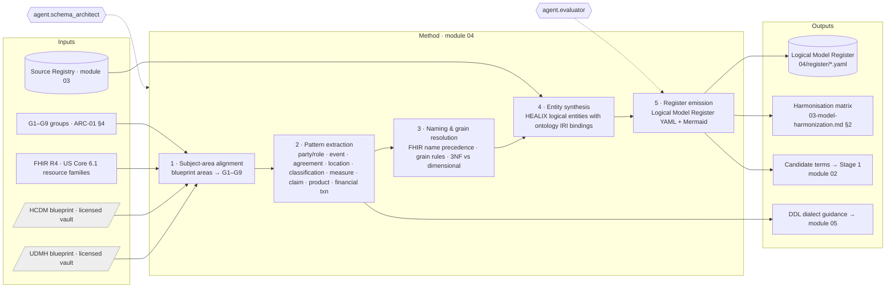

# Module 04 · Reference Data Models

## 1. Purpose

This module specifies **how HEALIX uses two commercial industry data models as blueprints** — the IBM Unified Data
Model for Healthcare (UDMH) and the Teradata Healthcare Data Model (HCDM) — without adopting either verbatim
(**ADR-05**). The output is a single, licence-safe **HEALIX logical model** whose subject areas are the nine groups
G1–G9 defined in `01-architecture-overview.md` §4, delivered to module 05 (EDW) as a machine-readable *Logical Model
Register* and to module 02 (Ontology Pipeline) as candidate terms for the Stage 1 controlled vocabulary.

The module answers four questions:

| Question | Where |
|----------|-------|
| What does each blueprint offer, structurally, and which parts do we take or leave? | `01-ibm-udmh.md`, `02-teradata-hcdm.md` |
| How do blueprint subject areas, FHIR R4 resource families and source systems collapse into G1–G9? | `03-model-harmonization.md` §2 |
| What rules resolve naming, grain, normalisation and party-role conflicts between the two models? | `03-model-harmonization.md` §3 |
| What exactly does module 05 consume? | `03-model-harmonization.md` §5 (Logical Model Register YAML) |

## 2. Why blueprints, not adoption (ADR-05 restated)

| Concern | Adopt one model verbatim | Blueprint approach (chosen) |
|---------|--------------------------|-----------------------------|
| Intellectual property | Proprietary entities/attributes would be copied into a Git repository, violating licence terms | Only *patterns*, *layering* and *subject-area intent* are referenced; all entity definitions are HEALIX-authored |
| Fit with FHIR R4 canonical stream (ADR-01) | Neither model is FHIR-native; mapping cost lands on every pipeline | Harmonisation picks FHIR resource names as the naming anchor and uses blueprints for structure |
| Bitemporality (ADR-03) | Both models support history, but with model-specific idioms | Temporal pattern is dictated by module 08 and applied uniformly |
| ERP / HCM / SCM coverage | Healthcare models are payer/provider-centric; Oracle Fusion finance, supply and workforce need generic enterprise patterns | UDMH-style generic patterns (party, agreement, location, measure) and HCDM-style financial/product patterns fill G3–G5 |
| Vendor lock-in | Model ties to a vendor's tooling | DDL in Teradata dialect *plus* portable variant (module 05) |

Both products remain **valuable inputs**: decades of healthcare modelling encoded as subject areas, entity patterns
and analytical requirements. We use them the way an architect uses a pattern book.

## 3. Documents in this module

| doc_id | File | Scope | Requirement prefix |
|--------|------|-------|--------------------|
| RDM-00 | `README.md` | Purpose, method, interfaces, requirement index | — |
| RDM-01 | `01-ibm-udmh.md` | UDMH layers → pipeline stages; subject-area mapping; adopted/rejected patterns; licensing | `RDM-UDMH-NNN` |
| RDM-02 | `02-teradata-hcdm.md` | HCDM 3NF structure → G1–G9; adopted patterns; Teradata physical considerations shaping our DDL dialect | `RDM-HCDM-NNN` |
| RDM-03 | `03-model-harmonization.md` | Harmonisation matrix, conflict-resolution rules, conceptual ER diagrams, Logical Model Register format | `RDM-HAR-NNN` |

## 4. Harmonisation method

The method is run by `agent.schema_architect` (autonomy L1 — every output is human-approved) with
`agent.vocabulary_curator` contributing term candidates and `agent.evaluator` scoring each proposal.

Steps in detail:

1. **Subject-area alignment.** Every blueprint subject area is placed in exactly one *primary* group and zero or
   more *secondary* groups. G1–G9 are fixed; a blueprint area that does not fit is split, never used to create a
   tenth group.
2. **Pattern extraction.** Reusable modelling patterns are named, described in HEALIX words, and tagged. A pattern
   is a *shape* (e.g. "a Party plays time-bounded Roles"), never a copied entity list.
3. **Naming and grain resolution.** Conflicts between the two blueprints, FHIR and source vocabularies are settled
   by the precedence rules in `03-model-harmonization.md` §3.
4. **Entity synthesis.** Each HEALIX logical entity is written with group, grain, keys, attributes, ontology IRI
   binding, source lineage and temporal pattern. Attributes bind to ontology properties from module 02; unbound
   attributes are reported as a coverage gap (goal G-01: ≥ 95 % bound).
5. **Register emission.** The Logical Model Register YAML is validated against its JSON Schema, Mermaid diagrams are
   regenerated from it, and the release is versioned (semver) and signed.

## 5. Interfaces

### 5.1 Inputs

| Input | From | Form |
|-------|------|------|
| Subject-area groups G1–G9 | ARC-01 §4 | Authoritative table |
| Source Registry & Data Element Catalog | module 03 (`agent.inventory`) | Registry API |
| FHIR R4 / US Core resource families and HEALIX-ERP profiles | module 06 | StructureDefinitions |
| Bitemporal model (valid/transaction time, PROV-O) | module 08 | Temporal pattern names |
| UDMH and HCDM blueprint material | Licensed model vault (outside Git) | Read-only, licence-scoped tool |

### 5.2 Outputs

| Output | Consumer | Form | Contract |
|--------|----------|------|----------|
| **Logical Model Register** (entities, groups, grains, keys, attributes with ontology IRIs, lineage, temporal pattern) | module 05 (`agent.schema_architect` → DDL), module 08 (graph shapes), module 09 (DQ rule derivation) | `04-reference-data-models/register/*.yaml` validated by `register.schema.json` | `03-model-harmonization.md` §5 |
| **Harmonisation matrix** | module 05, module 06 | Markdown table | `03-model-harmonization.md` §2 |
| **Candidate glossary terms** (blueprint-derived business terms re-expressed in HEALIX wording, tagged `source: blueprint`) | module 02 Stage 1 controlled vocabulary (`agent.vocabulary_curator`) | SKOS candidate concepts, `skos:editorialNote` with provenance | `01-ibm-udmh.md` §3 |
| **DDL dialect guidance** (primary index, MULTISET, PERIOD, partitioning) | module 05 `ddl/` | Rules referenced by requirement ID | `02-teradata-hcdm.md` §5 |
| **Pattern divergence log** | module 13 (risks), governance | Markdown table in register release notes | `01-ibm-udmh.md` §4, `02-teradata-hcdm.md` §4 |

### 5.3 Glossary → controlled vocabulary alignment (module 02 hand-off)

The UDMH-style *business vocabulary* layer and the HCDM-style entity/attribute *definitions* are the kind of
material Stage 1 of the Ontology Pipeline needs — but they are licensed text. The hand-off therefore works as follows:

1. `agent.schema_architect` emits only the **concept** (what needs a term), its **group**, and a **HEALIX-authored
   definition**; no blueprint text is copied.
2. `agent.vocabulary_curator` creates a candidate `skos:Concept` in the relevant scheme with `skos:prefLabel`,
   `skos:definition`, and `skos:editorialNote "derived-from: blueprint-pattern <pattern-id>"`.
3. Preferred labels follow module 02 collision rules; where a FHIR element name exists, it is the preferred label and
   blueprint-style wording becomes `skos:altLabel` only if it is generic healthcare vocabulary (e.g. "encounter",
   "coverage"), never a product-specific coinage.

## 6. Licensing and handling rules (summary; detail in RDM-01 §5 and RDM-02 §6)

- The adopting organisation **MUST** hold valid IBM UDMH and Teradata HCDM licences before any blueprint material is
  loaded into the model vault.
- Blueprint material **MUST NOT** be committed to this repository, pasted into agent prompts that are persisted, or
  embedded in the knowledge graph. Agents read it through a licence-scoped tool whose outputs are pattern summaries.
- All entity names, attribute names, definitions and diagrams in this module and in module 05 are HEALIX-authored.
  Where an entity list appears in this module it is **illustrative and generic**.
- Pinned blueprint release identifiers and licence references are recorded in the register metadata.

## 7. Requirement index

| ID | Priority | Verification | Title | Document |
|----|----------|--------------|-------|----------|
| RDM-UDMH-001 | P0 | inspection | No proprietary UDMH content in repository | RDM-01 |
| RDM-UDMH-002 | P0 | inspection | Licence-scoped, read-only access to UDMH material | RDM-01 |
| RDM-UDMH-003 | P0 | analysis | Every UDMH-style subject area mapped to one primary G-group | RDM-01 |
| RDM-UDMH-004 | P1 | test | Business-vocabulary terms enter Stage 1 as attributed candidates, re-expressed | RDM-01 |
| RDM-UDMH-005 | P0 | inspection | Adopted atomic-model patterns instantiated in register with pattern tag | RDM-01 |
| RDM-UDMH-006 | P1 | analysis | Dimensional patterns inform presentation layer only | RDM-01 |
| RDM-UDMH-007 | P1 | inspection | Analytical requirements re-specified as HEALIX/FHIR measures in G6 | RDM-01 |
| RDM-UDMH-008 | P2 | inspection | Pattern divergence log maintained | RDM-01 |
| RDM-UDMH-009 | P1 | test | Supportive-content standard mappings not imported; bind via Terminology Service | RDM-01 |
| RDM-UDMH-010 | P1 | inspection | Blueprint release and licence pinned in register metadata | RDM-01 |
| RDM-HCDM-001 | P0 | inspection | No proprietary HCDM content in repository | RDM-02 |
| RDM-HCDM-002 | P0 | analysis | Every HCDM-style subject area mapped to one primary G-group | RDM-02 |
| RDM-HCDM-003 | P0 | inspection | Adopted 3NF patterns instantiated in register with pattern tag | RDM-02 |
| RDM-HCDM-004 | P0 | test | Explicit primary index on every Teradata-dialect table | RDM-02 |
| RDM-HCDM-005 | P1 | test | MULTISET default; SET requires justification | RDM-02 |
| RDM-HCDM-006 | P0 | test | PERIOD-based bitemporal columns in Teradata dialect; portable twin columns | RDM-02 |
| RDM-HCDM-007 | P1 | test | Partitioning on large facts and history tables | RDM-02 |
| RDM-HCDM-008 | P1 | test | Identifier length, reserved words and naming portability | RDM-02 |
| RDM-HCDM-009 | P1 | analysis | Claim-lifecycle states as a G8 controlled vocabulary | RDM-02 |
| RDM-HCDM-010 | P1 | inspection | Blueprint release and licence pinned in register metadata | RDM-02 |
| RDM-HAR-001 | P0 | inspection | Harmonisation matrix complete for G1–G9 | RDM-03 |
| RDM-HAR-002 | P0 | test | Naming precedence rule enforced by register linter | RDM-03 |
| RDM-HAR-003 | P0 | analysis | Grain declared and justified per entity | RDM-03 |
| RDM-HAR-004 | P1 | analysis | 3NF integration / dimensional presentation split | RDM-03 |
| RDM-HAR-005 | P0 | test | Party supertype with time-bounded roles | RDM-03 |
| RDM-HAR-006 | P0 | test | Person / Patient / Member resolution rule | RDM-03 |
| RDM-HAR-007 | P0 | test | Register validates against JSON Schema | RDM-03 |
| RDM-HAR-008 | P0 | test | ≥ 95 % attributes bound to ontology IRIs | RDM-03 |
| RDM-HAR-009 | P0 | test | Source lineage and canonical binding on every entity | RDM-03 |
| RDM-HAR-010 | P0 | test | Temporal pattern declared per entity | RDM-03 |
| RDM-HAR-011 | P1 | inspection | Conformed dimension ownership by G1/G8 | RDM-03 |
| RDM-HAR-012 | P1 | inspection | Conflicts resolved through logged change requests | RDM-03 |
| RDM-HAR-013 | P1 | test | Diagrams generated from register, not hand-maintained | RDM-03 |
| RDM-HAR-014 | P1 | test | Register semantic versioning and breaking-change rules | RDM-03 |
| RDM-HAR-015 | P0 | test | EDW/KG reconcilable keys (business key + IRI) | RDM-03 |

## 8. Definition of done (module 04)

1. All P0 requirements above have a linter, test or review checklist item referenced by ID in
   `13-roadmap-and-acceptance/02-acceptance-criteria.md`.
2. `register/*.yaml` validates against `register.schema.json`; Mermaid diagrams regenerate without diff.
3. Each G1–G9 group has at least one approved register entity; conformed dimensions are present in G1/G8.
4. Legal/IP review confirms no proprietary blueprint content in the module or its generated artefacts.
5. Module 05 has consumed the register to produce at least one DDL migration per group.
