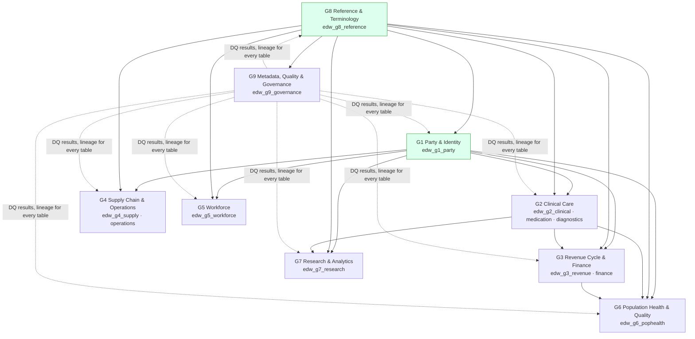

# Subject-Area Groups G1–G9

The nine groups, their Kafka domains, core entities and primary sources are **authoritative in
`01-architecture-overview.md` §4**. This document fixes, for each group, the EDW schema(s), the inventory of
dimensions, facts, bridges and reference tables, the **grain statement** of every fact, the conformed dimensions each
fact uses, and the primary sources. The inventory is the first-release target; `agent.schema_architect` extends it
from the Logical Model Register (module 04) through the change-request process (EDW-ARCH-010).

Conventions used in the inventories:

- **Conformed dimensions** (owned by G1/G8, specified in `05-conformed-dimensions.md`): `dim_patient`,
  `dim_practitioner`, `dim_organization`, `dim_location`, `dim_date`, `dim_time`, `dim_payer`, `dim_item`,
  `dim_cost_center`, `dim_code`, `dim_source_system`. In the tables below they are abbreviated **PAT, PRC, ORG, LOC,
  DATE, TIME, PAY, ITEM, CC, CODE, SRC**.
- Every fact also carries bitemporal columns and `prov_activity_iri` (EDW-ARCH-003); these are not repeated.
- Fact type: **T** transaction, **P** periodic snapshot, **A** accumulating snapshot, **F** factless.

## Group overview

Arrows read "provides dimensions/facts consumed by". G1 and G8 (green) own the conformed dimensions; G9 observes all.

---

## G1 — Party & Identity

**Purpose.** One resolved identity per person, organisation and place, with every source identifier retained. G1 owns
the conformed dimensions `dim_patient`, `dim_practitioner`, `dim_organization`, `dim_location` and `dim_payer`, and the
**party-role pattern** (`02-conceptual-model.md` §2) that lets one person be patient, employee and guarantor.

**Schema.** `edw_g1_party`
**Primary sources.** Cerner Millennium (Person/Encounter ADT, Provider), Oracle Fusion HCM (Worker), Oracle Fusion SCM
(Supplier), payer eligibility (270/271), EMPI (module 08 entity resolution).

| Table | Type | Grain / description | Conformed dims used |
|-------|------|---------------------|---------------------|
| `dim_party` | dim (SCD2) | One row per resolved party version (person or organisation), EMPI golden record | SRC |
| `dim_patient` | **conformed** dim (SCD2) | One row per patient version | SRC, LOC (home), ORG (managing org) |
| `dim_practitioner` | **conformed** dim (SCD2) | One row per practitioner version (NPI-resolved) | SRC |
| `dim_practitioner_role` | dim (SCD2) | One row per practitioner × organisation × specialty × period | PRC, ORG, LOC, CODE (specialty) |
| `dim_organization` | **conformed** dim (SCD2) | One row per organisation version; self-referencing hierarchy | SRC |
| `dim_location` | **conformed** dim (SCD2) | One row per physical/virtual location version (campus → building → unit → room → bed) | ORG, SRC |
| `dim_payer` | **conformed** dim (SCD2) | One row per payer version (payer-plan hierarchy lives in G3 `dim_payer_plan`) | ORG, SRC |
| `dim_related_person` | dim (SCD2) | One row per related person × patient × relationship | PAT, CODE |
| `dim_employee` | dim (SCD2) | Worker identity (HCM); employment detail lives in G5 | PRC (if clinician), ORG |
| `dim_supplier` | dim (SCD2) | Supplier identity (SCM); commercial detail lives in G4 `dim_supplier` view | ORG |
| `bridge_party_identifier` | bridge | One row per party × identifier system × value × period (MRN, NPI, EIN, Supplier#, SSN-hash) | SRC, CODE (identifier type) |
| `bridge_party_role` | bridge | One row per party × role × period (patient, practitioner, employee, guarantor, supplier contact) | CODE (role) |
| `bridge_patient_link` | bridge | One row per EMPI link decision: source record ↔ golden patient, with match score and method | PAT, SRC |
| `bridge_organization_affiliation` | bridge | One row per organisation × organisation × affiliation type × period | ORG, CODE |
| `fact_identity_event` | fact T | One row per identity lifecycle event (merge, unmerge, link, overlay, demographic update) | PAT, SRC, DATE, TIME |
| `hist_dim_patient`, `hist_dim_practitioner`, `hist_dim_organization`, `hist_dim_location`, `hist_dim_payer`, `hist_dim_party` | hist | Bitemporal history of each dimension (`06-history-and-bitemporality.md`) | — |

**Requirements**

> **EDW-G1-001** (P0, test) — `dim_patient.patient_sk` MUST be the only patient surrogate key in the EDW; no other
> schema MAY define a patient dimension.

> **EDW-G1-002** (P0, test) — Every source MRN MUST appear in `bridge_party_identifier` exactly once per
> `(identifier_system, identifier_value, valid period)` and MUST resolve to exactly one `patient_sk` at any instant.

> **EDW-G1-003** (P0, test) — `bridge_patient_link` MUST retain every EMPI link/unlink decision with the module-08
> `resolution_method` and `match_score`; a merge MUST never physically delete the surviving or retired record.

> **EDW-G1-004** (P1, inspection) — `dim_location` MUST implement the hierarchy campus → building → floor → unit → room
> → bed as a flattened hierarchy plus `parent_location_sk`.

---

## G2 — Clinical Care

**Purpose.** All clinical events for a patient: encounters, diagnoses, procedures, observations (vitals, labs),
diagnostic reports, medications across the order→dispense→administration lifecycle, allergies, immunisations,
documents, orders, specimens, imaging-study metadata and device use.

**Schemas.** `edw_g2_clinical` (encounter-centric), `edw_g2_medication` (medication lifecycle),
`edw_g2_diagnostics` (lab, imaging, pathology, specimens).
**Primary sources.** Cerner Millennium (ADT, orders, results, clinical documents, PowerChart), LIS, RIS/PACS (DICOM
metadata), pharmacy system, device gateways — all via `hc.canonical.clinical.*.fhir.v1`.

### `edw_g2_clinical`

| Table | Type | Grain | Conformed dims | Local dims / notes |
|-------|------|-------|----------------|--------------------|
| `fact_encounter` | A | One row per encounter (FHIR `Encounter`), accumulating admit → discharge → coded → billed milestones | PAT, PRC (attending, admitting), ORG, LOC (admit, discharge), DATE/TIME (admit, discharge), PAY (primary coverage), SRC | `dim_encounter_class`, `dim_encounter_type`, `dim_admit_source`, `dim_discharge_disposition`, `dim_encounter_status_junk` |
| `fact_encounter_location` | T | One row per encounter × location × period (ADT transfer history) | PAT, LOC, DATE, TIME | degenerate `encounter_bk` |
| `fact_episode_of_care` | A | One row per episode of care | PAT, ORG, PRC (care manager), DATE | `dim_episode_type` |
| `fact_diagnosis` | T | One row per diagnosis assertion (FHIR `Condition`) per encounter | PAT, PRC (asserter), CODE (ICD-10-CM / SNOMED CT), DATE (onset, recorded, abatement), SRC | `dim_diagnosis_type` (admitting, principal, secondary, chronic), `dim_clinical_status`, POA indicator |
| `bridge_encounter_diagnosis` | bridge | One row per encounter × diagnosis × rank (principal = 1) | — | `diagnosis_rank`, `poa_code`, `is_principal_flag` |
| `fact_procedure` | T | One row per performed procedure (FHIR `Procedure`) | PAT, PRC (performer), LOC, CODE (CPT/ICD-10-PCS/SNOMED), DATE/TIME (performed), SRC | `dim_procedure_category`, `dim_laterality` |
| `bridge_procedure_performer` | bridge | One row per procedure × practitioner × function | PRC, CODE (function) | — |
| `fact_allergy` | T | One row per allergy/intolerance assertion | PAT, PRC (recorder), CODE (substance RxNorm/SNOMED), DATE | `dim_allergy_criticality`, `dim_reaction_junk` |
| `fact_immunization` | T | One row per immunisation administered or reported | PAT, PRC, LOC, CODE (CVX), ITEM (vaccine product/NDC), DATE/TIME | `dim_immunization_status`, lot/expiry degenerate |
| `fact_clinical_document` | T | One row per clinical document version (FHIR `DocumentReference`) | PAT, PRC (author), ORG, CODE (LOINC doc type), DATE/TIME | `dim_document_status`; content pointer only (no document body) |
| `fact_order` | A | One row per service request / order (FHIR `ServiceRequest`) with placed → accepted → completed → cancelled milestones | PAT, PRC (requester), LOC, CODE (orderable), DATE/TIME | `dim_order_priority`, `dim_order_status` |
| `fact_care_plan_activity` | T | One row per care-plan activity | PAT, PRC, CODE, DATE | `dim_care_plan_category` |
| `fact_device_use` | T | One row per device use statement / implant | PAT, ITEM (device), PRC, DATE | UDI degenerate |
| `dim_encounter_class`, `dim_encounter_type`, `dim_admit_source`, `dim_discharge_disposition`, `dim_diagnosis_type`, `dim_clinical_status`, `dim_procedure_category`, `dim_laterality`, `dim_order_priority`, `dim_order_status`, `dim_document_status`, `dim_allergy_criticality`, `dim_immunization_status`, `dim_episode_type`, `dim_care_plan_category` | dims (SCD1, value-set bound) | One row per concept in the bound value set | CODE (`code_sk` back-reference) |
| `dim_encounter_status_junk`, `dim_reaction_junk` | junk | One row per observed combination of low-cardinality flags | — |

### `edw_g2_medication`

| Table | Type | Grain | Conformed dims | Notes |
|-------|------|-------|----------------|-------|
| `fact_medication_order` | A | One row per medication request (FHIR `MedicationRequest`) | PAT, PRC (prescriber), LOC, ITEM (drug product), CODE (RxNorm), DATE/TIME (authored, start, end) | `dim_route`, `dim_dose_form`, `dim_med_order_status`, degenerate `order_bk`, `encounter_bk` |
| `fact_medication_dispense` | T | One row per dispense event | PAT, PRC (pharmacist), LOC (pharmacy), ITEM, CODE, DATE/TIME | quantity, days supply, UCUM via `dim_ucum_unit` |
| `fact_medication_administration` | T | One row per administration event (FHIR `MedicationAdministration`) | PAT, PRC (administering), LOC, ITEM, CODE (RxNorm), DATE/TIME | dose, rate, `dim_route`, `dim_admin_status`, barcode-scan flags in `dim_mar_junk` |
| `fact_medication_statement` | T | One row per patient-reported/reconciled medication statement | PAT, CODE, DATE | — |
| `bridge_medication_order_reason` | bridge | One row per medication order × diagnosis (reason) | — | links to `fact_diagnosis` |
| `dim_route`, `dim_dose_form`, `dim_med_order_status`, `dim_admin_status`, `dim_mar_junk` | dims | value-set bound | CODE |

### `edw_g2_diagnostics`

| Table | Type | Grain | Conformed dims | Notes |
|-------|------|-------|----------------|-------|
| `fact_observation_result` | T | One row per observation component (FHIR `Observation` with components exploded) | PAT, PRC (performer), LOC, CODE (LOINC), DATE/TIME (effective, issued), SRC | numeric value + unit (`dim_ucum_unit`), coded value (`CODE`), text, reference range, `dim_result_status`, `dim_abnormal_flag`; degenerate `encounter_bk`, `order_bk`, `specimen_bk` |
| `fact_diagnostic_report` | A | One row per report (FHIR `DiagnosticReport`) with ordered → preliminary → final → amended milestones | PAT, PRC (interpreter), ORG (performing lab/radiology), CODE (report type), DATE/TIME | `dim_report_status` |
| `bridge_report_observation` | bridge | One row per report × observation | — | — |
| `fact_specimen` | A | One row per specimen (collected → received → processed → disposed) | PAT, PRC (collector), LOC, CODE (SNOMED specimen type), DATE/TIME | `dim_specimen_condition` |
| `fact_imaging_study` | A | One row per imaging study (DICOM metadata: modality, series count, instance count) | PAT, PRC (referring, reading), LOC (modality location), CODE (procedure, body site), DATE/TIME | accession number degenerate; no pixel data (VIS-00 §4) |
| `dim_result_status`, `dim_abnormal_flag`, `dim_report_status`, `dim_specimen_condition`, `dim_ucum_unit` (view over G8) | dims | value-set bound | CODE |

**Requirements**

> **EDW-G2-001** (P0, test) — `fact_encounter` MUST have exactly one row per `encounter_bk`; the grain test
> `COUNT(*) = COUNT(DISTINCT encounter_bk)` on current rows MUST pass on every load.

> **EDW-G2-002** (P0, test) — Every `fact_diagnosis` row linked to an encounter MUST appear in
> `bridge_encounter_diagnosis` with a `diagnosis_rank` ≥ 1, and at most one row per encounter MAY have
> `is_principal_flag = 'Y'`.

> **EDW-G2-003** (P0, test) — `fact_observation_result` MUST store the numeric value in canonical UCUM units
> (`value_numeric`, `ucum_unit_sk`) *and* the original source value/unit (`value_numeric_src`, `unit_src_text`).

> **EDW-G2-004** (P0, test) — `fact_medication_administration.medication_order_bk` MUST reference an existing
> `fact_medication_order` row, or the row MUST be flagged `orphan_flag = 'Y'` and reported to G9 (late-arriving order).

> **EDW-G2-005** (P1, test) — `fact_encounter` accumulating milestones (`admit_ts`, `discharge_ts`, `coding_complete_ts`,
> `final_bill_ts`) MUST be monotonically non-decreasing when all are populated.

> **EDW-G2-006** (P0, inspection) — No G2 table MAY store clinical narrative text (notes, report bodies); only pointers
> (`document_uri`, `content_hash`) are stored. Short coded display strings are permitted.

---

## G3 — Revenue Cycle & Finance

**Purpose.** From charge capture through claim, remittance and payment to the general ledger, plus accounts payable,
receivable, budget, fixed assets and projects from Oracle Fusion ERP.

**Schemas.** `edw_g3_revenue` (patient accounting / RCM), `edw_g3_finance` (ERP GL/AP/AR/FA/projects).
**Primary sources.** Cerner Millennium (charges, patient accounts), RCM / clearinghouse (X12 837/835/270/271/278 via
`hc.canonical.finance.*`), Oracle Fusion ERP (GL, AP, AR, FA, Projects via BICC).

### `edw_g3_revenue`

| Table | Type | Grain | Conformed dims | Notes |
|-------|------|-------|----------------|-------|
| `fact_account` | A | One row per patient account / guarantor account (FHIR `Account`) | PAT, ORG, PAY, DATE (open, close) | `dim_account_status`, `dim_financial_class` |
| `fact_charge` | T | One row per charge line (FHIR `ChargeItem`) | PAT, PRC (performing, billing), LOC, ORG, CC, CODE (CPT/HCPCS, revenue code), ITEM (supply/drug charged), DATE (service, post), SRC | quantity, unit price, extended amount; degenerate `encounter_bk`, `account_bk`, `charge_number` |
| `fact_coverage` | A | One row per patient coverage × period (FHIR `Coverage`) | PAT, PAY, DATE (start, end) | `dim_payer_plan`, `dim_coverage_type`, subscriber relationship |
| `fact_eligibility_check` | T | One row per 270/271 eligibility inquiry/response | PAT, PAY, DATE/TIME | `dim_eligibility_outcome` |
| `fact_prior_authorization` | A | One row per authorisation request (278) requested → decided → expired | PAT, PAY, PRC, CODE (service), DATE | `dim_auth_status` |
| `fact_claim_header` | A | One row per claim (837 / FHIR `Claim`) submitted → adjudicated → paid/denied | PAT, ORG (billing provider), PRC (rendering, attending), PAY, DATE (statement from/to, submitted, adjudicated), SRC | `dim_claim_type` (837I/837P/837D), `dim_claim_status`, `dim_payer_plan`, DRG (`CODE`), total charge/allowed/paid |
| `fact_claim_line` | T | One row per claim service line | PAT, PRC (rendering), LOC (place of service), PAY, CODE (procedure, revenue, modifiers via bridge), DATE (service), SRC | billed, allowed, paid, patient responsibility; degenerate `claim_number`, `line_number` |
| `bridge_claim_line_modifier` | bridge | One row per claim line × modifier × position | CODE | — |
| `bridge_claim_diagnosis` | bridge | One row per claim × diagnosis code × pointer | CODE | — |
| `bridge_claim_procedure` | bridge | One row per claim × procedure (ICD-10-PCS) × sequence | CODE | institutional claims |
| `fact_claim_response` | T | One row per adjudication response (277/835 header) | PAY, DATE | — |
| `fact_remittance` | T | One row per 835 service-line adjustment (CARC/RARC) | PAY, CODE (CARC, RARC, group code), DATE | links to `fact_claim_line` |
| `fact_payment` | T | One row per payment or adjustment transaction posted to an account | PAT, PAY, ORG, DATE (payment, post), CODE (adjustment reason) | `dim_payment_method`, `dim_transaction_type`, degenerate `account_bk`, `check_eft_number` |
| `fact_account_balance_daily` | P | One row per account per day with AR ageing buckets | PAT, PAY, ORG, DATE | derived |
| `fact_denial` | A | One row per denied claim line with appeal lifecycle | PAY, CODE (CARC), DATE | derived from `fact_remittance` |
| `dim_payer_plan` | dim (SCD2) | One row per payer plan/product version (hierarchy: payer → plan → product) | PAY | conformed-adjacent; owned by G3, referenced by G6 |
| `dim_financial_class`, `dim_claim_type`, `dim_claim_status`, `dim_account_status`, `dim_coverage_type`, `dim_eligibility_outcome`, `dim_auth_status`, `dim_payment_method`, `dim_transaction_type`, `dim_revenue_code` | dims | value-set bound | CODE |

### `edw_g3_finance`

| Table | Type | Grain | Conformed dims | Notes |
|-------|------|-------|----------------|-------|
| `fact_gl_journal_line` | T | One row per GL journal line (Oracle Fusion GL) | CC, ORG (legal entity, business unit), DATE (accounting, posted), SRC | `dim_gl_account`, `dim_ledger`, `dim_accounting_period`, `dim_journal_source`, `dim_journal_category`, debit/credit in entered and ledger currency, `dim_currency` |
| `fact_gl_balance_period` | P | One row per ledger × account × cost center × period | CC, DATE (period end) | begin/period/end balances |
| `fact_budget_line` | P | One row per budget version × account × cost center × period | CC, DATE | `dim_budget_version` |
| `fact_ap_invoice` | A | One row per supplier invoice header (entered → validated → approved → paid) | ORG (business unit), DATE (invoice, due, paid), SRC | `dim_supplier` (G4/G1), `dim_payment_terms`, `dim_invoice_status` |
| `fact_ap_invoice_line` | T | One row per invoice distribution line | CC, ITEM, DATE | `dim_gl_account`, links to `fact_purchase_order_line` (G4) |
| `fact_ap_payment` | T | One row per AP payment | ORG, DATE | `dim_payment_method` |
| `fact_ar_invoice` | A | One row per non-patient AR invoice (grants, leases, inter-entity) | ORG (customer org), DATE | `dim_ar_customer` |
| `fact_ar_receipt` | T | One row per AR receipt application | ORG, DATE | — |
| `fact_fixed_asset_period` | P | One row per asset × period (cost, accumulated depreciation, NBV) | CC, LOC, DATE | `dim_fixed_asset`, `dim_asset_category` |
| `fact_project_cost` | T | One row per project expenditure item | CC, DATE, ITEM | `dim_project`, `dim_project_task`, `dim_expenditure_type` |
| `dim_gl_account` | dim (SCD2) | One row per natural account version with roll-up hierarchy (account → sub-group → group → statement line) | — | hierarchy flattened + parent key |
| `dim_cost_center` | **conformed** dim (SCD2) | One row per cost center version with department → division → entity roll-up | ORG | owned here, specified in `05-conformed-dimensions.md` |
| `dim_ledger`, `dim_accounting_period`, `dim_journal_source`, `dim_journal_category`, `dim_currency`, `dim_budget_version`, `dim_payment_terms`, `dim_invoice_status`, `dim_fixed_asset`, `dim_asset_category`, `dim_project`, `dim_project_task`, `dim_expenditure_type`, `dim_ar_customer` | dims | SCD1/SCD2 per register | CODE where value-set bound |

**Requirements**

> **EDW-G3-001** (P0, test) — `fact_claim_line` amounts (`billed_amount`, `allowed_amount`, `paid_amount`,
> `patient_responsibility_amount`) MUST sum to the corresponding `fact_claim_header` totals per `claim_number` within
> 0.01 currency units; mismatches MUST be written to G9 `fact_dq_result`.

> **EDW-G3-002** (P0, test) — `fact_gl_journal_line` MUST balance: for every `journal_header_bk`,
> `SUM(debit_ledger_amount) = SUM(credit_ledger_amount)`.

> **EDW-G3-003** (P0, test) — Every `fact_charge` row MUST reference a `dim_cost_center` and a `dim_gl_account`
> (revenue account) resolved through the charge-master mapping as of the service date.

> **EDW-G3-004** (P1, test) — `fact_remittance` rows MUST link to a `fact_claim_line` by `(claim_number, line_number)`;
> unmatched remittances MUST be retained with `claim_line_match_status = 'UNMATCHED'`.

> **EDW-G3-005** (P1, inspection) — `dim_payer_plan` MUST roll up to the conformed `dim_payer`; a plan MUST NOT exist
> without a payer.

---

## G4 — Supply Chain & Operations

**Purpose.** Items, inventory, procurement, receiving, supply usage at point of care, supplier contracts, biomedical
assets, beds/rooms and scheduling (slots, appointments, transport).

**Schemas.** `edw_g4_supply`, `edw_g4_operations`.
**Primary sources.** Oracle Fusion SCM (Inventory, Procurement, Supplier Portal via BICC), Cerner Millennium scheduling
(Scheduling Appointment Book, FHIR `Appointment`/`Slot`/`Schedule`), Cerner supply charge capture, biomedical asset
management.

### `edw_g4_supply`

| Table | Type | Grain | Conformed dims | Notes |
|-------|------|-------|----------------|-------|
| `dim_item` | **conformed** dim (SCD2) | One row per item version (supply, drug, implant, equipment); UNSPSC, GTIN/UDI, NDC crosswalk | CODE | specified in `05-conformed-dimensions.md` |
| `dim_supplier` | dim (SCD2) | One row per supplier site version (commercial attributes; identity in G1) | ORG | `supplier_number`, DUNS, diversity classification |
| `dim_supplier_contract` | dim (SCD2) | One row per contract version | — | GPO tier, effective dates |
| `dim_inventory_org` | dim | One row per inventory organisation / sub-inventory / locator | LOC, ORG | — |
| `fact_purchase_requisition_line` | A | One row per requisition line | ITEM, CC, DATE (requested, needed, approved) | `dim_requisition_status` |
| `fact_purchase_order_line` | A | One row per PO line (schedule) created → approved → received → invoiced → closed | ITEM, CC, ORG (procurement BU), DATE (ordered, promised, need-by) | `dim_supplier`, `dim_supplier_contract`, `dim_po_status`, quantities ordered/received/billed, unit price |
| `fact_receipt_line` | T | One row per receiving transaction line | ITEM, LOC, DATE/TIME | links to PO line; lot/serial degenerate |
| `fact_inventory_transaction` | T | One row per inventory movement (issue, receipt, transfer, adjustment, cycle count) | ITEM, LOC, CC, DATE/TIME | `dim_inventory_org`, `dim_transaction_type`, quantity, unit cost |
| `fact_inventory_balance_daily` | P | One row per item × sub-inventory/locator × day | ITEM, LOC, DATE | on-hand, reserved, available, value; days-on-hand derived |
| `fact_supply_usage` | T | One row per supply consumed at point of care (case-cart pick, scan, implant) | PAT, ITEM, LOC, PRC, CC, DATE/TIME | degenerate `encounter_bk`, `procedure_bk`; links to `fact_charge` |
| `fact_supply_delivery` | T | One row per delivery to a care location (FHIR `SupplyDelivery`) | ITEM, LOC, DATE/TIME | — |
| `fact_contract_price_period` | P | One row per item × contract × price period | ITEM | — |
| `dim_requisition_status`, `dim_po_status`, `dim_transaction_type`, `dim_unspsc_category` | dims | value-set bound | CODE |

### `edw_g4_operations`

| Table | Type | Grain | Conformed dims | Notes |
|-------|------|-------|----------------|-------|
| `dim_bed` | dim (SCD2) | One row per bed version (type, isolation capability, telemetry) | LOC (room/unit) | — |
| `dim_asset` | dim (SCD2) | One row per biomedical / IT asset version | ITEM, LOC, CC | tag number, UDI, maintenance schedule |
| `dim_schedule` | dim | One row per bookable schedule (FHIR `Schedule`: practitioner/room/device) | PRC, LOC | `dim_service_type` |
| `fact_slot` | F | One row per schedule slot (free/busy) | DATE, TIME, PRC, LOC | capacity analysis |
| `fact_appointment` | A | One row per appointment (FHIR `Appointment`) booked → checked-in → fulfilled / no-show / cancelled | PAT, PRC, LOC, ORG, DATE/TIME (booked, start, end, check-in) | `dim_appointment_status`, `dim_appointment_type`, `dim_cancel_reason`, degenerate `encounter_bk` |
| `fact_bed_occupancy_hourly` | P | One row per bed × hour (occupied, blocked, available) | LOC, DATE, TIME | `dim_bed` |
| `fact_bed_assignment` | T | One row per patient–bed assignment period | PAT, LOC, DATE/TIME | `dim_bed`; mirrors `fact_encounter_location` |
| `fact_asset_maintenance` | T | One row per maintenance/work order event | ITEM, LOC, CC, DATE | `dim_asset`, `dim_work_order_type` |
| `fact_patient_transport` | A | One row per transport request requested → dispatched → completed | PAT, LOC (from, to), DATE/TIME | `dim_transport_mode` |
| `dim_appointment_status`, `dim_appointment_type`, `dim_cancel_reason`, `dim_service_type`, `dim_work_order_type`, `dim_transport_mode` | dims | value-set bound | CODE |

**Requirements**

> **EDW-G4-001** (P0, test) — `fact_inventory_balance_daily` MUST be reproducible from
> `fact_inventory_transaction`: for any item × locator × day, the closing balance MUST equal the prior day's balance
> plus the day's signed transaction quantity, within rounding; variances MUST be written to G9.

> **EDW-G4-002** (P0, test) — `fact_purchase_order_line.item_sk` MUST reference the conformed `dim_item`; items that
> cannot be resolved MUST use the `dim_item` "unknown" member (`item_sk = -1`) and raise a G9 completeness result.

> **EDW-G4-003** (P1, test) — `fact_supply_usage` rows with an `encounter_bk` MUST be joinable to G2 `fact_encounter`
> and, where chargeable, to G3 `fact_charge` by `(encounter_bk, item_sk, service_date)`.

> **EDW-G4-004** (P1, test) — `fact_appointment` MUST have exactly one current row per `appointment_bk`.

---

## G5 — Workforce

**Purpose.** Workers, positions, assignments, credentials/licences, competencies, shifts/timecards, payroll
aggregates and learning — supporting staffing, productivity and credentialing compliance analytics.

**Schema.** `edw_g5_workforce`
**Primary sources.** Oracle Fusion HCM (Core HR, Absence, Time & Labor, Talent via BICC/REST), credentialing system,
timekeeping/scheduling (e.g., Kronos/UKG), learning management.

| Table | Type | Grain | Conformed dims | Notes |
|-------|------|-------|----------------|-------|
| `dim_worker` | dim (SCD2) | One row per worker version (identity from G1 `dim_employee`) | PRC (if clinician), ORG, LOC | PHI-adjacent (HR data classified `confidential`) |
| `dim_position` | dim (SCD2) | One row per position version | ORG, CC, LOC | `dim_job`, FTE, headcount budget |
| `dim_job` | dim (SCD2) | One row per job code version (job family → job → grade) | — | — |
| `dim_department` | view | Alias of `dim_cost_center` restricted to HR departments | CC | no separate table (conformance) |
| `dim_credential_type` | dim | One row per credential/licence type (state RN licence, DEA, board certification) | CODE | — |
| `dim_competency` | dim | One row per competency | CODE | — |
| `dim_shift_type`, `dim_absence_type`, `dim_pay_element`, `dim_assignment_status`, `dim_action_reason` | dims | value-set bound | CODE |
| `fact_assignment` | A | One row per worker × assignment × period (hire, transfer, promotion, termination events as milestones) | ORG, CC, LOC, DATE (effective start/end) | `dim_worker`, `dim_position`, `dim_job`, `dim_assignment_status`, `dim_action_reason`, FTE, salary band |
| `fact_worker_event` | T | One row per HR action (hire, rehire, transfer, pay change, termination) | DATE | `dim_worker`, `dim_action_reason` |
| `fact_credential_status` | A | One row per worker × credential × period with issued → verified → expiring → expired/renewed milestones | DATE (issue, expiry, verified) | `dim_worker`, `dim_credential_type`, `dim_credential_status`; primary-source verification flag |
| `fact_competency_assessment` | T | One row per worker × competency × assessment | DATE | `dim_competency`, score |
| `fact_shift_schedule` | T | One row per scheduled shift | LOC, CC, DATE, TIME | `dim_worker`, `dim_shift_type`, planned hours |
| `fact_timecard` | T | One row per timecard entry (worked segment) | LOC, CC, DATE, TIME | `dim_worker`, `dim_pay_element`, hours by type (regular, overtime, on-call), cost |
| `fact_absence` | T | One row per absence entry | DATE | `dim_worker`, `dim_absence_type` |
| `fact_payroll_summary_period` | P | One row per worker × pay element × pay period (aggregate; no individual pay-slip detail) | CC, DATE | `dim_pay_element` |
| `fact_headcount_daily` | P | One row per position × day (filled/vacant/FTE) | CC, ORG, DATE | — |
| `fact_learning_completion` | T | One row per worker × course × completion | DATE | `dim_course` |
| `bridge_worker_practitioner` | bridge | One row per worker ↔ practitioner link (same person) | PRC | via G1 party roles |

**Requirements**

> **EDW-G5-001** (P0, test) — `fact_assignment` periods for a worker MUST NOT overlap for the same
> `assignment_bk`; the primary assignment flag MUST be set on exactly one assignment per worker per day.

> **EDW-G5-002** (P0, inspection) — `edw_g5_workforce` MUST NOT store individual compensation amounts below the pay
> element × pay period aggregate; bank, tax and national-identifier attributes are excluded (module 11).

> **EDW-G5-003** (P1, test) — `fact_credential_status` MUST allow a query "practitioners with an expired required
> credential while rostered on `fact_shift_schedule`" with a single join across G5 and G1.

---

## G6 — Population Health & Quality

**Purpose.** Measures (eCQM/HEDIS/registry), measure reports, registry membership, risk scores, care gaps, SDOH
observations, attribution and program enrolment. G6 is mostly **derived** from G1–G3 plus HIE and payer files.

**Schema.** `edw_g6_pophealth`
**Primary sources.** Derived from G2/G3; HIE (C-CDA, ADT notifications); payer files (attribution, gaps, risk);
SDOH screening (FHIR `Observation` SDOH profiles, Gravity Project value sets).

| Table | Type | Grain | Conformed dims | Notes |
|-------|------|-------|----------------|-------|
| `dim_measure` | dim (SCD2) | One row per measure version (CMS eCQM, HEDIS, custom) | CODE | numerator/denominator logic reference (CQL library IRI) |
| `dim_measure_population` | dim | One row per measure × population type (IPP, denominator, exclusion, numerator) | — | — |
| `dim_program` | dim (SCD2) | One row per program (ACO, MSSP, bundled payment, care management) | PAY, ORG | — |
| `dim_registry` | dim | One row per registry (diabetes, CHF, oncology) | — | inclusion criteria reference |
| `dim_risk_model` | dim (SCD2) | One row per risk model version (HCC v28, LACE, custom ML with model registry IRI) | — | — |
| `dim_care_gap_type`, `dim_sdoh_domain`, `dim_attribution_method` | dims | value-set bound | CODE |
| `fact_measure_result` | P | One row per measure × population × patient × measurement period (FHIR `MeasureReport` individual) | PAT, PRC (attributed), ORG, PAY, DATE (period end) | `dim_measure`, `dim_measure_population`, `in_population_flag`, evaluation timestamp |
| `fact_measure_report_summary` | P | One row per measure × organisation/practitioner × period (aggregate rates) | PRC, ORG, PAY, DATE | derived from `fact_measure_result` |
| `fact_care_gap` | A | One row per patient × care gap type × opened → closed/expired | PAT, PRC, PAY, DATE (opened, due, closed) | `dim_care_gap_type`, `dim_program`, closing event reference |
| `fact_risk_score` | P | One row per patient × risk model × scoring date | PAT, PAY, DATE | `dim_risk_model`, score, percentile, contributing factors pointer |
| `fact_sdoh_observation` | T | One row per SDOH screening observation | PAT, PRC, LOC, CODE (LOINC/SNOMED SDOH), DATE | `dim_sdoh_domain`, positive-screen flag |
| `fact_registry_membership` | A | One row per patient × registry × membership period | PAT, DATE (enrolled, exited) | `dim_registry` |
| `fact_attribution` | P | One row per patient × program × attributed practitioner/organisation × period | PAT, PRC, ORG, PAY, DATE | `dim_program`, `dim_attribution_method` |
| `fact_program_enrollment` | A | One row per patient × program × enrolment period | PAT, PAY, DATE | `dim_program`, `dim_enrollment_status` |
| `fact_utilization_summary_month` | P | One row per patient × month (ED visits, admits, readmits, PCP visits, cost) | PAT, PAY, DATE | derived from G2/G3 |
| `bridge_care_gap_evidence` | bridge | One row per care gap × evidencing clinical fact (observation, procedure, immunisation) | — | polymorphic `evidence_table_name`, `evidence_bk` |

**Requirements**

> **EDW-G6-001** (P0, test) — `fact_measure_result` MUST record the `dim_measure` version and the ontology/value-set
> release (`terminology_release_id`) used for evaluation so results are reproducible.

> **EDW-G6-002** (P1, test) — Every `fact_care_gap` closure MUST reference at least one `bridge_care_gap_evidence` row
> pointing to an existing G2 fact.

> **EDW-G6-003** (P1, inspection) — G6 facts MUST reference the conformed `dim_payer` and G3 `dim_payer_plan`, never a
> locally-defined payer attribute.

---

## G7 — Research & Analytics

**Purpose.** Research studies, subjects, cohorts, research consent, feature-store entries and model-registry links, so
analytics and AI are governed and reproducible against the same semantics as operations.

**Schema.** `edw_g7_research`
**Primary sources.** Derived cohorts (from G1–G6), clinical trial management system, IRB system, feature store, model
registry (module 10 agents register models here).

| Table | Type | Grain | Conformed dims | Notes |
|-------|------|-------|----------------|-------|
| `dim_study` | dim (SCD2) | One row per research study version (FHIR `ResearchStudy`: IRB number, phase, sponsor, PI) | ORG (sponsor), PRC (PI) | `dim_study_status`, `dim_study_phase` |
| `dim_cohort_definition` | dim (SCD2) | One row per cohort definition version (criteria expressed as CQL/SPARQL reference) | — | definition IRI, phenotype algorithm |
| `dim_feature` | dim (SCD2) | One row per feature definition (name, datatype, ontology IRI, computation reference) | — | — |
| `dim_model` | dim (SCD2) | One row per ML model version (registry URI, training cohort) | — | — |
| `dim_consent_type`, `dim_study_status`, `dim_study_phase`, `dim_subject_status` | dims | value-set bound | CODE |
| `fact_research_subject` | A | One row per subject × study (FHIR `ResearchSubject`) screened → enrolled → withdrawn/completed | PAT, DATE (consent, enrolled, withdrawn) | `dim_study`, `dim_subject_status`, pseudonymised subject id |
| `fact_research_consent` | T | One row per consent event (grant, withdraw, scope change) | PAT, DATE | `dim_consent_type`, `dim_study`, scope (data categories) |
| `fact_cohort_membership` | P | One row per cohort definition × patient × evaluation date (index date, in/out) | PAT, DATE | `dim_cohort_definition`, membership flag, index date |
| `fact_feature_value` | P | One row per feature × patient × as-of date (feature-store offline view) | PAT, DATE | `dim_feature`, numeric/text/coded value |
| `fact_model_prediction` | T | One row per model × patient × prediction time | PAT, DATE, TIME | `dim_model`, score, label, explanation pointer |
| `fact_model_evaluation` | P | One row per model × evaluation run × metric | DATE | `dim_model`, metric name/value |
| `bridge_cohort_study` | bridge | One row per cohort definition × study | — | — |

**Requirements**

> **EDW-G7-001** (P0, test) — `fact_cohort_membership` MUST be reproducible: re-evaluating `dim_cohort_definition`
> version *v* as of `evaluation_date` against the bitemporal history MUST return the same membership set.

> **EDW-G7-002** (P0, inspection) — Access to any G7 fact joined to identified `dim_patient` columns MUST require
> research consent scope (`fact_research_consent`) or an IRB waiver recorded in G9; default views expose
> `subject_pseudonym` only (module 11).

> **EDW-G7-003** (P1, test) — Every `dim_feature` MUST carry an `ontology_property_iri`; features without one MUST NOT
> be loaded to the feature store.

---

## G8 — Reference & Terminology

**Purpose.** Terminology (code systems, concepts, value sets, concept maps) mirrored from the Terminology Service
(module 06), plus calendar, time-of-day, geography, currency, UCUM units, organisation hierarchy and service lines.
G8 owns the conformed `dim_date`, `dim_time` and `dim_code`.

**Schema.** `edw_g8_reference`
**Primary sources.** FHIR Terminology Service (`CodeSystem`, `ValueSet/$expand`, `ConceptMap`), Ontology Registry
(SKOS concept schemes), Oracle Fusion reference data (currencies, geographies, calendars), Census/USPS geography.

| Table | Type | Grain | Notes |
|-------|------|-------|-------|
| `ref_code_system` | ref | One row per code system × version (SNOMED CT, LOINC, RxNorm, ICD-10-CM/PCS, CPT, HCPCS, NDC, CVX, UCUM, NUCC, X12 CARC/RARC, local Cerner/Oracle code sets) | canonical URI, version, release date, licence class |
| `ref_concept` | ref | One row per concept × code system version | code, display, definition, status, SKOS IRI, `is_abstract_flag` |
| `ref_concept_designation` | ref | One row per concept × language × use (synonyms, FSN) | — |
| `ref_concept_property` | ref | One row per concept × property (parent, inactive, effectiveTime, …) | — |
| `ref_concept_hierarchy` | ref | One row per ancestor–descendant pair with depth (transitive closure) | enables subsumption queries in SQL |
| `ref_value_set` | ref | One row per value set × version | canonical URL, compose definition hash, binding strength default |
| `ref_value_set_member` | ref | One row per value set version × concept (expanded) | expansion timestamp |
| `ref_concept_map` | ref | One row per concept map × version (source/target systems) | — |
| `ref_concept_map_element` | ref | One row per mapping element (source concept → target concept, equivalence, dependsOn) | — |
| `dim_code` | **conformed** dim | One row per concept version used by any fact (`code_sk`); surrogate view over `ref_concept` | specified in `05-conformed-dimensions.md` |
| `dim_date` | **conformed** dim | One row per calendar day 1900-01-01 … 2099-12-31 | fiscal calendar columns, holidays, payer-period flags |
| `dim_time` | **conformed** dim | One row per minute of day (1,440 rows) plus `-1` unknown | hour, shift, business-hours flags |
| `dim_fiscal_period` | dim | One row per fiscal period × calendar (ERP, payer, CMS reporting) | — |
| `dim_geography` | dim (SCD2) | One row per geographic unit version: country → state → county → city → ZIP/ZCTA → census tract | FIPS, lat/long centroid, ADI/SVI indices |
| `dim_currency` | dim | One row per ISO 4217 currency | — |
| `fact_exchange_rate_daily` | P | One row per currency pair × day × rate type | — |
| `dim_ucum_unit` | dim | One row per UCUM unit with dimension vector and conversion factor to canonical unit | — |
| `dim_service_line` | dim (SCD2) | One row per service line version (cardiology, oncology, …) with DRG/CPT mapping rules | — |
| `dim_organization_hierarchy` | dim (SCD2) | One row per node in the enterprise organisation hierarchy (health system → region → hospital → department) | mirrors G1 `dim_organization` parents; flattened |
| `ref_identifier_system` | ref | One row per identifier system (MRN namespaces per facility, NPI, EIN, Supplier#) | FHIR `system` URI |
| `dim_source_system` | **conformed** dim (SCD2) | One row per registered source system version (Cerner Millennium prod, Oracle Fusion ERP pod, LIS, …, platform components) | specified in `05-conformed-dimensions.md` §10; mirrors the module-03 Source Registry |

**Requirements**

> **EDW-G8-001** (P0, test) — `ref_concept` and `ref_value_set_member` MUST be loaded exclusively from the Terminology
> Service and the Ontology Registry; manual inserts are prohibited and MUST fail a G9 lineage check.

> **EDW-G8-002** (P0, test) — Every `*_code`/`code_sk` column in any fact MUST resolve to a `ref_concept` row of the
> code system bound to that column in the data dictionary, as of the fact's `valid_from`.

> **EDW-G8-003** (P0, test) — `dim_date` MUST contain exactly one row per day in its range plus an unknown member
> (`date_sk = -1`); `dim_time` MUST contain 1,440 rows plus an unknown member.

> **EDW-G8-004** (P1, test) — `ref_concept_hierarchy` MUST be a complete transitive closure for SNOMED CT, ICD-10-CM
> and LOINC parts, refreshed on each terminology release.

> **EDW-G8-005** (P1, inspection) — `dim_geography` MUST support ZIP → ZCTA → census tract crosswalks with effective
> dating so SDOH indices in G6 can be joined as of the observation date.

---

## G9 — Metadata, Quality & Governance

**Purpose.** The EDW's own metadata: source registry mirror, data elements, lineage activities, DQ rules and results
(written by module 09), issues/remediation, consents and directives, access policy and audit events. G9 is
platform-generated; it is the only group that references every other group's tables by name.

**Schema.** `edw_g9_governance`
**Primary sources.** `agent.inventory` (source registry, data elements), module 09 DQ engine (`hc.dq.*`), OpenLineage
/ PROV-O events (module 11), access-control system audit logs, consent management (FHIR `Consent`).

| Table | Type | Grain | Conformed dims | Notes |
|-------|------|-------|----------------|-------|
| `dim_source_system` (view) | alias | View over G8 `edw_g8_reference.dim_source_system` for local joins; the conformed table is owned by G8 (ARC-01 §4) | — | `05-conformed-dimensions.md` §10 |
| `dim_source_interface` | dim (SCD2) | One row per interface/topic feeding the platform | SRC | Kafka topic, connector, format (HL7 v2/FHIR/CDC/X12/file) |
| `dim_data_element` | dim (SCD2) | One row per registered data element (source field or EDW column) with ontology IRI and PHI class | SRC | mirror of module 03 registry + this module's data dictionary |
| `dim_dq_rule` | dim (SCD2) | One row per DQ rule version (`DQR-<DIMENSION>-<DOMAIN>-<NNN>`, `rule_version`, `pack_version` from module 09 DQ-02) | — | dimension, group (G1–G9/XSYS), domain, target planes and authoritative plane, severity (blocker/critical/major/minor), threshold `{metric,min,max,window}`, CDE flag, derivation, derived-from IRI, remediation action, owner → `dim_data_steward`, status (draft/review/active/tuning/deprecated/retired) |
| `dim_data_steward` | dim (SCD2) | One row per steward version (`steward_bk` = rule-pack `owner`): humans and agents (DQ-01 §6, DQ-FW-008) | SRC (owned source) | role, group, escalation steward; `pii:workforce` attributes |
| `ref_dq_weight` | ref | One row per (severity, CDE flag, formula version): `w_sev`, `w_cde` of the composite DQ index (DQ-04 §2.1) | — | versioned so historical scorecards reproduce (DQ-SCORE-007) |
| `dim_dq_certification` | dim (SCD2) | One row per certification state of a group / schema / data product: `is_certified_flag`, band, DQI (DQ-SCORE-009) | — | certified by → `dim_data_steward` |
| `dim_dq_dimension` | dim | One row per module-09 DQ dimension (completeness, validity, accuracy, consistency, uniqueness, timeliness, integrity, temporal, lineage, semantic — DQ-01 §2) | — | — |
| `dim_pipeline` | dim (SCD2) | One row per pipeline / agent workflow version | — | — |
| `dim_agent` | dim (SCD2) | One row per agent id × version × model (`agent.<role>`) | — | module 10 roster |
| `dim_policy` | dim (SCD2) | One row per access/PHI policy version | — | module 11 |
| `dim_consent_directive_type`, `dim_issue_status`, `dim_issue_severity`, `dim_audit_action` | dims | value-set bound | CODE |
| `fact_dq_result` | T | One row per `hc.dq.result.v1` record: rule version × plane × subject (record / focus node / row) or aggregate window × evaluation time (module 09 DQ-03 §6.1; field-for-field mapping in `ddl/g9_governance.sql`) | SRC (evaluated data), DATE, TIME | `dim_dq_rule` + `dq_rule_bk`/`dq_rule_version`/`pack_version`, `plane_code`, `outcome_code` (pass/fail/error/pending), `grain_code`, `severity_code`, subject (`subject_resource_type`, hashed `subject_bk`, named graph, target table/column), `facility_code`, `detail_text`, `context_json`, aggregate counts and window, quarantine/issue links, `is_backfill_flag`; 90-day record-grain retention |
| `agg_dq_result_day` | P | One row per (rule id, rule version, plane, source system, facility, day): passed/failed/errored/pending/denominator, pass rate, latency p95, breach flag (module 09 DQ-04 §6, 7-year retention) | SRC, DATE | roll-up of `fact_dq_result`; recomputation supersedes bitemporally (DQ-SCORE-007) |
| `fact_dq_score_daily` | P | One row per table (or subject area) × DQ dimension × day: pass rate, record counts, composite index | DATE | derived from `agg_dq_result_day` × `ref_dq_weight`; feeds scorecards |
| `fact_dq_profile` | P | One row per profiling baseline version: (rule target, source system, facility, window) with null rate, distinct count, quantiles, string lengths, top values, inter-arrival, PSI (module 09 DQ-01 §4.3, DQ-FW-009) | SRC, DATE | cited by profiling-derived rules via `baseline_ref` |
| `fact_dq_issue` | A (bitemporal) | One row per `hc.dq.issue.v1` state version: every workflow transition (detected → acknowledged → auto_fixing / steward_review / source_requested → escalated → verifying → resolved / accepted → reopened, DQ-05 §3) appends a version and supersedes the prior one (DQ-REM-009) | SRC (failing data), DATE, TIME | `dim_dq_rule`, owner → `dim_data_steward`, severity, SLA due/status, subjects (hashed), quarantine ids, plane agreement, reconciliation link (EDW-REC-002) |
| `fact_lineage_activity` | T | One row per PROV-O activity (load, transform, merge, DDL migration, agent action) with `prov_activity_iri` as business key | SRC, DATE, TIME | `dim_pipeline`, `dim_agent`, inputs/outputs via bridge |
| `bridge_lineage_activity_entity` | bridge | One row per activity × entity (table/topic/file/graph) × role (used/generated) | — | OpenLineage dataset URN |
| `fact_load_batch` | A | One row per load batch into any EDW table (topic offsets range, row counts, checksum) | SRC, DATE, TIME | referenced by every loaded row's `load_batch_id` |
| `fact_schema_change` | T | One row per applied DDL migration (version, checksum, applied_at, approved_by) | DATE, TIME | `dim_agent`, change-request id |
| `fact_reconciliation_check` | T | One row per EDW↔KG reconciliation check (table/graph, count, hash, status) (`06-history-and-bitemporality.md` §5) | DATE, TIME | — |
| `fact_audit_event` | T | One row per access/audit event (FHIR `AuditEvent`): who, what, when, outcome, purpose of use | PRC/worker (actor), SRC, DATE, TIME | `dim_audit_action`, `dim_policy`; PHI-row-access logging |
| `fact_consent_directive` | A | One row per patient × consent/directive × period (privacy consent, research opt-in, data-sharing restriction) | PAT, ORG, DATE | `dim_consent_directive_type`; consumed by module 11 masking |
| `fact_agent_change_request` | A | One row per typed change request (proposed → evaluated → approved/rejected → applied/rolled back) | DATE, TIME | `dim_agent`, evaluator score, risk class, approver |

**Requirements**

> **EDW-G9-001** (P0, test) — `fact_dq_result` and `fact_dq_issue` MUST implement the module-09 `hc.dq.result.v1` and
> `hc.dq.issue.v1` contracts field-for-field, and `agg_dq_result_day`, `fact_dq_profile`, `dim_data_steward`,
> `ref_dq_weight` and `dim_dq_certification` MUST carry the attributes module 09 (DQ-01, DQ-03, DQ-04) reads from them;
> the module-09 schemas are authoritative and these tables MUST be regenerated when they change.

> **EDW-G9-002** (P0, test) — Every row in every presentation table MUST carry a `load_batch_id` that exists in
> `fact_load_batch`, and every `fact_load_batch` MUST reference a `fact_lineage_activity` via `prov_activity_iri`.

> **EDW-G9-003** (P0, test) — `fact_schema_change` MUST contain one row per applied migration file with its SHA-256
> checksum; a migration whose checksum differs from the recorded one MUST abort (`04-physical-model-and-ddl.md` §5).

> **EDW-G9-004** (P0, inspection) — `fact_audit_event` MUST record every read of a column tagged `phi:direct` or
> `phi:sensitive-category` (any sub-tag) outside the Data Platform service accounts (module 11 `GOV-PHI-*`).

> **EDW-G9-005** (P1, test) — `fact_dq_score_daily` MUST be computable per subject-area group from `agg_dq_result_day`
> and `ref_dq_weight` with the module-09 formula (DQ-04 §2.1) so the composite DQ index KPI (VIS-00 §8) is reportable by
> `G1`–`G9`.

---

## Cross-group fact → conformed dimension matrix

| Fact (representative) | PAT | PRC | ORG | LOC | DATE/TIME | PAY | ITEM | CC | CODE | SRC |
|---|---|---|---|---|---|---|---|---|---|---|
| G2 `fact_encounter` | ● | ● | ● | ● | ● | ● | | | ● | ● |
| G2 `fact_observation_result` | ● | ● | | ● | ● | | | | ● | ● |
| G2 `fact_medication_administration` | ● | ● | | ● | ● | | ● | | ● | ● |
| G3 `fact_charge` | ● | ● | ● | ● | ● | | ● | ● | ● | ● |
| G3 `fact_claim_line` | ● | ● | | ● | ● | ● | | | ● | ● |
| G3 `fact_gl_journal_line` | | | ● | | ● | | | ● | ● | ● |
| G4 `fact_purchase_order_line` | | | ● | | ● | | ● | ● | ● | ● |
| G4 `fact_appointment` | ● | ● | ● | ● | ● | | | | ● | ● |
| G5 `fact_timecard` | | ● | | ● | ● | | | ● | ● | ● |
| G6 `fact_measure_result` | ● | ● | ● | | ● | ● | | | ● | ● |
| G7 `fact_cohort_membership` | ● | | | | ● | | | | ● | ● |
| G9 `fact_dq_result` | | | | | ● | | | | ● | ● |

Goal **G-04** (VIS-00) requires every conformed dimension to be shared by ≥ 2 groups; the matrix demonstrates this for
all eleven.

## Group-level requirements common to G1–G9

> **EDW-GRP-001** (P0, test) — Every fact table in every group MUST declare its grain in the Logical Model Register
> and MUST have an automated grain test (uniqueness of the declared grain columns over current rows).

> **EDW-GRP-002** (P0, test) — Every foreign key to a conformed dimension MUST be non-null, using the dimension's
> unknown member (`-1`) or not-applicable member (`-2`) where the source has no value.

> **EDW-GRP-003** (P1, inspection) — A group MUST NOT define a dimension whose business key domain duplicates a
> conformed dimension; `agent.evaluator` MUST flag any `dim_*` whose attributes overlap ≥ 50 % with a conformed
> dimension.
