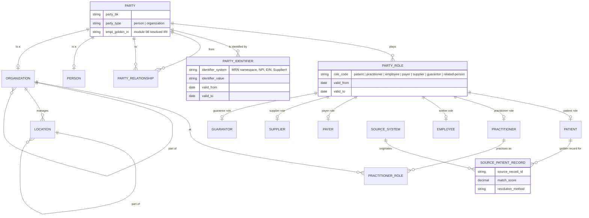
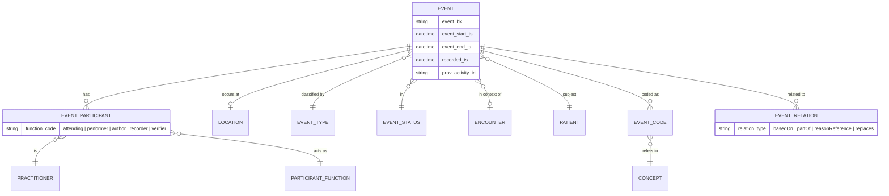
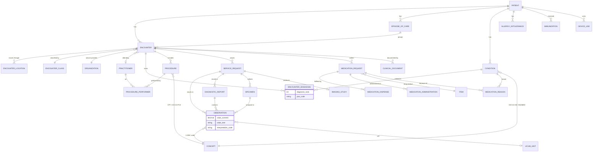
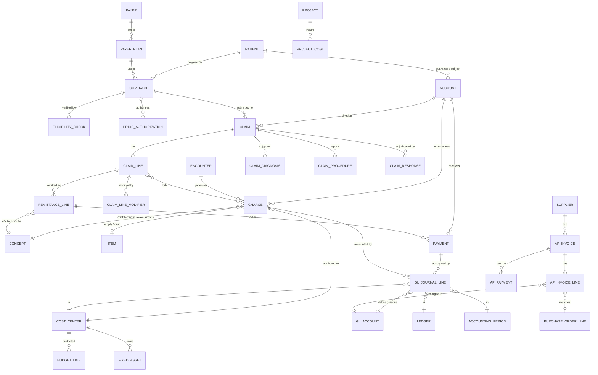
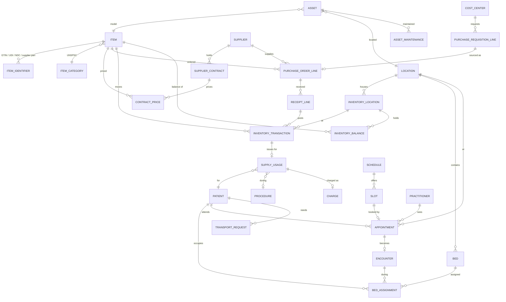
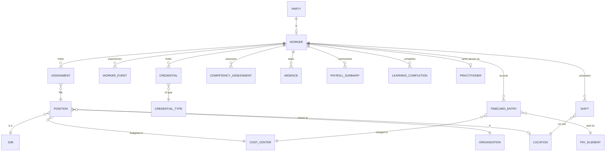
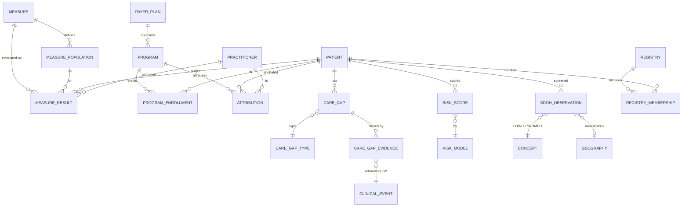
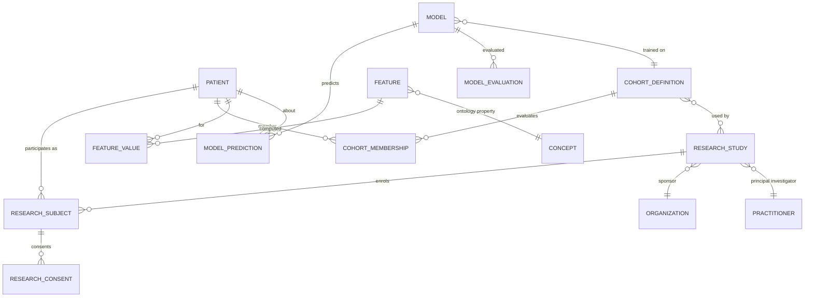
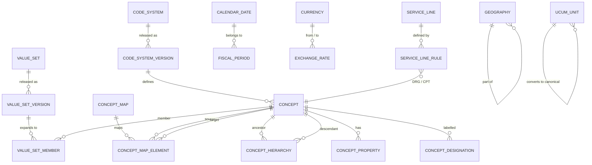
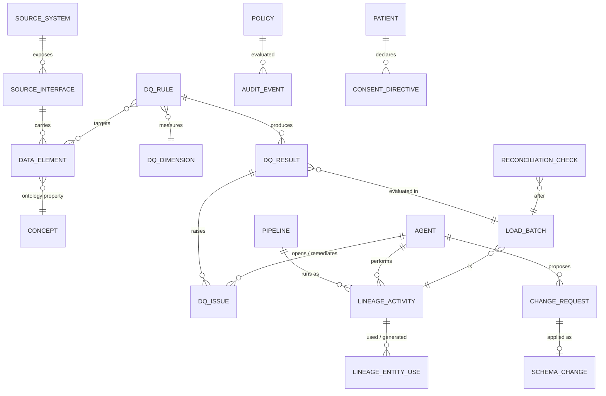

# Conceptual Model

The conceptual model names the **top-level entities and relationships** per subject-area group, independent of
dimensional or physical choices. Every entity here is a class in the enterprise ontology (module 02) and an entry in
the **Logical Model Register** (module 04); the EDW never introduces an entity that is absent from both. Diagrams are
Mermaid `erDiagram`s; cardinalities follow crow's-foot notation. Attribute lists are intentionally short — full
attributes live in the register and in `03-logical-model.md`.

## 1. How UDMH / HCDM patterns were applied

Module 04 (`RDM-*`) harmonises IBM UDMH and Teradata HCDM into a licence-safe logical model. This module consumes three
**patterns** from that harmonisation, not the vendors' entity definitions (README licensing note):

| Pattern (as harmonised in module 04) | Where it appears here | EDW realisation |
|--------------------------------------|-----------------------|-----------------|
| **Party / Party Role / Party Relationship** — a person or organisation is one *party*; roles (patient, practitioner, employee, guarantor, supplier) are time-bounded assertions; relationships between parties are typed and dated | §2, G1 | `dim_party`, `bridge_party_role`, `bridge_organization_affiliation`, `dim_related_person`; conformed `dim_patient` / `dim_practitioner` / `dim_organization` are role-specific projections of `dim_party` |
| **Event / Event Participant / Event Location** — every clinical, financial or operational occurrence is an event with a type, time, status, participants (with function) and location | §3, G2–G5 | one `fact_*` per event type; `bridge_*_performer` / participant bridges where participants are many; conformed PRC/LOC keys where single |
| **Agreement / Account / Financial Transaction** — coverage, contracts and accounts are agreements; charges, claims, payments and journal lines are transactions against them | G3, G4 | `fact_account`, `fact_coverage`, `dim_supplier_contract`; `fact_charge`, `fact_claim_*`, `fact_payment`, `fact_gl_journal_line` |
| **Product / Item / Location hierarchy** — supplies, drugs, devices and services are *items*; stock positions and movements reference item × location | G4 | conformed `dim_item`; `fact_inventory_*` |
| **Classification / Code** — every coded attribute refers to a concept in a versioned code system, optionally via a value set | G8 | `ref_code_system`, `ref_concept`, `ref_value_set_member`, conformed `dim_code` |
| **Subject-area grouping** — UDMH "business areas" and HCDM "subject areas" harmonised into G1–G9 | whole module | one or more `edw_gN_*` schemas per group |

Where the FHIR R4 resource model (module 06) and the blueprint pattern disagree, **FHIR naming wins for entities that
have a FHIR resource** (Encounter, Condition, Observation, Claim …) and the blueprint pattern wins for structure
(party-role, event participants). The register records both the FHIR resource and the blueprint pattern per entity.

## 2. Party-role pattern (G1)

Rules that follow from the pattern:

- A **person is created once** as a `PARTY` by EMPI resolution (module 08). Becoming a patient, employee or
  practitioner adds a `PARTY_ROLE`, never a second party.
- **Conformed dimensions are role projections.** `dim_patient` = `PARTY ⋈ PARTY_ROLE[patient]` with patient-specific
  attributes; `dim_practitioner` likewise. `dim_party` keeps the shared demographic truth.
- **Identifiers are first-class and dated**, so an MRN that moves between persons after an unmerge keeps its history.
- `SOURCE_PATIENT_RECORD` ↔ `PATIENT` is the EDW mirror of the module-08 `sameAs`/`resolvedTo` link, including the
  method and score, so analysts can audit or re-run resolution.

## 3. Event pattern (G2–G5)

Every G2 clinical fact, G3 financial transaction, G4 operational event and G5 workforce event is a specialisation of
`EVENT`. The dimensional translation (`03-logical-model.md` §3) is mechanical: `EVENT_TYPE`/`EVENT_STATUS` become
small value-set dimensions, single participants become conformed `*_practitioner_sk` columns (role-named, e.g.
`attending_practitioner_sk`), multi-valued participants become `bridge_*_performer`, `EVENT_CODE` becomes `code_sk`
(or a bridge when multi-coded), and `EVENT_RELATION` becomes degenerate `*_bk` columns pointing to the related fact.

## 4. Group conceptual diagrams

### 4.1 G2 — Clinical Care

Key design decisions: the encounter is the **context hub** but not a mandatory parent (ambulatory meds, problem-list
conditions and patient-reported observations exist without one); diagnosis ranking is an attribute of the
encounter–condition association, not of the condition; medication lifecycle is three events linked by the request;
observations are **component-level** (a blood pressure panel is two observation rows plus a panel pointer).

### 4.2 G3 — Revenue Cycle & Finance

Key design decisions: the **charge** is the bridge between clinical G2 and financial G3 (`encounter_bk` on
`fact_charge`); claim lines link to charges many-to-many (bundling); remittance is line-level with CARC/RARC concepts
from G8; every patient-accounting transaction is traceable to GL journal lines, which is where Oracle Fusion ERP and
Cerner patient accounting reconcile.

### 4.3 G4 — Supply Chain & Operations

Key design decisions: supply usage is the **clinical–supply hinge** (patient, procedure, charge); inventory balances
are snapshots reproducible from transactions (EDW-G4-001); scheduling follows FHIR `Schedule`/`Slot`/`Appointment` and
an appointment may become an encounter (`appointment_bk` on `fact_encounter`).

### 4.4 G5 — Workforce

Key design decisions: `WORKER` and `PRACTITIONER` are **two roles of one party** (`bridge_worker_practitioner`);
department is the conformed cost center; payroll is aggregate only (EDW-G5-002).

### 4.5 G6 — Population Health & Quality

### 4.6 G7 — Research & Analytics

### 4.7 G8 — Reference & Terminology

### 4.8 G9 — Metadata, Quality & Governance

## 5. Cross-group relationships

| From | To | Relationship | Carried as |
|------|----|--------------|-----------|
| G2 `ENCOUNTER` | G3 `CHARGE`, `CLAIM` | generates / billed as | `encounter_bk` on `fact_charge`, `fact_claim_header` |
| G4 `APPOINTMENT` | G2 `ENCOUNTER` | becomes | `appointment_bk` on `fact_encounter` |
| G4 `SUPPLY_USAGE` | G2 `PROCEDURE`, G3 `CHARGE` | during / charged as | `procedure_bk`, `charge_bk` |
| G5 `WORKER` | G1 `PRACTITIONER` | same party | `bridge_worker_practitioner` |
| G3 `AP_INVOICE_LINE` | G4 `PURCHASE_ORDER_LINE` | matches | `po_line_bk` |
| G6 `CARE_GAP` | G2 any event | evidenced by | `bridge_care_gap_evidence` (polymorphic) |
| G7 `COHORT_MEMBERSHIP` | G1–G6 | derived from | `cohort_definition` IRI + evaluation `as_of_ts` |
| G9 `DQ_RESULT` | any table | measures | `table_name`, `column_name`, `record_bk` |
| G9 `LOAD_BATCH` | every row | loaded by | `load_batch_id` |

## 6. Conceptual-level requirements

> **EDW-LOG-001** (P0, inspection) — Every entity in this document MUST exist as an OWL class in the Ontology Registry
> and as an entry in the Logical Model Register before any DDL is generated for it.

> **EDW-LOG-002** (P0, inspection) — Persons and organisations MUST be modelled with the party-role pattern; a role
> MUST NOT be modelled as a separate party.

> **EDW-LOG-003** (P0, inspection) — Every clinical, financial, operational and workforce fact MUST be a specialisation
> of the event pattern with `event_start_ts`, `recorded_ts`, status, at least one participant or subject, and
> `prov_activity_iri`.

> **EDW-LOG-004** (P1, inspection) — Cross-group relationships MUST be carried by business keys (`*_bk`) or bridges,
> never by copying attributes of the referenced entity into the referencing fact.

> **EDW-LOG-005** (P0, inspection) — No proprietary UDMH or HCDM entity names, attribute lists or diagrams MAY appear in
> this module; only the harmonised patterns of module 04 are referenced (README licensing note).
