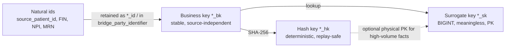

# Logical Model

This document states the **rules** `agent.schema_architect` applies when turning a Logical Model Register entry
(module 04) into presentation-layer tables, and gives **fully-specified sample tables** that the `ddl/` files
implement verbatim. Rules are normative; samples are the reference implementation of the rules.

## 1. Grain

| Rule | Statement |
|------|-----------|
| LOG-GRAIN-1 | Every fact table has exactly one grain, declared in the register as an ordered list of columns, and a type: transaction, periodic snapshot, accumulating snapshot or factless (`01-subject-area-groups.md`). |
| LOG-GRAIN-2 | The grain of a transaction fact is the **lowest level the source emits** (FHIR resource, or component for `Observation`, or line for `Claim`/`Invoice`/`Journal`). Aggregates are separate `fact_*_summary_*` tables. |
| LOG-GRAIN-3 | A periodic snapshot names its period (`_daily`, `_hourly`, `_month`, `_period`) in the table name. |
| LOG-GRAIN-4 | Accumulating snapshots carry one timestamp column per milestone (`*_ts`) plus matching `*_date_sk`; a milestone not yet reached is `NULL`, never a sentinel. |
| LOG-GRAIN-5 | Dimensions have grain "one row per version of one business entity" (SCD2) or "one row per entity" (SCD1). |

## 2. Keys

| Key type | Suffix | Datatype | Rule |
|----------|--------|----------|------|
| Surrogate | `_sk` | `BIGINT` | Assigned by the EDW, meaningless, one per row (dims) or per fact row. Conformed dimension `_sk` domains are global. Reserved members: `-1` unknown, `-2` not applicable, `-3` pending resolution (late-arriving). |
| Business | `_bk` | `VARCHAR(128)` | Stable identifier of the entity independent of source system: for FHIR-sourced entities `"<source_system_code>:<ResourceType>/<id>"`; for EMPI-resolved parties the module-08 golden identifier; for ERP entities the Fusion primary key qualified by instance. Never reused. |
| Natural | `_id`, `_number` | source datatype as text | Source identifiers kept for traceability (MRN, FIN, NPI, claim number, PO number). Multi-valued identifiers go to `bridge_party_identifier` / `bridge_*_identifier`. |
| Hash key | `_hk` | `CHAR(64)` | SHA-256 over the business key(s), used as deterministic physical key on high-volume facts and bridges so replays are idempotent (EDW-ARCH-006). |
| Record hash | `record_hash` | `CHAR(64)` | SHA-256 over all non-technical attributes (ordered by column name, `NULL` → `\N`, trimmed, UTF-8). Used for change detection in SCD2 and for KG reconciliation (`06-history-and-bitemporality.md`). |

> **EDW-LOG-010** (P0, test) — Every dimension MUST have one `*_sk` primary key, one `*_bk` business key, and a unique
> constraint on `(*_bk, valid_from)`; every fact MUST have a `*_sk` or `*_hk` primary key and a `*_bk`.

> **EDW-LOG-011** (P0, test) — Surrogate keys MUST never be derived from source identifiers and MUST never be exposed
> on Kafka or in the knowledge graph; the business key and ontology IRI are the cross-platform join keys (ADR-07).

> **EDW-LOG-012** (P0, test) — `record_hash` MUST be computed by one shared library function with a versioned
> algorithm id (`hash_algo_version`) so EDW and KG hashes are comparable.

## 3. Dimension design

### 3.1 Slowly changing dimensions

| Policy | When used | Columns |
|--------|-----------|---------|
| **Type 2 (default)** | Any dimension whose attributes have analytical history value (all conformed dims, `dim_payer_plan`, `dim_position`, `dim_item` …) | `valid_from`, `valid_to` (NULL = open), `is_current_flag`, `recorded_at`; `change_kind` / `change_reason_code` in `hist_*` |
| **Type 1** | Value-set dimensions (`dim_encounter_class`, `dim_route` …) where the concept is the identity and label changes are corrections | overwrite; history retained in G8 `ref_concept` |
| **Type 2 + bitemporal extension** | Every Type 2 dimension also has a `hist_dim_*` table in which each version carries **both** valid time and transaction time per module 08 (`TKG-01` §9, C1–C12) | `valid_from`, `valid_to`, `recorded_at`, `superseded_at`, `change_kind`, `change_reason_code`, `event_time`, `source_time`, `decision_time`, `source_tz`, `prov_activity_iri` |
| **Type 0** | `dim_date`, `dim_time`, `dim_currency` | immutable |

The current `dim_*` table is a **projection of `hist_dim_*`**: rows where `superseded_at IS NULL` (latest knowledge),
one row per valid-time version. Type 2 versioning in `dim_*` is on **valid time** (when the fact was true in the world),
and corrections (same valid period, new knowledge) replace the `dim_*` row and add a `hist_*` row with the old one
superseded. Detailed mechanics are in `06-history-and-bitemporality.md`.

> **EDW-LOG-013** (P0, test) — A Type 2 dimension MUST have no overlapping `[valid_from, valid_to)` intervals for the
> same `*_bk`, and exactly one row with `is_current_flag = 'Y'` per `*_bk`.

> **EDW-LOG-014** (P0, test) — Every Type 2 dimension MUST have a `hist_dim_*` table with identical business columns
> plus the full bitemporal block; `dim_*` MUST be reproducible from `hist_dim_*`.

### 3.2 Degenerate dimensions

Transaction identifiers with no attributes of their own are stored on the fact as `*_bk`/`*_number` columns:
`encounter_bk` on `fact_charge`, `claim_number`/`line_number` on `fact_claim_line`, `accession_number` on
`fact_imaging_study`, `po_number` on `fact_purchase_order_line`. They are documented as degenerate in the register
and MUST NOT be promoted to a dimension unless ≥ 3 non-key attributes exist.

### 3.3 Junk dimensions

Low-cardinality flags and indicators that would otherwise widen a fact are collected into one junk dimension per fact
family, with one row per observed combination: `dim_encounter_status_junk` (status, hospitalisation flags,
re-admission flag, newborn flag, trauma flag), `dim_mar_junk` (barcode scanned, override, witnessed, wasted),
`dim_reaction_junk`. Junk dimensions are Type 1 and populated on demand by the loader.

### 3.4 Bridges for many-to-many

| Bridge | Resolves | Extra attributes |
|--------|----------|------------------|
| `bridge_encounter_diagnosis` | encounter ↔ diagnosis | `diagnosis_rank` (1 = principal), `is_principal_flag`, `poa_code`, `diagnosis_role_code` (admitting, discharge, billing) |
| `bridge_claim_diagnosis` | claim ↔ diagnosis code | `diagnosis_pointer` (1–12), `is_principal_flag`, `poa_code` |
| `bridge_claim_procedure` | institutional claim ↔ ICD-10-PCS procedure | `procedure_sequence`, `procedure_date_sk` |
| `bridge_claim_line_modifier` | claim line ↔ modifier | `modifier_position` (1–4) |
| `bridge_claim_line_charge` | claim line ↔ charge | `allocation_pct` (weighting factor, sums to 1 per charge) |
| `bridge_procedure_performer` | procedure ↔ practitioner | `function_code_sk` |
| `bridge_party_identifier` | party ↔ identifier | `identifier_system`, `identifier_value`, period |
| `bridge_care_gap_evidence` | care gap ↔ any G2 fact | `evidence_table_name`, `evidence_bk` (polymorphic) |

Bridges with a weighting factor (`allocation_pct`) MUST sum to 1.0 per fact row so measures allocated through the
bridge are not double counted; ranked bridges MUST have a unique rank per parent.

> **EDW-LOG-015** (P0, test) — `bridge_encounter_diagnosis` MUST have a unique `(encounter_bk, diagnosis_rank)` among
> current rows and at most one `is_principal_flag = 'Y'` per `encounter_bk` (EDW-G2-002).

### 3.5 Hierarchies

Fixed-depth hierarchies (location, cost center, organisation, GL account, geography) are **flattened** into level
columns (`level1_name … levelN_name`) *and* keep `parent_*_sk` for ragged traversal. Variable-depth hierarchies
(SNOMED CT) use the closure table `ref_concept_hierarchy`.

## 4. Fact design

| Rule | Statement |
|------|-----------|
| LOG-FACT-1 | Facts contain foreign keys (`*_sk`), degenerate keys (`*_bk`, `*_number`), measures, milestone timestamps, and the technical block. No descriptive text other than source code display (≤ 255 chars). |
| LOG-FACT-2 | Every date on a fact appears twice: `*_date_sk` (→ `dim_date`, for slicing) and `*_ts` (`TIMESTAMP`, UTC, for precision). Time of day additionally as `*_time_sk` where shift/hour analysis is needed. |
| LOG-FACT-3 | Role-playing conformed dimensions use role-prefixed column names: `attending_practitioner_sk`, `admit_location_sk`, `service_from_date_sk`. |
| LOG-FACT-4 | Measures are additive where possible; semi-additive measures (balances) are documented; non-additive (ratios) are not stored, they are computed in `edw_sem`. |
| LOG-FACT-5 | Monetary measures are `DECIMAL(18,4)` with a `currency_code` (`CHAR(3)`, ISO 4217) when not the ledger currency. Quantities are `DECIMAL(18,6)` with `ucum_unit_sk`. |
| LOG-FACT-6 | Code columns appear as `*_code_sk` (→ `dim_code`); the raw source code and display are retained as `*_code_src` / `*_display_src` only where mapping may be lossy (observations, diagnoses). |

### 4.1 Late-arriving facts and dimensions

| Situation | Handling |
|-----------|----------|
| Fact arrives before its dimension member exists (e.g., administration before the medication order; encounter for a patient not yet in EMPI) | Loader inserts an **inferred member** in the dimension with `*_sk` from the normal sequence, `is_inferred_flag = 'Y'`, business key populated, attributes NULL. When the real member arrives it updates the inferred row (Type 1 on the inferred row) and records the correction in `hist_*`. |
| Fact arrives before its *parent fact* (admin before order) | Fact loads with `orphan_flag = 'Y'` and parent `*_bk` populated; a reconciliation job clears the flag when the parent lands; G9 completeness result is written (EDW-G2-004). |
| Fact arrives late relative to a Type 2 dimension (valid time in the past) | Loader resolves `*_sk` **as of the fact's valid time**, not load time (`06-history-and-bitemporality.md` §4.3). |
| Fact for a closed accounting period | Loaded with its true `valid_from`; period-close reports are reproduced with transaction-time predicates (as-of recorded time). |

> **EDW-LOG-016** (P0, test) — A fact MUST never be rejected because its dimension member is missing; the loader MUST
> use an inferred member and report completeness to G9.

> **EDW-LOG-017** (P0, test) — Dimension lookups for a fact MUST be performed as of the fact's `valid_from`, so a
> patient who changed address is attributed to the address current at the encounter, not at load time.

## 5. Ontology IRI binding (column metadata)

Every table and column in a presentation schema is bound to the enterprise ontology. The binding is stored in the
**data dictionary** (export format in `04-physical-model-and-ddl.md` §6) and, where the platform supports it, in the
column comment.

| Metadata attribute | Level | Required | Example |
|--------------------|-------|----------|---------|
| `ontology_class_iri` | table | yes | `https://ontology.healix.example.org/clinical/Encounter` |
| `ontology_property_iri` | column | yes, unless `role = technical` | `https://ontology.healix.example.org/clinical/admitDateTime` |
| `value_set_iri` | coded column | yes for `*_code_sk` | `https://ontology.healix.example.org/scheme/encounter-class` |
| `code_system_uri` | coded column | yes | `http://terminology.hl7.org/CodeSystem/v3-ActCode` |
| `source_fhir_path` | column | when FHIR-sourced | `Encounter.period.start` |
| `source_blueprint_pattern` | table | yes | `event` (module 04 harmonised pattern) |
| `role` | column | yes | `surrogate_key / business_key / foreign_key / degenerate / measure / attribute / milestone / technical / bitemporal` |
| `phi_class` | column | yes | a module-11 taxonomy value (`11-governance-security-compliance/01-hipaa-phi-and-privacy.md` §3, the `hc-phi-class` value set): `phi:direct`, `phi:quasi`, `phi:clinical`, `phi:sensitive-category` (or `phi:sensitive-category/{sud,hiv,mental-health,reproductive,genetic}`), `pii:workforce`, `confidential:financial`, `confidential:operational`, `internal`, `public`, `deidentified:safe-harbor`, `deidentified:expert`, `pseudonymised` |
| `unit_ucum` | numeric measure | when applicable | `mg/dL` |
| `nullable_reason` | nullable column | yes | `milestone-not-reached`, `source-optional`, `not-applicable` |

Column comments use a compact fixed format so they can be parsed back: `'<phi_class> | <ontology_property_iri>'`.

> **EDW-LOG-020** (P0, test) — Every column MUST have `ontology_property_iri` resolvable in the Ontology Registry at
> DDL-generation time, except columns with `role = technical` or `role = bitemporal`, whose IRIs are fixed by
> `TKG-01` (`healix-time:validFrom`, `healix-time:validTo`, `healix-time:recordedAt`, `healix-time:supersededAt`,
> `healix-time:changeKind`, `healix-time:eventTime`, `healix-time:sourceTime`, `healix-time:decisionTime`,
> `healix-time:sourceTimeZone`, `prov:wasGeneratedBy`).

> **EDW-LOG-021** (P0, test) — A `*_code_sk` column MUST declare `value_set_iri` and `code_system_uri`; the loader
> MUST validate codes against the value set expansion in G8 as of `valid_from` (EDW-G8-002).

> **EDW-LOG-022** (P1, test) — The IRI coverage ratio (bound columns / all non-technical columns) per schema MUST be
> ≥ 0.95 (VIS-00 goal G-01) and MUST be published daily to G9 `fact_dq_score_daily`.

## 6. PHI column tagging

`agent.privacy_guardian` (module 11) assigns a `phi_class` to every column before a DDL proposal is evaluated. The
value set is **module 11's classification taxonomy** (`01-hipaa-phi-and-privacy.md` §3, SKOS scheme
`<base>scheme/data-classification`), the same values carried in the Kafka header `hc-phi-class` and in KG
`healix:dataClassification` annotations; module 05 defines no values of its own (the pre-reconciliation tags
`phi_direct / phi_quasi / phi_sensitive / none` are retired). A column carries the **most restrictive** tag of the
values it can hold; tags are stored in the data dictionary and `edw_g9_governance.ref_data_element_classification`
and surfaced as column comments `'<phi_class> | <ontology_property_iri>'`.

| `phi_class` (module 11 §3) | EDW usage | Typical columns | Default handling (module 11 enforces) |
|----------------------------|-----------|-----------------|---------------------------------------|
| `phi:direct` | HIPAA direct identifiers 1–2, 4–18 of a patient or patient-linked person, including identifiers of a patient's episodes and records (encounter, account, claim, observation business keys and natural ids) | `patient_bk`, `mrn_primary`, `name_*`, `address_line*`, `phone_*`, `email`, `ssn_hash`, `birth_date`, `encounter_bk`, `claim_number`, `source_encounter_id`, `visit_number` | column-level masking outside approved roles; row access audited (EDW-G9-004); absent from non-prod (GOV-PHI-011) |
| `phi:quasi` | Identifies only in combination (identifier 3 dates, ZIP, sex, race, rare diagnosis groupers) | `admit_ts`, `discharge_ts`, `*_date_sk` on patient facts, `address_city`, `address_postal_code`, `geography_sk`, `administrative_gender_code_sk`, `race_primary_code_sk`, `drg_code_sk` | generalisation in the `deidentified:safe-harbor` views (`edw_sem.v_deid_*`); k-anonymity check before release |
| `phi:clinical` | Health or payment information about an identifiable individual that is not itself an identifier | diagnosis / procedure / observation / medication codes, result values, encounter class, attending practitioner, charge and claim amounts | PHI; released without `phi:direct` only under module 11 §6 |
| `phi:sensitive-category` and `phi:sensitive-category/{sud,hiv,mental-health,reproductive,genetic}` | Specially protected categories (42 CFR Part 2, state law, GINA, reproductive-health rule). Column-level tag is the parent; the sub-tag is **value-evaluated** per row via `sensitive_category_code` (G8 scheme `healix:scheme/sensitive-categories`) | `diagnosis_code_sk`, `medication_code_sk`, `value_text`, `gender_identity_code_sk`, `religion_code_sk` | consent-directive filtering (`fact_consent_directive`), segmented rows, `hc-part2-flag` on export |
| `pii:workforce` | Personal data of employees, contractors, applicants (G5 and steward/actor attributes in G9) | worker names, SSN hash, salary, `dim_data_steward.principal_id` | HR access policy; GDPR overlay for EU/UK staff |
| `confidential:financial` | Commercially sensitive non-personal finance and contract data | GL journal amounts, supplier pricing, PO quantities, payer contract rates | Finance role access |
| `confidential:operational` | Internal operational data with no personal content | inventory balances, bed capacity | Internal access |
| `internal` | Non-sensitive internal metadata: surrogate keys, technical and bitemporal blocks, flags, rule definitions, lineage | `*_sk`, `record_hash`, `recorded_at`, `prov_activity_iri`, `dq_rule_bk` | any authenticated principal |
| `public` | Approved for external publication | published code systems and value sets (`dim_code.code`), organisation directory, NPI, `dim_date` | no restriction |
| `deidentified:safe-harbor`, `deidentified:expert` | Only in `edw_sem.v_deid_*` outputs and G7 extracts, never on presentation base tables | — | governed by DSA; re-identification prohibited |
| `pseudonymised` | PHI replaced by vault-held tokens or one-way hashes: DQ result/issue payloads, non-prod copies | `fact_dq_result.subject_bk`, `detail_text`, `fact_dq_issue.subjects_json` | still PHI under HIPAA; vault access restricted |

Rules:

- A column's `phi_class` is inherited by every view and derived table that exposes it; `agent.evaluator` fails a
  change that exposes a `phi:direct` column in a view without a masking expression.
- Unclassified columns default to `phi:direct` (fail-closed, GOV-PHI-003); reclassification is a `phi-affecting`
  change request.
- HR data (G5) is classified `pii:workforce`; where a worker is also a patient the patient-role columns carry the
  `phi:*` tag.
- `phi:sensitive-category/*` is evaluated on **values**, not columns, for diagnosis / observation / medication facts:
  the loader sets `sensitive_category_code` on the row from the G8 value set `healix:scheme/sensitive-categories`, and
  the column-level tag is the parent `phi:sensitive-category`.
- Surrogate keys to `dim_patient` (`patient_sk`) are `internal`: they are meaningless outside the EDW (EDW-LOG-011);
  the row they sit on inherits the PHI class of its most restrictive column for access control.

> **EDW-LOG-030** (P0, inspection) — No DDL MAY be approved while any column lacks a `phi_class` drawn from the
> module-11 taxonomy; `agent.privacy_guardian` holds veto (L4).

> **EDW-LOG-031** (P0, test) — Tables containing `phi:direct` columns MUST live in schemas with row-level audit enabled
> and MUST NOT be granted to any role other than those listed in the module-11 access matrix.

## 7. Naming rules (module-05 refinements of `CONVENTIONS.md` §3)

| Element | Rule | Example |
|---------|------|---------|
| Table prefix | `dim_`, `fact_`, `bridge_`, `ref_`, `stg_`, `hist_`, `int_` (integration), `agg_` (periodic roll-up of a fact, e.g. G9 `agg_dq_result_day` named by module 09), `v_` (views) | `hist_dim_patient` = history of `dim_patient` |
| Role-prefixed FK | `<role>_<dimension>_sk` | `attending_practitioner_sk` |
| Date / time | `<event>_date_sk`, `<event>_time_sk`, `<event>_ts` | `admit_date_sk`, `admit_ts` |
| Flags | `<name>_flag CHAR(1)` values `Y`/`N`, never NULL (use `U` unknown) | `is_current_flag` |
| Codes | `<name>_code_sk` (FK to `dim_code`), `<name>_code_src`, `<name>_display_src` | `diagnosis_code_sk` |
| Measures | `<name>_amount`, `<name>_qty`, `<name>_count`, `<name>_pct`, `<name>_days`, `<name>_hours` | `billed_amount` |
| Hashes | `<name>_hash CHAR(64)`, `<name>_hk CHAR(64)` | `record_hash` |
| IRIs | `<name>_iri VARCHAR(512)` | `prov_activity_iri` |
| Abbreviations | only `sk, bk, hk, id, ts, pct, qty, amt(no), num(no)` — write `amount`, `number` in full | — |
| Maximum identifier length | 30 characters for schema, table and column names (Teradata legacy compatibility; Vantage allows 128 but portability wins); constraint and index names ≤ 60 | — |

> **EDW-LOG-040** (P0, test) — Identifiers MUST be lowercase snake_case, ≤ 30 characters, match the prefixes above and
> contain no reserved words of ANSI SQL or Teradata; the linter MUST reject otherwise.

## 8. Standard column blocks

Every presentation table ends with these blocks in this order.

**Technical block (all tables)**

| Column | Type | Null | Meaning |
|--------|------|------|---------|
| `source_system_sk` | `INTEGER` | no | → `edw_g8_reference.dim_source_system` (conformed, G8) |
| `load_batch_id` | `BIGINT` | no | → `edw_g9_governance.fact_load_batch` (EDW-G9-002) |
| `record_hash` | `CHAR(64)` | no | SHA-256 of business attributes (§2) |
| `recorded_at` | `TIMESTAMP` | no | transaction time start (when the EDW learned this version); `DEFAULT CURRENT_TIMESTAMP` as the sink-clock safety net (TKG-01 C3), always set explicitly by the loader |
| `prov_activity_iri` | `VARCHAR(512)` | no | PROV-O activity that produced the row (`TKG-01` C5) |

**Valid-time block (Type 2 dims, facts, bridges)**

| Column | Type | Null | Meaning |
|--------|------|------|---------|
| `valid_from` | `TIMESTAMP` | no | when the version became true in the world |
| `valid_to` | `TIMESTAMP` | yes | exclusive end; NULL = still valid |
| `is_current_flag` | `CHAR(1)` | no | dims only: `Y` for the open version |

**Transaction-time completion (`hist_*`, facts, bridges)**

| Column | Type | Null | Meaning |
|--------|------|------|---------|
| `superseded_at` | `TIMESTAMP` | yes | when this version stopped being the EDW's belief; NULL = current belief (TKG-01 C4) |
| `change_kind` | `CHAR(12)` | yes | TKG-01 C6/C10 `healix-time:changeKind` SKOS value explaining **why this version was closed**: `new-version / correction / retraction / merge / unmerge`; NULL while `superseded_at IS NULL`, NOT NULL once superseded (DQR-VALIDITY-TEMPORAL-003) |
| `change_reason_code` | `VARCHAR(30)` | yes | EDW loader reason **why this version was created**: `insert / source-update / correction / merge / late-arrival / retraction / reload` (`06-history-and-bitemporality.md` §1) |
| `event_time` | `TIMESTAMP` | no | TKG-01 C7: `hc-event-time` of the producing record (UTC) |
| `source_time` | `TIMESTAMP` | yes | TKG-01 C7: `hc-source-time`, the source system clock (UTC) |
| `decision_time` | `TIMESTAMP` | yes | TKG-01 C8: when the real-world decision was taken; NULL = not available |
| `source_tz` | `VARCHAR(64)` | yes | TKG-01 C12: IANA zone of the source timestamps; storage is UTC |

The full set (`valid_from`, `valid_to`, `recorded_at`, `superseded_at`, `change_kind`, `change_reason_code`,
`event_time`, `source_time`, `decision_time`, `source_tz`, `prov_activity_iri`) is the EDW realisation of the `TKG-01`
§9 contract C1–C12; the clause-by-column mapping is in `06-history-and-bitemporality.md` §3.3.

## 9. Sample logical tables

Types are portable ANSI; `ddl/` implements these exactly. PHI = `phi_class` in the module-11 taxonomy (§6); IRI column
shows the local part of `https://ontology.healix.example.org/`.

### 9.1 `edw_g1_party.dim_patient` (conformed, Type 2)

| Column | Type | Null | Role | PHI | Ontology property (local part) |
|--------|------|------|------|-----|-------------------------------|
| `patient_sk` | BIGINT | no | surrogate_key | internal | `party/Patient` (class) |
| `patient_bk` | VARCHAR(128) | no | business_key | phi:direct | `party/empiGoldenIdentifier` |
| `party_sk` | BIGINT | no | foreign_key → `dim_party` | internal | `party/isRoleOf` |
| `empi_golden_iri` | VARCHAR(512) | no | attribute | phi:direct | `party/empiGoldenIri` (module 08 resolved IRI) |
| `mrn_primary` | VARCHAR(64) | yes | attribute | phi:direct | `party/medicalRecordNumber` |
| `mrn_primary_system` | VARCHAR(255) | yes | attribute | internal | `party/identifierSystem` |
| `name_family` | VARCHAR(100) | yes | attribute | phi:direct | `party/familyName` |
| `name_given` | VARCHAR(100) | yes | attribute | phi:direct | `party/givenName` |
| `name_middle` | VARCHAR(100) | yes | attribute | phi:direct | `party/middleName` |
| `name_prefix` | VARCHAR(20) | yes | attribute | phi:direct | `party/namePrefix` |
| `name_suffix` | VARCHAR(20) | yes | attribute | phi:direct | `party/nameSuffix` |
| `birth_date` | DATE | yes | attribute | phi:direct | `party/birthDate` |
| `birth_date_estimated_flag` | CHAR(1) | no | attribute | phi:quasi | `party/birthDateEstimated` |
| `deceased_flag` | CHAR(1) | no | attribute | phi:clinical | `party/deceased` |
| `deceased_ts` | TIMESTAMP | yes | attribute | phi:quasi | `party/deceasedDateTime` |
| `administrative_gender_code_sk` | BIGINT | no | foreign_key → `dim_code` | phi:quasi | `party/administrativeGender` |
| `birth_sex_code_sk` | BIGINT | no | foreign_key → `dim_code` | phi:quasi | `party/birthSex` |
| `gender_identity_code_sk` | BIGINT | no | foreign_key → `dim_code` | phi:sensitive-category | `party/genderIdentity` |
| `race_primary_code_sk` | BIGINT | no | foreign_key → `dim_code` (multi-valued races in `bridge_patient_race`) | phi:quasi | `party/race` |
| `ethnicity_code_sk` | BIGINT | no | foreign_key → `dim_code` | phi:quasi | `party/ethnicity` |
| `preferred_language_code_sk` | BIGINT | no | foreign_key → `dim_code` | phi:quasi | `party/preferredLanguage` |
| `marital_status_code_sk` | BIGINT | no | foreign_key → `dim_code` | phi:quasi | `party/maritalStatus` |
| `religion_code_sk` | BIGINT | no | foreign_key → `dim_code` | phi:sensitive-category | `party/religiousAffiliation` |
| `interpreter_required_flag` | CHAR(1) | no | attribute | phi:quasi | `party/interpreterRequired` |
| `multiple_birth_flag` | CHAR(1) | no | attribute | phi:quasi | `party/multipleBirth` |
| `address_line1` | VARCHAR(200) | yes | attribute | phi:direct | `party/addressLine` |
| `address_line2` | VARCHAR(200) | yes | attribute | phi:direct | `party/addressLine` |
| `address_city` | VARCHAR(100) | yes | attribute | phi:quasi | `party/addressCity` |
| `address_state_code` | CHAR(2) | yes | attribute | phi:quasi | `party/addressState` |
| `address_postal_code` | VARCHAR(10) | yes | attribute | phi:quasi | `party/addressPostalCode` |
| `address_country_code` | CHAR(2) | yes | attribute | phi:quasi | `party/addressCountry` |
| `geography_sk` | BIGINT | no | foreign_key → `edw_g8_reference.dim_geography` | phi:quasi | `party/residesIn` |
| `phone_home` | VARCHAR(30) | yes | attribute | phi:direct | `party/homePhone` |
| `phone_mobile` | VARCHAR(30) | yes | attribute | phi:direct | `party/mobilePhone` |
| `email` | VARCHAR(255) | yes | attribute | phi:direct | `party/email` |
| `ssn_hash` | CHAR(64) | yes | attribute | phi:direct | `party/nationalIdentifierHash` |
| `managing_organization_sk` | BIGINT | no | foreign_key → `dim_organization` | phi:clinical | `party/managingOrganization` |
| `primary_care_practitioner_sk` | BIGINT | no | foreign_key → `dim_practitioner` | phi:clinical | `party/generalPractitioner` |
| `patient_status_code` | VARCHAR(20) | no | attribute | internal | `party/patientStatus` (`active / inactive / merged / deceased`) |
| `merged_into_patient_sk` | BIGINT | yes | foreign_key → `dim_patient` | internal | `party/mergedInto` |
| `test_patient_flag` | CHAR(1) | no | attribute | internal | `party/testPatient` |
| `is_inferred_flag` | CHAR(1) | no | technical | internal | — |
| `valid_from`, `valid_to`, `is_current_flag` | — | — | bitemporal | internal | `TKG-01` |
| technical block | — | — | technical | internal | — |

### 9.2 `edw_g1_party.dim_practitioner` (conformed, Type 2)

| Column | Type | Null | Role | PHI | Ontology property |
|--------|------|------|------|-----|-------------------|
| `practitioner_sk` | BIGINT | no | surrogate_key | internal | `party/Practitioner` (class) |
| `practitioner_bk` | VARCHAR(128) | no | business_key | internal | `party/practitionerIdentifier` |
| `party_sk` | BIGINT | no | foreign_key → `dim_party` | internal | `party/isRoleOf` |
| `npi` | CHAR(10) | yes | attribute | public | `party/npi` |
| `dea_number_hash` | CHAR(64) | yes | attribute | internal | `party/deaNumberHash` |
| `state_license_number` | VARCHAR(30) | yes | attribute | internal | `party/stateLicenseNumber` |
| `state_license_state_code` | CHAR(2) | yes | attribute | internal | `party/stateLicenseState` |
| `name_family` | VARCHAR(100) | yes | attribute | internal | `party/familyName` |
| `name_given` | VARCHAR(100) | yes | attribute | internal | `party/givenName` |
| `name_prefix` | VARCHAR(20) | yes | attribute | internal | `party/namePrefix` |
| `name_suffix` | VARCHAR(20) | yes | attribute | internal | `party/nameSuffix` |
| `credential_text` | VARCHAR(100) | yes | attribute | internal | `party/credentialText` (MD, DO, RN …) |
| `gender_code_sk` | BIGINT | no | foreign_key → `dim_code` | internal | `party/administrativeGender` |
| `practitioner_type_code_sk` | BIGINT | no | foreign_key → `dim_code` | internal | `party/practitionerType` |
| `primary_specialty_code_sk` | BIGINT | no | foreign_key → `dim_code` (NUCC taxonomy) | internal | `party/primarySpecialty` |
| `primary_organization_sk` | BIGINT | no | foreign_key → `dim_organization` | internal | `party/primaryOrganization` |
| `employed_flag` | CHAR(1) | no | attribute | internal | `party/employedByEnterprise` |
| `active_flag` | CHAR(1) | no | attribute | internal | `party/active` |
| `email_work` | VARCHAR(255) | yes | attribute | internal | `party/workEmail` |
| `phone_work` | VARCHAR(30) | yes | attribute | internal | `party/workPhone` |
| `is_inferred_flag` | CHAR(1) | no | technical | internal | — |
| valid-time block, technical block | | | | | |

### 9.3 `edw_g2_clinical.fact_encounter` (accumulating snapshot)

Grain: one row per encounter (`encounter_bk`).

| Column | Type | Null | Role | PHI | Ontology property |
|--------|------|------|------|-----|-------------------|
| `encounter_sk` | BIGINT | no | surrogate_key | internal | `clinical/Encounter` (class) |
| `encounter_bk` | VARCHAR(128) | no | business_key | phi:direct | `clinical/encounterIdentifier` |
| `patient_sk` | BIGINT | no | foreign_key → `dim_patient` | internal | `clinical/subject` |
| `encounter_class_sk` | BIGINT | no | foreign_key → `dim_encounter_class` | phi:clinical | `clinical/encounterClass` |
| `encounter_type_sk` | BIGINT | no | foreign_key → `dim_encounter_type` | phi:clinical | `clinical/encounterType` |
| `encounter_status_junk_sk` | BIGINT | no | foreign_key → `dim_encounter_status_junk` | phi:clinical | `clinical/encounterStatus` |
| `admit_source_sk` | BIGINT | no | foreign_key → `dim_admit_source` | phi:clinical | `clinical/admitSource` |
| `discharge_disposition_sk` | BIGINT | no | foreign_key → `dim_discharge_disposition` | phi:clinical | `clinical/dischargeDisposition` |
| `service_provider_org_sk` | BIGINT | no | foreign_key → `dim_organization` | phi:clinical | `clinical/serviceProvider` |
| `admit_location_sk` | BIGINT | no | foreign_key → `dim_location` | phi:clinical | `clinical/admitLocation` |
| `discharge_location_sk` | BIGINT | no | foreign_key → `dim_location` | phi:clinical | `clinical/dischargeLocation` |
| `attending_practitioner_sk` | BIGINT | no | foreign_key → `dim_practitioner` | phi:clinical | `clinical/attendingPractitioner` |
| `admitting_practitioner_sk` | BIGINT | no | foreign_key → `dim_practitioner` | phi:clinical | `clinical/admittingPractitioner` |
| `referring_practitioner_sk` | BIGINT | no | foreign_key → `dim_practitioner` | phi:clinical | `clinical/referringPractitioner` |
| `primary_payer_sk` | BIGINT | no | foreign_key → `dim_payer` | phi:clinical | `clinical/primaryCoveragePayer` |
| `service_line_sk` | BIGINT | no | foreign_key → `edw_g8_reference.dim_service_line` | phi:clinical | `clinical/serviceLine` |
| `drg_code_sk` | BIGINT | no | foreign_key → `dim_code` (MS-DRG) | phi:quasi | `clinical/diagnosisRelatedGroup` |
| `admit_date_sk` | INTEGER | no | foreign_key → `dim_date` | phi:quasi | `clinical/admitDateTime` |
| `admit_time_sk` | SMALLINT | no | foreign_key → `dim_time` | internal | `clinical/admitDateTime` |
| `admit_ts` | TIMESTAMP | yes | milestone | phi:quasi | `clinical/admitDateTime` |
| `discharge_date_sk` | INTEGER | no | foreign_key → `dim_date` | phi:quasi | `clinical/dischargeDateTime` |
| `discharge_time_sk` | SMALLINT | no | foreign_key → `dim_time` | internal | `clinical/dischargeDateTime` |
| `discharge_ts` | TIMESTAMP | yes | milestone | phi:quasi | `clinical/dischargeDateTime` |
| `ed_arrival_ts` | TIMESTAMP | yes | milestone | phi:quasi | `clinical/edArrivalDateTime` |
| `ed_departure_ts` | TIMESTAMP | yes | milestone | phi:quasi | `clinical/edDepartureDateTime` |
| `coding_complete_ts` | TIMESTAMP | yes | milestone | phi:clinical | `finance/codingCompleteDateTime` |
| `final_bill_ts` | TIMESTAMP | yes | milestone | phi:clinical | `finance/finalBillDateTime` |
| `length_of_stay_days` | DECIMAL(9,2) | yes | measure | phi:clinical | `clinical/lengthOfStayDays` |
| `length_of_stay_hours` | DECIMAL(12,2) | yes | measure | phi:clinical | `clinical/lengthOfStayHours` |
| `observation_hours` | DECIMAL(9,2) | yes | measure | phi:clinical | `clinical/observationHours` |
| `encounter_count` | SMALLINT | no | measure (= 1) | internal | `clinical/encounterCount` |
| `inpatient_flag` | CHAR(1) | no | attribute | phi:clinical | `clinical/isInpatient` |
| `readmission_30d_flag` | CHAR(1) | no | attribute (derived) | phi:clinical | `pophealth/readmissionWithin30Days` |
| `appointment_bk` | VARCHAR(128) | yes | degenerate → G4 `fact_appointment` | phi:direct | `clinical/basedOnAppointment` |
| `episode_of_care_bk` | VARCHAR(128) | yes | degenerate → `fact_episode_of_care` | phi:direct | `clinical/episodeOfCare` |
| `account_bk` | VARCHAR(128) | yes | degenerate → G3 `fact_account` | phi:direct | `finance/account` |
| `source_encounter_id` | VARCHAR(64) | yes | natural id (Cerner FIN/encntr_id) | phi:direct | `clinical/sourceEncounterIdentifier` |
| `visit_number` | VARCHAR(64) | yes | natural id (HL7 PV1-19) | phi:direct | `clinical/visitNumber` |
| `orphan_flag` | CHAR(1) | no | technical | internal | — |
| valid-time block (`valid_from`, `valid_to`), transaction-time completion (`superseded_at`, `change_kind`, `change_reason_code`, `event_time`, `source_time`, `decision_time`, `source_tz`), technical block | | | | | |

### 9.4 `edw_g2_diagnostics.fact_observation_result` (transaction)

Grain: one row per observation component (`observation_bk`, `component_sequence`).

| Column | Type | Null | Role | PHI | Ontology property |
|--------|------|------|------|-----|-------------------|
| `observation_result_sk` | BIGINT | no | surrogate_key | internal | `clinical/Observation` (class) |
| `observation_bk` | VARCHAR(128) | no | business_key | phi:direct | `clinical/observationIdentifier` |
| `component_sequence` | SMALLINT | no | business_key (0 = whole observation) | internal | `clinical/componentSequence` |
| `panel_observation_bk` | VARCHAR(128) | yes | degenerate (parent panel) | phi:direct | `clinical/memberOfPanel` |
| `patient_sk` | BIGINT | no | foreign_key → `dim_patient` | internal | `clinical/subject` |
| `encounter_bk` | VARCHAR(128) | yes | degenerate → `fact_encounter` | phi:direct | `clinical/encounter` |
| `order_bk` | VARCHAR(128) | yes | degenerate → `fact_order` | phi:direct | `clinical/basedOn` |
| `specimen_bk` | VARCHAR(128) | yes | degenerate → `fact_specimen` | phi:direct | `clinical/specimen` |
| `diagnostic_report_bk` | VARCHAR(128) | yes | degenerate → `fact_diagnostic_report` | phi:direct | `clinical/partOfReport` |
| `performer_practitioner_sk` | BIGINT | no | foreign_key → `dim_practitioner` | phi:clinical | `clinical/performer` |
| `performing_organization_sk` | BIGINT | no | foreign_key → `dim_organization` | phi:clinical | `clinical/performingOrganization` |
| `location_sk` | BIGINT | no | foreign_key → `dim_location` | phi:clinical | `clinical/location` |
| `observation_code_sk` | BIGINT | no | foreign_key → `dim_code` (LOINC) | phi:clinical | `clinical/observationCode` |
| `observation_category_code_sk` | BIGINT | no | foreign_key → `dim_code` | phi:clinical | `clinical/observationCategory` |
| `observation_code_src` | VARCHAR(64) | yes | attribute | phi:clinical | `clinical/sourceObservationCode` |
| `observation_display_src` | VARCHAR(255) | yes | attribute | phi:clinical | `clinical/sourceObservationDisplay` |
| `effective_date_sk` | INTEGER | no | foreign_key → `dim_date` | phi:quasi | `clinical/effectiveDateTime` |
| `effective_time_sk` | SMALLINT | no | foreign_key → `dim_time` | internal | `clinical/effectiveDateTime` |
| `effective_ts` | TIMESTAMP | yes | milestone | phi:quasi | `clinical/effectiveDateTime` |
| `issued_ts` | TIMESTAMP | yes | milestone | phi:clinical | `clinical/issued` |
| `result_status_sk` | BIGINT | no | foreign_key → `dim_result_status` | phi:clinical | `clinical/observationStatus` |
| `value_type_code` | VARCHAR(20) | no | attribute | internal | `clinical/valueType` (`quantity / coded / string / boolean / ratio / range / none`) |
| `value_numeric` | DECIMAL(18,6) | yes | measure (canonical UCUM) | phi:clinical | `clinical/valueQuantity` |
| `ucum_unit_sk` | BIGINT | no | foreign_key → `dim_ucum_unit` | phi:clinical | `clinical/valueUnit` |
| `value_numeric_src` | DECIMAL(18,6) | yes | measure (as received) | phi:clinical | `clinical/sourceValueQuantity` |
| `unit_src_text` | VARCHAR(50) | yes | attribute | phi:clinical | `clinical/sourceValueUnit` |
| `comparator_code` | VARCHAR(2) | yes | attribute | phi:clinical | `clinical/valueComparator` |
| `value_code_sk` | BIGINT | no | foreign_key → `dim_code` | phi:clinical | `clinical/valueCodeableConcept` |
| `value_text` | VARCHAR(1000) | yes | attribute | phi:sensitive-category (value-evaluated) | `clinical/valueString` |
| `value_boolean_flag` | CHAR(1) | yes | attribute | phi:clinical | `clinical/valueBoolean` |
| `reference_range_low` | DECIMAL(18,6) | yes | attribute | phi:clinical | `clinical/referenceRangeLow` |
| `reference_range_high` | DECIMAL(18,6) | yes | attribute | phi:clinical | `clinical/referenceRangeHigh` |
| `reference_range_text` | VARCHAR(100) | yes | attribute | phi:clinical | `clinical/referenceRangeText` |
| `abnormal_flag_sk` | BIGINT | no | foreign_key → `dim_abnormal_flag` | phi:clinical | `clinical/interpretation` |
| `critical_flag` | CHAR(1) | no | attribute | phi:clinical | `clinical/isCritical` |
| `body_site_code_sk` | BIGINT | no | foreign_key → `dim_code` | phi:clinical | `clinical/bodySite` |
| `method_code_sk` | BIGINT | no | foreign_key → `dim_code` | phi:clinical | `clinical/method` |
| `device_bk` | VARCHAR(128) | yes | degenerate | phi:direct | `clinical/device` |
| `sensitive_category_code` | VARCHAR(30) | yes | attribute (derived) | phi:clinical | `governance/sensitiveCategory` |
| `source_result_id` | VARCHAR(64) | yes | natural id | phi:direct | `clinical/sourceResultIdentifier` |
| `orphan_flag` | CHAR(1) | no | technical | internal | — |
| valid-time block, transaction-time completion (`superseded_at`, `change_kind`, `change_reason_code`, `event_time`, `source_time`, `decision_time`, `source_tz`), technical block | | | | | |

### 9.5 `edw_g3_revenue.fact_claim_line` (transaction)

Grain: one row per claim service line (`claim_number`, `line_number`, claim version).

| Column | Type | Null | Role | PHI | Ontology property |
|--------|------|------|------|-----|-------------------|
| `claim_line_sk` | BIGINT | no | surrogate_key | internal | `finance/ClaimLine` (class) |
| `claim_line_bk` | VARCHAR(128) | no | business_key | phi:direct | `finance/claimLineIdentifier` |
| `claim_header_sk` | BIGINT | no | foreign_key → `fact_claim_header` | internal | `finance/partOfClaim` |
| `claim_number` | VARCHAR(64) | no | degenerate | phi:direct | `finance/claimNumber` |
| `line_number` | SMALLINT | no | degenerate | internal | `finance/lineNumber` |
| `patient_sk` | BIGINT | no | foreign_key → `dim_patient` | internal | `finance/patient` |
| `rendering_practitioner_sk` | BIGINT | no | foreign_key → `dim_practitioner` | phi:clinical | `finance/renderingProvider` |
| `place_of_service_location_sk` | BIGINT | no | foreign_key → `dim_location` | phi:clinical | `finance/placeOfServiceLocation` |
| `place_of_service_code_sk` | BIGINT | no | foreign_key → `dim_code` (CMS POS) | phi:clinical | `finance/placeOfServiceCode` |
| `payer_sk` | BIGINT | no | foreign_key → `dim_payer` | phi:clinical | `finance/payer` |
| `payer_plan_sk` | BIGINT | no | foreign_key → `dim_payer_plan` | phi:clinical | `finance/payerPlan` |
| `procedure_code_sk` | BIGINT | no | foreign_key → `dim_code` (CPT/HCPCS) | phi:clinical | `finance/procedureCode` |
| `revenue_code_sk` | BIGINT | no | foreign_key → `dim_code` (UB-04 revenue) | phi:clinical | `finance/revenueCode` |
| `ndc_item_sk` | BIGINT | no | foreign_key → `dim_item` | phi:clinical | `finance/drugItem` |
| `service_from_date_sk` | INTEGER | no | foreign_key → `dim_date` | phi:quasi | `finance/serviceFromDate` |
| `service_to_date_sk` | INTEGER | no | foreign_key → `dim_date` | phi:quasi | `finance/serviceToDate` |
| `adjudication_date_sk` | INTEGER | no | foreign_key → `dim_date` | phi:clinical | `finance/adjudicationDate` |
| `units_of_service` | DECIMAL(12,3) | yes | measure | phi:clinical | `finance/unitsOfService` |
| `billed_amount` | DECIMAL(18,4) | yes | measure | phi:clinical | `finance/billedAmount` |
| `allowed_amount` | DECIMAL(18,4) | yes | measure | phi:clinical | `finance/allowedAmount` |
| `paid_amount` | DECIMAL(18,4) | yes | measure | phi:clinical | `finance/paidAmount` |
| `patient_responsibility_amount` | DECIMAL(18,4) | yes | measure | phi:clinical | `finance/patientResponsibilityAmount` |
| `deductible_amount` | DECIMAL(18,4) | yes | measure | phi:clinical | `finance/deductibleAmount` |
| `coinsurance_amount` | DECIMAL(18,4) | yes | measure | phi:clinical | `finance/coinsuranceAmount` |
| `copay_amount` | DECIMAL(18,4) | yes | measure | phi:clinical | `finance/copayAmount` |
| `contractual_adjustment_amount` | DECIMAL(18,4) | yes | measure | phi:clinical | `finance/contractualAdjustmentAmount` |
| `denied_amount` | DECIMAL(18,4) | yes | measure | phi:clinical | `finance/deniedAmount` |
| `currency_code` | CHAR(3) | no | attribute | internal | `finance/currency` |
| `line_status_sk` | BIGINT | no | foreign_key → `dim_claim_status` | phi:clinical | `finance/claimLineStatus` |
| `diagnosis_pointer_1` … `diagnosis_pointer_4` | SMALLINT | yes | attribute → `bridge_claim_diagnosis.diagnosis_pointer` | phi:clinical | `finance/diagnosisPointer` |
| `primary_charge_bk` | VARCHAR(128) | yes | degenerate → `fact_charge` (full M:N in `bridge_claim_line_charge`) | phi:direct | `finance/billsCharge` |
| `claim_line_match_status` | VARCHAR(20) | no | attribute | internal | `finance/remittanceMatchStatus` (`MATCHED / UNMATCHED / PARTIAL`) |
| `encounter_bk` | VARCHAR(128) | yes | degenerate → G2 `fact_encounter` | phi:direct | `finance/encounter` |
| `orphan_flag` | CHAR(1) | no | technical | internal | — |
| valid-time block, transaction-time completion (`superseded_at`, `change_kind`, `change_reason_code`, `event_time`, `source_time`, `decision_time`, `source_tz`), technical block | | | | | |

## 10. Requirement summary

| ID | Priority | Verification | Summary |
|----|----------|--------------|---------|
| EDW-LOG-001…005 | P0/P1 | inspection | Conceptual rules (`02-conceptual-model.md` §6) |
| EDW-LOG-010…012 | P0 | test | Key rules |
| EDW-LOG-013…017 | P0 | test | SCD, bridges, late-arriving |
| EDW-LOG-020…022 | P0/P1 | test | Ontology IRI binding |
| EDW-LOG-030…031 | P0 | inspection/test | PHI tagging (module-11 taxonomy) |
| EDW-LOG-040 | P0 | test | Naming |
