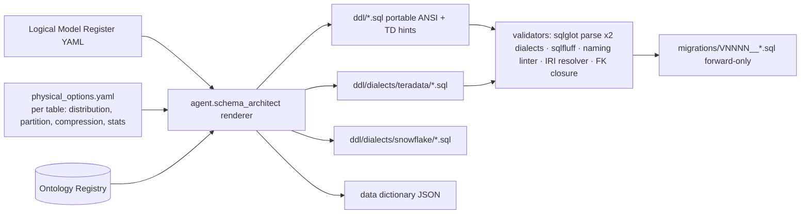

# Physical Model and DDL

## 1. Target platforms and dialects

| Platform | Role | Dialect handling |
|----------|------|------------------|
| **Teradata Vantage** (17.20+) | Primary reference platform; the `-- TD:` hints in `ddl/*.sql` are written for it | Generated dialect variant `ddl/dialects/teradata/*.sql` (PRIMARY INDEX, PARTITION BY, MULTISET, PERIOD, BLOCKCOMPRESSION, COLLECT STATISTICS) |
| **Portable ANSI SQL:2016** | What is committed in `ddl/*.sql`; must parse unchanged on PostgreSQL-compatible engines | Standard `CREATE SCHEMA/TABLE/INDEX/VIEW`, `COMMENT ON` (widely supported though not core ANSI), no vendor types |
| Snowflake, Databricks SQL, BigQuery | Secondary targets (ARC-01 §3) | Generated variants: clustering keys / Z-ORDER / partition expressions substitute for primary index + partition hints |

Dialect variants are **generated**, never hand-edited: `agent.schema_architect` renders the portable DDL plus a
per-table *physical options* YAML into each dialect. Only the portable files and the options YAML are reviewed.



> **EDW-PHY-001** (P0, test) — Committed DDL in `ddl/*.sql` MUST parse with `sqlglot` in both the generic and the
> `teradata` dialect, and with `sqlfluff` in the `postgres` dialect (the strictest widely-available ANSI-style grammar
> that accepts `COMMENT ON`); the generated `ddl/dialects/teradata/` files MUST parse with `sqlfluff --dialect teradata`.
> Teradata-only syntax MUST appear only in `-- TD:` comments or in the generated dialect files. (Known gap at the time
> of writing: sqlfluff 4.x's Teradata grammar does not accept `ALTER TABLE … ADD CONSTRAINT … FOREIGN KEY`, which the
> portable files use once to close the G3↔G4 cycle; sqlglot's Teradata parser accepts it.)

> **EDW-PHY-002** (P0, inspection) — Dialect-specific files MUST be generated from the portable DDL + physical options;
> a diff between regenerated and committed dialect files MUST be empty in CI.

## 2. Datatypes

| Logical | Portable | Teradata | Notes |
|---------|----------|----------|-------|
| Surrogate key | `BIGINT` | `BIGINT` | `INTEGER` for `dim_date` (`yyyymmdd`), `SMALLINT` for `dim_time` (`hhmm`) |
| Business key / IRI | `VARCHAR(128)` / `VARCHAR(512)` | `VARCHAR(n) CHARACTER SET UNICODE` | all text UNICODE on TD |
| Hash | `CHAR(64)` | `CHAR(64) CHARACTER SET LATIN` | hex SHA-256 |
| Timestamp | `TIMESTAMP` (UTC, no TZ) | `TIMESTAMP(6)` | stored UTC; TZ never stored (CONVENTIONS §4) |
| Date | `DATE` | `DATE FORMAT 'YYYY-MM-DD'` | — |
| Money | `DECIMAL(18,4)` | `DECIMAL(18,4)` | + `currency_code CHAR(3)` where needed |
| Quantity | `DECIMAL(18,6)` | `DECIMAL(18,6)` | + `ucum_unit_sk` |
| Flag | `CHAR(1)` | `CHAR(1) CHARACTER SET LATIN` | `Y/N/U` |
| Period (bitemporal) | four `TIMESTAMP` columns | optionally `PERIOD(TIMESTAMP(6))` × 2 | `06-history-and-bitemporality.md` §3 |
| Free text pointer | `VARCHAR(1000)` max | same | no CLOB/BLOB in presentation layer (EDW-G2-006) |

## 3. Distribution, indexing, partitioning, compression, statistics

Choices are driven by **table role** and **expected cardinality** from the register; the renderer applies these
defaults unless `physical_options.yaml` overrides.

| Table role | Teradata primary index (distribution) | Partitioning | Secondary / join indexes | Compression | Statistics |
|------------|--------------------------------------|--------------|--------------------------|-------------|------------|
| Conformed dimension (`dim_patient`, `dim_practitioner`, …) | UPI on `*_sk`; TD **MULTISET** off (SET) | none (dims < 100 M rows) | USI on `(*_bk, valid_from)`; NUSI on `*_bk` | MVC on low-cardinality code columns, flags | `*_sk`, `*_bk`, `is_current_flag`, PARTITION |
| Large dimension (`dim_item`, `dim_location`) | UPI `*_sk` | none | USI `(*_bk, valid_from)` | MVC + BLOCKCOMPRESSION | as above |
| Value-set dimension (`dim_encounter_class`, …) | UPI `*_sk` | none | — | none (tiny) | all columns |
| `hist_dim_*` | NUPI on `*_bk` | `RANGE_N(CAST(recorded_at AS DATE) BETWEEN DATE '2015-01-01' AND DATE '2040-12-31' EACH INTERVAL '1' MONTH)` | NUSI `(*_sk)` | BLOCKCOMPRESSION | `*_bk`, `recorded_at`, `superseded_at`, PARTITION |
| Transaction fact (`fact_observation_result`, `fact_claim_line`, `fact_gl_journal_line`) | NUPI on **`patient_sk`** for patient-centric facts (co-locates patient joins), `claim_number` for claim lines, `journal_header_bk` for GL lines | `RANGE_N` on event date (`effective_date_sk`, `service_from_date_sk`, `accounting_date_sk`) `EACH INTERVAL '1' MONTH`, plus sub-partition on `superseded_at IS NULL` via `CASE_N` | join index to `dim_date` optional; NUSI on `*_bk` | BLOCKCOMPRESSION; MVC on `*_sk` with < 256 distinct | `patient_sk`, every `*_sk` FK, PARTITION, `(*_bk)` |
| Accumulating snapshot (`fact_encounter`, `fact_claim_header`) | NUPI `patient_sk` | `RANGE_N` on start date (`admit_date_sk`) monthly | USI `*_bk` | BLOCKCOMPRESSION | FKs, PARTITION |
| Periodic snapshot (`fact_inventory_balance_daily`, `fact_dq_score_daily`, `agg_dq_result_day`, `fact_dq_profile`) | NUPI on entity key (`item_sk`) | `RANGE_N` on `snapshot_date_sk` **daily** for ≤ 2 years then monthly (`EACH INTERVAL '1' DAY` with range split) | — | BLOCKCOMPRESSION | entity key, PARTITION |
| Bridge | NUPI on parent fact key (`encounter_bk`) | `RANGE_N` on parent event date where available | NUSI on child key | MVC | both keys |
| Reference (`ref_concept`, `ref_value_set_member`) | NUPI `code_system_version_sk` + `code` | none | USI `(code_system_sk, code, version)`; NUSI `concept_iri` | MVC | all keys |
| Staging (`stg_*`) | NUPI `(topic, partition_no)` | `RANGE_N` on `event_date` daily, 90-day sliding | — | BLOCKCOMPRESSION | PARTITION |

Portable equivalents: `PRIMARY INDEX` → clustering key (Snowflake `CLUSTER BY`), Z-ORDER (Databricks); `PARTITION BY
RANGE_N` → `PARTITION BY DATE(...)` (BigQuery) / native range partitions (PostgreSQL); BLOCKCOMPRESSION → columnar
default; `COLLECT STATISTICS` → `ANALYZE`.

> **EDW-PHY-003** (P0, inspection) — Every fact and `hist_*` table MUST be partitioned by a date column declared in
> the register as its *primary event date*; the partition column MUST be the one used in the table's most common
> as-of or period predicate.

> **EDW-PHY-004** (P1, test) — Patient-centric facts in G2, G3, G6 and G7 MUST be distributed on `patient_sk` so that
> patient-level joins across groups are co-located; `agent.evaluator` MUST flag skew > 10 % (largest AMP vs average).

> **EDW-PHY-005** (P1, inspection) — Statistics MUST be collected on every primary index, every partition expression,
> every `*_sk` foreign key and every business key after each load batch exceeding 1 % of table rows.

> **EDW-PHY-006** (P2, inspection) — Column compression (MVC) SHOULD be applied to every `*_sk` with < 256 distinct
> values and every `*_flag` and `*_code` column; block-level compression SHOULD be enabled for all facts and history.

## 4. Constraints

| Constraint | Portable DDL | Teradata rendering | Enforcement |
|------------|-------------|--------------------|-------------|
| Primary key | `CONSTRAINT pk_* PRIMARY KEY (...)` | `UNIQUE PRIMARY INDEX` or `PRIMARY KEY` (implies USI) | enforced |
| Unique business key | `CREATE UNIQUE INDEX ux_* ON t (bk, valid_from)` | `UNIQUE INDEX` | enforced |
| Foreign key | `CONSTRAINT fk_* FOREIGN KEY ... REFERENCES` | `REFERENCES WITH NO CHECK OPTION` (soft RI for optimiser) | **not** enforced at load; validated by DQ rules (module 09, `DQR-CONSISTENCY-*`) and by nightly FK-closure job writing to G9 |
| Not null | `NOT NULL` | same | enforced |
| Check | `CHECK (flag IN ('Y','N','U'))` | same | enforced on dims; omitted on high-volume facts (DQ rule instead) |
| Default | `DEFAULT 'N'`, `DEFAULT -1` | same | — |

Soft foreign keys are deliberate: the platform never rejects data at the EDW boundary (EDW-LOG-016); it loads inferred
members and reports. The FK declarations remain in the DDL because they document the model, feed the semantic layer's
join generation and let optimisers use join elimination.

> **EDW-PHY-007** (P0, test) — Every `*_sk` column that references a dimension MUST have a declared FOREIGN KEY in the
> portable DDL; the nightly FK-closure job MUST report orphan rates per FK to `edw_g9_governance.fact_dq_result`.

## 5. Migrations

Migrations are **forward-only, idempotent, reversible by compensating migration** (CONVENTIONS §5).

```
ddl/
  00_schemas.sql            # reference DDL (what the current version should look like)
  g8_reference.sql, g9_governance.sql, g1_party.sql, g3_finance.sql, g4_supply.sql, g2_clinical.sql
                            # apply order (FK targets first); the one G3→G4 cycle is closed by ALTER TABLE in g4_supply.sql
  dialects/<dialect>/…      # generated
migrations/
  V0001__baseline_schemas.sql
  V0002__g1_party_initial.sql
  V0003__g2_clinical_add_fact_encounter.sql
  …
  R0003__g2_clinical_add_fact_encounter.sql   # compensating (reverse) migration, generated, never auto-applied
```

| Rule | Statement |
|------|-----------|
| MIG-1 | Each migration is one file `V<NNNN>__<group>_<slug>.sql`, numbered monotonically, with a header block (`-- migration:`, `-- change_request:`, `-- checksum:`, `-- approved_by:`). |
| MIG-2 | Migrations are idempotent: every statement is guarded (`CREATE TABLE IF NOT EXISTS` on platforms that support it; otherwise a `WHERE NOT EXISTS (SELECT … FROM information_schema.tables)` wrapper generated per dialect) or is a pure-additive change that the runner checks against catalog metadata before executing. |
| MIG-3 | Applied migrations are recorded in `edw_g9_governance.fact_schema_change` with SHA-256 checksum; a checksum mismatch aborts the run (EDW-G9-003). |
| MIG-4 | Destructive changes (drop column/table, type narrowing) are **two-step**: migration *N* marks deprecated (view alias retained, data copied to `hist_*` if needed), migration *N + k* (k ≥ 1 release) drops. |
| MIG-5 | Reverse migrations `R<NNNN>` are generated alongside and reviewed, but only executed by a human-approved change request. |
| MIG-6 | The reference DDL in `ddl/` MUST equal the result of applying all migrations to an empty database (CI test: apply → introspect → compare to parsed reference). |
| MIG-7 | Migrations run per environment `dev → test → uat → prod` by `agent.release_manager`, each promotion gated on the DQ smoke-suite and the EDW↔KG reconciliation (`06-history-and-bitemporality.md` §5). |

> **EDW-DDL-001** (P0, test) — Applying the full migration chain twice MUST be a no-op the second time (idempotency).

> **EDW-DDL-002** (P0, test) — The schema produced by the migration chain MUST be structurally identical to `ddl/*.sql`
> (tables, columns, types, nullability, PK/UK/FK, comments) in CI.

> **EDW-DDL-003** (P0, inspection) — No migration MAY drop or narrow a column in the same release in which it was
> deprecated.

> **EDW-DDL-004** (P0, test) — Every migration file MUST carry a change-request id that resolves to an approved
> `fact_agent_change_request` row and a human approver for L1 changes (EDW-ARCH-010).

## 6. DDL generation and validation pipeline

| Step | Tool / agent | Fails when |
|------|--------------|-----------|
| 1 Render | `agent.schema_architect` from register + ontology + physical options | register entry missing grain, keys or IRIs |
| 2 Parse | `sqlglot.parse(sql)` generic **and** `read="teradata"`; `sqlfluff parse --dialect postgres` on portable files, `--dialect teradata` on generated Teradata files | any statement unparsable |
| 3 Lint | naming regexes (EDW-ARCH-002, EDW-LOG-040); identifier length ≤ 30; reserved-word list | violation |
| 4 Semantic checks | every table has PK, `*_bk`, technical block; facts/bridges/hist have bitemporal block + `prov_activity_iri`; every `*_sk` FK declared; every FK target exists in the same or earlier file (closure) | violation |
| 5 IRI resolution | every table `ontology_class_iri`, every non-technical column `ontology_property_iri` resolves in Ontology Registry; code columns have `value_set_iri` | unresolved IRI |
| 6 PHI gate | `agent.privacy_guardian` returns `phi_class` for all columns; vetoes exposure in views | missing class or veto |
| 7 Dictionary | emit data dictionary JSON (§7); JSON Schema validate | invalid |
| 8 Dry-run | apply to ephemeral `dev` database; run grain tests, FK-closure, sample loads from 1 000 canonical records per topic | failure |
| 9 Evaluate | `agent.evaluator` rubric score ≥ 0.9; diff summary for human | below threshold |
| 10 Approve & release | DW Architect approval; `agent.release_manager` tags `edw-vX.Y.Z`, writes `fact_schema_change` | — |

> **EDW-DDL-005** (P0, test) — Steps 2–7 MUST run in CI on every pull request touching `ddl/` or the Logical Model
> Register, and MUST block merge on failure.

> **EDW-DDL-006** (P1, test) — The dry-run (step 8) MUST load ≥ 1 000 canonical records per in-scope topic and prove
> every fact's grain test and every conformed FK's non-null rule.

## 7. Data dictionary export (JSON)

`agent.schema_architect` emits one JSON document per schema at `ddl/dictionary/<schema>.json` (generated, committed
with each release) and publishes the same to G9 `dim_data_element`.

```json
{
  "dictionary_version": "0.1.0",
  "generated_at": "2026-10-17T00:00:00Z",
  "ontology_release": "https://ontology.healix.example.org/release/2026-10-01",
  "schema": "edw_g2_clinical",
  "group_code": "G2",
  "tables": [
    {
      "name": "fact_encounter",
      "role": "fact",
      "fact_type": "accumulating_snapshot",
      "grain": ["encounter_bk"],
      "ontology_class_iri": "https://ontology.healix.example.org/clinical/Encounter",
      "source_blueprint_pattern": "event",
      "source_fhir_resource": "Encounter",
      "canonical_topic": "hc.canonical.clinical.encounter.fhir.v1",
      "logical_model_register_id": "clinical/Encounter",
      "steward": "Clinical data steward",
      "physical": {
        "teradata": {"primary_index": ["patient_sk"], "partition": "RANGE_N(admit_date_sk ...)", "multiset": true},
        "portable": {"cluster_by": ["patient_sk", "admit_date_sk"]}
      },
      "columns": [
        {
          "name": "encounter_sk", "type": "BIGINT", "nullable": false, "role": "surrogate_key",
          "phi_class": "internal", "ontology_property_iri": null, "ontology_class_iri": "https://ontology.healix.example.org/clinical/Encounter"
        },
        {
          "name": "admit_ts", "type": "TIMESTAMP", "nullable": true, "role": "milestone",
          "phi_class": "phi:quasi",
          "ontology_property_iri": "https://ontology.healix.example.org/clinical/admitDateTime",
          "source_fhir_path": "Encounter.period.start", "nullable_reason": "milestone-not-reached"
        },
        {
          "name": "encounter_class_sk", "type": "BIGINT", "nullable": false, "role": "foreign_key",
          "references": {"schema": "edw_g2_clinical", "table": "dim_encounter_class", "column": "encounter_class_sk"},
          "phi_class": "phi:clinical",
          "ontology_property_iri": "https://ontology.healix.example.org/clinical/encounterClass",
          "value_set_iri": "https://ontology.healix.example.org/scheme/encounter-class",
          "code_system_uri": "http://terminology.hl7.org/CodeSystem/v3-ActCode",
          "source_fhir_path": "Encounter.class"
        },
        {
          "name": "prov_activity_iri", "type": "VARCHAR(512)", "nullable": false, "role": "technical",
          "phi_class": "internal", "ontology_property_iri": "http://www.w3.org/ns/prov#wasGeneratedBy"
        }
      ],
      "constraints": [
        {"type": "primary_key", "name": "pk_fact_encounter", "columns": ["encounter_sk"]},
        {"type": "unique", "name": "ux_fact_encounter_bk", "columns": ["encounter_bk", "valid_from"]}
      ],
      "dq_rules": ["DQR-UNIQUENESS-ENCOUNTER-001", "DQR-CONSISTENCY-ENCOUNTER-004"]
    }
  ]
}
```

JSON Schema for this document lives at `ddl/dictionary/schema.json` (generated with the first release). Key
constraints: `columns[].role` ∈ the enumeration in `03-logical-model.md` §5; `phi_class` required and ∈ the module-11 taxonomy (`03-logical-model.md` §6); `ontology_property_iri`
required unless `role ∈ {technical, bitemporal, surrogate_key}`.

> **EDW-DICT-001** (P0, test) — A data dictionary JSON MUST be generated for every presentation schema on every DDL
> release and MUST validate against `ddl/dictionary/schema.json`.

> **EDW-DICT-002** (P0, test) — The dictionary MUST be the single source for `ontology_property_iri`, `phi_class`,
> `value_set_iri` and `source_fhir_path` per column; the semantic layer, module 09 rule generation and module 11
> masking MUST read these from the dictionary, not from column comments.

> **EDW-DICT-003** (P1, test) — Column comments in the DDL MUST be regenerated from the dictionary in the format
> `'<phi_class> | <ontology_property_iri>'` and MUST match it in CI.

> **EDW-DICT-004** (P1, inspection) — The dictionary for each schema MUST be published to G9 `dim_data_element` (Type 2)
> so that element history is queryable in SQL and reconcilable with the module-03 Source Registry.

## 8. Semantic layer (`edw_sem`)

Generated views, one family per fact:

| View | Content |
|------|---------|
| `v_<fact>` | fact joined to current dimension rows, codes resolved to preferred labels from `dim_code` |
| `v_<fact>_asof(valid_ts, recorded_ts)` | table function (or parameterised view where TF unsupported) applying bitemporal predicates (`06-history-and-bitemporality.md` §4) |
| `v_deid_<fact>` | `deidentified:safe-harbor` projection: `phi:direct` dropped, `phi:quasi` generalised (year of birth, 3-digit ZIP, date-shifted), `phi:sensitive-category/*` rows filtered by consent, `pii:workforce` dropped; output tagged `deidentified:safe-harbor` |
| `v_<dim>_current` | current version of a dimension |
| `v_<dim>_hierarchy` | flattened hierarchy for BI tools |

> **EDW-PHY-010** (P1, test) — Semantic views MUST be generated from the dictionary; a hand-edited view in `edw_sem`
> MUST fail CI.

## 9. Capacity and performance baselines (first release)

| Table | Expected rows / year | Row width (bytes, compressed) | Notes |
|-------|----------------------|-------------------------------|-------|
| `fact_observation_result` | 1.5 B | ~180 | largest table; monthly partitions, patient_sk distribution |
| `fact_medication_administration` | 120 M | ~160 | — |
| `fact_charge` | 200 M | ~170 | — |
| `fact_claim_line` | 60 M | ~220 | — |
| `fact_gl_journal_line` | 80 M | ~150 | — |
| `fact_inventory_balance_daily` | 400 M | ~90 | item × locator × day |
| `fact_dq_result` | 3 B | ~120 | retention 13 months detail, aggregates kept |
| `hist_dim_patient` | 20 M versions | ~600 | — |

> **EDW-PHY-011** (P1, test) — The query "all observations for one patient over 5 years" MUST return in ≤ 2 s p95 and
> "monthly encounter counts by service line and payer for 3 years" in ≤ 10 s p95 on the reference Teradata
> configuration (module 12 sizing).
