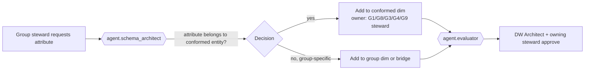

# Conformed Dimensions

`01-architecture-overview.md` §4 names the cross-group conformed dimensions: **Patient, Practitioner, Organization,
Location, Date/Time, Payer, Item, Cost Center, Code (terminology), Source System**. This document specifies each one.
A conformed dimension has **one definition, one surrogate-key domain, one owning schema and one steward**, and is
referenced by facts in at least two groups (VIS-00 goal G-04). Local copies are prohibited (EDW-GRP-003).

| Dimension | Schema | Owner group | SCD | Entity resolution | Hierarchy |
|-----------|--------|-------------|-----|-------------------|-----------|
| `dim_patient` | `edw_g1_party` | G1 | Type 2 + hist | EMPI (module 08) | none (geography via `dim_geography`) |
| `dim_practitioner` | `edw_g1_party` | G1 | Type 2 + hist | NPI + EMPI person resolution | specialty taxonomy via `dim_code` |
| `dim_organization` | `edw_g1_party` | G1 | Type 2 + hist | EIN/NPI-2/Fusion legal-entity resolution | self-referencing + flattened `dim_organization_hierarchy` (G8) |
| `dim_location` | `edw_g1_party` | G1 | Type 2 + hist | source location id + facility code | campus → building → floor → unit → room → bed |
| `dim_date` | `edw_g8_reference` | G8 | Type 0 | n/a | calendar, fiscal (ERP), payer, CMS reporting |
| `dim_time` | `edw_g8_reference` | G8 | Type 0 | n/a | minute → hour → shift |
| `dim_payer` | `edw_g1_party` | G1 (plans in G3) | Type 2 + hist | payer id / NAIC / Fusion customer | payer → plan (G3 `dim_payer_plan`) |
| `dim_item` | `edw_g4_supply` | G4 | Type 2 + hist | GTIN/UDI/NDC crosswalk + Fusion item id | UNSPSC segment → family → class → commodity |
| `dim_cost_center` | `edw_g3_finance` | G3 | Type 2 + hist | Fusion cost center segment | entity → division → department → cost center |
| `dim_code` | `edw_g8_reference` | G8 | versioned by terminology release | Terminology Service | per code system (`ref_concept_hierarchy`) |
| `dim_source_system` | `edw_g8_reference` | G8 | Type 2 | platform registry (module 03) | system → instance → interface |

All Type 2 conformed dimensions carry the valid-time block (`valid_from`, `valid_to`, `is_current_flag`), the
technical block and a `hist_dim_*` twin (`03-logical-model.md` §8, `06-history-and-bitemporality.md`). Reserved
members `-1` (unknown), `-2` (not applicable), `-3` (pending resolution) exist in every conformed dimension.

## 1. `dim_patient`

**Definition.** One row per version of a person in the patient role, resolved to a single EMPI golden record.
Full column list: `03-logical-model.md` §9.1; DDL: `ddl/g1_party.sql`.

**Entity-resolution linkage (module 08).** The EMPI in module 08 (`TKG-*` entity resolution) produces a golden
identifier and IRI per person plus `sameAs` links to every source record with method and score. The EDW mirrors that:

| EDW column / table | Module-08 concept |
|--------------------|-------------------|
| `dim_patient.patient_bk` | golden identifier (`healix:party/empiGoldenIdentifier`) |
| `dim_patient.empi_golden_iri` | the resolved person IRI in the KG |
| `bridge_patient_link` (`patient_sk`, `source_system_sk`, `source_record_id`, `match_score`, `resolution_method`, `link_status`, valid/transaction time) | `sameAs` / `resolvedTo` assertions with their provenance |
| `bridge_party_identifier` | every identifier (MRN per facility namespace, SSN hash, payer member id) with period |
| `fact_identity_event` | merge / unmerge / overlay events |

**Source precedence** (per attribute group, highest first; `agent.source_mapper` maintains the matrix in module 03):

| Attribute group | 1 | 2 | 3 |
|-----------------|---|---|---|
| Legal name, birth date, sex | Cerner Millennium (registration) | Payer eligibility (271) | Patient portal |
| Address, phone, email | Most recently *verified* source (Cerner registration, portal) by `recorded_at` | Payer | — |
| Race, ethnicity, language | Cerner (patient-reported) | HIE C-CDA | — |
| Gender identity, SOGI | Cerner (patient-reported) only | — | — |
| Deceased | Cerner, state death registry feed | Payer | — |
| Managing organisation / PCP | Cerner | Payer attribution (G6) | — |

**SCD behaviour.** Type 2 on demographic attributes; Type 1 overwrite on `is_inferred_flag` resolution and on
corrections of the *same* valid period (with the superseded version kept in `hist_dim_patient`). A **merge** closes the
retired patient's current row (`patient_status_code = 'merged'`, `merged_into_patient_sk`), re-points `bridge_party_identifier`
rows, and never updates fact rows: facts keep their original `patient_sk`; the semantic layer resolves to the surviving
patient through `merged_into_patient_sk` (one hop). An **unmerge** reverses this with a new version.

> **EDW-CONF-001** (P0, test) — A fact row's `patient_sk` MUST never be rewritten by a merge; resolution to the
> surviving record MUST be done through `dim_patient.merged_into_patient_sk` in `edw_sem` views.

> **EDW-CONF-002** (P0, test) — `bridge_patient_link` MUST contain the module-08 `match_score` and `resolution_method`
> for every source record linked to a `patient_sk`; records with `link_status = 'pending'` MUST map facts to
> `patient_sk = -3` until resolved.

> **EDW-CONF-003** (P0, test) — Every `dim_patient` current row MUST have exactly one `empi_golden_iri` that exists in
> the knowledge graph; the nightly reconciliation (`06-history-and-bitemporality.md` §5) MUST report the count of
> patients missing from either side.

## 2. `dim_practitioner`

**Definition.** One row per version of a person in the practitioner role (clinician, allied health, non-clinical
referrer). Column list: `03-logical-model.md` §9.2.

**Resolution.** Primary key of resolution is **NPI** (10-digit, Luhn-checked); practitioners without NPI (residents,
students, non-US) resolve on EMPI person resolution + licence number. Multiple source practitioner ids (Cerner PRSNL_ID,
Fusion person id, credentialing id) live in `bridge_party_identifier`.

**Source precedence.** Credentialing system (NPI, licences, specialty) → Cerner provider table (name, active, Cerner
positions) → Oracle HCM (employment) → NPPES (fallback for external referrers; refreshed monthly).

**Roles and hierarchy.** Organisation/location/specialty affiliations are many-to-many and dated, so they live in
`dim_practitioner_role` (one row per practitioner × organisation × specialty × period), not on `dim_practitioner`. Facts
reference `dim_practitioner` (the person); analyses by department join `dim_practitioner_role` as of the fact date.
Specialty hierarchy comes from the NUCC taxonomy in `dim_code`/`ref_concept_hierarchy`.

**SCD behaviour.** Type 2 on name, credentials, primary specialty, primary organisation, active flag.

> **EDW-CONF-004** (P0, test) — `dim_practitioner.npi` MUST be unique among current rows where not null and MUST pass
> the Luhn check; duplicates MUST be routed to EMPI review and loaded as separate rows with `is_inferred_flag = 'Y'`.

> **EDW-CONF-005** (P1, test) — Facts MUST reference the practitioner person, never a `dim_practitioner_role` row;
> role-based attribution MUST be resolved as of the fact's `valid_from`.

## 3. `dim_organization`

**Definition.** One row per version of a legal or administrative organisation: health system, hospital, department
(organisational, not cost center), practice, payer organisation, supplier legal entity, external referring facility,
Oracle Fusion legal entity / business unit.

| Column | Type | Notes |
|--------|------|-------|
| `organization_sk`, `organization_bk`, `party_sk` | keys | `organization_bk` = resolved golden id |
| `organization_name`, `organization_alias` | VARCHAR(255) | — |
| `organization_type_code_sk` | → `dim_code` | FHIR organization-type + HEALIX-ERP extensions (`legal-entity`, `business-unit`) |
| `npi_type2`, `ein_hash`, `tax_id_type` | identifiers | EIN hashed (`phi_class none` but confidential) |
| `parent_organization_sk` | self FK | ragged hierarchy |
| `level1_name … level5_name`, `hierarchy_level` | flattened | health system → region → facility → division → department |
| `fusion_legal_entity_id`, `fusion_business_unit_id`, `cerner_organization_id` | natural ids | — |
| `address_*`, `geography_sk` | — | billing/primary address |
| `active_flag`, `is_internal_flag` | flags | internal = part of the enterprise |

**Resolution.** EIN / NPI-2 / Fusion legal entity id; external organisations via NPPES and payer directories.
**Source precedence.** Oracle Fusion ERP (legal entities, business units) → Cerner organisation table (facilities,
departments) → Oracle SCM (suppliers) → payer directories → NPPES.
**Hierarchy.** Self-referencing `parent_organization_sk` plus flattened levels; the enterprise reporting hierarchy
(which may differ from legal structure) is in G8 `dim_organization_hierarchy` with effective dating.

> **EDW-CONF-006** (P0, test) — `dim_organization` MUST have no cycles in `parent_organization_sk` among current rows.

## 4. `dim_location`

**Definition.** One row per version of a physical or virtual place where care, work or storage happens.

| Column | Type | Notes |
|--------|------|-------|
| `location_sk`, `location_bk` | keys | — |
| `location_name`, `location_type_code_sk` | — | FHIR location-physical-type + `virtual`, `telehealth`, `warehouse`, `locator` |
| `managing_organization_sk` | → `dim_organization` | — |
| `parent_location_sk` | self FK | — |
| `campus_name`, `building_name`, `floor_name`, `unit_name`, `room_name`, `bed_name`, `hierarchy_level` | flattened | EDW-G1-004 |
| `cerner_location_cd`, `cerner_nurse_unit_cd`, `fusion_inventory_org_id`, `fusion_subinventory_code` | natural ids | — |
| `address_*`, `geography_sk`, `latitude`, `longitude` | — | — |
| `place_of_service_code_sk` | → `dim_code` | CMS POS for billing |
| `telehealth_flag`, `active_flag` | flags | — |

**Resolution.** Cerner location code (per facility) and Fusion inventory org/sub-inventory are both locations; the
register maps both to the same hierarchy when a stock room is inside a unit.
**Source precedence.** Cerner (clinical locations, beds) → Oracle SCM (inventory organisations) → facilities
management (campus/building master).
**SCD behaviour.** Type 2 on name, parent, type, managing organisation.

> **EDW-CONF-007** (P1, test) — Every `dim_location` row of type `bed` MUST roll up to a `unit` and a `facility`
> through `parent_location_sk` in ≤ 5 hops.

## 5. `dim_date` and `dim_time`

**`dim_date`.** `date_sk INTEGER` as `yyyymmdd`; one row per day 1900-01-01 … 2099-12-31 plus `-1`. Columns:
`calendar_date`, `day_of_week`, `day_name`, `day_of_month`, `day_of_year`, `week_of_year_iso`, `month_number`,
`month_name`, `quarter_number`, `calendar_year`, `is_weekend_flag`, `is_us_federal_holiday_flag`, `holiday_name`,
`fiscal_year`, `fiscal_quarter`, `fiscal_period`, `fiscal_period_start_date`, `fiscal_period_end_date` (enterprise
ERP calendar; additional calendars in `dim_fiscal_period`), `cms_reporting_year`, `hedis_measurement_year`,
`payer_period_label`, `is_last_day_of_month_flag`, `days_in_month`. Type 0; generated, never loaded from a source.

**`dim_time`.** `time_sk SMALLINT` as `hhmm`; 1,440 rows plus `-1`. Columns: `time_of_day`, `hour_24`, `hour_12`,
`minute_of_hour`, `am_pm`, `shift_code` (`day / evening / night` per enterprise default 07:00–15:00–23:00; local
overrides via `dim_shift_type` in G5), `is_business_hours_flag`, `half_hour_slot`, `quarter_hour_slot`.

Timestamps on facts are always UTC; `*_date_sk`/`*_time_sk` are derived in the **enterprise local time zone**
(`America/Chicago` default, configurable per `dim_source_system.default_timezone`) because operational reporting is
local. Both are stored so neither interpretation is lost.

> **EDW-CONF-008** (P0, test) — `dim_date` MUST contain exactly 73,049 + 1 rows for the range 1900–2099 and `dim_time`
> exactly 1,441 rows; both MUST be loaded by a generator script in `ddl/`, not from any source system.

> **EDW-CONF-009** (P0, test) — Every `*_date_sk` on a fact MUST equal the local-date derivation of its `*_ts`
> companion using the source system's time zone; mismatches MUST be reported to G9.

## 6. `dim_payer`

**Definition.** One row per version of a payer organisation (commercial insurer, Medicare/MA contract holder, Medicaid
agency/MCO, self-pay pseudo-payer, workers' comp carrier). Plans/products are in G3 `dim_payer_plan` (`payer_sk` FK).

| Column | Notes |
|--------|-------|
| `payer_sk`, `payer_bk`, `organization_sk` | payer is an organisation in a payer role (party-role pattern) |
| `payer_name`, `payer_type_code_sk` (`commercial / medicare / medicare-advantage / medicaid / medicaid-mco / self-pay / workers-comp / other-government`) | — |
| `naic_code`, `cms_contract_number`, `clearinghouse_payer_id`, `cerner_health_plan_id`, `fusion_customer_id` | identifiers |
| `financial_class_code_sk` | default financial class |
| `parent_payer_sk` | national carrier → regional entity |
| `active_flag` | — |

**Source precedence.** RCM/clearinghouse payer master → Cerner health plan table → Oracle AR customer (for payer
receivables) → CMS plan directory (MA/Part D).
**SCD behaviour.** Type 2.

> **EDW-CONF-010** (P0, test) — Every G3 `dim_payer_plan`, `fact_coverage`, `fact_claim_*`, `fact_remittance` and every
> G6 attribution fact MUST reference `dim_payer`; a plan whose payer is unknown MUST use `payer_sk = -1` and raise a G9
> completeness result.

## 7. `dim_item`

**Definition.** One row per version of a purchasable, stockable, administrable or billable thing: medical/surgical
supply, implant, pharmaceutical product (NDC level), vaccine, device/equipment model, service item (for AP). Owned by
G4 and used by G2 (medications, immunisations, devices), G3 (charges, AP lines, claim NDC) and G4.

| Column | Notes |
|--------|-------|
| `item_sk`, `item_bk` | `item_bk` = enterprise item id (Fusion item + organisation-independent master) |
| `item_description`, `item_short_name` | — |
| `item_type_code` (`supply / implant / drug / vaccine / device / equipment / service`) | — |
| `fusion_item_id`, `fusion_item_number`, `cerner_charge_item_id`, `cerner_medication_id` | natural ids |
| `gtin`, `udi_device_identifier`, `ndc_code`, `rxnorm_code_sk`, `cvx_code_sk`, `hcpcs_code_sk`, `unspsc_code_sk` | identifiers and codes (→ `dim_code`) |
| `unspsc_segment_name`, `unspsc_family_name`, `unspsc_class_name`, `unspsc_commodity_name` | flattened hierarchy |
| `manufacturer_organization_sk`, `manufacturer_part_number` | — |
| `primary_supplier_sk`, `primary_supplier_part_number` | → G4 `dim_supplier` |
| `unit_of_issue_ucum_sk`, `unit_of_purchase_ucum_sk`, `purchase_to_issue_factor` | — |
| `strength_value`, `strength_ucum_sk`, `dose_form_code_sk`, `route_code_sk` | drugs |
| `latex_flag`, `hazardous_flag`, `implantable_flag`, `lot_tracked_flag`, `serial_tracked_flag`, `chargeable_flag`, `active_flag` | flags |
| `standard_cost_amount`, `list_price_amount`, `currency_code` | last known; price history in `fact_contract_price_period` |

**Resolution.** GTIN / UDI-DI first, then NDC (drugs) and CVX (vaccines), then Fusion item id, then Cerner charge item.
Crosswalk decisions are recorded in `bridge_item_identifier`.
**Source precedence.** Oracle Fusion SCM item master → GUDID (UDI attributes) → RxNorm/NDC directory (drug attributes)
→ Cerner charge master (charge linkage).
**SCD behaviour.** Type 2 on description, codes, manufacturer, flags; prices are facts.

> **EDW-CONF-011** (P0, test) — A drug administered in G2 and the same drug charged in G3 and issued from inventory in
> G4 MUST resolve to the same `item_sk` when they share an NDC or GTIN.

## 8. `dim_cost_center`

**Definition.** One row per version of a cost center from the Oracle Fusion GL chart of accounts (cost center segment),
with the department/division/entity roll-up. Owned by G3; used by G3, G4 (requisitions, PO lines, inventory
transactions, assets), G5 (positions, timecards) and G2 (charges by department via `dim_cost_center` on `fact_charge`).

| Column | Notes |
|--------|-------|
| `cost_center_sk`, `cost_center_bk` (`<ledger>:<segment value>`) | — |
| `cost_center_code`, `cost_center_name` | — |
| `department_code`, `department_name`, `division_code`, `division_name`, `entity_code`, `entity_name` | flattened roll-up |
| `parent_cost_center_sk` | ragged |
| `organization_sk` | → `dim_organization` (legal entity / facility) |
| `cost_center_type_code` (`revenue / expense / overhead / capital`) | — |
| `manager_worker_bk` | G5 worker responsible |
| `cerner_department_cd` | crosswalk for charge attribution |
| `active_flag`, `allow_posting_flag` | — |

**Source precedence.** Oracle Fusion GL value set and hierarchy → Cerner department crosswalk (maintained by Finance).
**SCD behaviour.** Type 2; hierarchy versions follow Fusion tree versions with effective dates.

> **EDW-CONF-012** (P0, test) — Every `fact_gl_journal_line`, `fact_charge`, `fact_purchase_order_line` and
> `fact_timecard` row MUST reference a `dim_cost_center` version valid as of the row's accounting/service date.

## 9. `dim_code` (terminology)

**Definition.** One row per **concept version** usable as a coded value anywhere in the EDW: `code_sk` is the single
surrogate for codes from every code system. Physically `dim_code` is a thin dimension over G8 `ref_concept` (same
surrogate), adding display columns BI tools need.

| Column | Notes |
|--------|-------|
| `code_sk` | = `ref_concept.concept_sk` |
| `code_system_sk`, `code_system_uri`, `code_system_name`, `code_system_version` | from `ref_code_system` |
| `code`, `display`, `preferred_label`, `definition` | `preferred_label` from the enterprise SKOS scheme when one exists |
| `concept_iri` | SKOS concept IRI in the Ontology Registry |
| `concept_status` (`active / inactive / retired`), `effective_from`, `effective_to` | per terminology release |
| `is_abstract_flag` | grouping concepts |
| `parent_code_sk` (primary parent) | full closure in `ref_concept_hierarchy` |
| `sensitive_category_code` | from `healix:scheme/sensitive-categories` (drives `phi_sensitive`) |

**Versioning.** Not SCD2 in the usual sense: a concept's identity is `(code_system, code)`, its versions are terminology
releases. `code_sk` is stable per `(code_system, code)`; version-specific attributes are in `ref_concept` keyed by
`(concept_sk, code_system_version_sk)`. Facts store `code_sk` plus `terminology_release_id` where reproducibility
requires it (EDW-G6-001).

**Source.** Terminology Service only (module 06 `IOP-04`): `CodeSystem`, `ValueSet/$expand`, `ConceptMap`; local code
sets from Cerner (code_value) and Oracle (lookup codes) are loaded as code systems with their own URIs
(`https://ontology.healix.example.org/codesystem/cerner/<code_set>`).

> **EDW-CONF-013** (P0, test) — `dim_code.code_sk` MUST be stable for a `(code_system_uri, code)` pair across
> terminology releases; a release MUST never re-issue a `code_sk`.

> **EDW-CONF-014** (P0, test) — Every `*_code_sk` fact column MUST resolve to a `dim_code` row whose `code_system_uri`
> is in the value set bound to that column in the data dictionary (EDW-LOG-021).

## 10. `dim_source_system`

**Definition.** One row per version of a registered source system instance (platform registry, module 03), owned by G8 in `edw_g8_reference` (ARC-01 §4 assigns conformed dimensions to G1/G8); G9 references it for every lineage, load-batch and DQ row: Cerner
Millennium production domain, Oracle Fusion ERP pod, LIS, RIS, pharmacy, clearinghouse, HIE, portal, device gateway,
and also the platform's own components (`agent.*`, Terminology Service) for derived data.

| Column | Notes |
|--------|-------|
| `source_system_sk`, `source_system_bk` (`<vendor>:<product>:<instance>`) | — |
| `source_system_code` (short, e.g. `CERNER_PROD`), `source_system_name`, `vendor_name`, `product_name`, `product_version` | — |
| `system_category_code` (`ehr / erp / hcm / scm / lis / ris / pharmacy / rcm / hie / portal / device / payer / platform`) | — |
| `environment_code` (`prod / uat / test / dev`) | — |
| `default_timezone` | IANA zone for local date derivation (EDW-CONF-009) |
| `kafka_domain_codes` | comma list of `01-architecture-overview.md` domains fed |
| `owner_steward`, `registry_iri` | module-03 Source Registry IRI |
| `active_flag`, `onboarded_date`, `decommissioned_date` | — |

Every presentation row carries `source_system_sk` (technical block). For derived facts (G6, G7, G9) it is the
platform component that produced the row.

> **EDW-CONF-015** (P0, test) — `source_system_sk` MUST be non-null on every row of every presentation table and MUST
> resolve to a `dim_source_system` row whose `registry_iri` exists in the module-03 Source Registry.

## 11. Conformance governance

> **EDW-CONF-020** (P0, inspection) — Changes to a conformed dimension MUST be approved by the DW Architect **and** the
> owning steward, and MUST be announced to all group stewards before release (they are shared contracts).

> **EDW-CONF-021** (P1, test) — Each conformed dimension MUST be referenced by facts in ≥ 2 groups in the reference DDL;
> CI MUST report the usage matrix (`01-subject-area-groups.md` cross-group matrix) and fail if a conformed dimension
> falls below two.
