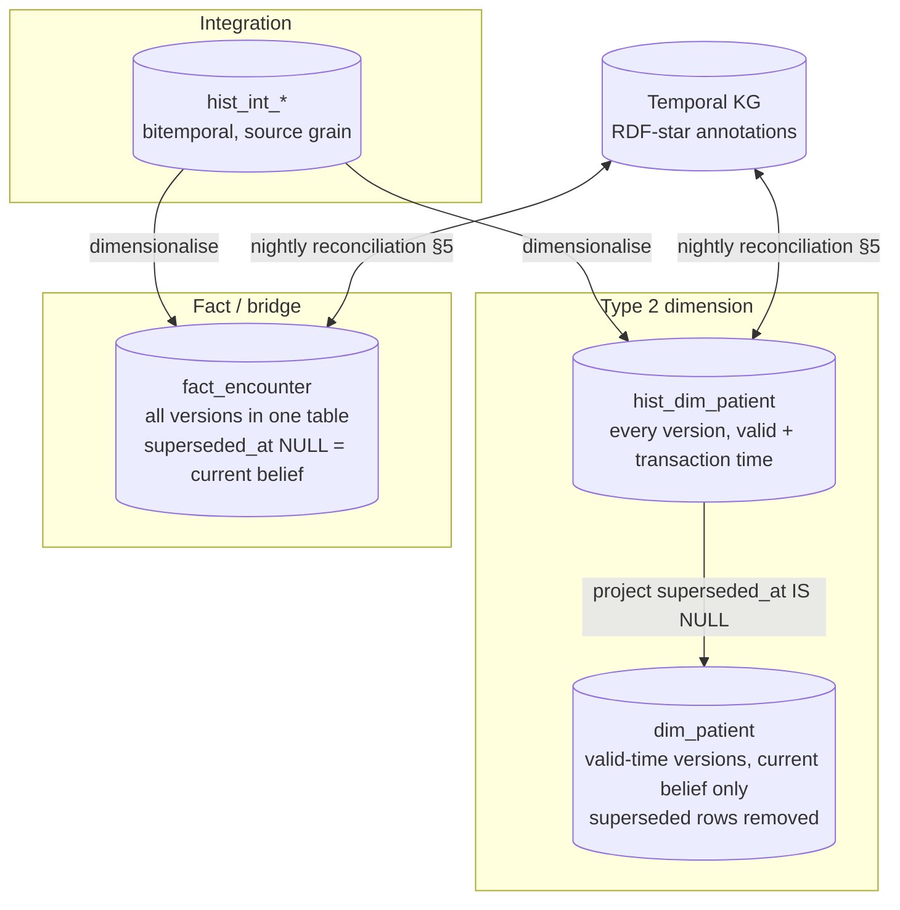

# History and Bitemporality

ADR-03 requires bitemporality on every row in EDW history tables. Module 08 (`TKG-01`) defines the semantics of
**valid time** (`valid_from`, `valid_to`), **transaction time** (`recorded_at`, `superseded_at`) and the provenance
reference (`prov_activity_iri`). This document specifies how the EDW implements those semantics so the warehouse and
the knowledge graph are two faithful projections of the same facts (ADR-07). It does not redefine the semantics.

## 1. Concepts as used in the EDW

| Term (module 08) | EDW meaning | Set by |
|------------------|-------------|--------|
| `valid_from` | When the version became true in the real world (encounter admit, address effective date, code effective date) | source data (FHIR `period.start`, `effectiveDateTime`, HCM effective dates); falls back to source event time |
| `valid_to` | Exclusive end of real-world validity; `NULL` = still valid | source end date, or the `valid_from` of the next version |
| `recorded_at` | When the EDW first stored this version (transaction-time start) | loader clock (UTC) at commit, monotonic per batch |
| `superseded_at` | When the EDW stopped believing this version (replaced, corrected, retracted); `NULL` = current belief | loader at the moment a newer version for the same `(bk, valid_from)` lands |
| `prov_activity_iri` | PROV-O activity that created the version (load batch, correction job, agent action), resolvable in the KG | loader; equals `fact_lineage_activity.prov_activity_iri` |
| `change_reason_code` | Why a new version exists | `insert / source-update / correction / merge / late-arrival / retraction / reload` |

Interval convention: **closed-open** `[from, to)`. A row is *valid at* `v` iff `valid_from <= v AND (valid_to IS NULL
OR v < valid_to)`; *known at* `t` iff `recorded_at <= t AND (superseded_at IS NULL OR t < superseded_at)`.

## 2. Where history lives



| Table family | Transaction time kept? | Valid time kept? | Where superseded versions go |
|--------------|------------------------|------------------|------------------------------|
| `dim_*` (Type 2) | `recorded_at` only | yes (`valid_from/valid_to/is_current_flag`) | removed from `dim_*`; kept in `hist_dim_*` |
| `hist_dim_*` | yes (full) | yes | never removed (retention §7) |
| `fact_*`, `bridge_*` | yes (full) | yes | stay in the same table with `superseded_at` set |
| `ref_*` (G8) | per terminology release (`code_system_version_sk`) + `recorded_at` | `effective_from/effective_to` | stay |
| `dim_*` Type 1 / Type 0 | `recorded_at` | n/a | overwritten (history in G8 or not analytically relevant) |

Facts keep superseded versions in place (rather than a separate `hist_fact_*`) because fact corrections are
frequent (lab result amendments, claim resubmissions, journal reversals) and most queries want "current belief", which
is a cheap predicate `superseded_at IS NULL` on a partition sub-key. Dimensions are split because BI tools expect a
one-row-per-version dimension without transaction-time filters.

> **EDW-HIST-001** (P0, test) — Every Type 2 dimension MUST have a `hist_dim_*` table with the same business columns,
> the full bitemporal block and a `hist_sk` primary key; `dim_*` MUST equal `SELECT … FROM hist_dim_* WHERE superseded_at
> IS NULL` on every column at every point in time.

> **EDW-HIST-002** (P0, test) — Every `fact_*` and `bridge_*` table MUST retain superseded versions in place with
> `superseded_at` set; a physical `DELETE` on a presentation fact table is prohibited except by the retention job (§7)
> and MUST be logged to `fact_lineage_activity`.

> **EDW-HIST-003** (P0, test) — For any `(business key, valid_from)` at most one row MAY have `superseded_at IS NULL`;
> transaction-time intervals for the same `(business key, valid_from)` MUST not overlap.

> **EDW-HIST-004** (P0, test) — `recorded_at` MUST be assigned by the loader from a monotonic UTC clock per batch and
> MUST never be taken from source data; `valid_from` MUST never be taken from the loader clock when the source carries a
> real-world time.

## 3. Physical representations

### 3.1 Portable four-column pattern (committed DDL)

```sql
valid_from       TIMESTAMP     NOT NULL,
valid_to         TIMESTAMP,                 -- NULL = open
recorded_at      TIMESTAMP     NOT NULL,
superseded_at    TIMESTAMP,                 -- NULL = current belief
prov_activity_iri VARCHAR(512) NOT NULL
```

Works on every target; indexes/partitions on `recorded_at` (hist) or event date (facts) plus a `superseded_at IS NULL`
sub-partition keep "current belief" cheap.

### 3.2 Teradata temporal option (generated dialect variant)

Teradata Vantage supports `PERIOD(TIMESTAMP(6) WITH TIME ZONE)` columns and ANSI-style temporal tables
(`AS VALIDTIME`, `AS TRANSACTIONTIME`). The generated Teradata variant MAY render `hist_*` tables as:

```sql
-- TD (generated variant only):
--   valid_period        PERIOD(TIMESTAMP(6)) NOT NULL AS VALIDTIME,
--   transaction_period  PERIOD(TIMESTAMP(6)) NOT NULL AS TRANSACTIONTIME
-- and queries use: VALIDTIME AS OF TIMESTAMP '…' TRANSACTIONTIME AS OF TIMESTAMP '…' SELECT …
```

Decision for first release: **the four-column pattern is the system of record on all platforms, including Teradata**;
the native temporal rendering is an *optimisation* that `agent.schema_architect` may generate as `hist_*_tt` shadow
tables when benchmarks justify it. Reasons: (a) identical semantics and SQL across EDW targets and the KG
reconciliation, (b) `PERIOD` end-bound semantics (closed-open, `UNTIL_CHANGED`) must be mapped carefully to NULL
open intervals, (c) Teradata transaction time is DBMS-assigned and cannot be back-filled from Kafka replays, which
breaks idempotent reload (EDW-ARCH-006).

> **EDW-HIST-005** (P0, inspection) — The four-column bitemporal pattern MUST be the authoritative representation on
> every platform; native temporal table features MAY be used only as generated, derived structures.

## 4. As-of query patterns

All examples use the portable pattern. `edw_sem` exposes them as table functions / parameterised views so analysts do
not hand-write them (EDW-ARCH-009).

### 4.1 Current belief, current world (default BI view)

```sql
SELECT e.encounter_bk, p.name_family, e.admit_ts, e.discharge_ts
FROM   edw_g2_clinical.fact_encounter e
JOIN   edw_g1_party.dim_patient p
       ON p.patient_sk = e.patient_sk          -- fact already carries the version valid at admit (EDW-LOG-017)
WHERE  e.superseded_at IS NULL
  AND  e.valid_to IS NULL;
```

### 4.2 World as of a valid time, with current knowledge ("what was the patient's address on the admit date?")

```sql
SELECT e.encounter_bk, hp.address_postal_code
FROM   edw_g2_clinical.fact_encounter e
JOIN   edw_g1_party.hist_dim_patient hp
       ON  hp.patient_bk = e.patient_bk_resolved           -- via dim_patient.patient_bk
       AND hp.valid_from <= e.admit_ts
       AND (hp.valid_to IS NULL OR e.admit_ts < hp.valid_to)
       AND hp.superseded_at IS NULL
WHERE  e.superseded_at IS NULL;
```

### 4.3 Knowledge as of a transaction time ("reproduce the month-end report as run on 2026-07-03 02:00 UTC")

```sql
SELECT g.gl_account_sk, g.cost_center_sk, SUM(g.debit_ledger_amount - g.credit_ledger_amount) AS net_amount
FROM   edw_g3_finance.fact_gl_journal_line g
WHERE  g.accounting_date_sk BETWEEN 20260601 AND 20260630
  AND  g.recorded_at <= TIMESTAMP '2026-07-03 02:00:00'
  AND (g.superseded_at IS NULL OR g.superseded_at > TIMESTAMP '2026-07-03 02:00:00')
GROUP BY g.gl_account_sk, g.cost_center_sk;
```

### 4.4 Full bitemporal as-of (both axes)

```sql
-- :valid_ts  = the real-world instant of interest
-- :tx_ts     = the knowledge instant of interest
SELECT *
FROM   edw_g1_party.hist_dim_patient hp
WHERE  hp.patient_bk = :patient_bk
  AND  hp.valid_from <= :valid_ts AND (hp.valid_to IS NULL OR :valid_ts < hp.valid_to)
  AND  hp.recorded_at <= :tx_ts   AND (hp.superseded_at IS NULL OR :tx_ts < hp.superseded_at);
```

### 4.5 What changed between two knowledge instants (audit / delta feed)

```sql
SELECT hp.patient_bk, hp.valid_from, hp.recorded_at, hp.superseded_at, hp.change_reason_code, hp.prov_activity_iri
FROM   edw_g1_party.hist_dim_patient hp
WHERE  (hp.recorded_at   > :tx_from AND hp.recorded_at   <= :tx_to)
   OR  (hp.superseded_at > :tx_from AND hp.superseded_at <= :tx_to)
ORDER BY hp.patient_bk, hp.recorded_at;
```

### 4.6 Dimension lookup as of fact valid time (loader pattern, EDW-LOG-017)

```sql
UPDATE edw_int.int_observation_stage s
SET    patient_sk = (
         SELECT d.patient_sk
         FROM   edw_g1_party.dim_patient d
         WHERE  d.patient_bk = s.patient_bk
           AND  d.valid_from <= s.effective_ts
           AND (d.valid_to IS NULL OR s.effective_ts < d.valid_to)
       )
WHERE  s.patient_sk IS NULL;
```

> **EDW-HIST-010** (P0, demo) — `edw_sem` MUST provide, for every `hist_dim_*` and every fact, an as-of accessor taking
> `(valid_ts, tx_ts)` that implements §4.4 exactly; the hand-written SQL above is the acceptance oracle.

> **EDW-HIST-011** (P1, test) — Patterns 4.1 and 4.3 on the largest fact MUST not degrade more than 1.5× relative to a
> non-temporal equivalent on the reference configuration (partition sub-key on `superseded_at IS NULL`).

## 5. Reconciliation with the knowledge graph

The KG (module 08) and the EDW load from the same canonical topics. Each night (and on demand after a replay)
`agent.dq_monitor` runs the reconciliation and writes results to `edw_g9_governance.fact_reconciliation_check`.

```mermaid
sequenceDiagram
  participant M as agent.dq_monitor
  participant E as EDW (hist_* / fact_*)
  participant K as Temporal KG (SPARQL)
  participant G9 as fact_reconciliation_check
  M->>E: per table, per tx-window: COUNT(*), COUNT(current), XOR-hash(record_hash) by bk bucket (1024 buckets)
  M->>K: per class, same window: COUNT(assertions), COUNT(current), XOR-hash(healix:recordHash) by bk bucket
  M->>M: compare counts and bucket hashes; drill into mismatching buckets (≤ 1 000 keys) for key-level diff
  M->>G9: write check rows (status OK / COUNT_MISMATCH / HASH_MISMATCH, deltas, sample keys)
  M-->>M: open fact_dq_issue if mismatch > threshold; trigger targeted replay of affected offsets
```

| Check | EDW side | KG side | Tolerance |
|-------|----------|---------|-----------|
| Row / assertion count by class, current belief | `COUNT(*) WHERE superseded_at IS NULL` | `COUNT(?s) WHERE healix:supersededAt unbound` | 0 after both sinks' consumer lag < 5 min; else re-check |
| Version count by business key (sampled 1 %) | `COUNT(*) GROUP BY bk` | count of RDF-star annotated versions per IRI | 0 |
| Content hash | XOR of `record_hash` per bk bucket | XOR of `healix:recordHash` per bucket | 0 (same algorithm version, EDW-LOG-012) |
| Latest `recorded_at` | `MAX(recorded_at)` per table | `MAX(healix:recordedAt)` per class | ≤ 15 min apart |
| Patient golden records | `dim_patient.empi_golden_iri` current | `?p a healix:Patient` current | 0 missing either side (EDW-CONF-003) |
| Provenance closure | every `prov_activity_iri` on EDW rows | `prov:Activity` exists in KG | 0 missing |

Both sides compute `record_hash` with the shared library (`03-logical-model.md` §2) over the same attribute set
(ontology-property order, canonical serialisation), which is why every column needs an `ontology_property_iri`: the
hash is defined over properties, not column names, so the KG can compute the same value.

> **EDW-REC-001** (P0, test) — The nightly EDW↔KG reconciliation MUST compare, per class/table, current-belief counts,
> version counts (sampled) and bucketed content hashes, and MUST write one `fact_reconciliation_check` row per check.

> **EDW-REC-002** (P0, test) — A count or hash mismatch exceeding 0 after consumer-lag settling MUST open a
> `fact_dq_issue` with severity `high` and MUST trigger a targeted replay of the affected Kafka offsets to the lagging
> sink; the mismatch MUST clear within 24 h or escalate to the DW Architect.

> **EDW-REC-003** (P1, test) — Promotion of a DDL release to `prod` MUST be blocked while any reconciliation check from
> the previous night is in `HASH_MISMATCH` for a table touched by the release (`04-physical-model-and-ddl.md` MIG-7).

## 6. Late data and corrections

| Case | Example | EDW handling | Versions produced |
|------|---------|--------------|-------------------|
| **Late-arriving event** (valid time in the past, no prior version) | A lab result from last week arrives today | Insert with true `valid_from`; `recorded_at` = now; `change_reason_code = 'late-arrival'`; dimension lookups as of `valid_from` | 1 |
| **Source update** (new real-world state) | Patient moves house | Close current `dim_patient` version (`valid_to` = move date), insert new version; `hist_*` gets a new row; nothing superseded | 1 new, 1 closed |
| **Correction** (same real-world period, better knowledge) | Lab result amended; address was mistyped | Set `superseded_at` = now on the wrong row; insert corrected row with the **same** `valid_from`, `recorded_at` = now, `change_reason_code = 'correction'`; `prov_activity_iri` points to the correction activity, which `prov:wasInformedBy` the original | 1 superseded, 1 new |
| **Retraction** (the event never happened) | Encounter entered on the wrong patient | Set `superseded_at` on all versions; insert a tombstone version with `valid_to = valid_from` and `change_reason_code = 'retraction'` so the retraction is itself queryable | n superseded, 1 tombstone |
| **Merge / unmerge** (identity) | EMPI merges two patients | `05-conformed-dimensions.md` §1: dimension versions change; facts untouched; `fact_identity_event` row | dims only |
| **Replay** (Kafka re-consumption) | Sink rebuilt from offset 0 | Deterministic `record_hash` and `*_hk`: identical content → no new version; `recorded_at` for re-inserted rows is taken from the original `fact_load_batch` so transaction time is preserved | 0 |
| **Terminology release** | SNOMED CT July release inactivates a code | `ref_concept` gains a version; facts unchanged; `dim_code.concept_status` reflects latest release; as-of queries resolve by `terminology_release_id` | ref only |

Rules:

- A correction **never updates in place**; it supersedes. `UPDATE` on business columns of a `hist_*`/fact row is
  prohibited (loader uses insert + set `superseded_at` only).
- Late data arriving in a **closed accounting or reporting period** loads with its true `valid_from`. Period-locked
  reports are reproduced with a transaction-time predicate (§4.3), and Finance's adjusting journal from Fusion arrives
  as a normal new fact — the EDW does not emulate period locks.
- Corrections to **PHI identifiers** (wrong MRN) are also recorded in `fact_identity_event` and trigger a module-11
  audit row.

> **EDW-HIST-020** (P0, test) — A correction MUST supersede the prior version (set `superseded_at`) and insert a new
> version with identical `valid_from`; business columns of an existing version MUST never be updated in place.

> **EDW-HIST-021** (P0, test) — Replaying the same canonical offsets MUST produce no new versions (same `record_hash`
> and `valid_from`) and MUST preserve original `recorded_at` values (EDW-ARCH-006).

> **EDW-HIST-022** (P1, test) — Retractions MUST be represented as a tombstone version (`valid_to = valid_from`,
> `change_reason_code = 'retraction'`) so that "was this ever asserted?" is answerable from `hist_*`/facts alone.

## 7. Retention

| Table family | Detail retention | After detail retention | Legal basis / note |
|--------------|------------------|------------------------|--------------------|
| `edw_stg.stg_*` | 90 days | dropped (replay from Kafka ≥ 30 days raw; infinite compacted canonical) | ARC-NFR-005 |
| `edw_int.int_*`, `hist_int_*` | 10 years | archived to object store (Parquet, same bitemporal columns), queryable via external tables | medical-record retention (state law, typically 7–10 y; 21+ y for minors handled by patient-level hold) |
| `hist_dim_*` (G1 party, G2–G5) | indefinite while subject has any retained fact; then per legal hold | — | — |
| `fact_*` G2 clinical | ≥ 10 years from encounter discharge, longer per legal hold / minors | archive | HIPAA 6 y for documentation; clinical retention per state |
| `fact_*` G3 finance / claims | 10 years from fiscal year end | archive | Medicare 10 y (FCA look-back) |
| `fact_*` G4, G5 | 7 years | archive | — |
| `fact_*` G6, G7 | per study/program; G7 per IRB protocol | archive or destroy per protocol | — |
| `fact_dq_result` (G9) | 13 months detail | `fact_dq_score_daily` aggregates kept indefinitely | — |
| `fact_audit_event` (G9) | 6 years minimum online | archive, never destroyed within 10 y | HIPAA §164.316 |
| `fact_lineage_activity`, `fact_schema_change`, `fact_reconciliation_check` | indefinite | — | provenance must outlive the data it describes |

Retention is executed by a scheduled job that writes a `fact_lineage_activity` row (`activity_type = 'retention-purge'`)
and a tombstone summary (counts per table per period) before any physical delete; archived partitions keep their
bitemporal columns so as-of queries can be federated to the archive.

> **EDW-HIST-030** (P0, inspection) — Physical deletion MUST only be performed by the retention job, MUST be preceded
> by archival for any table with retention > detail period, and MUST write a `fact_lineage_activity` row with counts.

> **EDW-HIST-031** (P0, test) — A patient-level **legal hold** (`fact_consent_directive` type `legal-hold`) MUST
> suppress retention for every fact of that `patient_sk` across all groups.

> **EDW-HIST-032** (P1, test) — Archived partitions MUST remain queryable through `edw_sem` as-of accessors with the
> same results as before archival (federated external table), verified quarterly on a sample.

## 8. Requirement summary

| ID range | Topic |
|----------|-------|
| EDW-HIST-001…005 | Table families, invariants, physical representation |
| EDW-HIST-010…011 | As-of accessors and performance |
| EDW-HIST-020…022 | Corrections, replay, retraction |
| EDW-HIST-030…032 | Retention and legal hold |
| EDW-REC-001…003 | EDW↔KG reconciliation |
