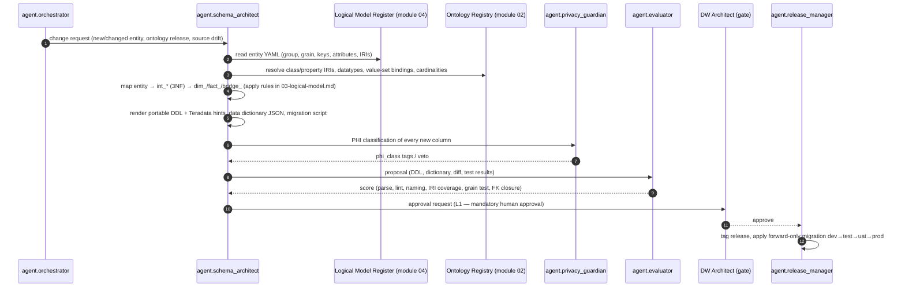

# Module 05 — EDW Schema

## 1. Scope

This module specifies the **enterprise data warehouse (EDW)** that is one of the two governed projections of the
canonical FHIR R4 stream (ADR-07). It covers:

- the **layered EDW architecture** (landing/staging → integration → presentation → semantic views);
- the **conceptual, logical and physical models** for the nine subject-area groups **G1–G9** defined in
  `01-architecture-overview.md` §4 (authoritative; this module never redefines the groups);
- the **conformed dimensions** shared by all groups;
- how the EDW implements **bitemporality** (valid time + transaction time + provenance) in `hist_*` tables, using the
  semantics defined by module 08 (`TKG-01`);
- the **DDL artefacts** in `ddl/*.sql` that are the machine-readable source of truth, generated and validated by
  `agent.schema_architect`.

Out of scope for this module: extraction and mapping from sources (module 03, 06), the Kafka sink connectors that
load the EDW (module 07), DQ rule content (module 09; results land in G9 tables defined here), access-control policy
content (module 11; PHI tags defined here are *consumed* by module 11).

### 1.1 Inputs this module consumes

| Input | Producer | Used for |
|-------|----------|----------|
| Logical Model Register (one YAML per entity: group, grain, keys, attributes bound to ontology IRIs) | Module 04 (`RDM-*`) | Seed for every `dim_*`/`fact_*`/`bridge_*`; the register is the only place entity semantics are authored |
| Ontology Registry (SKOS/OWL/SHACL) | Module 02 (`ONT-*`) | `ontology_class_iri` per table, `ontology_property_iri` per column, value-set bindings for `*_code` columns |
| Bitemporal model | Module 08 (`TKG-01`) | Column semantics of `valid_from/valid_to/recorded_at/superseded_at/prov_activity_iri`; EMPI linkage keys |
| Canonical FHIR R4 profiles | Module 06 (`IOP-*`) | Source element paths recorded in the data dictionary (`source_fhir_path`) |
| PHI classification | Module 11 (`GOV-PHI-*`) | `phi_class` tag per column |
| DQ result contract | Module 09 (`DQ-*`) | Shape of `fact_dq_result` in G9 |

### 1.2 Outputs this module produces

| Output | Consumers | Location |
|--------|-----------|----------|
| Schema-per-group DDL (portable ANSI with Teradata hints) | 07 (sink connectors), 09, 12 | `ddl/*.sql` |
| Data dictionary export (JSON) | 02, 09, 11, analysts | generated by `agent.schema_architect`, format in `04-physical-model-and-ddl.md` §6 |
| Semantic views (`v_*`) | analysts, BI, feature store (G7) | generated, not hand-written |
| Reconciliation contract EDW ↔ KG | 08, 12 | `06-history-and-bitemporality.md` §5 |

## 2. Layered EDW architecture

```mermaid
flowchart LR
  subgraph K[Kafka  (module 07)]
    CAN[(hc.canonical.*.fhir.v1)]
    DQT[(hc.dq.*)]
    EDWT[(hc.edw.*)]
  end
  subgraph L0[Landing / Staging · edw_stg]
    STG[(stg_* · raw FHIR JSON + headers, append-only)]
  end
  subgraph L1[Integration · edw_int]
    INT[(int_* · 3NF, business keys, EMPI-resolved, bitemporal hist_*)]
  end
  subgraph L2[Presentation · edw_g1_* … edw_g9_*]
    DIM[(dim_* conformed + local)]
    FACT[(fact_* · bridge_* · ref_*)]
    HIST[(hist_* bitemporal history)]
  end
  subgraph L3[Semantic · edw_sem]
    V[v_* views · ontology labels · as-of functions]
  end
  CAN --> STG
  DQT --> STG
  STG -->|typed, deduplicated| INT
  INT -->|dimensionalised| DIM & FACT & HIST
  DIM & FACT & HIST --> V
  EDWT -. publishes load/version events .- INT
  ONT[(Ontology Registry)] -.->|IRIs, labels, value sets| V
  ONT -.->|column metadata| DIM & FACT
  TKG[(Temporal KG)] <-->|nightly reconciliation| HIST
```

| Layer | Schema(s) | Purpose | Modelling style | Retention |
|-------|-----------|---------|-----------------|-----------|
| **Landing / staging** | `edw_stg` | Exact copy of each canonical/DQ Kafka record (JSON payload, headers, offset, `hc-event-time`, `hc-source-time`); idempotent upsert on `(topic, partition, offset)` | Append-only, one `stg_<domain>_<resource>` table per topic | 90 days (replay from Kafka beyond that) |
| **Integration** | `edw_int` | Typed, flattened, deduplicated, EMPI-resolved entities at source grain; the place where business keys are assigned and bitemporal history is first materialised | Third normal form (3NF), one `int_<entity>` table + `hist_int_<entity>` | Full history |
| **Presentation** | `edw_g1_party` … `edw_g9_governance` | Dimensional models per subject-area group; conformed dimensions owned by G1/G8 | Star / snowflake, bridges for M:N | Full history in `hist_*`, current in `dim_*` |
| **Semantic** | `edw_sem` | Views that join facts to dimension labels, resolve ontology IRIs to preferred labels, and expose as-of functions | Views and table functions only | n/a |

The integration layer exists because UDMH- and HCDM-style blueprints are 3NF-first (module 04): the agent derives the
3NF `int_*` model directly from the Logical Model Register and then derives the dimensional presentation layer from it.
A fact in `edw_g2_clinical.fact_encounter` therefore has a traceable lineage `canonical FHIR Encounter → stg → int_encounter
→ fact_encounter` recorded as PROV-O activities (module 11).

## 3. Schema grouping by subject-area group

Each group `GN` owns one or more schemas named `edw_gN_<subject>`. Groups, Kafka domains and core entities are
authoritative in `01-architecture-overview.md` §4; this table only fixes the schema names used throughout module 05.

| Group | Schema(s) | Owning steward | Spec |
|-------|-----------|----------------|------|
| G1 Party & Identity | `edw_g1_party` | Enterprise MDM steward | `01-subject-area-groups.md` §G1, `05-conformed-dimensions.md` |
| G2 Clinical Care | `edw_g2_clinical`, `edw_g2_medication`, `edw_g2_diagnostics` | Clinical data steward | §G2 |
| G3 Revenue Cycle & Finance | `edw_g3_revenue`, `edw_g3_finance` | Revenue-cycle steward; Finance controller | §G3 |
| G4 Supply Chain & Operations | `edw_g4_supply`, `edw_g4_operations` | Supply-chain steward; Operations analytics | §G4 |
| G5 Workforce | `edw_g5_workforce` | HR data steward | §G5 |
| G6 Population Health & Quality | `edw_g6_pophealth` | Quality & population-health steward | §G6 |
| G7 Research & Analytics | `edw_g7_research` | Research informatics | §G7 |
| G8 Reference & Terminology | `edw_g8_reference` | Terminology steward (`agent.terminology_steward`) | §G8 |
| G9 Metadata, Quality & Governance | `edw_g9_governance` | Data governance office | §G9 |
| Cross-layer | `edw_stg`, `edw_int`, `edw_sem` | Data Platform | `04-physical-model-and-ddl.md` |

## 4. Ownership and RACI

| Activity | Responsible | Accountable | Consulted | Informed |
|----------|-------------|-------------|-----------|----------|
| Author Logical Model Register entries | `agent.schema_architect` (proposes), module 04 modellers | DW Architect | Ontologist, Stewards | Analysts |
| Generate DDL migration | `agent.schema_architect` | DW Architect | `agent.privacy_guardian` | SRE |
| Approve DDL (L1 — always human) | DW Architect | Head of Data Platform | Steward of owning group | — |
| Apply migration to `dev/test/uat/prod` | `agent.release_manager` | SRE | DW Architect | Stewards |
| Define conformed dimension | DW Architect | CDO | MDM steward, Terminology steward | All group stewards |
| Monitor EDW↔KG reconciliation | `agent.dq_monitor` | Data Governance Office | DW Architect | SRE |

## 5. Document index

| Doc id | File | Content |
|--------|------|---------|
| EDW-00 | `README.md` | This document |
| EDW-01 | `01-subject-area-groups.md` | Per-group schemas, dimension/fact/bridge inventory, grain, sources |
| EDW-02 | `02-conceptual-model.md` | Conceptual ER per group; party-role and event patterns; UDMH/HCDM application |
| EDW-03 | `03-logical-model.md` | Logical design rules; keys; SCD; bridges; IRI binding; PHI tagging; sample tables |
| EDW-04 | `04-physical-model-and-ddl.md` | Platform dialects, indexing, partitioning, migrations, DDL generation/validation, data dictionary |
| EDW-05 | `05-conformed-dimensions.md` | Specification of each conformed dimension |
| EDW-06 | `06-history-and-bitemporality.md` | `hist_*` design, as-of queries, KG reconciliation, late data, retention |
| — | `ddl/*.sql` | Executable DDL (portable ANSI + Teradata hints) |

## 6. How `agent.schema_architect` derives DDL



Derivation rules (normative detail in `03-logical-model.md` and `04-physical-model-and-ddl.md`):

1. **One register entry → one integration table.** Entity `clinical/Encounter` becomes `edw_int.int_encounter` with the
   register's business key and all attributes; bitemporal columns are appended.
2. **Role classification.** The register marks each entity `dimension`, `event`, `transaction`, `snapshot`,
   `association` or `reference`. Events/transactions become `fact_*`, dimensions become `dim_*` (plus `hist_*`),
   associations with attributes become `bridge_*`, reference entities become `ref_*`.
3. **Conformance check.** Any attribute whose range is a conformed-dimension class (Patient, Practitioner, Organization,
   Location, Payer, Item, Cost Center, Code, Source System, Date/Time) becomes a foreign key to the conformed dimension
   and MUST NOT be denormalised locally.
4. **IRI binding.** Every column receives `ontology_property_iri` (or `ontology_class_iri` for keys); columns without a
   resolvable IRI fail evaluation unless explicitly tagged `technical`.
5. **PHI tagging.** `agent.privacy_guardian` assigns `phi_class` (`none | phi_direct | phi_quasi | phi_sensitive`) to
   every column before the proposal can be evaluated.
6. **Physical rendering.** Primary index / distribution key, partitioning and compression are chosen by table role and
   expected cardinality (`04-physical-model-and-ddl.md` §3).

## 7. Requirement index

All module-05 requirements use the prefix `EDW` with areas `G1`–`G9` (group-specific), `ARCH` (layers), `CONF`
(conformed dimensions), `LOG` (logical rules), `PHY` (physical), `DDL` (DDL generation/validation), `DICT` (data
dictionary), `HIST` (history/bitemporality), `REC` (reconciliation).

| Area | Range | Where |
|------|-------|-------|
| `EDW-ARCH-*` | 001–010 | this README §8 |
| `EDW-G1-*` … `EDW-G9-*`, `EDW-GRP-*` | 001–030 per group; `GRP` = rules common to all groups | `01-subject-area-groups.md` |
| `EDW-LOG-*` | 001–040 | `03-logical-model.md` |
| `EDW-PHY-*`, `EDW-DDL-*`, `EDW-DICT-*` | 001–030 each | `04-physical-model-and-ddl.md` |
| `EDW-CONF-*` | 001–030 | `05-conformed-dimensions.md` |
| `EDW-HIST-*`, `EDW-REC-*` | 001–030 each | `06-history-and-bitemporality.md` |

## 8. Architectural requirements

> **EDW-ARCH-001** (P0, inspection) — The EDW MUST be organised in exactly four layers (`edw_stg`, `edw_int`,
> `edw_gN_*` presentation schemas, `edw_sem`); no consumer outside the Data Platform team MAY read `edw_stg` or
> `edw_int` directly.

> **EDW-ARCH-002** (P0, test) — Every presentation schema name MUST match `^edw_g[1-9]_[a-z]+$` and every table name
> MUST match `^(dim|fact|bridge|ref|stg|hist)_[a-z0-9_]+$`; the linter in `agent.evaluator` MUST reject violations.

> **EDW-ARCH-003** (P0, test) — Every `fact_*`, `bridge_*` and `hist_*` row MUST carry `valid_from`, `valid_to`,
> `recorded_at`, `superseded_at` and `prov_activity_iri` with the semantics of `TKG-01`.

> **EDW-ARCH-004** (P0, test) — Every table and column in a presentation schema MUST have an entry in the data
> dictionary export with `ontology_class_iri` (tables) or `ontology_property_iri` (columns) resolvable in the Ontology
> Registry, except columns tagged `technical`.

> **EDW-ARCH-005** (P0, inspection) — The EDW MUST be loadable solely from `hc.canonical.*` and `hc.dq.*` topics; no
> direct connection from the EDW load path to a source system (Cerner, Oracle Fusion, peripherals) is permitted.

> **EDW-ARCH-006** (P0, test) — Loads into every layer MUST be idempotent: replaying the same Kafka offsets MUST
> produce byte-identical tables (ARC-NFR-004).

> **EDW-ARCH-007** (P1, test) — p95 latency from a record's arrival on `hc.canonical.*` to its visibility in the
> presentation layer MUST be ≤ 15 minutes for streaming domains and ≤ 60 minutes for batch (BICC) domains.

> **EDW-ARCH-008** (P0, inspection) — The reference DDL in `ddl/` MUST parse in both the portable ANSI dialect and
> the Teradata dialect (Teradata-specific syntax expressed only in `-- TD:` hint comments or in generated dialect
> variants).

> **EDW-ARCH-009** (P1, demo) — The semantic layer `edw_sem` MUST expose, for each fact, a view that resolves every
> `*_code`/`*_sk` to its ontology preferred label as of a given date, without the consumer joining G8 manually.

> **EDW-ARCH-010** (P0, inspection) — DDL changes MUST be proposed by `agent.schema_architect` as typed change
> requests and MUST be approved by a human DW Architect (autonomy level L1) before `agent.release_manager` applies them.

## 9. Glossary (module-local)

| Term | Meaning |
|------|---------|
| Conformed dimension | A dimension with one definition, one surrogate key domain and one owner, reused by facts in ≥ 2 groups |
| Degenerate dimension | A transaction identifier stored on the fact without its own dimension table (e.g., `claim_number`) |
| Junk dimension | A small dimension collecting low-cardinality flags/indicators to keep facts narrow |
| Bridge | A table resolving a many-to-many relation between a fact and a dimension, optionally weighted/ranked |
| `hist_*` | Bitemporal history table holding all versions of a dimension or integration entity |
| As-of query | Query constrained on both valid time and transaction time (`06-history-and-bitemporality.md` §4) |
| Logical Model Register | Module 04's YAML-per-entity catalogue; the only authoring point for entity semantics |
