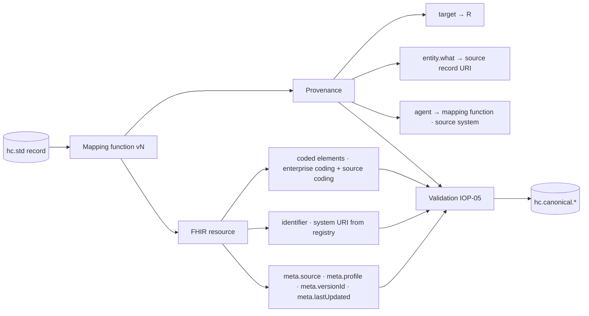
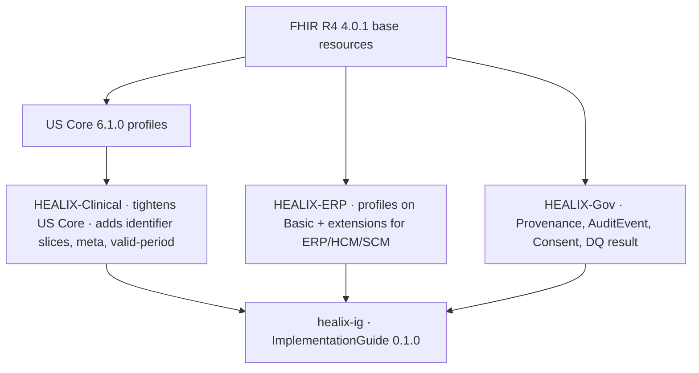

# Canonical Model — FHIR R4

## 1. Decision and rationale

Per **ADR-01**, the canonical interchange model of the HEALIX platform is **HL7 FHIR R4 (4.0.1)** constrained by
**US Core 6.1.0** and the HEALIX profile set. "Canonical" has a precise meaning here: a record on any
`hc.canonical.<domain>.<resource>.fhir.v1` topic **is** a FHIR resource; the EDW (module 05) and the temporal
knowledge graph (module 08) are projections of those resources and of nothing else.

Why FHIR R4 rather than a bespoke canonical:

| Driver | Effect |
|--------|--------|
| Native source support | Oracle Health Millennium exposes FHIR R4 APIs; Oracle Fusion exposes REST that maps cleanly to Organization/Practitioner/Location/Invoice/ChargeItem/Account. |
| Regulatory alignment | US Core 6.1 is the USCDI v3 conformance baseline; CARIN Blue Button and Da Vinci IGs cover payer data (IOP-03). |
| Formal semantics | FHIR RDF gives a direct bridge to the OWL ontology and SHACL shapes (module 02) without a second mapping layer. |
| Ecosystem tooling | HL7 FHIR Validator, IG Publisher, terminology servers, Bulk Data clients, V2-to-FHIR IG. |
| Reversibility | HL7 v2 can be regenerated from FHIR for legacy consumers (IOP-02 §8), so the choice does not strand any consumer. |

Where FHIR R4 has no resource for an ERP/HCM/SCM concept, HEALIX uses the **`Basic` resource with governed extensions**
(the `HEALIX-ERP` profile family, §4.3). Custom resource types are prohibited: they break every off-the-shelf validator, server and client.

## 2. Resource coverage by subject-area group

The table binds each G1–G9 core entity (ARC-01 §4) to the FHIR R4 resource that carries it and to the profile that
constrains it. Kafka topic names follow `hc.canonical.<kafka-domain>.<resource-lowercase>.fhir.v1`.

| Group | Entity | FHIR R4 resource | Profile | Topic (entity segment) |
|-------|--------|------------------|---------|------------------------|
| G1 Party & Identity | Patient | `Patient` | healix-patient (US Core Patient) | `party.patient` |
| G1 | Person (non-patient, EMPI golden record) | `Person` | healix-person | `party.person` |
| G1 | Related Person / guarantor contact | `RelatedPerson` | healix-relatedperson (US Core RelatedPerson) | `party.relatedperson` |
| G1 | Practitioner | `Practitioner` | healix-practitioner (US Core Practitioner) | `party.practitioner` |
| G1 | Practitioner Role | `PractitionerRole` | healix-practitionerrole (US Core PractitionerRole) | `party.practitionerrole` |
| G1 | Organization, Payer, Supplier, Legal Entity | `Organization` | healix-organization (US Core Organization) + `healix-erp-organization-type` ext | `party.organization` |
| G1 | Location, Facility, Nurse Unit, Bed, Room | `Location` | healix-location (US Core Location) | `party.location` |
| G1 | Employee / Worker (as a person) | `Practitioner` (clinical) or `Person` (non-clinical) + `healix-erp-worker` ext | healix-practitioner / healix-person | `party.practitioner` / `party.person` |
| G1 | Device (as a party, e.g. monitor) | `Device` | healix-device (US Core Implantable Device for implants) | `party.device` |
| G2 Clinical Care | Encounter | `Encounter` | healix-encounter (US Core Encounter) | `clinical.encounter` |
| G2 | Episode of Care | `EpisodeOfCare` | healix-episodeofcare | `clinical.episodeofcare` |
| G2 | Condition / Diagnosis / Problem | `Condition` | healix-condition (US Core Condition Encounter Diagnosis / Problems & Health Concerns) | `clinical.condition` |
| G2 | Procedure | `Procedure` | healix-procedure (US Core Procedure) | `clinical.procedure` |
| G2 | Observation — vital signs | `Observation` | US Core Vital Signs profiles (unchanged) | `clinical.observation` |
| G2 | Observation — laboratory | `Observation` | healix-observation-lab (US Core Laboratory Result Observation) | `clinical.observation` |
| G2 | Observation — other (clinical, SDOH, survey) | `Observation` | US Core Observation Clinical Result / Screening Assessment | `clinical.observation` |
| G2 | Diagnostic Report (lab, pathology, imaging narrative) | `DiagnosticReport` | healix-diagnosticreport (US Core DiagnosticReport Lab / Note) | `clinical.diagnosticreport` |
| G2 | Medication Request / Order | `MedicationRequest` | healix-medicationrequest (US Core MedicationRequest) | `clinical.medicationrequest` |
| G2 | Medication Dispense | `MedicationDispense` | healix-medicationdispense (US Core MedicationDispense) | `clinical.medicationdispense` |
| G2 | Medication Administration | `MedicationAdministration` | healix-medicationadministration | `clinical.medicationadministration` |
| G2 | Medication (formulary item) | `Medication` | US Core Medication | `clinical.medication` |
| G2 | Allergy / Intolerance | `AllergyIntolerance` | healix-allergyintolerance (US Core AllergyIntolerance) | `clinical.allergyintolerance` |
| G2 | Immunization | `Immunization` | healix-immunization (US Core Immunization) | `clinical.immunization` |
| G2 | Care Plan / Goal | `CarePlan`, `Goal`, `CareTeam` | US Core CarePlan / Goal / CareTeam | `clinical.careplan` |
| G2 | Clinical Document (note, discharge summary, C-CDA) | `DocumentReference` | healix-documentreference (US Core DocumentReference) | `clinical.documentreference` |
| G2 | Service Request / Order | `ServiceRequest` | healix-servicerequest (US Core ServiceRequest) | `clinical.servicerequest` |
| G2 | Specimen | `Specimen` | healix-specimen (US Core Specimen) | `clinical.specimen` |
| G2 | Imaging Study (metadata only) | `ImagingStudy` | healix-imagingstudy | `clinical.imagingstudy` |
| G2 | Device Use | `DeviceUseStatement` | healix-deviceusestatement | `clinical.deviceusestatement` |
| G3 Revenue Cycle & Finance | Patient Account / Encounter Account | `Account` | healix-account | `finance.account` |
| G3 | Charge Item | `ChargeItem` | healix-chargeitem | `finance.chargeitem` |
| G3 | Claim (837P/I, pre-adjudication) | `Claim` | healix-claim (aligns with Da Vinci PAS/CDex where used) | `finance.claim` |
| G3 | Claim Response / Prior Auth Response | `ClaimResponse` | healix-claimresponse | `finance.claimresponse` |
| G3 | Remittance / Adjudicated Claim | `ExplanationOfBenefit` | healix-eob (CARIN BB 2.0 EOB as base) | `finance.explanationofbenefit` |
| G3 | Payment Reconciliation (835 BPR/TRN) | `PaymentReconciliation` | healix-paymentreconciliation | `finance.paymentreconciliation` |
| G3 | Coverage / Eligibility | `Coverage` | healix-coverage (US Core Coverage) | `finance.coverage` |
| G3 | Eligibility inquiry/response (270/271) | `CoverageEligibilityRequest` / `CoverageEligibilityResponse` | healix-coverageeligibility* | `finance.coverageeligibilityresponse` |
| G3 | Invoice (patient statement, AR/AP invoice) | `Invoice` | healix-invoice | `finance.invoice` |
| G3 | GL Journal Line | `Basic` | **healix-erp-gl-journal-line** | `finance.gljournalline` |
| G3 | Cost Center, Budget, Fixed Asset, Project | `Basic` / `Organization` (cost center) | healix-erp-cost-center, healix-erp-budget-line, healix-erp-fixed-asset, healix-erp-project | `finance.*` |
| G4 Supply Chain & Operations | Item / Product | `Device` (equipment) / `Medication` (drug items) / `Basic` (non-device supplies) | healix-erp-item | `supply.item` |
| G4 | Inventory Balance | `Basic` | **healix-erp-inventory-balance** | `supply.inventorybalance` |
| G4 | Purchase Requisition / Purchase Order | `SupplyRequest` (requisition) + `Basic` (PO header/line) | healix-supplyrequest, **healix-erp-purchase-order** | `supply.supplyrequest`, `supply.purchaseorder` |
| G4 | Receipt / Supply Delivery | `SupplyDelivery` | healix-supplydelivery | `supply.supplydelivery` |
| G4 | Supplier Contract | `Contract` | healix-erp-supplier-contract (profile on Contract) | `supply.contract` |
| G4 | Asset / Equipment | `Device` | healix-device | `supply.device` |
| G4 | Bed, Room, Transport | `Location` | healix-location | `party.location` |
| G4 | Schedule, Slot, Appointment | `Schedule`, `Slot`, `Appointment` | healix-schedule, healix-slot, healix-appointment | `supply.appointment` etc. |
| G5 Workforce | Worker | `Practitioner` / `Person` + `healix-erp-worker` ext | see G1 | `workforce.worker` |
| G5 | Position | `Basic` | **healix-erp-position** | `workforce.position` |
| G5 | Assignment | `Basic` | **healix-erp-assignment** | `workforce.assignment` |
| G5 | Credential / Licence | `Practitioner.qualification` + `healix-credential` ext | healix-practitioner | `party.practitioner` |
| G5 | Competency, Learning | `Basic` | healix-erp-competency, healix-erp-learning-record | `workforce.*` |
| G5 | Shift / Timecard, Payroll aggregates | `Basic` | healix-erp-timecard, healix-erp-payroll-aggregate (no individual pay amounts; see module 11) | `workforce.*` |
| G6 Population Health & Quality | Measure | `Measure` | healix-measure (CQF/DEQM base) | `pophealth.measure` |
| G6 | Measure Report | `MeasureReport` | healix-measurereport (DEQM) | `pophealth.measurereport` |
| G6 | Registry Membership, Attribution, Program Enrolment | `Group` + `List` | healix-group | `pophealth.group` |
| G6 | Risk Score, Care Gap | `RiskAssessment`, `DetectedIssue` | healix-riskassessment, healix-caregap | `pophealth.*` |
| G6 | SDOH Observation | `Observation` | US Core Screening Assessment / Gravity SDOH Clinical Care | `clinical.observation` |
| G7 Research & Analytics | Research Study | `ResearchStudy` | healix-researchstudy | `research.researchstudy` |
| G7 | Research Subject | `ResearchSubject` | healix-researchsubject | `research.researchsubject` |
| G7 | Cohort | `Group` | healix-group | `research.group` |
| G7 | Consent (research) | `Consent` | healix-consent | `research.consent` |
| G8 Reference & Terminology | Code System, Value Set, Concept Map | `CodeSystem`, `ValueSet`, `ConceptMap` | IOP-04 | `reference.*` |
| G8 | Organisation Hierarchy, Service Line | `Organization` (partOf) | healix-organization | `party.organization` |
| G8 | Calendar, Geography, Currency, Unit | `CodeSystem` / `ValueSet` (ISO 3166, ISO 4217, UCUM) | IOP-04 | `reference.*` |
| G9 Metadata, Quality & Governance | Consent & Directive (privacy) | `Consent` | healix-consent | `governance.consent` |
| G9 | Audit Event | `AuditEvent` | healix-auditevent (IHE BALP base) | `governance.auditevent` |
| G9 | Lineage Activity | `Provenance` | healix-provenance | `governance.provenance` |
| G9 | DQ Rule, DQ Result, Issue | `Basic` (`healix-gov-dq-result`) and `Task` (remediation) | module 09 | `governance.*` |
| G9 | Source Registry, Data Element | `Basic` (`healix-gov-source`, `healix-gov-data-element`) | module 03 | `governance.*` |

Resources listed in US Core but not mapped above (e.g. `QuestionnaireResponse`) are admitted on demand through the
change-request process (module 10) and inherit the US Core profile unchanged.

## 3. Mandatory elements on every canonical resource



| Element | Rule | Example |
|---------|------|---------|
| `id` | Deterministic ULID-based logical id derived from (source system, business key); stable across replays | `01J9ZK8V2M3N4P5Q6R7S8T9UVW` |
| `meta.profile` | Exactly one HEALIX profile canonical URL with version | `https://fhir.healix.example.org/StructureDefinition/healix-encounter\|0.1.0` |
| `meta.source` | URI of the source system and interface from the Source Registry (module 03) | `https://id.healix.example.org/source/cerner-millennium/adt-mllp` |
| `meta.versionId` | Monotonic per logical id; equals the Kafka record's `hc-sequence` header | `17` |
| `meta.lastUpdated` | Transaction time (UTC) at which the canonical record was produced | `2026-10-17T14:03:22.118Z` |
| `meta.tag` | `https://fhir.healix.example.org/CodeSystem/record-flags` tags: `replay`, `backfill`, `synthetic`, `masked` | — |
| `identifier[]` | ≥ 1 identifier whose `system` is in the registry (§5); `type` from HL7 v2-0203 where defined | MRN, FIN |
| `extension[valid-period]` | `https://fhir.healix.example.org/StructureDefinition/ext-valid-period` — business valid time for bitemporal projection (module 08) when FHIR has no native period | — |
| Coded elements | At least one coding from the bound enterprise value set; source coding retained with `userSelected=true` | `class` = v3 `IMP` + Cerner code set 71 value |
| Reference targets | Literal `reference` to the canonical logical id **and** `identifier` with business identifier, so consumers can resolve either way | `Encounter.subject.reference = Patient/01J...`, `.identifier.system = .../cerner/mrn` |
| `Provenance` | One per resource version; see §6 | — |

Prohibited: `contained` resources (except `Provenance.agent.who` for ephemeral devices), `text.div` as the only carrier
of a fact, free-text in place of a bound code when the value set has a match.

## 4. The HEALIX profile set

### 4.1 Layering



| Family | Canonical URL pattern | Base | Count (first release) |
|--------|-----------------------|------|----------------------|
| HEALIX-Clinical | `https://fhir.healix.example.org/StructureDefinition/healix-<resource>` | US Core 6.1 profile where one exists, else FHIR R4 base | 38 |
| HEALIX-ERP | `https://fhir.healix.example.org/StructureDefinition/healix-erp-<concept>` | `Basic`, or `Organization`/`Contract`/`SupplyRequest` where a resource fits | 16 |
| HEALIX-Gov | `https://fhir.healix.example.org/StructureDefinition/healix-<resource>` | FHIR R4 base, IHE BALP for AuditEvent | 5 |
| Extensions | `https://fhir.healix.example.org/StructureDefinition/ext-<name>` | `Extension` | ~40 |

### 4.2 HEALIX-Clinical conventions

- `baseDefinition` is the US Core profile; HEALIX only **adds** constraints (slices, min cardinality, required bindings
  to enterprise value sets) and never relaxes a US Core `mustSupport`.
- Identifier slicing is by `system` (value discriminator) with `rules = open`; the primary business identifier slice
  has `min = 1`.
- Bindings: US Core `extensible` bindings are tightened to `required` only when the enterprise value set is a proper
  subset of the US Core set (e.g. `Encounter.class` → `healix-encounter-class`, a subset of v3 ActEncounterCode).
- Every profile declares `meta.source` and `meta.profile` as `min = 1, mustSupport = true`.
- Reference profiles: every `Reference` element is constrained to the corresponding HEALIX profile
  (`Encounter.subject` → `healix-patient`).

### 4.3 HEALIX-ERP: representing ERP/HCM/SCM entities without custom resources

Pattern for a `Basic`-based profile:

| `Basic` element | Use |
|-----------------|-----|
| `Basic.code` | Fixed to a code from `https://fhir.healix.example.org/CodeSystem/healix-erp-resource-type` (e.g. `gl-journal-line`, `purchase-order`, `purchase-order-line`, `inventory-balance`, `position`, `assignment`, `cost-center`, `budget-line`, `fixed-asset`, `project`, `timecard`, `competency`) |
| `Basic.identifier` | Oracle Fusion natural keys with registered systems (§5), e.g. `journal-header-id` + `journal-line-number` |
| `Basic.subject` | The party the record is about: `Organization` (legal entity / business unit) for finance and supply; `Practitioner`/`Person` for workforce |
| `Basic.author` | `Practitioner`/`PractitionerRole`/`Device` that created or posted the record |
| `Basic.created` | Business effective date (accounting date, hire date, balance date) |
| `Basic.extension[]` | Typed, sliced extensions carrying the attributes; each extension is its own `StructureDefinition` with `context = Basic` |

Core HEALIX-ERP profiles and their principal extensions:

| Profile | Extensions (`ext-erp-*`) | Notes |
|---------|--------------------------|-------|
| `healix-erp-gl-journal-line` | `ledger` (Reference Organization), `journal-header` (Identifier), `journal-line-number` (integer), `account-combination` (complex: segment[] with `segment-name`, `value`, `description`), `entered-amount` (Money), `accounted-amount` (Money), `currency-conversion` (complex), `period-name` (string), `effective-date` (date), `journal-source` (CodeableConcept), `journal-category` (CodeableConcept), `posting-status` (CodeableConcept), `cost-center` (Reference Organization), `description` (string) | One `Basic` per journal line; header attributes repeated so lines are self-describing on Kafka |
| `healix-erp-purchase-order` | `po-number`, `po-line-number`, `supplier` (Reference Organization), `supplier-site`, `buyer` (Reference Practitioner), `item` (Reference Device/Medication/Basic), `ordered-quantity` (Quantity), `unit-price` (Money), `line-amount` (Money), `need-by-date`, `ship-to-location` (Reference Location), `po-status`, `requisition` (Reference SupplyRequest), `contract` (Reference Contract) | Header and line profiles share a code; `po-line-number` absent on header |
| `healix-erp-inventory-balance` | `item` (Reference), `inventory-organization` (Reference Organization), `subinventory` (string), `locator` (string), `lot-number`, `serial-number`, `on-hand-quantity` (Quantity), `reserved-quantity` (Quantity), `available-quantity` (Quantity), `unit-of-measure` (CodeableConcept, UCUM or Oracle UOM mapped), `balance-as-of` (dateTime), `valuation-amount` (Money) | Snapshot semantics; `balance-as-of` drives valid time |
| `healix-erp-position` | `position-code`, `position-title`, `job` (CodeableConcept), `department` (Reference Organization), `business-unit` (Reference Organization), `location` (Reference Location), `fte` (decimal), `headcount` (integer), `position-type` (CodeableConcept, `healix-position-type`), `position-status`, `effective-period` (Period) | Position is independent of incumbent |
| `healix-erp-assignment` | `assignment-number`, `worker` (Reference Practitioner/Person), `position` (Reference Basic), `manager` (Reference), `assignment-status`, `assignment-category` (CodeableConcept), `grade`, `effective-period` (Period), `primary-flag` (boolean) | Salary and pay elements are excluded from canonical (module 11 minimisation) |

### 4.4 Example — a GL journal line as `Basic`

```json
{
  "resourceType": "Basic",
  "id": "01J9ZKP7B4F3X2A1C9D8E7G6H5",
  "meta": {
    "profile": ["https://fhir.healix.example.org/StructureDefinition/healix-erp-gl-journal-line|0.1.0"],
    "source": "https://id.healix.example.org/source/oracle-fusion-erp/gl-bicc",
    "versionId": "3",
    "lastUpdated": "2026-10-17T02:15:04.221Z"
  },
  "identifier": [
    {"system": "https://id.healix.example.org/oracle/gl-journal-header-id", "value": "300000123456789"},
    {"system": "https://id.healix.example.org/oracle/gl-journal-line", "value": "300000123456789-12"}
  ],
  "code": {"coding": [{"system": "https://fhir.healix.example.org/CodeSystem/healix-erp-resource-type", "code": "gl-journal-line"}]},
  "subject": {"reference": "Organization/01J9ZK...LE1", "identifier": {"system": "https://id.healix.example.org/oracle/legal-entity-id", "value": "300000000012"}},
  "created": "2026-09-30",
  "extension": [
    {"url": "https://fhir.healix.example.org/StructureDefinition/ext-erp-ledger", "valueReference": {"reference": "Organization/01J9ZK...LDG"}},
    {"url": "https://fhir.healix.example.org/StructureDefinition/ext-erp-journal-line-number", "valueInteger": 12},
    {"url": "https://fhir.healix.example.org/StructureDefinition/ext-erp-accounted-amount", "valueMoney": {"value": 12450.00, "currency": "USD"}},
    {"url": "https://fhir.healix.example.org/StructureDefinition/ext-erp-period-name", "valueString": "Sep-26"},
    {"url": "https://fhir.healix.example.org/StructureDefinition/ext-erp-posting-status", "valueCodeableConcept": {"coding": [{"system": "https://fhir.healix.example.org/CodeSystem/healix-gl-posting-status", "code": "posted"}]}}
  ]
}
```

## 5. Identifier system URI registry

The registry is machine-readable in [`profiles/identifier-systems.yaml`](profiles/identifier-systems.yaml); the table
below is the normative summary. Base for HEALIX-assigned systems is `https://id.healix.example.org/`. Where HL7 defines
a system URI it is used unchanged.

| Identifier | `Identifier.system` | v2-0203 type | Source / assigner | PHI class (module 11) |
|------------|---------------------|--------------|-------------------|------------------------|
| Enterprise person id (EMPI) | `https://id.healix.example.org/empi/enterprise-id` | `PI` | HEALIX entity resolution (module 08) | Direct identifier |
| Medical Record Number | `https://id.healix.example.org/cerner/mrn` | `MR` | Cerner Millennium (PERSON_ALIAS, alias type MRN) | Direct identifier |
| Cerner person id | `https://id.healix.example.org/cerner/person-id` | `PI` | Cerner PERSON.PERSON_ID | Direct identifier |
| Financial / encounter number | `https://id.healix.example.org/cerner/fin` | `AN` | Cerner ENCNTR_ALIAS, alias type FIN NBR | Direct identifier |
| Cerner encounter id | `https://id.healix.example.org/cerner/encntr-id` | `VN` | Cerner ENCOUNTER.ENCNTR_ID | Direct identifier |
| Placer order number | `https://id.healix.example.org/cerner/placer-order` | `PLAC` | Cerner ORDERS / ORC-2 | Indirect |
| Filler order number | `https://id.healix.example.org/cerner/filler-order` | `FILL` | Cerner / LIS ORC-3 | Indirect |
| LIS accession number | `https://id.healix.example.org/lis/accession` | `ACSN` | LIS | Indirect |
| Imaging accession number | `https://id.healix.example.org/ris/accession` | `ACSN` | RIS | Indirect |
| DICOM Study Instance UID | `urn:dicom:uid` (value `urn:oid:<uid>`) | — | Modality / PACS | Indirect |
| National Provider Identifier | `http://hl7.org/fhir/sid/us-npi` | `NPI` | CMS NPPES | Public |
| DEA number | `urn:oid:2.16.840.1.113883.4.814` | `DEA` | DEA | Restricted |
| State licence | `https://id.healix.example.org/licence/<state-iso2>` | `MD` etc. | State boards | Public |
| Employer Identification Number | `urn:oid:2.16.840.1.113883.4.4` | `TAX` | IRS | Restricted |
| CLIA number | `urn:oid:2.16.840.1.113883.4.7` | `XX` | CMS | Public |
| Social Security Number | `http://hl7.org/fhir/sid/us-ssn` | `SS` | SSA — **never published to canonical**; hashed token only (module 11) | Direct, prohibited |
| Medicare Beneficiary Identifier | `http://hl7.org/fhir/sid/us-mbi` | `MC` | CMS | Direct identifier |
| Payer member id | `https://id.healix.example.org/payer/<payer-id>/member-id` | `MB` | Payer | Direct identifier |
| Payer id (X12 NM109 / PI) | `https://id.healix.example.org/payer/payer-id` | `NIIP` / `PAYERID` | CAQH / clearinghouse | Public |
| Claim control number | `https://id.healix.example.org/rcm/claim-control-number` | — | RCM / clearinghouse (CLM01) | Indirect |
| Payer claim control number (ICN) | `https://id.healix.example.org/payer/<payer-id>/icn` | — | Payer (835 CLP07) | Indirect |
| Oracle supplier number | `https://id.healix.example.org/oracle/supplier-number` | — | Oracle Fusion SCM (POZ_SUPPLIERS) | None |
| Oracle supplier site | `https://id.healix.example.org/oracle/supplier-site-id` | — | Oracle Fusion SCM | None |
| Oracle person number (HCM) | `https://id.healix.example.org/oracle/person-number` | `EI` | Oracle Fusion HCM | Direct identifier (workforce) |
| Oracle employee number | `https://id.healix.example.org/oracle/employee-number` | `EN` | Oracle Fusion HCM | Direct identifier (workforce) |
| Oracle assignment number | `https://id.healix.example.org/oracle/assignment-number` | — | Oracle Fusion HCM | Indirect |
| Oracle position code | `https://id.healix.example.org/oracle/position-code` | — | Oracle Fusion HCM | None |
| Oracle legal entity id | `https://id.healix.example.org/oracle/legal-entity-id` | — | Oracle Fusion ERP | None |
| Oracle ledger id | `https://id.healix.example.org/oracle/ledger-id` | — | Oracle Fusion GL | None |
| Oracle GL journal header id / line | `https://id.healix.example.org/oracle/gl-journal-header-id`, `.../gl-journal-line` | — | Oracle Fusion GL | None |
| Oracle PO number / line | `https://id.healix.example.org/oracle/po-number`, `.../po-line` | — | Oracle Fusion Procurement | None |
| Oracle item number | `https://id.healix.example.org/oracle/item-number` | — | Oracle Fusion Product Hub | None |
| Oracle inventory organization | `https://id.healix.example.org/oracle/inventory-org-id` | — | Oracle Fusion Inventory | None |
| Oracle AP/AR invoice number | `https://id.healix.example.org/oracle/ap-invoice-number`, `.../ar-invoice-number` | — | Oracle Fusion Payables / Receivables | None |
| Device UDI (GS1) | `http://hl7.org/fhir/NamingSystem/gs1-di` | `UDI` | GS1 via FDA GUDID | None |
| Device serial (gateway) | `https://id.healix.example.org/device/<vendor>/serial` | `SNO` | Device gateway | Indirect |
| Document unique id | `urn:ietf:rfc:3986` (value `urn:oid:` or `urn:uuid:`) | — | C-CDA `ClinicalDocument/id`, XDS `uniqueId` | Indirect |
| HL7 v2 message control id | `https://id.healix.example.org/hl7v2/<sending-app>/message-control-id` | — | MSH-10 | None |

Rules: a system URI is registered once, in the YAML, with an owner and PHI class before any mapping may emit it;
`agent.source_mapper` proposals that introduce an unregistered system are rejected by the evaluator.

## 6. Provenance conventions

Every canonical resource version is paired with a `Provenance` (profile `healix-provenance`) published to
`hc.canonical.governance.provenance.fhir.v1` and carried alongside the resource in the same Kafka record when the
record is a Bundle (§7).

| `Provenance` element | Value |
|----------------------|-------|
| `target` | Reference to the canonical resource including `_history/<versionId>` |
| `recorded` | Transaction time |
| `occurredPeriod` | Business valid time when known (e.g. `Encounter.period`) |
| `activity` | `http://terminology.hl7.org/CodeSystem/v3-DataOperation` `CREATE` / `UPDATE` / `DELETE`, plus HEALIX code `transform` |
| `agent[author]` | `who` = `Device` representing the mapping function; `onBehalfOf` = source `Organization` |
| `agent[performer]` | Practitioner or user from the source record where the source carries it (e.g. EVN-5 operator) |
| `entity[source]` | `role = source`; `what.identifier` = source record identifier (MSH-10, CDC `(scn, table, pk)`, X12 ST02/BHT03, document id) |
| `entity[derivation]` | For derived resources (e.g. EOB from 835), `role = derivation` pointing at the parent canonical |
| `extension[mapping-version]` | `https://fhir.healix.example.org/StructureDefinition/ext-mapping-version` — Git tag of the mapping spec |
| `extension[prov-activity-iri]` | PROV-O activity IRI used by module 08 and 11 (`CONVENTIONS.md` §4) |

## 7. Bundle and Kafka record conventions

| Concern | Convention |
|---------|-----------|
| Record value | FHIR JSON. Either a single resource, or a `Bundle` of `type = transaction` when a source event yields multiple resources that must be applied atomically (e.g. ADT A01 → Encounter + Patient update + Coverage + Provenance ×3). |
| Record key | `<resource-type>/<logical-id>` for single resources; for Bundles, the key of the *anchor* resource (`Encounter` for ADT, `DiagnosticReport` for ORU, `Claim` for 837). Guarantees per-entity ordering. |
| Bundle entries | `entry.fullUrl = urn:uuid:<v4>`; `entry.request.method` = `PUT` with conditional `ifMatch` on `versionId` where upsert, `DELETE` for retractions; `entry.resource.meta` fully populated on each entry. |
| Topic routing | A Bundle is published once to the anchor's topic **and** each contained resource is fanned out to its own topic by the canonical router (module 07), with `hc-bundle-id` header linking them. |
| Headers | `hc-event-time`, `hc-source-time`, `hc-source-system`, `hc-profile` (profile URL\|version), `hc-mapping-version`, `hc-bundle-id`, `hc-sequence`, `hc-prov-activity-iri`, `hc-phi-class`. |
| Deletes / retractions | A FHIR `DELETE` request entry plus a `Provenance` with activity `DELETE`; consumers close valid time (module 08) rather than physically removing. Kafka tombstones are not used on `canonical` because provenance must survive. |
| Schema Registry | JSON Schema generated from each HEALIX profile (`fhir.schema.json` subset + profile constraints) registered as `<topic>-value` with `BACKWARD_TRANSITIVE` compatibility (`CONVENTIONS.md` §5). |
| Size | A record MUST be ≤ 1 MiB. Larger payloads (documents, images) are referenced via `DocumentReference.content.attachment.url` pointing to the object store, never embedded. |
| Compacted snapshots | `hc.canonical.<domain>.<resource>.fhir.snapshot.v1` compacted topics hold the latest version per key for bootstrapping consumers (ARC-NFR-005). |

## 8. Requirements

> **IOP-FHIR-001** (P0, test) — Every record published to any `hc.canonical.*` topic MUST be a FHIR R4 (4.0.1) resource
> or a `transaction` Bundle of such resources, each declaring exactly one HEALIX profile in `meta.profile`.

> **IOP-FHIR-002** (P0, inspection) — HEALIX-Clinical profiles MUST derive from the corresponding US Core 6.1.0 profile
> where one exists and MUST NOT relax any US Core mustSupport, cardinality or binding.

> **IOP-FHIR-003** (P0, test) — Entities with no FHIR R4 resource MUST be represented with `Basic` and HEALIX-ERP
> extensions; custom resource types MUST NOT be used.

> **IOP-FHIR-004** (P0, test) — Every canonical resource MUST carry `meta.source`, `meta.profile`, `meta.versionId`,
> `meta.lastUpdated` and at least one `identifier` whose `system` is present in `profiles/identifier-systems.yaml`.

> **IOP-FHIR-005** (P0, test) — Every coded element with an enterprise binding MUST contain at least one coding from the
> bound value set; the original source coding MUST be retained with `userSelected = true`.

> **IOP-FHIR-006** (P1, test) — Every `Reference` MUST carry both a literal `reference` to a canonical logical id and an
> `identifier` with a registered system, except references to `Provenance` and `AuditEvent`.

> **IOP-FHIR-007** (P1, test) — Logical ids MUST be deterministic functions of (source system, business key) so that
> replay of `std` produces identical ids.

> **IOP-FHIR-008** (P0, test) — Every canonical resource version MUST be accompanied by a `Provenance` conforming to
> `healix-provenance` that names the source record identifier, the mapping version and a PROV-O activity IRI.

> **IOP-FHIR-009** (P0, inspection) — Social Security Numbers MUST NOT appear in any canonical resource; only the
> module 11 hashed token identifier (`https://id.healix.example.org/empi/ssn-token`) MAY be emitted.

> **IOP-FHIR-010** (P1, test) — Workforce canonical resources MUST exclude individual compensation amounts; payroll is
> represented only as `healix-erp-payroll-aggregate` at cost-center grain or above.

> **IOP-FHIR-011** (P0, test) — Resources produced from one source event that must be applied atomically MUST be
> published as one `transaction` Bundle keyed by the anchor resource; the canonical router MUST fan entries out to
> per-resource topics with a shared `hc-bundle-id` header.

> **IOP-FHIR-012** (P0, test) — A canonical Kafka record MUST NOT exceed 1 MiB; binary content MUST be referenced by URL.

> **IOP-FHIR-013** (P1, test) — Retractions MUST be expressed as Bundle `DELETE` entries with a `Provenance` activity
> `DELETE`; Kafka tombstones MUST NOT be used on `hc.canonical.*` topics.

> **IOP-FHIR-014** (P1, test) — Every HEALIX profile MUST have a generated JSON Schema registered in the Schema Registry
> under `<topic>-value` with `BACKWARD_TRANSITIVE` compatibility.

> **IOP-FHIR-015** (P0, inspection) — The identifier system registry MUST record, for each system, the URI, HL7 v2-0203
> type, assigning authority (HD namespace and OID where applicable), owner, PHI class and value format.

> **IOP-FHIR-016** (P1, test) — A mapping proposal that emits an unregistered identifier system or an unbound code system
> MUST be rejected by `agent.evaluator` before it can be applied.

> **IOP-FHIR-017** (P1, test) — `Encounter.class` MUST be bound (required) to `healix-encounter-class`;
> `Encounter.hospitalization.admitSource` and `.dischargeDisposition` MUST be bound (extensible) to the HEALIX value
> sets in IOP-04 §4.

> **IOP-FHIR-018** (P1, test) — Laboratory `Observation.code` MUST include a LOINC coding when the Terminology Service
> has a ConceptMap for the source code; otherwise the record MUST carry the `unmapped` tag and route per IOP-TS-010.

> **IOP-FHIR-019** (P1, test) — `Observation.valueQuantity.system` MUST be `http://unitsofmeasure.org` with a valid
> UCUM code.

> **IOP-FHIR-020** (P1, inspection) — HEALIX-ERP `Basic` profiles MUST fix `Basic.code` to a code from
> `healix-erp-resource-type` and slice `Basic.extension` by `url` with every business attribute as a typed extension.

> **IOP-FHIR-021** (P2, test) — `Basic.subject` on finance and supply profiles MUST reference an `Organization`
> (legal entity or business unit); on workforce profiles it MUST reference the worker's `Practitioner` or `Person`.

> **IOP-FHIR-022** (P1, test) — Every canonical resource lacking a native period element MUST carry
> `ext-valid-period` so that module 08 can derive valid time without resource-specific logic.

> **IOP-FHIR-023** (P1, test) — Compacted snapshot topics MUST hold the latest version of every canonical resource and
> be sufficient to bootstrap a new consumer without replaying `raw`.

> **IOP-FHIR-024** (P1, inspection) — The `healix-ig` ImplementationGuide MUST build without errors on every change to
> `profiles/` and MUST be published with the module version.

> **IOP-FHIR-025** (P2, analysis) — Profiles MUST be designed so that an R5 lift changes only `fhirVersion`,
> `baseDefinition` and renamed elements, documented in a per-profile migration note.

> **IOP-FHIR-026** (P1, test) — Deterministic ids, identifiers and provenance MUST be sufficient to reconcile the KG and
> EDW projections of the same resource nightly (ADR-07) with zero unexplained differences.
