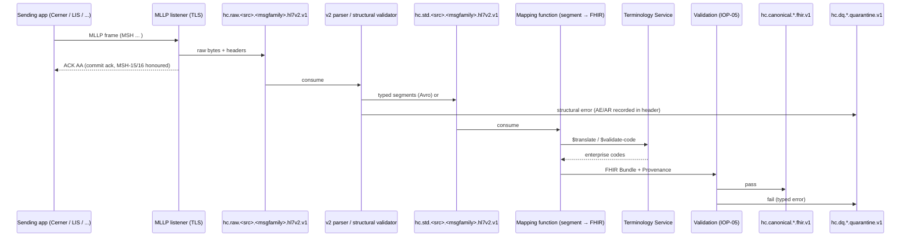

# HL7 v2 Handling and HL7 v2 → FHIR Mapping

## 1. Position of HL7 v2 in the platform

HL7 v2 is the dominant wire format from Cerner Millennium (ADT, orders, results, charges, documents, scheduling) and
from most peripheral systems (LIS, RIS, pharmacy, immunisation registry). Per **ADR-01** it is accepted inbound and
emitted outbound; it is **not** a canonical model. Every v2 message is (1) landed byte-exact in `hc.raw.*`,
(2) parsed to a typed segment model in `hc.std.*`, (3) mapped to FHIR R4 resources in `hc.canonical.*` following the
HL7 **V2-to-FHIR Implementation Guide** (v2-to-fhir, STU1) conventions, and (4) optionally regenerated as v2 for legacy
consumers from canonical.

## 2. Supported versions, transport and framing

| Aspect | Specification |
|--------|---------------|
| Versions | HL7 v2.3, 2.3.1, 2.4, 2.5, 2.5.1, 2.6, 2.7, 2.8 (MSH-12). Version-specific segment grammars from the HL7 v2 XML schemas; v2.3 messages are parsed with the v2.5.1 grammar in lenient mode. |
| Transport | MLLP (Minimal Lower Layer Protocol) release 1 over TLS 1.2+ with mutual authentication; one persistent connection per sending application; HAPI HL7 v2 MLLP source connector (ARC-01 §3). Plain-TCP MLLP is permitted only inside a sending system's enclave with a module 11 waiver. |
| Encoding | MSH-18 honoured; `UNICODE UTF-8` preferred, `8859/1` accepted and transcoded. |
| Delimiters | Default `\|^~\&`; non-default delimiters accepted (read from MSH-1/MSH-2). |
| Batching | FHS/BHS batch files (e.g. nightly DFT batches) accepted via file drop; each message is landed individually with `hc-batch-id`. |
| Size | A single message ≤ 4 MiB; larger (embedded PDFs in OBX-5 ED) triggers externalisation of the attachment to the object store at the `std` layer. |
| Idempotency | Dedup key = (MSH-3, MSH-4, MSH-10). Duplicate messages within 7 days are acknowledged `AA` and not reprocessed; the duplicate is recorded in `hc.dq.*`. |

## 3. Acknowledgement policy

The listener implements **enhanced acknowledgement mode** when MSH-15/MSH-16 are present and **original mode** otherwise.

| Condition | ACK code (MSA-1) | When | Behaviour |
|-----------|------------------|------|-----------|
| Frame received and durably written to `hc.raw.*` | `AA` (original) / `CA` (enhanced commit) | Immediately after Kafka `acks=all` write | Sender may release the message. Semantic failures downstream never alter this ACK (they are handled by DQ, not re-sent). |
| MSH malformed, unsupported version, unknown sending application, dedup hit on different content | `AR` / `CR` | Before raw write | Error detail in ERR segment (ERR-3 HL70357 code, ERR-8 user message). Message is still landed on `hc.raw.<src>.rejected.hl7v2.v1` for forensics. |
| Transient platform fault (Kafka unavailable) | `AE` / `CE` | Before raw write | Sender retries; listener back-pressures by closing the connection after 3 consecutive `AE`. |
| Application-level ACK requested (MSH-16 = `AL`/`ER`/`SU`) | `AA`/`AE`/`AR` application ACK | After `std` structural validation | Emitted asynchronously over the same connection; `AE` if structural validation fails, with ERR segments. |

ACK messages are themselves recorded on `hc.ops.outbound.ack.hl7v2.v1` for audit. ACK latency target: p99 ≤ 200 ms
(ARC-NFR-001 budget).

## 4. Message types and trigger events in scope

| Family | Trigger events | Source systems | Anchor FHIR resource(s) | Canonical topics (domain.entity) |
|--------|---------------|----------------|-------------------------|----------------------------------|
| ADT | A01 admit, A02 transfer, A03 discharge, A04 register, A05 pre-admit, A08 update, A11 cancel admit, A13 cancel discharge, A28 add person, A31 update person, A40 merge patient | Cerner, peripheral registration | Encounter, Patient, Coverage, RelatedPerson, Condition (DG1), Procedure (PR1), Location | `clinical.encounter`, `party.patient`, `finance.coverage` |
| SIU | S12 new, S13 reschedule, S14 modify, S15 cancel, S16 discontinue, S17 delete, S26 no-show | Cerner Scheduling, RIS | Appointment, Slot, Schedule, ServiceRequest | `supply.appointment` |
| ORM / OMP / OML | O01 general order, O09 pharmacy order, O21 lab order | Cerner Orders, pharmacy, LIS | ServiceRequest, MedicationRequest, Specimen | `clinical.servicerequest`, `clinical.medicationrequest` |
| ORU | R01 unsolicited observation | LIS, RIS, device gateways, Cerner | DiagnosticReport, Observation, Specimen, ServiceRequest | `clinical.diagnosticreport`, `clinical.observation` |
| DFT | P03 post detail financial transaction | Cerner Charge Services | ChargeItem, Account, Encounter (ref) | `finance.chargeitem` |
| MDM | T02 original document, T04 status change, T08 edit | Cerner Clinical Documentation, transcription | DocumentReference, Composition (optional) | `clinical.documentreference` |
| RDE / RAS / RDS | O11 pharmacy encoded order, O17 administration, O13 dispense | Cerner PharmNet, dispensing cabinets | MedicationRequest, MedicationAdministration, MedicationDispense | `clinical.medication*` |
| VXU | V04 vaccination record | Cerner, state IIS | Immunization | `clinical.immunization` |
| BAR | P01 add account, P05 update account | Cerner Patient Accounting | Account, Coverage, Patient | `finance.account` |

Trigger events outside this table are landed in `raw`, acknowledged `AA`, and routed to
`hc.dq.interop.unsupported-trigger.quarantine.v1`; `agent.source_mapper` opens a change request to add a mapping when
volume exceeds a steward-set threshold.

## 5. Segment-to-FHIR mapping conventions

Mappings follow the V2-to-FHIR IG **segment maps** and **datatype maps** by name (e.g. `PID[Patient]`,
`PV1[Encounter]`, `OBX[Observation]`, `XPN[HumanName]`, `CX[Identifier]`, `CWE[CodeableConcept]`). Every HEALIX mapping
specification is a Markdown/YAML pair in the mapping repository and declares its IG map reference, its deviations
and its test fixtures.

### 5.1 Segment → resource matrix

| Segment | FHIR resource | IG segment map | HEALIX notes / deviations |
|---------|---------------|----------------|---------------------------|
| MSH | `MessageHeader` (not persisted), `Provenance` | MSH[MessageHeader], MSH[Provenance] | MSH-3/4 → `meta.source`; MSH-10 → `Provenance.entity.what.identifier`; MSH-7 → `hc-source-time` |
| EVN | `Provenance` | EVN[Provenance] | EVN-2 → `recorded`; EVN-5 → `agent[performer]`; EVN-6 → `occurredDateTime` |
| PID | `Patient` | PID[Patient] | PID-3 sliced by CX-4 assigning authority → registered systems (MRN, EMPI, SSN excluded per IOP-FHIR-009); PID-10/22 → US Core race/ethnicity extensions via ConceptMap to CDC Race & Ethnicity |
| PD1 | `Patient` | PD1[Patient] | PD1-4 → `generalPractitioner` |
| NK1 | `RelatedPerson`, `Patient.contact` | NK1[RelatedPerson], NK1[Patient-Contact] | Emergency contacts → `Patient.contact`; guarantors and legal guardians → `RelatedPerson` |
| PV1 | `Encounter`, `Location`, `Practitioner` | PV1[Encounter], PV1-DG1[Encounter] | PV1-2 → `class` via `ConceptMap-cerner-encounter-type-to-healix`; PV1-3/6 → `location[]` with `status`; PV1-7/8/9/17 → `participant` with v3 ParticipationType ATND/REF/CON/ADM; PV1-19 → identifier FIN; PV1-44/45 → `period` |
| PV2 | `Encounter` | PV2[Encounter] | PV2-3 → `reasonCode` (text) ; PV2-8 → `hospitalization.expectedDischargeDate` ext |
| OBX | `Observation` | OBX[Observation], OBX[Observation-Component] | OBX-3 → `code` + LOINC via TS; OBX-2 drives `value[x]` type; OBX-6 → UCUM via TS; OBX-8 → `interpretation`; OBX-11 → `status`; OBX-14 → `effectiveDateTime`; OBX-5 ED → `DocumentReference` attachment externalised |
| NTE | `Observation.note`, `DiagnosticReport.conclusion`, `ServiceRequest.note` | NTE[Annotation] | Attached to the preceding segment per grouping |
| ORC | `ServiceRequest`, `MedicationRequest` | ORC[ServiceRequest], ORC[MedicationRequest] | ORC-1 order control → `status`/`intent` and Bundle request method (NW→POST, CA/OC→status revoked, XO→PUT); ORC-2/3 → identifiers placer/filler |
| OBR | `ServiceRequest`, `DiagnosticReport`, `Specimen` | OBR[ServiceRequest], OBR[DiagnosticReport], OBR[Specimen] | OBR-4 → `code` via TS (LOINC order codes); OBR-22 → `issued`; OBR-25 → `DiagnosticReport.status`; OBR-16 → `requester` |
| SPM | `Specimen` | SPM[Specimen] | SPM-4 → `type` (SNOMED CT specimen hierarchy via TS); SPM-17 → `collection.collected` |
| DG1 | `Condition`, `Encounter.diagnosis` | DG1[Condition], DG1[Encounter] | DG1-3 ICD-10-CM; DG1-6 → `diagnosis.use` (admitting/working/final/billing via ConceptMap `v2-0052-to-diagnosis-role`); DG1-15 → `diagnosis.rank` |
| PR1 | `Procedure` | PR1[Procedure] | PR1-3 ICD-10-PCS/CPT; PR1-5 → `performedDateTime`; PR1-11 → `performer` |
| AL1 | `AllergyIntolerance` | AL1[AllergyIntolerance] | AL1-2 → `category` via ConceptMap v2-0127; AL1-3 → `code` (RxNorm/SNOMED/UNII via TS); AL1-4 → `criticality`/`reaction.severity` |
| IAM | `AllergyIntolerance` | IAM[AllergyIntolerance] | Preferred over AL1 in v2.5+; IAM-6 → action code drives Bundle method; IAM-17 → `clinicalStatus` |
| IN1 / IN2 | `Coverage`, `Organization` (payer), `RelatedPerson` (subscriber) | IN1[Coverage], IN1[Organization] | IN1-3/4 → payer identifier and Organization; IN1-15 → `type` via ConceptMap v2-0086; IN1-17 → `relationship`; IN1-22 → `order`; IN1-36 → `subscriberId` |
| GT1 | `RelatedPerson` (guarantor), `Account.guarantor` | GT1[RelatedPerson] | — |
| RXE / RXO | `MedicationRequest`, `Medication`, `Dosage` | RXE[MedicationRequest], RXO[MedicationRequest] | RXE-2 → `medicationCodeableConcept` (RxNorm via TS; NDC retained); RXE-1 TQ → `dosageInstruction.timing`; RXR-1 → `route` via ConceptMap v2-0162 → SNOMED route |
| RXA | `MedicationAdministration`, `Immunization` | RXA[MedicationAdministration], RXA[Immunization] | In RAS O17 → MedicationAdministration; in VXU V04 → Immunization with RXA-5 CVX, RXA-17 MVX manufacturer, RXA-20 completion status |
| RXD | `MedicationDispense` | RXD[MedicationDispense] | RXD-2 drug; RXD-4 quantity; RXD-7 dispense id |
| RXR | `Dosage.route/site/method` | RXR[Dosage] | — |
| TQ1 / TQ2 | `Dosage.timing`, `ServiceRequest.occurrence` | TQ1[Timing], TQ1[ServiceRequest] | — |
| FT1 | `ChargeItem`, `Account`, `Encounter` (ref) | FT1[ChargeItem] | FT1-6 transaction type → `status`/`code`; FT1-7 transaction code → `code` (Cerner CDM charge code, CPT/HCPCS via TS); FT1-10 quantity; FT1-11/12 amounts → `priceOverride` and `ext-charge-amount`; FT1-19 → `supportingInformation` (Condition) |
| TXA | `DocumentReference` | TXA[DocumentReference] | TXA-2 → `type` (LOINC document type via TS); TXA-12 → `masterIdentifier`; TXA-17/19 → `docStatus`/`status`; TXA-22 → `authenticator`; OBX in MDM carries content |
| SCH | `Appointment` | SCH[Appointment] | SCH-1/2 → identifiers placer/filler; SCH-6 event reason → `reasonCode`; SCH-7 → `appointmentType`; SCH-11 TQ → `start`/`end`; SCH-25 → `status` via ConceptMap v2-0278 |
| AIS / AIG / AIL / AIP | `Appointment.participant`, `ServiceRequest` | AIS[ServiceRequest], AIL[Location], AIP[Practitioner] | AIL → `participant.actor` Location; AIP → `participant.actor` Practitioner; AIS → `serviceType` |
| MRG | `Patient.link`, `Encounter` identifier change | MRG[Patient] | A40 → target `Patient.link.type = replaces`; source patient `active = false`, `link.type = replaced-by`; module 08 entity resolution consumes the link |
| PRT | `Encounter.participant`, `Observation.performer`, `Device` | PRT[PractitionerRole] | v2.7+ only |
| ZXX | see §6 | — | — |

### 5.2 Datatype conventions

| v2 datatype | FHIR datatype | Rule |
|-------------|---------------|------|
| CX | `Identifier` | CX-1 → `value`; CX-4 (HD) → `system` via registry lookup on (namespace id, universal id); CX-5 → `type` from v2-0203; CX-7/8 → `period` |
| XPN | `HumanName` | XPN-7 name type → `use` via ConceptMap v2-0200; XPN-1 family, XPN-2/3 given, XPN-4 suffix, XPN-5 prefix |
| XAD | `Address` | XAD-7 → `use`/`type` via v2-0190; XAD-1 SAD → `line` |
| XTN | `ContactPoint` | XTN-2/3 → `use`/`system` via v2-0201/0202; XTN-4 email; XTN-12 unformatted |
| CWE / CE / CNE | `CodeableConcept` | Triplets 1-3 and 4-6 → separate codings; CWE-3 coding system → system URI via `v2-0396` ConceptMap in TS; CWE-9 original text → `text` |
| TS / DTM | `dateTime` / `instant` | Precision preserved; missing offset → source system's configured zone, recorded in `Provenance.extension[tz-assumed]` |
| NM + CWE units | `Quantity` | Units via UCUM ConceptMap; non-convertible units keep source unit in `unit` and set `ext-unit-unmapped` |
| SN | `Quantity` / `Range` / `Ratio` | SN-1 comparator → `comparator`; `-` separator → `Range`; `:` or `/` → `Ratio` |
| ED / RP | `Attachment` | Content externalised; `url` and `hash` (SHA-256) populated |
| EI | `Identifier` | EI-1 → `value`; EI-2/3 → `system` |
| XCN | `Practitioner` + `Reference` | XCN-1 → identifier (NPI when XCN-9 = NPI); names as XPN |
| PL | `Location` hierarchy | PL-1 point of care, PL-2 room, PL-3 bed, PL-4 facility → four `Location` resources with `partOf` chain; `physicalType` = `si`/`ro`/`bd`/`bu` |

### 5.3 Example — ADT A01 → transaction Bundle

| Input (abridged) | Output |
|------------------|--------|
| `MSH\|^~\&\|CERNER\|HOSP_A\|HEALIX\|HEALIX\|20261017140300\|\|ADT^A01^ADT_A01\|Q12345\|P\|2.5.1` | `Provenance.entity.what.identifier = {system: .../hl7v2/CERNER/message-control-id, value: Q12345}`; `meta.source = .../source/cerner-millennium/adt-mllp` |
| `PID\|1\|\|123456^^^HOSP_A^MR~E998877^^^HEALIX^PI\|\|DOE^JANE^Q^^^^L\|\|19800214\|F\|\|2106-3^White^CDCREC` | `Patient.identifier[mrn] {system: .../cerner/mrn, value: 123456, type: MR}`, `identifier[empi]`, `name[official]`, `birthDate 1980-02-14`, `gender female`, `us-core-race ombCategory 2106-3` |
| `PV1\|1\|I\|4N^4N12^A^HOSP_A\|E\|\|\|12345^SMITH^JOHN^^^^^^NPI\|\|\|MED\|\|\|\|\|\|\|\|\|V2026001\|\|\|\|\|\|\|\|\|\|\|\|\|\|\|\|\|\|\|\|\|20261017133000` | `Encounter.class = v3 IMP` (via ConceptMap), `identifier[fin] V2026001`, `location[]` 4 nested Locations, `participant[ATND] Practitioner NPI 12345`, `serviceType MED→ healix-service-line`, `hospitalization.admitSource E→ emergency`, `period.start 2026-10-17T13:30:00-05:00` |
| `DG1\|1\|\|I50.9^Heart failure, unspecified^I10\|\|\|A` | `Condition.code ICD-10-CM I50.9`, `Encounter.diagnosis.use = AD (admitting)` |
| `IN1\|1\|PPO^Preferred\|60054\|AETNA\|...\|\|\|\|\|\|\|\|\|\|\|SELF\|...\|W123456789` | `Coverage.type via v2-0086→ healix-coverage-type`, `payor Organization identifier payer-id 60054`, `subscriberId W123456789`, `relationship self` |

Bundle key: `Encounter/<deterministic id from (cerner, FIN V2026001)>`. Entries: Patient (PUT), Encounter (PUT),
Condition (PUT), Coverage (PUT), Locations (PUT, conditional), Provenance ×4 (POST).

### 5.4 Example — ORU R01 lab → DiagnosticReport

| Segment | Resource mapping |
|---------|------------------|
| `OBR\|1\|PL123^CERNER\|FL456^LIS\|24331-1^Lipid panel^LN\|\|\|20261017070000\|...\|\|\|\|\|\|\|\|\|\|\|\|20261017083000\|\|\|F` | `DiagnosticReport.identifier[placer, filler]`, `code LOINC 24331-1`, `effectiveDateTime 07:00`, `issued 08:30`, `status final`; `basedOn ServiceRequest` (same identifiers) |
| `OBX\|1\|NM\|2093-3^Cholesterol^LN\|\|212\|mg/dL^^UCUM\|<200\|H\|\|\|F\|\|\|20261017080000` | `Observation.code LOINC 2093-3`, `valueQuantity 212 mg/dL`, `referenceRange.text <200`, `interpretation H`, `status final`, `effectiveDateTime`; `DiagnosticReport.result[0]` |
| `OBX\|2\|NM\|2085-9^HDL^LN\|\|48\|mg/dL\|>40\|N\|\|\|F` | second `Observation`; `DiagnosticReport.result[1]` |
| `SPM\|1\|S123^LIS\|\|119364003^Serum specimen^SCT\|...\|20261017065500` | `Specimen.type SNOMED 119364003`, `collection.collectedDateTime`; `Observation.specimen`, `DiagnosticReport.specimen` |

## 6. Z-segment policy

Cerner and peripheral systems emit site-specific Z-segments (e.g. `ZPV` encounter extras, `ZIN` insurance extras,
`ZEI` employer). Policy:

1. **Registered or rejected.** A Z-segment is parsed only if its grammar is registered in the Source Registry
   (module 03) with field-level definitions and a steward. Unregistered Z-segments are retained verbatim in `std`
   (`unparsed_segments[]`) and counted in DQ; they never silently disappear.
2. **Map to standard first.** Each Z field is mapped to a standard FHIR element when one exists (e.g. `ZPV-3`
   "expected discharge date" → `Encounter.hospitalization` extension from the IG). Only residual fields become
   `ext-z-<segment>-<field>` extensions in the `https://fhir.healix.example.org/StructureDefinition/` namespace.
3. **No PHI leakage by default.** Z fields are classified by `agent.privacy_guardian` before mapping; unclassified Z
   fields are not emitted to canonical.
4. **Promotion.** When a Z-field is observed in ≥ 2 sending applications with the same meaning, `agent.source_mapper`
   proposes promoting it to a HEALIX-Clinical extension with a value set.

## 7. Code translation via the Terminology Service

Every coded field passes through the Terminology Service (IOP-04) during mapping:

| Step | Operation | Failure handling |
|------|-----------|------------------|
| Resolve coding system | CWE-3 / HL7 table id → canonical system URI via `v2-0396` ConceptMap (e.g. `LN` → `http://loinc.org`, `I10` → `http://hl7.org/fhir/sid/icd-10-cm`, `CDCREC` → `urn:oid:2.16.840.1.113883.6.238`, `99CRN71` local → `https://fhir.healix.example.org/CodeSystem/cerner-code-set-71`) | Unknown system → `IOP-E-TERM-001`, record quarantined |
| Validate | `$validate-code` against the bound HEALIX value set | Invalid → `IOP-E-TERM-002` unless source coding is retained and translation succeeds |
| Translate | `$translate` from local/system coding to the enterprise target (e.g. Cerner code set 71 → `healix-encounter-class`) | No match → record tagged `unmapped`, routed per IOP-TS-010; `agent.terminology_steward` notified |
| Enrich | `$lookup` for display, designations and ontology IRI (`ext-ontology-iri`) | Display absent → source display retained |

Translation results are cached per (system, code, version, target) with the TS release id as part of the key, so a new
terminology release invalidates the cache (IOP-TS-021).

## 8. Message-to-resource provenance

Each v2 message produces one `Provenance` per generated resource and one *message-level* `Provenance` aggregating them:

| Provenance element | Message-level | Resource-level |
|--------------------|---------------|----------------|
| `target` | All resources in the Bundle | The one resource version |
| `entity[source].what.identifier` | MSH-10 with system `.../hl7v2/<MSH-3>/message-control-id` | Same, plus `extension[segment-path]` = e.g. `OBX[2]` |
| `agent[author].who` | `Device` for mapping function `v2-adt-a01@<git-sha>` | Same |
| `agent[performer]` | EVN-5 / ORC-10 / TXA-22 operator where present | Same |
| `recorded` | `std` consumption time | Same |
| `extension[raw-offset]` | Kafka (topic, partition, offset) of the raw record | Same |

This allows any canonical fact to be traced to the exact byte range of the message that asserted it, which module 11
requires for audit and module 09 uses for root-cause of DQ failures.

## 9. Outbound HL7 v2 generation from canonical

Legacy consumers (e.g. a departmental system that only speaks ADT, a state registry, a dietary system) subscribe to
`hc.ops.outbound.<family>.hl7v2.v1`. Generation is **FHIR → v2** using the inverse of the IG maps.

| Outbound family | Trigger | Source canonical resources | Notes |
|-----------------|---------|----------------------------|-------|
| ADT A01/A02/A03/A04/A08/A40 | New or changed `Encounter`/`Patient` version; `Patient.link` | Encounter, Patient, Coverage, Condition, Location | Event selection from `Encounter.status` and `location.status` deltas; MSH-3 = `HEALIX`, MSH-4 = consumer-specific facility |
| ORU R01 | `DiagnosticReport.status` ∈ {preliminary, final, amended, corrected} | DiagnosticReport, Observation, Specimen, ServiceRequest | OBX-3 carries LOINC plus original local code in triplet 2 |
| SIU S12–S17/S26 | `Appointment.status` change | Appointment, Slot, Patient, Practitioner, Location | — |
| DFT P03 | New `ChargeItem` | ChargeItem, Account, Encounter, Condition | — |
| MDM T02/T04/T08 | New/changed `DocumentReference` | DocumentReference (+ attachment fetched from object store) | Content as OBX-5 ED base64 only if consumer profile requires; otherwise RP pointer |
| VXU V04 | New `Immunization` | Immunization, Patient | For state IIS submission |

Outbound rules: the generator targets a per-consumer **HL7 v2 conformance profile** (version, required segments,
code tables, Z-segments the consumer expects); codes are back-translated through the TS (`$translate` with
`reverse = true`) to the table the consumer requires; identifiers are rendered with HD assigning authority from the
registry; every outbound message is logged with its originating canonical ids in `Provenance` (activity `transmit`)
and the consumer's ACK is captured on `hc.ops.inbound.ack.hl7v2.v1`.

## 10. Requirements

> **IOP-V2-001** (P0, test) — The platform MUST accept HL7 v2.3 through v2.8 messages over MLLP with TLS 1.2+ mutual
> authentication and MUST honour MSH-15/16 acknowledgement modes.

> **IOP-V2-002** (P0, test) — A commit acknowledgement (`AA`/`CA`) MUST be returned only after the raw message is
> durably written to `hc.raw.*` with `acks=all`; semantic failures downstream MUST NOT cause negative ACKs.

> **IOP-V2-003** (P0, test) — Messages with malformed MSH, unsupported version or unknown sending application MUST be
> rejected with `AR`/`CR` and an ERR segment, and MUST still be landed on a rejected-message topic.

> **IOP-V2-004** (P1, test) — Duplicate messages by (MSH-3, MSH-4, MSH-10) within 7 days MUST be acknowledged and
> MUST NOT be reprocessed; the duplicate MUST be reported to `hc.dq.*`.

> **IOP-V2-005** (P0, test) — All trigger events listed in §4 MUST have a mapping specification, a conformance profile
> and ≥ 5 fixture messages with expected canonical output in the regression suite.

> **IOP-V2-006** (P1, test) — Trigger events not in scope MUST be landed, acknowledged and routed to
> `hc.dq.interop.unsupported-trigger.quarantine.v1` without data loss.

> **IOP-V2-007** (P1, test) — Attachments in OBX-5 (ED) exceeding 256 KiB MUST be externalised to the object store at
> the `std` layer and referenced by URL with a SHA-256 hash.

> **IOP-V2-008** (P1, inspection) — Parsing MUST honour MSH-1/MSH-2 delimiters and MSH-18 character sets, transcoding
> to UTF-8.

> **IOP-V2-009** (P1, test) — ACK latency MUST be ≤ 200 ms at p99 under the throughput of ARC-NFR-002.

> **IOP-V2-010** (P0, inspection) — Segment and datatype mappings MUST follow the HL7 V2-to-FHIR IG maps named in §5;
> every deviation MUST be registered in the mapping specification with rationale and fixture coverage.

> **IOP-V2-011** (P0, test) — PID-3 repetitions MUST be mapped to `Patient.identifier` slices by assigning authority
> using the identifier registry; repetitions whose authority is unregistered MUST quarantine the message.

> **IOP-V2-012** (P0, test) — PV1-2 patient class and Cerner encounter type MUST be translated to `Encounter.class`
> through the governed ConceptMap; untranslatable values MUST tag the Encounter `unmapped` and quarantine it.

> **IOP-V2-013** (P1, test) — PL locations MUST be decomposed into a `Location` hierarchy (facility → point of care →
> room → bed) with `partOf` and `physicalType`, each with deterministic ids.

> **IOP-V2-014** (P1, test) — ORC-1 order control codes MUST drive both resource `status`/`intent` and the Bundle
> request method per the IG `OrderControlCode` vocabulary map.

> **IOP-V2-015** (P1, test) — OBX-2 value types MUST select the `Observation.value[x]` type per the IG; OBX-6 units MUST
> be UCUM via the Terminology Service, with unmapped units retained and flagged.

> **IOP-V2-016** (P1, test) — ADT A40 MUST produce `Patient.link` on both source and target patients and MUST NOT
> delete the source patient resource.

> **IOP-V2-017** (P1, test) — DG1 and PR1 codes MUST be validated against ICD-10-CM / ICD-10-PCS / CPT release
> versions valid on the encounter date.

> **IOP-V2-018** (P1, test) — VXU RXA-5 MUST be CVX and RXA-17 MVX; NDC codes MUST be retained as additional codings.

> **IOP-V2-019** (P1, inspection) — Z-segments MUST be parsed only when registered in the Source Registry; unregistered
> Z-segments MUST be retained verbatim in `std` and counted, never dropped.

> **IOP-V2-020** (P0, inspection) — Z-segment fields MUST be PHI-classified by `agent.privacy_guardian` before any
> mapping to canonical is applied.

> **IOP-V2-021** (P1, test) — Z fields MUST map to standard FHIR elements where one exists; residual fields MUST use
> `ext-z-<segment>-<field>` extensions with registered definitions.

> **IOP-V2-022** (P0, test) — Every resource generated from a message MUST have a `Provenance` with MSH-10, the segment
> path, the mapping function version and the raw Kafka offset.

> **IOP-V2-023** (P0, test) — Outbound HL7 v2 MUST be generated only from canonical resources, never from `raw` or
> `std`, so legacy consumers receive the same facts as FHIR consumers.

> **IOP-V2-024** (P1, test) — Outbound messages MUST conform to the consumer's registered HL7 v2 conformance profile,
> verified by the conformance suite in IOP-05 before the consumer is enabled in `prod`.

> **IOP-V2-025** (P1, test) — Outbound codes MUST be back-translated via `$translate` (reverse) to the consumer's
> required tables, and the message MUST carry a `Provenance` with activity `transmit` and the consumer ACK outcome.

> **IOP-V2-026** (P2, analysis) — Mapping specifications MUST be expressible as FHIR `StructureMap` or declarative YAML
> so that `agent.source_mapper` can generate and `agent.evaluator` can diff them.
