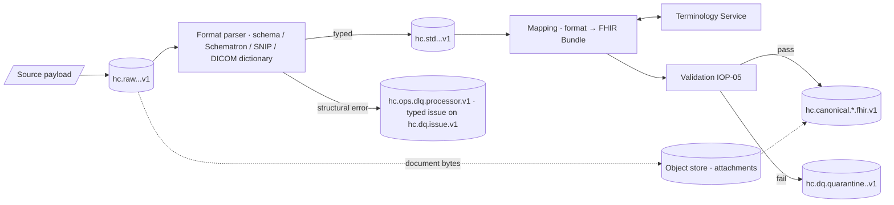

# C-CDA, IHE XDS/XCA, X12 005010, DICOM, IEEE 11073 and Bulk Data

## 1. Scope

This document covers every inbound format that is neither HL7 v2 (IOP-02) nor native FHIR, and how each is brought
to the canonical FHIR R4 model (IOP-01). The common pattern is identical for all of them:

Requirement areas: `IOP-CDA` (C-CDA and IHE document exchange), `IOP-X12` (X12 005010), `IOP-FHIR-1xx` (DICOM,
IEEE 11073 and Bulk Data into FHIR).

## 2. C-CDA 2.1 inbound

### 2.1 Sources and document types

| Source | Transport | Document templates (C-CDA R2.1) |
|--------|-----------|---------------------------------|
| HIE (state / regional) | IHE XCA `RetrieveDocumentSet`, Direct (XDR/XDM), FHIR `DocumentReference` with CDA attachment | CCD, Discharge Summary, Referral Note, Consultation Note, Progress Note, Care Plan, Transition of Care |
| Partner practices / payers | Direct secure messaging | CCD, Referral Note |
| Cerner (own documents exported as CDA) | MDM T02 with ED/RP pointer, or FHIR `DocumentReference` | CCD, Discharge Summary |

### 2.2 Processing model

1. **Validate structurally.** XML schema (CDA R2 `CDA.xsd`) then the C-CDA 2.1 Schematron (HL7 published rules plus
   the ONC C-CDA Validator rule set). Errors (`IOP-E-PARSE-010`) → the document is retained on `hc.ops.dlq.processor.v1` and a typed issue is published to
   `hc.dq.issue.v1`; warnings are recorded but not blocking.
2. **Persist the document.** The full XML is stored in the object store; a `DocumentReference` (profile
   `healix-documentreference`) is always produced with `content.attachment.url`, `hash`, `format = urn:hl7-org:sdwg:ccda-structuredBody:2.1`,
   `type` = LOINC document type from `ClinicalDocument/code`, `masterIdentifier` from `ClinicalDocument/id`.
3. **Extract discrete data.** Sections are mapped to FHIR resources using the HL7 **C-CDA on FHIR** IG and the
   **C-CDA ↔ FHIR mapping** guidance (CDA-FHIR mapping project). Every extracted resource is placed in a single
   `transaction` Bundle anchored on the `DocumentReference`, and references `DocumentReference` through
   `Provenance.entity[source]`.
4. **Reconcile, do not overwrite.** Extracted problems, medications, allergies and immunisations are *externally
   sourced*; they are published with `meta.tag = external-document` and `Provenance.agent.onBehalfOf` = the authoring
   Organization. Module 08 entity resolution decides whether they merge with Cerner-originated facts; this module never
   mutates a Cerner-originated resource from a CDA.

### 2.3 Section → resource map

| C-CDA section (templateId root) | Entry template | FHIR resource | Key mapping notes |
|---------------------------------|----------------|---------------|-------------------|
| Header `recordTarget` | — | `Patient` | `id` → identifiers via registry (assigning authority OID → system); never creates a new MRN; links to EMPI |
| Header `author`, `custodian`, `legalAuthenticator` | — | `Practitioner`, `Organization`, `DocumentReference.author/custodian/authenticator` | NPI from `id/@root=2.16.840.1.113883.4.6` |
| Header `componentOf/encompassingEncounter` | — | `Encounter` | Only when matching encounter exists by identifier; otherwise `Encounter` with `meta.tag = external-document` |
| Problems 2.16.840.1.113883.10.20.22.2.5.1 | Problem Concern Act / Problem Observation | `Condition` | `code` SNOMED CT; ICD-10-CM translations retained; `clinicalStatus` from concern act `statusCode`; `onset/abatement` from `effectiveTime` |
| Medications 2.16.840.1.113883.10.20.22.2.1.1 | Medication Activity | `MedicationRequest` (intent `order`/`plan`) or `MedicationStatement` | RxNorm `consumable/manufacturedProduct`; `doseQuantity`, `routeCode` → `dosageInstruction`; `moodCode EVN` → `MedicationStatement` |
| Allergies 2.16.840.1.113883.10.20.22.2.6.1 | Allergy Concern Act / Allergy-Intolerance Observation | `AllergyIntolerance` | Participant playing entity code (RxNorm/UNII/SNOMED); reaction/severity observations → `reaction` |
| Immunizations 2.16.840.1.113883.10.20.22.2.2.1 | Immunization Activity | `Immunization` | CVX from `consumable`; `negationInd=true` → `status = not-done` |
| Results 2.16.840.1.113883.10.20.22.2.3.1 | Result Organizer / Result Observation | `DiagnosticReport` + `Observation` | LOINC codes; `interpretationCode`; `referenceRange` |
| Vital Signs 2.16.840.1.113883.10.20.22.2.4.1 | Vital Signs Organizer / Observation | `Observation` (US Core Vital Signs) | UCUM units enforced |
| Procedures 2.16.840.1.113883.10.20.22.2.7.1 | Procedure Activity Procedure/Act/Observation | `Procedure` | CPT/SNOMED/ICD-10-PCS |
| Encounters 2.16.840.1.113883.10.20.22.2.22.1 | Encounter Activity | `Encounter` | CPT E/M code → `type`; `Encounter.diagnosis` from Encounter Diagnosis act |
| Social History 2.16.840.1.113883.10.20.22.2.17 | Smoking Status, Tobacco Use, SDOH observations | `Observation` (US Core Smoking Status / Screening Assessment) | — |
| Plan of Treatment 2.16.840.1.113883.10.20.22.2.10 | Planned Act/Procedure/Medication | `CarePlan`, `ServiceRequest`, `MedicationRequest` (intent `plan`) | — |
| Goals 2.16.840.1.113883.10.20.22.2.60 | Goal Observation | `Goal` | — |
| Health Concerns 2.16.840.1.113883.10.20.22.2.58 | Health Concern Act | `Condition` (category `health-concern`) | — |
| Payers 2.16.840.1.113883.10.20.22.2.18 | Coverage Activity / Policy Activity | `Coverage`, `Organization` (payer) | Payer id via registry |
| Advance Directives 2.16.840.1.113883.10.20.22.2.21.1 | Advance Directive Observation | `Consent` (scope `adr`) / `DocumentReference` | — |
| Functional / Mental Status 2.16.840.1.113883.10.20.22.2.14 / .56 | Functional Status Observation | `Observation` | — |
| Medical Equipment 2.16.840.1.113883.10.20.22.2.23 | Non-Medicinal Supply Activity | `Device`, `DeviceUseStatement` | UDI when present |
| Notes 2.16.840.1.113883.10.20.22.2.65 | Note Activity | `DocumentReference` (child, `relatesTo appends`) | — |

Narrative-only sections (no entries) produce no discrete resources; the section text is retained inside the stored
document and indexed by `DocumentReference` only. Null flavors (`NI`, `UNK`, `NA`, `ASKU`) map to FHIR
`data-absent-reason` extensions per the C-CDA on FHIR guidance; `nullFlavor` on a whole section suppresses extraction.

## 3. IHE XDS / XCA document metadata

HEALIX consumes XDS.b / XCA metadata (ebXML RIM `ExtrinsicObject`, `RegistryPackage`) from the HIE as the index of
available documents, mapping it to `DocumentReference` and `List` per the **IHE MHD (Mobile access to Health
Documents) 4.2** profile, which is the normative XDS ↔ FHIR correspondence.

| XDS DocumentEntry attribute | FHIR element (MHD) |
|-----------------------------|--------------------|
| `uniqueId` | `DocumentReference.masterIdentifier` (`urn:ietf:rfc:3986`) |
| `entryUUID` | `DocumentReference.identifier` (`urn:ietf:rfc:3986`, `urn:uuid:`) |
| `patientId` (CX with HD) | `subject` via identifier registry (HIE community patient id system) |
| `classCode` / `typeCode` | `category` / `type` (LOINC) |
| `formatCode` | `content.format` |
| `confidentialityCode` | `securityLabel` (v3 Confidentiality) |
| `creationTime`, `serviceStartTime/StopTime` | `date`, `context.period` |
| `healthcareFacilityTypeCode`, `practiceSettingCode` | `context.facilityType`, `context.practiceSetting` |
| `author` (XCN/XON) | `author` (Practitioner/Organization) |
| `homeCommunityId` (XCA) | `ext-home-community-id` extension; also `meta.source` |
| `availabilityStatus` | `status` (`Approved` → current, `Deprecated` → superseded) |
| SubmissionSet | `List` (code `submissionset`) with `ext-source-id` |
| Association `RPLC` | `relatesTo.code = replaces` |

Retrieval of document content (`RetrieveDocumentSet` / XCA `CrossGatewayRetrieve`) is on demand by `DocumentReference`
consumers through the object store proxy; HEALIX does not bulk-pull every document, only metadata, unless the HIE
agreement allows it (module 11 data-use terms).

## 4. X12 005010 → FHIR financial resources

### 4.1 Transactions in scope

| Transaction | Direction | Source / partner | Anchor FHIR resource | Alignment |
|-------------|-----------|------------------|----------------------|-----------|
| 837P (005010X222A1) professional claim | Outbound from RCM to clearinghouse, mirrored inbound to HEALIX | RCM / clearinghouse | `Claim` (type `professional`) | CARIN BB (for EOB shape), Da Vinci PAS (for `Claim` conventions) |
| 837I (005010X223A2) institutional claim | Same | RCM / clearinghouse | `Claim` (type `institutional`) | Same |
| 835 (005010X221A1) remittance advice | Inbound | Payers via clearinghouse | `ExplanationOfBenefit` (adjudicated claim lines) + `PaymentReconciliation` (BPR/TRN/PLB) | CARIN BB 2.0 EOB profiles (Professional/Inpatient/Outpatient Institutional) |
| 270/271 (005010X279A1) eligibility inquiry/response | Outbound inquiry, inbound response | Payers | `CoverageEligibilityRequest` / `CoverageEligibilityResponse` + `Coverage` | Da Vinci PDex, US Core Coverage |
| 276/277 (005010X212) claim status | Outbound inquiry, inbound response | Payers | `ClaimResponse` (status-only, `outcome`, `processNote`) linked to `Claim` | Da Vinci CDex conventions |
| 278 (005010X217) prior authorisation request/response | Both | Payers / UM vendors | `Claim` (use `preauthorization`) / `ClaimResponse` | Da Vinci PAS 2.0 |
| 999 / 277CA acknowledgements | Inbound | Clearinghouse | `Task` (status of submission) + `Provenance` | — |

### 4.2 Parsing and structural validation

X12 interchanges (ISA/GS/ST envelopes) are parsed with an EDI library validated against the 005010 implementation
guides, applying **WEDI SNIP levels 1–4** (syntax, HIPAA IG syntax, balancing, situational rules). SNIP 5–7 (code
set, product/line of business, trading-partner rules) are applied in the terminology and business-rule stages of
IOP-05. Each `ST` transaction becomes one `std` record keyed by (ISA13, GS06, ST02).

### 4.3 Segment / loop → FHIR mapping conventions (837 → Claim)

| 837 loop / segment | FHIR `Claim` element |
|--------------------|----------------------|
| BHT03 | `identifier` (system `.../rcm/batch-id`) |
| 2000A / 2010AA NM1*85 billing provider | `provider` (Organization/Practitioner, NPI from NM109) |
| 2010AB pay-to | `ext-pay-to-provider` |
| 2000B SBR | `insurance.sequence`, `insurance.focal`, `Coverage.relationship` (SBR02), `Coverage.class` (SBR03 group), claim filing indicator (SBR09) → `Coverage.type` |
| 2010BA NM1*IL subscriber | `Coverage.subscriber`, `subscriberId` (NM109) |
| 2010BB NM1*PR payer | `insurer` (Organization, payer id NM109 → registry) |
| 2010CA NM1*QC patient | `patient` (matched to EMPI; never creates MRN) |
| 2300 CLM | `identifier` claim control number (CLM01), `total` (CLM02), `facility`/`type` (CLM05 place of service/facility code → `facility.type`, `subType`), `ext-claim-frequency` (CLM05-3), `related`, `accident` |
| 2300 DTP | `billablePeriod` (DTP*434 statement dates), `supportingInfo` (admission/discharge dates DTP*435/096, onset) |
| 2300 HI | `diagnosis[]` (ABK/ABF ICD-10-CM; `type` principal/admitting/external-cause/patient-reason), `procedure[]` (BBR/BBQ ICD-10-PCS, institutional) |
| 2300 REF*EA / *G1 / *F8 | `supportingInfo` MRN, `insurance.preAuthRef` (G1), `related.claim` (F8 original ref) |
| 2310A–E NM1 | `careTeam[]` with `role` (attending, operating, rendering, referring, service facility → `facility`) |
| 2320 / 2330 other subscriber/payer | Additional `insurance[]` entries, COB amounts (AMT*D) → `ext-cob-paid-amount` |
| 2400 LX / SV1 / SV2 / SV3 | `item[]`: `sequence` (LX01), `productOrService` (CPT/HCPCS/revenue code via TS), `modifier`, `quantity`, `unitPrice`, `net`, `servicedDate/Period` (DTP*472), `locationCodeableConcept` (place of service), `diagnosisSequence` (SV107 pointers), `revenue` (SV201) |
| 2400 LIN / CTP (drugs) | `item.detail.productOrService` NDC, `quantity` |
| 2420 rendering provider | `item.careTeamSequence` |

### 4.4 835 → ExplanationOfBenefit and PaymentReconciliation

| 835 segment | FHIR element |
|-------------|--------------|
| BPR (payment) | `PaymentReconciliation.paymentAmount` (BPR02), `paymentDate` (BPR16), `paymentIssuer`, `formCode` (BPR04 ACH/CHK), `ext-payment-method` |
| TRN (trace) | `PaymentReconciliation.paymentIdentifier` (TRN02 with TRN03 originator) |
| N1*PR / N1*PE | `paymentIssuer` (payer Organization), `requestor` (payee Organization/Practitioner) |
| CLP (claim payment) | `ExplanationOfBenefit`: `identifier` (CLP01 patient control no. → claim link, CLP07 payer ICN), `status`, `outcome` (CLP02 status code → `complete`/`partial`/`error`), `total[submitted]` (CLP03), `total[benefit]` (CLP04), `total[patient-responsibility]` (CLP05), `payment.amount` |
| CAS (adjustments) | `adjudication[]` / `item.adjudication[]` with `category` (`https://fhir.healix.example.org/CodeSystem/healix-adjudication-category`: contractual, deductible, coinsurance, copay, denial, other) + `reason` = CARC (X12 Claim Adjustment Reason Codes `https://x12.org/codes/claim-adjustment-reason-codes`), group code CO/PR/OA/PI in `ext-cas-group` |
| SVC (service line) | `item[]` with `productOrService`, `adjudication[submitted/benefit]`, `servicedDate` (DTP*472) |
| LQ / RARC | `item.adjudication.reason` additional coding (`https://x12.org/codes/remittance-advice-remark-codes`) |
| PLB (provider-level adjustments) | `PaymentReconciliation.processNote` + `ext-provider-level-adjustment` (amount, reason, reference) |
| AMT*AU / *B6 | `total[allowed]` etc. |

`PaymentReconciliation.detail[]` links each EOB (`detail.response`) to the payment, so a remittance can be reconciled to
the GL cash receipt (G3) and to the originating `Claim` (via CLP01 → CLM01).

### 4.5 270/271, 276/277 and 278

| Transaction | Mapping highlights |
|-------------|--------------------|
| 270 → `CoverageEligibilityRequest` | `purpose` (benefits/discovery/validation), `patient`, `insurer`, `servicedDate` (DTP*291), `item.category` (EQ01 service type codes via ConceptMap to `healix-benefit-category`) |
| 271 → `CoverageEligibilityResponse` + `Coverage` | EB segments → `insurance.item[]` with `benefit[]` (`allowedMoney`, `usedMoney`), `network`, `unit`, `term`; EB01 eligibility code → `insurance.inforce`; `Coverage` created or updated with `period` (DTP*346/347), `class` (REF*18 plan, REF*6P group), `payor` |
| 276 → `Task` (status inquiry) | Not persisted canonically beyond `Task`/`Provenance` |
| 277 → `ClaimResponse` | STC01 category/status codes (`https://x12.org/codes/claim-status-category-codes`, `.../claim-status-codes`) → `processNote` and `ext-claim-status`; STC04 total paid; linked to `Claim` by TRN02 / REF*1K payer claim number |
| 278 request → `Claim` (`use = preauthorization`) | Per Da Vinci PAS: UM01 request category, service lines (SV1/SV2/HI), `supportingInfo` (attachments via PWK → `DocumentReference`) |
| 278 response → `ClaimResponse` | HCR01 action code → `outcome`, HCR02 → `preAuthRef`, `preAuthPeriod` (DTP*AAH), `item.adjudication` reason from HCR03 |

## 5. DICOM metadata → ImagingStudy

Only metadata is ingested (VIS-00 non-goal: pixel data stays in PACS/VNA). Sources: PACS/VNA via DICOMweb QIDO-RS
(`/studies`, `/series`, `/instances`) polling or C-FIND, and modality worklist events; RIS ORU/ORM remain HL7 v2.

| DICOM attribute (tag) | FHIR `ImagingStudy` element |
|-----------------------|-----------------------------|
| Study Instance UID (0020,000D) | `identifier` (`urn:dicom:uid`, value `urn:oid:<uid>`) |
| Accession Number (0008,0050) + Issuer (0008,0051) | `identifier` (`.../ris/accession`), `basedOn` ServiceRequest |
| Patient ID (0010,0020) + Issuer (0010,0021) | `subject` via identifier registry |
| Study Date/Time (0008,0020/0030) | `started` |
| Modalities in Study (0008,0061) | `modality` (DICOM CID 29 `http://dicom.nema.org/resources/ontology/DCM`) |
| Referring Physician (0008,0090) | `referrer` |
| Study Description (0008,1030), Procedure Code Sequence (0008,1032) | `description`, `procedureCode` (RadLex Playbook / LOINC via TS) |
| Number of Series/Instances (0020,1206/1208) | `numberOfSeries`, `numberOfInstances` |
| Series: UID (0020,000E), Modality (0008,0060), Body Part (0018,0015), Laterality (0020,0060), Number (0020,0011) | `series[]`: `uid`, `modality`, `bodySite` (SNOMED via TS), `laterality`, `number` |
| Instance: SOP Instance UID (0008,0018), SOP Class UID (0008,0016), Instance Number (0020,0013) | `series.instance[]`: `uid`, `sopClass`, `number` |
| Retrieve URL (0008,1190) | `endpoint` (`Endpoint` resource with `connectionType = dicom-wado-rs`) |
| Station / Manufacturer (0008,1010/0070), Device Serial (0018,1000) | `series.performer.actor` → `Device` (G4 asset) |

Structured reports (SR) and radiation dose (RDSR) are mapped to `Observation`/`DiagnosticReport` via the DICOM SR to
FHIR Observation guidance; this is P2.

## 6. IEEE 11073 device data → Observation

Device gateways deliver observations as IHE PCD-01 (HL7 v2 ORU R01 with 11073 nomenclature in OBX-3 `MDC` codes) or
as native 11073-10201 DIM / 11073-20601 PHD payloads converted by the gateway. Both resolve to `Observation`:

| 11073 element | FHIR element | Notes |
|---------------|--------------|-------|
| MDC nomenclature code (e.g. `MDC_PULS_OXIM_SAT_O2`, 150456) | `Observation.code` coding `urn:iso:std:iso:11073:10101` plus LOINC via ConceptMap `mdc-to-loinc` | Follows the HL7 **Personal Health Device (PHD) IG** / **Point-of-Care Device (PoCD) IG** |
| Containment tree (MDS → VMD → Channel → Metric) | OBX-4 sub-id → `Observation.device` (`Device` per MDS), `component[]` for compound metrics | PoCD IG `Device` hierarchy via `Device.parent` |
| Measurement value + MDC unit (e.g. `MDC_DIM_PERCENT`) | `valueQuantity` with UCUM via ConceptMap `mdc-unit-to-ucum` | — |
| Measurement status | `status` + `interpretation` + `ext-device-measurement-status` | Invalid / questionable → `status = cancelled`/`preliminary` |
| Timestamp (device clock) + gateway time | `effectiveDateTime` (device), `issued` (gateway) ; clock skew recorded in `Provenance.extension[clock-offset]` | Skew > 60 s raises a DQ warning |
| Patient association (gateway ADT binding) | `subject` | Unassociated device data goes to `hc.dq.quarantine.clinical.v1` with `IOP-E-REF-003` |
| Waveforms | `SampledData` only when ≤ 1 MiB; otherwise `DocumentReference` to object store | Alarm events → `Observation` category `alarm` (P2) |

Sampling policy: high-frequency device streams (≥ 1 Hz) are down-sampled or windowed at the gateway per device profile
before canonicalisation; raw rates are retained in `raw` for the retention window only.

## 7. CSV / Parquet batch via FHIR Bulk Data

Low-frequency sources (payer attribution files, SDOH screening extracts, research registries, Oracle Fusion seeded
reference data) arrive as files. HEALIX treats them as **Bulk Data**:

1. Files land in the object store; a manifest (`hc.ops.connector.file.manifest.v1`) records source, schema version,
   row count and SHA-256.
2. A declarative column → FHIR mapping (same YAML dialect as IOP-02 §10, IOP-V2-026) converts rows to FHIR resources
   written as **ndjson** files, one resource type per file, following the FHIR Bulk Data Access IG 2.0 output format.
3. The Bulk loader publishes each ndjson line to the resource's canonical topic through the standard validation
   pipeline, with `meta.tag = backfill` and a `Provenance` naming the file, row number and manifest id.
4. Outbound, HEALIX exposes `$export` (system, Group and Patient level) producing ndjson per the same IG for
   analytics partners and the EDW bootstrap; exports honour module 11 purpose-of-use and de-identification policies.

| Parameter | Value |
|-----------|-------|
| Accepted inputs | CSV (RFC 4180, UTF-8, header row), Parquet (schema registered), ndjson FHIR |
| Max file | 10 GiB; larger files are split by the manifest step |
| Ordering | Row order within a file is preserved into `hc-sequence`; files are processed in manifest order |
| Error budget | A file with > 1 % row-level validation failures is halted and the whole file quarantined for steward review |
| `$export` formats | `application/fhir+ndjson`; `_type`, `_since`, `_typeFilter` supported; async pattern with `Content-Location` polling |

## 8. Requirements

> **IOP-CDA-001** (P0, test) — Inbound C-CDA documents MUST be validated against the CDA R2 schema and the C-CDA 2.1
> Schematron; schema or Schematron *error* severity MUST quarantine the document.

> **IOP-CDA-002** (P0, test) — Every accepted C-CDA MUST yield a `DocumentReference` with the stored document URL,
> SHA-256 hash, LOINC type and `masterIdentifier` from `ClinicalDocument/id`, regardless of discrete extraction outcome.

> **IOP-CDA-003** (P1, test) — Sections listed in §2.3 MUST be extracted to the named FHIR resources following the
> C-CDA on FHIR IG; all extracted resources MUST be in one `transaction` Bundle anchored on the `DocumentReference`.

> **IOP-CDA-004** (P0, test) — Resources extracted from external documents MUST carry `meta.tag = external-document`
> and MUST NOT modify a Cerner-originated resource; merging is delegated to module 08 entity resolution.

> **IOP-CDA-005** (P1, test) — Null flavors MUST map to `data-absent-reason` extensions; a section-level `nullFlavor`
> MUST suppress extraction for that section.

> **IOP-CDA-006** (P1, test) — CDA identifiers MUST be mapped to registered identifier systems by assigning-authority
> OID; a patient `id` with an unregistered root MUST NOT create a new identifier slice.

> **IOP-CDA-007** (P1, test) — XDS/XCA DocumentEntry and SubmissionSet metadata MUST map to `DocumentReference` and
> `List` per IHE MHD 4.2, including `homeCommunityId` and `RPLC` associations.

> **IOP-CDA-008** (P1, inspection) — Document content retrieval from the HIE MUST be on demand through the object-store
> proxy and MUST respect data-use terms recorded in module 11.

> **IOP-CDA-009** (P2, test) — Narrative-only sections MUST NOT produce discrete resources; their presence MUST be
> recorded in `DocumentReference.extension[sections-present]`.

> **IOP-CDA-010** (P1, test) — Every extracted resource MUST have a `Provenance` with `entity[source].what` = the
> `DocumentReference` and `extension[xpath]` locating the source entry.

> **IOP-X12-001** (P0, test) — 837P, 837I, 835, 270, 271, 276, 277 and 278 (005010) MUST be parsed and mapped to
> `Claim`, `ClaimResponse`, `Coverage`, `CoverageEligibilityRequest/Response`, `ExplanationOfBenefit` and
> `PaymentReconciliation` as specified in §4.

> **IOP-X12-002** (P0, test) — Structural validation MUST apply WEDI SNIP levels 1–4 before `std`; failures MUST
> quarantine the `ST` transaction with the SNIP level and segment position in the error.

> **IOP-X12-003** (P1, test) — Each `ST` transaction MUST be a distinct `std` record keyed by (ISA13, GS06, ST02) and
> MUST be idempotent on replay.

> **IOP-X12-004** (P0, test) — `ExplanationOfBenefit` produced from 835 MUST conform to the applicable CARIN Blue
> Button 2.0 EOB profile (Professional / Inpatient / Outpatient Institutional) in addition to the HEALIX profile.

> **IOP-X12-005** (P0, test) — CAS adjustments MUST be represented as `adjudication` entries with a HEALIX adjudication
> category and the CARC/RARC codes as `reason` codings using the X12 code system URIs.

> **IOP-X12-006** (P1, test) — `PaymentReconciliation` MUST link every CLP-derived EOB through `detail.response`, and
> the sum of `detail.amount` plus PLB adjustments MUST equal BPR02 (balancing check).

> **IOP-X12-007** (P1, test) — 837 patient and subscriber identities MUST be resolved against the EMPI; the mapping
> MUST NOT create a new MRN or FIN from a claim.

> **IOP-X12-008** (P1, test) — Claim diagnoses and procedures MUST be validated against the ICD-10-CM/PCS and
> CPT/HCPCS releases in effect on the service date via the Terminology Service.

> **IOP-X12-009** (P1, test) — 271 responses MUST create or update `Coverage` with `period`, `class` and `payor`, and
> MUST produce a `CoverageEligibilityResponse` carrying every EB benefit.

> **IOP-X12-010** (P1, test) — 278 requests and responses MUST follow Da Vinci PAS 2.0 conventions for `Claim`
> (`use = preauthorization`) and `ClaimResponse`, including `preAuthRef` and `preAuthPeriod`.

> **IOP-X12-011** (P1, test) — 277 status codes MUST be carried as codings from the X12 claim status category and claim
> status code systems and linked to the originating `Claim` by trace number.

> **IOP-X12-012** (P2, inspection) — Outbound 837 and 270/276/278 transactions MAY be generated from canonical
> resources; when they are, they MUST pass SNIP 1–4 in CI and be logged with `Provenance` activity `transmit`.

> **IOP-FHIR-101** (P0, test) — DICOM study/series/instance metadata MUST map to `ImagingStudy` per §5 with
> `urn:dicom:uid` identifiers and a WADO-RS `Endpoint`; pixel data MUST NOT be ingested.

> **IOP-FHIR-102** (P1, test) — `ImagingStudy.procedureCode` and `series.bodySite` MUST be translated via the
> Terminology Service to RadLex/LOINC and SNOMED CT respectively, retaining source codes.

> **IOP-FHIR-103** (P1, test) — DICOM Patient ID and Accession Number MUST be resolved through the identifier registry
> by issuer; unresolved issuers MUST quarantine the study.

> **IOP-FHIR-104** (P0, test) — IEEE 11073 / PCD-01 observations MUST map to `Observation` with the MDC coding
> (`urn:iso:std:iso:11073:10101`), a LOINC translation where mapped, and UCUM units.

> **IOP-FHIR-105** (P1, test) — Device observations MUST reference a `Device` hierarchy (MDS → VMD → Channel) per the
> PoCD IG and MUST record device clock offset in `Provenance`.

> **IOP-FHIR-106** (P0, test) — Device observations without a confirmed patient association MUST be quarantined, never
> published to canonical with a guessed subject.

> **IOP-FHIR-107** (P0, test) — Batch files MUST be converted to FHIR ndjson per the Bulk Data Access IG 2.0 and pass
> through the standard validation pipeline with `meta.tag = backfill` and file/row provenance.

> **IOP-FHIR-108** (P1, test) — The platform MUST expose `$export` (system, Group, Patient) producing ndjson with
> `_type`, `_since` and `_typeFilter`, subject to module 11 purpose-of-use and de-identification policies.
