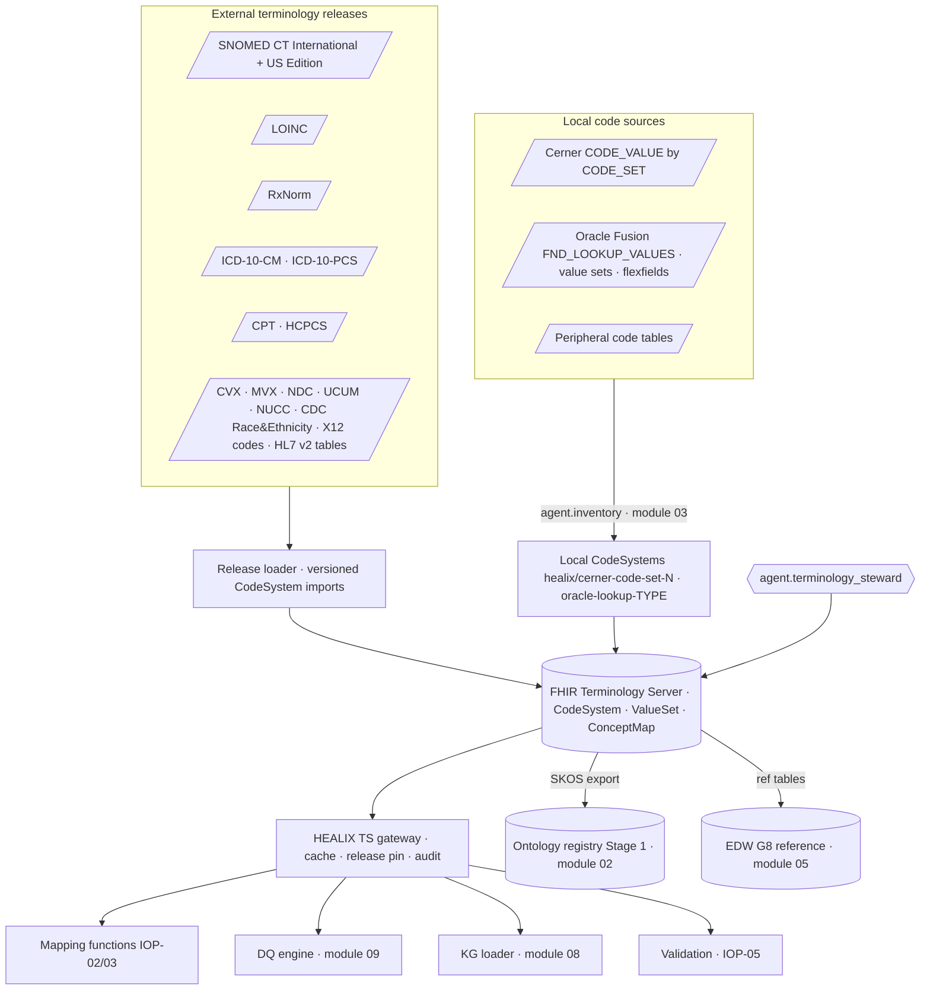

# Terminology Services

## 1. Role in the platform

The Terminology Service (TS) is the cross-module contract named in ARC-01 §6: the single place where codes are defined,
validated, expanded and translated. Every mapping function (IOP-02, IOP-03), the DQ engine (module 09), the knowledge
graph loader (module 08) and the vocabulary stage of the ontology pipeline (module 02) call it; no module keeps a
private code table. It is implemented as an HL7 FHIR R4 Terminology Server (Ontoserver / Snowstorm-backed by default,
ARC-01 §3) fronted by a HEALIX gateway that adds caching, release pinning and audit.

## 2. Resource model

| Resource | Use in HEALIX | Canonical URL pattern |
|----------|---------------|-----------------------|
| `CodeSystem` | External terminologies (loaded as supplements or full content as licence permits); HEALIX-defined code systems; **local** code systems mirroring Cerner code sets and Oracle lookup types | External: HL7-registered URIs. HEALIX: `https://fhir.healix.example.org/CodeSystem/<slug>`. Local: `https://fhir.healix.example.org/CodeSystem/cerner-code-set-<N>`, `.../CodeSystem/oracle-lookup-<LOOKUP_TYPE>` |
| `ValueSet` | Enterprise value sets bound by HEALIX profiles; intensional (`compose`) definitions preferred, with stored `expansion` snapshots per release | `https://fhir.healix.example.org/ValueSet/healix-<slug>` |
| `ConceptMap` | Local → standard, standard → standard (e.g. ICD-10-CM → SNOMED), HL7 v2 table → FHIR code, reverse maps for outbound | `https://fhir.healix.example.org/ConceptMap/<source-slug>-to-<target-slug>` |
| `NamingSystem` | Identifier system registry mirror (IOP-01 §5) | `https://fhir.healix.example.org/NamingSystem/<slug>` |
| `CodeSystem.supplement` | Local designations, ontology IRI property, EDW dimension key, retired flags on external concepts | `.../CodeSystem/<slug>-healix-supplement` |

Every concept in a HEALIX or local `CodeSystem` carries the properties: `ontologyIri` (IRI in the Stage 1 concept scheme),
`edwCodeSk` (G8 `dim_code` surrogate key, populated by module 05), `status` (active/retired), `effectivePeriod`,
`source` (module 03 source element id for local codes).

## 3. Operations contract

All operations are FHIR R4 standard operations; HEALIX fixes parameters and behaviours that the base spec leaves open.

| Operation | Endpoint | HEALIX-fixed behaviour | Primary callers |
|-----------|----------|------------------------|-----------------|
| `$lookup` | `CodeSystem/$lookup?system&code&version&property` | Returns `display`, `designation` (incl. local designations), properties `ontologyIri`, `status`, `parent`/`child`. `version` defaults to the pinned release of the calling environment. | Mapping functions (enrichment), KG loader |
| `$validate-code` | `ValueSet/<id>/$validate-code?system&code&display` and `CodeSystem/$validate-code` | Returns `result`, `message`, and HEALIX output parameter `inactive` (true if valid but retired). Display mismatch is a warning, not a failure, unless the value set is flagged `displayStrict`. | Validation stage 3 (IOP-05), DQ engine |
| `$expand` | `ValueSet/<id>/$expand?filter&count&offset&includeDesignations&activeOnly` | Paged; `count` ≤ 5,000 per page; result carries `expansion.identifier` (stable per release) and `expansion.parameter[version]` per code system. | EDW G8 loader, UI pick-lists, SKOS export |
| `$translate` | `ConceptMap/$translate?url&system&code&target&reverse` | Returns best `match` ordered by `equivalence` (`equivalent` > `equal` > `wider` > `subsumes` > `narrower` > `specializes` > `inexact`); `unmatched` results carry HEALIX `unmappedPolicy` parameter (`quarantine` / `passthrough` / `default`). `reverse = true` for outbound v2/X12. | Mapping functions, outbound generators |
| `$closure` | `ConceptMap/$closure?name&concept&version` | Maintains subsumption closure tables for SNOMED CT and LOINC parts used by DQ rules (e.g. "is a diabetes mellitus disorder") and by the KG for inference-free `broader` queries. | DQ engine, KG loader |
| `$subsumes` | `CodeSystem/$subsumes?codeA&codeB` | Used by SHACL business rules (IOP-05) through the SHACL-SPARQL function binding. | Validation stage 4 |
| `$find-matches` (P2) | `CodeSystem/$find-matches` | Post-coordinated SNOMED matching for device/procedure descriptions. | agent.terminology_steward |

Error semantics: a TS call that fails for infrastructure reasons (timeout, 5xx) MUST cause the caller to retry with
back-off and, after the retry budget, to quarantine the record with `IOP-E-TERM-009` (service unavailable) — never to
publish an unvalidated code.

## 4. Enterprise value set catalog

Canonical URL base: `https://fhir.healix.example.org/ValueSet/`. The G column gives the owning subject-area group;
"Bound in" names the profile element with the strongest binding. The catalog is machine-readable in the IG package
(`profiles/`); only the first release set is listed here.

| # | Value set slug | G | Content / source system(s) | Binding | Bound in |
|---|----------------|---|----------------------------|---------|----------|
| 1 | `healix-encounter-class` | G2 | v3 ActCode subset: AMB, EMER, FLD, HH, IMP, ACUTE, NONAC, OBSENC, PRENC, SS, VR | required | `Encounter.class` |
| 2 | `healix-encounter-type` | G2 | SNOMED CT encounter types + CPT E/M, mapped from Cerner code set 71 | extensible | `Encounter.type` |
| 3 | `healix-encounter-status` | G2 | FHIR `encounter-status` (full) | required | `Encounter.status` |
| 4 | `healix-admit-source` | G2 | FHIR `encounter-admit-source` + HEALIX additions (`transfer-snf`, `court-law-enforcement`) mapped from UB-04 point of origin / Cerner admit source | extensible | `Encounter.hospitalization.admitSource` |
| 5 | `healix-discharge-disposition` | G2/G3 | NUBC UB-04 patient discharge status (`https://www.nubc.org/CodeSystem/PatDischargeStatus`) with FHIR `encounter-discharge-disposition` translations | extensible | `Encounter.hospitalization.dischargeDisposition` |
| 6 | `healix-service-line` | G8 | HEALIX code system `healix-service-line` (Cardiology, Oncology, Women's Health …) | required | `Encounter.serviceType`, `Organization.type` |
| 7 | `healix-condition-category` | G2 | US Core condition categories + `health-concern`, `admitting-diagnosis` | required | `Condition.category` |
| 8 | `healix-condition-code` | G2 | SNOMED CT `< 404684003 \|Clinical finding\|` + ICD-10-CM | extensible | `Condition.code` |
| 9 | `healix-diagnosis-role` | G2/G3 | FHIR `diagnosis-role` + `principal`, `secondary`, `external-cause`, `patient-reason` | required | `Encounter.diagnosis.use`, `Claim.diagnosis.type` |
| 10 | `healix-procedure-code` | G2/G3 | CPT, HCPCS, ICD-10-PCS, SNOMED CT `< 71388002 \|Procedure\|` | extensible | `Procedure.code`, `Claim.item.productOrService` |
| 11 | `healix-lab-result-status` | G2 | FHIR `observation-status` subset: registered, preliminary, final, amended, corrected, cancelled, entered-in-error (mapped from HL7 v2-0085) | required | `Observation.status` (lab) |
| 12 | `healix-lab-observation-code` | G2 | LOINC class LAB*, CHEM, HEM/BC, MICRO, SERO, UA … | extensible | `Observation.code` (lab) |
| 13 | `healix-observation-interpretation` | G2 | v3 ObservationInterpretation subset (H, L, HH, LL, A, AA, N, R, S, I, POS, NEG) | required | `Observation.interpretation` |
| 14 | `healix-specimen-type` | G2 | SNOMED CT `< 123038009 \|Specimen\|` + HL7 v2-0487 translations | extensible | `Specimen.type` |
| 15 | `healix-allergy-category` | G2 | FHIR `allergy-intolerance-category` (food, medication, environment, biologic) mapped from v2-0127 | required | `AllergyIntolerance.category` |
| 16 | `healix-allergy-substance` | G2 | RxNorm, UNII, SNOMED CT substances/products, NDF-RT classes | extensible | `AllergyIntolerance.code` |
| 17 | `healix-medication-code` | G2 | RxNorm (SCD, SBD, GPCK, BPCK) with NDC translations | extensible | `Medication*.medication[x]` |
| 18 | `healix-medication-route` | G2 | SNOMED CT route of administration (`< 284009009`) mapped from v2-0162 and Cerner route code set | extensible | `Dosage.route` |
| 19 | `healix-medication-request-status` | G2 | FHIR `medicationrequest-status` (full) | required | `MedicationRequest.status` |
| 20 | `healix-immunization-vaccine` | G2 | CVX (`http://hl7.org/fhir/sid/cvx`) with NDC and MVX manufacturer | extensible | `Immunization.vaccineCode` |
| 21 | `healix-document-type` | G2 | LOINC document ontology (`{Role}.{SMD}.{Kind}.{Setting}.{Subject}`), mapped from Cerner event codes / TXA-2 | extensible | `DocumentReference.type` |
| 22 | `healix-appointment-status` | G4 | FHIR `appointmentstatus` mapped from v2-0278 and Cerner scheduling states | required | `Appointment.status` |
| 23 | `healix-location-physical-type` | G1/G4 | FHIR `location-physical-type` subset (si, bu, wi, wa, lvl, ro, bd, ve, ho, ca, rd, area, jdn) | required | `Location.physicalType` |
| 24 | `healix-organization-type` | G1 | FHIR `organization-type` + HEALIX ERP additions (`legal-entity`, `business-unit`, `cost-center`, `supplier`, `inventory-org`, `department`) | extensible | `Organization.type` |
| 25 | `healix-practitioner-specialty` | G1 | NUCC Health Care Provider Taxonomy | extensible | `PractitionerRole.specialty` |
| 26 | `healix-coverage-type` | G3 | X12 claim filing indicator (SBR09) + v3 ActCoverageType mapped from v2-0086 | extensible | `Coverage.type` |
| 27 | `healix-claim-type` | G3 | FHIR `claim-type`: institutional, professional, pharmacy, oral, vision | required | `Claim.type`, `ExplanationOfBenefit.type` |
| 28 | `healix-claim-use` | G3 | FHIR `claim-use`: claim, preauthorization, predetermination | required | `Claim.use` |
| 29 | `healix-adjudication-category` | G3 | HEALIX: submitted, allowed, contractual, deductible, coinsurance, copay, denied, paid, patient-responsibility, cob-paid, other | required | `ExplanationOfBenefit.adjudication.category` |
| 30 | `healix-adjudication-reason` | G3 | X12 CARC + RARC | extensible | `adjudication.reason` |
| 31 | `healix-revenue-code` | G3 | NUBC revenue codes | required | `Claim.item.revenue` |
| 32 | `healix-place-of-service` | G3 | CMS place of service codes | required | `Claim.item.locationCodeableConcept` |
| 33 | `healix-charge-status` | G3 | FHIR `chargeitem-status` mapped from Cerner charge event / FT1-6 | required | `ChargeItem.status` |
| 34 | `healix-account-status` | G3 | FHIR `account-status` | required | `Account.status` |
| 35 | `healix-gl-posting-status` | G3 | HEALIX: unposted, posted, reversed, error — mapped from Oracle GL `JE_HEADERS.STATUS` | required | `ext-erp-posting-status` |
| 36 | `healix-journal-source` | G3 | Oracle lookup `GL_JE_SOURCE` mirrored | extensible | `ext-erp-journal-source` |
| 37 | `healix-supplier-type` | G4 | Oracle lookup `POZ_VENDOR_TYPE` mirrored + HEALIX (`manufacturer`, `distributor`, `gpo`, `service-provider`, `agency`) | extensible | `Organization.type` (supplier), `ext-erp-supplier-type` |
| 38 | `healix-po-status` | G4 | Oracle PO document status (`PO_HEADERS_ALL.DOCUMENT_STATUS`) mirrored | required | `ext-erp-po-status` |
| 39 | `healix-item-category` | G4 | UNSPSC segments + Oracle item catalog categories | extensible | `ext-erp-item-category`, `Device.type` |
| 40 | `healix-unit-of-measure` | G8 | UCUM (`http://unitsofmeasure.org`) with Oracle `INV_UNITS_OF_MEASURE` ConceptMap | required | `Quantity.code` |
| 41 | `healix-position-type` | G5 | HEALIX: single-incumbent, pooled, shared, none; mapped from Oracle `POSITION_TYPE` | required | `ext-erp-position-type` |
| 42 | `healix-assignment-category` | G5 | Oracle lookup `EMP_CAT` mirrored (full-time regular, part-time, PRN/casual, contractor, …) | extensible | `ext-erp-assignment-category` |
| 43 | `healix-credential-type` | G5 | HEALIX + NUCC/state licence types (MD, DO, RN, APRN, PA, board certification) | extensible | `Practitioner.qualification.code` |
| 44 | `healix-measure-scoring` | G6 | FHIR `measure-scoring` (proportion, ratio, continuous-variable, cohort) | required | `Measure.scoring` |
| 45 | `healix-sdoh-domain` | G6 | Gravity Project SDOH domains | extensible | `Observation.category` (SDOH) |
| 46 | `healix-research-subject-status` | G7 | FHIR `research-subject-status` | required | `ResearchSubject.status` |
| 47 | `healix-consent-scope` | G7/G9 | FHIR `consent-scope` (research, patient-privacy, treatment, adr) | required | `Consent.scope` |
| 48 | `healix-audit-event-type` | G9 | DICOM audit (DCM 110100–110137) + IHE BALP | extensible | `AuditEvent.type` |
| 49 | `healix-record-flags` | G9 | HEALIX tags: replay, backfill, synthetic, masked, external-document, unmapped | required | `meta.tag` |
| 50 | `healix-identifier-type` | G1 | HL7 v2-0203 + HEALIX additions (`PAYERID`, `EMPI`, `SSN-TOKEN`) | extensible | `Identifier.type` |

## 5. Local codes: Cerner code sets and Oracle lookup types

Local codes are never silently normalised away; they are **first-class CodeSystems** with a ConceptMap to the standard
target. This preserves source fidelity (IOP-FHIR-005) while making every canonical record queryable by standard codes.

| Local source | Discovery (module 03) | CodeSystem | Concept fields | Typical target ConceptMap |
|--------------|-----------------------|------------|----------------|---------------------------|
| Cerner `CODE_VALUE` rows for `CODE_SET = N` | `agent.inventory` extracts `CODE_VALUE`, `DISPLAY`, `DESCRIPTION`, `CDF_MEANING`, `ACTIVE_IND`, `BEGIN_EFFECTIVE_DT_TM`, `END_EFFECTIVE_DT_TM`, plus `CODE_VALUE_ALIAS` / `CODE_VALUE_EXTENSION` | `cerner-code-set-N` (e.g. 71 encounter type, 69 encounter class, 19 discharge disposition, 57 sex, 282 ethnicity, 72 lab result type — illustrative; module 03 Source Registry is authoritative) | `code` = CODE_VALUE; `display` = DISPLAY; property `cdfMeaning`; `status` from ACTIVE_IND; `effectivePeriod` | `cerner-code-set-71-to-healix-encounter-class`, `cerner-code-set-19-to-healix-discharge-disposition`, … |
| Cerner nomenclature (`NOMENCLATURE`, SNOMED/ICD-coded) | Source vocabulary code and `CONCEPT_CKI` | passthrough to standard system; `cerner-nomenclature` for locally-authored terms | — | `cerner-nomenclature-to-snomed` |
| Cerner charge codes (CDM) | `CHARGE_EVENT`, `CDM` tables | `cerner-cdm` | property `cpt`, `hcpcs`, `revenueCode` | `cerner-cdm-to-healix-procedure-code` |
| Oracle `FND_LOOKUP_VALUES` for `LOOKUP_TYPE = T` | BICC `FndLookupValues` extract: `LOOKUP_CODE`, `MEANING`, `DESCRIPTION`, `ENABLED_FLAG`, `START_DATE_ACTIVE`, `END_DATE_ACTIVE`, `TAG` | `oracle-lookup-T` (e.g. `oracle-lookup-POZ_VENDOR_TYPE`, `oracle-lookup-EMP_CAT`, `oracle-lookup-GL_JE_SOURCE`) | `code` = LOOKUP_CODE; `display` = MEANING | `oracle-lookup-POZ_VENDOR_TYPE-to-healix-supplier-type` |
| Oracle value sets / flexfield segments (chart of accounts) | `FND_VS_VALUES_B`, `GL_CODE_COMBINATIONS` | `oracle-coa-<segment>` (e.g. `oracle-coa-COST_CENTER`, `oracle-coa-NATURAL_ACCOUNT`) | hierarchy from `GL_ACCOUNT_HIERARCHIES` as `parent` property | `oracle-coa-COST_CENTER-to-healix-cost-center` (identity + Organization reference) |
| Oracle UOM | `INV_UNITS_OF_MEASURE` | `oracle-uom` | — | `oracle-uom-to-ucum` |
| Peripheral local codes (LIS test codes, RIS procedure codes, pharmacy formulary ids) | Interface specs + observed codes | `lis-<vendor>-test-code`, `ris-<vendor>-procedure`, `pharmacy-<vendor>-formulary` | — | `*-to-loinc`, `*-to-radlex`, `*-to-rxnorm` |

### 5.1 Unmapped-code lifecycle

```mermaid
stateDiagram-v2
  [*] --> Observed: new local code seen in std
  Observed --> Registered: agent.inventory adds concept to local CodeSystem (auto)
  Registered --> Proposed: agent.terminology_steward proposes ConceptMap element (lexical + ontology similarity + usage)
  Proposed --> Approved: evaluator score ≥ threshold and risk low (auto) OR steward approves
  Proposed --> Rejected: steward rejects → stays unmapped with reason
  Approved --> Released: included in next TS release; cache invalidated; backfill replay of quarantined records
  Rejected --> Proposed: new evidence
```

Records carrying an unmapped code follow the value set's `unmappedPolicy`: `quarantine` (default for required
bindings), `passthrough` (record published with `meta.tag = unmapped` and source coding only; allowed for extensible
bindings on non-critical elements), or `default` (a steward-approved fallback code, e.g. `healix-encounter-class`
has none; `healix-observation-interpretation` defaults to none; `healix-record-flags` is never defaulted).

## 6. Versioning of external terminology releases

| Terminology | Release cadence | HEALIX adoption window | Version identifier in FHIR |
|-------------|-----------------|------------------------|----------------------------|
| SNOMED CT International | Monthly (from 2025) | Adopt US Edition within 30 days of release | `http://snomed.info/sct/731000124108/version/YYYYMMDD` (US Edition module) |
| LOINC | Twice yearly (Feb/Aug) | 30 days | `2.xx` |
| RxNorm | Monthly full + weekly updates | Monthly full within 14 days | `MMDDYYYY` |
| ICD-10-CM / PCS | Annual Oct 1 (+ April updates) | Loaded before effective date; both fiscal years active during transition | `YYYY` |
| CPT / HCPCS | Annual Jan 1 (HCPCS quarterly) | Before effective date | `YYYY` / `YYYYQn` |
| CVX / MVX | As published by CDC | 14 days | release date |
| NDC | Daily (FDA) | Weekly | date |
| UCUM | Rare | On release | `2.x` |
| Cerner code sets / Oracle lookups | Continuous (source changes) | Captured by CDC/BICC within the ARC-NFR-001 window | `CODE_VALUE` effective dates / `START_DATE_ACTIVE` |

Rules: every environment pins a **TS release id** (a manifest listing the version of every CodeSystem, ValueSet
expansion and ConceptMap). Mapping functions call the TS with that release pinned; a canonical resource records the
release id in `Provenance.extension[ts-release]`. Date-sensitive validation (ICD, CPT) uses the code system version in
effect on the clinical/service date, not the processing date. Retired concepts remain resolvable with `inactive = true`
for the full retention window.

## 7. Synchronisation to the ontology (Stage 1) and to EDW G8

| Direction | Mechanism | Cadence | Contract |
|-----------|-----------|---------|----------|
| TS → Ontology Stage 1 (module 02) | `$expand` each enterprise ValueSet; emit a SKOS `ConceptScheme` (`<base>scheme/<slug>`) with `skos:Concept` per code, `skos:prefLabel`, `skos:altLabel` (designations), `skos:notation` (code), `skos:exactMatch`/`closeMatch` from ConceptMap equivalence, `skos:broader` from `$closure` | On every TS release; delta via `hc.canonical.reference.valueset.fhir.v1` | ONT Stage 1 registry API |
| Ontology → TS | Stage 1 preferred-label and definition changes approved in module 02 feed back as `CodeSystem.supplement` designations | On ontology release | — |
| TS → EDW G8 (module 05) | `ref_code_system`, `ref_value_set`, `ref_value_set_member`, `ref_concept_map`, `dim_code` populated from `$expand` snapshots with `valid_from/valid_to` from release dates (bitemporal) | On every TS release | `05-edw-schema` G8 DDL |
| TS → Kafka | `CodeSystem`, `ValueSet`, `ConceptMap` resources published as canonical G8 records (`hc.canonical.reference.<resource>.fhir.v1`) so stream processors can hydrate local caches | On change | Topic catalog |
| TS → KG (module 08) | FHIR RDF of terminology resources; SNOMED CT/LOINC as OWL-EL where licensed (`owl:imports` by version IRI) | On release | KG ingestion API |

## 8. Performance, caching and availability

| Metric | Target |
|--------|--------|
| `$validate-code` / `$translate` latency | p50 ≤ 5 ms from cache, p99 ≤ 50 ms cache miss (in-cluster) |
| `$lookup` latency | p99 ≤ 50 ms |
| `$expand` latency (≤ 5,000 members) | p99 ≤ 2 s; larger expansions served from pre-computed release snapshots |
| Throughput | ≥ 50,000 terminology calls/s aggregate (≈ 10 coded elements × ARC-NFR-002) |
| Cache | Two tiers: in-process LRU in each mapping/validation worker keyed by (operation, system, code, version, target, release-id); shared Redis-compatible cache with TTL = until next release. Negative results cached for 10 min. |
| Hydration | Stream processors pre-load the value sets they bind from `hc.canonical.reference.*` at start-up; no cold-start calls on the hot path for `required` bindings |
| Availability | 99.95 % monthly for read operations; TS is deployed active-active across two zones; the gateway serves stale cache up to 24 h when the server is down (read-only), flagged in `Provenance` |
| Release load | A full SNOMED CT US Edition import completes in ≤ 2 h and is validated by a regression `$expand` of every enterprise value set before the release id is promoted |

## 9. Requirements

> **IOP-TS-001** (P0, test) — The Terminology Service MUST implement FHIR R4 `$lookup`, `$validate-code`, `$expand`,
> `$translate`, `$closure` and `$subsumes` with the HEALIX-fixed behaviours in §3.

> **IOP-TS-002** (P0, inspection) — No module MAY maintain a private code table; every code system, value set and concept
> map used by a mapping, DQ rule or sink MUST be resolvable from the TS by canonical URL.

> **IOP-TS-003** (P0, test) — Every enterprise ValueSet in §4 MUST be loaded with an intensional `compose` definition
> and a stored expansion per release, and MUST declare its `unmappedPolicy`.

> **IOP-TS-004** (P0, test) — Every HEALIX profile binding MUST reference a value set in the catalog; a profile that
> binds to an uncatalogued value set MUST fail the IG build.

> **IOP-TS-005** (P1, test) — `$expand` MUST be paged (`count` ≤ 5,000) and MUST return a stable `expansion.identifier`
> per release so consumers can detect change.

> **IOP-TS-006** (P1, test) — `$translate` MUST return matches ordered by equivalence strength and MUST support
> `reverse = true` for outbound code generation.

> **IOP-TS-007** (P1, test) — `$closure` tables MUST be maintained for SNOMED CT and LOINC and MUST be rebuilt on each
> terminology release before the release id is promoted.

> **IOP-TS-008** (P0, test) — Cerner `CODE_VALUE` code sets and Oracle `FND_LOOKUP_VALUES` lookup types in scope MUST be
> represented as local `CodeSystem` resources with effective periods and status synchronised from CDC/BICC within the
> ARC-NFR-001 latency window.

> **IOP-TS-009** (P0, test) — Every local code set bound to a canonical element MUST have a `ConceptMap` to the enterprise
> target value set; map elements MUST carry `equivalence` and a `comment` citing the evidence.

> **IOP-TS-010** (P0, test) — No local code MAY reach `canonical` without either a ConceptMap-governed translation or
> handling per the value set's `unmappedPolicy` (`quarantine` / `passthrough` with `unmapped` tag / approved default).

> **IOP-TS-011** (P1, test) — Newly observed local codes MUST be auto-registered in their local `CodeSystem` by
> `agent.inventory` within one pipeline cycle and surfaced to `agent.terminology_steward` with usage counts.

> **IOP-TS-012** (P1, test) — Proposed ConceptMap elements MUST be auto-approved only when the evaluator score meets the
> threshold and the target value set is not flagged `clinical-critical`; otherwise a human steward MUST approve.

> **IOP-TS-013** (P1, test) — When a ConceptMap element is released, records previously quarantined for that code MUST be
> replayed automatically from `std`.

> **IOP-TS-014** (P0, inspection) — Each environment MUST pin a TS release id listing every CodeSystem version, ValueSet
> expansion id and ConceptMap version; mapping functions MUST call the TS with that release pinned.

> **IOP-TS-015** (P0, test) — Date-sensitive code systems (ICD-10-CM/PCS, CPT, HCPCS) MUST be validated against the
> version in effect on the clinical or service date supplied by the caller.

> **IOP-TS-016** (P1, test) — Retired concepts MUST remain resolvable via `$lookup` and `$validate-code` (`inactive =
> true`) for at least the longest retention window defined in module 12.

> **IOP-TS-017** (P1, inspection) — SNOMED CT US Edition, LOINC, RxNorm, ICD-10-CM/PCS, CPT/HCPCS and CVX/MVX MUST be
> adopted within the windows in §6, with licence evidence recorded in module 11.

> **IOP-TS-018** (P0, test) — Every enterprise ValueSet MUST be exported to Stage 1 of the ontology pipeline as a SKOS
> ConceptScheme at `<base>scheme/<slug>` with notation, labels, and match relations on every release.

> **IOP-TS-019** (P0, test) — G8 reference tables (`ref_code_system`, `ref_value_set`, `ref_value_set_member`,
> `ref_concept_map`, `dim_code`) MUST be populated from TS release snapshots with bitemporal validity.

> **IOP-TS-020** (P1, test) — Terminology resources MUST be published to `hc.canonical.reference.*` topics so stream
> processors can hydrate caches without hot-path calls for `required` bindings.

> **IOP-TS-021** (P0, test) — Caches MUST key on the TS release id so a new release invalidates every cached result;
> negative results MUST expire within 10 minutes.

> **IOP-TS-022** (P0, test) — `$validate-code` and `$translate` MUST meet p99 ≤ 50 ms on cache miss and the service
> MUST sustain ≥ 50,000 calls/s aggregate.

> **IOP-TS-023** (P1, test) — Read availability MUST be ≥ 99.95 % monthly; during an outage the gateway MUST serve
> stale cache ≤ 24 h and mark affected `Provenance` with `ts-degraded`.

> **IOP-TS-024** (P1, test) — A terminology release MUST NOT be promoted until a regression `$expand` of every enterprise
> value set and a replay of the conformance fixture suite (IOP-05) pass.

> **IOP-TS-025** (P1, inspection) — Every concept in HEALIX and local code systems MUST carry `ontologyIri`, `status`,
> `effectivePeriod` and `source` properties.

> **IOP-TS-026** (P2, test) — The TS MUST audit every write operation (CodeSystem/ValueSet/ConceptMap create, update,
> release) as an `AuditEvent` on `hc.ops.audit.v1` with the acting agent or steward.
