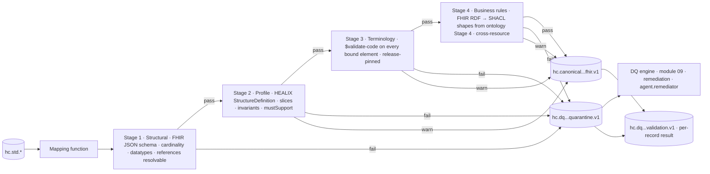
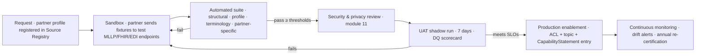

# Validation Pipeline, Conformance and Profiles

## 1. Purpose

Validation is the gate between `std` and `canonical` (ADR-04). A record becomes canonical only when it passes four
ordered stages; otherwise it is quarantined with a typed error that module 09 can act on. This document specifies the
stages, the tooling, the conformance test programme, partner onboarding, the error taxonomy and the metrics.

## 2. Validation pipeline



| Stage | Checks | Tooling | Severity policy |
|-------|--------|---------|-----------------|
| 1 Structural | Well-formed FHIR JSON; `resourceType` known; base R4 cardinality and datatypes; primitive regexes (dates, ids, URIs); Bundle integrity (`fullUrl` unique, `request` present); references resolvable within Bundle or by canonical id/identifier | HL7 FHIR Validator (`org.hl7.fhir.validation`) in base-only mode via in-process library; FHIR JSON Schema for fast pre-check | Any error → fail |
| 2 Profile | Conformance to `meta.profile` (HEALIX) and its US Core ancestor: slices, min/max, fixed/pattern values, FHIRPath invariants, mustSupport presence where HEALIX requires, extension contexts | HL7 FHIR Validator with the `healix-ig` package and `hl7.fhir.us.core#6.1.0` loaded; `-tx n/a` (terminology deferred to stage 3) | Error → fail; warning (e.g. mustSupport absent, informational) → pass with warning recorded |
| 3 Terminology | Every coded element with a binding: `required` → `$validate-code` must succeed on the enterprise value set; `extensible` → succeed, or source coding retained and `unmappedPolicy` applied; `preferred/example` → warning only. Display text checked when `displayStrict`. Code system version per clinical date (IOP-TS-015) | Terminology Service gateway (IOP-04) with pinned release; batched `$validate-code` via `Parameters` | `required` fail → fail; `extensible` unmapped → per policy; display mismatch → warning |
| 4 Business rules | Cross-element and cross-resource rules expressed as SHACL shapes derived from the ontology (module 02 Stage 4) and DQ rule pack (module 09): e.g. discharge after admission, Observation effective within Encounter period ± 24 h, lab value within physiologic plausibility, Claim total = Σ item.net, MedicationRequest dose unit consistent with form, GL journal debits = credits per header, assignment within position effective period | FHIR → RDF (FHIR RDF R4 / Turtle, ShEx-validated) then SHACL (`sh:Violation`/`sh:Warning`/`sh:Info`) with SHACL-SPARQL functions bound to TS `$subsumes` | `sh:Violation` → fail; `sh:Warning` → pass with warning; `sh:Info` → metric only |

Stage 4 shapes are owned by module 02/09; this module defines the invocation contract: shape graph version pinned per
release, evaluation ≤ 20 ms p99 per resource, result serialised as a FHIR `OperationOutcome` with
`issue.details.coding` = shape IRI.

### 2.1 Validation result record

Every validated record (pass or fail) emits one result to `hc.dq.<domain>.<resource>.validation.v1`:

```json
{
  "resourceType": "OperationOutcome",
  "id": "01J9ZM0A5C7E9G1I3K5M7O9Q1S",
  "meta": {"profile": ["https://fhir.healix.example.org/StructureDefinition/healix-validation-outcome|0.1.0"]},
  "extension": [
    {"url": "https://fhir.healix.example.org/StructureDefinition/ext-validated-resource", "valueReference": {"reference": "Encounter/01J9ZK...", "identifier": {"system": "https://id.healix.example.org/cerner/fin", "value": "V2026001"}}},
    {"url": "https://fhir.healix.example.org/StructureDefinition/ext-validation-release", "valueString": "healix-ig 0.1.0; us-core 6.1.0; ts-release 2026.10.1; shapes 2026.10.0"},
    {"url": "https://fhir.healix.example.org/StructureDefinition/ext-validation-disposition", "valueCode": "quarantine"}
  ],
  "issue": [
    {"severity": "error", "code": "code-invalid",
     "details": {"coding": [{"system": "https://fhir.healix.example.org/CodeSystem/healix-interop-error", "code": "IOP-E-TERM-003"}], "text": "Code 309999 (cerner-code-set-71) has no translation to healix-encounter-class"},
     "expression": ["Encounter.class"]},
    {"severity": "warning", "code": "informational",
     "details": {"coding": [{"system": "https://fhir.healix.example.org/CodeSystem/healix-interop-error", "code": "IOP-W-PROF-002"}], "text": "mustSupport element Encounter.hospitalization.dischargeDisposition absent on finished encounter"},
     "expression": ["Encounter.hospitalization.dischargeDisposition"]}
  ]
}
```

## 3. FHIR Validator usage

| Concern | Decision |
|---------|----------|
| Engine | HL7 FHIR Validator (Java, `org.hl7.fhir.validation`) embedded as a library in Flink validation operators; version pinned per release and upgraded through the change-request process with full fixture regression |
| Packages | `hl7.fhir.r4.core#4.0.1`, `hl7.fhir.us.core#6.1.0`, `hl7.fhir.uv.bulkdata#2.0.0`, `hl7.fhir.us.carin-bb#2.0.0`, `hl7.fhir.us.davinci-pas#2.0.1`, `hl7.fhir.uv.v2mappings` (reference only), `healix.fhir.ig#<version>` built from `profiles/` |
| Terminology | Validator runs with terminology checks disabled (`-tx n/a`) in stage 2; stage 3 performs them against the HEALIX TS so release pinning and caching are uniform |
| Modes | Strict for `canonical`; lenient (`-allow-example-urls`, best-practice warnings off) only for partner onboarding sandboxes |
| Performance | Warm validator context shared per JVM; `StructureDefinition` snapshot pre-generation at build time; target ≤ 15 ms p99 per resource for stages 1–2 |
| Output | `OperationOutcome` mapped to the HEALIX error taxonomy (§6) by validator `issue.code` + message pattern table maintained by `agent.interop_engineer` |
| CLI use | The same validator jar is used in CI (`java -jar validator_cli.jar -version 4.0.1 -ig healix.fhir.ig -profile <url> fixtures/*.json`) so CI and runtime agree |

## 4. Conformance test suites

HEALIX runs executable conformance suites in the style of **AEGIS Touchstone** and **ONC Inferno** (Touchstone for
FHIR `TestScript` execution, Inferno-style test kits for behavioural API checks), extended with HL7 v2 and X12 suites.

| Suite | Scope | Artefacts | Executed |
|-------|-------|-----------|----------|
| `healix-ig-build` | Every profile, value set, concept map compiles; IG Publisher QA page has 0 errors | `profiles/` | Every merge |
| `canonical-fixtures` | ≥ 5 positive and ≥ 3 negative fixtures per profile (`profiles/fixtures/<profile>/pos-*.json`, `neg-*.json`) validated through stages 1–4 | FHIR JSON fixtures + expected `OperationOutcome` | Every merge; nightly full |
| `v2-mapping` | For each trigger event in IOP-02 §4: fixture messages → expected Bundle (golden files); round-trip v2 → FHIR → v2 for outbound profiles | `.hl7` fixtures, golden Bundles, HL7 v2 conformance profiles (XML) checked with the NIST HL7 v2 validation engine | Every merge |
| `ccda-x12-mapping` | C-CDA samples (HL7 published + synthetic) and X12 005010 samples per transaction → golden Bundles; SNIP 1–4 | XML/EDI fixtures, golden Bundles | Every merge |
| `fhir-api-conformance` | FHIR facade `CapabilityStatement` vs behaviour: read/search/`$export`/Subscriptions; US Core server tests (Inferno US Core 6.1 test kit) run against the facade | `TestScript` resources, Inferno test kit | Nightly in `test`; before each release in `uat` |
| `partner-conformance` | Partner-specific suites (inbound HL7 v2 profile, FHIR client, X12 trading partner) | Partner `TestScript`/fixture bundle; `TestReport` stored | At onboarding and on partner change |
| `terminology-regression` | `$expand` of all enterprise value sets and `$translate` of every ConceptMap element against golden expansions | Golden expansions per release | Every TS release |
| `shacl-regression` | SHACL shape pack against RDF fixtures | Turtle fixtures | Every shape release |

Golden files are versioned with the module; a change that alters a golden file requires evaluator review with a diff
summary in the change request (module 10).

## 5. Partner onboarding conformance



| Partner class | Required suites | Pass threshold | Evidence |
|---------------|-----------------|----------------|----------|
| Inbound HL7 v2 sender (department system, LIS, device gateway) | `v2-mapping` subset for declared triggers; conformance profile check | 100 % structural; ≥ 99.5 % canonical pass on 7-day shadow | `TestReport`, DQ scorecard |
| Inbound FHIR source (partner FHIR server, app) | US Core client conformance; HEALIX profile fixtures | 100 % profile pass on fixtures | `TestReport` |
| HIE / document partner | `ccda-x12-mapping` C-CDA subset; XDS metadata | Schematron 0 errors on 20 sample docs | `TestReport` |
| Payer / clearinghouse | X12 SNIP 1–4; 835 balancing; 271 coverage mapping | 100 % SNIP 1–4 | `TestReport`, balancing report |
| Outbound HL7 v2 consumer | Outbound profile generation test; consumer ACK ≥ 99.9 % `AA` in shadow | 7-day shadow | ACK statistics |
| Outbound FHIR / Bulk consumer | CapabilityStatement negotiation; `$export` test; purpose-of-use policy | Policy sign-off | module 11 record |

Re-certification is triggered by: partner version change, HEALIX major profile version, or a 30-day rolling canonical
pass rate < 99 % for that partner.

## 6. Error taxonomy and routing

Error codes live in `https://fhir.healix.example.org/CodeSystem/healix-interop-error`. Pattern:
`IOP-<E|W|I>-<AREA>-<NNN>` where `E` = error (quarantine), `W` = warning (publish + record), `I` = info (metric only).

| Area | Code range | Examples | Default disposition | Routed to |
|------|------------|----------|---------------------|-----------|
| `PARSE` | 001–049 | `IOP-E-PARSE-001` malformed MLLP frame; `-002` MSH unparseable; `-010` CDA schema error; `-020` X12 SNIP 1 syntax; `-030` DICOM dictionary unknown VR | Reject at `raw`/`std`; record kept on `hc.raw.<src>.rejected.*` | `hc.dq.interop.parse.quarantine.v1` |
| `STRUCT` | 050–099 | `IOP-E-STRUCT-051` unknown resourceType; `-052` cardinality violation; `-053` invalid primitive; `-060` Bundle fullUrl duplicate; `-061` unresolvable reference | Quarantine | `hc.dq.<domain>.<resource>.quarantine.v1` |
| `PROF` | 100–149 | `IOP-E-PROF-101` slice min not met (e.g. MRN identifier missing); `-102` fixed value mismatch; `-103` invariant failed; `IOP-W-PROF-002` mustSupport absent | Quarantine (E) / publish with warning (W) | same |
| `TERM` | 150–199 | `IOP-E-TERM-001` unknown code system; `-002` code not in required value set; `-003` no ConceptMap translation; `-004` retired code on required binding; `-009` TS unavailable after retries; `IOP-W-TERM-005` display mismatch; `IOP-W-TERM-006` extensible unmapped passthrough | Per value set `unmappedPolicy` | same, plus `hc.dq.reference.unmapped-code.v1` for stewards |
| `REF` | 200–249 | `IOP-E-REF-001` subject not resolvable in EMPI; `-002` encounter referenced but unknown; `-003` device observation without patient association; `IOP-W-REF-004` practitioner NPI unknown | Quarantine with hold-and-retry (24 h) for late-arriving referents | `hc.dq.<domain>.<resource>.quarantine.v1` with `hc-retry-until` header |
| `RULE` | 250–299 | `IOP-E-RULE-251` SHACL violation (shape IRI in details); `-252` 835 balancing failure; `-253` GL line debits ≠ credits; `IOP-W-RULE-260` observation outside encounter period | Quarantine (Violation) / warning | same |
| `PRIV` | 300–349 | `IOP-E-PRIV-301` prohibited identifier (SSN) present; `-302` unclassified Z-field; `-303` purpose-of-use missing on export | Quarantine, alert `agent.privacy_guardian`, never publish | `hc.dq.governance.privacy.quarantine.v1` (restricted ACL) |
| `DUP` | 350–399 | `IOP-I-DUP-351` duplicate message control id; `IOP-E-DUP-352` same control id, different payload | Info / quarantine | `hc.dq.interop.duplicate.v1` |
| `SIZE` | 400–449 | `IOP-E-SIZE-401` record > 1 MiB after externalisation; `-402` file > 10 GiB unsplit | Quarantine | `hc.dq.interop.size.quarantine.v1` |

Quarantine record contract (consumed by module 09): the original `std` record reference (topic, partition, offset),
the attempted canonical resource (as produced), the `OperationOutcome`, the mapping version, the TS release id, and a
`remediation-hint` (`retry-after-release`, `await-referent`, `steward-map-code`, `fix-source`, `privacy-review`).
Quarantine topics use the `hc.dq.<domain>.<resource>.quarantine.v1` naming so module 09 rule packs and dashboards align
with canonical topics one-to-one.

## 7. Metrics

| Metric | Definition | Target / alert |
|--------|------------|----------------|
| `iop_validation_pass_rate` | passed / validated, per profile, per source, 5-min and daily | ≥ 99.5 % daily (VIS-00 G-02); alert < 99 % over 15 min |
| `iop_quarantine_rate_by_area` | quarantined / validated by error area | `TERM` < 0.3 %, `REF` < 0.1 %, `PRIV` = 0 |
| `iop_validation_latency_ms` | p50/p95/p99 per stage | stages 1–2 ≤ 15 ms p99; stage 3 ≤ 50 ms; stage 4 ≤ 20 ms; total ≤ 100 ms p99 |
| `iop_unmapped_codes_open` | distinct (system, code) in `Observed`/`Proposed` state | Trend down; alert on > 50 new per day for one source |
| `iop_hold_retry_success_rate` | `REF` quarantines resolved by retry within 24 h | ≥ 95 % |
| `iop_ack_error_rate` | HL7 v2 `AE`/`AR` / total (inbound and outbound) | < 0.1 % (VIS-00 §8) |
| `iop_partner_conformance_pass` | partner suite pass rate at last run | 100 % for enabled partners |
| `iop_golden_diff_count` | golden files changed per release | Reviewed in release notes |
| `iop_validator_version_drift` | environments not on the pinned validator/IG/TS release | 0 |
| `iop_shacl_violation_rate_by_shape` | violations per shape IRI | Feeds module 09 scorecards |

All metrics are emitted as OpenTelemetry with labels `source_system`, `profile`, `stage`, `error_code`, `env`, and are
mirrored into G9 (`fact_validation_result`) so the DQ composite index (module 09) can include interoperability quality.

## 8. Requirements

> **IOP-VAL-001** (P0, test) — Every record MUST pass the four ordered stages (structural, profile, terminology,
> business-rule) before publication to any `hc.canonical.*` topic; stage order MUST NOT be short-circuited on pass.

> **IOP-VAL-002** (P0, test) — Stages 1–2 MUST use the HL7 FHIR Validator with `hl7.fhir.r4.core#4.0.1`,
> `hl7.fhir.us.core#6.1.0` and the `healix-ig` package at the pinned versions.

> **IOP-VAL-003** (P0, test) — Stage 3 MUST validate every element with a `required` binding via the Terminology
> Service at the pinned release; a failure MUST quarantine the record.

> **IOP-VAL-004** (P1, test) — `extensible` bindings with no translation MUST follow the value set's `unmappedPolicy`;
> passthrough records MUST carry `meta.tag = unmapped` and emit `IOP-W-TERM-006`.

> **IOP-VAL-005** (P0, test) — Stage 4 MUST convert the resource (and Bundle context) to FHIR RDF and evaluate the
> pinned SHACL shape graph; `sh:Violation` MUST quarantine, `sh:Warning` MUST publish with a recorded warning.

> **IOP-VAL-006** (P1, test) — Every validation, pass or fail, MUST emit an `OperationOutcome` conforming to
> `healix-validation-outcome` on `hc.dq.<domain>.<resource>.validation.v1` with the validated resource reference and
> the release identifiers used.

> **IOP-VAL-007** (P0, test) — Total validation latency MUST be ≤ 100 ms p99 per resource at ARC-NFR-002 throughput.

> **IOP-VAL-008** (P1, test) — The validator, IG, TS release and SHACL shape versions MUST be identical in CI and
> runtime for a given environment; drift MUST be detected and alerted.

> **IOP-VAL-009** (P0, test) — Every HEALIX profile MUST ship with ≥ 5 positive and ≥ 3 negative fixtures and expected
> outcomes; CI MUST fail if any fixture outcome changes without an approved golden update.

> **IOP-VAL-010** (P0, test) — The `healix-ig` package MUST build with the HL7 IG Publisher with zero errors on every
> change to `profiles/`.

> **IOP-VAL-011** (P1, test) — The FHIR facade MUST pass the Inferno US Core 6.1 server test kit and its published
> `CapabilityStatement` MUST match observed behaviour, verified nightly in `test`.

> **IOP-VAL-012** (P0, test) — Records failing any stage MUST be routed to `hc.dq.<domain>.<resource>.quarantine.v1`
> with an error code from `healix-interop-error`, the `std` record coordinates, the attempted resource, the
> `OperationOutcome`, mapping version, TS release id and a remediation hint.

> **IOP-VAL-013** (P0, test) — `PRIV` errors MUST route to a restricted-ACL quarantine topic, alert
> `agent.privacy_guardian`, and MUST NOT be visible to general DQ consumers.

> **IOP-VAL-014** (P1, test) — `REF` quarantines MUST be retried automatically for up to 24 h as referents arrive; the
> record MUST be published without further human action when the referent resolves.

> **IOP-VAL-015** (P1, test) — Quarantined `TERM` records MUST be replayed automatically when the missing ConceptMap
> element is released (IOP-TS-013).

> **IOP-VAL-016** (P1, inspection) — The error taxonomy MUST be maintained as a `CodeSystem` with disposition and
> remediation-hint properties; mapping-function and validator messages MUST resolve to a taxonomy code, never free text
> alone.

> **IOP-VAL-017** (P0, test) — Every in-scope HL7 v2 trigger event MUST have an HL7 v2 conformance profile verified
> with the NIST HL7 v2 validation engine, and fixture messages MUST round-trip v2 → FHIR → v2 for outbound profiles.

> **IOP-VAL-018** (P1, test) — C-CDA and X12 suites MUST include HL7-published and synthetic samples per section and
> transaction with golden Bundles, and SNIP 1–4 MUST pass for every X12 fixture.

> **IOP-VAL-019** (P0, test) — A partner MUST NOT be enabled in `prod` until the required suites in §5 pass at the stated
> thresholds, module 11 review is recorded, and a 7-day UAT shadow run meets SLOs.

> **IOP-VAL-020** (P1, test) — Partner conformance results MUST be stored as `TestReport` resources linked to the
> partner's Source Registry entry and retained as audit evidence.

> **IOP-VAL-021** (P1, test) — Re-certification MUST be triggered by partner version change, HEALIX major profile
> version, or a 30-day canonical pass rate below 99 % for that partner.

> **IOP-VAL-022** (P1, test) — Terminology releases and SHACL shape releases MUST pass their regression suites before
> promotion (IOP-TS-024).

> **IOP-VAL-023** (P0, test) — The metrics in §7 MUST be emitted as OpenTelemetry with the stated labels and mirrored
> to G9 `fact_validation_result`.

> **IOP-VAL-024** (P1, test) — Alerts MUST fire when `iop_validation_pass_rate` falls below 99 % over 15 minutes for
> any source system or when any `PRIV` error occurs.

> **IOP-VAL-025** (P1, inspection) — Golden-file changes MUST be summarised in the change request and approved by
> `agent.evaluator` and, for PHI-affecting profiles, by a human steward before merge.

> **IOP-VAL-026** (P2, test) — Partner onboarding sandboxes MAY run the validator in lenient mode, but lenient results
> MUST NOT count toward enablement thresholds.
