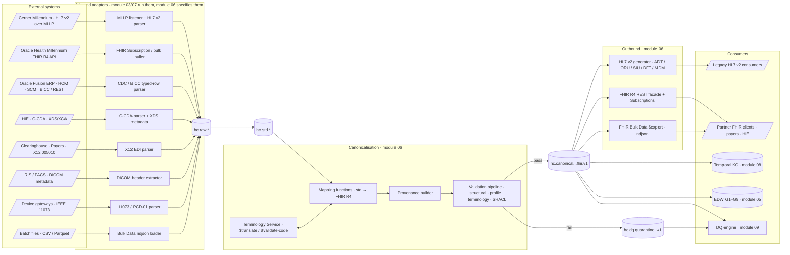
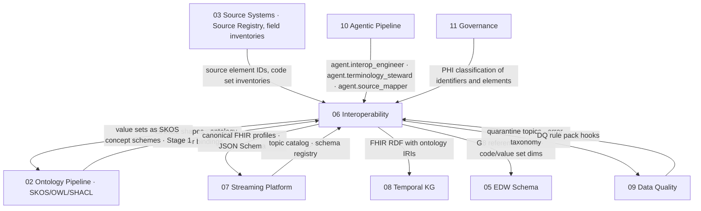

# Module 06 — Interoperability

## 1. Purpose and scope

Module 06 defines **how every event that enters or leaves the HEALIX platform is expressed in a standard**. It owns the
canonical interchange model (FHIR R4), the inbound adapters that translate HL7 v2, C-CDA, X12, DICOM, IEEE 11073 and
batch files into that model, the outbound generators that re-emit HL7 v2 and FHIR for legacy and partner consumers,
the enterprise Terminology Service, and the validation pipeline that decides whether a record may be called *canonical*.

The module is the producer of two cross-module contracts named in `01-architecture-overview.md` §6:

| Contract | Spec in this module | Consumers |
|----------|---------------------|-----------|
| Terminology Service (FHIR TS) | [`04-terminology-services.md`](04-terminology-services.md) | 02, 07, 08, 09 |
| Canonical FHIR profiles | [`profiles/`](profiles/) and [`01-canonical-model-fhir.md`](01-canonical-model-fhir.md) | 05, 07, 08, 09 |

### In scope

- FHIR R4 (4.0.1) as the canonical model, constrained by US Core 6.1 and the **HEALIX profile set** (`HEALIX-Clinical`,
  `HEALIX-ERP`) for all nine subject-area groups G1–G9.
- HL7 v2.3–2.8 inbound over MLLP and outbound generation for legacy consumers (ADT, SIU, ORM/OMP/OML/ORU, DFT, MDM,
  RDE/RAS/RDS, VXU, BAR).
- C-CDA 2.1 inbound, IHE XDS/XCA document metadata, X12 005010 (837P/I, 835, 270/271, 276/277, 278), DICOM metadata,
  IEEE 11073 device observations, CSV/Parquet batch via FHIR Bulk Data (ndjson).
- Terminology Service contract (CodeSystem / ValueSet / ConceptMap; `$lookup`, `$validate-code`, `$expand`,
  `$translate`, `$closure`), enterprise value set catalog, local-code mapping, release versioning.
- Validation pipeline (structural, profile, terminology, business-rule via SHACL on FHIR RDF), conformance testing and
  partner onboarding.

### Out of scope (owned elsewhere)

- Kafka topology, partitioning, retention and the authoritative topic catalog — module 07 (`07/topics.yaml`). This
  module *names* the topics it produces and consumes using the convention in `CONVENTIONS.md` §3; module 07 registers them.
- Source extraction mechanics (CDC, BICC, MLLP listener deployment) — module 03 and 07.
- DQ rule content and scorecards — module 09. This module routes validation failures to `hc.dq.*` and defines the
  error taxonomy; module 09 decides remediation.
- Ontology authoring — module 02. This module synchronises value sets *into* Stage 1 (controlled vocabulary) and consumes
  SHACL shapes *from* Stage 4.
- FHIR R5 — deferred (VIS-00 §6); profiles are versioned so an R5 lift is a major profile version, not a redesign.

## 2. Canonical model decision

**ADR-01** (ARC-01 §7) fixes the decision: *FHIR R4 with US Core 6.1 is the canonical interchange model; HL7 v2 is
accepted inbound and emitted outbound for legacy consumers.* Module 06 applies that decision as follows.

| Principle | Consequence |
|-----------|-------------|
| One canonical shape per entity | Every `hc.canonical.*` record is exactly one FHIR R4 resource (or a `transaction` Bundle when atomicity is required) conforming to a named HEALIX profile. No alternative canonical encodings exist. |
| Standards before extensions | A US Core profile is used where one exists; HEALIX-Clinical tightens US Core; HEALIX-ERP adds ERP/HCM/SCM semantics using `Basic` plus governed extensions — never custom resource types. |
| Codes are canonical too | Every coded element carries at least one coding from the enterprise value set bound to it, obtained through the Terminology Service. The original source code is retained as an additional coding (never dropped). |
| Provenance is not optional | Every canonical resource is accompanied by a `Provenance` resource that names the source record (HL7 v2 message control ID, CDC LSN, X12 ST02, document ID) and the mapping version that produced it. |
| HL7 v2 is a wire format, not a model | HL7 v2 is parsed to the `std` layer and mapped to FHIR; downstream modules never consume segments. Outbound HL7 v2 is *generated* from canonical FHIR, so legacy consumers see the same truth as FHIR consumers. |
| Validation gates canonical | A record that fails structural, profile or terminology validation is not published to `hc.canonical.*`; it goes to a quarantine topic under `hc.dq.*` with a typed error. |

## 3. Interoperability architecture

Layer responsibilities, aligned to `CONVENTIONS.md` §3 Kafka layers:

| Layer | Content | Owner of the contract | Example topic |
|-------|---------|------------------------|---------------|
| `raw` | Byte-exact source payload + headers (`hc-source-system`, `hc-source-time`, `hc-event-time`, `hc-message-control-id`) | 07 | `hc.raw.cerner.adt.hl7v2.v1` |
| `std` | Parsed, typed, schema-registered (Avro) segment/row/transaction model; structural validation only. Outbound HL7 v2 generated from canonical also lives here, under domain `outbound` | 03 / 07 (outbound: 06 / 07) | `hc.std.cerner.adt.hl7v2-parsed.v1`, `hc.std.clearinghouse.x12.837-parsed.v1`, `hc.std.outbound.adt.hl7v2.v1` |
| `canonical` | Validated FHIR R4 resources conforming to HEALIX profiles, FHIR JSON with JSON Schema | **06** | `hc.canonical.clinical.encounter.fhir.v1` |
| `dq` | Validation and DQ outcomes; one quarantine topic per domain (`hc.dq.quarantine.<domain>.v1`); typed issues on `hc.dq.issue.v1` | 09 (06 defines interop error taxonomy) | `hc.dq.quarantine.clinical.v1` |
| `ops` | Operational telemetry for interop, including ACK/NAK outcomes returned by legacy consumers of outbound HL7 v2 | 07 | `hc.ops.outbound.hl7v2.ack.v1` |

## 4. Conformance strategy

Conformance is treated as a **product** with versioned artefacts, automated tests and a published statement, not a
one-off integration check.

1. **Published conformance artefacts.** A FHIR `ImplementationGuide` resource (`healix-ig`) packages every
   `StructureDefinition`, `ValueSet`, `CodeSystem`, `ConceptMap`, `SearchParameter` and `CapabilityStatement` in
   `profiles/`. The IG is built with the HL7 FHIR IG Publisher on every merge and versioned with the module.
2. **Three conformance surfaces.**
   - *Inbound*: HL7 v2 conformance profiles (HL7 v2 Message Profiles, XML) per message type; C-CDA Schematron; X12 SNIP
     levels 1–4 for EDI; FHIR profile validation for FHIR-native sources.
   - *Canonical*: every `hc.canonical.*` record validates against its HEALIX profile with the HL7 FHIR Validator plus
     SHACL business rules on FHIR RDF (`05-validation-and-profiles.md`).
   - *Outbound*: a `CapabilityStatement` for the FHIR facade; HL7 v2 message profiles for outbound feeds; Bulk Data
     conformance per the SMART Bulk Data Access IG 2.0.
3. **Test suites.** Touchstone/Inferno-style executable test scripts (`TestScript` resources and HL7 v2 fixture suites)
   run in CI and during partner onboarding. Pass thresholds are launch criteria (VIS-00 G-02: validator pass rate
   ≥ 99.5 %).
4. **Partner onboarding.** A partner (payer, HIE, device vendor, downstream analytics consumer) is admitted only after
   passing the relevant suite in the `test` environment; results are stored as `TestReport` resources and surfaced to
   module 11 as audit evidence.
5. **Agents maintain conformance.** `agent.interop_engineer` regenerates profiles, message profiles and tests from the
   ontology and source registry; `agent.terminology_steward` maintains value sets and concept maps; `agent.evaluator`
   scores every proposed change against the regression suite; changes with PHI impact require `agent.privacy_guardian`
   clearance (ARC-01 §5).

## 5. Documents in this module

| Doc | File | Covers | Requirement areas |
|-----|------|--------|-------------------|
| IOP-00 | `README.md` | Scope, decision, architecture, conformance strategy, index | — |
| IOP-01 | [`01-canonical-model-fhir.md`](01-canonical-model-fhir.md) | FHIR R4 canonical model, resource coverage G1–G9, HEALIX profile set, mandatory elements, identifier registry, Bundle/Kafka conventions | `IOP-FHIR-001`–`IOP-FHIR-099` |
| IOP-02 | [`02-hl7v2-to-fhir.md`](02-hl7v2-to-fhir.md) | HL7 v2 versions, MLLP, ACKs, message types, segment→FHIR mapping, Z-segments, outbound generation | `IOP-V2-NNN` |
| IOP-03 | [`03-cda-x12-other.md`](03-cda-x12-other.md) | C-CDA, XDS/XCA, X12 005010, DICOM, IEEE 11073, Bulk Data | `IOP-CDA-NNN`, `IOP-X12-NNN`, `IOP-FHIR-101`+ (other-format→FHIR) |
| IOP-04 | [`04-terminology-services.md`](04-terminology-services.md) | Terminology Service contract, value set catalog, local code mapping, versioning, sync, performance | `IOP-TS-NNN` |
| IOP-05 | [`05-validation-and-profiles.md`](05-validation-and-profiles.md) | Validation pipeline, validator usage, conformance suites, partner onboarding, error taxonomy, metrics | `IOP-VAL-NNN` |
| — | [`profiles/`](profiles/) | Machine-readable StructureDefinitions, ValueSets, ConceptMaps, identifier system registry | — |

## 6. Requirement index

The authoritative text of each requirement lives in the document that defines it; this index is maintained by
`agent.release_manager` and linted for dangling IDs.

| Area | Range in use | Theme | Defined in |
|------|--------------|-------|------------|
| `IOP-FHIR` | 001–026 | Canonical model, profiles, identifiers, provenance, Bundles on Kafka | IOP-01 |
| `IOP-FHIR` | 101–108 | DICOM, IEEE 11073 and Bulk Data into FHIR | IOP-03 |
| `IOP-V2` | 001–026 | HL7 v2 ingestion, ACK, mapping, Z-segments, outbound | IOP-02 |
| `IOP-CDA` | 001–010 | C-CDA 2.1 and IHE XDS/XCA | IOP-03 |
| `IOP-X12` | 001–012 | X12 005010 claims, remittance, eligibility, status, authorisation | IOP-03 |
| `IOP-TS` | 001–026 | Terminology Service operations, catalog, local codes, versioning, sync, performance | IOP-04 |
| `IOP-VAL` | 001–026 | Validation pipeline, conformance suites, onboarding, error taxonomy, metrics | IOP-05 |

### P0 requirements at a glance

| ID | One-line summary |
|----|------------------|
| IOP-FHIR-001 | Every `hc.canonical.*` record is a FHIR R4 (4.0.1) resource conforming to a named HEALIX profile. |
| IOP-FHIR-004 | Every canonical resource carries `meta.source`, `meta.profile` and ≥ 1 identifier with a registered system URI. |
| IOP-FHIR-008 | Every canonical resource has a `Provenance` naming the source record and mapping version. |
| IOP-V2-001 | Inbound HL7 v2.3–2.8 accepted over MLLP with TLS; ACK semantics per §3 of IOP-02. |
| IOP-V2-010 | Segment mappings follow the HL7 V2-to-FHIR IG; deviations are registered and justified. |
| IOP-X12-001 | 837P/I, 835, 270/271, 276/277, 278 parsed and mapped to Claim/ClaimResponse/Coverage/EOB/PaymentReconciliation. |
| IOP-TS-001 | The Terminology Service exposes `$lookup`, `$validate-code`, `$expand`, `$translate`, `$closure` per FHIR R4. |
| IOP-TS-010 | No local code reaches `canonical` without a ConceptMap-governed translation or an explicit `unmapped` marker. |
| IOP-VAL-001 | Four-stage validation (structural, profile, terminology, business-rule) gates publication to `canonical`. |
| IOP-VAL-012 | Failed records route to `hc.dq.quarantine.<domain>.v1` with a typed error from the taxonomy. |

## 7. Interfaces with other modules

## 8. Definition of done (module 06)

In addition to `CONVENTIONS.md` §6:

1. `profiles/` builds as a FHIR IG with zero errors in the IG Publisher; every `StructureDefinition` parses with
   `python -m json.tool` and validates with the HL7 FHIR Validator against FHIR 4.0.1.
2. Every in-scope HL7 v2 message type has a conformance profile, a mapping specification and at least five fixture
   messages with expected FHIR output in the regression suite.
3. The enterprise value set catalog (IOP-04 §4) is loaded into the Terminology Service and mirrored to the Stage 1
   vocabulary registry and to G8 reference tables.
4. The validation pipeline rejects every negative fixture and accepts every positive fixture; the quarantine topic
   contract is registered in `07/topics.yaml`.
5. At least one partner (internal legacy HL7 v2 consumer) has passed outbound conformance in `test`.
