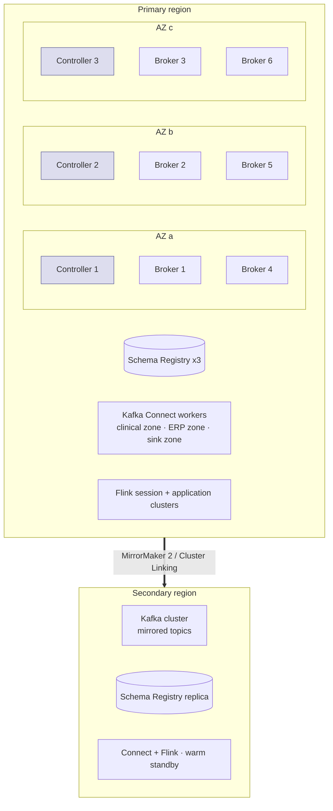

# Kafka Topology

This document fixes the physical and logical shape of the HEALIX Kafka estate: clusters, brokers, tenancy, security,
retention, partitioning, ordering and cross-region replication. Topic-by-topic parameters live in `topics.yaml`
(STR-02); this document sets the policy those parameters must obey.

## 1. Cluster topology

### 1.1 Mode, brokers and controllers

- **KRaft** (no ZooKeeper). Three dedicated controller nodes (`process.roles=controller`), one per availability zone
  (AZ). Brokers never co-host the controller role in `prod`.
- **Brokers**: minimum six in `prod` (two per AZ), scaled in multiples of three so that every AZ keeps equal capacity.
  `test`/`uat` run three brokers (one per AZ) with combined controller/broker roles permitted; `dev` MAY be a single
  node.
- **Rack awareness**: `broker.rack=<az-id>`; replica placement uses the rack-aware assignor so the three replicas of
  every partition sit in three different AZs. Consumers use `client.rack` with follower fetching to stay AZ-local.

### 1.2 Broker sizing assumptions (prod, first release)

| Dimension | Assumption | Basis |
|-----------|------------|-------|
| Sustained ingress | 5,000 canonical resources/s ≈ 15 MB/s canonical; ≈ 60 MB/s across all layers (raw + std + canonical + dq + kg + edw) | `ARC-NFR-002` with ×3 headroom → design for 180 MB/s |
| Peak factor | ×4 at 07:00–10:00 (ADT, lab runs, BICC daily extracts landing) | Source profiling (module 03) |
| Per-broker | 16 vCPU, 64 GB RAM, 4 TB NVMe (or tiered storage with 1 TB hot), 10 GbE | Keeps page cache ≥ 70 % of hot data |
| Storage | raw 30 d × 60 MB/s ≈ 155 TB logical ×3 RF ≈ 465 TB → **tiered storage** (`remote.storage.enable=true`) for `raw`/`canonical`/`dq`; local retention 3 d | Cost; replay from tier |
| Partitions | ≤ 4,000 per broker, ≤ 20,000 per cluster | KRaft metadata performance envelope |
| Connections | ≤ 1,000 client connections per broker | Connect + Flink + agents |

Capacity is re-baselined each quarter by Platform SRE from the metrics in STR-OPS-004.

### 1.3 Environments

| Environment | Clusters | Data | Notes |
|-------------|----------|------|-------|
| `dev` | 1 small | Synthetic only (Synthea-derived, no PHI) | Topic catalog applied with partitions ÷ 4 |
| `test` | 1 | Synthetic + de-identified samples | CI runs contract and chaos tests here |
| `uat` | 1 (3 brokers) | Masked production copy (field-level masking per `ARC-NFR-003`) | Mirrors prod ACLs |
| `prod` | primary + secondary region | PHI | Mirrored per §6 |

No topic is ever shared across environments; environment is encoded in the bootstrap endpoint and the OIDC audience,
never in the topic name (CONVENTIONS §3).

## 2. Tenancy and namespaces

A **single logical production cluster** hosts all layers and domains. Isolation is by **prefix**, **principal** and
**quota**, not by separate clusters, so that exactly-once processing (`std → canonical → dq/kg/edw`) stays inside one
transactional coordinator. Exceptions:

- **Kafka Connect worker clusters** are split by trust zone: `connect-clinical` (MLLP, Debezium, FHIR — reaches the
  clinical network), `connect-erp` (BICC, X12, files — reaches ERP/SFTP endpoints) and `connect-sink` (graph, EDW,
  archive). A compromise of one zone cannot reach the others' credentials.
- **Agents** (module 10) are producers to `hc.ops.*` only and consumers of `hc.ops.*`, `hc.dq.*` and compacted
  `hc.canonical.*reference*` snapshots; they never read `raw`/`std` PHI topics directly.

Namespace = topic prefix. The ACL and quota model (§3) is defined on prefixes `hc.<layer>.<domain>.`.

## 3. Security

### 3.1 Transport and authentication

| Path | Mechanism |
|------|-----------|
| Inter-broker, controller | mTLS (TLS 1.3 preferred, 1.2 minimum), certificates from the platform CA, 90-day rotation |
| Clients (Connect, Flink, agents, services) | TLS + **SASL/OAUTHBEARER** with OIDC JWTs from the platform IdP (workload identity: SPIFFE/K8s service account federation); principal = `sub` claim mapped to the catalog principal (`connect.<name>`, `proc.<name>`, `sink.<name>`, `agent.<role>`) |
| Human break-glass | mTLS client cert bound to a named operator, time-boxed, logged to `hc.ops.audit.v1` |
| Schema Registry, Connect REST, Flink REST | mTLS + OIDC; behind the platform API gateway |

`SASL/PLAIN` and `SASL/SCRAM` are prohibited in `uat`/`prod`; `SCRAM` MAY be used in `dev` for local tooling.

### 3.2 ACL model

Authorisation is **deny by default** (`allow.everyone.if.no.acl.found=false`) with **prefixed ACLs**:

| Principal class | WRITE | READ | Consumer group | Notes |
|-----------------|-------|------|----------------|-------|
| `connect.<source>` | `hc.raw.<source-domain>.` prefix only; `hc.ops.dlq.connect.v1`; `hc.ops.lineage.openlineage.v1`; `hc.ops.connector.` | — | — | one principal per connector |
| `proc.parser` | `hc.std.` | `hc.raw.` | `proc.parser.` | |
| `proc.canonicaliser`, `proc.enricher` | `hc.canonical.` | `hc.std.`, `hc.canonical.*-snapshot`, `hc.canonical.reference.` | `proc.canonicaliser.`, `proc.enricher.` | |
| `proc.dq-evaluator` | `hc.dq.` | `hc.canonical.`, `hc.dq.rule-activation.v1`, `hc.ops.dq.rulepack.v1` | `proc.dq-evaluator.` | |
| `proc.temporal-splitter` | `hc.kg.` | `hc.canonical.`, `hc.dq.passed.`, `hc.dq.result.v1`, `hc.kg.er.link.v1` | `proc.temporal-splitter.` | |
| `proc.edw-projector` | `hc.edw.` | `hc.canonical.`, `hc.dq.` | `proc.edw-projector.` | |
| `proc.hl7v2-outbound` | `hc.std.outbound.` | `hc.canonical.clinical.`, `hc.canonical.party.`, `hc.ops.outbound.` | `proc.hl7v2-outbound.` | |
| `sink.<name>` | `hc.ops.` (lineage, audit, dlq, kg load receipts) | the layer it sinks (`hc.kg.`, `hc.edw.`, `hc.dq.`, `hc.raw.`+`hc.canonical.` for archive) | `sink.<name>.` | |
| `agent.<role>` | `hc.ops.agent.`, `hc.ops.heal.` (`self_healer`), `hc.ops.replay.request.v1`, `hc.dq.issue.v1` (`dq_monitor`), `hc.kg.er.link.v1` (`entity_resolver`) | `hc.ops.`, `hc.dq.` (metadata topics; quarantine/passed only for `remediator`), `hc.canonical.reference.` | `agent.<role>.` | no `raw`/`std` access |
| `svc.*` (terminology publisher, lineage) | as catalogued | as catalogued | `svc.<name>.` | |

Every ACL is generated from `topics.yaml` (`producers`, `consumers`) by the GitOps pipeline; a principal not listed in
the catalog has no access. Transactional-id ACLs are granted per processor with prefix `proc.<name>.`.

### 3.3 Topic-level PHI classification

Each topic's `phi_class` is a tag from the module 11 data-classification taxonomy (GOV-01 §3, SKOS scheme
`<base>scheme/data-classification`) and is the **most restrictive** class of any record the topic may carry. It drives
the controls below; the module 11 default handling applies in addition.

| `phi_class` | Meaning (GOV-01 §3) | Extra controls |
|-------------|---------------------|----------------|
| `phi:direct` | Directly identifies an individual (HIPAA identifiers 1–2, 4–18): MRN, name, SSN, member and account numbers; all `raw`/`std` patient feeds, Patient/Account/Coverage/Claim resources, DLQs, `kg.*` | ACL grant requires `agent.privacy_guardian` approval; no mirroring to non-prod (masking mirror only); archive and tiered storage encrypted with the PHI key class; consumer apps must present the `phi-reader` role claim and a purpose of use |
| `phi:sensitive-category` and `/sud`, `/hiv`, `/mental-health`, `/reproductive`, `/genetic` | Specially protected categories (42 CFR Part 2, HIV, psychotherapy notes, reproductive, genetic) | As `phi:direct` plus consent gate (`hc-consent-ref`, `hc-part2-flag`) and segmented consumers; no topic in the initial catalog is classed here — segmentation is per record via `hc-phi-class`/`hc-phi-tags` and module 11 row-level policy |
| `phi:clinical` | Health information about an identifiable individual that is not itself an identifier (canonical clinical resources keyed by `patient_bk`) | As `phi:direct` for ACL approval, mirroring and encryption; may feed `deidentified:*` outputs only through module 11 transforms |
| `phi:quasi` | Quasi-identifiers or PHI by reference only (dates, ZIP3, business keys in DQ results, audit and reconciliation records) | ACL approval by `agent.privacy_guardian`; non-prod mirroring allowed after masking; k-anonymity check before any release |
| `pseudonymised` | PHI replaced by reversible tokens from the token vault (non-prod data, agent working sets) | Still PHI under HIPAA: same ACL approval; vault access restricted; never co-located with the token map |
| `pii:workforce` | Personal data about employees/contractors (HCM, credentialing, timekeeping, practitioner records) | HR data steward approval; GDPR overlay for EU/UK staff (GOV-01 §9); masked in non-prod |
| `confidential:financial` | Commercially sensitive non-personal financial and contract data (GL, AP, PO, supplier, item pricing, fixed assets) | Finance role claim; standard encryption |
| `confidential:operational` | Internal operational data with no personal content (on-hand balances, slots, supply requests) | Standard controls |
| `internal` | Non-sensitive platform metadata (lineage, change requests, decisions, checkpoints, rule packs, source reference data) | Any authenticated principal catalogued as consumer |
| `public` | Approved for external publication (published value sets, organisation directory) | Standard controls; may be exposed through the public FHIR terminology endpoints |
| `deidentified:safe-harbor`, `deidentified:expert` | Output of a certified Safe Harbor or Expert Determination transform (module 11 §6) | Standard controls; re-identification prohibited by policy and DSA; only module 11 de-identification processors may produce to such topics (STR-PROC-017) |

The classification is also carried on every record as header `hc-phi-class` (STR-03) so that interceptors can refuse a
produce whose header class is more sensitive than the topic's class.

### 3.4 Encryption and masking

- At rest: broker volumes and tiered-storage buckets encrypted with KMS keys per environment; separate PHI key class
  for `phi:*` and `pseudonymised` tier buckets; keys rotated annually, re-wrapped on demand.
- Non-production: `uat` receives data only through the masking mirror (module 11 masking rules) — never a raw
  mirror of `phi:*`, `pseudonymised` or `pii:workforce` topics.
- Optional (OQ-07-04): client-side field-level encryption for direct identifiers in `hc.canonical.party.patient.*`.

## 4. Retention and compaction policy

| Layer | Policy | Rationale |
|-------|--------|-----------|
| `raw` | `delete`, **≥ 30 days** (default 30 d; tiered storage; archive sink keeps 7 years in object storage) | Replay of every downstream layer (`ARC-NFR-005`) |
| `std` | `delete`, 14 days | Re-canonicalise after a mapping fix without re-parsing |
| `canonical` event topics | `delete`, 90 days | DQ re-evaluation, EDW/KG reconciliation windows |
| `canonical` snapshot topics (`*-snapshot.v1`) and `reference.*` | `compact`; `min.compaction.lag.ms=86400000`; `delete.retention.ms=604800000`; tombstone on merge/delete | Infinite current state for late joiners and enrichment lookups |
| `dq` | `delete`, **90 days** (`scorecard`, `rule-activation` compacted; `passed.<domain>` and `quarantine.<domain>` 90 d) | Trend analysis, audit of quarantine decisions; re-sink of passed records |
| `kg` | `delete`, 30 days (`dlq`, `er.link` included) | Reload window for the graph store |
| `edw` | `delete`, 14 days | Re-apply to the warehouse after a failed load |
| `ops` | `delete`, **7 days**; exceptions: `audit`, `audit.break-glass`, `dlq.*`, `agent.changerequest`, `agent.evaluation`, `heal.*`, `replay`, `schema`, `connector.*` 30 days; `kg-edw-reconciliation` 90 days; `agent.decision` 7 years; `dq.rulepack`, `agent.memory.episode`, `agent.policy.release` compacted | Operational; audit is sunk to immutable storage within 60 s and retained 6 years there (module 11); the decision log is the agents' episodic memory (module 10/14) |

Timestamps use `message.timestamp.type=CreateTime`; `message.timestamp.difference.max.ms` is unlimited for `raw`
(replays and backfills carry historical timestamps) and 7 days elsewhere.

## 5. Partitioning and ordering

### 5.1 Partition keys per domain

| Domain / layer | Key | Reason |
|----------------|-----|--------|
| `raw`/`std` HL7 v2 (all sources) | `MSH-4 \| PID-3.1` (sending facility + MRN); `MSH-10` when no PID | Preserves per-patient order within a facility feed; facility prefix prevents MRN collisions |
| `raw`/`std` CDC (Cerner replica) | Source table primary key | Debezium default; per-row order; rekeyed to patient at canonicalisation |
| `raw`/`std` BICC (Fusion) | PVO primary key | Idempotent upserts per entity |
| `raw`/`std` X12 | `ISA13 \| GS06 \| ST02` | One record per transaction set, ordered per interchange |
| `canonical.party` | `patient_bk` (EMPI id), `practitioner_bk` (NPI), `organization_bk`, `location_bk` | Conformed dimension keys shared with EDW |
| `canonical.clinical`, `pophealth`, `research.consent`, `supply.appointment` | `patient_bk` | All of a patient's clinical events in order on one partition |
| `canonical.finance` | `account_bk` (Account, ChargeItem), `claim_bk` (Claim, ClaimResponse, PaymentReconciliation), `patient_bk` (Coverage), `invoice_bk`, `ledger_id \| je_header_id` (GL), `asset_bk` | Order of charges per account, adjudication per claim, journal integrity per header |
| `canonical.supply` | `item_bk \| location_bk` (balances, requests, deliveries), `po_header_bk`, `item_bk` | Inventory position per item/location |
| `canonical.workforce` | `worker_bk` (person number), `position_bk` | Assignment history per worker |
| `canonical.reference` | `url \| version` | Terminology artefacts are versioned by canonical URL |
| `dq.result`, `dq.quarantine.*` | Key of the evaluated record | Quarantine and results co-partition with the subject |
| `kg.*` | `subject_iri` | Assertions about one subject apply in order |
| `edw.cdc.gN` | `table_name \| business_key` | Row order per target row |
| `ops.*` | Correlating id (`run_id`, `cr_id`, `correlation_id`) | Lifecycle events in order |

Keys are UTF-8 strings or Avro records (`key_format` in the catalog); composite keys use `|` as separator and are
never hashed by producers (the default murmur2 partitioner hashes the serialised key).

### 5.2 Ordering guarantees

- Kafka guarantees order **per partition**; HEALIX therefore guarantees order **per key within a topic version**.
- Cross-topic order (e.g., Patient before Encounter) is **not** guaranteed; consumers MUST tolerate referential
  lateness (the enricher and sinks buffer or emit `pending-link` states — STR-05).
- Producers run with `enable.idempotence=true`, `acks=all`, `max.in.flight.requests.per.connection=5`.
- **Partition counts are immutable for a topic version.** Increasing partitions changes key→partition mapping and
  breaks ordering and compaction; a resize is done by creating `vN+1` and migrating (STR-02 lifecycle).

## 6. Multi-region and disaster recovery

- **Topology**: active/passive. The secondary region hosts a warm Kafka cluster, a Schema Registry replica, and Connect
  and Flink deployments scaled to zero until failover.
- **Replication**: MirrorMaker 2 (default) or Confluent Cluster Linking (OQ-07-01). Mirrored prefixes: `hc.raw.`,
  `hc.canonical.`, `hc.dq.`, `hc.kg.`, `hc.edw.`, `hc.ops.`; `hc.std.` is rebuilt from `raw` after failover. Consumer
  group offsets are synchronised (`sync.group.offsets.enabled=true`, checkpoint interval 60 s) so processors resume
  without reprocessing more than one checkpoint interval.
- **Identity preservation**: with MM2 the `IdentityReplicationPolicy` keeps topic names unchanged so `topics.yaml`
  applies to both regions; with Cluster Linking offsets are preserved natively.
- **Schema Registry**: schema ids are global; the replica is read-only until promotion.
- **Failover**: DNS/bootstrap switch, promote registry, scale up Connect/Flink from savepoints replicated to the
  secondary object store; source connectors re-attach (Debezium resumes from mirrored offsets; MLLP senders re-queue;
  BICC poller re-reads unprocessed manifests).
- **Failback** replays the secondary's delta back to the primary through the reverse link before switching.

## 7. Requirements

> **STR-TOP-001** (P0, inspection) — Production Kafka MUST run in KRaft mode with three dedicated controller nodes
> placed one per AZ and at least six brokers spread evenly across three AZs.

> **STR-TOP-002** (P0, test) — Every topic MUST have `replication.factor=3`, `min.insync.replicas=2` and
> `unclean.leader.election.enable=false`; replicas of a partition MUST reside in three distinct `broker.rack` values.

> **STR-TOP-003** (P1, analysis) — The cluster MUST be sized for 3× the sustained canonical throughput in
> `ARC-NFR-002` and 4× daily peak, with the sizing model and quarterly re-baseline recorded by Platform SRE.

> **STR-TOP-004** (P0, inspection) — Each environment (`dev`, `test`, `uat`, `prod`) MUST have its own cluster(s); a
> topic name MUST NOT encode the environment and no topic MAY be shared between environments.

> **STR-TOP-005** (P0, test) — All broker, controller and client connections MUST use TLS 1.2 or higher; inter-broker
> and controller traffic MUST use mTLS with platform-CA certificates rotated at least every 90 days.

> **STR-TOP-006** (P0, test) — Clients MUST authenticate with SASL/OAUTHBEARER using OIDC tokens whose subject maps to
> a catalogued principal; SASL/PLAIN and SASL/SCRAM MUST be disabled in `uat` and `prod`.

> **STR-TOP-007** (P0, test) — Authorisation MUST be deny-by-default with prefixed ACLs generated from `topics.yaml`
> producers/consumers; a principal MUST NOT hold WRITE on a layer it does not produce or READ on PHI topics it is not
> catalogued to consume.

> **STR-TOP-008** (P0, test) — Every topic MUST carry a `phi_class` drawn from the module 11 taxonomy (GOV-01 §3);
> granting READ on a topic classed `phi:*` or `pseudonymised` MUST be approved by `agent.privacy_guardian` (or its
> human delegate), on a `pii:workforce` topic by the HR data steward, and every grant MUST be recorded in `hc.ops.audit.v1`.

> **STR-TOP-009** (P0, test) — Retention MUST follow §4: `raw` ≥ 30 days, `dq` ≥ 90 days, `ops` 7 days (listed
> exceptions 30 days, 90 days or 7 years as catalogued), canonical snapshot topics and the listed `ops` control topics
> compacted with `min.compaction.lag.ms` ≥ 24 h.

> **STR-TOP-010** (P1, test) — Compacted topics MUST emit a tombstone for every merge, delete or key retirement, and
> producers to compacted topics MUST publish the full current state (no partial deltas).

> **STR-TOP-011** (P0, inspection) — Partition keys MUST follow the per-domain table in §5.1; clinical canonical topics
> MUST be keyed by the enterprise patient business key after EMPI linkage.

> **STR-TOP-012** (P0, test) — Producers MUST use idempotent producers with `acks=all`; consumers MUST tolerate lack of
> cross-topic ordering and MUST NOT assume a referenced resource has already arrived.

> **STR-TOP-013** (P0, inspection) — The partition count of a topic version MUST NOT change after creation; a resize
> MUST be performed by creating the next topic version and migrating producers and consumers.

> **STR-TOP-014** (P0, inspection) — All broker storage and tiered-storage buckets MUST be encrypted at rest with
> environment-specific KMS keys and a separate PHI key class for `phi:*` and `pseudonymised` data; `uat` MUST receive
> such data only through the masking mirror.

> **STR-TOP-015** (P1, test) — Produce and fetch quotas MUST be configured per principal so that no single connector,
> processor or agent can consume more than 25 % of a broker's network capacity.

> **STR-OPS-001** (P0, demo) — `raw`, `canonical`, `dq`, `kg`, `edw` and `ops` layers MUST be replicated to the
> secondary region with consumer-offset synchronisation such that RPO ≤ 15 minutes (`ARC-NFR-007`).

> **STR-OPS-002** (P1, demo) — A documented failover runbook MUST restore ingestion and processing in the secondary
> region within RTO ≤ 4 hours; the exercise MUST be performed at least quarterly in `uat` and annually in `prod`.

> **STR-OPS-003** (P1, test) — Schema Registry schema ids MUST be identical in both regions; the secondary registry
> MUST be read-only until promotion.

> **STR-OPS-004** (P1, inspection) — Brokers and controllers MUST export under-replicated partitions, ISR shrink/expand,
> request latency, disk usage, controller health and per-principal quota throttling to the module 12 observability
> stack with the alert thresholds defined there.

> **STR-OPS-005** (P1, test) — Capacity alerts MUST fire at 70 % local disk, 80 % partition budget and 60 % sustained
> network utilisation per broker, opening an issue on `hc.dq.issue.v1` tagged `capacity` for `agent.orchestrator`.
