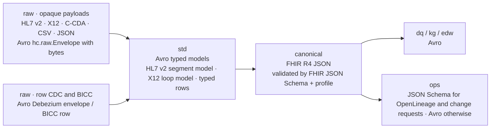

# Schema Registry

Every record on every HEALIX topic has a registered schema. This document defines which serialisation format each layer
uses, how subjects are named, the compatibility mode per layer, the evolution rules agents and engineers must follow,
the common **envelope** (record headers) that makes records traceable, and the linting rules enforced in CI.

## 1. Formats per layer



| Layer | Format | Serialiser | Why |
|-------|--------|-----------|-----|
| `raw` opaque (HL7 v2, X12, C-CDA, NDJSON, CSV, device JSON) | **Avro envelope** `hc.raw.Envelope` wrapping `payload: bytes` | Confluent Avro (wire format: magic byte + schema id) | Payload stays byte-exact for legal replay; metadata is typed |
| `raw` rows (Debezium, BICC) | **Avro** (Debezium change-event envelope with `before`/`after`/`source`/`op`; BICC row record) | Confluent Avro | Typed columns straight from the source |
| `std` | **Avro**: `hc.std.hl7v2.Message` (segments → fields → components, with `MSH` promoted), `hc.std.x12.TransactionSet`, `hc.std.ccda.Document`, typed row records; FHIR sources stay **FHIR JSON** after base validation | Confluent Avro / JSON Schema | Strong typing for processors; HL7 v2 generality preserved |
| `canonical` | **FHIR R4 JSON** validated against the FHIR R4 JSON Schema **and** the HEALIX/US Core profile (module 06); `fhir-ext` uses the same mechanism with HEALIX-ERP StructureDefinitions | Confluent JSON Schema serialiser (schema = FHIR R4 `fhir.schema.json` subset per resource, `$ref` to profile constraints expressed as JSON Schema where possible; full profile validation by the FHIR validator in the canonicaliser) | Interoperability and tooling; validators exist for JSON, not for Avro FHIR |
| `dq`, `kg`, `edw` | **Avro** | Confluent Avro | Compact, strict evolution (`FULL`) |
| `ops` | **JSON Schema** for OpenLineage `RunEvent` and the module 10 Change Request / Evaluation schemas; **Avro** for audit, DLQ, manifests, replay, checkpoints | JSON Schema / Avro | Reuse of external standard schemas |
| optional | **Protobuf** MAY be adopted for very high-volume `std` device observations (OQ-07-03) | Confluent Protobuf | Compactness; not used in the initial catalog |

Records in the DLQ topics keep the original bytes under `hc.raw.Envelope` with the original schema id in a header.

## 2. Subject naming strategy

`TopicNameStrategy` everywhere: subjects are `<topic>-value` and, for Avro keys, `<topic>-key` (CONVENTIONS §3).
`RecordNameStrategy`/`TopicRecordNameStrategy` are prohibited so that one topic has exactly one value type.

Shared types live in **referenced schemas** under reserved subjects:

| Subject | Content |
|---------|---------|
| `hc.common.Envelope` | `hc.raw.Envelope` record (§4) |
| `hc.common.Provenance` | `source_system`, `source_id`, `source_version`, `prov_activity_iri`, `recorded_at` |
| `hc.common.BitemporalInterval` | `valid_from`, `valid_to`, `recorded_at`, `superseded_at` (module 08) |
| `hc.common.Coding` | `system`, `version`, `code`, `display` |
| `hc.common.DqVerdict` | `rule_id`, `rule_version`, `dimension`, `status`, `score`, `message` |

Topic schemas reference these by schema reference, never by copy.

## 3. Compatibility modes

| Subject prefix | Mode | Source |
|----------------|------|--------|
| `hc.raw.*`, `hc.std.*` | `BACKWARD` | consumers upgrade first; source schema churn is frequent |
| `hc.canonical.*` | `BACKWARD_TRANSITIVE` | CONVENTIONS §5 — any historic record must be readable with the latest schema (90-day retention, infinite snapshots) |
| `hc.dq.*` | `BACKWARD_TRANSITIVE` | 90-day retention |
| `hc.kg.*`, `hc.edw.*` | `FULL` | CONVENTIONS §5 — sinks and producers deploy independently |
| `hc.ops.*` | `BACKWARD` | operational |
| `hc.common.*` | `FULL_TRANSITIVE` | referenced by every layer |

The registry-wide default is `BACKWARD`; subject-level modes are set by GitOps from `topics.yaml` (`compatibility`)
when the topic is created and are **not** changeable by clients (registry in `READONLY` mode for all principals except
`ci.gitops`, which uses `READWRITE`; `IMPORT` mode is used only for DR restore).

## 4. Envelope: common record headers

Every record on every layer carries these Kafka headers (UTF-8 string values unless stated):

| Header | Required | Format | Meaning |
|--------|----------|--------|---------|
| `hc-event-time` | MUST | RFC 3339 UTC (`2026-10-17T08:15:30.123Z`) | Time the business event occurred (e.g., HL7 `EVN-2`/`MSH-7`, CDC `source.ts_ms`, BICC `LAST_UPDATE_DATE`, FHIR `meta.lastUpdated` or clinically effective time per resource) |
| `hc-source-time` | MUST | RFC 3339 UTC | Time the source system recorded/committed the change (transaction time at source) |
| `hc-ingest-time` | MUST | RFC 3339 UTC | Time the connector produced the `raw` record; propagated unchanged downstream |
| `hc-source-system` | MUST | Source Registry id (`src.cerner.millennium.prod`, `src.fusion.erp`, `src.lis.sunquest`) | Origin system |
| `hc-source-id` | MUST | string | Source-native identifier of the record (`MSH-10` control id, CDC `table:pk`, BICC `pvo:pk`, FHIR `resourceType/id/_history/vid`, X12 `ISA13:ST02`) |
| `hc-source-version` | SHOULD | string | Source version/sequence (CDC SCN, FHIR `versionId`, HL7 `MSH-13`) |
| `hc-correlation-id` | MUST | ULID | Shared by every record derived from the same `raw` record |
| `hc-idempotency-key` | MUST (std and later) | `sha256(hc-source-system \| hc-source-id \| hc-source-version)` hex | Sink de-duplication (STR-05) |
| `hc-phi-class` | MUST | Module 11 taxonomy tag (GOV-01 §3): `phi:direct`, `phi:quasi`, `phi:clinical`, `phi:sensitive-category[/sud\|hiv\|mental-health\|reproductive\|genetic]`, `pii:workforce`, `confidential:financial`, `confidential:operational`, `internal`, `public`, `deidentified:safe-harbor`, `deidentified:expert`, `pseudonymised` | Single most-restrictive tag for the record; must not be more sensitive than the topic's `phi_class` |
| `hc-phi-tags` | SHOULD | comma-separated taxonomy tags | All classification tags present in the record (GOV-01 §3.1); `hc-part2-flag`, `hc-purpose-of-use`, `hc-consent-ref`, `hc-deid-method` as defined there |
| `hc-prov-activity` | MUST | IRI | PROV-O activity that produced this record (connector run, processor checkpoint, replay) |
| `hc-schema-version` | MUST | integer (Schema Registry schema id) | Redundant with the wire format; used by non-Confluent clients and for lineage |
| `hc-trace-id` | MUST | W3C `traceparent` | Distributed tracing across connectors, processors and sinks |
| `hc-mapping-version` | MUST (canonical) | `<mapping-spec-id>@<semver>` | Module 06 mapping spec that produced the resource |
| `hc-rule-pack-version` | MUST (dq) | semver | Module 09 rule pack used |
| `hc-dq-status` | MUST (dq passed, canonical records forwarded after evaluation) | `pass`, `fail-critical`, `fail-major`, `fail-minor` | Module 09 DQ-03 §3.2 verdict for the record; `blocker` failures never carry this header because they go to quarantine |
| `hc-dq-failed-rules` | MUST when `hc-dq-status` ≠ `pass` | comma-separated rule ids (`DQR-<DIMENSION>-<ENTITY>-<NNN>`) | Rules that failed with non-blocking severity; persisted by KG/EDW sinks as the `dq_flag` |
| `hc-dq-remediation-of` | MAY (canonical re-publish) | `<topic>:<partition>:<offset>` of the record being corrected | Set by `agent.remediator` or a steward when re-publishing a corrected record (DQ-05 §2); the evaluator re-runs all rules |
| `hc-dq-fix-class` | MUST with `hc-dq-remediation-of` | fix class id from DQ-05 §2.1 | Auto-fix class applied, used for rollback-rate suspension (DQ-REM-002) |
| `hc-validation` | MUST (std, canonical) | `pass`, `warn`, `fail` | Structural (std) / profile (canonical) validation outcome |
| `hc-late` | MAY | `true` | Record arrived after the watermark (STR-05) |
| `hc-replay` | MAY | replay id | Produced by a replay/backfill run |
| `hc-content-type`, `hc-content-encoding` | MUST (raw opaque, DLQ) | MIME type, `identity`/`gzip` | Payload type inside the envelope |

The `raw` opaque envelope value schema (Avro, namespace `hc.raw`):

```json
{"type":"record","name":"Envelope","namespace":"hc.raw","doc":"As-received payload with typed provenance",
 "fields":[
  {"name":"payload","type":"bytes","doc":"Exact bytes received (HL7 v2 ER7, X12, XML, NDJSON line, CSV row)"},
  {"name":"content_type","type":"string","doc":"MIME type, e.g. x-application/hl7-v2+er7; charset=UTF-8"},
  {"name":"content_encoding","type":{"type":"enum","name":"Encoding","symbols":["identity","gzip"]},"default":"identity"},
  {"name":"payload_sha256","type":"string","doc":"Hex digest of payload for integrity and de-duplication"},
  {"name":"source","type":"hc.common.Provenance"},
  {"name":"transport","type":{"type":"record","name":"Transport","fields":[
     {"name":"protocol","type":{"type":"enum","name":"Protocol","symbols":["MLLP","SFTP","AS2","HTTPS","OBJECT_STORAGE","CDC"]}},
     {"name":"endpoint","type":["null","string"],"default":null,"doc":"Listener or path; no credentials"},
     {"name":"sequence","type":["null","long"],"default":null,"doc":"Per-connection sequence (MLLP) or file line number"},
     {"name":"file_name","type":["null","string"],"default":null}]}},
  {"name":"received_at","type":{"type":"long","logicalType":"timestamp-millis"}}
 ]}
```

Debezium records keep the Debezium envelope; BICC rows are flat Avro records with the BICC metadata columns
(`LAST_UPDATE_DATE`, `CREATION_DATE`, `OBJECT_VERSION_NUMBER`) retained and an added `bicc_extract_job_id`.

## 5. Schema evolution rules

| Change | `raw`/`std`/`ops` (`BACKWARD`) | `canonical`/`dq` (`BACKWARD_TRANSITIVE`) | `kg`/`edw` (`FULL`) |
|--------|-------------------------------|------------------------------------------|---------------------|
| Add optional field with default | allowed | allowed | allowed |
| Add required field (no default) | prohibited | prohibited | prohibited |
| Remove field | allowed if it had a default | allowed if it had a default in **every** prior version | prohibited (deprecate first) |
| Rename field | prohibited (add new, deprecate old, remove after window) | prohibited | prohibited |
| Change type | prohibited except widening (`int`→`long`, add `null` to union) | prohibited except widening | prohibited |
| Enum symbol add | allowed with `default` symbol | allowed with `default` symbol | allowed with `default` symbol |
| Change key schema | new `vN+1` topic | new `vN+1` | new `vN+1` |
| FHIR profile change (canonical) | — | Loosening constraint: same topic; tightening or new mandatory element: profile version bump, same topic if JSON Schema stays backward compatible, else `vN+1` | — |

Deprecated fields carry `"doc": "DEPRECATED since <version>; remove after <date>"`; the linter blocks removal before
the date, which is at least the layer's retention window plus 30 days.

### 5.1 Review by agents

A schema change is a change request (`kind: schema.evolve`) attached to the topic. `agent.source_mapper` proposes
`raw`/`std` changes when it detects source drift (Debezium schema-change events, new HL7 segments/Z-segments, new BICC
columns); `agent.interop_engineer` proposes `canonical` changes when a FHIR profile changes; `agent.schema_architect`
proposes `edw` changes alongside DDL migrations; `agent.kg_builder` proposes `kg` changes with the graph model.
`agent.evaluator` runs: registry compatibility test against **all** retained versions, the linter (§6), a consumer
impact analysis (which catalogued consumers deserialise with a pinned reader schema), and, for `canonical`, the FHIR
validator against the profile and the module 06 example bundles. `agent.privacy_guardian` checks that no new field
raises the effective `phi_class` of the topic without reclassification. Only then may `agent.release_manager` register
the schema (via `ci.gitops`) and emit `hc.ops.schema.change.v1`.

## 6. Schema linting rules

| Rule | Applies to | Check |
|------|-----------|-------|
| LINT-SR-01 | Avro | Namespace is `hc.<layer>.<domain>[.<sub>]`; record names `UpperCamelCase`; field names `snake_case` |
| LINT-SR-02 | Avro | Every record and field has non-empty `doc` |
| LINT-SR-03 | Avro | Timestamps use `logicalType` `timestamp-millis`/`timestamp-micros`; dates `date`; decimals `decimal` with declared precision; no timestamps as strings outside the envelope headers |
| LINT-SR-04 | Avro | Unions are `["null", T]` only; no multi-type unions |
| LINT-SR-05 | Avro, JSON Schema | Fields that may contain PHI or personal data carry property `"hc.phi-class"` whose value is a module 11 Table 3-A tag (`phi:direct`, `phi:quasi`, `phi:clinical`, `phi:sensitive-category/<sub>`, `pii:workforce`, `confidential:*`); fields with no such content are untagged or `internal` — `none` and similar aliases are not values (GOV-01 §3). The topic `phi_class` must be at least the most restrictive field tag: any `phi:direct` field ⇒ `phi:direct` (or a `phi:sensitive-category` tag), `phi:clinical` fields ⇒ at least `phi:clinical`, only `phi:quasi` fields ⇒ at least `phi:quasi` |
| LINT-SR-06 | Avro, JSON Schema | Codes are `hc.common.Coding`, never bare strings, in `std` and later |
| LINT-SR-07 | Avro | Shared types used by reference (`hc.common.*`), never inlined copies |
| LINT-SR-08 | JSON Schema (canonical) | `$id` is the profile canonical URL + version; `additionalProperties` not loosened relative to FHIR R4 base |
| LINT-SR-09 | all | Subject equals `<topic>-value`/`-key`; schema `name` matches catalog `entity` |
| LINT-SR-10 | all | Deprecated fields have a removal date not earlier than retention + 30 days |
| LINT-SR-11 | all | No field named after a secret (`password`, `token`, `ssn` outside `Patient.identifier` mapping) without `hc.phi-class` |
| LINT-SR-12 | all | Schema size ≤ 1 MB; nesting depth ≤ 12 |

Linting runs in CI on every pull request touching `schemas/` and in the evaluator for agent proposals.

## 7. Requirements

> **STR-SR-001** (P0, inspection) — The Schema Registry MUST run as three or more instances behind the API gateway,
> backed by a `_schemas` topic with replication factor 3, with mTLS and OIDC authentication.

> **STR-SR-002** (P0, inspection) — Layers MUST use the formats in §1: Avro for `raw` rows, `std`, `dq`, `kg`, `edw`;
> the `hc.raw.Envelope` Avro envelope for opaque `raw` payloads; FHIR R4 JSON validated against JSON Schema and
> profile for `canonical`; Protobuf only where explicitly catalogued.

> **STR-SR-003** (P0, test) — Subjects MUST follow `TopicNameStrategy` (`<topic>-value`, `<topic>-key`); a topic
> MUST carry exactly one value record type.

> **STR-SR-004** (P0, test) — Compatibility MUST be `BACKWARD_TRANSITIVE` for `hc.canonical.*` and `hc.dq.*`,
> `FULL` for `hc.kg.*` and `hc.edw.*`, `FULL_TRANSITIVE` for `hc.common.*`, and `BACKWARD` elsewhere, set per subject
> by GitOps and immutable by clients.

> **STR-SR-005** (P0, test) — Schema evolution MUST obey the matrix in §5; a change that violates it MUST be delivered
> as a new topic version `vN+1`.

> **STR-SR-006** (P0, test) — Every schema change MUST be submitted as a change request, pass registry compatibility
> against all retained versions, the §6 linter and the evaluator's consumer-impact analysis, and, when the effective PHI
> class could change, be approved by `agent.privacy_guardian`.

> **STR-SR-007** (P0, test) — Every record MUST carry the MUST-level headers in §4; brokers or a produce interceptor
> MUST reject records missing `hc-event-time`, `hc-source-time`, `hc-source-system`, `hc-source-id`,
> `hc-correlation-id`, `hc-phi-class`, `hc-prov-activity`, `hc-schema-version` or `hc-trace-id`, and records on
> `hc.dq.passed.*` missing `hc-dq-status`.

> **STR-SR-008** (P0, test) — Header timestamps MUST be RFC 3339 in UTC; `hc-phi-class` MUST be a tag of the module 11
> data-classification taxonomy (GOV-01 §3, the same value set as `topics.yaml` `defaults.phi_classes`) and MUST NOT be
> more sensitive than the topic's catalogued `phi_class`; `hc-trace-id` MUST be a valid W3C `traceparent`.

> **STR-SR-009** (P0, test) — Opaque `raw` payloads MUST be stored byte-exact in `hc.raw.Envelope.payload` with
> `payload_sha256`, `content_type` and transport metadata; connectors MUST NOT normalise, re-encode or redact payloads
> before `raw`.

> **STR-SR-010** (P0, test) — A `canonical` record MUST validate against the FHIR R4 JSON Schema for its resource type
> and the module 06 profile before it is produced; a resource that fails profile validation MUST go to the domain
> quarantine topic, never to the canonical topic.

> **STR-SR-011** (P0, test) — Schemas MUST pass the linting rules LINT-SR-01 to LINT-SR-12 in CI and in the evaluator.

> **STR-SR-012** (P0, test) — Schema registration MUST be possible only through `ci.gitops`; the registry MUST be
> `READONLY` for all other principals and auto-registration by serialisers MUST be disabled
> (`auto.register.schemas=false`, `use.latest.version=true`).

> **STR-SR-013** (P1, inspection) — Shared types (`hc.common.*`) MUST be used through schema references; CI MUST reject
> inlined copies.

> **STR-SR-014** (P0, test) — `hc-schema-version` MUST equal the Schema Registry id of the writer schema used for the
> record's value.

> **STR-SR-015** (P0, inspection) — Fields that may contain direct or quasi PHI identifiers MUST be tagged `hc.phi-class`
> in the schema with a module 11 Table 3-A value; field tags and the topic's `phi_class` share one vocabulary, the topic
> class MUST be at least the most restrictive field tag, and the field tags are the input to module 11 masking rules.

> **STR-SR-016** (P0, test) — Registry access MUST be authorised per subject prefix mirroring topic ACLs: a principal
> MAY read the subjects of topics it is catalogued to consume or produce and nothing else.

> **STR-SR-017** (P0, inspection) — Schema versions MUST only be soft-deleted in `prod`; hard deletion MUST be
> impossible for any principal, preserving the ability to deserialise archived records.

> **STR-SR-018** (P1, test) — Schema normalisation MUST be enabled so that semantically identical schemas receive the
> same id regardless of field ordering or whitespace.
