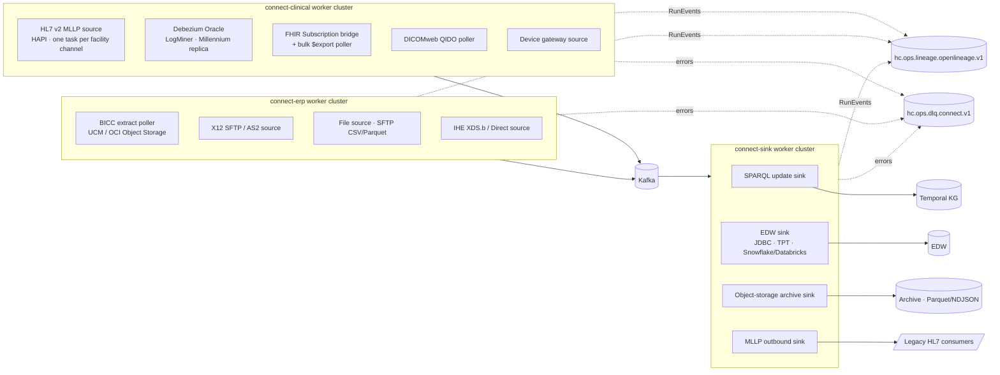

# CDC and Connectors

Connectors are the only writers to `hc.raw.*` and the only readers of `hc.kg.*`/`hc.edw.*` that touch external stores.
This document catalogues the source and sink connectors, their key configuration decisions, error handling,
exactly-once posture and monitoring. Connector manifests (Kafka Connect JSON, one file per connector) live in
`connectors/` of the deployment repository and are applied by GitOps; this document fixes what they must contain.

## 1. Connector landscape

## 2. Source connector catalog

| Connector id | Technology | Sources | Target topics | Delivery | `phi_class` |
|--------------|-----------|---------|---------------|----------|-----|
| `connect.debezium-millennium` | Debezium Oracle (LogMiner) | Millennium Oracle read-only replica | `hc.raw.cerner.cdc.<table>.avro.v1` | exactly-once (Connect EOS) | phi:direct (PRSNL pii:workforce; ORGANIZATION, CODE_VALUE internal) |
| `connect.mllp-cerner` | HAPI HL7 v2 MLLP source | Cerner outbound interfaces (ADT, ORM, ORU, SIU, MDM, DFT, RDE, VXU, MFN) | `hc.raw.cerner.<type>.hl7v2.v1` | at-least-once + ACK after durable produce | phi:direct (MFN internal) |
| `connect.mllp-lis`, `-ris`, `-pharmacy`, `-hie` | HAPI HL7 v2 MLLP source | Peripheral HL7 feeds | `hc.raw.<source>.<type>.hl7v2.v1` | as above | phi:direct |
| `connect.fhir-subscription-bridge` | Custom (FHIR R4 Subscription rest-hook receiver) | Patient portal, partner FHIR servers | `hc.raw.portal.*.fhir-json.v1` | at-least-once | phi:direct |
| `connect.fhir-bulk-poller` | Custom (`$export` client) | Millennium FHIR R4 APIs | `hc.raw.cerner.fhir.bulk.ndjson.v1` | at-least-once, idempotent by `versionId` | phi:direct |
| `connect.bicc-poller` | Custom (OCI Object Storage / UCM client) | Oracle Fusion BICC extracts (ERP, HCM, SCM PVOs) | `hc.raw.fusion.<module>.<pvo>.bicc.v1` | at-least-once, idempotent by manifest | pii:workforce (HCM worker/assignment), confidential:financial (GL, AP, PO, item, supplier, FA), confidential:operational (on-hand), internal (positions) |
| `connect.x12-sftp-as2` | Custom (SFTP + AS2 listener, X12 envelope splitter) | Clearinghouse (837/835/277), payers (271/278) | `hc.raw.clearinghouse.x12.<set>.v1`, `hc.raw.payer.x12.<set>.v1` | at-least-once, idempotent by `ISA13` | phi:direct |
| `connect.hie-ihe-xds` | Custom (IHE XDS.b consumer / Direct receiver) | HIE | `hc.raw.hie.ccda.v1` | at-least-once | phi:direct |
| `connect.pacs-dicomweb-poller` | Custom (QIDO-RS) | PACS/VNA | `hc.raw.pacs.study.dicom-json.v1` | at-least-once | phi:direct |
| `connect.device-gateway` | MQTT/HTTPS source | Device integration gateway | `hc.raw.devices.observation.json.v1` | at-least-once | phi:direct |
| `connect.sftp-file` | SFTP file source (CSV/Parquet) | Payer rosters, credentialing, timekeeping | `hc.raw.<source>.<entity>.csv.v1` | at-least-once, idempotent by file checksum | phi:direct (payer rosters), pii:workforce (credentialing, timekeeping) |

### 2.1 Debezium Oracle (LogMiner) for the Millennium replica

- **Target**: the Millennium Oracle **read-only replica** (Data Guard physical standby opened read-only, or a GoldenGate
  copy), never the production OLTP database (vendor support and performance). Supplemental logging
  (`ALTER TABLE ... ADD SUPPLEMENTAL LOG DATA (ALL) COLUMNS`) is enabled on whitelisted tables at the primary.
- **Table whitelist** (`table.include.list`) is generated from the Source Registry (module 03); initial key tables:

| Table (schema `V500`) | Purpose | Raw topic | Notes |
|-----------------------|---------|-----------|-------|
| `PERSON`, `PERSON_ALIAS`, `PERSON_NAME`, `ADDRESS`, `PHONE` | Patient demographics, MRNs | `cdc.person` | multi-table routed by `person_id` |
| `ENCOUNTER`, `ENCNTR_ALIAS`, `ENCNTR_LOC_HIST`, `ENCNTR_PRSNL_RELTN` | Encounters | `cdc.encounter` | |
| `CLINICAL_EVENT`, `CE_CODED_RESULT`, `CE_STRING_RESULT`, `CE_DATE_RESULT`, `CE_BLOB_RESULT`, `CE_BLOB` | Results and documents | `cdc.clinical_event` | LOB rules below |
| `ORDERS`, `ORDER_ACTION`, `ORDER_DETAIL` | Orders | `cdc.orders` | |
| `DIAGNOSIS`, `NOMENCLATURE` | Diagnoses | `cdc.diagnosis` | |
| `PROCEDURE` | Procedures | `cdc.procedure` | |
| `ALLERGY`, `REACTION` | Allergies | `cdc.allergy` | |
| `PRSNL`, `PRSNL_ALIAS` | Practitioners | `cdc.prsnl` | |
| `ORGANIZATION` | Organizations | `cdc.organization` | |
| `CODE_VALUE`, `CODE_SET`, `CODE_VALUE_ALIAS` | Reference data | `cdc.code_value` | `internal` |

- **Snapshot strategy**: `snapshot.mode=initial` once per table group; thereafter **incremental snapshots** triggered via
  the Debezium signal table (`HEALIX_DBZ_SIGNAL`) with `incremental.snapshot.chunk.size=4096`, so a re-snapshot of one
  table never blocks streaming of others. Snapshots run outside the 06:00–20:00 clinical window.
- **LOB handling**: `lob.enabled=true` only for `CE_BLOB` (compressed RTF/XML notes). Blobs above 1 MiB are written to
  the archive bucket by a Debezium post-processor and replaced by an object reference; `unavailable.value.placeholder`
  is a sentinel the parser recognises (unchanged LOBs are not re-sent). Pixel data never traverses Kafka.
- **Envelope**: `ExtractNewRecordState` is **not** applied at `raw`; the full Debezium envelope (`before`, `after`,
  `source.scn`, `source.ts_ms`, `op`) is preserved so transaction time is recoverable. Headers: `hc-source-time` =
  `source.ts_ms`; `hc-source-version` = `source.scn`; `hc-event-time` = `after.UPDT_DT_TM` when present, else
  `source.ts_ms`.
- **Schema drift**: `schema.history.internal.kafka.topic=hc.ops.connector.debezium.schema-history` (internal); DDL
  changes raise a change request via `agent.source_mapper`.
- **Tuning**: `log.mining.strategy=online_catalog`, `log.mining.batch.size.default=20000`, heartbeat every 10 s to
  `hc.ops.processor.checkpoint.v1`, `max.batch.size=4096`, `tasks.max=1` per connector (Oracle limitation); tables are
  split across several connectors by volume (`clinical_event` on its own).

### 2.2 HL7 v2 MLLP source (HAPI-based)

- One listener **per sending facility channel** (Cerner outbound interface = one channel), TLS-wrapped MLLP (or IPsec
  tunnel) with IP allow-listing; a channel maps to one `raw` topic by `MSH-9` message type.
- **ACK semantics**: the connector returns `MSA-1 = AA` only after the Kafka produce has been acknowledged with
  `acks=all`. On a non-durable produce (timeout, not enough replicas) it returns `AE` so the sender re-queues (Cerner
  outbound queues retry; the sequence is preserved). A message that cannot be framed or parsed at MSH level receives
  `AR` with the cause in `ERR`, is written to `hc.ops.dlq.connect.v1` with the original bytes, and opens an issue —
  the sender's queue must not stall on a poison message, but the message is never lost.
- **Sequencing**: records are keyed by `MSH-4|PID-3.1`, so all messages for a patient from one facility land on one
  partition in arrival order. `MSH-13` (sequence number) is validated when the sender uses sequence protocol; gaps raise a
  `hc.dq.issue.v1` of type `sequence-gap`. Each listener runs a **single** producer task to preserve order.
- **Duplicates**: `MSH-10` + `MSH-4` are kept in a 24-hour RocksDB window; duplicates are produced with header
  `hc-duplicate=true` (never dropped at `raw`; the parser handles them).
- Encoding: ER7 bytes stored verbatim with `content_type=x-application/hl7-v2+er7; charset=<MSH-18 or ISO-8859-1>`.

### 2.3 FHIR Subscription bridge and bulk poller

- **Subscription bridge** receives rest-hook notifications (R4 Subscription with `channel.type=rest-hook`,
  payload `application/fhir+json`), verifies the notification signature/mTLS, and produces each resource as `raw`;
  if the notification carries only ids, it fetches the resource (`GET [base]/[type]/[id]/_history/[vid]`).
- **Bulk poller** runs `$export` (system or group level) daily with `_since=<watermark>` per resource type, follows the
  status endpoint, downloads NDJSON files to a quarantine bucket, then streams lines. Watermark = max `meta.lastUpdated`
  observed, persisted in Connect offsets. Idempotency key = `resourceType/id/_history/versionId`.

### 2.4 Oracle Fusion BICC extract poller

- BICC schedules extract jobs per PVO (offering: ERP, HCM, SCM) writing zipped CSV plus `MANIFEST.MF` /
  `*.mdcsv` metadata to UCM or OCI Object Storage. The poller lists the bucket every 5 minutes.
- **Manifest handling**: the manifest is read first; a job is processed only when all files it lists are present and
  their sizes match; the manifest is recorded on `hc.ops.connector.bicc.manifest.v1` with state `discovered` →
  `processing` → `completed|failed`. Reprocessing a manifest id is a no-op (idempotency), and a manifest whose files
  reappear with different checksums raises an issue.
- **Incremental watermarks**: BICC runs incremental extracts keyed on `LAST_UPDATE_DATE`; the poller tracks the
  watermark per PVO and triggers a **full extract** request (via BICC REST) when the gap exceeds 24 hours or when the
  Source Registry flags a column addition. Deletes are detected through BICC's `__DELETED__` indicator/PK extracts.
- **Row processing**: CSV → Avro using the `.mdcsv` column metadata (name, type) — no inference; BICC metadata columns
  retained; `hc-event-time=LAST_UPDATE_DATE`, `hc-source-time=` extract job start time, `hc-source-id=<pvo>:<pk>`.
- **Latency**: with hourly BICC schedules for high-value PVOs (GL journals, PO lines, on-hand) and the 5-minute poll,
  end-to-end stays within the 15-minute BICC budget of `ARC-NFR-001` for the landing step.

### 2.5 X12 SFTP/AS2 source

- Receives X12 005010 interchanges by SFTP pull (clearinghouse outbound directories) or AS2 push (payers). The
  connector returns/produces `TA1`/`999` acknowledgements per interchange (functional acknowledgement generation is a
  connector responsibility; 277CA business acks are inbound data).
- Splits the interchange at `ST`/`SE` and produces **one record per transaction set** with key `ISA13|GS06|ST02`;
  interchange and group envelopes are retained in the Avro envelope `transport` and in a `hc-x12-envelope` header.
- Duplicate interchanges (same `ISA13` from the same trading partner within 30 days) are flagged, not dropped.

### 2.6 File source

- SFTP CSV/Parquet for low-frequency feeds (payer rosters, credentialing, timekeeping). The schema is taken from the
  catalog's `std` Avro schema (header-driven column binding); unknown columns trigger a change request rather than
  silent inference. Files are checksummed; a file with a seen checksum is skipped and logged.

## 3. Sink connector catalog

| Connector id | Technology | Reads | Writes | Idempotency |
|--------------|-----------|-------|--------|-------------|
| `sink.kg-sparql` | Custom SPARQL 1.2 UPDATE sink (module 08 ingestion API) | `hc.kg.assertion.v1`, `hc.kg.retraction.v1`, `hc.dq.result.v1`, `hc.ops.lineage.openlineage.v1` | Named graph per batch `<base>graph/<source>/<yyyy-mm-dd>/<batch-ulid>`; `hc.kg.load-receipt.v1` | Batch ULID recorded in a receipt graph; a batch already receipted is skipped |
| `sink.edw` | JDBC sink with dialect adapters: Teradata (TPT `LOAD`/`UPDATE` via staging), Snowflake (Snowpipe Streaming), Databricks (Delta), BigQuery (Storage Write API) | `hc.edw.cdc.g1..g9.v1`, `hc.dq.result.v1`, `hc.dq.issue.v1`, `hc.ops.agent.*` | `stg_*` staging then `MERGE` into `dim_*`/`fact_*`/`hist_*` by business key + `recorded_at` | `hc-idempotency-key` stored on every row; `MERGE` ignores seen keys |
| `sink.archive` | Object-storage sink (S3/GCS/OCI), Parquet for Avro, NDJSON for FHIR | `hc.raw.*`, `hc.canonical.*`, `hc.dq.quarantine.*`, `hc.ops.dlq.*`, `hc.ops.audit.v1` | `s3://healix-archive-<env>/<topic>/dt=<yyyy-mm-dd>/hh=<hh>/` | Exactly-once via deterministic file names from topic-partition-start-offset |
| `sink.audit-worm` | Object-storage sink with Object Lock / immutability | `hc.ops.audit.v1` | WORM bucket, 6-year retention | as archive |
| `connect.mllp-outbound` | HAPI MLLP client sink | `hc.std.outbound.*.hl7v2.v1` | Legacy HL7 consumers; ACK results to `hc.ops.outbound.hl7v2.ack.v1` | `MSH-10` de-duplication at receiver; retries with same control id |

The archive sink is the long-term record (7 years for `raw`/`canonical`, 6 years for audit, per module 11); Kafka
retention is a replay buffer, not the archive.

## 4. Error handling and dead-letter queues

| Situation | Behaviour |
|-----------|-----------|
| Source cannot produce (broker unavailable, `NotEnoughReplicas`) | Retry with backoff; MLLP returns `AE`; file/BICC/X12 pollers leave the object unprocessed; Debezium pauses (offsets not advanced) |
| Source record unframeable/unparseable at transport level | Produce bytes to `hc.ops.dlq.connect.v1` with headers `hc-dlq-reason`, `hc-dlq-connector`, `hc-dlq-exception`, `hc-dlq-original-topic`; open `hc.dq.issue.v1`; MLLP returns `AR` |
| Sink conversion/serialisation error | `errors.tolerance=all`, `errors.deadletterqueue.topic.name=hc.ops.dlq.connect.v1`, `errors.deadletterqueue.context.headers.enable=true`, `errors.log.include.messages=false` (no PHI in logs) |
| Sink target rejects (constraint violation, SPARQL error) | Retry 5× with exponential backoff; then DLQ with target error; the batch is **not** partially committed (staging/transaction rollback) |
| Sink target unavailable | Task pauses with lag alert (STR-OPS-006); no DLQ |
| DLQ record remediation | `agent.remediator` or an engineer replays from the DLQ through `hc.ops.replay.request.v1`; DLQ records are archived and retained 30 days on Kafka |

DLQ topics are `phi:direct` class (they carry original record bytes); their consumers are limited to `agent.dq_monitor`,
`agent.source_mapper`, `sre.oncall` and the archive sink.

## 5. Exactly-once and idempotency configuration

- Connect workers: `exactly.once.source.support=enabled`; Debezium connectors `exactly.once.support=required`,
  `transaction.boundary=poll`. Custom pollers that cannot use Connect EOS are **idempotent** (manifest id, file
  checksum, `ISA13`, FHIR `versionId`) so that re-delivery yields duplicates identifiable by `hc-idempotency-key`.
- Producers: `enable.idempotence=true`, `acks=all`, `compression.type=zstd`, `linger.ms=20`, `batch.size=256 KiB`.
- Sinks: `consumer.isolation.level=read_committed`; writes keyed on `hc-idempotency-key`; archive file names are
  deterministic; SPARQL sink uses batch receipts; EDW sink uses staging + `MERGE`.
- Offsets: Connect offsets topic `connect-offsets-<cluster>` with RF 3, `min.insync.replicas=2`; offsets are committed
  only after the downstream write is durable.

## 6. Configuration and secrets

- Manifests are Kafka Connect JSON in Git, templated per environment; secrets use the Connect `ConfigProvider`
  (KMS/Vault) with `${secret:...}` placeholders; plaintext credentials fail CI.
- Each connector has a dedicated OIDC principal (`connect.<name>`) and a dedicated source account with the minimum
  privileges (Debezium: `SELECT` on whitelisted tables + LogMiner privileges; BICC: object-storage read; SFTP: read-only).
- Connect REST is behind the gateway; `PUT /connectors` is callable only by `ci.gitops`.

## 7. Monitoring

| Metric / signal | Source | Alert |
|-----------------|--------|-------|
| Connector/task status (`RUNNING`/`FAILED`/`PAUSED`) | Connect REST + JMX | `FAILED` > 2 min → page; auto-restart up to 3× (STR-OPS-010) |
| Source lag: Debezium `MilliSecondsBehindSource`; MLLP queue depth at sender; BICC manifest age; bulk `$export` watermark age | Connector metrics | > 60 s CDC, > 15 min BICC, > 24 h bulk → alert |
| MLLP ACK outcome rates (`AA`/`AE`/`AR`) per channel | Connector metrics + `hc.ops.outbound.hl7v2.ack.v1` for outbound | `AE`+`AR` > 0.1 % over 5 min → alert |
| DLQ production rate per connector | `hc.ops.dlq.connect.v1` | > 0 for connectors feeding `phi:*` topics → issue; > 10/min → page |
| Sink commit latency and rows/s | Sink metrics | p95 > 60 s → alert |
| Lineage completeness (RunEvents per task per checkpoint) | `hc.ops.lineage.openlineage.v1` | missing COMPLETE → issue |

All metrics flow to the module 12 observability stack; alert routing is to the owning integration team and Platform SRE.

## 8. Requirements

> **STR-CDC-001** (P0, inspection) — Debezium MUST capture from a read-only Millennium replica, never from the
> production OLTP instance; the table whitelist MUST be generated from the Source Registry.

> **STR-CDC-002** (P0, test) — Debezium MUST use an initial snapshot per table group followed by incremental
> snapshots via the signal table; a re-snapshot of one table MUST NOT pause streaming of other tables.

> **STR-CDC-003** (P0, test) — LOB capture MUST be enabled only for whitelisted LOB tables; blobs above 1 MiB MUST be
> stored in the archive bucket and referenced, and DICOM pixel data MUST NOT traverse Kafka.

> **STR-CDC-004** (P0, inspection) — The `raw` CDC record MUST retain the full Debezium envelope (`before`, `after`,
> `source`, `op`) and MUST set `hc-source-time` from `source.ts_ms` and `hc-source-version` from the SCN.

> **STR-CDC-005** (P1, test) — Source DDL changes detected by Debezium MUST raise a `schema.evolve` change request
> through `agent.source_mapper` and MUST NOT auto-register a new `raw` schema.

> **STR-CDC-006** (P1, inspection) — Debezium connectors MUST be partitioned across connectors by table volume with the
> highest-volume tables (`CLINICAL_EVENT`) isolated, and MUST emit heartbeats at least every 10 seconds.

> **STR-CDC-007** (P0, test) — The MLLP source MUST return `AA` only after the Kafka produce is acknowledged with
> `acks=all`; it MUST return `AE` on non-durable produce and `AR` with a DLQ write for unparseable messages, and MUST
> NOT acknowledge before durability.

> **STR-CDC-008** (P0, test) — Each MLLP listener MUST use a single ordered producer task and key records by
> `MSH-4|PID-3.1` so that per-patient order within a facility is preserved; `MSH-13` gaps MUST open an issue.

> **STR-CDC-009** (P0, inspection) — MLLP MUST be carried over TLS or an IPsec tunnel with IP allow-listing; plain
> MLLP over routable networks is prohibited.

> **STR-CDC-010** (P1, test) — The FHIR Subscription bridge MUST verify notification authenticity (mTLS or signed
> payload) and the bulk poller MUST maintain a per-resource-type `_since` watermark and de-duplicate by
> `resourceType/id/versionId`.

> **STR-CDC-011** (P0, test) — The BICC poller MUST process an extract only when its manifest and all listed files are
> complete, MUST record manifest state on `hc.ops.connector.bicc.manifest.v1`, and MUST treat a repeated manifest id
> as a no-op.

> **STR-CDC-012** (P0, test) — The BICC poller MUST maintain a watermark per PVO on `LAST_UPDATE_DATE`, request a full
> extract when the gap exceeds 24 hours, and parse CSV strictly by the `.mdcsv` metadata with no type inference.

> **STR-CDC-013** (P0, test) — The X12 source MUST produce one record per transaction set keyed by `ISA13|GS06|ST02`,
> MUST retain the ISA/GS envelopes, and MUST generate `TA1`/`999` acknowledgements per trading-partner agreement.

> **STR-CDC-014** (P1, test) — The file source MUST bind columns to the catalogued `std` schema by header name, MUST
> reject or raise a change request for unknown columns, and MUST skip files whose checksum has already been processed.

> **STR-CDC-015** (P0, test) — The SPARQL sink MUST load each `hc.kg.*` batch into its own named graph in one
> transaction, write a receipt to `hc.kg.load-receipt.v1`, and skip any batch ULID already receipted.

> **STR-CDC-016** (P0, test) — The EDW sink MUST load through staging tables and `MERGE` on business key plus
> `recorded_at`, storing `hc-idempotency-key` on every row so that re-delivered records produce no duplicate rows.

> **STR-CDC-017** (P0, inspection) — The archive sink MUST write `raw` and `canonical` topics to object storage with
> deterministic file names partitioned by topic and date, encrypted with the PHI key class for `phi:*` topics, retained for
> 7 years; `hc.ops.audit.v1` MUST be written to an immutable (WORM) bucket within 60 seconds.

> **STR-CDC-018** (P0, test) — Every sink connector MUST configure `errors.tolerance=all` with the dead-letter topic
> `hc.ops.dlq.connect.v1`, context headers enabled and message logging disabled; every DLQ write MUST open or update an
> issue on `hc.dq.issue.v1`.

> **STR-CDC-019** (P0, test) — Source connectors MUST use Connect exactly-once support where the connector supports it
> (Debezium) and MUST otherwise be idempotent by a documented key (manifest id, checksum, `ISA13`, FHIR `versionId`);
> all producers MUST be idempotent with `acks=all`.

> **STR-CDC-020** (P0, inspection) — Connector manifests MUST live in Git, be applied only by `ci.gitops`, use a
> secret `ConfigProvider` for credentials, and run under a per-connector OIDC principal with least-privilege source
> accounts.

> **STR-CDC-021** (P0, inspection) — Connect worker clusters MUST be separated by trust zone (`connect-clinical`,
> `connect-erp`, `connect-sink`) so that no worker holds credentials for more than one zone.

> **STR-CDC-022** (P1, test) — Connectors MUST emit OpenLineage `RunEvent`s (START/COMPLETE/FAIL) per task and offset
> commit to `hc.ops.lineage.openlineage.v1`, naming input datasets (source tables/feeds) and output topics.

> **STR-OPS-006** (P0, test) — Connector and task state, source lag (CDC seconds behind source, BICC manifest age,
> MLLP queue depth, bulk watermark age) and sink commit latency MUST be exported to the module 12 observability stack
> with the thresholds in §7.

> **STR-OPS-007** (P0, test) — MLLP `AE`/`AR` rates MUST be monitored per channel and an alert MUST fire when they
> exceed 0.1 % over five minutes.

> **STR-OPS-008** (P1, test) — BICC extract freshness MUST be monitored per PVO; a PVO whose latest completed manifest
> is older than twice its schedule interval MUST raise an issue to the Oracle Fusion integration team.

> **STR-OPS-009** (P0, test) — Any dead-letter write from a connector feeding `phi:*` topics MUST create an issue within one minute, and
> a DLQ rate above 10 records per minute MUST page Platform SRE.

> **STR-OPS-010** (P1, test) — Failed connector tasks MUST be restarted automatically up to three times within ten
> minutes; a fourth failure MUST page and leave the task failed for diagnosis.
