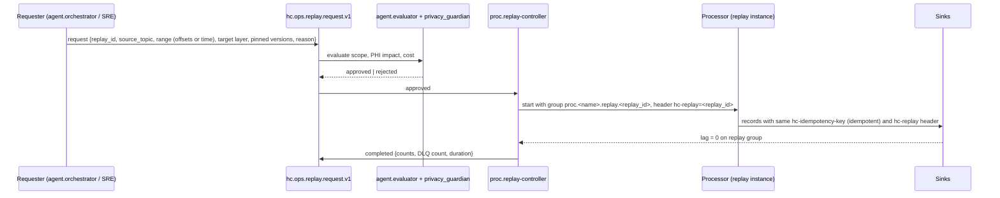

# Stream Processing

Processors turn `raw` into `std`, `std` into canonical FHIR, canonical into quality verdicts, bitemporal graph
assertions, warehouse rows and outbound HL7 v2. They are **Apache Flink** jobs for anything stateful (joins, windows,
enrichment with lookups, DQ evaluation) and **Kafka Streams** for stateless record-at-a-time maps (parsing). This
document defines each processor's contract, event-time semantics, state, exactly-once, idempotency, replay and scaling.

## 1. Processor pipeline

```mermaid
flowchart LR
  RAW[(hc.raw.*)] --> P1[proc.parser<br/>Kafka Streams]
  P1 --> STD[(hc.std.*)]
  STD --> P2[proc.canonicaliser<br/>Flink · mapping specs · terminology cache]
  P2 --> P3[proc.enricher<br/>Flink · EMPI linkage · rekey]
  P3 --> CAN[(hc.canonical.*)]
  CAN --> P3S[proc.snapshot-compactor] --> SNAP[(hc.canonical.*-snapshot)]
  SNAP -. lookups .-> P2 & P3 & P6
  CAN --> P4[proc.dq-evaluator<br/>Flink · rule pack]
  P4 --> DQR[(hc.dq.result / issue / scorecard)]
  P4 --> Q[(hc.dq.quarantine.*)]
  CAN --> P5[proc.temporal-splitter<br/>Flink · valid/transaction time]
  DQR -. verdict join .-> P5 & P6
  P5 --> KG[(hc.kg.assertion / retraction)]
  CAN --> P6[proc.edw-projector<br/>Flink · SK resolution]
  P6 --> EDWT[(hc.edw.cdc.gN)]
  CAN --> P7[proc.hl7v2-outbound<br/>Flink]
  P7 --> OUT[(hc.std.outbound.*)]
  P1 & P2 & P3 & P4 & P5 & P6 & P7 -. DLQ .-> DLQ[(hc.ops.dlq.processor.v1)]
  P1 & P2 & P3 & P4 & P5 & P6 & P7 -. RunEvents · checkpoints .-> OPS[(hc.ops.lineage · hc.ops.processor.checkpoint)]
  RC[proc.replay-controller] -. hc.ops.replay.request .-> P1 & P2 & P4 & P5 & P6
```

## 2. Processor catalog

| Processor | Engine | Inputs | Outputs | State | Owner |
|-----------|--------|--------|---------|-------|-------|
| `proc.parser` | Kafka Streams | `hc.raw.*` | `hc.std.*`, DLQ | none (stateless), 24 h duplicate window for HL7 | Integration Engineering |
| `proc.canonicaliser` | Flink | `hc.std.*`, `hc.canonical.reference.*` (broadcast), snapshots for reference resolution | `hc.canonical.*` (pre-enrichment stream, internal), quarantine | terminology cache, mapping-spec versions, reference resolution | Interoperability Engineering |
| `proc.enricher` | Flink | internal canonical stream, EMPI service, `party.*-snapshot` | `hc.canonical.*` | pending-link buffer, EMPI cache | G1 stewards / Interop |
| `proc.snapshot-compactor` | Kafka Streams | `hc.canonical.*` event topics for conformed entities | `hc.canonical.*-snapshot.v1` | last-version per key | Data Platform |
| `proc.dq-evaluator` | Flink | `hc.canonical.*`, `hc.dq.rule-activation.v1` (broadcast), snapshots for cross-record rules | `hc.dq.result.v1`, `hc.dq.quarantine.<domain>.v1`, `hc.dq.issue.v1`, `hc.dq.scorecard.v1` | rule state, windowed aggregates, profiling sketches | Data Quality Engineering |
| `proc.temporal-splitter` | Flink | `hc.canonical.*`, `hc.dq.result.v1` | `hc.kg.assertion.v1`, `hc.kg.retraction.v1` | last-asserted version per subject (to compute retractions) | KG team (module 08) |
| `proc.edw-projector` | Flink | `hc.canonical.*`, `hc.dq.result.v1`, dimension snapshots | `hc.edw.cdc.g1..g9.v1` | surrogate-key cache, open-row cache for `hist_*` closes | EDW team (module 05) |
| `proc.hl7v2-outbound` | Flink | `hc.canonical.clinical.encounter/observation/diagnosticreport`, `party.patient`, `hc.ops.outbound.hl7v2.ack.v1` | `hc.std.outbound.*.hl7v2.v1` | per-destination sequence, pending ACK map | Integration Engineering |
| `proc.replay-controller` | Flink/Temporal | `hc.ops.replay.request.v1` | processor control (consumer group creation, offsets), `hc.ops.replay.request.v1` state | replay registry | Data Platform |

### 2.1 Parser (`raw → std`)

- Reads the `hc.raw.Envelope`, selects the parser by `content_type` and topic: HAPI HL7 v2 (version per `MSH-12`, with
  the HEALIX conformance profile for Z-segments from module 06), X12 005010 parser, C-CDA (MDHT/FHIR-converter front end
  producing the section/entry model), CSV by catalogued schema, DICOM JSON, device JSON. Debezium/BICC rows are
  type-coerced (Oracle `NUMBER` → `decimal`, `DATE` → `timestamp-millis`) and pass through otherwise.
- Structural validation only (required segments/fields, data types, cardinality). Verdict in `hc-validation`
  (`pass`/`warn`); unparseable records go to `hc.ops.dlq.processor.v1` with the original envelope. **Nothing is
  dropped.**
- Headers propagated unchanged; adds `hc-idempotency-key`, `hc-validation`, `hc-prov-activity` (parser run IRI).
- One Kafka Streams application per source domain; parallelism = partitions of the input topic.

### 2.2 Canonicaliser (`std → canonical`)

- Loads **mapping specifications** from module 06 (FHIR Mapping Language / StructureMap or the HEALIX YAML mapping DSL,
  compiled to executable mappers) by `<spec-id>@<semver>`; the active version per `std` topic is a broadcast state fed
  from the Ontology/Mapping Registry; every output carries `hc-mapping-version`.
- **Terminology lookups** call the Terminology Service (`$translate`, `$validate-code`, `$lookup`) through a two-level
  cache: a Flink keyed/broadcast state primed from `hc.canonical.reference.conceptmap/valueset/codesystem` snapshots,
  and an in-process LRU (TTL 24 h, 1 M entries). A change on a reference topic invalidates the affected map entries.
  Unmapped codes are emitted with the original `Coding` plus `hc-validation=warn`, and a `new-code` issue goes to
  `hc.dq.issue.v1` for `agent.terminology_steward`.
- **Reference resolution**: source identifiers (MRN, FIN, order id, supplier number) are converted to FHIR
  `identifier` elements; `reference` elements resolve to enterprise ids using the party snapshots when available, else
  a conditional reference (`Patient?identifier=<system>|<value>`) that the enricher resolves.
- Produces the FHIR resource with `meta.profile`, `meta.source=<hc-source-system>`, `meta.versionId` (monotonic per
  key) and `extension[hc-provenance]`; validates against JSON Schema + profile (STR-SR-010); failures go to the domain
  quarantine with the validation `OperationOutcome`.
- Keyed by the source key until the enricher rekeys.

### 2.3 Enricher (EMPI linkage)

- Calls the module 08 entity-resolution service (`/empi/resolve` with identifiers and demographics) with an
  in-state cache keyed by `(system, value)`; on a confident match sets `Patient.id`/`subject.reference` to the
  enterprise id and **rekeys** the record to `patient_bk` for the canonical topic; on a new person it requests an id
  (idempotent on identifiers); on an ambiguous match it emits the record with `hc-validation=warn` and
  `extension[hc-link-status]=pending` into a **pending-link buffer** (Flink state, TTL 7 days) and re-emits when the
  steward resolves the link (`party.patient` merge event). Nothing is held back from canonical for more than one
  checkpoint; downstream consumers treat `pending` as a provisional subject.
- Practitioner, Organization and Location references resolve similarly against their snapshots (NPI, EIN/tax id,
  location business key). Merges (`ADT^A40`, Fusion party merge) emit the surviving resource plus a `link` and a
  tombstone on the snapshot topic for the retired key.

### 2.4 DQ evaluator

- A Flink job per group domain that loads the **module 09 rule pack** (`rules/*.yaml`, compiled to Flink
  operators: SHACL-derived shape checks, FHIRPath constraints, value-set membership, referential integrity against
  snapshots, timeliness and volume windows, statistical profiling) with active versions from `hc.dq.rule-activation.v1`.
- For each canonical record emits one `hc.dq.result.v1` per applicable rule (`pass`/`warn`/`fail`, score) carrying a
  pointer `(topic, partition, offset, key)`; a record failing any **blocking** rule is also written, wrapped, to
  `hc.dq.quarantine.<domain>.v1`. Non-blocking failures leave the record in canonical with its verdicts available for
  the splitter and projector to annotate (`dq_status` columns, `hc:dqStatus` graph annotations).
- Windowed rules (e.g., lab result volume per hour per facility, duplicate rate) use event-time tumbling/sliding
  windows with allowed lateness; breaches open `hc.dq.issue.v1`. Scorecards are recomputed per period and compacted on
  `hc.dq.scorecard.v1`.
- Rule packs are versioned; `hc-rule-pack-version` is on every result so replays are explainable.

### 2.5 Temporal splitter

- Derives for every canonical resource version: **valid time** (`valid_from`, `valid_to`) from clinically/financially
  effective elements (`Encounter.period`, `Condition.onset/abatement`, `Observation.effective[x]`,
  `Coverage.period`, journal `effectiveDate`, assignment `effectiveStartDate/EndDate`; rules per resource in module 08),
  defaulting to `hc-event-time`; and **transaction time** `recorded_at = hc-source-time` (when the source knew it) with
  `superseded_at` filled when a newer version of the same key arrives.
- Emits `hc.kg.assertion.v1` batches (RDF-star statements with the bitemporal interval and `prov_activity_iri`
  using the FHIR-to-RDF mapping generated by `agent.kg_builder`) and `hc.kg.retraction.v1` for statements whose valid or
  transaction time closes; it never emits deletes. Merges emit `owl:sameAs`/link assertions.
- Keeps the last asserted version per `subject_iri` in state to compute minimal retractions.

### 2.6 EDW projector

- Maps canonical resources to row-shaped events for `edw_gN_*` per module 05 models: resolves surrogate keys for the
  conformed dimensions from compacted snapshots (and emits placeholder dimension rows for late-arriving dimensions,
  `-1`/`inferred` pattern), computes `valid_from/valid_to/recorded_at/superseded_at`, carries `dq_status` and
  `prov_activity_iri`, and emits `upsert`/`close` operations to `hc.edw.cdc.gN.v1` keyed `table_name|business_key`.
- Projects `hc.dq.result.v1`/`issue` into G9 fact tables.

### 2.7 Outbound HL7 v2 generator

- Builds HL7 v2.5.1 messages (ADT A01/A02/A03/A04/A08/A40 from Encounter/Patient; ORU^R01 from
  DiagnosticReport/Observation) from **canonical** resources using the module 06 reverse maps and per-destination
  conformance profiles (segment/field filters, code translations to the receiver's code sets via `$translate`).
- Keeps a per-destination `MSH-13` sequence and pending-ACK state; `AE`/`AR` from `hc.ops.outbound.hl7v2.ack.v1`
  trigger retry (same `MSH-10`) up to the destination policy, then an issue. PHI minimisation: only the segments the
  destination is approved for (module 11 flow policy) are populated.

## 3. Event-time semantics

- **Event time** is `hc-event-time`; processors assign Flink timestamps from the header, not from Kafka
  `CreateTime`. **Source time** (`hc-source-time`) is used for transaction time; **ingest time** is used only for
  latency metrics.
- **Watermarks**: bounded-out-of-orderness per source class — HL7 v2 and device feeds 5 min, CDC 15 min, FHIR
  subscription/bulk 1 h, BICC and files 24 h, X12 and C-CDA 7 days. Idle partitions are detected after 60 s
  (`withIdleness`) so a quiet facility does not stall the watermark.
- **Late data** is never dropped: windowed operators use `allowedLateness` equal to the watermark bound and a side
  output; records beyond lateness are still processed record-at-a-time, flagged `hc-late=true`, counted, and (for
  windowed DQ rules) trigger a window re-emission with `hc-late=true`. The temporal splitter handles them naturally
  (valid time in the past, transaction time now).
- Clock skew between source and platform is measured (`hc-source-time` vs `hc-ingest-time`) and skews above 2 min raise
  an issue for the source team.

## 4. State stores

- Flink **RocksDB** state backend with **incremental checkpoints** to object storage (`s3://healix-flink-<env>/`),
  checkpoint interval 30 s (parser/canonicaliser) to 60 s (DQ, splitter, projector); `EXACTLY_ONCE` mode; unaligned
  checkpoints enabled for backpressure resilience; savepoints before every deployment.
- State TTLs: terminology cache 24 h, EMPI cache 7 d, pending-link buffer 7 d, duplicate window 24 h, DQ windows =
  window + lateness, last-asserted version (splitter) and SK cache (projector) unbounded but compacted from snapshots.
- Kafka Streams state (parser duplicate window, snapshot compactor) uses RocksDB with changelog topics
  (`hc.ops.state.<app>.<store>-changelog`, internal, compact, RF 3).
- State contains PHI; checkpoint buckets are encrypted with the `phi` key and access-restricted to the job principal.

## 5. Exactly-once and idempotency

- `std → canonical → dq / kg / edw`: Flink `KafkaSink` in `EXACTLY_ONCE` delivery with transactional producers
  (`transactional.id.prefix=proc.<name>.`), `transaction.timeout.ms=900000` (below the broker
  `transaction.max.timeout.ms`), consumers in `read_committed`. Checkpoint completion commits the transaction.
- `raw → std` (Kafka Streams) runs `processing.guarantee=exactly_once_v2`.
- **Idempotency key**: `hc-idempotency-key = sha256(hc-source-system | hc-source-id | hc-source-version)`; the
  canonicaliser derives `meta.versionId` deterministically from it, so replays regenerate byte-identical resources.
  Sinks de-duplicate on the key (STR-04 §5); the snapshot compactor ignores versions older than the stored one.
- Deterministic processing: mapping and rule versions are pinned per record (`hc-mapping-version`,
  `hc-rule-pack-version`); terminology lookups are versioned (`ConceptMap.version`); wall-clock time appears only in
  `recorded_at` of newly created transaction-time intervals.

## 6. Processor contracts and deployment

Each processor has a manifest (`processors/<name>.yaml`) declaring inputs, outputs, state stores, parallelism,
watermark bound, SLOs and the module artefact versions it pins. CI validates the manifest against the topic catalog
(inputs/outputs exist; the principal is catalogued as producer/consumer). Deployment is blue/green from a savepoint:
the new version starts from the savepoint with a new consumer group suffix, runs in shadow against the live output
for a validation window (compares `hc-idempotency-key` sets), then takes over; rollback restores the savepoint.
Processors emit OpenLineage `RunEvent`s at start, each checkpoint (`RUNNING` with offsets as facets) and stop.

## 7. Replay and backfill procedure



1. **Scope**: a replay names a source layer/topic and a range (offset interval or `hc-event-time` interval), the target
   layer (e.g., re-canonicalise with mapping `encounter-v2@2.1.0`, re-evaluate DQ with rule pack `3.4.0`), and the
   pinned artefact versions. Backfills of a new topic (e.g., a new FHIR resource) replay from `raw` with the new mapping.
2. **Approval**: `agent.evaluator` checks cost and blast radius; `agent.privacy_guardian` approves when `phi` topics
   are involved; replays into `prod` canonical topics above 10 M records need a human approver.
3. **Execution**: the replay runs in a **separate consumer group** and processor instance with `hc-replay=<id>` on
   every output; outputs go to the **same** topics (idempotent sinks make this safe) unless the request specifies a
   shadow topic (`hc.<layer>...-shadow-<id>.v1`, auto-retired after 14 days) for comparison before promotion.
4. **Bitemporal correctness**: replayed records keep their original `hc-event-time`/`hc-source-time`; the splitter
   records `recorded_at` as the replay time only for statements that did not previously exist (new transaction-time
   intervals), so history is never rewritten, only extended. EDW `hist_*` rows follow the same rule.
5. **Audit**: start, scope, approvals and counts are written to `hc.ops.audit.v1` and the replay request topic; lineage
   RunEvents carry a `replay` facet.

## 8. Scaling

- Max parallelism of a Flink job = partition count of its busiest input; parallelism set to partitions / 2 by default,
  autoscaled (Flink Kubernetes Operator autoscaler) between 1× and the max on backpressure and busy-time metrics.
- Partition counts in the catalog are chosen so that the p95 budget of `ARC-NFR-001` (≤ 5 s HL7/CDC; ≤ 15 min BICC)
  holds at 3× sustained load with the per-record cost budget: parser ≤ 2 ms, canonicaliser ≤ 20 ms (cache hit) /
  ≤ 200 ms (TS call), enricher ≤ 10 ms (cache hit) / ≤ 100 ms, DQ ≤ 5 ms per rule.
- Hot keys (a patient with thousands of device observations per hour) are handled by local pre-aggregation in the DQ
  job and by Observation's 48 partitions; no key salting is used because per-key order matters.
- Processors are stateless across restarts except for RocksDB state restored from checkpoints; recovery time objective
  per job ≤ 5 min.

## 9. Requirements

> **STR-PROC-001** (P0, inspection) — Each processor in §2 MUST have a versioned manifest declaring inputs, outputs,
> state stores, watermark bound, parallelism, SLOs and pinned module 06/08/09 artefact versions, validated against the
> topic catalog in CI.

> **STR-PROC-002** (P0, test) — The parser MUST produce exactly one `std` record or one DLQ record per `raw` record,
> MUST perform structural validation only, MUST propagate all envelope headers and MUST NOT drop or alter payload
> content beyond type coercion.

> **STR-PROC-003** (P0, test) — The canonicaliser MUST apply the module 06 mapping specification version pinned for the
> `std` topic, stamp `hc-mapping-version`, resolve codes through the Terminology Service with a versioned cache, and
> route profile-validation failures to the domain quarantine topic.

> **STR-PROC-004** (P0, test) — Unmapped codes MUST NOT block canonicalisation: the record MUST be produced with the
> original coding and `hc-validation=warn`, and a `new-code` issue MUST be opened for `agent.terminology_steward`.

> **STR-PROC-005** (P0, test) — The enricher MUST resolve the patient to the enterprise id via the module 08 entity
> resolution service and rekey clinical records to `patient_bk`; ambiguous matches MUST be emitted as provisional
> (`pending`) within one checkpoint interval and re-emitted when resolved.

> **STR-PROC-006** (P0, test) — The DQ evaluator MUST execute the active module 09 rule pack version from
> `hc.dq.rule-activation.v1`, emit one result per applicable rule with a pointer to the evaluated record, quarantine
> records failing blocking rules, and stamp `hc-rule-pack-version` on every output.

> **STR-PROC-007** (P0, test) — The temporal splitter MUST derive valid time from the resource-specific effective
> elements defined in module 08 (defaulting to `hc-event-time`) and transaction time from `hc-source-time`, MUST emit
> retractions instead of deletes, and MUST never rewrite an existing transaction-time interval.

> **STR-PROC-008** (P0, test) — The EDW projector MUST resolve conformed-dimension surrogate keys from the compacted
> snapshots, emit inferred dimension rows for late-arriving dimensions, and populate bitemporal and provenance columns
> on every `hc.edw.cdc.gN.v1` record.

> **STR-PROC-009** (P0, test) — Outbound HL7 v2 MUST be generated from canonical resources only, per destination
> conformance profile and PHI flow policy, with per-destination sequencing and ACK-driven retry using the same
> `MSH-10`.

> **STR-PROC-010** (P0, test) — Processors MUST assign event time from `hc-event-time`, use per-source-class
> bounded-out-of-orderness watermarks with idleness detection, and MUST NOT drop late records; late records MUST be
> flagged `hc-late=true` and counted.

> **STR-PROC-011** (P0, inspection) — Flink jobs MUST use RocksDB with incremental, exactly-once checkpoints to
> encrypted object storage at the intervals in §4, with declared TTLs for every state store and a savepoint before every
> deployment.

> **STR-PROC-012** (P0, test) — Processing from `std` to `canonical`, `dq`, `kg` and `edw` MUST be exactly-once:
> transactional Kafka sinks committed on checkpoint, `read_committed` consumers, and `exactly_once_v2` for Kafka
> Streams applications (`ARC-NFR-004`).

> **STR-PROC-013** (P0, test) — Every `std` and later record MUST carry `hc-idempotency-key =
> sha256(hc-source-system|hc-source-id|hc-source-version)`; canonical `meta.versionId` MUST be derived from it so that
> replays reproduce identical resources, and sinks MUST de-duplicate on it.

> **STR-PROC-014** (P0, test) — Replays and backfills MUST be requested on `hc.ops.replay.request.v1`, approved per
> §7, executed in a dedicated consumer group with `hc-replay` on every output, and MUST preserve original event and
> source time.

> **STR-PROC-015** (P1, test) — Replays MAY target shadow topics for comparison; a shadow topic MUST be auto-retired
> after 14 days and MUST never be consumed by sinks.

> **STR-PROC-016** (P1, test) — Processors MUST read with the registered writer schema and tolerate compatible schema
> evolution without redeployment; an incompatible schema MUST route records to `hc.ops.dlq.processor.v1` with reason
> `schema-incompatible`.

> **STR-PROC-017** (P0, inspection) — Processors MUST propagate `hc-phi-class` unchanged and MUST NOT lower it; only
> module 11 de-identification processors MAY produce a lower class, and only to topics catalogued for that class.

> **STR-PROC-018** (P0, test) — Processors MUST meet the latency budget of `ARC-NFR-001` at three times sustained load:
> p95 `raw` produce to `canonical` produce ≤ 5 s for HL7 v2 and CDC sources.

> **STR-PROC-019** (P1, test) — Each processor MUST emit OpenLineage `RunEvent`s at start, at every checkpoint (with
> offset facets) and at stop to `hc.ops.lineage.openlineage.v1`, and MUST publish `hc-prov-activity` IRIs resolvable in
> the knowledge graph.

> **STR-PROC-020** (P1, test) — Deployment MUST be blue/green from a savepoint with a shadow validation window comparing
> output idempotency-key sets, and rollback MUST restore the previous savepoint within 15 minutes.

> **STR-OPS-011** (P0, test) — Processor dashboards MUST show, per job and partition, consumer lag, watermark lag,
> late-record rate, DLQ rate, checkpoint duration/size and end-to-end latency percentiles from `hc-ingest-time`.

> **STR-OPS-012** (P0, test) — Three consecutive failed checkpoints or a checkpoint duration above the interval MUST
> page Platform SRE and pause autoscaling for the job.

> **STR-OPS-013** (P0, inspection) — Every replay MUST be auditable from `hc.ops.audit.v1` and the replay request topic
> with requester, approvers, scope, pinned versions and output counts.

> **STR-OPS-014** (P1, demo) — Processor failover (task-manager loss, broker loss, Schema Registry outage) MUST be
> exercised quarterly in `uat` with duplicate-free, loss-free output verified by idempotency-key reconciliation.

> **STR-OPS-015** (P1, test) — Processor end-to-end latency SLO breaches (`ARC-NFR-001`) sustained for 10 minutes MUST
> open an issue on `hc.dq.issue.v1` tagged `timeliness` for the owning steward group.
