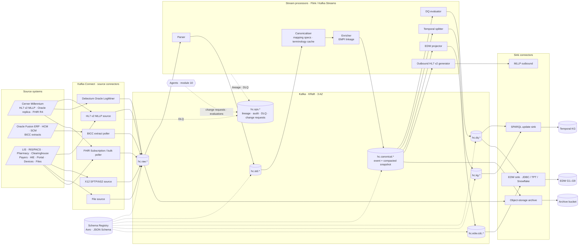

# Module 07 — Streaming Platform

## 1. Purpose and scope

Module 07 specifies the **event backbone** of HEALIX: the Apache Kafka clusters, the layered topic catalog, the Schema
Registry contracts, the change-data-capture (CDC) and interface connectors, and the stream processors that move every
clinical, financial, supply-chain and workforce event from **Cerner Millennium**, **Oracle Fusion Cloud** and the
peripheral systems through `raw → std → canonical → dq → kg / edw → ops`, standardised as **HL7 v2** (inbound and
outbound) and **FHIR R4** (canonical). It implements ADR-04 (layered topics) and ADR-07 (dual projection) from
`01-architecture-overview.md` and is the producer of the **Topic Catalog** cross-module contract (`topics.yaml`).

In scope:

- Kafka topology, tenancy, security, retention, partitioning, ordering and disaster recovery.
- The topic catalog (`topics.yaml` + `topics.schema.json`) and its GitOps lifecycle.
- Schema formats, subject naming, compatibility and the common record envelope and headers.
- Source connectors (Debezium Oracle LogMiner, HL7 v2 MLLP, FHIR Subscription/bulk, Oracle BICC, X12, files) and sink
  connectors (graph store, EDW, object-storage archive), including dead-letter handling and exactly-once.
- Stream processors (parser, canonicaliser, enricher, DQ evaluator, temporal splitter, EDW projector, outbound HL7 v2
  generator), event-time semantics, state, replay and scaling.

Out of scope (owned elsewhere): field-level mapping specifications and FHIR profiles (module 06), DQ rule content
(module 09), the bitemporal graph model and entity resolution (module 08), EDW DDL (module 05), agent behaviour
(module 10), PHI policy (module 11), and cluster operations run-books and SLO dashboards (module 12).

## 2. Documents in this module

| doc_id | File | Contents | Requirement IDs |
|--------|------|----------|-----------------|
| STR-00 | `README.md` | Scope, architecture, tenets, requirement index | — |
| STR-01 | [`01-kafka-topology.md`](01-kafka-topology.md) | Cluster topology, tenancy, security, retention, partitioning, ordering, DR | `STR-TOP-001`–`015`, `STR-OPS-001`–`005` |
| STR-02 | [`02-topic-catalog.md`](02-topic-catalog.md) | Catalog schema, naming, lifecycle, ownership, full initial topic list | `STR-TOP-016`–`030` |
| STR-03 | [`03-schema-registry.md`](03-schema-registry.md) | Formats per layer, subjects, compatibility, evolution, envelope and headers, linting | `STR-SR-001`–`018` |
| STR-04 | [`04-cdc-and-connectors.md`](04-cdc-and-connectors.md) | Source and sink connector catalog, DLQ, exactly-once, monitoring | `STR-CDC-001`–`022`, `STR-OPS-006`–`010` |
| STR-05 | [`05-stream-processing.md`](05-stream-processing.md) | Processor catalog, event time, state, exactly-once, idempotency, replay, scaling | `STR-PROC-001`–`020`, `STR-OPS-011`–`015` |
| — | [`topics.yaml`](topics.yaml) | Machine-readable topic catalog (220 topics) | validated by `topics.schema.json` |
| — | [`topics.schema.json`](topics.schema.json) | JSON Schema 2020-12 for the catalog | — |

## 3. Streaming architecture

Layer semantics (authoritative in `01-architecture-overview.md` §2, refined here):

| Layer | Content | Format | Who writes | Who reads |
|-------|---------|--------|------------|-----------|
| `raw` | Bytes/rows exactly as received, plus provenance headers | Avro envelope (opaque payloads), Avro (CDC/BICC rows) | Source connectors only | Parser, archive |
| `std` | Parsed, structurally validated, typed records; outbound HL7 v2 | Avro (segment model, typed rows, X12 loops), FHIR JSON (validated) | Parser; outbound generator | Canonicaliser, DQ evaluator |
| `canonical` | FHIR R4 resources (US Core + HEALIX profiles) and HEALIX-ERP `fhir-ext` resources; compacted snapshots | FHIR JSON validated by JSON Schema + profile | Canonicaliser, enricher, snapshot compactor | DQ, temporal splitter, EDW projector, outbound generator |
| `dq` | Rule results, issues, scorecards, quarantined records | Avro | DQ evaluator, `agent.dq_monitor` | KG and EDW sinks, `agent.remediator` |
| `kg` | Bitemporal assertions/retractions, load receipts | Avro | Temporal splitter, SPARQL sink | SPARQL sink, `agent.kg_builder` |
| `edw` | Row-shaped CDC per subject-area group | Avro | EDW projector | EDW sink |
| `ops` | Lineage, audit, DLQ, change requests, evaluations, replay, schema events | JSON (OpenLineage, CR schema), Avro | Everything | Governance, agents, SRE |

## 4. Design tenets

1. **Replayability.** `raw` is immutable and retained ≥ 30 days; every downstream layer can be rebuilt from `raw` by
   replaying with the same mapping/rule versions (`ARC-NFR-005`). Compacted `canonical` snapshots give an infinite
   current-state view for late joiners.
2. **Layered contracts.** Each layer has its own schema format, compatibility mode, retention and ACL posture. A
   consumer depends on a layer's registered schema, never on an upstream internal (CONVENTIONS §5).
3. **Exactly-once where it matters.** `std → canonical → dq/kg/edw` runs under Flink checkpoints with transactional
   Kafka producers and `read_committed` consumers; every sink is idempotent on `hc-idempotency-key` (`ARC-NFR-004`).
4. **Event time, not arrival time.** Every record carries `hc-event-time` and `hc-source-time`; processors use
   watermarks and never drop late data; the temporal splitter turns these into valid and transaction time for module 08.
5. **PHI-aware by construction.** Every topic carries a `phi_class`; ACLs, mirroring, masking and archive policy are
   derived from it; `phi_class` values are the module 11 data-classification tags (`phi:direct`, `phi:clinical`,
   `phi:quasi`, `pii:workforce`, `confidential:*`, `internal`, `public`, `deidentified:*`, `pseudonymised`);
   `agent.privacy_guardian` reviews every topic, schema or connector change touching `phi:*` data.
6. **Standards on the wire.** Inbound HL7 v2 and X12 are preserved verbatim in `raw`; everything canonical is FHIR R4;
   outbound legacy consumers receive HL7 v2 generated from canonical resources, never from `raw` pass-through.
7. **Declared, not clicked.** Topics, schemas, connectors and processors are declared in Git (`topics.yaml`, schema
   files, connector manifests, processor manifests) and applied by GitOps; the clusters reject ad-hoc creation.

## 5. Interfaces with other modules

| Direction | Module | Contract |
|-----------|--------|---------|
| consumes | 03 Source Systems | Source Registry feed ids → one `raw` topic per registered feed; table whitelists for CDC |
| consumes | 06 Interoperability | Mapping specs (HL7 v2/CDC/X12 → FHIR), FHIR profiles and JSON Schemas, Terminology Service API |
| consumes | 08 Temporal KG | EMPI/entity-resolution lookup API; assertion/retraction payload schema; named-graph conventions |
| consumes | 09 Data Quality | Rule pack (`rules/*.yaml`) loaded by the DQ evaluator; quarantine and issue schemas |
| consumes | 10 Agentic Pipeline | Change Request schema for topic/schema/connector proposals; evaluator gates |
| consumes | 11 Governance | PHI classification scheme, ACL approval policy, audit event schema, retention law |
| produces | all | Topic Catalog (`topics.yaml`), envelope headers, schema subjects |
| produces | 05 EDW, 08 KG | `hc.edw.cdc.gN.v1`, `hc.kg.assertion.v1`, `hc.kg.retraction.v1` |
| produces | 12 Platform & Ops | Metrics, lineage (`hc.ops.lineage.openlineage.v1`), DLQ topics, replay requests |

## 6. Requirement index

| Range | Area | Document | Count |
|-------|------|----------|-------|
| `STR-TOP-001`–`STR-TOP-015` | Cluster topology, security, retention, partitioning, ordering | STR-01 | 15 |
| `STR-TOP-016`–`STR-TOP-030` | Topic catalog, naming, lifecycle, ownership, defaults | STR-02 | 15 |
| `STR-SR-001`–`STR-SR-018` | Schema Registry formats, subjects, compatibility, evolution, envelope, linting | STR-03 | 18 |
| `STR-CDC-001`–`STR-CDC-022` | Source and sink connectors, DLQ, exactly-once | STR-04 | 22 |
| `STR-PROC-001`–`STR-PROC-020` | Processors, event time, state, idempotency, replay, scaling | STR-05 | 20 |
| `STR-OPS-001`–`STR-OPS-005` | Multi-region/DR, cluster observability | STR-01 | 5 |
| `STR-OPS-006`–`STR-OPS-010` | Connector monitoring and automation | STR-04 | 5 |
| `STR-OPS-011`–`STR-OPS-015` | Processor monitoring, deployment, replay audit | STR-05 | 5 |

P0 requirements in this module and their verification artefacts (CONVENTIONS §6, item 1):

| ID | Summary | Verification artefact |
|----|---------|-----------------------|
| STR-TOP-002 | RF 3 across 3 AZ, `min.insync.replicas=2`, unclean leader election off | `test`: cluster config conformance test in CI |
| STR-TOP-005 / 006 / 007 | mTLS + OIDC via SASL/OAUTHBEARER; deny-by-default prefixed ACLs | `test`: ACL conformance suite per principal |
| STR-TOP-009 | Layer retention policy (raw ≥ 30 d, dq 90 d, ops 7 d, canonical snapshots compacted) | `test`: catalog linter + cluster drift check |
| STR-TOP-016 / 018 | `topics.yaml` is the only way to create topics; validates against schema | `test`: GitOps pipeline + `auto.create.topics.enable=false` check |
| STR-SR-004 / 007 | Compatibility per layer; mandatory envelope headers | `test`: schema CI + header interceptor test |
| STR-CDC-001 / 007 | Debezium on replica only; HL7 ACK after durable write | `test`: connector contract tests |
| STR-PROC-012 / 013 | Exactly-once from `std` to sinks; idempotency key | `test`: chaos test with duplicate/replayed input |
| STR-OPS-001 | Cross-region mirroring with RPO ≤ 15 min | `demo`: quarterly DR exercise |

## 7. Open questions

| # | Question | Owner | Target |
|---|----------|-------|--------|
| OQ-07-01 | Confluent Cluster Linking vs. MirrorMaker 2 for the DR link (licence vs. offset-preservation) | Data Platform | Phase 1 design review |
| OQ-07-02 | Whether the Millennium Oracle replica permits supplemental logging on all whitelisted tables (vendor support statement) | Integration Engineering | Phase 1 |
| OQ-07-03 | Protobuf for high-volume device observations in `std` (compactness) vs. single Avro format per layer | Data Platform | Phase 2 |
| OQ-07-04 | Field-level encryption (client-side) for `phi:direct` topics in addition to at-rest encryption | Privacy & Security | Phase 1 |
