# Bitemporal Model Contract

This document is **the** bitemporal contract for HEALIX. It is referenced as a cross-module contract in
`01-architecture-overview.md` §6 ("Bitemporal graph model", producer 08, consumers 05, 09, 11). Module 05 mirrors
the contract table in §9 in every `hist_*` table; module 09 evaluates DQ rules against the same four timestamps;
module 11 relies on the provenance link for audit. Anything that stores a fact anywhere in HEALIX MUST be
expressible in the terms defined here (ADR-03).

The module-02 document `06-knowledge-graph.md` explains *how* the ontology stage instantiates the graph. This
document deliberately does not repeat that; it specifies the time dimensions, the RDF representation, the
derivation rules from FHIR and Oracle Fusion sources, and the semantics of corrections and retractions.

## 1. Why bitemporal, in one clinical example

On 2026-03-02 a nurse records that a patient's atrial fibrillation began "about January 2026". On 2026-03-20 the
cardiologist reviews an older ECG and corrects the onset to 2025-11-14. On 2026-04-01 a quality analyst asks: *"Did
this patient have AF on 2025-12-01?"* The answer depends on **when you ask**:

| Question asked on | Answer | Why |
|---|---|---|
| 2026-03-10 | No | What the system *knew* then said onset was January 2026 |
| 2026-04-01 | Yes | The correction recorded on 2026-03-20 moved onset to 2025-11-14 |

A snapshot or SCD2-only store can answer only one of these. Clinical audit, claims re-adjudication, quality-measure
re-submission and legal discovery all require both. Hence every assertion carries **valid time** (when the fact was
true in the world) and **transaction time** (when the platform believed it).

## 2. Definitions

| Term | Definition | Property (RDF) | EDW column (module 05) | Kafka header (module 07) |
|---|---|---|---|---|
| **Valid time** | The period during which the asserted fact is/was true in the real world. Half-open interval `[valid_from, valid_to)`. | `healix-time:validFrom`, `healix-time:validTo` | `valid_from`, `valid_to` | — |
| **Transaction time** | The period during which the platform held the assertion as current knowledge. Half-open `[recorded_at, superseded_at)`. Set by the platform, never by the source. | `healix-time:recordedAt`, `healix-time:supersededAt` | `recorded_at`, `superseded_at` | `hc-kg-recorded-at` (set by sink) |
| **Event time** | The instant the originating business event occurred as stamped by the source (e.g. HL7 `MSH-7`, FHIR `meta.lastUpdated`, CDC commit SCN time). Used for stream ordering and watermarks. | `healix-time:eventTime` | `event_time` | `hc-event-time` |
| **Source time** | The instant the *source system* recorded/committed the data (Cerner `UPDT_DT_TM`, Oracle `LAST_UPDATE_DATE`, FHIR `Provenance.recorded`). Often equals event time; differs on back-dated charting and late CDC. | `healix-time:sourceTime` | `source_time` | `hc-source-time` |
| **Decision time** | The instant a clinical, financial or governance *decision* was made that the assertion depends on (order signed, claim adjudicated, merge approved). Optional; present when the FHIR element exists (`authoredOn`, `ClaimResponse.created`, `Consent.dateTime`). | `healix-time:decisionTime` | `decision_time` | — |
| **Assertion** | One (subject, predicate, object) triple together with its temporal annotation and provenance. | `healix-time:BitemporalAssertion` (the RDF-star triple term is the instance) | one `hist_*` row | one `hc.kg.assertion.v1` record |

Rules:

- **Half-open intervals.** `validTo` and `supersededAt` are exclusive. A fact valid on 2026-01-01 only has
  `validFrom = 2026-01-01T00:00:00Z`, `validTo = 2026-01-02T00:00:00Z`.
- **Open-ended intervals** are represented by the *absence* of `validTo` / `supersededAt`, never by sentinel dates
  (`9999-12-31`). EDW mirrors this with `NULL`. Query patterns in `02-graph-store-and-query.md` use
  `FILTER(!BOUND(?to) || ?to > ?asOf)`.
- **Transaction time is monotonic per sink.** `recordedAt` is assigned by the KG sink from its own clock at commit,
  not copied from `hc-event-time`. Late or replayed records therefore get a *new* `recordedAt` and keep their
  original valid time — which is exactly what makes replay safe (see `04-graph-ingestion-from-kafka.md` §6).
- **Precision.** `xsd:dateTime` with millisecond precision; `xsd:date` is permitted on `validFrom`/`validTo` only
  when the source provides a date without time (FHIR `date`, Oracle `DATE` columns) and is normalised to the start of
  day in the **source facility's local zone**, then converted to UTC (§7).

## 3. Representation options compared

| Option | Sketch | Pros | Cons | Verdict |
|---|---|---|---|---|
| **A. RDF-star annotation** | `<< :p :hasCondition :c1 >> healix-time:validFrom "..."` | Native in RDF 1.2 / SPARQL 1.2; one triple term per fact; compact; works with reasoning on the base triple | Needs RDF-star-capable store (all candidates in TKG-02 §2 qualify); annotations are per *triple*, not per *resource* | **Chosen** for valid time, transaction time and provenance per assertion |
| **B. Named graph per version** | Each version of a resource in its own graph; graph node carries times | Store-agnostic; good for bulk load/unload, retention and ACLs | Explodes graph count; a single correction re-materialises the whole resource; cross-version diff is awkward | **Chosen** for the *batch* dimension only: one graph per ingestion batch (CONVENTIONS §3), carrying PROV-O activity |
| **C. N-ary reification** (`rdf:Statement`, or an `Assertion` node with `rdf:subject/predicate/object`) | 4+ triples per fact | Works in RDF 1.1 stores; explicit assertion IRIs | 4–6× storage; SPARQL unreadable; breaks OWL reasoning over the base fact | Rejected as primary; permitted as **export serialisation** for RDF 1.1-only consumers (§10) |
| **D. OWL-Time intervals as first-class nodes** | `:c1 time:hasTime :i1 . :i1 time:hasBeginning ...` | Interoperable with OWL-Time consumers; supports fuzzy/approximate instants (`time:hasTRS`, `time:inXSDDate`) | Models *the condition's* time, not the *assertion's* time; verbose | **Chosen** for *domain* temporal entities only (an Encounter's period, a Contract's term) — these are ordinary facts, themselves annotated per option A |
| **E. Property graph with edge properties** | Edges carry `valid_from`… | Familiar; fast traversal | Not RDF; no shared IRIs with ontology; no SHACL/OWL | Rejected (ADR-02); a labelled-property-graph *projection* MAY be exported |

The hybrid is therefore **A + B + D**: RDF-star triple terms carry the bitemporal annotation and `prov:wasGeneratedBy`;
each assertion lives in the named graph of the batch that produced it; domain-level periods are modelled with OWL-Time.

### 3.1 Canonical assertion shape

```turtle
@prefix healix:      <https://ontology.healix.example.org/> .
@prefix healix-time: <https://ontology.healix.example.org/time/> .
@prefix clin:        <https://ontology.healix.example.org/clinical/> .
@prefix prov:        <http://www.w3.org/ns/prov#> .
@prefix xsd:         <http://www.w3.org/2001/XMLSchema#> .

GRAPH <https://ontology.healix.example.org/graph/cerner-fhir/2026-03-02/01J8Q6Z3M9K2V7XW4R5T6Y8ABC> {
  <https://ontology.healix.example.org/id/condition/cerner/12345678>
      clin:onsetDateTime "2026-01-15T06:00:00Z"^^xsd:dateTime .

  << <https://ontology.healix.example.org/id/condition/cerner/12345678>
       clin:onsetDateTime "2026-01-15T06:00:00Z"^^xsd:dateTime
     ~ <https://ontology.healix.example.org/assertion/01J8Q6Z3M9K2V7XW4R5T6Y8ABC/1> >>
      a healix-time:BitemporalAssertion ;
      healix-time:validFrom   "2026-01-15T06:00:00Z"^^xsd:dateTime ;
      healix-time:recordedAt  "2026-03-02T14:07:11.412Z"^^xsd:dateTime ;
      healix-time:eventTime   "2026-03-02T14:06:58Z"^^xsd:dateTime ;
      healix-time:sourceTime  "2026-03-02T14:06:58Z"^^xsd:dateTime ;
      prov:wasGeneratedBy     <https://ontology.healix.example.org/prov/activity/01J8Q6Z3M9K2V7XW4R5T6Y8ABC> .
}
```

Every assertion MUST have `validFrom`, `recordedAt` and `prov:wasGeneratedBy`. `validTo`, `supersededAt`,
`eventTime`, `sourceTime`, `decisionTime` are present when known. The base triple is *asserted* (not only quoted) so
that reasoning and plain SPARQL work; the triple term annotates it.

**Dialects.** The canonical serialisation is **RDF 1.2**: the assertion is a *named reifier*
`<< s p o ~ <base>assertion/<batch-ulid>/<seq> >>` (the parser expands it to
`<reifier> rdf:reifies <<( s p o )>>`), and `supersedes`/`supersededBy`/`retractedBy` link reifier IRIs. Stores that
implement only the earlier RDF-star Community Group syntax read the same content with `~ <reifier>` dropped; the
triple term `<< s p o >>` is then the assertion itself. Query patterns written as `<< ?s ?p ?o >> healix-time:validFrom ?vf`
are valid in **both** dialects (SPARQL 1.2 treats it as a pattern over any reifier of that triple), which is why
`02-graph-store-and-query.md` uses that form. The reifier IRI is stable across replays (TKG-04 §5) because `<seq>` is
derived from the assertion's position in the sorted batch.

## 4. Vocabulary

Namespace `healix-time:` = `https://ontology.healix.example.org/time/`; defined in `temporal-vocabulary.ttl` in this
folder and published through the Ontology Registry (module 02) as `owl:imports`-able module `healix-time`.

| Term | Type | Range | Aligns to | Meaning |
|---|---|---|---|---|
| `healix-time:BitemporalAssertion` | class | — | `rdfs:subClassOf prov:Entity`; `skos:closeMatch time:TemporalEntity` is **not** asserted (an assertion is not a temporal entity) | The class of annotated triple terms |
| `healix-time:validFrom` | datatype property | `xsd:dateTime` ∪ `xsd:date` | `rdfs:subPropertyOf time:hasBeginning`-shortcut (documented, not axiomatised; OWL-Time range is `time:Instant`) | Inclusive start of valid time |
| `healix-time:validTo` | datatype property | `xsd:dateTime` ∪ `xsd:date` | — | Exclusive end of valid time |
| `healix-time:recordedAt` | datatype property | `xsd:dateTime` | `rdfs:subPropertyOf prov:generatedAtTime` | Inclusive start of transaction time |
| `healix-time:supersededAt` | datatype property | `xsd:dateTime` | `rdfs:subPropertyOf prov:invalidatedAtTime` | Exclusive end of transaction time |
| `healix-time:eventTime` | datatype property | `xsd:dateTime` | — | Business event instant (`hc-event-time`) |
| `healix-time:sourceTime` | datatype property | `xsd:dateTime` | — | Source commit instant (`hc-source-time`) |
| `healix-time:decisionTime` | datatype property | `xsd:dateTime` | — | Decision instant, when applicable |
| `healix-time:supersededBy` | object property | `healix-time:BitemporalAssertion` | `rdfs:subPropertyOf prov:wasRevisionOf` (inverse direction documented) | Links a closed assertion to the one that replaced it |
| `healix-time:retractedBy` | object property | `healix-time:Retraction` | `prov:wasInvalidatedBy` | Links a closed assertion to a retraction event |
| `healix-time:Retraction` | class | — | `rdfs:subClassOf prov:Activity` | A retraction event (§6) |
| `healix-time:changeKind` | datatype property | `healix-time:ChangeKind` (SKOS scheme: `new`, `new-version`, `correction`, `retraction`, `merge`, `unmerge`) | — | Why an assertion was closed |
| `healix-time:validTimeSource` | datatype property | `xsd:string` (FHIRPath or column reference) | — | Audit of which source element produced valid time (§5) |
| `healix-time:validTimePrecision` | datatype property | SKOS scheme: `instant`, `day`, `month`, `year`, `approximate` | `time:TemporalUnit` | How precise the source was |

Reused vocabularies: `time:` (OWL-Time, `http://www.w3.org/2006/time#`) for domain intervals; `prov:` for
activities/agents; `dcterms:` for dates on ontology artefacts only.

## 5. Deriving valid time from source elements

The KG builder (`agent.kg_builder`) MUST apply the following rules; mappings are declared as FHIRPath (or column
reference for `HEALIX-ERP` extension records) and recorded on the assertion as `healix-time:validTimeSource`.

### 5.1 FHIR R4 resources (clinical and administrative)

| Resource / element | `validFrom` | `validTo` | Notes |
|---|---|---|---|
| `Patient` demographics (name, address, telecom) | `Patient.meta.lastUpdated` of the version introducing the value, or `Provenance.recorded` if present | next version's `validFrom` | Demographic facts have no source-asserted validity; use source time as a proxy and flag `validTimePrecision = instant` with `validTimeSource = "meta.lastUpdated"` |
| `Patient.deceasedDateTime` | the value | open | Death is a point fact with open interval |
| `Encounter.period` | `period.start` | `period.end` (absent while `status in (planned, arrived, in-progress)`) | `Encounter.status` and `Encounter.location.period` produce their own assertions; `class` changes mid-stay (ED→inpatient) are new versions |
| `EpisodeOfCare.period` | `period.start` | `period.end` | — |
| `Condition` | `onsetDateTime` \| `onsetPeriod.start` \| `onsetAge` (resolved against `Patient.birthDate`) \| `recordedDate` (fallback, precision=`approximate`) | `abatementDateTime` \| `abatementPeriod.end`; if `clinicalStatus ∈ {resolved, remission, inactive}` and abatement absent, use `meta.lastUpdated` of that version with precision=`approximate` | `clinicalStatus` and `verificationStatus` are separately asserted facts; `verificationStatus = entered-in-error` is a **retraction** (§6) |
| `Observation` | `effectiveDateTime` \| `effectivePeriod.start` \| `effectiveInstant` \| `issued` (fallback) | `effectivePeriod.end` (open otherwise — a lab result does not "expire") | `Observation.status = amended/corrected` ⇒ correction of the prior assertion with the same `identifier`; `cancelled/entered-in-error` ⇒ retraction |
| `DiagnosticReport` | `effective[x]` start | `effective[x]` end | — |
| `Procedure` | `performedDateTime` \| `performedPeriod.start` | `performedPeriod.end` | — |
| `MedicationRequest` | `dispenseRequest.validityPeriod.start` \| `authoredOn` | `dispenseRequest.validityPeriod.end`; `status ∈ {completed, stopped, cancelled}` closes at `statusReason` time if present else `meta.lastUpdated` | `authoredOn` also populates `decisionTime` |
| `MedicationDispense` | `whenHandedOver` \| `whenPrepared` | open (point) | — |
| `MedicationAdministration` | `effectiveDateTime` \| `effectivePeriod.start` | `effectivePeriod.end` | — |
| `AllergyIntolerance` | `onset[x]` \| `recordedDate` | `lastOccurrence` is **not** `validTo`; close only on `clinicalStatus = resolved` | — |
| `Immunization` | `occurrenceDateTime` | open (point) | — |
| `CarePlan.period`, `Goal`, `ServiceRequest.occurrence[x]` | period start | period end | — |
| `Coverage.period` | `period.start` | `period.end` | Open end for active policies; payer `271` responses update as new versions |
| `Claim.billablePeriod` | `billablePeriod.start` (fallback `created`) | `billablePeriod.end` | `Claim.created` populates `decisionTime`; `ClaimResponse.created` likewise |
| `ClaimResponse`, `PaymentReconciliation`, `ExplanationOfBenefit` | `created` | open | Lifecycle states are new versions (§6) |
| `Account.servicePeriod`, `Invoice.date`, `ChargeItem.occurrence[x]` | start | end | — |
| `PractitionerRole.period` | `period.start` | `period.end` | Credential/privilege facts via `Practitioner.qualification.period` |
| `Location`, `Organization` | `meta.lastUpdated` proxy | next version | Address changes are new versions |
| `Appointment`, `Slot` | `start` | `end` | — |
| `Consent.provision.period` | start | end | Consent `status` is a separate assertion |
| `Device`, `DeviceUseStatement.timing[x]` | period start | period end | — |

Fallback order when no explicit element exists: `Provenance.recorded` → `meta.lastUpdated` → `hc-source-time` →
`hc-event-time`, always with `validTimePrecision = approximate` and a DQ observation (`DQR-TIMELINESS-*`, module 09).

### 5.2 Oracle Fusion Cloud (via `HEALIX-ERP` profiles)

Oracle Fusion HCM and parts of ERP are **effective-dated**: a logical row is split into physical rows with
`EFFECTIVE_START_DATE` / `EFFECTIVE_END_DATE` (inclusive, `DATE` precision, end sentinel `31-DEC-4712`). These map
directly onto valid time, with normalisation:

| Fusion object (BICC view / table) | `validFrom` | `validTo` | Notes |
|---|---|---|---|
| `PER_ALL_PEOPLE_F`, `PER_PERSON_NAMES_F`, `PER_ALL_ASSIGNMENTS_M`, `HR_ALL_POSITIONS_F`, `PER_JOBS_F`, `PER_GRADES_F` | `EFFECTIVE_START_DATE` at 00:00 local | `EFFECTIVE_END_DATE + 1 day` at 00:00 local; `31-DEC-4712` ⇒ open | Inclusive→half-open conversion is mandatory. `EFFECTIVE_SEQUENCE`/`EFFECTIVE_LATEST_CHANGE` order same-day changes; the latest sequence wins as current, earlier same-day rows are *corrections* (§6) |
| `PER_PERIODS_OF_SERVICE` | `DATE_START` | `ACTUAL_TERMINATION_DATE + 1 day` | Employment relationship |
| Supplier (`POZ_SUPPLIERS`, `POZ_SUPPLIER_SITES_ALL_M`) | `CREATION_DATE` (proxy) or `START_DATE_ACTIVE` where present | `END_DATE_ACTIVE + 1 day`; `INACTIVE_DATE` closes | — |
| Supplier contracts (`OKC_K_HEADERS_ALL_B`) | `START_DATE` | `END_DATE + 1 day` | Contract versions (`MAJOR_VERSION`) are new versions, amendments are new versions, "fix typo" edits flagged by `agent.source_mapper` are corrections |
| Purchase orders (`PO_HEADERS_ALL`, `PO_LINES_ALL`) | `APPROVED_DATE` (fallback `CREATION_DATE`) | `CLOSED_DATE + 1 day` | `APPROVED_DATE` → `decisionTime` |
| Items (`EGP_SYSTEM_ITEMS_B`), price lists | `CREATION_DATE` / `START_DATE_ACTIVE` | `END_DATE_ACTIVE + 1 day` | — |
| GL balances / journals (`GL_BALANCES`, `GL_JE_HEADERS`, `GL_PERIODS`) | `GL_PERIODS.START_DATE` of `PERIOD_NAME` | `GL_PERIODS.END_DATE + 1 day` | Valid time is the **accounting period**; `POSTED_DATE` → `decisionTime`; an adjustment journal posted into a closed period keeps the period as valid time and a later `recordedAt` — the canonical bitemporal case in finance |
| Fixed assets (`FA_BOOKS`) | `DATE_EFFECTIVE` | `DATE_INEFFECTIVE` | Already half-open-ish; verify per column |
| Non-effective-dated rows (`AP_INVOICES_ALL`, `AR_CASH_RECEIPTS_ALL`) | `LAST_UPDATE_DATE` proxy | next version | precision=`instant`, source=`LAST_UPDATE_DATE` |

### 5.3 Cerner Millennium CDC rows (when FHIR is not the capture path)

`BEG_EFFECTIVE_DT_TM` / `END_EFFECTIVE_DT_TM` (Cerner's convention; `END_EFFECTIVE_DT_TM = 2100-12-31` means open)
map to `validFrom`/`validTo` after sentinel removal. `UPDT_DT_TM` → `sourceTime`. `ACTIVE_IND = 0` with an
`END_EFFECTIVE_DT_TM` in the past closes the interval; `ACTIVE_IND = 0` with a *future* end date is a logical delete
and is treated as a **retraction**.

### 5.4 Transaction time

`recordedAt` is **always** assigned by the KG sink at commit (§2). `sourceTime` copies `hc-source-time`; `eventTime`
copies `hc-event-time`. The sink MUST reject (to the DLQ) any record whose `hc-source-time` is missing or more than
24 h in the future relative to the sink clock (clock-skew guard; threshold configurable per source).

## 6. Change semantics

Three kinds of change close an assertion's transaction time. The distinction is the single most important thing
downstream consumers must respect, so it is carried explicitly as `healix-time:changeKind`.

```mermaid
stateDiagram-v2
  [*] --> Current: assert (recordedAt = now)
  Current --> Superseded_NewVersion: new version (valid time of old closed at new validFrom)
  Current --> Superseded_Correction: correction (valid time unchanged; old belief closed)
  Current --> Retracted: retraction (never true; transaction time closed, valid time kept)
  Superseded_NewVersion --> [*]
  Superseded_Correction --> [*]
  Retracted --> [*]
```



### 6.1 New version (the world changed)

The patient moved; the encounter class changed from emergency to inpatient; the supplier contract was amended. The
old assertion's **valid time is closed** at the new fact's `validFrom`, *and* its transaction time is closed at
`recordedAt` of the change. A new assertion is created with its own open intervals. Both remain queryable: the old
one is true for its valid window and was believed for its transaction window.

### 6.2 Correction (our knowledge was wrong)

The onset date was mis-charted; the GL amount was keyed wrongly; the supplier's DUNS was mistyped. The old
assertion's **valid time is left untouched** (it describes what we *claimed* was true), its transaction time is
closed, and a new assertion is created whose valid time reflects the corrected truth — typically overlapping or
replacing the old valid window. `changeKind = correction`, `supersededBy` links old → new.

Detection rules for correction vs new version (applied by the ingestion processor, overridable per mapping):

| Signal | Interpretation |
|---|---|
| FHIR `Observation.status = corrected/amended`, `DocumentReference.relatesTo.code = replaces`, `Provenance.activity = REVISE` with reason `CORRECT` | correction |
| Fusion same-day `EFFECTIVE_SEQUENCE` increment, or `EFFECTIVE_LATEST_CHANGE='Y'` replacing a row with identical `EFFECTIVE_START_DATE` | correction |
| Fusion new `EFFECTIVE_START_DATE` | new version |
| New value whose source-asserted valid start is **earlier than or equal to** the prior version's start and the prior version was recorded < 72 h ago | correction (heuristic; configurable) |
| Anything else | new version |

### 6.3 Retraction (it was never true)

`Condition.verificationStatus = entered-in-error`, `Observation.status = entered-in-error`, Cerner logical delete of a
wrongly-registered encounter, a duplicate supplier record found by entity resolution. The assertion's transaction time
is closed and it is linked to a `healix-time:Retraction` activity; **valid time is preserved** so "what did we
believe on X" still works. A retraction is published on `hc.kg.retraction.v1` and MUST NOT physically delete the
triple term or its annotation; the base (unannotated) triple MAY be removed from the *current-state* view (§8).

Retractions are themselves provenance-bearing: `prov:wasAssociatedWith` the agent or user, `prov:used` the source
record that triggered it, `healix-time:changeKind = retraction`.

### 6.4 Merge / unmerge (entity resolution)

Linking two Patient IRIs changes *which subject* a fact is about without changing the fact. Merge and unmerge are
asserted as temporal events on `healix:linkedTo`/`owl:sameAs` statements (see `03-entity-resolution.md` §6), never
by rewriting subjects of existing assertions.

## 7. Time zones and calendars

- Store UTC (`Z`). Preserve the source offset or IANA zone as `healix-time:sourceTimeZone` on the assertion when the
  source supplied one (FHIR offsets, Cerner `TZ` column, Fusion `TIMEZONE_CODE`), because clinical day boundaries
  (midnight census, DRG day counts) are computed in facility-local time.
- Date-only values are expanded to local midnight **in the facility's zone** (looked up from `Location`/`Organization`
  in G1), then converted to UTC. The facility zone used MUST be recorded in `sourceTimeZone`.
- Accounting periods use the ledger's calendar (`GL_PERIODS`) — never recomputed from Gregorian months.
- Leap seconds are not represented; sources that emit `23:59:60` are normalised to `23:59:59.999`.
- Partial dates from HL7 v2 (`TS` with `YYYYMM`) carry `validTimePrecision = month` and the interval is widened to
  the whole month; DQ rules may flag them for completeness but they are valid assertions.

## 8. Views over the bitemporal store

| View | Definition | Who uses it |
|---|---|---|
| **Current** | `recordedAt ≤ now ∧ supersededAt unbound ∧ validFrom ≤ now ∧ (validTo unbound ∨ validTo > now)` | Dashboards, GraphQL facade default |
| **As-of (valid)** | valid time contains `T`, transaction time contains `now` | "What was the patient's state on T, given everything we now know" |
| **As-known (transaction)** | transaction time contains `T_k` | Audit: "what did we believe on T_k" |
| **Bitemporal point** | valid contains `T_v` and transaction contains `T_k` | Re-adjudication: "what did we believe on T_k about state on T_v" |
| **Full history** | no filter | Lineage, DQ drift analysis |

The graph store MAY materialise the **Current** view into a separate named graph
`<base>graph/current/<group>` for performance (TKG-02 §4); the materialisation is derived and rebuildable.

## 9. The contract table (mirrored by module 05 `hist_*` tables and module 09 DQ rules)

| # | Clause | KG realisation | EDW realisation (module 05) | DQ rule family (module 09) |
|---|---|---|---|---|
| C1 | Every fact carries `validFrom` | `healix-time:validFrom` on the triple term | `valid_from TIMESTAMP(3) WITH TIME ZONE NOT NULL` | `DQR-COMPLETENESS-TEMPORAL-*` |
| C2 | `validTo` exclusive, NULL = open | `healix-time:validTo` optional | `valid_to … NULL` | `DQR-VALIDITY-TEMPORAL-001` (`valid_to > valid_from`) |
| C3 | `recordedAt` set by sink clock | `healix-time:recordedAt` | `recorded_at … NOT NULL DEFAULT CURRENT_TIMESTAMP` | `DQR-TIMELINESS-*` (recordedAt − eventTime) |
| C4 | `supersededAt` exclusive, NULL = current | `healix-time:supersededAt` | `superseded_at … NULL` | `DQR-CONSISTENCY-TEMPORAL-002` (no two current rows for same `(bk, attribute)`) |
| C5 | Provenance reference mandatory | `prov:wasGeneratedBy <activity IRI>` | `prov_activity_iri VARCHAR(256) NOT NULL` | `DQR-COMPLETENESS-PROV-001` |
| C6 | Change kind explicit | `healix-time:changeKind` | `change_kind CHAR(12)` from the same SKOS scheme | `DQR-VALIDITY-TEMPORAL-003` |
| C7 | Event/source time preserved | `healix-time:eventTime/sourceTime` | `event_time`, `source_time` | timeliness |
| C8 | Decision time when available | `healix-time:decisionTime` | `decision_time NULL` | — |
| C9 | No overlapping valid intervals for the same `(subject, functional predicate)` within one transaction-time slice | SHACL-SPARQL shape `healix-shape:NoOverlapFunctional` | `UNIQUE`-like check in DQ (`DQR-CONSISTENCY-TEMPORAL-001`) | consistency |
| C10 | Retractions preserve valid time | `healix-time:retractedBy` | row kept with `change_kind='retraction'`, `superseded_at` set | — |
| C11 | Same business key and ontology IRI in both projections | subject IRI pattern `<base>id/<entity>/<source>/<natural-id>` | `*_bk` column carries the same natural id; `ontology_iri` column | reconciliation (TKG-04 §7) |
| C12 | UTC storage, source zone kept | `healix-time:sourceTimeZone` | `source_tz VARCHAR(64)` | — |

A change to this table is a **breaking contract change** (CONVENTIONS §5): major version bump of TKG-01, new
`hc.kg.*.v2` topics, and coordinated migration of module 05 DDL.

## 10. Allen interval relations for queries

Queries over valid time use Allen's thirteen relations expressed in SPARQL over `validFrom`/`validTo`. The following
six (plus their inverses) are provided as reusable **SPARQL functions** (`healix-fn:`) implemented as store-side
custom functions or, where unsupported, as macro templates expanded by the facade:

| Relation `X r Y` | Condition on half-open intervals `[xs,xe)`,`[ys,ye)` | Healthcare use |
|---|---|---|
| `during` | `xs ≥ ys ∧ xe ≤ ye` | Observation during Encounter; purchase order during contract term |
| `overlaps` | `xs < ys ∧ xe > ys ∧ xe < ye` | Two coverages overlapping (COB determination) |
| `meets` | `xe = ys` | Assignment changes in HCM with no gap |
| `before` | `xe ≤ ys` | Condition onset before encounter admission (present-on-admission) |
| `contains` (inverse of during) | `xs ≤ ys ∧ xe ≥ ye` | Encounter containing a procedure |
| `equals` | `xs = ys ∧ xe = ye` | Duplicate detection |
| `intersects` (derived) | `xs < ye ∧ ys < xe` | Generic "was active at any time in window" |

Open ends (`xe` unbound) are treated as `+∞` by the functions; implementations MUST use `COALESCE(?xe, "9999-12-31T00:00:00Z"^^xsd:dateTime)` *only inside the function body*, never in stored data.

## 11. Export to RDF 1.1 consumers

Partners without RDF-star support receive the **n-ary reification** form (option C) generated on export:
`[] a healix-time:BitemporalAssertion ; rdf:subject s ; rdf:predicate p ; rdf:object o ; healix-time:validFrom … ]`.
The mapping is lossless and defined in `temporal-vocabulary.ttl` comments; the GraphQL facade (TKG-02 §6) hides the
difference.

## 12. Requirements

> **TKG-TIME-001** (P0, test) — Every assertion loaded into the knowledge graph MUST carry `healix-time:validFrom`,
> `healix-time:recordedAt` and `prov:wasGeneratedBy` on its RDF-star triple term; the SHACL shape
> `healix-shape:BitemporalAssertionShape` MUST reject loads that violate this.

> **TKG-TIME-002** (P0, test) — Valid and transaction intervals MUST be half-open; `validTo` and `supersededAt`
> MUST be absent (not a sentinel) for open intervals. Loads containing `9999-12-31` or `4712-12-31` MUST be rejected.

> **TKG-TIME-003** (P0, test) — `recordedAt` MUST be assigned by the KG sink at commit time and MUST be
> monotonically non-decreasing per sink partition; it MUST NOT be copied from `hc-event-time` or `hc-source-time`.

> **TKG-TIME-004** (P0, test) — Valid time MUST be derived from the source element tables in §5.1–§5.3; the element
> used MUST be recorded in `healix-time:validTimeSource` and its precision in `healix-time:validTimePrecision`.

> **TKG-TIME-005** (P0, test) — Oracle Fusion inclusive `EFFECTIVE_END_DATE` values MUST be converted to exclusive
> `validTo` by adding one day in the ledger/legal-entity local zone; the sentinel `4712-12-31` MUST map to an open
> interval.

> **TKG-TIME-006** (P0, test) — Every closing of an assertion MUST be classified with `healix-time:changeKind` ∈
> {`new-version`, `correction`, `retraction`, `merge`, `unmerge`} following §6; a correction MUST NOT alter the
> closed assertion's valid time.

> **TKG-TIME-007** (P0, test) — A retraction MUST close transaction time, preserve valid time, link
> `healix-time:retractedBy` to a `healix-time:Retraction` activity, and MUST NOT physically delete the triple term.

> **TKG-TIME-008** (P0, test) — All stored timestamps MUST be UTC `xsd:dateTime`; when the source supplied an offset
> or zone, it MUST be retained in `healix-time:sourceTimeZone`. Date-only values MUST be expanded using the
> facility's IANA zone.

> **TKG-TIME-009** (P0, analysis) — The contract table in §9 is the authoritative mapping between KG annotation
> properties and EDW `hist_*` columns; module 05 DDL MUST contain every column listed, with the stated nullability.

> **TKG-TIME-010** (P1, test) — For functional properties (declared `owl:FunctionalProperty` or SHACL `sh:maxCount 1`)
> the store MUST reject two assertions with overlapping valid time for the same subject that are both current in
> transaction time (contract clause C9).

> **TKG-TIME-011** (P1, test) — The platform MUST provide the Allen relation functions in §10 as SPARQL extension
> functions or facade macros, with open intervals treated as unbounded.

> **TKG-TIME-012** (P1, test) — Records whose `hc-source-time` is missing or more than 24 h ahead of the sink clock
> MUST be routed to the dead-letter topic with reason `TEMPORAL_SKEW`.

> **TKG-TIME-013** (P1, inspection) — `decisionTime` MUST be populated for `MedicationRequest.authoredOn`,
> `Claim.created`, `ClaimResponse.created`, `Consent.dateTime`, Fusion `PO_HEADERS_ALL.APPROVED_DATE` and
> `GL_JE_HEADERS.POSTED_DATE`.

> **TKG-TIME-014** (P2, demo) — Export to RDF 1.1 consumers MUST use the n-ary reification form in §11 and MUST be
> round-trippable back to the RDF-star form without loss.

> **TKG-TIME-015** (P0, analysis) — Any change to §4 vocabulary or §9 contract table MUST follow CONVENTIONS §5 as a
> breaking change (major version, `hc.kg.*.v2`, coordinated EDW migration) and MUST pass the module 11 privacy review.
