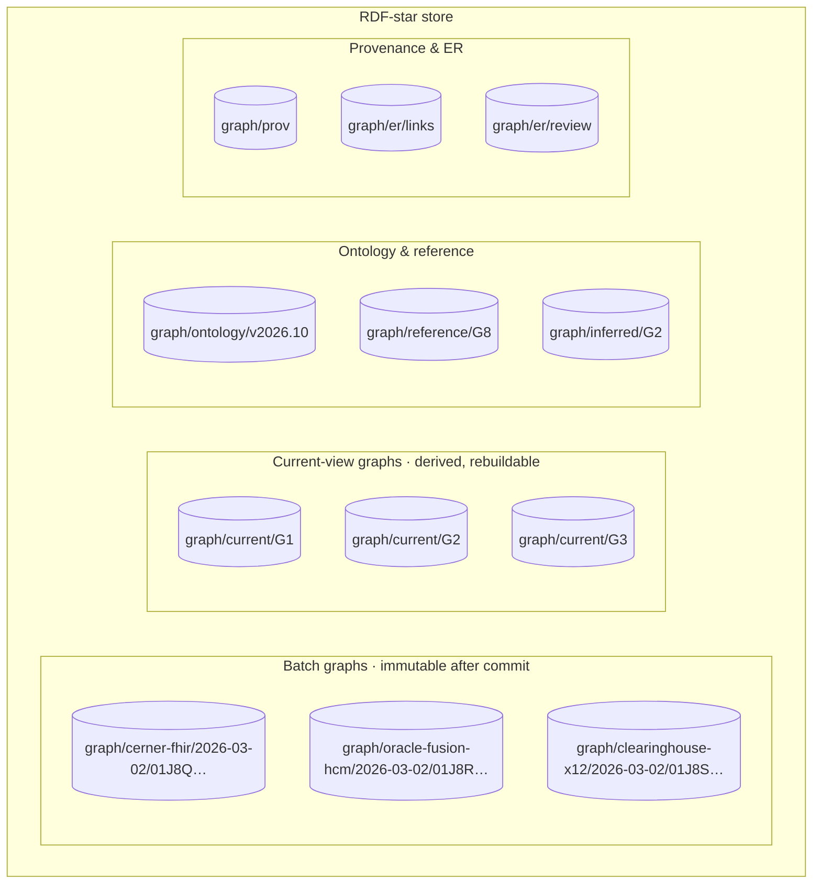

# Graph Store and Query Layer

This document specifies the RDF-star graph store that persists the bitemporal assertions defined in TKG-01, how it is
partitioned and indexed, the query patterns the platform guarantees, the GraphQL/REST facade, access control at
named-graph granularity, and performance SLOs. Hosting, DR and observability mechanics are in module 12; this
document states what the store must *do*.

## 1. Store capability requirements

| Capability | Requirement | Rationale |
|---|---|---|
| Data model | RDF 1.2 with triple terms (RDF-star); quads (named graphs) | TKG-01 §3 hybrid: annotation on triple terms, batch in named graph |
| Query | SPARQL 1.2 Query & Update including triple-term patterns `<< ?s ?p ?o >>` and annotation syntax `{\| \|}`; SPARQL 1.1 Federated Query (`SERVICE`) for the Terminology Service and EDW-SQL bridge | Query patterns in §5 |
| Scale | ≥ 10 B triples total (≈ 2 B base triples + ≈ 8 B annotation triples, 5-year retention); ≥ 50 M named graphs | 5,000 resources/s × ~40 triples × 5 annotations, see §3 sizing |
| Transactions | ACID per SPARQL UPDATE request; bulk load of ≥ 200 M triples/h with atomic visibility per batch graph | Idempotent sink (TKG-04 §5); reconciliation needs batch atomicity |
| Reasoning | RDFS-Plus / OWL 2 RL **at load time (forward chaining, materialised)** over base triples only; annotations are never reasoned over; inferred triples land in `<base>graph/inferred/<group>` and are marked `healix-time:derived true` | Query-time reasoning is too slow at 10 B; annotations must not be inferred |
| Validation | SHACL Core + SHACL-SPARQL on ingest (TKG-04 §3), store-side or sidecar | TKG-TIME-001, TKG-TIME-010 |
| Full-text | Lucene/Elasticsearch-style connector over `rdfs:label`, `skos:*Label`, FHIR `text.div` (PHI-classified), with per-named-graph filtering | Practitioner/organization search; ER blocking (TKG-03 §3) |
| Geospatial | GeoSPARQL 1.1 `geo:asWKT` for `Location.position` and supplier/facility addresses — **optional** in release 1 | Catchment and site analytics (G4, G6) |
| Security | Named-graph ACLs, OIDC/OAuth2 bearer auth, per-query audit log, row-level (graph-level) filtering pushed into the query planner | module 11 |
| HA / DR | Active-passive cluster, RPO ≤ 15 min (ARC-NFR-007), point-in-time restore by batch ULID | module 12 |
| Export | TriG, N-Quads, RDF 1.1 reification export (TKG-01 §11), LPG (openCypher/GraphSON) projection | partner and analytics consumers |

### 1.1 Candidate products (vendor-swappable behind the SPARQL endpoint and the ingestion API)

| Product | RDF-star / SPARQL-star | Named graphs | OWL RL at load | Full-text | Notes |
|---|---|---|---|---|---|
| Ontotext GraphDB (EE) | Yes (RDF-star since 9.x) | Yes | Yes (rulesets) | Lucene/Elastic connectors | Default reference implementation for this PRD |
| Stardog | Yes | Yes | Yes (query-time or materialised) | Built-in | Virtual graphs useful for the EDW bridge |
| Amazon Neptune | Partial (RDF-star not GA at time of writing — verify) | Yes | No (external) | Via OpenSearch | Managed; may need reification fallback |
| OpenLink Virtuoso | Partial | Yes | Limited | Built-in | High scale; verify SPARQL-star conformance |
| Apache Jena Fuseki/TDB2 | Yes (RDF-star) | Yes | Rules engine | Lucene | Reference/test harness only (single node) |
| Oxigraph / QLever | RDF-star in Oxigraph | Yes | No | No | Test harness / read replicas |

Selection is a module-12 procurement decision; **conformance tests in §8 are the acceptance gate**, not the brand.

## 2. Logical layout



| Graph family | IRI pattern | Mutability | Contents |
|---|---|---|---|
| Batch | `<base>graph/<source>/<yyyy-mm-dd>/<batch-ulid>` (CONVENTIONS §3) | Append-only; closing an assertion adds `supersededAt` to its annotation **in the original batch graph** | Base triples + RDF-star annotations for one ingestion batch |
| Current view | `<base>graph/current/<Gn>` | Derived; rebuilt from batch graphs | Base triples whose assertions are current (TKG-01 §8) — no annotations |
| Ontology | `<base>graph/ontology/<version>` | Replaced per release (module 02) | OWL/SKOS/SHACL |
| Reference | `<base>graph/reference/G8` | Managed by Terminology Service sync | Code systems, value sets, calendars |
| Inferred | `<base>graph/inferred/<Gn>` | Rebuilt on ontology release or on demand | OWL RL closure over current view |
| Provenance | `<base>graph/prov` | Append-only | PROV-O activities, agents, bundles per batch |
| ER | `<base>graph/er/links`, `<base>graph/er/review` | Append-only (links are bitemporal assertions) | `healix:linkedTo`, `owl:sameAs`, review-queue items |

Writing `supersededAt` into the *original* batch graph (rather than a new one) keeps every assertion's full lifecycle
in one graph and makes "export batch X" self-contained. The write that closes it is itself recorded in the PROV
graph with the closing batch's activity.

## 3. Partitioning, sharding and indexes

**Sizing basis.** 5,000 canonical resources/s (ARC-NFR-002) × 60 % producing new assertions × ~35 base triples ×
(1 base + 5 annotation triples) ≈ 630 k triples/s peak, ≈ 2.5 B triples/month before compaction of non-changing
re-sends (TKG-04 §5 dedups ~70 %). Five-year retention therefore lands near 10 B triples.

| Dimension | Strategy |
|---|---|
| **Group** | One logical repository per subject-area group `G1`–`G9` is **not** used (cross-group joins — patient ↔ claim ↔ coverage — are the point). Instead, a single repository with graph-family naming; stores that support *graph-set partitioning* assign `G1/G8` (conformed, hot, small) to replicated shards and `G2/G3` (large, append-heavy) to range shards |
| **Time** | Batch graph IRIs embed the date; monthly **graph buckets** allow cold batch graphs (> 24 months) to be moved to a cheaper tier or archived to object storage as N-Quads and *re-mountable* for as-known queries. Current-view and inferred graphs stay hot |
| **Hot/cold split** | Current-view graphs (~15 % of triples) carry 90 % of queries; they MUST be on the fastest tier and are fully indexed |
| **Indexes** | Mandatory: `SPOC`, `POSC`, `OSPC`, `CSPO` (named-graph first for ACL pushdown), plus a **triple-term index** so `<< ?s ?p ?o >> healix-time:supersededAt ?x` resolves without scanning annotations. Literal range index on `xsd:dateTime` for all `healix-time:*` properties (as-of filters). Full-text index on label properties |
| **Business-key index** | A secondary index on `healix:businessKey` (string) — the `*_bk` value shared with the EDW — for ER lookups and reconciliation |
| **Replication** | ≥ 2 read replicas serving SPARQL/GraphQL; writes only via the sink |

## 4. Current-view materialisation

The sink maintains `graph/current/<Gn>` incrementally: on `assert`, insert the base triple; on `supersede`/`retract`
delete it (if no other current assertion of the same triple exists). A nightly job rebuilds each current graph from
batch graphs and compares counts (TKG-04 §7) so drift between derived and authoritative data is detected, not
assumed away. Queries that need **only** current state MUST be written against `graph/current/*` for performance;
queries with temporal predicates MUST use the batch graphs via annotation patterns.

## 5. Query patterns (guaranteed, tested)

All examples use these prefixes:

```sparql
PREFIX healix:      <https://ontology.healix.example.org/>
PREFIX healix-time: <https://ontology.healix.example.org/time/>
PREFIX clin:        <https://ontology.healix.example.org/clinical/>
PREFIX fin:         <https://ontology.healix.example.org/finance/>
PREFIX sup:         <https://ontology.healix.example.org/supply/>
PREFIX wf:          <https://ontology.healix.example.org/workforce/>
PREFIX party:       <https://ontology.healix.example.org/party/>
PREFIX prov:        <http://www.w3.org/ns/prov#>
PREFIX xsd:         <http://www.w3.org/2001/XMLSchema#>
PREFIX sct:         <http://snomed.info/id/>
```

The temporal filter idiom used throughout (valid at `?asOf`, current knowledge):

```sparql
# reusable fragment: VALID_AT(?asOf) + CURRENT_KNOWLEDGE
<< ?s ?p ?o >> healix-time:validFrom ?vf ; healix-time:recordedAt ?ra .
OPTIONAL { << ?s ?p ?o >> healix-time:validTo ?vt }
OPTIONAL { << ?s ?p ?o >> healix-time:supersededAt ?sa }
FILTER ( ?vf <= ?asOf && ( !BOUND(?vt) || ?vt > ?asOf ) )
FILTER ( !BOUND(?sa) )
```

> **Syntax note.** The pattern `<< ?s ?p ?o >> healix-time:validFrom ?vf` is valid in both the RDF-star Community
> Group dialect (where it matches the triple term) and in SPARQL 1.2 (where it matches *any reifier* of the triple —
> equivalent to `?r rdf:reifies <<( ?s ?p ?o )>> . ?r healix-time:validFrom ?vf`). Data is serialised with named
> reifiers `<< s p o ~ <base>assertion/<ulid>/<seq> >>` (TKG-01 §3.1, `examples.trig`); when a query needs the
> assertion's identity (e.g. to follow `supersededBy`) it binds it with `<< ?s ?p ?o ~ ?assertion >>`. The facade (§6)
> MUST abstract the dialect, and the conformance suite (§8) runs both where the store supports them. The §5.3 queries
> were executed against `examples.trig` with Oxigraph (RDF 1.2) during authoring and return the documented rows.

### 5.1 As-of patient clinical state

"Active conditions and medication requests for patient `P` valid at 2026-02-01T07:00Z, as currently known."

```sparql
SELECT ?kind ?item ?code ?display ?vf ?vt
WHERE {
  BIND(<https://ontology.healix.example.org/id/patient/empi/01HZX7K3> AS ?pt)
  BIND("2026-02-01T07:00:00Z"^^xsd:dateTime AS ?asOf)
  {
    BIND("Condition" AS ?kind)
    ?item a clin:Condition ; clin:subject ?pt ; clin:code ?code .
    << ?item clin:clinicalStatus clin:ClinicalStatus_active >> healix-time:validFrom ?vf .
    OPTIONAL { << ?item clin:clinicalStatus clin:ClinicalStatus_active >> healix-time:validTo ?vt }
    OPTIONAL { << ?item clin:clinicalStatus clin:ClinicalStatus_active >> healix-time:supersededAt ?sa }
  } UNION {
    BIND("MedicationRequest" AS ?kind)
    ?item a clin:MedicationRequest ; clin:subject ?pt ; clin:medicationCode ?code .
    << ?item clin:status clin:MedicationRequestStatus_active >> healix-time:validFrom ?vf .
    OPTIONAL { << ?item clin:status clin:MedicationRequestStatus_active >> healix-time:validTo ?vt }
    OPTIONAL { << ?item clin:status clin:MedicationRequestStatus_active >> healix-time:supersededAt ?sa }
  }
  FILTER ( ?vf <= ?asOf && ( !BOUND(?vt) || ?vt > ?asOf ) && !BOUND(?sa) )
  OPTIONAL { ?code skos:prefLabel ?display }
}
ORDER BY ?kind ?vf
```

### 5.2 Encounter timeline with location moves

```sparql
SELECT ?enc ?class ?loc ?from ?to
WHERE {
  ?enc a clin:Encounter ; clin:subject <https://ontology.healix.example.org/id/patient/empi/01HZX7K3> .
  ?enc clin:location ?locRef .
  ?locRef clin:locationRef ?loc .
  << ?locRef clin:locationRef ?loc >> healix-time:validFrom ?from .
  OPTIONAL { << ?locRef clin:locationRef ?loc >> healix-time:validTo ?to }
  OPTIONAL { << ?locRef clin:locationRef ?loc >> healix-time:supersededAt ?sa }
  FILTER(!BOUND(?sa))
  ?enc clin:class ?class .
}
ORDER BY ?enc ?from
```

### 5.3 Retroactive correction diff — "what did we know on date X" vs now

Given the AF example in TKG-01 §1, return both beliefs about onset:

```sparql
SELECT ?onset ?recordedAt ?supersededAt ?changeKind
       (IF(?recordedAt <= ?knownAt && (!BOUND(?supersededAt) || ?supersededAt > ?knownAt), "believed-on-X", "not-believed-on-X") AS ?beliefOnX)
       (IF(!BOUND(?supersededAt), "current", "superseded") AS ?beliefNow)
WHERE {
  BIND(<https://ontology.healix.example.org/id/condition/cerner/12345678> AS ?cond)
  BIND("2026-03-10T00:00:00Z"^^xsd:dateTime AS ?knownAt)
  ?cond clin:onsetDateTime ?onset .
  << ?cond clin:onsetDateTime ?onset >> healix-time:recordedAt ?recordedAt .
  OPTIONAL { << ?cond clin:onsetDateTime ?onset >> healix-time:supersededAt ?supersededAt }
  OPTIONAL { << ?cond clin:onsetDateTime ?onset >> healix-time:changeKind ?changeKind }
}
ORDER BY ?recordedAt
```

Expected result on `examples.trig`: two rows — `2026-01-15` (believed-on-X, superseded, `correction`) and
`2025-11-14` (not-believed-on-X, current).

A generalised **as-known diff** between two transaction instants `?t1 < ?t2` for one patient:

```sparql
SELECT ?s ?p ?o ?delta
WHERE {
  BIND("2026-03-10T00:00:00Z"^^xsd:dateTime AS ?t1)
  BIND("2026-04-01T00:00:00Z"^^xsd:dateTime AS ?t2)
  ?s clin:subject <https://ontology.healix.example.org/id/patient/empi/01HZX7K3> .
  ?s ?p ?o .
  << ?s ?p ?o >> healix-time:recordedAt ?ra .
  OPTIONAL { << ?s ?p ?o >> healix-time:supersededAt ?sa }
  BIND( (?ra <= ?t1 && (!BOUND(?sa) || ?sa > ?t1)) AS ?atT1 )
  BIND( (?ra <= ?t2 && (!BOUND(?sa) || ?sa > ?t2)) AS ?atT2 )
  FILTER( ?atT1 != ?atT2 )
  BIND( IF(?atT2, "added", "removed") AS ?delta )
}
```

### 5.4 Claim lifecycle

```sparql
SELECT ?claim ?status ?decisionTime ?recordedAt ?coverageBelieved
WHERE {
  BIND(<https://ontology.healix.example.org/id/claim/clearinghouse/CLM-2026-0097714> AS ?claim)
  ?claim fin:status ?status .
  << ?claim fin:status ?status >> healix-time:recordedAt ?recordedAt .
  OPTIONAL { << ?claim fin:status ?status >> healix-time:decisionTime ?decisionTime }
  # which coverage did we believe applied when this status was recorded?
  ?claim fin:patient ?pt .
  ?cov a fin:Coverage ; fin:beneficiary ?pt ; fin:payor ?coverageBelieved .
  << ?cov fin:status fin:CoverageStatus_active >> healix-time:validFrom ?cvf ; healix-time:recordedAt ?cra .
  OPTIONAL { << ?cov fin:status fin:CoverageStatus_active >> healix-time:validTo ?cvt }
  OPTIONAL { << ?cov fin:status fin:CoverageStatus_active >> healix-time:supersededAt ?csa }
  ?claim fin:billablePeriodStart ?svc .
  FILTER( ?cvf <= ?svc && (!BOUND(?cvt) || ?cvt > ?svc) )               # valid on service date
  FILTER( ?cra <= ?recordedAt && (!BOUND(?csa) || ?csa > ?recordedAt) )  # believed at decision
}
ORDER BY ?recordedAt
```

### 5.5 Supplier-contract validity joined with purchase orders (Allen `during` violated)

```sparql
SELECT ?po ?poDate ?contract ?cFrom ?cTo ?learnedExpiryAt
WHERE {
  ?po a sup:PurchaseOrder ; sup:againstContract ?contract ; sup:approvedDate ?poDate .
  ?contract a sup:SupplierContract .
  ?contract sup:term ?term .
  << ?contract sup:term ?term >> healix-time:validFrom ?cFrom ; healix-time:recordedAt ?cRec .
  OPTIONAL { << ?contract sup:term ?term >> healix-time:validTo ?cTo }
  OPTIONAL { << ?contract sup:term ?term >> healix-time:supersededAt ?cSup }
  FILTER(!BOUND(?cSup))
  # PO not DURING contract term
  FILTER( ?poDate < ?cFrom || (BOUND(?cTo) && ?poDate >= ?cTo) )
  # when did we first record the end date? (transaction time of the closing)
  OPTIONAL {
    << ?contract sup:term ?term >> healix-time:validTo ?cTo .
    << ?contract sup:term ?term >> healix-time:validToRecordedAt ?learnedExpiryAt .
  }
}
```

(`healix-time:validToRecordedAt` is written by the sink when it closes valid time later than the original assertion,
so that "when did we learn it ended" is answerable without scanning PROV.)

### 5.6 Workforce credential expiry vs active assignment

```sparql
SELECT ?worker ?position ?credential ?credTo
WHERE {
  BIND("2026-10-17T00:00:00Z"^^xsd:dateTime AS ?asOf)
  ?asg a wf:Assignment ; wf:worker ?worker ; wf:position ?position .
  << ?asg wf:status wf:AssignmentStatus_active >> healix-time:validFrom ?aFrom .
  OPTIONAL { << ?asg wf:status wf:AssignmentStatus_active >> healix-time:validTo ?aTo }
  OPTIONAL { << ?asg wf:status wf:AssignmentStatus_active >> healix-time:supersededAt ?aSup }
  FILTER( ?aFrom <= ?asOf && (!BOUND(?aTo) || ?aTo > ?asOf) && !BOUND(?aSup) )
  ?position wf:requiresCredentialType ?ctype .
  ?worker party:hasCredential ?credential . ?credential wf:credentialType ?ctype .
  << ?credential wf:status wf:CredentialStatus_active >> healix-time:validFrom ?cFrom .
  OPTIONAL { << ?credential wf:status wf:CredentialStatus_active >> healix-time:validTo ?credTo }
  FILTER( BOUND(?credTo) && ?credTo <= ?asOf + "P30D"^^xsd:dayTimeDuration )
}
```

### 5.7 Provenance drill-down for any assertion

```sparql
SELECT ?activity ?agent ?batchGraph ?sourceTopic ?offset
WHERE {
  << <https://ontology.healix.example.org/id/condition/cerner/12345678>
       clin:onsetDateTime "2025-11-14T00:00:00Z"^^xsd:dateTime >> prov:wasGeneratedBy ?activity .
  ?activity prov:wasAssociatedWith ?agent ;
            healix:batchGraph ?batchGraph ;
            healix:kafkaTopic ?sourceTopic ;
            healix:kafkaOffsetRange ?offset .
}
```

## 6. GraphQL / REST facade

Most applications MUST NOT write SPARQL. The facade exposes the ontology as a GraphQL schema generated from the OWL
model (module 02 release artefact) with **temporal arguments on every type and field**:

```graphql
type Query {
  patient(id: ID!, asOf: DateTime, asKnownAt: DateTime): Patient
  patients(filter: PatientFilter, asOf: DateTime, asKnownAt: DateTime, first: Int, after: String): PatientConnection
}
type Patient {
  id: ID!
  conditions(status: [ClinicalStatus!], asOf: DateTime, asKnownAt: DateTime): [Condition!]!
  history(field: String!, from: DateTime, to: DateTime): [AssertionVersion!]!   # bitemporal versions
}
type AssertionVersion {
  value: JSON!
  validFrom: DateTime!  validTo: DateTime
  recordedAt: DateTime! supersededAt: DateTime
  changeKind: ChangeKind!
  provenance: ProvActivity!
}
```

Semantics: `asOf` defaults to `now` (valid time), `asKnownAt` defaults to `now` (transaction time); arguments on a
field override those inherited from the parent. REST mirrors this with `?asOf=&asKnownAt=` query parameters and a
`GET /{type}/{id}/history?field=`. Responses carry `X-HC-As-Of` and `X-HC-As-Known-At` headers echoing the resolved
instants, and `X-HC-Graph-Version` (ontology version + max batch ULID read) for reproducibility.

The facade compiles to SPARQL against `graph/current/*` when both arguments are defaulted and to annotation patterns
otherwise, and enforces the ACL token of the caller (§7).

## 7. Access control at named-graph level

Module 11 classifies every ontology property with a PHI class: `PHI-DIRECT` (identifiers, names, addresses),
`PHI-CLINICAL` (conditions, meds, notes), `PHI-FINANCIAL`, `WORKFORCE-SENSITIVE`, `NON-PHI`. The store enforces:

| Mechanism | Rule |
|---|---|
| **Graph-level ACL** | Each batch graph carries `healix:phiClassMax` (highest class present). A principal MAY read a graph only if its role's clearance ≥ `phiClassMax`. Current-view graphs are split per class: `graph/current/G2` (clinical, PHI) vs `graph/current/G2-deid` (de-identified projection, Safe Harbor, maintained by module 11 jobs) |
| **Property-level masking** | For roles with `PHI-CLINICAL` but not `PHI-DIRECT` (e.g. researchers), the facade rewrites queries to exclude `PHI-DIRECT` properties and substitutes the EMPI pseudonym IRI |
| **Purpose binding** | Every query carries a `purpose` claim (treatment, operations, research, audit); PROV records the purpose with the query audit event (`G9 AuditEvent`) |
| **Minimum necessary** | Default `LIMIT` and projection caps; wildcard `SELECT *` over PHI graphs is rejected for non-audit roles |
| **Break-glass** | Emergency clinical access logs to `hc.ops.audit.break-glass.v1` and notifies the privacy office |
| **Service identities** | The sink, reconciliation job and ER agent authenticate with mTLS service identities whose ACL is write-only to batch/current/prov/er graphs |

## 8. Conformance and performance

### 8.1 Conformance suite (acceptance gate for any store)

1. RDF-star parse/round-trip of `examples.trig`.
2. All §5 queries return the documented results on the acceptance dataset.
3. 10 B-triple synthetic load (generator in module 12) completes with the SLOs below.
4. SHACL rejection of a load violating TKG-TIME-001/002.
5. ACL test: `PHI-DIRECT` graph unreadable by research role via SPARQL, GraphQL and export.

### 8.2 SLOs (p95 unless stated; measured on the production-shape dataset)

| Query class | SLO | Measured via |
|---|---|---|
| Point lookup by business key or IRI (current view) | ≤ 50 ms | facade `patient(id)` |
| As-of patient summary (§5.1) | ≤ 500 ms | facade |
| Encounter timeline (§5.2) ≤ 50 encounters | ≤ 800 ms | facade |
| Retroactive diff (§5.3) per patient | ≤ 2 s | SPARQL |
| Cross-group join (§5.4, §5.5) ≤ 10 k rows | ≤ 5 s | SPARQL |
| Analytical scan over one group current view | ≤ 60 s | SPARQL, 1 concurrent |
| Concurrency | 200 concurrent facade queries with ≤ 2× p95 degradation | load test |
| Ingest write visibility (commit → readable) | ≤ 2 s | sink metric |
| Bulk reload of one day's batch graphs | ≤ 2 h | DR drill |

## 9. Requirements

> **TKG-STORE-001** (P0, test) — The graph store MUST support RDF 1.2 triple terms (RDF-star), SPARQL 1.2 Query and
> Update with triple-term patterns, and named graphs, verified by the conformance suite in §8.1.

> **TKG-STORE-002** (P0, test) — The store MUST sustain ≥ 10 B triples and ≥ 50 M named graphs with the §8.2 SLOs
> met on the synthetic production-shape dataset.

> **TKG-STORE-003** (P0, test) — Each SPARQL UPDATE from the sink MUST be ACID; a batch graph MUST become visible
> atomically (all assertions of the batch or none).

> **TKG-STORE-004** (P0, test) — Bulk load MUST achieve ≥ 200 M triples/hour and MUST be restartable by batch ULID.

> **TKG-STORE-005** (P0, test) — OWL 2 RL / RDFS-Plus inference MUST be materialised at load over base triples only,
> written to `graph/inferred/<Gn>`, flagged `healix:derived true`, and MUST never produce or alter `healix-time:*`
> annotations.

> **TKG-STORE-006** (P0, test) — The store MUST maintain the graph families and IRI patterns in §2; `supersededAt`
> MUST be written into the original batch graph of the assertion it closes.

> **TKG-STORE-007** (P0, test) — Current-view graphs MUST be incrementally maintained by the sink and MUST be rebuilt
> and reconciled nightly; drift > 0 rows MUST open a DQ issue (`DQR-CONSISTENCY-KG-001`).

> **TKG-STORE-008** (P0, test) — Named-graph ACLs MUST enforce the PHI class hierarchy of module 11 for SPARQL,
> facade and export paths alike; `phiClassMax` MUST be stamped on every batch graph at commit.

> **TKG-STORE-009** (P0, test) — Every query against PHI-classified graphs MUST produce a `G9 AuditEvent` with
> principal, purpose, graphs touched, and result row count.

> **TKG-STORE-010** (P1, test) — Full-text indexing MUST cover `rdfs:label`, `skos:prefLabel/altLabel` and
> `healix:searchText` with named-graph-aware filtering; PHI text MUST be indexed only in PHI-cleared index partitions.

> **TKG-STORE-011** (P1, test) — Batch graphs older than 24 months MUST be archivable to object storage as N-Quads
> and re-mountable for as-known queries within 4 h.

> **TKG-STORE-012** (P1, test) — Range indexes on all `healix-time:*` dateTime properties and a triple-term index
> MUST exist; the planner MUST use them for the §5 idiom (verified by query plans in the conformance suite).

> **TKG-STORE-013** (P2, demo) — GeoSPARQL 1.1 MUST be supported for `Location.position` when the geospatial option is
> enabled.

> **TKG-STORE-014** (P1, test) — Point-in-time restore MUST be possible to any batch ULID boundary with RPO ≤ 15 min.

> **TKG-QUERY-001** (P0, test) — The §5 query patterns (as-of state, timeline, retroactive diff, as-known diff, claim
> lifecycle, contract/PO validity, credential expiry, provenance drill-down) MUST be part of the regression suite with
> fixed expected results on the acceptance dataset.

> **TKG-QUERY-002** (P0, test) — The GraphQL and REST facade MUST accept `asOf` and `asKnownAt` on every type and
> relationship field, defaulting both to `now`, with field-level override of parent values.

> **TKG-QUERY-003** (P0, test) — Facade responses MUST include `X-HC-As-Of`, `X-HC-As-Known-At` and
> `X-HC-Graph-Version` headers so any result is reproducible.

> **TKG-QUERY-004** (P0, test) — Queries with defaulted temporal arguments MUST be compiled against current-view
> graphs; queries with explicit temporal arguments MUST be compiled against annotation patterns on batch graphs.

> **TKG-QUERY-005** (P0, test) — The facade MUST rewrite queries for roles lacking `PHI-DIRECT` clearance to exclude
> direct identifiers and substitute the pseudonymous EMPI IRI.

> **TKG-QUERY-006** (P1, test) — Every entity type MUST expose a `history(field, from, to)` operation returning
> `AssertionVersion` objects with all four timestamps, `changeKind` and provenance.

> **TKG-QUERY-007** (P1, test) — Allen relation functions (TKG-TIME-011) MUST be callable from SPARQL as
> `healix-fn:during`, `healix-fn:overlaps`, `healix-fn:meets`, `healix-fn:before`, `healix-fn:contains`,
> `healix-fn:equals`, `healix-fn:intersects`.

> **TKG-QUERY-008** (P1, test) — The §8.2 SLOs MUST be met at 200 concurrent facade queries; breaches MUST alert
> per module 12 SLO policy.

> **TKG-QUERY-009** (P1, test) — `SELECT *` without a `LIMIT` over PHI graphs MUST be rejected for non-audit roles.

> **TKG-QUERY-010** (P1, test) — Federated `SERVICE` calls to the Terminology Service (`$expand` results cached as
> value-set graphs) MUST be supported so queries can filter by value set membership (e.g. "all diabetes codes").

> **TKG-QUERY-011** (P2, demo) — An LPG projection (openCypher) of current-view graphs MAY be offered; it MUST be
> read-only and regenerated from the RDF store.

> **TKG-QUERY-012** (P1, inspection) — Query examples in this document and facade documentation MUST be kept in sync
> with the ontology release by `agent.kg_builder`; stale examples fail the module-02 release gate.
