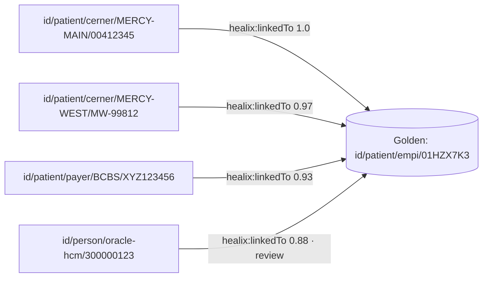

# Entity Resolution

The same person is a Cerner `PERSON_ID` with three MRNs across facilities, an Oracle HCM `PERSON_ID` (as an
employee), a payer member ID, and an HIE record; the same supplier is an Oracle `VENDOR_ID`, a GPO contract party
and a DUNS number. The knowledge graph is where these identities are **linked, scored and governed over time**. This
document specifies entity resolution (ER) for the G1 master entities as a graph-native, bitemporal, non-destructive
process. The conformed dimensions of module 05 (`dim_patient`, `dim_practitioner`, `dim_organization`,
`dim_location`, `dim_item`) are projections of the golden records defined here.

## 1. Entities in scope and identifiers

| Entity | Source records | Strong identifiers | Weak attributes | Golden record IRI |
|---|---|---|---|---|
| **Patient / Person** | Cerner `PERSON` + `PERSON_ALIAS` (MRN per facility, SSN, driver licence, payer member id), HIE/IHE PIX feeds, payer eligibility (`271`), patient portal, Oracle HCM `PER_ALL_PEOPLE_F` (when employee is also a patient) | MRN (+ facility), SSN (last-4 policy §2.2), payer member id, HIE community id | name (incl. former names), DOB, sex, address history, phone, email, mother's maiden name, multiple-birth indicator | `<base>id/patient/empi/<ulid>` |
| **Practitioner** | Cerner `PRSNL`, credentialing system, Oracle HCM worker, NPPES | NPI, state licence number, DEA, Oracle `PERSON_NUMBER` | name, specialty taxonomy (NUCC), practice address, phone | `<base>id/practitioner/master/<ulid>` |
| **Organization** (incl. payers, facilities, legal entities) | Cerner `ORGANIZATION`, Oracle `HZ_PARTIES` (TCA), Oracle Fusion legal entities, payer lists, NPPES type-2 | NPI (type 2), EIN/TIN, payer id (CMS/NAIC), Oracle `PARTY_ID`, HIE OID | legal name, DBA, address, parent org | `<base>id/organization/master/<ulid>` |
| **Supplier** | Oracle `POZ_SUPPLIERS`, `POZ_SUPPLIER_SITES_ALL_M`, GPO feeds, Cerner `ORGANIZATION` (device vendors) | DUNS, EIN/TIN, Oracle `VENDOR_ID`, GPO supplier id | name, remit-to address, bank account hash (never raw), contacts | `<base>id/supplier/master/<ulid>` |
| **Item / Product** | Oracle `EGP_SYSTEM_ITEMS_B`, GPO item master, Cerner charge master (`CDM`), pharmacy formulary, device registry (GUDID) | GTIN/UDI-DI, NDC, manufacturer part number + manufacturer, UNSPSC | description, UoM, pack size, HCPCS | `<base>id/item/master/<ulid>` |
| **Location** | Cerner `LOCATION` (facility → building → unit → room → bed), Oracle `HR_LOCATIONS_ALL`, Oracle inventory orgs/subinventories, RIS modality rooms | Cerner `LOCATION_CD`, Oracle `LOCATION_ID`, NPI-linked facility id, CMS CCN | names, hierarchy, address, geocode | `<base>id/location/master/<ulid>` |

The golden record IRI is the subject used by all G2–G9 facts after resolution; source-record IRIs
(`<base>id/patient/cerner/<facility>/<mrn>`) are kept as first-class nodes linked to the golden record.

## 2. Identifier policies

### 2.1 Identifier modelling

Identifiers are nodes, not literals, so they can carry period, assigner and status (FHIR `Identifier` semantics):

```turtle
<base>id/patient/cerner/MERCY-MAIN/00412345
    party:hasIdentifier [ a party:Identifier ;
        party:identifierSystem <urn:oid:2.16.840.1.113883.3.1234.5.1> ;   # Mercy Main MRN pool
        party:identifierType  <http://terminology.hl7.org/CodeSystem/v2-0203#MR> ;
        party:identifierValue "00412345" ;
        party:assigner <base>id/organization/master/01HZ…MERCY ] .
```

Every identifier assertion is bitemporal (TKG-01): an MRN that is retired after a merge gets `validTo`, not deletion.

### 2.2 SSN last-4 policy

- Full SSN is **never** loaded into the graph. The ingestion processor replaces it with `party:ssnLast4` (string,
  `phi:direct`) and a keyed HMAC-SHA-256 of the full value (`party:ssnHash`, key held in KMS, rotated annually with
  re-hash job) used only for blocking/matching.
- Last-4 is used as a **blocking key component** and a **comparison field** (agreement weight capped so last-4 alone
  can never auto-link).
- Payer and HIE feeds carrying full SSN are hashed at the `std` layer (module 07) before reaching `canonical`.

### 2.3 Other identifier rules

| Identifier | Rule |
|---|---|
| MRN | Only meaningful with its facility/assigner; `(assigner, value)` is the key. Cerner `PERSON_ALIAS.ALIAS_POOL_CD` identifies the pool. Merged-away MRNs remain linked with `validTo`. |
| NPI | Validated by Luhn check digit (prefix 80840) and against NPPES monthly file; a deactivated NPI closes the identifier's valid time |
| EIN/TIN | Format-validated; shared EINs across facilities are expected (health systems) — EIN alone never resolves Organization |
| DUNS | Validated against D&B feed where licensed; DUNS reassignment (rare) creates new version |
| GTIN | GS1 check digit; GTIN-14 normalised (left-pad); UDI-DI parsed per GS1/HIBCC/ICCBBA issuing agency |
| NDC | Normalised to 11-digit 5-4-2 |
| Payer member id | Keyed with payer organization golden IRI |

## 3. Blocking

Blocking keeps pairwise comparison tractable (≈ 4 M patients → 8 × 10¹² naive pairs). Multiple independent blocking
passes are unioned; a pair is compared if it co-occurs in any block.

| Entity | Blocking passes |
|---|---|
| Patient | (1) exact `(assigner, MRN)`; (2) `ssnHash`; (3) `Soundex(last) + DOB`; (4) `first-3(last) + first-1(first) + birth year`; (5) `DOB + sex + ZIP5`; (6) phone E.164; (7) email lower-cased; (8) payer member id |
| Practitioner | NPI; licence `(state, number)`; `Soundex(last) + first-1 + specialty group`; DEA |
| Organization | NPI-2; EIN; normalised name tokens (stop-words removed) + state; payer id |
| Supplier | DUNS; EIN; normalised name + remit ZIP5; bank hash |
| Item | GTIN; NDC; `(manufacturer golden IRI, normalised MPN)`; UNSPSC + tokenised description (MinHash LSH, Jaccard ≥ 0.6) |
| Location | `(source, code)`; geohash-6 + name tokens; parent location IRI + name |

Blocks larger than 5,000 records are split by an additional key (year of birth, ZIP3) and logged as a DQ observation
(`DQR-UNIQUENESS-*`, module 09) since very large blocks usually indicate default/placeholder values (`DOB =
1900-01-01`, `SSN = 999-99-9999`, `name = "BABY BOY"`). Known placeholder values are maintained as a reference list in
G8 and are **excluded from matching** (they neither agree nor disagree).

## 4. Matching

### 4.1 Deterministic rules (evaluated first)

| Rule id | Entity | Condition | Outcome |
|---|---|---|---|
| D-PAT-01 | Patient | same `(assigner, MRN)` | link, confidence 1.0 |
| D-PAT-02 | Patient | same `ssnHash` ∧ DOB exact ∧ (last name Jaro-Winkler ≥ 0.9 ∨ former-name match) | link, 0.99 |
| D-PAT-03 | Patient | same HIE community id | link, 0.99 |
| D-PAT-X1 | Patient | DOB differs by > 2 years ∧ sex differs ∧ no shared strong id | **exclude** (hard negative) |
| D-PAT-X2 | Patient | multiple-birth indicator set on both ∧ same DOB ∧ same last name ∧ first names differ | **exclude** (twins) |
| D-PRC-01 | Practitioner | same NPI | link, 1.0 |
| D-ORG-01 | Organization | same NPI-2 ∨ (same EIN ∧ normalised name equal) | link, 0.98 |
| D-SUP-01 | Supplier | same DUNS | link, 0.99 |
| D-ITM-01 | Item | same GTIN ∨ same NDC-11 | link, 1.0 |
| D-LOC-01 | Location | same `(source, code)` | link, 1.0 |

### 4.2 Probabilistic matching (Fellegi–Sunter)

For pairs not decided deterministically, compute the log-likelihood ratio

$$ W = \sum_i w_i,\qquad w_i = \begin{cases} \log_2\frac{m_i}{u_i} & \text{field } i \text{ agrees}\\ \log_2\frac{1-m_i}{1-u_i} & \text{field } i \text{ disagrees}\\ 0 & \text{missing / placeholder}\end{cases} $$

where $m_i$ = P(agree | true match) and $u_i$ = P(agree | non-match). Parameters are estimated by EM on unlabelled
pairs and re-estimated quarterly against the labelled set (§9). Agreement is graded, not binary: name fields use
Jaro-Winkler with thresholds (≥ 0.92 agree, 0.85–0.92 partial at half weight, < 0.85 disagree); DOB uses exact /
transposed-digits / off-by-one-year tiers; addresses use USPS-standardised components with a move-aware comparison
(agreement on *any* historical address within overlapping valid time counts).

Patient field set (initial m/u; illustrative, to be re-estimated):

| Field | m | u | agree weight | disagree weight |
|---|---|---|---|---|
| ssnLast4 | 0.95 | 0.0001 | +13.2 | −4.3 |
| DOB exact | 0.97 | 0.00027 | +11.8 | −5.1 |
| last name JW ≥ 0.92 | 0.92 | 0.004 | +7.8 | −3.6 |
| first name JW ≥ 0.92 | 0.90 | 0.008 | +6.8 | −3.3 |
| sex | 0.99 | 0.50 | +1.0 | −5.6 |
| ZIP5 (any valid-time-overlapping address) | 0.80 | 0.002 | +8.6 | −2.3 |
| phone E.164 | 0.60 | 0.0005 | +10.2 | −1.3 |
| mother's maiden name | 0.70 | 0.003 | +7.9 | −1.7 |

Decision thresholds per entity are **two** cut-offs: $W \ge T_{upper}$ auto-link; $T_{lower} \le W < T_{upper}$ human
review; below → non-match. Initial Patient thresholds $T_{upper} = 24$, $T_{lower} = 12$, tuned to the §9 targets.
Confidence is $\sigma(W - T_{upper})$ mapped to `healix:linkConfidence` in `[0,1]`.

### 4.3 Learned matcher (optional, P2)

A pairwise classifier (gradient-boosted trees or a small transformer over field pairs) MAY replace the hand-set
weights once the labelled set exceeds 50 k pairs; it MUST be evaluated against the same metrics (§9), MUST produce
per-field contribution explanations stored with the link, and its model version MUST be recorded as a `prov:Agent`
on every link it produces (module 10 model governance).

## 5. Golden record, `owl:sameAs` and `healix:linkedTo`



| Predicate | When used | Reasoning impact |
|---|---|---|
| `healix:linkedTo` (source record → golden record), annotated with `healix:linkConfidence`, `healix:linkMethod` (`deterministic:D-PAT-01` / `probabilistic:v2026.3` / `human`), `healix:linkState` (`auto`, `reviewed`, `rejected`) | **Always**, for every link regardless of confidence | None — inert property; safe for reasoning |
| `owl:sameAs` (source record ↔ golden record) | Only when `linkConfidence ≥ 0.995` **or** `linkState = reviewed`, *and* the entity type is not Patient in PHI-sensitive inference contexts (see below) | OWL RL `sameAs` propagation: facts about the source record become facts about the golden record in `graph/inferred` |

`owl:sameAs` is powerful and dangerous: a wrong patient link propagates another patient's diagnoses. Therefore for
**Patient**, `owl:sameAs` is asserted only for deterministic or human-reviewed links; probabilistic auto-links use
`healix:linkedTo` only, and the facade resolves them explicitly (returns facts from all linked records, each tagged
with the source IRI and link confidence). For Supplier/Item/Location, `owl:sameAs` at ≥ 0.995 is acceptable.

### 5.1 Survivorship (golden-record attribute selection)

The golden record is a **view**, re-derivable from source records and links; survivorship rules choose which source
value is asserted on the golden IRI. Rules are declared per attribute in a YAML rule pack owned by stewards:

| Attribute | Rule |
|---|---|
| Patient name | Most recent valid-time value from the source with highest trust rank (Cerner registration > payer > portal); former names kept as `party:formerName` |
| DOB | Majority vote across sources; tie → highest trust; conflicting DOB opens a DQ issue |
| Address | Union of addresses with valid time; current = latest `validFrom` from a trusted source; USPS-standardised |
| Sex / gender identity | Cerner for administrative sex; patient-reported (portal) for gender identity; never overwrite one with the other |
| Deceased | Any source asserting death with date wins (after review if sources conflict) |
| Supplier remit-to / bank hash | Oracle Fusion only (system of record for payments); other sources never survive |
| Item description / UoM | Oracle item master; GPO description as `altLabel` |
| Practitioner specialty | Credentialing system > NPPES > Cerner |

Survived values are asserted on the golden IRI as ordinary bitemporal assertions with
`prov:wasDerivedFrom <source assertion triple term>` so every golden value is traceable to the source value.

## 6. Merge and unmerge as temporal events

Links are **never destructive**. No subject is rewritten, no triple deleted.

| Event | Graph effect | Valid time | Transaction time |
|---|---|---|---|
| **Link** (merge) | assert `A healix:linkedTo G` (and `owl:sameAs` if eligible) | `validFrom` = earliest evidence instant (e.g. registration date of A) or decision time if evidence is undatable | `recordedAt` = now |
| **Re-score** | close old link annotation, assert new with new confidence; `changeKind = correction` | unchanged | now |
| **Unlink** (unmerge) | close `A healix:linkedTo G` with `changeKind = unmerge`; assert `A healix:linkedTo G2` (new golden) ; retract `owl:sameAs`; **re-derive** survivorship on G and G2 | `validTo` on the wrong link = *the original validFrom* (it was never true) **and** transaction closed — i.e. an unmerge is a *retraction* of the link, not a new version | now |
| **Golden split** (one golden was two people) | new golden G2 minted; links re-pointed by unlink/link events; facts asserted on G *by survivorship* are re-derived; facts asserted on source records are untouched | per link | now |
| **Golden retire** | all links moved; G gets `party:retiredInFavourOf G'`, status `retired` | now | now |

Because clinical facts are asserted on **source-record IRIs** and only *derived* onto golden IRIs (or reached via
`linkedTo` at query time), an unmerge never requires editing clinical history — the query for G simply stops
including A's facts for transaction times after the unmerge, while "what did we believe before the unmerge" still
works (TKG-01 §8).

Cerner's own `PERSON_COMBINE` events (and `ADT^A40` merge / `ADT^A47` identifier change messages) and Oracle TCA party
merges (`HZ_MERGE_*`) are ingested as **evidence** that triggers rule D-PAT-01-style links with `linkMethod =
source-merge:cerner`; they are never applied blindly because source merges are themselves sometimes wrong (and
un-merged later via `ADT^A37`/manual).

## 7. Interaction with source systems

| Source behaviour | ER handling |
|---|---|
| Cerner `PERSON_ALIAS` rows with `ACTIVE_IND=0` or `END_EFFECTIVE_DT_TM` in the past | Identifier assertion closed (valid time), remains linked |
| Cerner "unknown patient" / trauma aliases (`DOE, JOHN`, temporary MRN) | Blocked from auto-link; flagged `party:temporaryIdentity true`; resolved when `ADT^A08`/`A40` arrives |
| Cerner encounter-level aliases (FIN) | Not person identifiers; modelled on Encounter |
| Oracle HCM person as patient (employee health) | Linked across G1 *and* G5 via `healix:linkedTo` with purpose restriction: workforce facts are not visible under treatment purpose and vice versa (module 11) |
| Oracle TCA `HZ_PARTIES` customer vs `POZ_SUPPLIERS` supplier for the same legal entity | Both linked to one Organization golden; roles (`party:hasRole party:SupplierRole`, `party:CustomerRole`) are bitemporal |
| Supplier site vs supplier | Sites are Locations linked to Supplier golden; remit-to changes are new versions |
| GPO item cross-reference files | Ingested as `healix:linkedTo` evidence with `linkMethod = crosswalk:<gpo>` at 0.9 pending GTIN confirmation |

## 8. Human review queue

Pairs in the review band, all Patient `owl:sameAs` promotions, every unmerge, and any link touching a record with
a `break-glass` or legal-hold flag go to the **review queue** (`graph/er/review`, exposed via the facade and a
steward UI in module 10's HITL tooling).

- Queue item: pair IRIs, score, per-field contributions, side-by-side attribute view (masked per role), SLA.
- Decisions: `link`, `reject`, `defer`, `split`. Each decision is a `prov:Activity` with the steward as `prov:Agent`.
- SLAs: Patient review items touching an *active encounter* ≤ 4 h; others ≤ 5 business days; Supplier before first
  payment run.
- Reviewed decisions feed the labelled set (§9) and are used to re-estimate m/u.
- `agent.privacy_guardian` vetoes any auto-link that would join records across a confidentiality boundary (VIP flag,
  behavioural-health restricted record, employee-as-patient) — these always go to review.

## 9. Metrics and labelled sets

| Metric | Definition | Target (Patient) | Target (others) |
|---|---|---|---|
| Precision | true links / asserted links on labelled set | ≥ 0.995 | ≥ 0.99 |
| Recall | true links found / true links in labelled set | ≥ 0.97 | ≥ 0.95 |
| Auto-resolution rate | links decided without review | ≥ 90 % | ≥ 95 % |
| Review backlog age p95 | — | ≤ SLA §8 | — |
| Duplicate rate | golden records per 1,000 that should be one | ≤ 1.0 | ≤ 2.0 |
| Overlay rate | source records wrongly in one golden per 100 k | ≤ 1.0 | — |
| Unmerge rate | unmerges / links per month (proxy for precision drift) | ≤ 0.1 % | — |

Labelled sets: ≥ 20 k Patient pairs (stratified by block type, including twins, name changes, placeholder values,
migrant/transliterated names), ≥ 5 k per other entity; curated by HIM/stewards; versioned in Git; refreshed with
review decisions quarterly. Metrics are published to G9 as `DQ Result` facts and to the module 12 dashboards.

## 10. Requirements

> **TKG-ER-001** (P0, test) — Identifiers MUST be modelled as `party:Identifier` nodes with system, type, value,
> assigner and bitemporal validity; retired identifiers MUST be closed, not deleted.

> **TKG-ER-002** (P0, test) — Full SSN MUST NOT be stored in the graph; only `party:ssnLast4` and a KMS-keyed
> HMAC-SHA-256 `party:ssnHash` MAY be stored, and last-4 agreement alone MUST NOT produce an automatic link.

> **TKG-ER-003** (P0, test) — Blocking MUST implement at least the passes in §3 per entity; blocks > 5,000 records
> MUST be split and reported as DQ observations; reference placeholder values MUST be excluded from matching.

> **TKG-ER-004** (P0, test) — Deterministic rules in §4.1 MUST be evaluated before probabilistic scoring and hard
> negatives (D-*-X*) MUST prevent any link.

> **TKG-ER-005** (P0, test) — Probabilistic matching MUST implement Fellegi–Sunter log-likelihood scoring with graded
> agreement, two thresholds per entity, and MUST store the score, per-field contributions and parameter version on
> each link.

> **TKG-ER-006** (P0, test) — Every link MUST be asserted as `healix:linkedTo` with `healix:linkConfidence`,
> `healix:linkMethod` and `healix:linkState`; `owl:sameAs` MUST be asserted only when confidence ≥ 0.995 or the link
> is human-reviewed, and for Patient only for deterministic or reviewed links.

> **TKG-ER-007** (P0, test) — Clinical, financial and operational facts MUST be asserted on source-record IRIs;
> golden-record values MUST be derived by declared survivorship rules with `prov:wasDerivedFrom` to the source
> assertion.

> **TKG-ER-008** (P0, test) — Merge, re-score, unmerge, split and retire MUST be recorded as bitemporal events per §6;
> no subject rewriting or triple deletion is permitted; an unmerge MUST be a retraction of the link.

> **TKG-ER-009** (P0, test) — Source-system merge events (Cerner `PERSON_COMBINE`, `ADT^A40/A47`, Oracle TCA merge)
> MUST be ingested as evidence and MUST NOT be applied without passing the ER rules.

> **TKG-ER-010** (P0, test) — The review queue MUST receive all review-band pairs, all Patient `owl:sameAs`
> promotions, all unmerges and all links vetoed by `agent.privacy_guardian`; decisions MUST be PROV activities with the
> steward as agent.

> **TKG-ER-011** (P0, analysis) — Precision ≥ 0.995 and recall ≥ 0.97 on the Patient labelled set, and ≥ 0.99 /
> ≥ 0.95 for other entities, MUST be demonstrated before auto-linking is enabled in production.

> **TKG-ER-012** (P1, test) — Survivorship rules MUST be declared in a versioned YAML rule pack owned by stewards and
> MUST be re-executed automatically after any link, unlink or source value change affecting a golden record.

> **TKG-ER-013** (P1, test) — Module 05 conformed dimensions MUST be generated from golden records and MUST carry the
> golden IRI, so EDW and KG agree on identity (reconciliation TKG-04 §7 includes link counts).

> **TKG-ER-014** (P1, test) — Review SLAs in §8 MUST be monitored; breaches MUST alert the HIM steward on-call.

> **TKG-ER-015** (P1, test) — m/u parameters and thresholds MUST be re-estimated at least quarterly from the labelled
> set and review decisions; each parameter set MUST be a versioned `prov:Agent`.

> **TKG-ER-016** (P2, demo) — A learned matcher MAY be deployed under module 10 model governance when it meets or
> beats TKG-ER-011 targets on a held-out set and provides per-field explanations.
