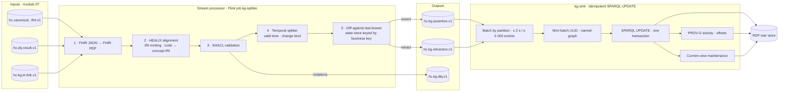

# Graph Ingestion from Kafka

This document specifies the pipeline from the canonical FHIR topics to the bitemporal graph: conversion to FHIR RDF,
alignment to the HEALIX ontology, SHACL validation, RDF-star temporal annotation, publication of assertion and
retraction events, and the idempotent SPARQL UPDATE sink. It also defines batching, ordering, exactly-once
behaviour, named-graph assignment, PROV-O activity records, replay/backfill and reconciliation with the EDW.

## 1. Pipeline



Two components, both owned by `agent.kg_builder` configuration but run as platform services:

- **kg-splitter** (Flink, stateful): per canonical record, produce zero or more assertion/retraction events. State =
  last-known annotated triples per business key (RocksDB, checkpointed). Exactly-once from `canonical` to `kg.*`
  via Kafka transactions (ARC-NFR-004).
- **kg-sink** (Kafka consumer, stateless except offsets stored in the graph): apply events to the store in
  transactions, idempotently.

## 2. Stage 1 — FHIR JSON → FHIR RDF

Conversion follows the **HL7 FHIR RDF specification** (R4 `fhir.ttl` / ShEx): resource node typed with
`fhir:<Resource>`, elements as `fhir:<Resource>.<element>` predicates, primitive values via `fhir:value`, references
via `fhir:link`, codings via `fhir:Coding.system/code` plus the concept IRI (`http://snomed.info/id/49436004`) when
the system is one of the registered terminologies (module 06). The converter MUST be deterministic: the same FHIR
JSON (after canonical JSON normalisation) MUST produce the same N-Triples (sorted) so hashes are stable (§5).

Resource IRI: `<base>id/<entity>/<source>/<natural-id>` from `Resource.id` and the source header
`hc-source-system`; FHIR `id` on Oracle Health APIs is stable, CDC-derived resources carry the Cerner primary key.
Contained resources and element nodes use fragment IRIs `<resourceIRI>#<element-path>[index]` rather than blank
nodes so that annotations and diffs are addressable.

## 3. Stage 2–3 — HEALIX alignment and SHACL validation

Alignment maps FHIR RDF to HEALIX ontology IRIs using the **FHIR-to-HEALIX mapping module** released by the Ontology
Registry (module 02, `06-knowledge-graph.md` owns the mapping *content*; this document owns its *execution*):

| Step | Rule |
|---|---|
| Class | `fhir:Condition` → `clin:Condition` (subclass axiom retained; both types asserted) |
| Property | `fhir:Condition.onset[x]` → `clin:onsetDateTime` / `clin:onsetPeriod`; typed per ontology range |
| Codes | `fhir:Coding` → concept IRI via Terminology Service `$translate` to the enterprise value set; unmapped codes keep the source IRI and raise `DQR-CONFORMITY-CODE-*` |
| References | `fhir:link` → object property to the referenced resource's HEALIX IRI; unresolved references are kept as IRIs (the target may arrive later) |
| Business key | `healix:businessKey` literal = the EDW `*_bk` (`<source>:<natural-id>`), on every resource node |
| Group | `healix:group` = G1–G9 code from the resource/domain mapping table (module 01 §4) |
| Extensions | `HEALIX-ERP` profiles (GL journals, POs, positions) map to `fin:`/`sup:`/`wf:` classes directly |

SHACL validation runs the shapes released with the ontology plus the temporal shapes in this module
(`healix-shape:BitemporalAssertionShape`, `healix-shape:NoOverlapFunctional`). Violations with `sh:Violation` severity
route the whole resource to `hc.kg.dlq.v1` with the validation report (RDF) attached; `sh:Warning` is recorded as a
DQ observation and the resource proceeds.

## 4. Stage 4–5 — Temporal splitting and diffing

For every aligned triple `(s, p, o)` the splitter:

1. **Derives valid time** per TKG-01 §5 using the per-resource mapping (`validTimeSource`, `validTimePrecision`).
2. **Looks up last-known state** for `(businessKey, p)` (and for non-functional `p`, the full set of `o`).
3. **Classifies**: unchanged (emit nothing — ~70 % of re-sent resources), new, new-version, correction, retraction
   (TKG-01 §6 detection table).
4. **Emits** events.

### 4.1 Event schemas (`FULL` compatibility, CONVENTIONS §5)

`hc.kg.assertion.v1` value (JSON Schema in `07-streaming-platform/topics.yaml` registry; abridged):

```json
{
  "assertionId": "01J8Q6Z3M9K2V7XW4R5T6Y8ABC:sha256:3f9c…",   // idempotency key, §5
  "businessKey": "cerner:condition:12345678",
  "group": "G2",
  "subject": "https://ontology.healix.example.org/id/condition/cerner/12345678",
  "predicate": "https://ontology.healix.example.org/clinical/onsetDateTime",
  "object": { "type": "literal", "value": "2025-11-14T00:00:00Z", "datatype": "xsd:dateTime" },
  "validFrom": "2025-11-14T00:00:00Z",
  "validTo": null,
  "eventTime": "2026-03-20T09:41:02Z",
  "sourceTime": "2026-03-20T09:41:02Z",
  "decisionTime": null,
  "validTimeSource": "Condition.onsetDateTime",
  "validTimePrecision": "day",
  "sourceTimeZone": "America/Chicago",
  "changeKind": "correction",
  "supersedes": "01J8Q6Z3M9K2V7XW4R5T6Y8ABC:sha256:a1b2…",     // assertionId being closed, if any
  "phiClass": "PHI-CLINICAL",
  "source": { "topic": "hc.canonical.clinical.condition.fhir.v1", "partition": 7, "offset": 9912387,
              "system": "cerner-fhir", "resourceVersion": "3" }
}
```

`hc.kg.retraction.v1` value: `assertionId` of the assertion to close, `businessKey`, `reason` (`entered-in-error`,
`logical-delete`, `duplicate`, `er-unmerge`, `steward`), `evidence` (source offset or PROV activity), `eventTime`,
`sourceTime`, `phiClass`.

Record **key** = `businessKey` on both topics; headers `hc-event-time`, `hc-source-time`, `hc-group`, `hc-phi-class`.

### 4.2 Ordering

- Partitioning by `businessKey` guarantees per-entity order from splitter to sink; cross-entity order is not
  guaranteed and not required (references are IRIs that may dangle until the target arrives).
- The splitter uses **event-time watermarks** (5 min allowed lateness per source, configurable) only for the
  *diff state*; an event arriving later than the watermark is still processed, with `changeKind` decided against the
  then-current state — i.e. a late arrival whose `sourceTime` is older than the current state's is treated as a
  **correction of history**, not as the new current value, and both versions remain queryable.
- Retractions for an assertion the sink has not yet seen are parked in the sink's pending set (store-side, in
  `graph/prov`) for up to 24 h and applied when the assertion arrives; otherwise sent to DLQ.

## 5. Idempotency and exactly-once

| Layer | Mechanism |
|---|---|
| `canonical` → `kg.*` | Flink exactly-once with Kafka transactional producer; state checkpoints every 30 s |
| `assertionId` | `<batchUlidOfFirstSight>:sha256(subject \| predicate \| objectCanonical \| validFrom \| validTimeSource)`; the same fact re-derived from a replay produces the same hash suffix |
| Sink dedup | The sink's SPARQL UPDATE is a `DELETE/INSERT WHERE` keyed on `healix:assertionId` on the triple term: if a term with that id already exists with `recordedAt` bound, the insert is a no-op (`FILTER NOT EXISTS`) |
| Offsets | Consumed offsets are written **in the same transaction** as the data, into the PROV activity (`healix:kafkaOffsetRange`); on restart the sink reads the max committed offset per partition from the graph, not from Kafka consumer groups |
| Closing | `supersededAt` is written with `FILTER NOT EXISTS { … healix-time:supersededAt ?x }` so a replayed close is a no-op |

Canonical SPARQL UPDATE template (one batch; abridged):

```sparql
INSERT {
  GRAPH ?batch {
    ?s ?p ?o .
    << ?s ?p ?o ~ ?r >> a healix-time:BitemporalAssertion ;
                   healix:assertionId ?aid ;
                   healix-time:validFrom ?vf ; healix-time:recordedAt ?now ;
                   healix-time:eventTime ?et ; healix-time:sourceTime ?st ;
                   healix-time:validTimeSource ?vts ; healix-time:validTimePrecision ?vtp ;
                   healix-time:changeKind ?ck ;
                   prov:wasGeneratedBy ?activity .
  }
  GRAPH ?current { ?s ?p ?o . }
}
WHERE {
  VALUES (?s ?p ?o ?r ?aid ?vf ?et ?st ?vts ?vtp ?ck) { … }    # from the batch; ?r = <base>assertion/<ulid>/<seq>
  BIND(<…batch graph IRI…> AS ?batch) BIND(<…activity IRI…> AS ?activity)
  BIND(NOW() AS ?now)
  FILTER NOT EXISTS { GRAPH ?g { ?any healix:assertionId ?aid } }
};
# close superseded assertions
DELETE { GRAPH ?cur { ?ps ?pp ?po } }
INSERT { GRAPH ?g { ?prev healix-time:supersededAt ?now ;
                    healix-time:supersededBy ?new } }
WHERE {
  VALUES (?prevId ?aid) { … }
  GRAPH ?g  { << ?ps ?pp ?po ~ ?prev >> healix:assertionId ?prevId .
              FILTER NOT EXISTS { ?prev healix-time:supersededAt ?x } }
  GRAPH ?g2 { ?new healix:assertionId ?aid }
  BIND(NOW() AS ?now)
};
```

`recordedAt` is the **transaction's** `NOW()` so every assertion in the batch shares one `recordedAt` and ordering
of transaction time per partition is monotonic (TKG-TIME-003). If the store cannot guarantee a single `NOW()` per
request, the sink binds its own clock value.

## 6. Batching, named graphs and PROV-O

| Aspect | Rule |
|---|---|
| Batch boundary | ≤ 2 s or ≤ 5,000 events per sink instance per source, whichever first; one Kafka partition set per instance |
| Named graph | `<base>graph/<source>/<yyyy-mm-dd>/<batch-ulid>` where `<source>` = `hc-source-system` (e.g. `cerner-fhir`, `oracle-fusion-hcm`, `clearinghouse-x12`, `er`, `dq`), date = UTC date of `recordedAt`, ULID minted by the sink |
| Graph metadata (in `graph/prov`) | `?batch a healix:BatchGraph ; prov:wasGeneratedBy ?activity ; healix:group ?g ; healix:phiClassMax ?c ; healix:assertionCount ?n ; healix:contentHash ?h` |
| PROV activity | `?activity a prov:Activity , healix:IngestionBatch ; prov:startedAtTime ; prov:endedAtTime ; prov:wasAssociatedWith <agent.kg_builder vN> , <kg-sink service identity> ; prov:used <topic/partition/offset-range entity> ; healix:splitterVersion ; healix:ontologyVersion ; healix:mappingVersion ; healix:shaclVersion` |
| Retraction activity | `a healix-time:Retraction , prov:Activity ; prov:wasAssociatedWith ; prov:used <evidence> ; healix-time:changeKind "retraction"` |
| Replay marker | `healix:replayOf ?originalActivity` when the batch comes from a replay run |

Content hash = SHA-256 over the sorted N-Quads of the batch graph **excluding** `recordedAt`, so a replayed batch
hashes identically and reconciliation can prove equivalence.

## 7. Replay, backfill and reconciliation with the EDW

### 7.1 Replay / backfill

- Replaying `canonical` (ARC-NFR-005) through the splitter re-derives the same `assertionId`s; the sink's dedup
  makes the replay a no-op for already-present assertions and fills gaps for missing ones, with `recordedAt` = replay
  time (correct: that *is* when we learned/recovered them) and `healix:replayOf` set.
- Backfilling a new source or a new mapping version uses a dedicated `<source>` segment (`cerner-fhir-backfill-2026Q4`)
  so backfill graphs are identifiable and can be dropped atomically if the mapping proves wrong.
- Mapping-version changes that alter triples for the same resource produce `correction` events (the world did not
  change; our representation did), flagged `healix:changeReason "mapping:v2026.4"`.

### 7.2 Reconciliation (ADR-07)

Nightly (02:00 UTC) and on demand, for each group `Gn` and each `recordedAt` UTC day `D`:

| Check | KG side | EDW side (module 05) | Tolerance |
|---|---|---|---|
| Current fact count per `(group, entity type)` | `COUNT` in `graph/current/Gn` | `COUNT(*) WHERE superseded_at IS NULL AND valid_to IS NULL OR valid_to > now` in `hist_*` | 0 |
| Assertion count recorded on D | `COUNT` of triple terms with `recordedAt` on D | `COUNT(*) WHERE recorded_at::date = D` | 0 |
| Content hash per `(entity type, D)` | SHA-256 over sorted `(businessKey, predicate, objectCanonical, validFrom, validTo)` of assertions recorded on D | same over `hist_*` columns via the TKG-01 §9 mapping | equal |
| ER link count per entity | `COUNT healix:linkedTo` current | `COUNT dim_*_xref` rows | 0 |
| Retractions on D | count with `changeKind = retraction` | `change_kind='retraction'` | 0 |

Results are published to `hc.ops.kg-edw-reconciliation.v1` and asserted as `G9 DQ Result` facts; any mismatch opens
a DQ issue (`DQR-CONSISTENCY-KG-EDW-001`) assigned to the data-platform steward with the differing business keys
attached (capped at 1,000). A mismatch is **never auto-fixed** by copying one side to the other; the root cause is
sought in the canonical stream (both sides must be re-derivable from it).

## 8. Failure handling

| Failure | Behaviour |
|---|---|
| FHIR RDF conversion error | DLQ with `reason = CONVERSION`, raw record attached |
| SHACL violation | DLQ `reason = SHACL`, validation report attached; `agent.remediator` may propose a mapping fix |
| Unmapped code | Proceed with source code IRI; DQ observation; `agent.terminology_steward` notified |
| Temporal skew (TKG-TIME-012) | DLQ `reason = TEMPORAL_SKEW` |
| Store unavailable | Sink pauses consumption (no offset advance); alert after 60 s; events accumulate in Kafka |
| Transaction too large | Sink splits batch in half recursively; a single event that cannot commit goes to DLQ `reason = STORE_REJECT` |
| Poison event (repeated failure ≥ 3) | DLQ `reason = POISON`; partition continues |
| DLQ reprocessing | `agent.remediator` or steward re-publishes fixed records to `canonical` (never directly to `kg.*`), preserving lineage |

## 9. SLOs and capacity

| Metric | Target |
|---|---|
| p95 latency `canonical` publish → assertion readable in store | ≤ 60 s (p50 ≤ 10 s) |
| p99 latency | ≤ 5 min |
| Sustained throughput | ≥ 5,000 canonical resources/s in; ≥ 150 k assertion events/s out (ARC-NFR-002 with headroom) |
| Splitter checkpoint recovery | ≤ 2 min to resume after failover |
| DLQ rate | ≤ 0.1 % of canonical records per day; alert at 0.5 % |
| Reconciliation drift | 0 mismatches per nightly run (alert on any) |
| Replay of one day of `canonical` | ≤ 4 h |

## 10. Requirements

> **TKG-INGEST-001** (P0, test) — The pipeline MUST convert canonical FHIR JSON to FHIR RDF per the HL7 FHIR RDF
> specification deterministically: identical canonical JSON MUST yield identical sorted N-Triples.

> **TKG-INGEST-002** (P0, test) — Resource and element IRIs MUST follow `<base>id/<entity>/<source>/<natural-id>`
> with fragment IRIs for elements; blank nodes MUST NOT appear in assertion subjects or objects.

> **TKG-INGEST-003** (P0, test) — Alignment MUST use the Ontology Registry's released FHIR-to-HEALIX mapping version
> and the Terminology Service for code translation; the mapping, ontology and SHACL versions MUST be recorded on the
> batch PROV activity.

> **TKG-INGEST-004** (P0, test) — SHACL `sh:Violation` results MUST route the resource to `hc.kg.dlq.v1` with the
> report attached; `sh:Warning` MUST be recorded as a DQ observation without blocking.

> **TKG-INGEST-005** (P0, test) — The splitter MUST classify each triple as unchanged / new / new-version /
> correction / retraction using TKG-01 §6 and MUST emit no event for unchanged triples.

> **TKG-INGEST-006** (P0, test) — Assertion and retraction events MUST conform to the §4.1 schemas registered with
> `FULL` compatibility, be keyed by `businessKey`, and carry `hc-event-time`, `hc-source-time`, `hc-group` and
> `hc-phi-class` headers.

> **TKG-INGEST-007** (P0, test) — `canonical` → `kg.*` processing MUST be exactly-once (Kafka transactions, checkpointed
> state); the sink MUST be idempotent via `assertionId` such that replaying any range of `kg.*` offsets produces no
> duplicate assertions or duplicate closings.

> **TKG-INGEST-008** (P0, test) — The sink MUST commit consumed offsets in the same store transaction as the data and
> MUST resume from the offsets recorded in the graph.

> **TKG-INGEST-009** (P0, test) — Each sink batch MUST be written to one named graph following CONVENTIONS §3 with
> one PROV-O activity recording agent versions, topic/partition/offset range, counts, `phiClassMax` and content hash.

> **TKG-INGEST-010** (P0, test) — All assertions in one batch MUST share one `recordedAt` equal to the transaction
> commit instant; `recordedAt` MUST be non-decreasing across successive batches of the same sink instance.

> **TKG-INGEST-011** (P0, test) — Late events (beyond watermark) MUST still be applied and MUST be classified
> against the then-current state, producing corrections of history rather than overwriting current values.

> **TKG-INGEST-012** (P0, test) — Retractions MUST close the referenced assertion per TKG-TIME-007; retractions for
> unseen assertions MUST be parked up to 24 h and then dead-lettered.

> **TKG-INGEST-013** (P0, test) — Replays MUST be no-ops for existing assertions, MUST fill gaps with
> `healix:replayOf`, and MUST produce batch content hashes identical to the originals for identical input.

> **TKG-INGEST-014** (P0, test) — Nightly reconciliation per §7.2 MUST run for every group and MUST open a DQ issue
> on any mismatch; automatic copying between KG and EDW is prohibited.

> **TKG-INGEST-015** (P0, test) — p95 latency from `canonical` publish to store visibility MUST be ≤ 60 s and p99
> ≤ 5 min at ARC-NFR-002 throughput.

> **TKG-INGEST-016** (P1, test) — Backfills MUST use a distinct `<source>` segment in the named-graph IRI so they can
> be identified and dropped atomically.

> **TKG-INGEST-017** (P1, test) — Mapping-version changes that alter the representation of unchanged source data
> MUST be emitted as `correction` events with `healix:changeReason "mapping:<version>"`.

> **TKG-INGEST-018** (P1, test) — DLQ records MUST be reprocessed only by re-publishing to `canonical`, never by
> direct writes to `kg.*` or the store; the DLQ rate MUST be ≤ 0.1 %/day with alerting at 0.5 %.
