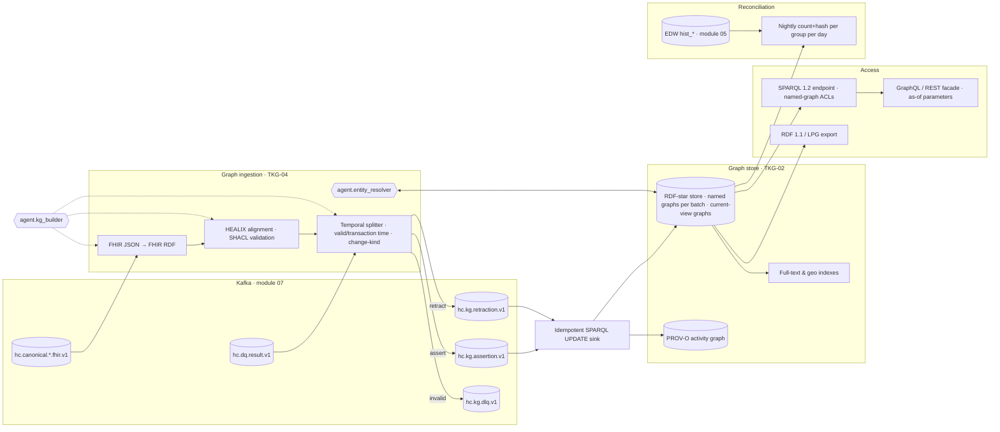

# Module 08 — Temporal Knowledge Graph

## 1. Scope

This module specifies the **bitemporal, provenance-aware knowledge graph** that is one of the two projections of the
canonical FHIR stream (ADR-07). It owns:

- the **bitemporal model contract** (`01-temporal-model.md`) that module 05 (EDW `hist_*` tables), module 09 (DQ
  temporal rules) and module 11 (audit) depend on — listed in `01-architecture-overview.md` §6;
- the **graph store** requirements, query patterns and the SPARQL/GraphQL/REST access layer
  (`02-graph-store-and-query.md`);
- **entity resolution** (EMPI and enterprise master data) expressed as temporal graph events
  (`03-entity-resolution.md`);
- the **ingestion pipeline** from `hc.canonical.*` Kafka topics through FHIR RDF, ontology alignment and RDF-star
  annotation to the `hc.kg.assertion.v1` / `hc.kg.retraction.v1` topics and the idempotent SPARQL UPDATE sink
  (`04-graph-ingestion-from-kafka.md`);
- machine-readable artefacts: `temporal-vocabulary.ttl` (the `healix-time:` vocabulary) and `examples.trig` (a
  worked bitemporal correction).

Out of scope here, owned elsewhere: the ontology itself and how the KG stage of the Ontology Pipeline instantiates
classes from the OWL model (module 02, `06-knowledge-graph.md`); FHIR profiles and terminology binding (module 06);
Kafka topology and schema registry (module 07); PHI classification policy (module 11); hosting, backup and SLO
operations (module 12).

| Document | doc_id | Requirement areas |
|---|---|---|
| `01-temporal-model.md` | TKG-01 | `TKG-TIME-NNN` |
| `02-graph-store-and-query.md` | TKG-02 | `TKG-STORE-NNN`, `TKG-QUERY-NNN` |
| `03-entity-resolution.md` | TKG-03 | `TKG-ER-NNN` |
| `04-graph-ingestion-from-kafka.md` | TKG-04 | `TKG-INGEST-NNN` |
| `temporal-vocabulary.ttl`, `examples.trig` | — | validated artefacts referenced by TKG-TIME-001 |

## 2. Why a temporal knowledge graph for healthcare

A health system's data is dominated by facts that are true *for a period*, learned *later*, and *corrected after the
fact*. A graph that stores only the latest state answers the wrong question for most regulated use cases.

| Use case | Question only a bitemporal graph answers | Groups |
|---|---|---|
| **As-of clinical state** | "What was this patient's active problem list, medication list and allergy list at 07:00 on the day of surgery — as the team could see it then?" (pre-op reconciliation review, sentinel-event RCA) | G1, G2 |
| **Retroactive corrections** | "Which quality-measure denominators changed because 312 Condition onset dates were corrected during the March chart audit?" (re-submission to CMS, HEDIS) | G2, G6 |
| **Claims adjudication timelines** | "On the date the payer denied claim X, what coverage did we believe the patient had, and what do we know now?" (appeal preparation; recoupment defence) | G3 |
| **Supplier contract validity** | "Which purchase orders were released against contract C while it was expired — and did we learn of the expiry before or after release?" (procurement audit, price-variance recovery) | G4 |
| **Workforce assignment history** | "Who held position P on ward W on the night of the incident, under which credentials, and when did HR record the transfer?" (Joint Commission, litigation hold) | G5 |
| **Consent & directives** | "Was research consent valid at specimen collection time, and had the withdrawal been recorded yet when the sample was shipped?" | G7, G9 |
| **Reconciliation with EDW** | "Do the EDW hist tables and the graph agree, day by day, on the number and content of current facts per group?" (ADR-07) | all |

Each example contains a *valid-time* clause ("on the day", "while expired") and a *transaction-time* clause ("as the
team could see it", "did we learn before or after"). The model in TKG-01 makes both first-class on every assertion.

## 3. Architecture

Flow summary (detail in TKG-04):

1. Canonical FHIR resources (and DQ results, which are also facts) are converted to **FHIR RDF** per the HL7 FHIR RDF
   specification, then **aligned** to HEALIX ontology IRIs via the Ontology Registry mappings and validated against
   SHACL shapes.
2. The **temporal splitter** derives valid time from source elements (TKG-01 §5), decides new-version vs correction
   vs retraction (TKG-01 §6), and emits **assertion** or **retraction** events keyed by business key.
3. The **sink** applies events as idempotent SPARQL UPDATE transactions into the named graph of the batch
   (`<base>graph/<source>/<yyyy-mm-dd>/<batch-ulid>`), writes the PROV-O activity, and refreshes current-view graphs.
4. **Entity resolution** runs as a graph-native process, writing `healix:linkedTo`/`owl:sameAs` as temporal events.
5. **Access** is SPARQL 1.2 for power users and a GraphQL/REST facade with explicit `asOf`/`asKnownAt` parameters for
   applications; named-graph-level ACLs enforce PHI classes from module 11.
6. **Reconciliation** with the EDW runs nightly per group per day; mismatches open DQ issues.

## 4. Interfaces (contracts this module exposes or consumes)

| Contract | Direction | Spec |
|---|---|---|
| Bitemporal model (annotation properties, contract table, change kinds) | exposes → 05, 09, 11 | TKG-01 §4, §9 |
| `hc.kg.assertion.v1`, `hc.kg.retraction.v1`, `hc.kg.dlq.v1` record schemas | exposes → 07 (catalog), 09, 12 | TKG-04 §4; schema `FULL` compatibility (CONVENTIONS §5) |
| SPARQL endpoint + GraphQL/REST facade | exposes → 09, 10, analysts | TKG-02 §6 |
| Entity-resolution link events and review queue API | exposes → 05 (conformed dims), 09, 11 | TKG-03 §6, §8 |
| Reconciliation report (`hc.ops.kg-edw-reconciliation.v1`) | exposes → 05, 09, 12 | TKG-04 §7 |
| Canonical FHIR profiles | consumes ← 06 | `06-interoperability/profiles/` |
| Ontology Registry (OWL/SHACL/mappings) | consumes ← 02 | `02-ontology-pipeline/07-governance-and-versioning.md` |
| Terminology Service | consumes ← 06 | `06-interoperability/04-terminology-services.md` |
| PHI classification & named-graph policy | consumes ← 11 | `11-governance-security-compliance/01-hipaa-phi-and-privacy.md` |
| DQ rule pack (temporal rules) | consumes ← 09 | `09-data-quality/rules/` |

## 5. Requirement index

| ID | Priority | Summary | Doc |
|---|---|---|---|
| TKG-TIME-001 | P0 | Every assertion carries validFrom, recordedAt, prov:wasGeneratedBy; SHACL-enforced | 01 |
| TKG-TIME-002 | P0 | Half-open intervals; no sentinel dates | 01 |
| TKG-TIME-003 | P0 | recordedAt assigned by sink clock, monotonic per partition | 01 |
| TKG-TIME-004 | P0 | Valid time derived per source-element table; source and precision recorded | 01 |
| TKG-TIME-005 | P0 | Fusion inclusive effective dates → exclusive validTo; 4712 sentinel → open | 01 |
| TKG-TIME-006 | P0 | Explicit changeKind on every closure; corrections keep old valid time | 01 |
| TKG-TIME-007 | P0 | Retractions preserve valid time and triple term | 01 |
| TKG-TIME-008 | P0 | UTC storage with retained source zone; facility-zone date expansion | 01 |
| TKG-TIME-009 | P0 | Contract table authoritative for EDW hist columns | 01 |
| TKG-TIME-010 | P1 | No overlapping valid intervals for functional properties | 01 |
| TKG-TIME-011 | P1 | Allen relation functions available | 01 |
| TKG-TIME-012 | P1 | Clock-skew guard → DLQ | 01 |
| TKG-TIME-013 | P1 | decisionTime populated for listed elements | 01 |
| TKG-TIME-014 | P2 | Lossless RDF 1.1 reification export | 01 |
| TKG-TIME-015 | P0 | Contract changes are breaking changes | 01 |
| TKG-STORE-001 … 014 | P0–P2 | Store capabilities, scale, ACID bulk load, reasoning, partitioning, ACLs, backup | 02 |
| TKG-QUERY-001 … 012 | P0–P2 | Query patterns, facade semantics, SLOs, explainability | 02 |
| TKG-ER-001 … 016 | P0–P2 | Blocking, matching, golden record, merge/unmerge events, review queue, metrics | 03 |
| TKG-INGEST-001 … 018 | P0–P2 | FHIR RDF conversion, alignment, splitting, idempotency, ordering, provenance, replay, reconciliation, latency | 04 |

## 6. Artefact validation notes

| Artefact | Dialect | Validated with (authoring, 2026-10-17) | Checks |
|---|---|---|---|
| `temporal-vocabulary.ttl` | Turtle 1.1 (no RDF-star needed; it defines the annotation terms) | rdflib 7.6 parse; pyshacl 0.40 self-test of `healix-shape:BitemporalAssertionShape` | 325 triples; every term has `rdfs:label`/`rdfs:comment`; shape rejects sentinel `validTo`, missing `prov:wasGeneratedBy`, closed assertion without `changeKind`; passes a well-formed assertion |
| `examples.trig` | TriG, RDF 1.2 named reifiers (`<< s p o ~ r >>`) | pyoxigraph 0.5 (Oxigraph) parse + SPARQL 1.2; reifier nodes exported to N-Triples and validated with pyshacl against the vocabulary shapes | 121 quads, 5 named graphs; TKG-02 §5.3 diff query returns the two documented rows; bitemporal point query "AF on 2025-12-01" is false as-known 2026-03-10 and true as-known 2026-04-01; all 5 assertions satisfy TKG-TIME-001; shapes conform |

rdflib (7.6) does not yet parse RDF-star/RDF 1.2 Turtle, which is why Oxigraph is the reference parser for the TriG
example; the module-12 CI job MUST run both tools. Note the SPARQL scoping rule that bit during authoring: a `FILTER`
placed *inside* a `GRAPH { }` block cannot see variables `BIND`-ed in the enclosing group — the §5 patterns in TKG-02
keep temporal filters at the outer group level for that reason.

## 7. Definition of done (module-specific, in addition to CONVENTIONS §6)

1. `temporal-vocabulary.ttl` parses, is OWL 2 DL consistent together with the HEALIX ontology, and is published as
   an importable module by the Ontology Registry.
2. `examples.trig` loads into the reference store and the as-of/as-known queries in TKG-02 §5.3 return the
   documented answers.
3. Module 05 DDL contains every column in the TKG-01 §9 contract table; the reconciliation job (TKG-04 §7) reports
   zero drift on the acceptance dataset for seven consecutive days.
4. Entity-resolution precision ≥ 0.995 and recall ≥ 0.97 on the labelled Patient set (TKG-03 §9).
5. p95 canonical→KG latency ≤ 60 s under the ARC-NFR-002 load profile.
