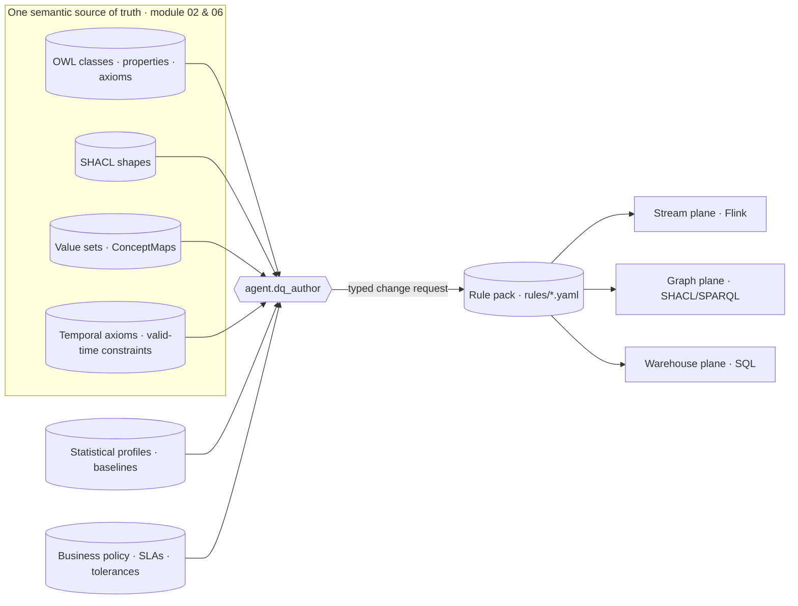
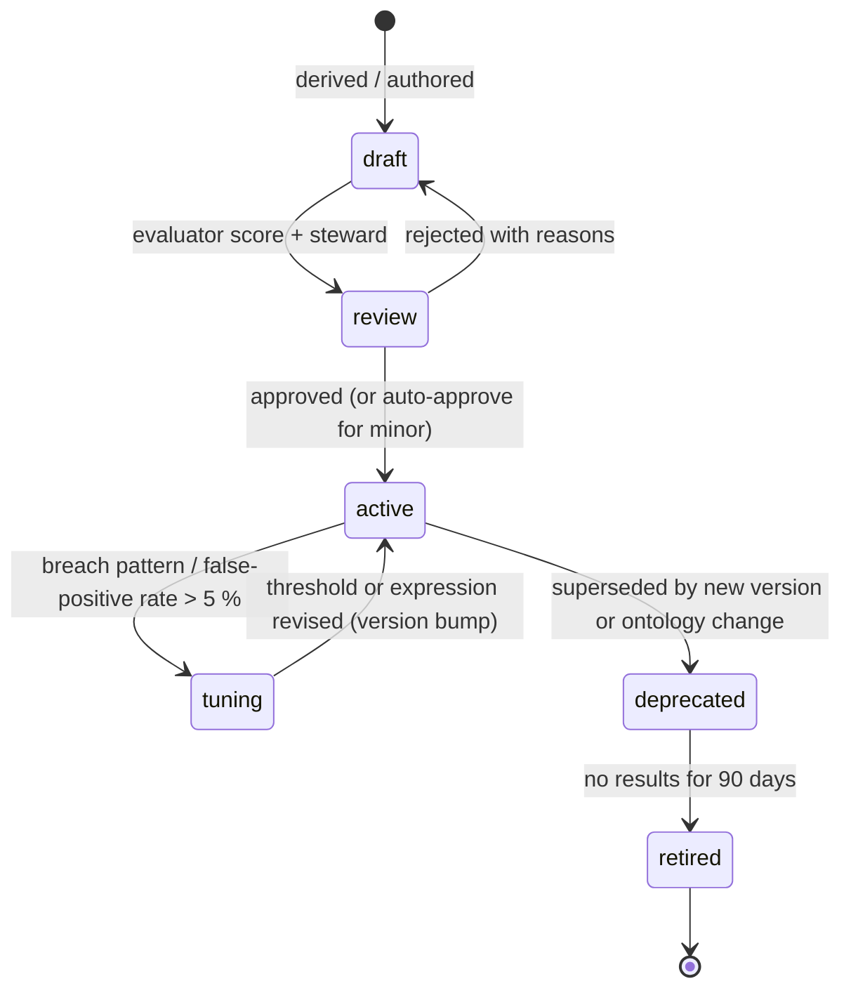

# Data Quality Framework

## 1. Purpose and position in the platform

Data quality in HEALIX is **measured against the ontology at the point of arrival** (VIS-00 §2). The ontology
pipeline (module 02) produces, for every subject-area group, a set of OWL classes and properties, SHACL shapes,
value-set bindings and temporal axioms. The DQ framework treats those artefacts as the *primary* source of DQ rules:
when `agent.ontologist` publishes a SHACL `sh:minCount 1` on `clinical:Encounter → clinical:class`, the DQ engine
acquires a completeness rule without anyone writing it by hand. Statistical profiling and business policy add rules
the ontology cannot express (plausible ranges, volume baselines, SLAs, reconciliation tolerances).

This document defines the vocabulary everyone else in module 09 uses: dimensions, critical data elements (CDEs),
derivation sources, severity classes, routing and roles. The rule DSL is in `02-rule-catalog.md`, execution in
`03-dq-pipelines.md`, measurement in `04-scorecards-and-slas.md` and fixes in `05-remediation-workflows.md`.

## 2. Quality dimensions

Ten dimensions are used. Each rule declares exactly one. The first six are the classical ISO/IEC 25012 / DAMA
dimensions; the last four are HEALIX extensions that the bitemporal, ontology-driven architecture makes measurable.

| # | Dimension | Token in rule id | Healthcare definition | Example (Cerner / Oracle Fusion / peripheral) |
|---|-----------|------------------|-----------------------|-----------------------------------------------|
| 1 | Completeness | `COMPLETENESS` | A required element (per SHACL `sh:minCount`, US Core *must-support*, or CDE policy) is populated with a non-null, non-placeholder value | `Patient.birthDate` present on every Cerner person; PO line has a UOM in Oracle SCM; `ImagingStudy` carries an accession number from RIS |
| 2 | Validity / conformance | `VALIDITY` | The value conforms to its datatype, format, pattern and **value-set binding** in the canonical FHIR profile or ERP extension model | Lab `Observation.code` is a member of the LOINC laboratory value set; NPI passes the Luhn check with prefix 80840; GL account segment exists in the chart of accounts |
| 3 | Accuracy | `ACCURACY` | The value is correct with respect to a trusted reference or an arithmetic/physical invariant | Journal debits equal credits per batch; serum potassium inside a physiologically possible range; on-hand quantity never negative |
| 4 | Consistency | `CONSISTENCY` | Related values agree with each other within a record, across records, or across systems | `Encounter.period.end ≥ start`; `Claim.total = Σ item.net`; Cerner charges reconcile to Oracle AR |
| 5 | Uniqueness | `UNIQUENESS` | A real-world entity is represented once per scope defined by the ontology's identity axioms (`owl:hasKey`) | One active MRN per patient per facility; one NPI per practitioner; one item number per inventory organisation |
| 6 | Timeliness | `TIMELINESS` | Data arrives, is processed and is refreshed within the latency the consumer needs | ADT event canonicalised within 5 min; charge posted within 72 h of service; inventory snapshot age ≤ 24 h |
| 7 | Integrity (referential) | `INTEGRITY` | Every reference resolves to an existing, in-scope target of the right type (FHIR `Reference`, foreign key, `owl:ObjectProperty` range) | `Claim.patient` resolves to a Patient; Receipt line references an open PO line; `Assignment → Position` resolves to an active Position |
| 8 | Temporal plausibility | `TEMPORAL` | Valid-time intervals are well-formed, non-overlapping where the ontology says so, and causally ordered | No overlapping primary assignments for a worker; `Observation.effective` falls within its encounter ± 24 h; licence issued ≤ expiry |
| 9 | Lineage completeness | `LINEAGE` | Every record/row/assertion carries the provenance the platform mandates (source system, batch, PROV-O activity, transaction time) | Canonical record has `hc-source-time` and `prov_activity_iri`; EDW row has `source_system_sk` and `batch_ulid` |
| 10 | Semantic consistency | `SEMANTIC` | The record is consistent with ontology axioms beyond simple shape checks: disjointness, domain/range, qualified cardinality, code-system cross-constraints | ICD-10-CM code restricted to female patients not attached to a male patient; route of administration compatible with dose form |

Dimension 10 is where the ontology pipeline pays off most directly: the OWL reasoner catches these contradictions in
the knowledge graph (module 08), and `agent.dq_author` back-ports them as FHIRPath/SQL rules so they are caught in
stream and warehouse too.

## 3. Critical data elements (CDE) catalogue

A **critical data element** is an element whose failure materially harms patient safety, regulatory compliance,
revenue integrity or the identity backbone of the enterprise. CDEs are tagged in the Data Element Catalog (module 03)
and in the ontology with `healix:isCriticalDataElement true`. The composite DQ index weights CDE rules ×3
(`04-scorecards-and-slas.md`). Goal G-03 (VIS-00) requires DQ coverage of ≥ 90 % of CDEs at first release; coverage
means at least one active rule in at least one plane per CDE per dimension marked applicable.

| Group | CDE (canonical element) | Primary source | Why critical | Applicable dimensions |
|-------|-------------------------|----------------|--------------|-----------------------|
| G1 | `Patient.identifier[MRN]` (+ assigner facility) | Cerner Millennium `PERSON_ALIAS` | Identity backbone; EMPI | COMPLETENESS, VALIDITY, UNIQUENESS |
| G1 | `Patient.birthDate` | Cerner `PERSON.BIRTH_DT_TM` | Dosing, age-based rules, matching | COMPLETENESS, TEMPORAL, VALIDITY |
| G1 | `Patient.gender` (administrative sex) | Cerner `PERSON.SEX_CD` | Sex-specific clinical/coding axioms | COMPLETENESS, VALIDITY, SEMANTIC |
| G1 | `Practitioner.identifier[NPI]` | Cerner `PRSNL_ALIAS`, Credentialing | Billing, attribution, licensing | VALIDITY, UNIQUENESS, COMPLETENESS |
| G1 | `Organization.identifier[EIN/Supplier#]` | Oracle Fusion SCM `POZ_SUPPLIERS` | Payments, 1099, master data | VALIDITY, UNIQUENESS |
| G1 | `Location.identifier[bed/room]` + `partOf` | Cerner `LOCATION`, Oracle facility hierarchy | Census, ADT, asset mapping | COMPLETENESS, INTEGRITY |
| G2 | `Encounter.class`, `Encounter.period` | Cerner `ENCOUNTER` | Census, LOS, billing class | COMPLETENESS, VALIDITY, CONSISTENCY, TIMELINESS |
| G2 | `Condition.code` + diagnosis rank (`Encounter.diagnosis.rank`) | Cerner `DIAGNOSIS`, `NOMENCLATURE` | Coding, DRG, quality measures | COMPLETENESS, VALIDITY, SEMANTIC |
| G2 | Lab `Observation.code` (LOINC) + `valueQuantity` + `unit` + `referenceRange` | Cerner `CLINICAL_EVENT`, LIS | Clinical decision, trending across labs | VALIDITY, COMPLETENESS, ACCURACY, CONSISTENCY |
| G2 | `MedicationRequest.medication` (RxNorm) + dose + route | Cerner `ORDERS`, Pharmacy | Medication safety | VALIDITY, COMPLETENESS, SEMANTIC |
| G2 | `AllergyIntolerance.code` | Cerner `ALLERGY` | Medication safety | VALIDITY, COMPLETENESS |
| G2 | `Immunization.vaccineCode` (CVX) + `occurrenceDateTime` | Cerner, registry | Registry reporting | VALIDITY, TEMPORAL |
| G2 | `ImagingStudy.identifier[accession]` + modality | RIS/PACS | Report-to-study linkage | COMPLETENESS, INTEGRITY |
| G3 | `Claim.identifier`, `Claim.patient`, `Claim.insurer`, `Claim.total` | RCM / clearinghouse 837 | Revenue | COMPLETENESS, INTEGRITY, CONSISTENCY |
| G3 | `ClaimResponse.payment.amount` / 835 adjudication | Clearinghouse 835 | Cash posting | ACCURACY, CONSISTENCY |
| G3 | `ChargeItem.code`, `quantity`, `occurrence`, `account` | Cerner `CHARGE` | Charge capture | COMPLETENESS, TIMELINESS |
| G3 | GL journal line (account combination, debit, credit, accounting date) | Oracle Fusion GL `GL_JE_LINES` | Financial close | ACCURACY, VALIDITY, TEMPORAL |
| G3 | `Coverage.payor`, `subscriberId` | Cerner, eligibility 270/271 | Clean claims | INTEGRITY, VALIDITY |
| G4 | Item number, description, primary UOM | Oracle SCM `EGP_SYSTEM_ITEMS` | Supply master | COMPLETENESS, UNIQUENESS, VALIDITY |
| G4 | On-hand quantity by sub-inventory | Oracle SCM `INV_ONHAND_QUANTITIES` | Stock-outs, valuation | ACCURACY, TIMELINESS |
| G4 | PO line (UOM, quantity, unit price, amount, need-by) | Oracle SCM `PO_LINES_ALL` | Spend control | VALIDITY, CONSISTENCY, TEMPORAL |
| G4 | Receipt → PO line | Oracle SCM `RCV_TRANSACTIONS` | 3-way match | INTEGRITY |
| G4 | Appointment / Slot (start, end, location) | Cerner Scheduling | Access, double-booking | TEMPORAL, CONSISTENCY |
| G5 | Worker person number, legal name, hire date | Oracle HCM `PER_ALL_PEOPLE_F` | Identity, payroll | COMPLETENESS, UNIQUENESS |
| G5 | Assignment (position, effective start/end, primary flag) | Oracle HCM `PER_ALL_ASSIGNMENTS_M` | Cost allocation, access | TEMPORAL, INTEGRITY, CONSISTENCY |
| G5 | Position (job, department, FTE) | Oracle HCM `HR_ALL_POSITIONS_F` | Budget, org hierarchy | COMPLETENESS |
| G5 | Licence / certification (type, number, issue, expiry) | Credentialing, HCM `PER_LICENSES` | Regulatory, privileges | TIMELINESS, VALIDITY, TEMPORAL |
| G6 | `MeasureReport.group.population.count` | Derived | Quality reporting | COMPLETENESS, CONSISTENCY |
| G7 | `ResearchSubject.individual` + research `Consent` | Research systems | IRB compliance | INTEGRITY, TEMPORAL |
| G8 | Value-set expansion version, ConceptMap targets, UCUM units | Terminology Service | Everything downstream | COMPLETENESS, INTEGRITY, VALIDITY, TIMELINESS |
| G9 | `prov_activity_iri`, `source_system`, `batch_ulid`, `recorded_at` | Platform | Audit, replay, trust | LINEAGE, COMPLETENESS |

The CDE catalogue is itself machine-readable (module 03 Data Element Catalog) and the rule DSL field `cde` lists the
canonical element paths a rule protects; `agent.dq_author` reports uncovered CDEs weekly.

## 4. Rule derivation sources

Every rule carries `derivation` (how it came to exist) and `derived_from` (the IRI or artefact it was derived from),
so that when the source changes the rule is re-derived rather than drifting.

### 4.1 From the ontology (SHACL → rule)

| Ontology construct | Generated rule dimension | Generated expressions |
|--------------------|-------------------------|-----------------------|
| `sh:minCount 1` on property `p` | COMPLETENESS | FHIRPath `p.exists()`; SHACL shape reference; SQL `WHERE p IS NULL` |
| `sh:maxCount n` / `owl:FunctionalProperty` | CONSISTENCY | FHIRPath `p.count() <= n`; SQL `GROUP BY ... HAVING COUNT(*) > n` |
| `sh:datatype`, `sh:pattern`, `sh:minInclusive` | VALIDITY | FHIRPath `p.matches('...')`, type checks; SQL `REGEXP_SIMILAR` |
| `sh:class` / `owl:ObjectProperty` range | INTEGRITY | FHIRPath `p.resolve() is <Type>`; SQL anti-join to dimension |
| `owl:hasKey` on a class | UNIQUENESS | SQL `GROUP BY key HAVING COUNT(*) > 1`; SPARQL duplicate-key query |
| `owl:disjointWith`, qualified cardinality, property chains encoding sex/age restrictions | SEMANTIC | SPARQL ASK over the KG; FHIRPath against a generated lookup; SQL join to `ref_code_constraint` |
| Temporal axioms (`healix:nonOverlapping`, `healix:endAfterStart`, `healix:withinParentInterval`) | TEMPORAL | SPARQL window query; SQL self-join on valid-time intervals |

Derivation is deterministic: the generator is a tool `dq.derive_from_shapes` invoked by `agent.dq_author` on every
ontology release (`owl:versionIRI` change). Generated rules enter status `draft` with `derivation: ontology`, and are
promoted to `active` by the steward of the group (or auto-approved for `minor` severity after evaluator score ≥
threshold, module 10).

### 4.2 From terminology (value-set membership)

Every element bound in a canonical FHIR profile (module 06) with binding strength `required` or `extensible` yields a
VALIDITY rule: stream plane calls `$validate-code` (cached expansion), graph plane checks `skos:inScheme` membership,
warehouse plane joins to `edw_g8_reference.ref_value_set_member` at the expansion version in force at `recorded_at`.
Value-set version changes re-evaluate affected rules and version the rule (`version` minor bump).

### 4.3 From statistical profiling

`agent.dq_monitor` profiles every canonical topic and EDW table continuously (null rate, distinct count, value
distribution, numeric quantiles, string length, code frequency, inter-arrival time). Baselines are stored per
`(rule target, source system, facility)` in `edw_g9_governance.fact_dq_profile`. From baselines `agent.dq_author`
proposes:

- ACCURACY range rules (e.g., 0.1–99.9 percentile per LOINC code, widened by clinical plausibility bounds),
- TIMELINESS thresholds (p99 inter-arrival ×1.5),
- volume rules (daily record count within ±3σ of a seasonal baseline),
- "new code" rules (a code not seen before in a field appears → `minor` issue to `agent.terminology_steward`).

Profiling-derived rules are never `blocker`; they carry `derivation: profiling` and a `baseline_ref`.

### 4.4 From business policy

Stewards, finance and compliance encode non-semantic rules: SLAs (ADT within 5 min), reconciliation tolerances
(charges vs AR within 0.5 %), posting windows (charge within 72 h), period controls (GL date in an open period).
These carry `derivation: policy` and a `policy_ref` to a governance document (module 11).

## 5. Severity classes and routing

| Severity | Definition | Stream behaviour | Issue routing | SLA (see DQ-04) |
|----------|-----------|------------------|---------------|-----------------|
| `blocker` | The record cannot be trusted for any use; identity or safety-critical CDE missing/invalid | **Quarantine**: record goes to `hc.dq.quarantine.<domain>.v1`, not to KG/EDW | Page on-call steward + `agent.remediator`; issue opened immediately | Ack ≤ 15 min, remediate ≤ 4 h |
| `critical` | A CDE fails but the record remains usable with a flag | Pass through **tagged** (`hc-dq-status: fail-critical`); KG/EDW load with `dq_flag`; optionally quarantine per rule `quarantine: true` | Issue opened at once; steward notified | Ack ≤ 30 min, remediate ≤ 24 h |
| `major` | Non-CDE validity/consistency failure, or CDE failure below threshold aggregate | Pass through tagged | Issue aggregated per rule per hour | Ack ≤ 4 h, remediate ≤ 5 business days |
| `minor` | Cosmetic, informational, profiling drift, new code | Pass through tagged | Issue aggregated daily | Ack ≤ 2 business days, remediate at backlog cadence |

Severity is assigned per rule, not per record. A rule's effective severity MAY be escalated by threshold breach: a
`major` rule whose pass rate falls below its `threshold.min` for the evaluation window raises a `critical` aggregate
issue (`03-dq-pipelines.md` §7).

Routing targets are expressed in the rule's `remediation.action` (`auto_fix`, `steward`, `source_fix`, `accept`)
and `owner`. All issues are published to `hc.dq.issue.v1` and persisted in `edw_g9_governance.fact_dq_issue` and the
KG `governance` named graph.

## 6. Roles and stewardship

| Role | Responsibility | Scope |
|------|----------------|-------|
| Data Quality Lead | Owns this framework, the composite index formula, cross-group tolerances | Enterprise |
| Group Data Steward (one per G1–G9) | Approves rules for the group, owns thresholds, resolves escalations, signs off remediation | One group |
| Source Owner (Cerner, Oracle Fusion ERP/HCM/SCM, each peripheral) | Receives source-fix requests, confirms fixes, maintains source data dictionary | One source |
| Clinical Informaticist | Validates clinical plausibility ranges and semantic rules | G2, G6 |
| Revenue Integrity Analyst | Validates charge, claim, GL reconciliation rules | G3 |
| `agent.dq_author` (L2) | Derives/proposes rules, thresholds; re-derives on ontology/terminology release | All |
| `agent.dq_monitor` (L3) | Executes planes, profiles, detects drift, opens/aggregates issues | All |
| `agent.remediator` (L2) | Applies auto-fixes within policy, drafts steward-assisted fixes | All |
| `agent.privacy_guardian` (L4) | Vetoes any rule or remediation that would expose PHI outside policy (e.g., sample rows in issues) | All |

Steward assignments are data in `edw_g9_governance.dim_data_steward` and in the KG; every rule's `owner` MUST
resolve to one.

## 7. Lifecycle of a rule

A rule version is immutable once `active`; a change creates a new `version` and the previous version is
`deprecated`. `fact_dq_result` rows reference `(rule_id, rule_version)` so historical scorecards stay reproducible.

## 8. Requirements

> **DQ-FW-001** (P0, inspection) — Every DQ rule MUST declare exactly one of the ten dimensions in §2 and its id MUST
> follow `DQR-<DIMENSION>-<DOMAIN>-<NNN>` where `<DIMENSION>` is the token in §2.

> **DQ-FW-002** (P0, test) — For every SHACL shape published by the Ontology Registry with `sh:minCount`, `sh:maxCount`,
> `sh:datatype`, `sh:pattern`, `sh:class`, `sh:in` or an `owl:hasKey`, `agent.dq_author` MUST generate a draft rule
> within 24 h of the ontology release, carrying `derivation: ontology` and `derived_from` = the shape or property IRI.

> **DQ-FW-003** (P0, test) — For every canonical FHIR profile element with a `required` or `extensible` value-set
> binding, a VALIDITY rule MUST exist in at least the stream plane, pinned to the value-set expansion version in force.

> **DQ-FW-004** (P0, analysis) — At first release at least 90 % of CDEs in §3 MUST be covered by at least one active
> rule per applicable dimension; coverage MUST be computed weekly and published to the G9 scorecard.

> **DQ-FW-005** (P0, inspection) — Each rule MUST carry a `severity` from {blocker, critical, major, minor}; only
> rules protecting a CDE MAY be `blocker`; profiling-derived rules MUST NOT be `blocker`.

> **DQ-FW-006** (P0, test) — A `blocker` failure in the stream plane MUST route the record to
> `hc.dq.quarantine.<domain>.v1` and MUST NOT be forwarded to the KG or EDW sinks until remediated or accepted.

> **DQ-FW-007** (P1, test) — `critical`, `major` and `minor` failures MUST NOT block the record; the record MUST be
> forwarded with the header `hc-dq-status` and the failing rule ids so that both sinks persist the DQ flag with the fact.

> **DQ-FW-008** (P0, inspection) — Every rule MUST have an `owner` that resolves to a steward in
> `dim_data_steward`; rules with unresolved owners MUST fail the rule-pack linter.

> **DQ-FW-009** (P1, test) — Profiling baselines MUST be stored per rule target, source system and facility with the
> statistics in §4.3, and a rule derived from profiling MUST reference its `baseline_ref`.

> **DQ-FW-010** (P0, inspection) — Rule versions MUST be immutable once `active`; any change to `expression`,
> `threshold` or `severity` MUST create a new version and deprecate the old one.

> **DQ-FW-011** (P1, test) — When an ontology release removes or changes a constraint from which a rule was derived,
> the rule MUST be moved to `deprecated` automatically and the steward notified with the diff.

> **DQ-FW-012** (P0, inspection) — `agent.privacy_guardian` MUST review every rule whose issue payload includes sample
> values; rules on PHI elements MUST emit only hashed or masked samples outside the quarantine topic.

> **DQ-FW-013** (P1, analysis) — The ten dimensions MUST be mapped to the ISO/IEC 25012 characteristics in the
> appendix glossary (module 99) so external audits can reconcile terminology.

> **DQ-FW-014** (P2, demo) — Stewards MUST be able to request a new rule in natural language; `agent.dq_author` MUST
> produce a DSL draft with derivation `policy` and a test fixture before it enters review.
