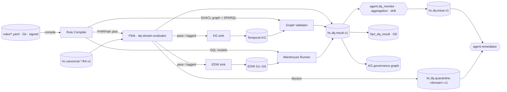

# DQ Pipelines and Execution Planes

## 1. Overview

The same rule pack is executed on three planes, each where the data already is:

| Plane | Where | When | Why it exists |
|-------|-------|------|---------------|
| **Stream** | Flink job `dq-stream-evaluator` consuming `hc.canonical.<domain>.<resource>.fhir.v1` (module 07) | Per record, at arrival (p95 ≤ 2 s added latency) | Detect and quarantine before the record is projected; mean time-to-detect < 15 min (G-03) |
| **Graph** | SHACL validation and SPARQL over the bitemporal KG (module 08) | Micro-batch per ingested named graph, plus nightly full validation of the current slice | Rules that need the whole graph: uniqueness, referential integrity across sources, temporal overlap, semantic axioms, reasoner consequences |
| **Warehouse** | SQL on EDW (module 05) scheduled dbt-test-like | Per load batch per group, plus daily reconciliation at 02:00 facility-local | Rules at set/aggregate grain: cross-table and cross-system reconciliation, trend baselines, history-table checks |

All three publish the same `hc.dq.result.v1` record so scorecards (DQ-04) and reconciliation (§7) are plane-agnostic.



## 2. Rule compilation and distribution

1. A pack release (`rules/*.yaml`, signed tag) is picked up by the **Rule Compiler** (a tool invoked by
   `agent.orchestrator`). It validates against `rule.schema.json`, resolves `owner`, `derived_from` and value-set URLs,
   and emits three plane-specific bundles plus `dim_dq_rule` rows (`rule_id, rule_version, dimension, group, severity,
   owner_sk, derivation, derived_from, status, valid_from, valid_to`).
2. Bundles are published to the compacted control topic `hc.ops.dq.rulepack.v1` (key = `rule_id`, value = compiled
   rule, tombstone = retired). Each plane subscribes and hot-reloads (§3.3, §4.2, §5.2).
3. Every compiled rule carries `pack_version` and `rule_version`; every result cites both, so a scorecard can be
   recomputed for any historical pack version.

## 3. Stream plane (Flink)

### 3.1 Job design

- One Flink job per Kafka domain (`dq-stream-evaluator-clinical`, `-party`, `-finance`, `-supply`, `-workforce`,
  `-pophealth`, `-research`, `-reference`), sharing one codebase. Parallelism equals partition count of the busiest
  canonical topic in the domain (ARC-NFR-002: ≥ 5,000 resources/s aggregate).
- Operators: `Source(canonical topics)` → `KeyBy(resource type, business key)` → `RuleEvaluator` (broadcast state
  holds compiled rules for the domain) → `Router` (pass / tagged / quarantine) → `Sinks` (pass-through topic
  `hc.dq.passed.<domain>.v1` consumed by the KG and EDW sinks, quarantine topic, results topic).
- Checkpointing every 10 s, exactly-once sinks via Kafka transactions (ARC-NFR-004). Resource state (for stateful
  TIMELINESS rules and simple uniqueness windows) is kept in RocksDB keyed state with TTL = the rule window.

### 3.2 Per-record evaluation

For each canonical record the evaluator:

1. Reads headers `hc-event-time`, `hc-source-time`, `hc-source-system`, `hc-prov-activity` (LINEAGE rules first; a
   missing provenance header is a `blocker`).
2. Selects rules where `target.plane == stream` and `target.resource` matches `resourceType` (and `profile` matches
   `meta.profile` when given).
3. Evaluates each FHIRPath expression with the HEALIX function library: `%vs(url)` resolves through a local LRU cache of
   expansions (refresh ≤ 15 min; miss → async `$validate-code` with a `pending` result), `%ref_exists()` queries the
   entity-resolution cache fed from `hc.kg.entity.resolved.v1`, `%header()` reads Kafka headers, `%now` is event time.
4. Emits one `hc.dq.result.v1` record per (record, rule) with `outcome ∈ {pass, fail, error, pending}`. An evaluation
   error (bad expression, TS timeout) is `error` and is never counted as `fail` for the scorecard but raises an
   operational alert after 100 errors/min.
5. Routes: any `blocker` fail → quarantine; otherwise forward with `hc-dq-status` header (`pass`,
   `fail-critical`, `fail-major`, `fail-minor`) and `hc-dq-failed-rules` (comma-separated ids).

TIMELINESS rules in stream are evaluated as `event_time − source_time ≤ budget` at arrival and, for records that
never arrive, by a keyed timer per expected sequence (e.g., an A01 admit without an A03 discharge or A08 update
within the facility's p99 LOS raises a `minor` liveness result).

### 3.3 Hot reload

Compiled rules arrive on `hc.ops.dq.rulepack.v1` as a broadcast stream. A new rule version is activated at the next
checkpoint barrier so all parallel instances switch atomically; results in the same checkpoint cite the same
`rule_version`. Deactivation (tombstone) stops evaluation but keeps the rule in `dim_dq_rule` as `retired`.

### 3.4 Quarantine routing and idempotency

- Quarantine topics are `hc.dq.quarantine.<domain>.v1` (e.g., `hc.dq.quarantine.clinical.v1`), keyed by the canonical
  business key, retention 90 days, PHI-classified (module 11), ACL restricted to `agent.remediator` and stewards.
- The quarantined value is the **unchanged canonical record** plus a `dq` envelope: failing rule ids, versions,
  evaluation details, `quarantine_id` (ULID), `replay_offset`.
- Remediation re-publishes a corrected record to the original canonical topic with header `hc-dq-remediation-of:
  <quarantine_id>`; the evaluator re-evaluates it like any record. Idempotency: the KG and EDW sinks upsert on
  (business key, `hc-source-time`, `hc-prov-activity`) so a replayed or remediated record creates a new temporal
  version, never a duplicate (TKG-00 bitemporal model).
- A record quarantined twice for the same rule within 24 h escalates the issue to `source_fix`.

## 4. Graph plane (SHACL + SPARQL)

### 4.1 Validation batches

Each ingested named graph `<base>graph/<source>/<yyyy-mm-dd>/<batch-ulid>` triggers a validation job:

1. Rules with `target.plane == graph` and `language == shacl` are grouped into a shapes graph per domain; validation
   runs with the target named graph plus the **current valid-time slice** of the domain as data graph (so
   cross-record rules such as uniqueness see existing entities). Result: a `sh:ValidationReport` whose
   `sh:ValidationResult` nodes are converted to `hc.dq.result.v1` records (one per focus node per shape).
2. Rules with `language == sparql` run their `SELECT ?focus ?detail` against the same data graph; every row is a `fail`
   result, and the rule emits an aggregate `pass` count from a companion `COUNT` of the target class.
3. Nightly at 01:00 UTC the full current slice is validated (all shapes) to catch violations introduced by
   deletions, retro-active valid-time corrections and ontology releases.

### 4.2 Temporal plausibility via SPARQL

Temporal rules use RDF-star annotations for valid time (`<< s p o >> healix:validFrom ?vf ; healix:validTo ?vt`).
The pattern for overlap (DQR-TEMPORAL-ASSIGNMENT-001):

```sparql
SELECT ?focus (CONCAT(STR(?a1), ' overlaps ', STR(?a2)) AS ?detail) WHERE {
  ?focus a workforce:Worker .
  << ?focus workforce:hasPrimaryAssignment ?a1 >> healix:validFrom ?f1 ; healix:validTo ?t1 .
  << ?focus workforce:hasPrimaryAssignment ?a2 >> healix:validFrom ?f2 ; healix:validTo ?t2 .
  FILTER(?a1 != ?a2 && ?f1 < COALESCE(?t2, "9999-12-31T00:00:00Z"^^xsd:dateTime)
                     && ?f2 < COALESCE(?t1, "9999-12-31T00:00:00Z"^^xsd:dateTime))
}
```

Rule hot-reload on the graph plane means the shapes graph and SPARQL set are re-materialised from
`hc.ops.dq.rulepack.v1` before the next batch; a running batch finishes with the version it started with.

### 4.3 Semantic rules and the reasoner

SEMANTIC rules (e.g., DQR-SEMANTIC-CONDITION-005) are expressed as SHACL-SPARQL constraints over the ontology's
restriction axioms (`healix:restrictedToSex`, `healix:minAge`). The nightly reasoner run (module 02, ELK) additionally
reports unsatisfiable individuals; `agent.dq_author` converts each new inconsistency class into a draft SEMANTIC rule
with a SPARQL target and, where the pattern is record-local, a FHIRPath back-port for the stream plane.

## 5. Warehouse plane (SQL)

### 5.1 Execution model

- Each warehouse target compiles to a dbt-style **test model** `dq_<rule_id_lower>` in schema `edw_g9_governance`,
  materialised as a view returning failing rows plus `rule_id`, `rule_version`, `evaluated_at`.
- A **runner** (Airflow DAG `dq_warehouse_<group>`) executes after each group's load batch completes (trigger: EDW load
  lineage event on `hc.edw.<group>.load.completed.v1`), and daily at 02:00 facility-local for reconciliation rules.
  For each rule it records the failing-row count, the denominator (`SELECT COUNT(*)` of the target at the same grain)
  and streams one aggregate `hc.dq.result.v1` record plus one detail record per failing key (capped at 10,000 keys;
  the remainder is summarised).
- Rules that evaluate history tables (`hist_*`) run against the bitemporal slice `AS OF` the batch's `recorded_at`.

### 5.2 Scheduling, retries and hot reload

| Trigger | Rules | Max runtime | On failure |
|---------|-------|-------------|-----------|
| Load completed (per group) | All warehouse rules for the group except XSYS | 20 min | Retry ×2, then operational alert |
| Daily 02:00 facility-local | XSYS reconciliation, TIMELINESS backlog rules, profiling | 2 h | Alert; scorecard marks group `stale` |
| Pack release | Backfill new/changed rules over trailing 30 days | 4 h | Partial results flagged `backfill` |

New compiled SQL models are deployed by the runner on the next DAG run; no in-flight run is interrupted.

### 5.3 Cross-table and cross-system reconciliation

XSYS rules follow a fixed SQL shape so detail is always a set difference, not a delta:

```sql
WITH a AS (SELECT facility_sk, service_dt AS d, SUM(charge_amt) AS amt FROM edw_g3_finance.fact_charge WHERE source_system_bk='cerner' GROUP BY 1,2),
     b AS (SELECT facility_sk, trx_dt AS d, SUM(amount) AS amt FROM edw_g3_finance.fact_ar_transaction WHERE source_system_bk='oracle_erp' GROUP BY 1,2)
SELECT COALESCE(a.facility_sk,b.facility_sk) AS facility_sk, COALESCE(a.d,b.d) AS d, a.amt AS cerner_amt, b.amt AS oracle_amt
FROM a FULL OUTER JOIN b ON a.facility_sk=b.facility_sk AND a.d=b.d
WHERE a.amt IS NULL OR b.amt IS NULL OR ABS(a.amt-b.amt) > 0.005*GREATEST(a.amt,b.amt);
```

## 6. Result and issue schemas

### 6.1 `hc.dq.result.v1`

Schema Registry subject `hc.dq.result.v1-value` (Avro, `FULL` compatibility). Key = `rule_id`.

| Field | Type | Notes |
|-------|------|-------|
| `result_id` | string (ULID) | Unique per evaluation |
| `rule_id`, `rule_version`, `pack_version` | string | From `dim_dq_rule` |
| `plane` | enum `stream, graph, warehouse` | |
| `outcome` | enum `pass, fail, error, pending` | |
| `grain` | enum `record, focus_node, row, aggregate` | |
| `subject` | record `{resource_type, business_key, resource_id?, named_graph?, table?, key_columns?}` | Never PHI values beyond the business key; MRN is hashed (module 11) |
| `source_system`, `facility` | string | From headers / dimensions |
| `event_time`, `source_time`, `evaluated_at` | timestamp-micros UTC | Event time is the record's `hc-event-time` |
| `valid_from`, `recorded_at`, `prov_activity_iri` | | Bitemporal provenance of the result itself (CONVENTIONS §4) |
| `severity` | enum | Copied from rule for convenience |
| `detail` | string ≤ 2 KB | Expression-specific detail (masked) |
| `context` | map<string,string> | `valueset_version`, `ontology_version`, `baseline_ref`, `window` |
| `aggregate` | optional record `{passed, failed, errored, denominator, window_start, window_end}` | For `grain=aggregate` |

### 6.2 `hc.dq.issue.v1`

Key = `issue_id`. One issue per `(rule_id, source_system, facility, aggregation window)` for `major/minor`; one per
record for `blocker`; one per record or per hour for `critical` (rule option `issue_grain`).

| Field | Type |
|-------|------|
| `issue_id` (ULID), `rule_id`, `rule_version`, `severity`, `state` (DQ-05 §3) | |
| `first_seen`, `last_seen`, `count`, `pass_rate_in_window` | |
| `subjects` (≤ 100 business keys, hashed where PHI), `quarantine_ids` | |
| `owner`, `assignee`, `remediation_action`, `sla_ack_due`, `sla_fix_due` | |
| `planes_agreeing` (list), `reconciliation_status` | |
| `prov_activity_iri`, `recorded_at` | |

Issues are persisted to `edw_g9_governance.fact_dq_issue` (bitemporal history) and the KG governance graph as
`healix:DQIssue` individuals linked to the failing entities with `prov:wasInvalidatedBy` on remediation.

## 7. Reconciliation across planes

A CDE rule with three targets produces three pass rates for the same window. `agent.dq_monitor` reconciles hourly:

| Condition | Interpretation | Action |
|-----------|----------------|--------|
| Stream fail, graph/warehouse pass for the same subject | Record was remediated before projection, or sinks dropped it | Verify a remediation link exists; otherwise open `major` issue DQR-CONSISTENCY-PLANE-001 |
| Stream pass, warehouse fail | Transformation defect in the EDW sink or mapping | Open issue against module 05 owner with lineage |
| Graph fail only (uniqueness, temporal) | Cross-record condition invisible in stream | Expected; feed back to stream as a stateful rule if frequent |
| Pass rates differ > 0.5 pp | Expression drift between planes | `agent.dq_author` opens a rule `tuning` change request |

Reconciliation output is stored as `fact_dq_result` rows with `grain=aggregate`, `plane=warehouse`, rule
DQR-CONSISTENCY-PLANE-001.

## 8. Profiling and drift detection (`agent.dq_monitor`)

`agent.dq_monitor` maintains baselines (DQ-01 §4.3) and raises drift issues when:

| Drift type | Detection | Severity |
|-----------|-----------|----------|
| Distribution shift | Population Stability Index > 0.2 on numeric or categorical field vs trailing 28-day baseline, per source and facility | `major` (CDE) / `minor` |
| New code | A code/system pair unseen in 90 days appears in a bound element | `minor`; routed to `agent.terminology_steward` |
| Volume anomaly | Hourly record count outside seasonal ±3σ (STL decomposition) or zero records for a topic beyond 2× p99 inter-arrival | `critical` (ADT, results, charges), `major` otherwise |
| Null-rate creep | Null rate on a CDE rises > 1 pp week-over-week | `major` |
| Schema drift | New or dropped field in `std` relative to registered Data Element Catalog | `critical`; `agent.source_mapper` notified |
| Latency drift | p95 source→canonical latency exceeds ARC-NFR-001 budget for 15 min | `critical` (operational) |

Drift findings are published as results of auto-generated rules (`derivation: profiling`, status `active`, severity
per table) so they appear on scorecards like any other rule.

## 9. Requirements

> **DQ-PIPE-001** (P0, test) — The stream plane MUST evaluate every record on every `hc.canonical.*` topic against all
> active stream-target rules for its resource type, adding ≤ 2 s p95 latency.

> **DQ-PIPE-002** (P0, test) — Rule activation, versioning and retirement MUST take effect on all planes without
> redeployment, via `hc.ops.dq.rulepack.v1`, within 5 min of pack release; stream activation MUST be atomic at a
> checkpoint barrier.

> **DQ-PIPE-003** (P0, test) — Evaluation errors (`outcome=error`) MUST be excluded from pass-rate denominators and
> MUST raise an operational alert when exceeding 100/min per rule.

> **DQ-PIPE-004** (P0, test) — Quarantined records MUST be stored unchanged with their DQ envelope on
> `hc.dq.quarantine.<domain>.v1`, retained ≥ 90 days, and MUST be re-evaluated on re-publication; sinks MUST remain
> idempotent for replayed and remediated records (ARC-NFR-004).

> **DQ-PIPE-005** (P0, test) — The graph plane MUST validate every ingested named graph against the domain shapes graph
> within 15 min of ingestion and MUST run a full validation of the current valid-time slice nightly.

> **DQ-PIPE-006** (P1, test) — Temporal rules on the graph plane MUST evaluate against RDF-star valid-time annotations
> and MUST support an `as_of` parameter to validate historical slices.

> **DQ-PIPE-007** (P0, test) — The warehouse plane MUST execute all warehouse-target rules for a group within 20 min of
> that group's load-completed event and MUST publish aggregate and detail results.

> **DQ-PIPE-008** (P0, inspection) — Every result on every plane MUST conform to `hc.dq.result.v1` and carry
> `rule_version`, `pack_version`, `plane`, bitemporal fields and `prov_activity_iri`.

> **DQ-PIPE-009** (P0, inspection) — Result and issue payloads MUST NOT contain PHI values other than hashed business
> keys; sample values MUST be masked per module 11 classification; quarantine topics are the only PHI-bearing DQ topics.

> **DQ-PIPE-010** (P1, test) — `agent.dq_monitor` MUST reconcile pass rates across planes hourly for every multi-target
> rule and MUST open a DQR-CONSISTENCY-PLANE-001 issue when rates differ by more than 0.5 pp.

> **DQ-PIPE-011** (P1, test) — Profiling MUST compute the statistics in DQ-01 §4.3 for every CDE daily and raise drift
> issues per the §8 table; baselines MUST be versioned and stored in `fact_dq_profile`.

> **DQ-PIPE-012** (P0, test) — Mean time from a failing record's `hc-event-time` to its first `fail` result MUST be
> < 15 min at p95 across all planes (G-03), and ≤ 10 s on the stream plane.

> **DQ-PIPE-013** (P1, test) — Pack releases MUST trigger a 30-day backfill of changed rules on the warehouse plane,
> with results flagged `backfill` so scorecards can distinguish them.

> **DQ-PIPE-014** (P1, test) — All DQ results MUST be persisted to `edw_g9_governance.fact_dq_result` and the KG
> governance named graph within 15 min of emission; `fact_dq_result` MUST partition by `evaluated_at` and cluster by
> `rule_id`.

> **DQ-PIPE-015** (P2, demo) — Stewards MUST be able to replay a quarantine topic range through the evaluator with a
> candidate rule version (shadow mode) and compare outcomes before activation.
