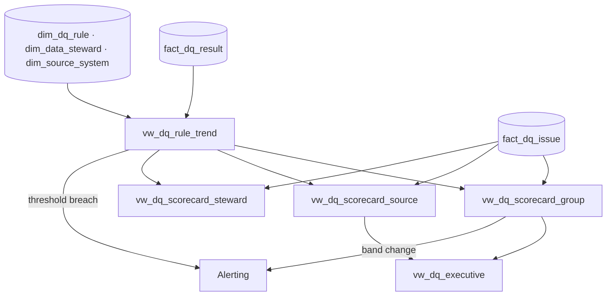

# DQ Scorecards, Index and SLAs

## 1. Purpose

Scorecards turn millions of `hc.dq.result.v1` records into a small number of trustworthy, comparable numbers per
subject-area group, source system and steward, and define the service levels the organisation commits to when
quality fails. Every number here is computed from `edw_g9_governance.fact_dq_result` joined to `dim_dq_rule`, so the
scorecards are reproducible for any historical window and any pack version.

## 2. Composite DQ index

### 2.1 Definition

For a scope *S* (a group, a source, a steward, a facility, or the enterprise) and a window *W* (default: trailing 24 h
for operational views, calendar month for executive views):

```
DQI(S, W) = 100 × Σ_r [ w_sev(r) × w_cde(r) × pass_rate(r, W) ] / Σ_r [ w_sev(r) × w_cde(r) ]
```

over all rules *r* with status `active` whose group/source/owner falls in *S* and that produced ≥ 1 non-error result in
*W*. `pass_rate(r, W) = passed / (passed + failed)` taken from the **authoritative plane** for the rule (§2.3).

| Weight | Values |
|--------|--------|
| `w_sev` | blocker 8 · critical 4 · major 2 · minor 1 |
| `w_cde` | 3 if the rule protects at least one CDE (DQ-01 §3), else 1 |

Properties: a single blocker CDE rule at 90 % pass rate costs 24 weighted points of denominator; a dozen minor
non-CDE rules at 90 % cost 12. Rules with no results in *W* are excluded from the index but counted in the **coverage**
metric so silence cannot inflate the score.

### 2.2 Companion metrics (always shown next to DQI)

| Metric | Definition |
|--------|-----------|
| Coverage | Active CDE rules with results in *W* ÷ active CDE rules (target ≥ 95 %); CDE coverage per DQ-FW-004 |
| Breach count | Rules whose pass rate < `threshold.min` in *W*, by severity |
| Quarantine rate | Quarantined records ÷ canonical records in *W* per domain (target < 0.1 %) |
| Open issues | By state and severity, with SLA status (within / at risk / breached) |
| MTTD / MTTA / MTTR | Median and p95 time to detect (event time → first fail), acknowledge, remediate |
| Plane agreement | Share of multi-target rules whose plane pass rates agree within 0.5 pp |

### 2.3 Authoritative plane per rule

To avoid triple counting, each rule's `pass_rate` comes from one plane: stream if it has a stream target (earliest,
record-grain), else graph, else warehouse. Other planes feed the plane-agreement metric only.

### 2.4 Bands

| DQI | Band | Meaning |
|-----|------|---------|
| ≥ 99.0 | Green | Fit for all uses |
| 97.0–98.9 | Amber | Fit for operational use; analytics must consult breach list |
| 95.0–96.9 | Red | Group steward action plan required |
| < 95.0 | Black | Executive escalation; downstream certification revoked for the group |

## 3. Scorecards

All scorecards are materialised as EDW views in `edw_g9_governance` and rendered by the platform's BI layer; the SQL
is the specification.

### 3.1 Group scorecard (`vw_dq_scorecard_group`)

Grain: `(group_code, window)`. Columns: `dqi`, band, coverage, breach counts per severity, quarantine rate, top-5
failing rules (id, pass rate, trend), open issues by SLA status, MTTD/MTTA/MTTR, 7-day and 28-day DQI sparkline
values.

### 3.2 Source scorecard (`vw_dq_scorecard_source`)

Grain: `(source_system, facility, window)`. Same metrics, plus latency (p95 source→canonical), schema-drift count,
new-code count, and the source owner. This is the view handed to Cerner and Oracle Fusion application owners in the
monthly data-quality review.

### 3.3 Steward scorecard (`vw_dq_scorecard_steward`)

Grain: `(steward_bk, window)`. Issues owned, SLA attainment (% acknowledged and remediated within SLA), rules in
`tuning`, false-positive rate (issues closed as `accepted` ÷ issues closed), and rule proposals pending review from
`agent.dq_author` older than 5 business days.

### 3.4 Rule scorecard (`vw_dq_rule_trend`)

Grain: `(rule_id, rule_version, plane, day)`. Pass rate, failed count, denominator, errored, p95 evaluation latency,
with breach markers. This is the drill-down from every other scorecard.

### 3.5 Executive view (`vw_dq_executive`)

Monthly, enterprise and per-group: DQI with month-over-month delta, Black/Red groups, CDE coverage, count of
source-fix requests open > 30 days by source owner, cost of poor quality proxy (quarantined charge dollar value,
denied-claim dollar value linked to DQ issues), and the three largest drivers of DQI change (rules with the largest
weighted contribution delta).



## 4. Thresholds and alerting

### 4.1 Rule thresholds

Every rule carries `threshold: {metric, min|max, window}` (DQ-02 §2.2). Defaults set by `agent.dq_author` when a rule
is derived, tunable by the steward:

| Severity | Default metric | Default min pass rate | Default window |
|----------|----------------|-----------------------|----------------|
| blocker | pass_rate | 0.9999 | PT1H |
| critical | pass_rate | 0.999 | PT1H |
| major | pass_rate | 0.99 | P1D |
| minor | pass_rate | 0.95 | P7D |

For XSYS and volume rules the metric is `value` (e.g., relative delta ≤ 0.005) or `fail_count` (≤ N unmatched keys).

### 4.2 Breach detection

`agent.dq_monitor` evaluates thresholds on tumbling windows aligned to the rule's `window`. A breach raises an
aggregate issue at the rule's severity escalated by one level if the breach persists for 3 consecutive windows
(`minor → major → critical`; `critical` and `blocker` do not escalate further but page).

### 4.3 Alert routing

| Trigger | Channel | Recipient |
|---------|---------|-----------|
| Blocker record quarantined | Page (on-call) + issue | Group steward on-call, `agent.remediator` |
| Critical threshold breach | Chat channel `#dq-<group>` + issue | Group steward, source owner |
| Major/minor breach | Daily digest | Group steward |
| Group band drops to Red/Black | Email + page | Data Quality Lead, group steward, CDO |
| Source latency / schema drift | Ops channel | Platform SRE, `agent.source_mapper` |
| Plane disagreement > 0.5 pp | Issue | `agent.dq_author`, Data Platform |

Alerts carry only hashed keys and aggregate counts (DQ-PIPE-009).

## 5. Service levels

### 5.1 Issue SLAs

| Severity | Acknowledge (MTTA target) | Remediate or accept (MTTR target) | Escalation if breached |
|----------|---------------------------|-----------------------------------|------------------------|
| blocker | ≤ 15 min | ≤ 4 h | Data Quality Lead at +4 h; CDO at +24 h |
| critical | ≤ 30 min | ≤ 24 h | Data Quality Lead at +24 h |
| major | ≤ 4 business hours | ≤ 5 business days | Steward's manager at +5 bd |
| minor | ≤ 2 business days | Backlog; reviewed monthly | None |

Acknowledgement by `agent.remediator` (auto-fix started) counts as acknowledged; remediation counts only when the
issue reaches `resolved` or `accepted` (DQ-05 §3) and the corrected record has re-passed the rule.

### 5.2 Pipeline SLOs (owned jointly with module 12)

| SLO | Target |
|-----|--------|
| Stream plane availability | 99.9 % monthly |
| Stream added latency p95 | ≤ 2 s |
| Time to detect (p95, event time → first fail) | < 15 min all planes; ≤ 10 s stream |
| Graph validation of ingested named graph | ≤ 15 min p95 |
| Warehouse rule run after load | ≤ 20 min p95 |
| Scorecard freshness | ≤ 1 h operational; ≤ 24 h executive |
| Results persisted to `fact_dq_result` | ≤ 15 min |

### 5.3 Rule governance SLAs

| Event | SLA |
|-------|-----|
| Ontology release → derived draft rules | ≤ 24 h (DQ-FW-002) |
| Steward review of a draft rule | ≤ 5 business days |
| False-positive rate of an active rule > 5 % | Moved to `tuning` within 1 business day |
| Deprecated rule with no results | Retired after 90 days |

## 6. Trend reporting from `fact_dq_result`

`fact_dq_result` grain is one row per result (record-grain results are stored for 90 days, then rolled up to
`agg_dq_result_day` by `(rule_id, rule_version, plane, source_system, facility, day)` retained for 7 years to meet
financial and clinical audit horizons). Trend queries use the daily aggregate:

```sql
SELECT r.group_code, a.day,
       100 * SUM(w.w_sev * w.w_cde * a.passed / NULLIF(a.passed + a.failed, 0))
           / SUM(w.w_sev * w.w_cde)                                  AS dqi
FROM edw_g9_governance.agg_dq_result_day a
JOIN edw_g9_governance.dim_dq_rule r  ON r.rule_id = a.rule_id AND r.rule_version = a.rule_version
JOIN edw_g9_governance.ref_dq_weight w ON w.severity = r.severity AND w.is_cde = r.is_cde
WHERE a.plane = r.authoritative_plane AND a.day >= CURRENT_DATE - 90
GROUP BY 1, 2;
```

Trends are reported with the pack version in force so a step change caused by a rule change is annotated, not
mistaken for a data change (`dim_dq_rule.valid_from` provides the change marker).

## 7. Requirements

> **DQ-SCORE-001** (P0, test) — The composite DQ index MUST be computed exactly per §2.1 with the weights in §2.1 from
> `fact_dq_result` and `dim_dq_rule`, for every group, source, facility and steward, for trailing 24 h and calendar month
> windows.

> **DQ-SCORE-002** (P0, test) — Each rule's pass rate in the index MUST come from its authoritative plane (§2.3); other
> planes MUST feed only the plane-agreement metric.

> **DQ-SCORE-003** (P0, inspection) — Every scorecard MUST display coverage, breach counts, quarantine rate, open issues
> by SLA status and MTTD/MTTA/MTTR alongside the index; the index MUST NOT be shown without coverage.

> **DQ-SCORE-004** (P0, test) — Threshold breaches MUST be detected on tumbling windows aligned to each rule's
> `threshold.window` and MUST raise an aggregate issue within one window of the breach.

> **DQ-SCORE-005** (P0, test) — Blocker quarantines MUST page the on-call steward within 5 min; critical breaches MUST
> notify within 15 min; routing MUST follow §4.3.

> **DQ-SCORE-006** (P0, analysis) — Issue SLAs in §5.1 (blocker ack ≤ 15 min / fix ≤ 4 h; critical ack ≤ 30 min /
> fix ≤ 24 h; major ack ≤ 4 bh / fix ≤ 5 bd) MUST be tracked per issue and attainment reported on the steward scorecard.

> **DQ-SCORE-007** (P1, test) — Scorecards MUST be reproducible for any past window and pack version from
> `agg_dq_result_day` and bitemporal `dim_dq_rule`; recomputation MUST match the originally published value.

> **DQ-SCORE-008** (P1, inspection) — Record-grain results MUST be retained 90 days and daily aggregates 7 years.

> **DQ-SCORE-009** (P1, test) — A group whose index falls into Red or Black MUST have its downstream data-product
> certification flag (`dim_dq_certification.is_certified`) set false until it returns to Amber for 7 consecutive days.

> **DQ-SCORE-010** (P1, demo) — The executive view MUST attribute month-over-month index change to the three rules with
> the largest weighted contribution delta and annotate pack-version changes in the window.

> **DQ-SCORE-011** (P2, demo) — Stewards MUST be able to simulate the index impact of a proposed threshold or severity
> change against the trailing 28 days before approving it.

> **DQ-SCORE-012** (P0, inspection) — Scorecards and alerts MUST contain no PHI; drill-down to record level MUST require
> the quarantine-topic or EDW row-level entitlement defined in module 11.
