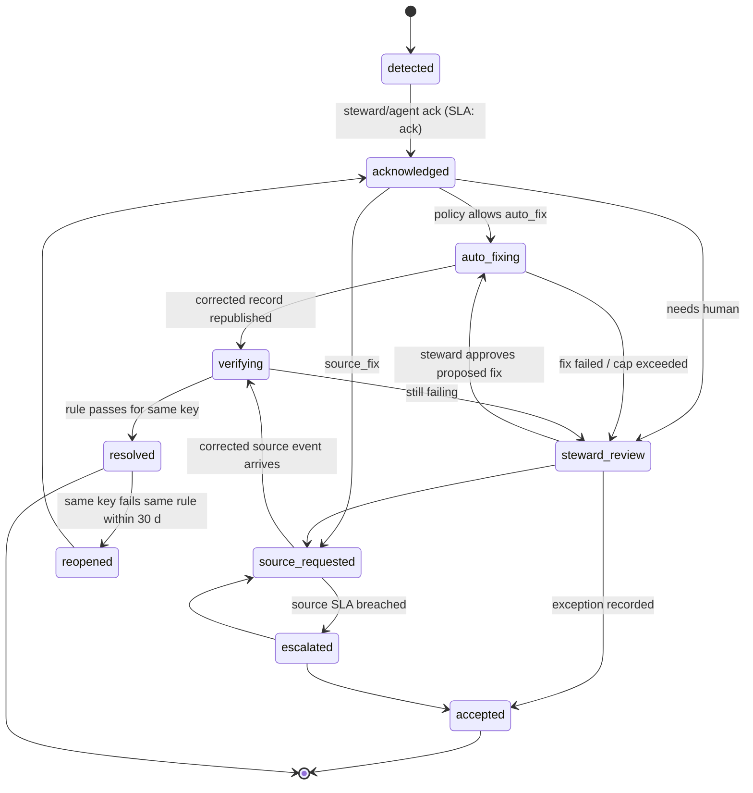
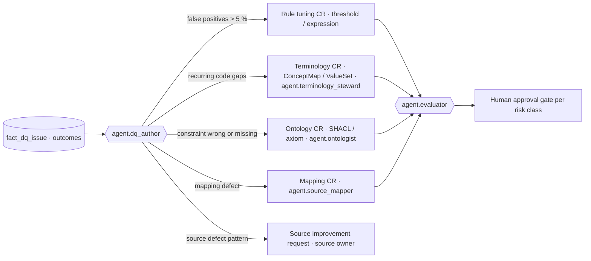

# DQ Remediation Workflows

## 1. Principles

1. **Never overwrite.** A fix is a new temporal version of the fact with its own valid time, transaction time and a
   PROV-O activity that cites the issue, the rule and the actor (agent or human). The failing version remains
   queryable as-of its transaction time (ARC ADR-03).
2. **Fix at the lowest safe layer.** Prefer fixing in the source (Cerner, Oracle Fusion, peripheral) so the error does
   not recur; fix in the platform only for normalisation defects the platform introduced or can resolve
   deterministically.
3. **Autonomy within policy.** `agent.remediator` (L2) auto-applies only fix classes in the approved policy table (§2.1)
   and only when the evaluator score meets the threshold; everything else is proposed to a steward.
4. **Every fix teaches.** Remediation outcomes feed rule tuning and ontology/terminology change requests (§7).

## 2. Remediation taxonomy

### 2.1 Auto-fix within policy (`action: auto_fix`, actor `agent.remediator`)

| Fix class | Typical rule | Mechanism | Guardrail |
|-----------|-------------|-----------|-----------|
| Code re-mapping | DQR-VALIDITY-OBSERVATION-003, DQR-VALIDITY-MEDICATION-001, DQR-VALIDITY-PO-001 | `$translate` through a governed ConceptMap (module 06) from the source code system to the bound value set; equivalence `equivalent` or `equal` only | No mapping or `wider/narrower` ⇒ steward |
| Unit normalisation | DQR-COMPLETENESS-OBSERVATION-004, DQR-VALIDITY-UCUM-001 | Map local unit string to UCUM via unit ConceptMap; convert value when the LOINC code's example UCUM unit differs by a fixed factor (mg/dL ↔ mmol/L per analyte table) | Conversion factor must be in `ref_unit_conversion`; never for drug doses |
| Identifier formatting | DQR-VALIDITY-PRACTITIONER-001, DQR-VALIDITY-ORGANIZATION-001 | Strip whitespace/hyphens, zero-pad, set `identifier.system` | Value must pass the check digit after formatting |
| Reference resolution | DQR-INTEGRITY-OBSERVATION-007, DQR-INTEGRITY-PO-003 | Resolve a dangling reference through the entity-resolution index (EMPI/supplier master) when a unique match ≥ 0.98 confidence exists | Ambiguous match ⇒ steward |
| Timestamp/offset repair | DQR-TIMELINESS-*, DQR-TEMPORAL-PO-004 | Apply the known facility offset when a source emits local time without offset (registered in Source Registry) | Only when the source is flagged `local_time_no_offset` |
| Derived-field completion | DQR-COMPLETENESS-ENCOUNTER-001 | Derive `Encounter.class` from Cerner `ENCNTR_TYPE_CLASS_CD` via ConceptMap when the mapped element is missing | Derivation rule must be in the mapping spec (module 06) |
| Late-arrival wait | DQR-INTEGRITY-* in stream | Hold quarantined record up to the rule's `window` for the referenced resource to arrive, then re-evaluate | Hold ≤ 24 h |

Auto-fixes are applied by re-publishing a corrected canonical record with header `hc-dq-remediation-of` and
`hc-dq-fix-class`; the evaluator re-runs all rules. Daily auto-fix volume per rule is capped (default 5 % of records)
to prevent silent mass changes; above the cap the issue becomes `source_fix`.

### 2.2 Steward-assisted (`action: steward`)

| Case | Workflow |
|------|----------|
| Duplicate patient (DQR-UNIQUENESS-PATIENT-001) | Issue creates an EMPI merge/link task with match evidence; steward decides merge, link or keep-separate; result is a `Linkage` resource and a KG `owl:sameAs`-with-provenance assertion; EDW `dim_patient` gets a new SCD2 row with `survivor_patient_sk` |
| Implausible lab value (DQR-ACCURACY-OBSERVATION-005) | Clinical informaticist reviews with LIS; outcome is `accept` (rare but valid), `source_fix` (transcription), or ConceptMap/unit correction |
| Sex/age-restricted code (DQR-SEMANTIC-CONDITION-005) | Coding steward reviews; either the diagnosis is corrected in Cerner (source fix) or the patient's demographic is wrong (EMPI task) |
| Overlapping assignments (DQR-TEMPORAL-ASSIGNMENT-001) | HR steward corrects effective dates in HCM; platform holds the later assignment as `tagged` until corrected |
| Reconciliation break (DQR-CONSISTENCY-XSYS-001/006) | Revenue integrity analyst reviews unmatched keys; typical outcomes are a missed interface batch (replay), timing (accept with a `late_posting` annotation), or a mapping defect |

`agent.remediator` prepares the steward packet: issue summary, affected keys (hashed in the issue; full keys in the
entitled workspace), evidence, suggested fix and confidence, one-click actions.

### 2.3 Source-fix request (`action: source_fix`)

A request is opened in the source owner's queue (Cerner application team, Oracle Fusion functional team, peripheral
vendor) with the DQ issue id, rule, affected keys and a reproduction query. The platform does **not** alter the data;
the record stays quarantined (blocker) or tagged (others) until the corrected source event arrives and re-passes. The
request tracks `requested_at`, `source_ack_at`, `source_fixed_at`, `verified_at`; verification is automatic when the
rule passes for the same business key with a later `hc-source-time`.

### 2.4 Accept-and-annotate (`action: accept`)

Stewards MAY accept a failure as a true, documented exception (e.g., a 112-year-old patient, a legitimately negative
GL adjustment line). Acceptance records a `healix:DQException` with scope (`record`, `key`, `rule`), justification,
expiry (≤ 12 months, renewable) and approver; the exception suppresses future issues for that scope and marks the
result as `pass_with_exception` in scorecards. Exceptions on `blocker` rules require two approvers.

## 3. Workflow states

| State | Meaning | Who moves it |
|-------|---------|--------------|
| `detected` | Issue created from results | `agent.dq_monitor` |
| `acknowledged` | Owner has seen it; SLA clock for fix starts | steward or `agent.remediator` |
| `auto_fixing` | Policy fix being applied | `agent.remediator` |
| `steward_review` | Awaiting human decision | steward |
| `source_requested` | Ticket open with source owner | `agent.remediator` creates; source owner updates |
| `escalated` | Source SLA breached | `agent.dq_monitor` |
| `verifying` | Waiting for the corrected record to re-pass | evaluator |
| `resolved` | Re-passed; closure evidence linked | evaluator |
| `accepted` | Documented exception | steward (two for blocker) |
| `reopened` | Recurrence within 30 days | `agent.dq_monitor` |

Every transition is appended to `fact_dq_issue` as a new bitemporal row and to the KG as a `prov:Activity` with
`prov:used` (the issue, the rule version, the failing version) and `prov:generated` (the new version, the exception,
or the source request).

## 4. Remediation SLAs

| Severity | Auto-fix decision | Steward decision | Source-fix acknowledgement by source owner | Source fix delivered |
|----------|-------------------|------------------|--------------------------------------------|----------------------|
| blocker | ≤ 5 min | ≤ 2 h | ≤ 4 h | ≤ 24 h (then `escalated`) |
| critical | ≤ 15 min | ≤ 8 business hours | ≤ 1 business day | ≤ 5 business days |
| major | ≤ 1 h | ≤ 3 business days | ≤ 3 business days | ≤ 15 business days |
| minor | next daily batch | monthly review | monthly review | next source release |

These compose with the issue SLAs in DQ-04 §5.1; the issue SLA is the outer bound.

## 5. Audit trail

Every remediation produces the following, with no exceptions:

| Artefact | Content |
|----------|---------|
| New temporal version | Corrected canonical record republished; KG assertions with `valid_from` unchanged (the fact was always true) or corrected (if the valid time itself was wrong), new `recorded_at`; EDW `hist_*` row with `superseded_at` set on the old row |
| `prov:Activity` | Type `healix:DQRemediation`, `prov:wasAssociatedWith` the agent or person, `prov:used` the quarantine or tagged record, the issue and rule version, `healix:fixClass`, `healix:evaluatorScore` |
| Issue history | State transitions, actors, timestamps, justification text |
| Diff | Field-level before/after (PHI fields masked in the issue, full in the entitled audit store) |
| Source request linkage | External ticket id and status for `source_fix` |

Overwriting a record in place, deleting a quarantined record, or editing a result row is prohibited and technically
prevented (append-only topics, EDW history tables, named-graph immutability in module 08).

## 6. Agent policy for `agent.remediator`

| Policy element | Value |
|----------------|-------|
| Autonomy level | L2: auto-apply when `agent.evaluator` score ≥ 0.95 and fix class is in §2.1; otherwise propose |
| Tools (MCP) | Terminology `$translate`/`$validate-code`; entity-resolution lookup; canonical republish (scoped to the quarantined key); issue API; source ticket API; EDW read (masked) |
| Forbidden | Changing a clinical value (dose, result value) except deterministic unit conversion; merging patients; editing GL amounts; touching records outside the issue's keys; any fix vetoed by `agent.privacy_guardian` |
| Volume caps | ≤ 5 % of a rule's records per day auto-fixed; ≤ 1,000 records per issue without steward approval |
| Explainability | Every proposed fix includes the rule, the evidence, the ConceptMap/version or conversion used, and the confidence |
| Rollback | Any auto-fix can be rolled back by republishing the prior version with a `healix:DQRollback` activity; rollback rate > 2 % per fix class per week suspends that fix class |

## 7. Feedback loop

| Signal | Threshold | Change request |
|--------|-----------|----------------|
| Issues closed as `accepted` ÷ closed | > 5 % over 28 days | Rule to `tuning`; propose threshold/expression change or scope exception |
| Same ConceptMap gap fixed by stewards | ≥ 3 times | Add mapping; `agent.terminology_steward` |
| Semantic rule fires where clinicians confirm validity | ≥ 2 confirmed | Ontology CR to relax or qualify the axiom (`agent.ontologist`, L1 human-approved) |
| Completeness rule fails because the source never has the element | pass rate < 50 % for 7 days | Ontology CR to downgrade `sh:minCount` or profile must-support; or source improvement request |
| Reconciliation break pattern tied to interface timing | recurring at same hour | Adjust rule grain/window (policy CR) and raise interface scheduling with source owner |

Ontology change requests from DQ carry the evidence (issue ids, counts, clinician confirmations) so the ontology
pipeline's governance (module 02) can weigh real-world data against the modelled constraint. Rules re-derive
automatically when the ontology changes (DQ-FW-011), closing the loop.

## 8. Requirements

> **DQ-REM-001** (P0, test) — A remediation MUST create a new temporal version of the affected record/assertion/row
> with a PROV-O activity of type `healix:DQRemediation`; in-place overwrite or deletion of the failing version MUST be
> technically impossible.

> **DQ-REM-002** (P0, inspection) — `agent.remediator` MUST apply only fix classes listed in §2.1, only when the
> evaluator score ≥ 0.95, and MUST propose to a steward otherwise.

> **DQ-REM-003** (P0, test) — Auto-fixed records MUST be republished to the originating canonical topic with headers
> `hc-dq-remediation-of` and `hc-dq-fix-class`, and MUST be re-evaluated by all applicable rules before reaching a sink.

> **DQ-REM-004** (P0, test) — Code re-mapping fixes MUST use only governed ConceptMaps with equivalence `equivalent` or
> `equal` and MUST record the ConceptMap version in the provenance.

> **DQ-REM-005** (P0, inspection) — `agent.remediator` MUST NOT alter clinical result values, medication doses or GL
> amounts, merge patients, or act outside the keys of the issue; unit conversion MUST use `ref_unit_conversion`.

> **DQ-REM-006** (P0, test) — Duplicate-patient issues MUST be routed to the EMPI steward queue with match evidence;
> merges MUST be recorded as `Linkage` resources and provenance-annotated `owl:sameAs` assertions, never by deleting a
> patient.

> **DQ-REM-007** (P0, test) — Source-fix requests MUST remain open until a corrected source event with a later
> `hc-source-time` re-passes the rule for the same business key; verification MUST be automatic.

> **DQ-REM-008** (P1, inspection) — Exceptions (`accepted`) MUST carry scope, justification, approver(s) and an expiry
> ≤ 12 months; exceptions on `blocker` rules MUST have two approvers; expired exceptions MUST reactivate the issue.

> **DQ-REM-009** (P0, test) — Every workflow transition in §3 MUST be persisted bitemporally in `fact_dq_issue` and as
> a `prov:Activity` in the KG governance graph within 15 min.

> **DQ-REM-010** (P1, test) — Auto-fix volume MUST be capped at 5 % of a rule's records per day and 1,000 records per
> issue; exceeding a cap MUST convert the issue to `steward_review`.

> **DQ-REM-011** (P1, test) — Any auto-fix MUST be reversible by republishing the prior version under a
> `healix:DQRollback` activity; a fix class with rollback rate > 2 % per week MUST be suspended automatically.

> **DQ-REM-012** (P1, analysis) — `agent.dq_author` MUST evaluate the feedback signals in §7 weekly and open the
> corresponding change requests with evidence; rules with false-positive rate > 5 % MUST enter `tuning` within one
> business day.

> **DQ-REM-013** (P0, inspection) — Steward packets, issues and source-fix requests MUST expose PHI only inside the
> entitled remediation workspace; all other channels MUST carry hashed keys and masked diffs (module 11).

> **DQ-REM-014** (P2, demo) — Stewards MUST be able to apply a steward-assisted fix to all records in an issue in one
> action, with the evaluator checking each record and the result reported per record.
