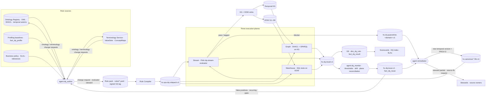
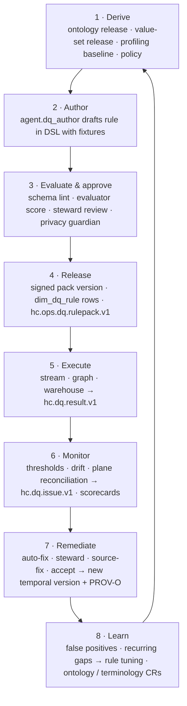

# Module 09 · Data Quality

## 1. Scope

This module specifies how HEALIX measures, scores and repairs the quality of every clinical, financial, supply-chain
and workforce fact flowing from **Cerner Millennium**, **Oracle Fusion Cloud (ERP, HCM, SCM)** and the **peripheral
systems** (LIS, RIS/PACS, pharmacy, RCM/clearinghouse, HIE, portal, devices, payers, credentialing, timekeeping,
scheduling, EMPI).

The central design idea is that **DQ rules are derived from the ontology**. The ontology pipeline (module 02)
publishes OWL classes and properties, SHACL shapes, value-set bindings (module 06) and temporal axioms; `agent.dq_author`
turns those constraints into executable rules, supplements them with statistical profiling baselines and business
policy, and packages them as versioned rule packs (`rules/*.yaml`). One rule pack is executed on **three planes**:

| Plane | Engine | Module | Grain |
|-------|--------|--------|-------|
| Stream | Flink job on `hc.canonical.<domain>.<resource>.fhir.v1`, FHIRPath expressions | 07 | per record, at arrival |
| Graph | SHACL validation and SPARQL over the bitemporal knowledge graph | 08 | per named graph batch, per focus node |
| Warehouse | SQL tests on EDW tables (dbt-test-like), cross-table and cross-system reconciliation | 05 | per load batch, per row / aggregate |

All three emit the same `hc.dq.result.v1` record, so the ontology pipeline and the DQ pipeline share **one semantic
source of truth** and results from any plane reconcile against each other and against the scorecards.

**In scope:** DQ dimensions and CDE catalogue; rule DSL and catalogue; the three execution planes; result, issue and
quarantine contracts; profiling and drift detection; composite DQ index, scorecards and SLAs; remediation workflows and
audit trail; the agents `agent.dq_author`, `agent.dq_monitor`, `agent.remediator` (behavioural policy; manifests live
in module 10).

**Out of scope:** structural validation of `raw`/`std` records (module 07), FHIR profile conformance validation at
canonicalisation (module 06), ontology consistency checking itself (module 02), access control and PHI classification
(module 11), platform SLOs for infrastructure (module 12).

## 2. Documents

| Doc id | File | Content |
|--------|------|---------|
| DQ-00 | `README.md` | This overview, architecture, lifecycle, requirement index |
| DQ-01 | [`01-dq-framework.md`](01-dq-framework.md) | Ten dimensions with healthcare definitions, CDE catalogue by group, rule derivation sources, severity classes and routing, roles |
| DQ-02 | [`02-rule-catalog.md`](02-rule-catalog.md) | YAML rule DSL, 98-rule first-release catalogue across G1–G9 and cross-system reconciliation |
| DQ-03 | [`03-dq-pipelines.md`](03-dq-pipelines.md) | Stream, graph and warehouse planes; result and issue schemas; cross-plane reconciliation; profiling and drift |
| DQ-04 | [`04-scorecards-and-slas.md`](04-scorecards-and-slas.md) | Composite DQ index, scorecards per group/source/steward, thresholds, alerting, SLAs, trend reporting |
| DQ-05 | [`05-remediation-workflows.md`](05-remediation-workflows.md) | Remediation taxonomy, workflow states, SLAs, audit trail, feedback loop into rules and ontology |
| — | [`rules/rule.schema.json`](rules/rule.schema.json) | JSON Schema (Draft 2020-12) for the rule DSL |
| — | [`rules/*.yaml`](rules/) | Rule packs: `g1-party`, `g2-clinical`, `g3-finance`, `g4-supply`, `g5-workforce`, `cross-system-reconciliation` (64 rules) |

## 3. DQ architecture

## 4. Key contracts exposed by this module

| Contract | Direction | Consumers | Spec |
|----------|-----------|-----------|------|
| Rule pack `rules/*.yaml` + `rule.schema.json` | out | 07 (stream), 08 (graph), 05 (warehouse), 10 (agents) | DQ-02 §2 |
| `hc.ops.dq.rulepack.v1` compiled rules (compacted control topic) | out | planes | DQ-03 §2 |
| `hc.dq.result.v1` | out | 05 (`fact_dq_result`), 08 (governance graph), 04 scorecards | DQ-03 §6.1 |
| `hc.dq.issue.v1` | out | 10 (`agent.remediator`), stewards, 12 alerting | DQ-03 §6.2 |
| `hc.dq.quarantine.<domain>.v1` | out | `agent.remediator`, stewards (PHI-restricted) | DQ-03 §3.4 |
| `hc.dq.passed.<domain>.v1` + headers `hc-dq-status`, `hc-dq-failed-rules` | out | KG and EDW sinks | DQ-03 §3.2 |
| G9 tables `dim_dq_rule`, `fact_dq_result`, `fact_dq_issue`, `fact_dq_profile`, `agg_dq_result_day`, `dim_data_steward` | out | 05 DDL, 04 scorecards | DQ-03, DQ-04 |
| Ontology Registry API (SHACL shapes, axioms, version IRIs) | in | from 02 | ONT-00 |
| Terminology Service (`$validate-code`, `$translate`, `$expand`) | in | from 06 | IOP-00 |
| Data Element Catalog with CDE flags | in | from 03 | SRC-00 |
| Bitemporal graph model and RDF-star valid-time annotations | in | from 08 | TKG-00 |
| Change Request schema, evaluator, autonomy levels | in | from 10 | AGT-00 |

## 5. DQ lifecycle

| Stage | Owner | Key artefacts | Gate |
|-------|-------|---------------|------|
| 1 Derive | `agent.dq_author` | derivation report per ontology/terminology release | within 24 h of release (DQ-FW-002) |
| 2 Author | `agent.dq_author`, stewards | rule YAML, fixtures | schema valid (DQ-RULE-001) |
| 3 Evaluate & approve | `agent.evaluator`, group steward, `agent.privacy_guardian` | change request, evaluation score | L2 auto-approve only for `minor`; PHI review (DQ-FW-012) |
| 4 Release | `agent.release_manager` | signed pack tag, `dim_dq_rule` | ARC-NFR-006 |
| 5 Execute | planes, `agent.dq_monitor` | `hc.dq.result.v1` | latency budgets (DQ-PIPE-001/005/007) |
| 6 Monitor | `agent.dq_monitor` | issues, scorecards, drift findings | threshold windows (DQ-SCORE-004) |
| 7 Remediate | `agent.remediator`, stewards, source owners | new versions, PROV-O activities, exceptions | policy table and caps (DQ-REM-002/010) |
| 8 Learn | `agent.dq_author` | tuning CRs, ontology CRs | weekly review (DQ-REM-012) |

## 6. Agents in this module

| Agent | Level | Responsibilities here | Detailed in |
|-------|-------|----------------------|-------------|
| `agent.dq_author` | L2 | Derive rules from SHACL/OWL/value sets/profiles/policy; propose thresholds; re-derive on releases; tune rules from feedback; open ontology/terminology CRs | DQ-01 §4, DQ-05 §7 |
| `agent.dq_monitor` | L3 | Run planes, profile, detect drift, evaluate thresholds, reconcile planes, open and aggregate issues, alert | DQ-03 §7–8, DQ-04 §4 |
| `agent.remediator` | L2 | Auto-fix within policy, prepare steward packets, raise source-fix requests, verify fixes, roll back | DQ-05 |

## 7. Success measures (from VIS-00 G-03 and §8)

| Measure | First-release target |
|---------|---------------------|
| CDE coverage by active rules | ≥ 90 % (stretch 95 %) |
| Mean time-to-detect (event time → first fail result) | < 15 min p95; ≤ 10 s stream |
| Composite DQ index per group | ≥ 97 (Amber or better) for G1–G5 at go-live |
| Critical-rule breach acknowledgement | ≤ 30 min (blocker ≤ 15 min) |
| Critical-rule breach remediation | ≤ 24 h (blocker ≤ 4 h) |
| Rules derived from ontology or terminology (vs hand-written) | ≥ 70 % of active rules |
| DQ-rule changes auto-approved after evaluation | ≥ 80 % (G-06) with zero unreviewed PHI-affecting changes |

## 8. Requirement index

Priorities: P0 launch-blocking, P1 first release, P2 later. Verification: test, inspection, demo, analysis.

### DQ-01 Framework (`DQ-FW`)

| ID | Pri | Ver | Summary |
|----|-----|-----|---------|
| DQ-FW-001 | P0 | inspection | One dimension per rule; id follows `DQR-<DIMENSION>-<DOMAIN>-<NNN>` |
| DQ-FW-002 | P0 | test | SHACL/OWL constraints yield draft rules within 24 h of ontology release |
| DQ-FW-003 | P0 | test | Every required/extensible binding has a stream VALIDITY rule pinned to expansion version |
| DQ-FW-004 | P0 | analysis | ≥ 90 % CDE coverage; computed weekly |
| DQ-FW-005 | P0 | inspection | Severity classes; only CDE rules may be blocker; profiling never blocker |
| DQ-FW-006 | P0 | test | Blocker failures quarantined, never forwarded to sinks |
| DQ-FW-007 | P1 | test | Non-blocker failures forwarded with `hc-dq-status` headers |
| DQ-FW-008 | P0 | inspection | Rule owner resolves to `dim_data_steward` |
| DQ-FW-009 | P1 | test | Profiling baselines per target/source/facility; `baseline_ref` |
| DQ-FW-010 | P0 | inspection | Rule versions immutable once active |
| DQ-FW-011 | P1 | test | Ontology constraint removal auto-deprecates derived rule |
| DQ-FW-012 | P0 | inspection | Privacy guardian reviews rules emitting samples; PHI masked |
| DQ-FW-013 | P1 | analysis | Dimensions mapped to ISO/IEC 25012 |
| DQ-FW-014 | P2 | demo | Natural-language rule requests drafted by `agent.dq_author` |

### DQ-02 Rule DSL and catalogue (`DQ-RULE`)

| ID | Pri | Ver | Summary |
|----|-----|-----|---------|
| DQ-RULE-001 | P0 | test | Packs validate against `rule.schema.json` in CI |
| DQ-RULE-002 | P0 | test | Unique ids; dimension token equals `dimension` |
| DQ-RULE-003 | P0 | test | ≥ 1 target; blocker/critical CDE rules have a stream target |
| DQ-RULE-004 | P0 | test | FHIRPath/SQL/SHACL/SPARQL expressions valid and resolvable |
| DQ-RULE-005 | P0 | inspection | `derivation` and `derived_from` with per-derivation IRI schemes |
| DQ-RULE-006 | P0 | test | First release ships the catalogued rules across G1–G9 and all source classes |
| DQ-RULE-007 | P1 | test | Pass and fail fixtures; mandatory for blocker |
| DQ-RULE-008 | P1 | test | Reconciliation rules declare grain, tolerance and set difference |
| DQ-RULE-009 | P0 | inspection | Packs versioned in Git and signed |
| DQ-RULE-010 | P1 | test | Value-set expansion version pinned and recorded |
| DQ-RULE-011 | P2 | demo | Catalogue tables regenerable from packs |
| DQ-RULE-012 | P0 | inspection | No PHI literals in rules or fixtures |

### DQ-03 Pipelines (`DQ-PIPE`)

| ID | Pri | Ver | Summary |
|----|-----|-----|---------|
| DQ-PIPE-001 | P0 | test | Stream plane evaluates every canonical record, ≤ 2 s p95 added latency |
| DQ-PIPE-002 | P0 | test | Hot reload on all planes within 5 min; atomic at checkpoint |
| DQ-PIPE-003 | P0 | test | Evaluation errors excluded from pass rates; alert at 100/min |
| DQ-PIPE-004 | P0 | test | Quarantine unchanged record + envelope; 90-day retention; idempotent sinks |
| DQ-PIPE-005 | P0 | test | Graph validation per named graph ≤ 15 min; nightly full slice |
| DQ-PIPE-006 | P1 | test | Temporal rules over RDF-star valid time with `as_of` |
| DQ-PIPE-007 | P0 | test | Warehouse rules within 20 min of load-completed |
| DQ-PIPE-008 | P0 | inspection | All results conform to `hc.dq.result.v1` with versions and provenance |
| DQ-PIPE-009 | P0 | inspection | No PHI in results/issues beyond hashed keys |
| DQ-PIPE-010 | P1 | test | Hourly cross-plane reconciliation; issue at > 0.5 pp |
| DQ-PIPE-011 | P1 | test | Daily CDE profiling and drift issues |
| DQ-PIPE-012 | P0 | test | Time-to-detect < 15 min p95; ≤ 10 s stream |
| DQ-PIPE-013 | P1 | test | 30-day warehouse backfill on pack release |
| DQ-PIPE-014 | P1 | test | Results persisted to `fact_dq_result` and KG within 15 min |
| DQ-PIPE-015 | P2 | demo | Shadow-mode replay of quarantine with candidate rule version |

### DQ-04 Scorecards and SLAs (`DQ-SCORE`)

| ID | Pri | Ver | Summary |
|----|-----|-----|---------|
| DQ-SCORE-001 | P0 | test | Composite index per formula and weights, all scopes and windows |
| DQ-SCORE-002 | P0 | test | Authoritative plane per rule |
| DQ-SCORE-003 | P0 | inspection | Coverage and companion metrics always shown with index |
| DQ-SCORE-004 | P0 | test | Threshold breaches on tumbling windows; issue within one window |
| DQ-SCORE-005 | P0 | test | Blocker page ≤ 5 min; critical notify ≤ 15 min |
| DQ-SCORE-006 | P0 | analysis | Issue SLAs tracked and reported per steward |
| DQ-SCORE-007 | P1 | test | Scorecards reproducible for any window/pack version |
| DQ-SCORE-008 | P1 | inspection | Retention: record-grain 90 days, daily aggregates 7 years |
| DQ-SCORE-009 | P1 | test | Red/Black band revokes data-product certification |
| DQ-SCORE-010 | P1 | demo | Executive attribution of index change to rules and pack changes |
| DQ-SCORE-011 | P2 | demo | Simulate threshold/severity change impact |
| DQ-SCORE-012 | P0 | inspection | No PHI in scorecards or alerts |

### DQ-05 Remediation (`DQ-REM`)

| ID | Pri | Ver | Summary |
|----|-----|-----|---------|
| DQ-REM-001 | P0 | test | Fix = new temporal version with PROV-O activity; no overwrite |
| DQ-REM-002 | P0 | inspection | Auto-fix only within policy table and evaluator ≥ 0.95 |
| DQ-REM-003 | P0 | test | Fixed records republished with remediation headers and re-evaluated |
| DQ-REM-004 | P0 | test | Code re-mapping only via governed ConceptMaps, version recorded |
| DQ-REM-005 | P0 | inspection | Forbidden fixes (clinical values, doses, GL amounts, merges) |
| DQ-REM-006 | P0 | test | Duplicate patients via EMPI queue; Linkage + provenance-annotated sameAs |
| DQ-REM-007 | P0 | test | Source-fix requests verified automatically on re-pass |
| DQ-REM-008 | P1 | inspection | Exceptions with scope, justification, approvers, expiry ≤ 12 months |
| DQ-REM-009 | P0 | test | Every workflow transition persisted bitemporally and as PROV-O |
| DQ-REM-010 | P1 | test | Auto-fix caps 5 %/day and 1,000/issue |
| DQ-REM-011 | P1 | test | Rollback via `healix:DQRollback`; suspend fix class at > 2 % rollback |
| DQ-REM-012 | P1 | analysis | Weekly feedback review; FP > 5 % enters tuning in 1 business day |
| DQ-REM-013 | P0 | inspection | PHI only inside entitled remediation workspace |
| DQ-REM-014 | P2 | demo | Bulk steward-assisted fix per issue with per-record evaluation |

**Totals:** 67 requirements (P0 42 · P1 20 · P2 5).

## 9. Definition of done for this module

1. All P0 requirements above have an automated verification artefact (fixture suite, schema lint, integration test)
   referenced by ID.
2. `rules/*.yaml` validate against `rules/rule.schema.json`; every pack rule appears in DQ-02 §3 and every rule id is
   unique and well-formed.
3. `depends_on` doc_ids resolve to approved documents in modules 01, 02, 03, 05, 06, 07, 08, 10, 11.
4. Privacy review (module 11) signed off for quarantine topics, issue payloads and steward packets.
5. Agent evaluation suite (module 10) passes for `agent.dq_author`, `agent.dq_monitor`, `agent.remediator` at the
   thresholds in `13-roadmap-and-acceptance/02-acceptance-criteria.md`.
