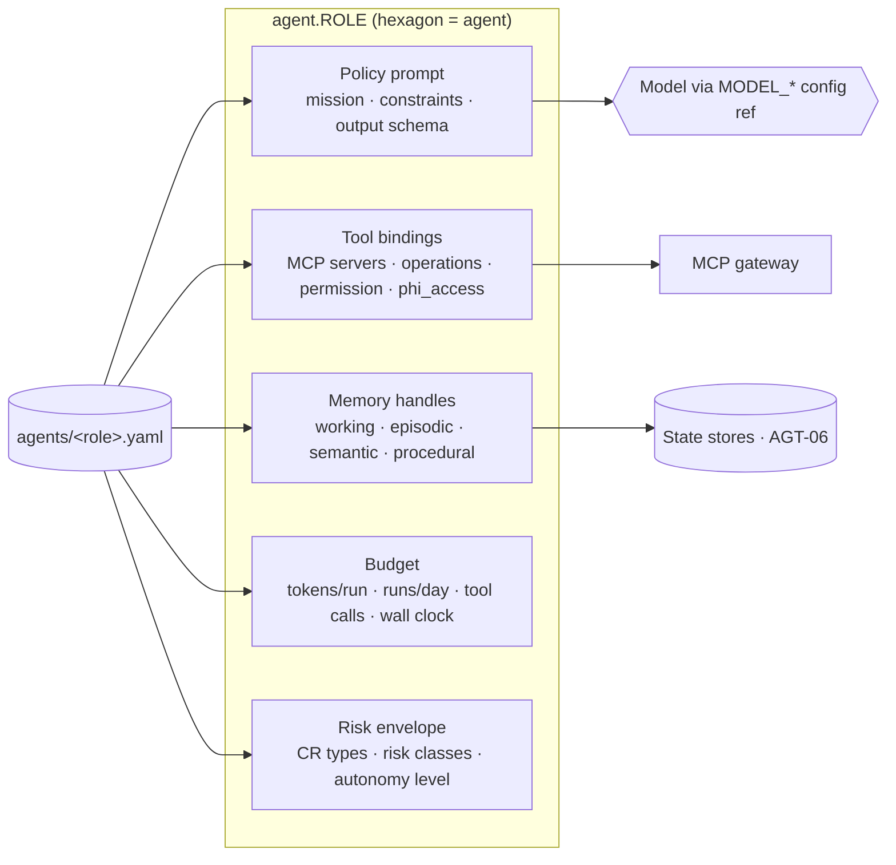
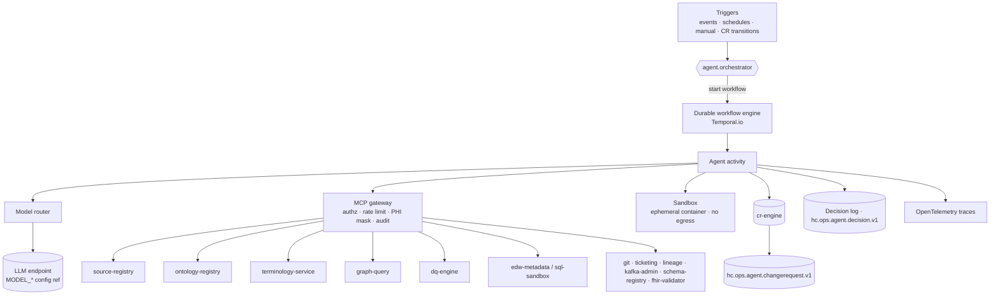

# Agent Architecture and Runtime

This document specifies what an agent *is* in HEALIX, how the runtime executes it, what wakes it up, and how its
behaviour is observed. The agent roster and initial autonomy levels in `01-architecture-overview.md` §5 are
authoritative; this document does not add or rename agents. Manifest fields referenced here are defined in
`agents/agent.schema.json`.

## 1. Design stance

The control plane follows ADR-06: **agents propose, governance disposes**. Every durable effect an agent has on
the platform is one of exactly three kinds:

| Effect kind | Example | Mechanism | Who may do it |
|-------------|---------|-----------|---------------|
| **Propose** a change to a governed artefact | New SKOS concept, DDL migration, DQ rule, FHIR profile | Change Request (CR) through `cr-engine` (AGT-03) | Any agent at L1+ |
| **Operate** within a pre-approved policy envelope | Load a named graph batch, register a discovered source, open a ticket, run a DQ scorecard | Direct MCP tool call at `apply` permission, logged | L3/L4 agents, listed per tool in the manifest |
| **Veto / halt** other agents | Block a CR, trip the kill switch | `cr-engine.veto_cr`, `cr-engine.kill_switch` | `agent.privacy_guardian` (L4), Agent Operator |

Nothing else is possible: an agent cannot write to the ontology registry, the terminology server, the EDW, the
Schema Registry or Kafka except through an applied CR or an explicitly `apply`-scoped operational tool. LLM output
never reaches a production store without passing through a typed schema and (for proposals) an independent
evaluation.

## 2. Agent anatomy

Every agent is fully described by its manifest plus a versioned **policy prompt** held in Git. The five parts:

1. **Policy prompt.** A system prompt assembled at run time from (a) the manifest `mission`, (b) the autonomy-level
   rules for the agent's current level, (c) the output JSON Schema for the task, (d) the Ontology Pipeline stage
   rules for the stage the agent serves (e.g. for Stage 1 "a preferred label MUST be unique within its scheme,
   case-insensitive, ≤ 60 characters, singular noun phrase, no abbreviations unless the abbreviation is the
   established clinical term"), and (e) the untrusted-input preamble (AGT-05 §3). Prompts are versioned
   (`prompts/<role>/<semver>.md`, outside this PRD) and the version is recorded in every decision-log entry.
2. **Tools.** An allow-list of MCP servers and operations with a permission level (`read` | `propose` | `apply` |
   `admin`) and a PHI visibility (`none` | `masked` | `audited_raw`). The MCP gateway enforces the list; the model
   never sees a tool it is not allowed to call.
3. **Memory.** Handles into the four tiers of AGT-06. Working memory is per run; episodic memory is the decision
   log; semantic memory is the ontology/KG itself (written only via CRs); procedural memory is the playbook store.
4. **Budget.** Hard limits: tokens per run, runs per day, daily token cap, tool calls per run, wall-clock minutes,
   concurrent runs, open CRs. Exceeding any limit ends the run cleanly with a checkpoint (§4.6).
5. **Risk class and autonomy level.** Which CR types and risk classes the agent may propose, and at which autonomy
   level it currently operates (§6 and README §4). The level is data, not code: graduation changes the manifest,
   not the agent.

### 2.1 Risk classes

| Risk class | Definition | Typical examples |
|------------|------------|------------------|
| `low` | Additive, reversible, no consumer contract change, no PHI element | New SKOS altLabel; new value-set member; additive dimension member; DQ rule at severity `warn` |
| `medium` | Reversible but changes behaviour of a consumer or a semantic relation | New `skos:broader`; ConceptMap equivalence change; new `dq_rule` at `error` severity; additive nullable EDW column |
| `high` | Breaking or hard to reverse | Deprecating a concept in use; OWL axiom change affecting inference; non-additive DDL; topic schema major bump; profile cardinality tightening |
| `phi_affecting` | Touches an element classified PHI, a mask, an ACL, a de-identification rule or a mapping that routes PHI | Mapping `PID-3` to `Patient.identifier`; DDL on `dim_patient`; topic ACL change |

`impact.phi_fields_touched` non-empty **forces** `phi_affecting` regardless of what the proposer stated (enforced
by `cr-engine` on create, AGT-ORCH-006).

## 3. Runtime

### 3.1 Durable workflows

Every agent run is a **Temporal workflow** (Airflow is acceptable for purely batch DAGs such as the monthly
terminology sync, Flink for streaming detection in `agent.dq_monitor`). The workflow holds the run's state; each
LLM call and each tool call is an **activity** with its own retry policy and timeout. Benefits that are
requirements, not conveniences: a run survives worker restarts; long-running reasoner jobs (minutes to hours) do not
hold an LLM context open; a CR awaiting a human gate can sleep for days without consuming resources; and the
workflow history *is* the audit trail of what the agent did and in what order.

Workflow ids are deterministic from the trigger (`wf.<name>/<trigger-dedup-key>`), which gives idempotency for
free: a replayed trigger attaches to the existing run instead of starting a second one.

### 3.2 Sandboxed tool execution

Any tool that executes agent-produced code or queries (`sql-sandbox.run_query`, `dq-engine.backtest_rule`,
`edw-metadata.ddl_dry_run`, `ontology-registry.run_reasoner`, `fhir-validator.*`) runs in an **ephemeral
container** with: no outbound network except the named service, a read-only filesystem apart from `/work`,
CPU/memory/time quotas, and a database role that sees only **masked views** of non-production data. The container
is destroyed after the activity. Agents never receive credentials; the gateway injects short-lived, scoped tokens.

### 3.3 Model routing

Model choice is **configuration**, resolved per environment from the manifest's `model.ref`:

| Config ref | Recommended default | Used for |
|------------|---------------------|----------|
| `${MODEL_ORCHESTRATION}` | `claude-fable-5-1` | Planning, routing, release assembly fallback |
| `${MODEL_CRITIQUE}` | `claude-fable-5-1` | Evaluator, privacy guardian |
| `${MODEL_REASONING}` | `claude-fable-5-1` | Ontologist, schema architect (axioms, DDL design) |
| `${MODEL_MAPPING}` | `claude-sonnet-5-5` | Vocabulary, taxonomy, thesaurus, source mapping, KG mapping, DQ authoring, interop, release |
| `${MODEL_CLASSIFICATION}` | `claude-haiku-5-5` | Terminology code classification, DQ monitoring, remediation triage |

The router additionally applies per-task rules: a task whose output schema is a single enum (e.g. "is this code
value a specimen type?") is routed to `${MODEL_CLASSIFICATION}` even inside a `${MODEL_MAPPING}` agent; a task
that failed structured-output validation twice is escalated one tier. Model ids actually used are recorded in the
CR (`proposer.model`) and the decision log, never hard-coded in prompts or manifests. Prices are not part of the
specification; budgets are expressed in tokens and runs.

### 3.4 Structured outputs

Every LLM call that produces an artefact declares a **JSON Schema** output contract. The runtime validates the
response; on failure it retries with the validation error appended (max 2), then escalates the model tier once,
then fails the activity. Artefact-bearing outputs are **never free text**: a SKOS proposal is a JSON object that
the runtime serialises to Turtle; a DDL proposal is a JSON AST that the runtime renders per dialect; an HL7 v2
mapping is a JSON mapping table. This is what makes the evaluator's automated checks possible and keeps
prompt-injection payloads from reaching a store as code.

### 3.5 Retries and timeouts

| Activity type | Timeout | Retry | On exhaustion |
|---------------|---------|-------|---------------|
| LLM call | 120 s (300 s for reasoning tier) | 3, exponential, jitter | Escalate tier once; then fail run with checkpoint |
| Read-only tool | 30 s | 3 | Fail activity; run continues if non-critical |
| Reasoner / backtest / dry-run | 60 min | 1 | Mark check `skipped` → forces human review |
| Human gate wait | 14 days | — | Orchestrator reminds at 3/7 days; expires CR to `withdrawn` with reason |
| Graph batch load | 30 min | 3 (same batch ULID → idempotent) | Park run; alert SRE |

### 3.6 Cost and token budgets

Budgets are enforced at three scopes: **per run** (manifest `tokens_per_run`, `max_tool_calls_per_run`,
`wall_clock_minutes_per_run`), **per agent per day** (`runs_per_day`, `daily_token_cap`) and **per environment per
day** (platform cap in module 12). The gateway meters tokens from the model response usage block. At 80 % of any
budget the agent receives a budget warning in its context and is expected to checkpoint; at 100 % the run is
terminated and resumed at the next trigger from the checkpoint. The privacy guardian and evaluator **fail closed**
when exhausted (no CR passes), all other agents **fail idle**.

## 4. Triggers

### 4.1 Event-driven

All agent-facing events are normalised onto `hc.ops.agent.trigger.v1` by stream processors (module 07), so agents
subscribe to one topic with `event_type` filters. The orchestrator debounces and deduplicates.

| `event_type` | Produced by | Primary consumer(s) | Debounce |
|--------------|-------------|---------------------|----------|
| `new_source_discovered` | Connector registration, Schema Registry new subject, inventory crawl | inventory → source_mapper, interop_engineer, privacy_guardian | 10 min per source |
| `new_element_registered` | `agent.inventory` | vocabulary_curator, privacy_guardian | none |
| `schema_drift` | Schema Registry version event; Debezium DDL event on Millennium replica; BICC PVO change | inventory, source_mapper | 10 min per subject |
| `unmapped_code` | Canonicaliser (`$validate-code` fail), dq_monitor | terminology_steward, vocabulary_curator | 1 h per (system, code) |
| `mapping_failure` | Canonicaliser dead-letter rate | source_mapper | 15 min per source |
| `dq_anomaly` / `dq_breach` | `agent.dq_monitor`, Flink rule processors | dq_author, remediator, orchestrator | per (rule, source, window) |
| `ontology_release` | `agent.release_manager` | kg_builder, schema_architect, dq_author, interop_engineer | none |
| `terminology_release` | Terminology sync job | terminology_steward, taxonomist | none |
| `profile_changed` | profile CR applied | ontologist, kg_builder, source_mapper | none |
| `fhir_validation_regression` | Canonical validation pass rate < 99.5 % for a topic | interop_engineer, source_mapper | 15 min |
| `phi_access_exception` | Audit pipeline (module 11) | privacy_guardian | none |
| `rollback_requested` | Human, kill switch, dq_monitor regression verdict | release_manager | none |

### 4.2 Scheduled

| Schedule | Workflow | Agent(s) |
|----------|----------|----------|
| Every 15 min | DQ scorecard and drift window | dq_monitor |
| Every 4 h | Quarantine sweep | remediator |
| Nightly 01:00 | Control-plane plan for next 24 h; PHI leakage scan | orchestrator; privacy_guardian |
| Nightly 02:00 | Evaluator regression suites on release candidate | evaluator |
| Nightly 02:30 | Inventory crawl | inventory |
| Nightly 04:00 | **Taxonomy validation** (cycles, orphans, depth, polyhierarchy, label-hierarchy coherence) | taxonomist |
| Nightly 00:00 | KG ↔ EDW reconciliation | kg_builder |
| Weekly Sun 02:00 | **Full OWL reasoning + SHACL** over the release candidate | ontologist |
| Weekly Sun 06:00 | Evaluator calibration against human reviews | evaluator |
| Weekly Tue/Wed/Thu/Sat | Thesaurus co-occurrence mining; DQ coverage review; interop conformance; EDW drift | thesaurus_editor; dq_author; interop_engineer; schema_architect |
| Tue/Thu 22:00 | Release window | release_manager |
| Monthly 1st 06:00 | **Terminology release sync** (SNOMED CT, LOINC, RxNorm, ICD-10, CPT/HCPCS, CVX, UCUM per their cadences) | terminology_steward |

Schedules are expressed in the manifest `triggers[].cron` and are the single source of truth; module 12 deploys
them.

### 4.3 Manual

Agent Operators and personas in VIS-00 §5 may start, pause, resume or cancel any workflow from the HITL console
(AGT-05 §7). A manual run is a trigger like any other and carries the operator identity into provenance.

## 5. Observability

- **Traces.** Every run is an OpenTelemetry trace; the `trace_id` is written to the CR `provenance.trace_id`.
  Spans: trigger → plan → each LLM call (with prompt version, model id, token usage, schema validation result) →
  each tool call (server, operation, latency, masked-row counts) → CR transition.
- **Decision log.** Every consequential decision (propose, withdraw, route, approve, veto, apply, release,
  rollback, budget stop) is an append-only record on `hc.ops.agent.decision.v1` and in the episodic store (AGT-06):
  who, what, why (the model's structured rationale), evidence pointers, prompt version, model id, scores. Decision
  logs contain **no PHI** and are scanned nightly (AGT-05 §2).
- **Metrics.** Per agent: runs, success rate, p50/p95 duration, tokens, tool errors, CRs proposed / auto-approved /
  rejected / vetoed / rolled back, evaluator agreement. Per CR type: cycle time proposed→applied, gate wait time.
  These feed the KPIs in VIS-00 §8 ("Autonomy") and the graduation computation (README §4).
- **Alerts.** Budget exhaustion, evaluator calibration below threshold, veto rate spike, dead-letter growth after a
  release, kill-switch activation.

## 6. Multi-tenancy and environments

Agents run per environment (`dev`, `test`, `uat`, `prod`). Promotion of a CR between environments is itself a
release step: a CR is proposed and evaluated in `dev`/`test` against masked or synthetic data, applied in `uat`,
and released to `prod` by `agent.release_manager` within a window. Environments differ in configuration only
(`${MODEL_*}` refs, budgets, thresholds, PHI mode). Production agents **never** see raw PHI through their default
tool bindings (`phi_access: none|masked`); the sole exception path is `audited_raw`, which is absent from every
manifest in this release and would require a GOV-PHI exception. Where a health system operates multiple legal
entities, tenancy is modelled as separate Kafka ACL scopes, named-graph prefixes and EDW schemas; one agent
deployment may serve several tenants but a run is always scoped to one tenant id, carried in the workflow input and
every tool call.

## 7. Requirements

> **AGT-ARCH-001** (P0, inspection) — Every agent MUST be described by a manifest in `agents/<role>.yaml` that
> validates against `agents/agent.schema.json`; the runtime MUST refuse to start an agent whose manifest fails
> validation or whose `id` is not in the roster of ARC-01 §5.

> **AGT-ARCH-002** (P0, test) — An agent MUST be unable to invoke any MCP server or operation not listed in its
> manifest `tools`, and MUST be unable to exceed the listed `permission` level; the gateway MUST reject and log
> such attempts.

> **AGT-ARCH-003** (P0, test) — Every agent run MUST execute as a durable workflow whose history records each LLM
> call (prompt version, model id, token usage) and each tool call (server, operation, outcome).

> **AGT-ARCH-004** (P0, test) — Any tool that executes agent-produced code or queries MUST run in an ephemeral
> sandbox with no network egress other than the target service, quotas on CPU, memory and time, and access only to
> masked data.

> **AGT-ARCH-005** (P0, test) — Every LLM output that becomes an artefact or a CR field MUST be validated against a
> declared JSON Schema before use; outputs failing validation after retries MUST NOT be persisted.

> **AGT-ARCH-006** (P0, inspection) — Model selection MUST be expressed as a `${MODEL_*}` configuration reference
> resolved per environment; no prompt, manifest or workflow MAY hard-code a model id.

> **AGT-ARCH-007** (P1, test) — The router MUST escalate one model tier after two structured-output failures and
> MUST record the resolved model id in the CR `proposer.model` and the decision log.

> **AGT-ARCH-008** (P0, test) — Budgets in the manifest (`tokens_per_run`, `runs_per_day`, `daily_token_cap`,
> `max_tool_calls_per_run`, `wall_clock_minutes_per_run`) MUST be enforced by the runtime; exceeding any MUST end the
> run with a checkpoint and a decision-log entry.

> **AGT-ARCH-009** (P0, test) — `agent.privacy_guardian` and `agent.evaluator` MUST fail closed on budget or tool
> exhaustion: no CR MAY pass a gate they own while they are unavailable.

> **AGT-ARCH-010** (P0, test) — All agent-facing events MUST be delivered on `hc.ops.agent.trigger.v1` with an
> `event_type` from §4.1; the orchestrator MUST deduplicate by the per-type debounce key.

> **AGT-ARCH-011** (P1, inspection) — Scheduled runs MUST be defined in manifest `triggers[].cron` and deployed
> from there; the nightly taxonomy validation, weekly ontology reasoning and monthly terminology release sync MUST
> exist as scheduled workflows in every environment.

> **AGT-ARCH-012** (P0, test) — Workflow ids MUST be derived deterministically from the trigger deduplication key
> so that a replayed trigger attaches to the existing run rather than starting a duplicate.

> **AGT-ARCH-013** (P0, test) — Every run MUST emit an OpenTelemetry trace whose `trace_id` is stored in the CR
> `provenance.trace_id`, and every consequential decision MUST be appended to `hc.ops.agent.decision.v1`.

> **AGT-ARCH-014** (P0, test) — Decision-log entries and traces MUST NOT contain PHI; the nightly leakage scan
> (AGT-SAFE-004) MUST cover them.

> **AGT-ARCH-015** (P0, inspection) — No production manifest MAY declare `phi_access: audited_raw` without a
> recorded GOV-PHI exception referenced in the manifest and approved by the Privacy & Security Officer.

> **AGT-ARCH-016** (P1, test) — A run MUST be scoped to exactly one environment and one tenant id, carried in the
> workflow input and attached to every tool call and CR.

> **AGT-ARCH-017** (P1, test) — Human-gate waits MUST be implemented as durable timers; a CR unanswered after
> 14 days MUST transition to `withdrawn` with reason `gate_timeout` after reminders at 3 and 7 days.

> **AGT-ARCH-018** (P1, analysis) — The platform MUST publish per-agent metrics (runs, tokens, CR outcomes,
> evaluator agreement, rollbacks) sufficient to compute the graduation criteria in README §4 without manual
> collection.

> **AGT-ARCH-019** (P2, demo) — An Agent Operator MUST be able to pause, resume and cancel any agent's workflows
> per environment from the HITL console without redeploying.

> **AGT-ARCH-020** (P0, test) — The policy prompt version used in a run MUST be recorded in the decision log and
> MUST be reproducible from Git for the lifetime of the episodic retention period (AGT-MEM-007).
