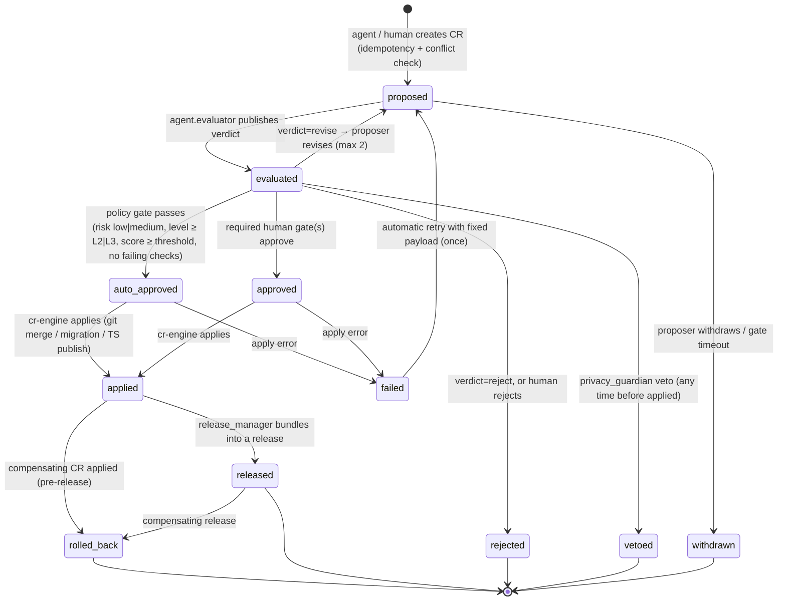

# Orchestration, Change Requests and Workflows

This document **owns the Change Request (CR) contract** listed in `01-architecture-overview.md` §6. Modules 02
(ontology governance), 05 (EDW migrations), 06 (profiles, value sets), 09 (DQ rules) and 11 (audit) consume CRs
and MUST NOT define a parallel change mechanism. The machine-readable schema is
`agents/change-request.schema.json` (`$id` `…/schema/change-request/1.0.0`); this prose explains it and sets the
gate policy.

## 1. Why one contract

Six pipeline stages, nine subject-area groups and a dozen artefact families would otherwise each grow their own
approval path. A single typed CR gives: one evaluator, one privacy gate, one audit stream
(`hc.ops.agent.changerequest.v1`), one rollback mechanism, and one place to compute autonomy statistics. The CR is
deliberately verbose — evidence and evaluation travel *with* the change so a steward reviewing a `skos:broader`
proposal at 09:00 sees the masked frequency profile, the SNOMED subsumption check and the evaluator's notes in one
screen.

## 2. Change Request schema

### 2.1 Field summary

| Field | Req. | Purpose |
|-------|------|---------|
| `id` | ✔ | `CR-<yyyymmdd>-<ULID>`; immutable; the Kafka record key |
| `schema_version` | ✔ | `1.0.0`; breaking change ⇒ `2.0.0` and topic `v2` (CONVENTIONS §5) |
| `type` | ✔ | `vocabulary` · `taxonomy` · `thesaurus` · `ontology` · `mapping` · `value_set` · `dq_rule` · `edw_ddl` · `topic` · `profile` |
| `risk_class` | ✔ | `low` · `medium` · `high` · `phi_affecting` (AGT-01 §2.1) |
| `state` | ✔ | See §3 |
| `environment` | ✔ | `dev` · `test` · `uat` · `prod` |
| `proposer` | ✔ | `agent_id` (or `human:<id>`), `run_id`, `autonomy_level_at_proposal`, resolved `model` |
| `title`, `summary`, `rationale` | ✔/✔/– | Human-readable; PHI-free by construction (metadata, aggregates, masked samples only) |
| `target` | ✔ | `module`, `artefact_ref` (IRI / path / topic / table / rule id), `subject_area_group` G1–G9, `pipeline_stage` 0–5, `current_version`, `source_system` |
| `evidence` | ✔ | `sources[]` (each flagged `untrusted_text`), `profiling_stats[]` (each `phi_masked: true`), `test_results[]`, `references[]` to standards |
| `payload` | ✔ | `format` (skos-turtle, owl-turtle, shacl-turtle, sparql-update, fhir-json, yaml, sql-ddl, json-patch, rml, r2rml, hl7v2-mapping, avro-schema, json-schema), `operation`, inline `diff` (≤ 256 KiB) or `payload_ref` with sha256, `affected_iris`, `affected_objects` |
| `impact` | – | `breaking`, downstream artefacts, estimated rows/triples, `phi_fields_touched` (element ids, never values), `lineage_report_ref` |
| `evaluation` | ✔ from `evaluated` | Evaluator run, rubric scores (weights), automated checks (enumerated), `aggregate_score`, `verdict`, LLM-judge calibration |
| `privacy_review` | ✔ for `phi_affecting` | `agent.privacy_guardian` decision, PHI classification, conditions, `veto_rule_ids` (PGV-NNN, AGT-05 §2) |
| `gates_required` / `approvals[]` | ✔ / – | Gates computed by policy at create time; each approval carries gate, approver type, id, decision, time |
| `application` / `release` / `rollback` | ✔ from the matching state | Commit sha, PR, migration id, version IRI, changelog, compensating CR |
| `depends_on`, `conflicts_with`, `supersedes` | – | CR graph edges used by the orchestrator (§5) |
| `idempotency_key` | ✔ | `sha256(type ‖ target.artefact_ref ‖ canonical payload)` |
| `state_history[]` | ✔ | Every transition with actor and reason — the audit trail |
| `provenance` | ✔ | PROV-O activity IRI, workflow id/run id, OpenTelemetry `trace_id` |

Schema-level invariants (encoded as `if/then` in the JSON Schema and re-checked by `cr-engine`):

- `state ∈ {evaluated, approved, auto_approved, applied, released, rolled_back}` ⇒ `evaluation` present.
- `state = auto_approved` ⇒ `risk_class ∈ {low, medium}`.
- `risk_class ∈ {high, phi_affecting}` ⇒ `gates_required` contains a human gate.
- `risk_class = phi_affecting ∧ state ∈ {approved, applied, released}` ⇒ `privacy_review.decision ≠ vetoed`.
- `state = vetoed` ⇒ `privacy_review.decision = vetoed`.
- `state ∈ {applied, released, rolled_back}` ⇒ `application`; `released` ⇒ `release`; `rolled_back` ⇒ `rollback`.

### 2.2 Example (validated against the schema)

A low-risk Stage 1 vocabulary CR that was auto-approved at L2. It is the first step of the end-to-end scenario in
`02-agent-catalog.md` §19.

```yaml
id: CR-20261017-01J9ZK3Q8X5W2M7N4P6R1T0V9B
schema_version: "1.0.0"
type: vocabulary
risk_class: low
state: auto_approved
environment: uat
title: Add concept 'Observation Unit Encounter' to scheme encounter-class
summary: >-
  Cerner Millennium code set 71 (Encounter Type) gained code value 309308 with display
  'Observation Unit' on 2026-10-14. 1,842 masked encounters in the last 7 days carry it and no
  concept in scheme encounter-class covers it. Proposes a new skos:Concept with exactMatch to
  SNOMED CT 448951000 |Admission to observation unit| and FHIR v3-ActCode 'OBSENC' closeMatch.
rationale: >-
  Without this concept the canonicaliser maps Encounter.class to 'unknown', which breaks DQ rule
  DQR-VALIDITY-ENCOUNTER-004 and leaves dim_encounter_class without a member.
proposer:
  agent_id: agent.vocabulary_curator
  run_id: run_01J9ZK2V7H3E9D5F8G1A2B3C4D
  autonomy_level_at_proposal: L2
  model: claude-sonnet-5-5
  manifest_version: 0.1.0
target:
  module: "02"
  artefact_ref: https://ontology.healix.example.org/scheme/encounter-class
  subject_area_group: G2
  pipeline_stage: 1
  current_version: "2026.10.1"
  source_system: cerner_millennium
evidence:
  sources:
    - kind: source_registry_element
      ref: src.cerner.code_value.cs71.309308
      description: CODE_VALUE row (display text treated as untrusted)
      untrusted_text: true
    - kind: profiling_run
      ref: prof_01J9ZK2W0A1B2C3D4E5F6G7H8J
      description: 7-day masked frequency profile of Encounter.class source codes
      untrusted_text: false
    - kind: standard
      ref: SNOMED CT International 20260301
      untrusted_text: false
  profiling_stats:
    - metric: encounters_with_code_7d
      value: 1842
      sample_size: 412330
      population: hc.canonical.clinical.encounter.fhir.v1 (masked)
      computed_at: "2026-10-16T02:10:04Z"
      phi_masked: true
    - metric: distinct_facilities
      value: 3
      computed_at: "2026-10-16T02:10:04Z"
      phi_masked: true
  test_results:
    - suite: label-collision
      passed: 1
      failed: 0
    - suite: golden-vocab-encounter-class-v1
      passed: 48
      failed: 0
      report_ref: s3://healix-eval/reports/run_01J9ZK2V7H3E9D5F8G1A2B3C4D/golden.json
  references:
    - standard: ISO 25964-1:2011 §6 (preferred and non-preferred terms)
    - standard: FHIR R4 v3-ActEncounterCode
payload:
  format: skos-turtle
  operation: create
  diff: |
    @prefix skos: <http://www.w3.org/2004/02/skos/core#> .
    @prefix hx:   <https://ontology.healix.example.org/> .
    @prefix sct:  <http://snomed.info/id/> .
    @prefix v3:   <http://terminology.hl7.org/CodeSystem/v3-ActCode#> .
    + hx:clinical/encounter-class/observation-unit a skos:Concept ;
    +   skos:inScheme hx:scheme/encounter-class ;
    +   skos:prefLabel "Observation Unit Encounter"@en ;
    +   skos:altLabel "OBS encounter"@en ;
    +   skos:definition "An encounter in which the patient is held in a hospital observation unit for assessment, typically under 48 hours, without inpatient admission."@en ;
    +   skos:notation "309308"^^hx:CernerCodeSet71 ;
    +   skos:exactMatch sct:448951000 ;
    +   skos:closeMatch v3:OBSENC .
  affected_iris:
    - https://ontology.healix.example.org/clinical/encounter-class/observation-unit
    - https://ontology.healix.example.org/scheme/encounter-class
impact:
  breaking: false
  downstream_artefacts: [dim_encounter_class, DQR-VALIDITY-ENCOUNTER-004, ValueSet/healix-encounter-class]
  estimated_rows_affected: 1842
  phi_fields_touched: []
evaluation:
  evaluator_run_id: eval_01J9ZK3P2Q4R6S8T0V1W3X5Y7Z
  rubric_scores:
    - { rubric_id: RUB-VOC-01, score: 0.97, weight: 0.3, notes: "No collision; label style conforms." }
    - { rubric_id: RUB-VOC-02, score: 0.92, weight: 0.3, notes: "Definition sourced from SNOMED FSN semantics; scope note recommended." }
    - { rubric_id: RUB-VOC-03, score: 0.95, weight: 0.3, notes: "exactMatch verified via $lookup; closeMatch appropriate." }
    - { rubric_id: RUB-EVD-01, score: 0.94, weight: 0.05 }
    - { rubric_id: RUB-PHI-01, score: 1.0, weight: 0.05, notes: "Metadata only." }
  automated_checks:
    - { check: label_collision, status: pass }
    - { check: label_completeness, status: pass }
    - { check: shacl_validation, status: pass }
    - { check: phi_scan, status: pass }
    - { check: prompt_injection_scan, status: pass, summary: "Source display text contained no instruction-like content." }
  aggregate_score: 0.95
  verdict: approve
  evaluated_at: "2026-10-16T03:02:41Z"
  llm_judge:
    model: claude-fable-5-1
    calibration_set_version: human-reviewed-cr-sample-rolling-90d@2026-10-12
    estimated_human_agreement: 0.96
privacy_review:
  reviewer: agent.privacy_guardian
  decision: cleared
  phi_classification: none
  reviewed_at: "2026-10-16T03:04:10Z"
gates_required: [evaluation, privacy_review, auto_approval]
approvals:
  - gate: auto_approval
    approver_type: policy
    approver_id: policy.autonomy.L2.low
    decision: approved
    comment: aggregate 0.95 >= threshold 0.90; risk low; no failing checks
    decided_at: "2026-10-16T03:04:12Z"
depends_on: []
idempotency_key: 3b1f0c9e4d2a7f6b8c5d1e0a9f3b2c4d6e8f7a1b0c9d2e3f4a5b6c7d8e9f0a1b
ticket_ref: HLX-4821
labels: [stage:1, group:g2, source:cerner]
state_history:
  - { from: null, to: proposed, at: "2026-10-16T02:58:00Z", by: agent.vocabulary_curator }
  - { from: proposed, to: evaluated, at: "2026-10-16T03:02:41Z", by: agent.evaluator }
  - { from: evaluated, to: auto_approved, at: "2026-10-16T03:04:12Z", by: agent.orchestrator, reason: "policy.autonomy.L2.low" }
provenance:
  prov_activity_iri: https://ontology.healix.example.org/prov/activity/run_01J9ZK2V7H3E9D5F8G1A2B3C4D
  workflow_id: wf.vocabulary_harvest
  workflow_run_id: 7c1f2e3d-4b5a-4c6d-8e9f-0a1b2c3d4e5f
  trace_id: 4bf92f3577b34da6a3ce929d0e0e4736
created_at: "2026-10-16T02:58:00Z"
updated_at: "2026-10-16T03:04:12Z"
```

## 3. State machine



Rules:

1. Transitions are performed only by `cr-engine` on behalf of an authorised actor; the actor and reason are
   appended to `state_history`. The CR record on `hc.ops.agent.changerequest.v1` is re-published on every
   transition (key = `id`, compacted).
2. `vetoed` is reachable from any non-terminal state before `applied`; after `applied`, a privacy veto triggers a
   rollback instead (§4.6 workflow f).
3. A `revise` verdict returns the CR to `proposed` with the evaluator notes attached; the proposer may revise at
   most twice, after which the CR goes to human review regardless of risk class.
4. `applied` means the artefact exists in the governed store for the CR's environment (merged to the Git release
   branch, migration executed in `uat`, ValueSet published as draft). `released` means `agent.release_manager`
   included it in a versioned, signed release visible to consumers.

## 4. Gates per risk class and autonomy level

`gates_required` is computed by `cr-engine` at create time from (`risk_class`, proposer's autonomy level, `type`).
`evaluation` and `privacy_review` are always required; the table shows the **approval** gate.

| Risk class ↓ / Level → | L1 | L2 | L3 | L4 |
|---|---|---|---|---|
| `low` | `steward_approval` | `auto_approval` if `aggregate_score ≥ threshold` (manifest, ≥ 0.90) and no `fail` check | `auto_approval` if score ≥ 0.85 and no `fail` | `auto_approval` |
| `medium` | `steward_approval` | `steward_approval` | `auto_approval` if score ≥ 0.95, no `fail`/`warn` on mandatory checks, and `impact.breaking = false` | `auto_approval` (same conditions) |
| `high` | two human gates: `steward_approval` + (`architect_approval` for edw_ddl/topic/profile, `ontologist_approval` for ontology/taxonomy/thesaurus, `steward_approval` ×2 otherwise) | same | same | same |
| `phi_affecting` | `privacy_review` must be `cleared*` + `privacy_officer_approval` + the `high` gates | same | same | same |

Type-specific additional gates: `edw_ddl` and `topic` always add `dry_run`; `ontology`, `edw_ddl`, `topic` and
`profile` always add `release_window` (they only reach `released` in a window); any CR with `impact.breaking = true`
adds `change_advisory_board`. The evaluator's per-type thresholds and the mandatory check list are in AGT-05 §4–§5.

**Interpretation of levels.** L1 agents (`ontologist`, `schema_architect`) never bypass a human. L2 agents are
trusted for additive low-risk changes once the evaluator is calibrated for their CR type. L3 agents may also
auto-apply medium-risk changes, which is what lets `agent.kg_builder` keep RML mappings current with an ontology
release without waiting for a steward. L4 is held only by `agent.privacy_guardian`, whose own artefact CRs follow
the same table but whose veto needs no gate.

## 5. Concurrency, conflicts and idempotency

- **Target locks.** `cr-engine.lock_target` grants an advisory lock on `target.artefact_ref` (and, for ontology
  CRs, on every IRI in `affected_iris`). Two open CRs on the same target are allowed to exist but are **serialised**
  in `created_at` order: the later one is marked `conflicts_with` and is re-evaluated (rebased) after the earlier
  one reaches a terminal state. The orchestrator notifies both proposers.
- **Rebase.** When the earlier CR is applied, `cr-engine` re-applies the later CR's `diff` to the new base. If the
  diff no longer applies cleanly the CR returns to `proposed` with reason `rebase_conflict` for the proposer to
  regenerate.
- **Dependency edges.** `depends_on` CRs must be `applied` before a dependent CR can leave `evaluated`. The
  end-to-end scenario (catalog §19) is a chain: vocabulary → taxonomy → thesaurus → ontology → dq_rule → edw_ddl.
- **Idempotency.** `idempotency_key` deduplicates re-proposals from replayed triggers; `cr-engine.create_cr` returns
  the existing CR for a duplicate key. Apply operations are idempotent by construction: Git merges by commit sha,
  migrations by `migration_id`, Terminology Service publishes by `(url, version)`, graph loads by batch ULID.
- **Fairness.** Per-agent `max_open_change_requests` (manifest) bounds the queue; the evaluator prioritises
  `phi_affecting` > `high` > blocked dependencies > age.
- **Human-gate batching.** The HITL console groups CRs by steward and artefact family so a steward can approve a
  release-worth of value-set additions in one sitting; every item still gets its own `approvals[]` entry.

## 6. Standard workflows

Participants: `ORCH` = orchestrator, `EVAL` = evaluator, `PG` = privacy_guardian, `CR` = cr-engine, `REL` =
release_manager, `HITL` = human gate.

### 6.1 (a) Full ontology pipeline run across six stages

```mermaid
sequenceDiagram
  autonumber
  participant ORCH as agent.orchestrator
  participant INV as agent.inventory
  participant VOC as agent.vocabulary_curator
  participant TAX as agent.taxonomist
  participant THS as agent.thesaurus_editor
  participant ONTO as agent.ontologist
  participant KG as agent.kg_builder
  participant EVAL as agent.evaluator
  participant PG as agent.privacy_guardian
  participant HITL as Human gates
  participant REL as agent.release_manager
  ORCH->>INV: Stage 0 — crawl sources (nightly)
  INV-->>ORCH: N new elements registered (trigger new_element_registered)
  ORCH->>PG: classify PHI for new elements
  ORCH->>VOC: Stage 1 — harvest terms for elements needing vocabulary
  VOC->>EVAL: CR(type=vocabulary) ×k
  EVAL-->>ORCH: verdicts; low-risk auto_approved, others → HITL
  ORCH->>TAX: Stage 2 — place applied concepts; nightly validation
  TAX->>EVAL: CR(type=taxonomy)
  ORCH->>THS: Stage 3 — relations for placed concepts
  THS->>EVAL: CR(type=thesaurus)
  Note over THS,ONTO: relations must be stable ≥ 30 days before promotion
  ORCH->>ONTO: Stage 4 — promote stable relations; weekly reasoning
  ONTO->>EVAL: CR(type=ontology) incl. SHACL
  EVAL->>HITL: ontology CRs always human-approved (L1)
  HITL-->>ORCH: approved
  ORCH->>REL: release window — assemble applied CRs
  REL->>EVAL: release gate suite (OWL consistency, SHACL, golden tests)
  REL-->>ORCH: ontology_release vX published
  ORCH->>KG: Stage 5 — regenerate RML/FHIR→RDF, load named graphs, reconcile
  KG-->>ORCH: load report + reconciliation
```

### 6.2 (b) New source onboarding

```mermaid
sequenceDiagram
  autonumber
  participant SRC as Connector / Schema Registry
  participant ORCH as agent.orchestrator
  participant INV as agent.inventory
  participant PG as agent.privacy_guardian
  participant MAP as agent.source_mapper
  participant IOP as agent.interop_engineer
  participant TERM as agent.terminology_steward
  participant EVAL as agent.evaluator
  participant HITL as Integration Engineer / Steward
  SRC-->>ORCH: new_source_discovered (e.g. new LIS feeding ORU^R01 over MLLP)
  ORCH->>INV: register source, elements, stewards
  INV->>PG: elements with PHI hints (PID, OBX values…)
  PG-->>INV: PHI classification per element
  ORCH->>IOP: draft HL7 v2 conformance profile + canonical topic proposal
  IOP->>EVAL: CR(type=profile), CR(type=topic)  [risk high → human]
  ORCH->>MAP: map ORU^R01 → DiagnosticReport/Observation/Specimen
  MAP->>TERM: unmapped local lab codes
  TERM->>EVAL: CR(type=value_set) ConceptMap local→LOINC
  MAP->>EVAL: CR(type=mapping) with golden tests (synthetic messages)
  EVAL->>PG: privacy review (mapping routes PHI) → phi_affecting
  PG-->>EVAL: cleared_with_conditions (mask OBX-5 free text in non-prod)
  EVAL->>HITL: approvals (steward + integration engineer + privacy officer)
  HITL-->>ORCH: approved → applied in uat
  ORCH-->>SRC: canonicaliser deployed; dq_monitor watch window 72 h
```

### 6.3 (c) DQ anomaly to remediation

```mermaid
sequenceDiagram
  autonumber
  participant DQM as agent.dq_monitor
  participant ORCH as agent.orchestrator
  participant DQA as agent.dq_author
  participant REM as agent.remediator
  participant TERM as agent.terminology_steward
  participant EVAL as agent.evaluator
  participant STW as Data Steward
  DQM-->>ORCH: dq_anomaly — Observation.valueQuantity.unit 'mg/dl' spike, source=LIS-B, 12 % of records
  ORCH->>DQM: attribution — correlate with schema_drift / recent CRs
  DQM-->>ORCH: hypothesis: new analyser firmware emits lowercase unit
  ORCH->>DQA: is there a covering rule?
  DQA->>EVAL: CR(type=dq_rule) DQR-CONFORMANCE-OBSERVATION-017 (UCUM case-sensitive)
  EVAL-->>ORCH: auto_approved (low, score 0.93)
  ORCH->>REM: remediation plan for quarantined records
  REM->>TERM: $translate 'mg/dl' → UCUM 'mg/dL'?
  TERM-->>REM: equivalent (case normalisation)
  REM->>EVAL: CR(type=dq_rule) remediation plan — deterministic unit normalisation + replay
  EVAL-->>ORCH: medium risk → steward gate
  ORCH->>STW: approve replay of 48,210 records (masked sample attached)
  STW-->>ORCH: approved
  REM-->>ORCH: replay complete; DQM watch window; ticket closed
```

### 6.4 (d) Terminology release sync

```mermaid
sequenceDiagram
  autonumber
  participant SYNC as Terminology sync job
  participant ORCH as agent.orchestrator
  participant TERM as agent.terminology_steward
  participant TAX as agent.taxonomist
  participant EVAL as agent.evaluator
  participant STW as Terminology Steward (human)
  participant REL as agent.release_manager
  SYNC-->>ORCH: terminology_release (SNOMED CT International 20261001 loaded to TS)
  ORCH->>TERM: expand all bound ValueSets against new release
  TERM-->>ORCH: impact: 14 retired concepts in use, 3 moved, 212 new descendants
  TERM->>EVAL: CR(type=value_set) ×17 (replacements via historical association refset)
  EVAL-->>ORCH: 15 auto_approved (low); 2 medium → steward
  ORCH->>STW: review 2 ConceptMap equivalence changes
  STW-->>ORCH: approved
  ORCH->>TAX: re-check skos:exactMatch alignment and subsumption
  TAX->>EVAL: CR(type=taxonomy) re-parenting ×4
  ORCH->>REL: next release window
  REL-->>ORCH: terminology bindings release published; consumers notified
```

### 6.5 (e) EDW schema evolution

```mermaid
sequenceDiagram
  autonumber
  participant REL as agent.release_manager
  participant ORCH as agent.orchestrator
  participant SA as agent.schema_architect
  participant EVAL as agent.evaluator
  participant PG as agent.privacy_guardian
  participant DWA as Data Warehouse Architect
  participant KG as agent.kg_builder
  REL-->>ORCH: ontology_release 2026.11.0 (new class clinical:ObservationUnitStay)
  ORCH->>SA: diff release vs EDW bindings
  SA-->>ORCH: 1 new dimension member, 1 new fact attribute, 0 unbound PHI columns
  SA->>EVAL: CR(type=edw_ddl) ALTER fact_encounter ADD obs_unit_flag + dim member; compensating migration
  EVAL->>EVAL: ddl_dry_run (Teradata + portable), naming_lint, migration_reversibility
  EVAL->>PG: privacy review (fact_encounter contains patient_sk FK → not PHI value) → cleared
  EVAL-->>ORCH: medium; L1 → architect gate
  ORCH->>DWA: review DDL + impact (3 dbt models downstream)
  DWA-->>ORCH: approved
  ORCH->>REL: apply in uat; release window → prod
  REL-->>ORCH: migration 2026.11.0-003 applied; released
  ORCH->>KG: update R2RML for fact_encounter; nightly reconciliation
```

### 6.6 (f) Rollback

```mermaid
sequenceDiagram
  autonumber
  participant DQM as agent.dq_monitor
  participant ORCH as agent.orchestrator
  participant REL as agent.release_manager
  participant EVAL as agent.evaluator
  participant OPR as Agent Operator
  DQM-->>ORCH: regression verdict — canonical validation pass rate 98.9 % after release 2026.11.0 (profile CR-…)
  ORCH->>ORCH: attribute to CR; risk high → rollback_requested
  ORCH->>OPR: notify (auto rollback policy applies for consumer_failure)
  ORCH->>REL: build compensating CR (supersedes original; payload = inverse diff)
  REL->>EVAL: evaluate compensating CR (fast path: checks only, rubric inherited)
  EVAL-->>REL: pass
  REL->>REL: apply compensating release 2026.11.1; original CR → rolled_back
  REL-->>ORCH: consumers notified; proposer agent's rollback counter incremented
  ORCH->>OPR: post-incident ticket; graduation statistics updated
```

## 7. SLAs

| Measure | Target | Owner |
|---------|--------|-------|
| Evaluation latency (`proposed` → `evaluated`) | p95 ≤ 30 min for low/medium; ≤ 4 h when reasoner/backtest required | evaluator |
| Privacy review latency | p95 ≤ 15 min | privacy_guardian |
| Auto-approval cycle (`proposed` → `applied`, low risk) | p95 ≤ 1 h | orchestrator |
| Human gate wait | p50 ≤ 2 business days; reminder at 3 and 7 days; timeout 14 days | stewards |
| Release cadence | Tue/Thu windows; emergency release ≤ 4 h after approval | release_manager |
| Rollback (`rollback_requested` → compensating release applied) | ≤ 60 min for `topic`/`profile`/`mapping`; ≤ 4 h for `edw_ddl`/`ontology` | release_manager |
| CR topic availability | 99.9 %; compacted retention infinite | module 07 |

## 8. Requirements

> **AGT-ORCH-001** (P0, test) — Every change to a vocabulary, taxonomy, thesaurus, ontology, mapping, value set,
> DQ rule, EDW DDL, Kafka topic or FHIR profile MUST be represented as a CR that validates against
> `agents/change-request.schema.json`; governed stores MUST reject writes that do not reference an `applied` CR.

> **AGT-ORCH-002** (P0, test) — `cr-engine` MUST publish the full CR record to `hc.ops.agent.changerequest.v1`
> (key = `id`) on every state transition, and the evaluator MUST publish each evaluation record to
> `hc.ops.agent.evaluation.v1`.

> **AGT-ORCH-003** (P0, test) — State transitions MUST follow §3; `cr-engine` MUST reject any transition not in
> the diagram and MUST append actor, time and reason to `state_history` for every accepted transition.

> **AGT-ORCH-004** (P0, test) — `gates_required` MUST be computed by `cr-engine` from the policy table in §4 at
> creation and MUST NOT be editable by the proposer.

> **AGT-ORCH-005** (P0, test) — A CR MUST NOT enter `auto_approved` unless `risk_class ∈ {low, medium}`, the
> proposer's level permits it per §4, `evaluation.aggregate_score` meets the manifest threshold, no mandatory
> automated check is `fail` (or `skipped`), and `privacy_review.decision` is `cleared` or
> `cleared_with_conditions`.

> **AGT-ORCH-006** (P0, test) — `cr-engine` MUST set `risk_class = phi_affecting` whenever
> `impact.phi_fields_touched` is non-empty or the target element is PHI-classified, overriding the proposer.

> **AGT-ORCH-007** (P0, test) — `high` and `phi_affecting` CRs MUST require at least one human approval and MUST
> never be auto-approved at any autonomy level.

> **AGT-ORCH-008** (P0, test) — A `vetoed` CR MUST be terminal; no actor other than the Privacy & Security Officer
> MAY create a superseding CR for the same payload, and that CR MUST reference the vetoed one in `supersedes`.

> **AGT-ORCH-009** (P0, test) — `create_cr` MUST be idempotent on `idempotency_key`; a duplicate MUST return the
> existing CR and MUST NOT create a second record.

> **AGT-ORCH-010** (P0, test) — Open CRs sharing a `target.artefact_ref` or an `affected_iris` entry MUST be
> serialised by `created_at`; the later CR MUST be rebased after the earlier reaches a terminal state and MUST
> return to `proposed` on a rebase conflict.

> **AGT-ORCH-011** (P0, test) — A CR MUST NOT leave `evaluated` while any CR in `depends_on` is not `applied` or
> `released`.

> **AGT-ORCH-012** (P1, test) — A `revise` verdict MUST return the CR to `proposed` with evaluator notes; after
> two revisions the CR MUST be routed to human review irrespective of risk class.

> **AGT-ORCH-013** (P0, test) — Apply operations MUST be idempotent (Git by commit sha, migrations by
> `migration_id`, Terminology Service by `(url, version)`, graph loads by batch ULID) so that a retried apply
> produces no duplicate effect.

> **AGT-ORCH-014** (P0, test) — Every CR MUST carry `provenance.prov_activity_iri`; applying a CR MUST write a
> PROV-O activity to the knowledge graph linking the artefact version to the CR id (module 08/11).

> **AGT-ORCH-015** (P0, test) — Rollback MUST be implemented as a compensating CR/release that `supersedes` the
> original; direct edits to a released artefact outside a CR MUST be impossible.

> **AGT-ORCH-016** (P0, test) — A rollback MUST be triggered automatically when `agent.dq_monitor` attributes a
> regression of a release-gate metric (canonical FHIR validation pass rate < 99.5 %, critical DQ rule breach
> rate, consumer failure) to a released CR; the Agent Operator MUST be notified and MAY cancel within 10 minutes for
> `edw_ddl`/`ontology` types.

> **AGT-ORCH-017** (P1, analysis) — The orchestrator MUST meet the SLAs in §7 and MUST expose cycle-time metrics
> per CR type and gate.

> **AGT-ORCH-018** (P0, test) — CR `summary`, `rationale`, evidence descriptions and evaluator notes MUST be free
> of PHI; `cr-engine` MUST run the `phi_scan` check on create and reject a CR that fails it.

> **AGT-ORCH-019** (P1, inspection) — The six standard workflows in §6 MUST exist as named, versioned workflow
> definitions (`wf.pipeline_run`, `wf.source_onboarding`, `wf.dq_remediation`, `wf.terminology_sync`,
> `wf.edw_evolution`, `wf.rollback`) deployed per environment.

> **AGT-ORCH-020** (P1, test) — `edw_ddl` and `topic` CRs MUST pass a `dry_run` gate; `ontology`, `edw_ddl`,
> `topic` and `profile` CRs MUST only reach `released` inside a release window unless flagged emergency by the
> Agent Operator.

> **AGT-ORCH-021** (P1, test) — Promotion across environments MUST reuse the same CR id; `environment` records
> where the CR currently applies and the release manifest records the promotion history.

> **AGT-ORCH-022** (P2, demo) — The HITL console MUST allow batch approval grouped by steward and artefact family
> while recording one `approvals[]` entry per CR.

> **AGT-ORCH-023** (P0, test) — `human:<id>`-proposed CRs MUST follow the same evaluation and privacy gates as
> agent-proposed CRs; only the approval gate table differs (treated as L1).
