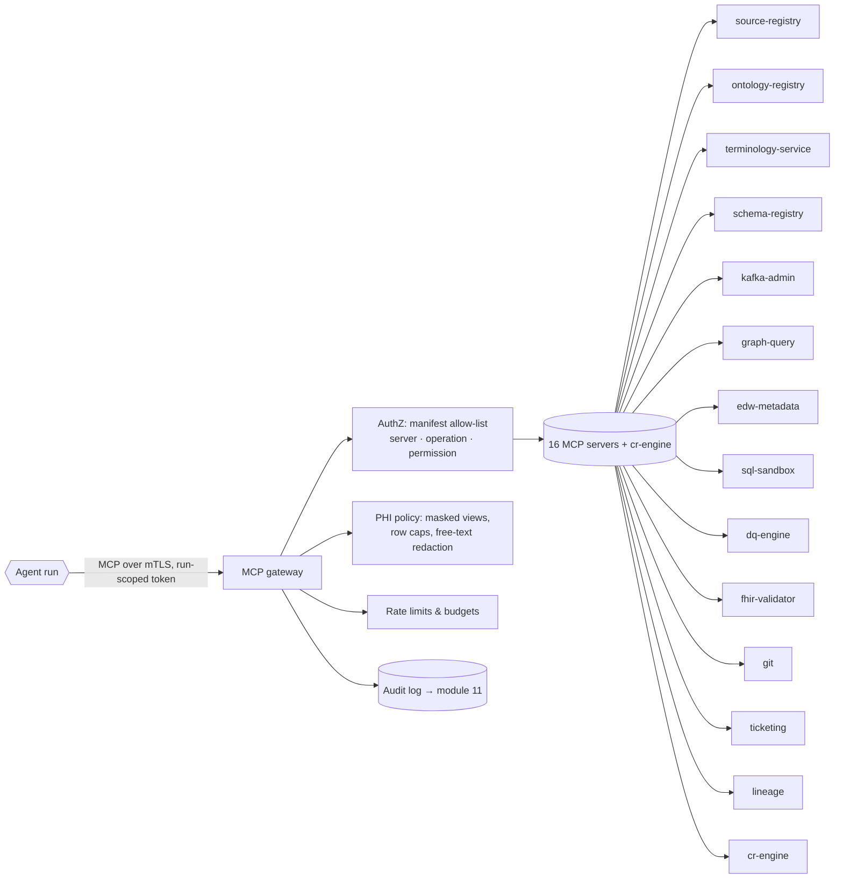

# Tools and MCP Servers

Agents act on the platform exclusively through **tools** exposed by MCP (Model Context Protocol) servers behind one
**MCP gateway**. The gateway is the enforcement point for the permission matrix (§3), PHI policy (§4), rate limits
and budgets (§6) and audit. This document is the tool catalog; the per-agent bindings are the `tools` blocks in
`agents/*.yaml`, which the validator checks against the server list here.

## 1. Gateway architecture



Principles:

- **Least privilege by manifest.** The tool list the model sees is the intersection of the server's catalogue and
  the agent's manifest. Unlisted tools do not exist for that agent.
- **Four permission levels.** `read` (no side effect) · `propose` (produces an artefact that enters a CR; no store
  mutation) · `apply` (mutates state, only for operational tools or applying an approved CR) · `admin` (lifecycle:
  publish release, veto, kill switch).
- **Mutation only via CR.** Every server that fronts a governed store (ontology-registry, terminology-service,
  schema-registry, kafka-admin, graph-query UPDATE, edw-metadata DDL, dq-engine rules) exposes mutation only as
  `propose_*` (creates CR payload) or as an `apply` operation callable solely by `cr-engine` / `agent.release_manager`
  with an `approved|auto_approved` CR id.
- **Structured I/O.** Every tool has a JSON Schema for input and output (§5). Free-text fields coming from data
  (labels, notes, display strings) are tagged `untrusted: true` in the output so the policy prompt can quarantine
  them (AGT-05 §3).
- **Masked by default.** Any tool that can return row-level data returns it from masked views unless the binding
  says `audited_raw` (none in this release).

## 2. Tool catalog

Operation names are the MCP tool names. "Perm." is the minimum permission level required.

### 2.1 `source-registry` (module 03, G9)

| Operation | Perm. | Purpose |
|-----------|-------|---------|
| `list_sources`, `get_source` | read | Source systems, interface types (MLLP, CDC, FHIR, BICC, X12, file), cadence, owner |
| `list_elements`, `get_element` | read | Data Element Catalog: element id, source path (table.column, segment.field, PVO.attribute), datatype, PHI classification, steward, candidate code set, profiling summary |
| `get_code_set_values` | read | Observed values for a code-set element (Cerner CODE_SET, Fusion lookup type) with frequencies, display text tagged untrusted |
| `get_steward` | read | Steward for an element or domain |
| `register_source`, `upsert_element` | apply (inventory only) | Metadata-only writes; reversible |
| `propose_steward` | propose | Stewardship assignment → vocabulary CR |
| `set_phi_classification` | apply (privacy_guardian only) | PHI class per element |

### 2.2 `ontology-registry` (module 02)

| Operation | Perm. | Purpose |
|-----------|-------|---------|
| `list_schemes`, `get_scheme`, `get_concept`, `search_concepts`, `get_hierarchy`, `get_relations` | read | SKOS read (schemes, concepts, broader/narrower/related, matches) |
| `list_classes`, `list_properties`, `get_shapes` | read | OWL classes/properties, SHACL shapes for a release |
| `diff` | read | Semantic diff between two versions/branches (added/removed/changed triples, grouped by concept) |
| `check_label_collision`, `detect_cycles`, `list_orphans` | read | Stage 1/2 structural checks |
| `run_reasoner` | read (sandboxed) | HermiT/ELK: consistency, unsatisfiable classes, inferred subsumptions, explanation |
| `validate_shacl` | read (sandboxed) | SHACL validation of a data graph or synthetic bundle against shapes |
| `explain_inconsistency` | read | Justification sets for an inconsistency |
| `propose_change` | propose | Build a Turtle diff payload for a CR (`vocabulary`/`taxonomy`/`thesaurus`/`ontology`) |
| `get_release` | read | Release manifest, `owl:versionIRI`, `dcterms:modified` |
| `publish_release` | admin (release_manager only) | Publish a signed release of applied CRs |

### 2.3 `terminology-service` (module 06, FHIR TS)

| Operation | Perm. | Purpose |
|-----------|-------|---------|
| `lookup` | read | `CodeSystem/$lookup` (SNOMED CT, LOINC, RxNorm, ICD-10-CM/PCS, CPT/HCPCS, NDC, CVX, UCUM, local) |
| `validate_code` | read | `ValueSet/$validate-code` |
| `translate` | read | `ConceptMap/$translate` with equivalence |
| `expand` | read | `ValueSet/$expand` (paged, versioned) |
| `subsumes`, `closure` | read | `$subsumes`, `$closure` for hierarchy alignment |
| `get_release_manifest` | read | Loaded terminology versions and deltas |
| `propose_value_set`, `propose_concept_map` | propose | FHIR JSON payload → `value_set` CR |
| `publish_value_set`, `publish_concept_map` | apply (release_manager) | Set status active with version, from an approved CR |
| `sync_release` | apply (platform job) | Load external release; emits `terminology_release` |

### 2.4 `schema-registry` (module 07)

| Operation | Perm. | Purpose |
|-----------|-------|---------|
| `list_subjects`, `get_schema`, `get_schema_history` | read | Avro / JSON Schema subjects and versions |
| `check_compatibility` | read | `BACKWARD_TRANSITIVE` (`canonical.*`) / `FULL` (`kg.*`, `edw.*`) check |
| `propose_schema` | propose | New version → `topic` CR |
| `register_schema` | apply (release_manager) | Register from approved CR |

### 2.5 `kafka-admin` (module 07) — read-only + propose

| Operation | Perm. | Purpose |
|-----------|-------|---------|
| `list_topics`, `describe_topic`, `get_consumer_lag`, `list_acls` | read | Topology and health |
| `sample_records` | read, **masked** | ≤ 200 records from a topic through the masking proxy; PHI fields tokenised, free text redacted |
| `propose_topic`, `propose_acl_change` | propose | Topic/ACL change → `topic` CR; naming lint applied |
| `apply_topic_change` | apply (release_manager) | Create/alter topic or ACL from approved CR |

No agent may produce to a data topic. Agents produce only to `hc.ops.agent.*` via the runtime.

### 2.6 `graph-query` (module 08)

| Operation | Perm. | Purpose |
|-----------|-------|---------|
| `sparql_select`, `sparql_ask`, `sparql_construct`, `describe` | read, masked graphs | SPARQL 1.2 read over the de-identified projection (patient-level literals tokenised); 60 s timeout, 10k row cap |
| `get_named_graphs` | read | Named graphs by source/date/batch ULID |
| `propose_update` | propose | SPARQL UPDATE payload → CR (`ontology` for T-box, `mapping` for A-box rules) |
| `load_batch` | apply (kg_builder) | Idempotent batch load of a named graph with bitemporal + PROV-O annotations from canonical topics; never free-form UPDATE |

**SPARQL UPDATE is never executed directly by an agent**; it travels in a CR and is applied by `cr-engine`.

### 2.7 `edw-metadata` and `sql-sandbox` (module 05)

| Server / Operation | Perm. | Purpose |
|--------------------|-------|---------|
| `edw-metadata.list_schemas`, `describe_table`, `list_columns`, `get_column_bindings` | read | Physical model, ontology IRI bindings, PHI masks per column |
| `edw-metadata.naming_lint` | read | CONVENTIONS §3 naming check |
| `edw-metadata.ddl_dry_run` | read (sandboxed) | Parse + execute DDL in a scratch schema per dialect; returns plan and errors |
| `edw-metadata.propose_ddl` | propose | DDL + compensating migration → `edw_ddl` CR |
| `edw-metadata.apply_migration`, `list_migrations` | apply (release_manager) | Forward-only, idempotent migrations |
| `sql-sandbox.run_query` | read, **masked** | Read-only SQL on masked views; 10k rows, 60 s, no DDL/DML, statement allow-list |
| `sql-sandbox.profile_column` | read, masked | Null %, distinct, min/max, top-k values (k ≤ 50, PHI columns return pattern histograms only) |
| `sql-sandbox.explain` | read | Query plan |

### 2.8 `dq-engine` (module 09)

| Operation | Perm. | Purpose |
|-----------|-------|---------|
| `list_rules`, `list_results`, `get_scorecard` | read | Rule pack and results per group/source |
| `run_rule` | read (sandboxed) | Evaluate a rule expression on a masked sample or window |
| `profile_dataset` | read, masked | Dataset-level profile |
| `backtest_rule` | read (sandboxed) | Run a proposed rule over 90 days of masked history: hit rate, trend, seasonality |
| `detect_drift` | read | Distribution/volume drift versus baseline |
| `open_quarantine_sample` | read, masked | ≤ 100 quarantined records, masked |
| `propose_rule`, `propose_remediation` | propose | → `dq_rule` CR |
| `replay_quarantine` | apply (remediator, with approved CR) | Re-process quarantined partitions through the fixed canonicaliser |

### 2.9 `fhir-validator` (module 06)

| Operation | Perm. | Purpose |
|-----------|-------|---------|
| `validate_resource`, `validate_bundle` | read | HL7 validator with US Core 6.1 + HEALIX IG; returns OperationOutcome |
| `validate_profile`, `get_structure_definition` | read | Profile well-formedness and snapshot |
| `generate_examples` | read | Synthetic example instances for a profile (no PHI) |
| `propose_profile` | propose | StructureDefinition/IG change → `profile` CR |
| `publish_ig` | apply (release_manager) | Publish IG build |

### 2.10 `git`, `ticketing`, `lineage`

| Server / Operation | Perm. | Purpose |
|--------------------|-------|---------|
| `git.read_file`, `get_diff` | read | Artefact repos (ontology, DDL, mappings, rules, profiles, prompts) |
| `git.create_branch`, `commit`, `open_pr` | propose | CR payload lands as a PR on branch `cr/<cr-id>`; PR body is generated from the CR; signed commits by the runtime identity |
| `git.merge_pr`, `tag_release` | apply (cr-engine / release_manager) | Merge on `applied`; tag on `released` |
| `ticketing.create_issue`, `update_issue`, `link_cr`, `get_issue` | apply | Steward tickets; every ticket links its CR(s); descriptions PHI-scanned |
| `lineage.get_upstream`, `get_downstream`, `impact_analysis` | read | OpenLineage graph: which topics, tables, graphs, models depend on an artefact |
| `lineage.emit_run_event` | apply | OpenLineage RunEvent for agent runs and applies |

### 2.11 `cr-engine` (this module)

| Operation | Perm. | Purpose |
|-----------|-------|---------|
| `create_cr`, `get_cr`, `list_crs`, `withdraw_cr` | propose | Lifecycle for proposers |
| `record_evaluation` | apply (evaluator) | Attach evaluation; transition `proposed → evaluated` |
| `record_privacy_review`, `veto_cr` | admin (privacy_guardian) | Privacy decision; veto |
| `route_cr`, `transition_cr`, `lock_target`, `detect_conflicts` | apply (orchestrator, release_manager) | Gate routing, transitions, locks |
| `kill_switch` | admin (privacy_guardian, Agent Operator) | Halt all auto-approvals and applies platform-wide or per agent |

### 2.12 `memory-api`, `healing-orchestrator`, `policy-registry` (module 14)

Three servers front the memory and self-improvement surfaces. They never expose PHI (manifests pin `phi_access:
none`, except the self-healer's masked Kafka/DQ reads for diagnosis).

- **`memory-api`** (Mem0 + Graphiti): `read_episode`, `write_insight`, `consolidate`, `expire`, `prune`,
  `list_scope`, `redact`. Writes to semantic memory are limited to `memory_curator`; everyone else reads only.
  Enforces the no-PHI rule at write time (every value is scanned; a hit is rejected and audited).
- **`healing-orchestrator`**: `match_playbook`, `run_action`, `verify_recovery`, `open_incident`,
  `close_incident`, `list_incidents`. `run_action` is bounded by the playbook's blast-radius class and the global
  kill switch; only `self_healer` holds it.
- **`policy-registry`**: `get_policy`, `diff_policy`, `propose_policy`, `start_canary`, `read_canary_metrics`,
  `list_versions`. Policy mutations are propose-only and gated; promotion is a human-approved CR. Only `improver`
  proposes; `orchestrator` and `evaluator` read.

These three servers mutate state only through the CR engine and the canary gate, like every other governed store.

## 3. Permission matrix

Legend: `R` read · `P` propose · `A` apply · `D` admin · `–` none. Masked data access is marked `m`. Derived from
the manifests; the manifests are authoritative and this table is regenerated by the linter.

| Agent | src-reg | ont-reg | term-svc | schema-reg | kafka | graph | edw-meta | sql-sbx | dq | fhir-val | git | ticket | lineage | cr-engine |
|-------|---------|---------|----------|------------|-------|-------|----------|---------|----|----------|-----|--------|---------|-----------|
| orchestrator | R | R | – | – | R | – | – | – | R | – | R | A | A | A |
| inventory | A | – | – | R | Rm | – | R | Rm | Rm | – | – | A | A | P |
| vocabulary_curator | R | P | R | – | Rm | – | – | Rm | – | – | P | – | – | P |
| taxonomist | R | P | R | – | – | R | – | – | – | – | P | – | – | P |
| thesaurus_editor | – | P | R | – | – | R | – | Rm | – | – | P | – | – | P |
| ontologist | – | P | R | – | – | R | R | – | – | R | P | – | R | P |
| kg_builder | – | R | – | R | Rm | Am | R | Rm | – | – | P | – | A | P |
| source_mapper | R | R | R | R | Rm | – | – | – | Rm | R | P | – | – | P |
| terminology_steward | R | R | P | – | – | – | – | Rm | R | – | P | – | – | P |
| schema_architect | – | R | – | R | – | – | P | Rm | – | – | P | – | R | P |
| dq_author | R | R | R | – | – | – | – | Rm | Pm | R | P | – | – | P |
| dq_monitor | – | – | – | R | Rm | – | – | – | Am | – | – | A | A | R |
| remediator | – | – | R | – | R | – | – | – | Pm | R | – | A | – | P |
| interop_engineer | R | R | R | P | Pm | – | – | – | – | P | P | – | – | P |
| privacy_guardian | A | R | – | – | P | R | R | Rm | – | – | – | A | R | D |
| evaluator | – | R | R | R | – | R | R | – | Rm | R | R | – | R | A |
| release_manager | – | D | A | A | A | – | A | – | – | A | A | A | A | A |
| memory_curator | – | – | – | – | – | – | – | – | – | – | – | A | A | P |
| self_healer | – | – | – | R | Am | – | – | – | Rm | – | – | A | A | P |
| improver | – | – | – | – | – | – | – | – | Rm | – | P | – | A | P |

Observations the linter enforces: only `release_manager` holds `apply`/`admin` on governed stores; only
`privacy_guardian` holds `admin` on `cr-engine`; only `kg_builder` may `load_batch`; only `inventory` and
`privacy_guardian` write to `source-registry`; nobody holds `audited_raw`.

## 4. PHI access policy for tools

1. **Default is metadata.** Most tools return schemas, IRIs, codes, counts and aggregates. These are not PHI and
   need no masking, but free-text fields (displays, descriptions, notes) are tagged untrusted.
2. **Masked views only.** `sample_records`, `run_query`, `profile_column`, `profile_dataset`,
   `open_quarantine_sample`, `backtest_rule`, `run_rule`, SPARQL reads: the gateway routes to the de-identified
   projection (module 11: Safe Harbor identifiers removed, dates shifted per patient, identifiers tokenised with
   per-environment keys, free text redacted). Row caps apply (≤ 200 Kafka records, ≤ 10k SQL rows, ≤ 100 quarantine
   records). Aggregates below a small-cell threshold (n < 11) are suppressed.
3. **No raw PHI path in this release.** `audited_raw` exists in the schema for a future break-glass flow (module
   11) and is not granted to any agent.
4. **Synthetic first.** Golden tests and FHIR validation use synthetic bundles (`synthetic-fhir-bundles-v1`) and
   HL7 v2 test messages generated by `fhir-validator.generate_examples` or the test-data service; never production
   records.
5. **Audit everything masked.** Every masked-data call is logged with agent, run, CR (if any), tool, row count and
   masking profile version to module 11's audit stream.

## 5. Input/output schemas for key tools

Schemas are published by each server under `.well-known/mcp/tools/<name>.schema.json`; the excerpts below are
normative for the fields shown.

```json
// ontology-registry.propose_change — input
{
  "type": "object", "required": ["cr_type", "scheme_or_ontology_iri", "operations"],
  "properties": {
    "cr_type": {"enum": ["vocabulary", "taxonomy", "thesaurus", "ontology"]},
    "scheme_or_ontology_iri": {"type": "string", "format": "uri"},
    "base_version": {"type": "string"},
    "operations": {"type": "array", "minItems": 1, "items": {
      "type": "object", "required": ["op", "subject"],
      "properties": {
        "op": {"enum": ["add_concept", "deprecate_concept", "merge_concepts", "set_label", "add_relation", "remove_relation", "add_axiom", "remove_axiom", "upsert_shape"]},
        "subject": {"type": "string", "format": "uri"},
        "predicate": {"type": "string", "format": "uri"},
        "object": {"type": ["string", "object"]},
        "language": {"type": "string", "pattern": "^[a-z]{2}(-[A-Z]{2})?$"},
        "justification": {"type": "string", "maxLength": 2000}
      }}}
  }
}
// ontology-registry.propose_change — output
{ "type": "object", "required": ["payload_format", "diff", "affected_iris", "precheck"],
  "properties": {
    "payload_format": {"enum": ["skos-turtle", "owl-turtle", "shacl-turtle"]},
    "diff": {"type": "string"},
    "affected_iris": {"type": "array", "items": {"type": "string", "format": "uri"}},
    "precheck": {"type": "object", "properties": {
      "label_collision": {"enum": ["pass", "fail"]}, "cycle": {"enum": ["pass", "fail", "n/a"]},
      "shacl_syntax": {"enum": ["pass", "fail", "n/a"]}}}
  } }
```

```json
// terminology-service.translate — input / output
{ "input": { "type": "object", "required": ["system", "code", "target_system"],
    "properties": { "system": {"type": "string", "format": "uri"}, "code": {"type": "string"},
      "version": {"type": "string"}, "target_system": {"type": "string", "format": "uri"},
      "concept_map_url": {"type": "string", "format": "uri"} } },
  "output": { "type": "object", "required": ["result", "matches"],
    "properties": { "result": {"type": "boolean"},
      "matches": {"type": "array", "items": {"type": "object", "required": ["equivalence", "code", "system"],
        "properties": { "equivalence": {"enum": ["relatedto", "equivalent", "equal", "wider", "subsumes", "narrower", "specializes", "inexact", "unmatched", "disjoint"]},
          "code": {"type": "string"}, "system": {"type": "string"}, "display": {"type": "string", "x-untrusted": true},
          "concept_map_url": {"type": "string"} } } } } } }
```

```json
// sql-sandbox.run_query — input / output
{ "input": { "type": "object", "required": ["sql", "purpose"],
    "properties": { "sql": {"type": "string", "maxLength": 20000}, "dialect": {"enum": ["teradata", "ansi"]},
      "max_rows": {"type": "integer", "maximum": 10000, "default": 1000}, "timeout_s": {"type": "integer", "maximum": 60},
      "purpose": {"type": "string", "maxLength": 500, "description": "Recorded in audit"} } },
  "output": { "type": "object", "required": ["columns", "rows", "masking_profile", "truncated"],
    "properties": { "columns": {"type": "array", "items": {"type": "object", "properties": {
        "name": {"type": "string"}, "type": {"type": "string"}, "phi_class": {"enum": ["none", "masked", "suppressed"]} } } },
      "rows": {"type": "array"}, "row_count": {"type": "integer"}, "truncated": {"type": "boolean"},
      "masking_profile": {"type": "string"}, "small_cells_suppressed": {"type": "integer"} } } }
```

```json
// dq-engine.backtest_rule — input / output
{ "input": { "type": "object", "required": ["rule", "dataset", "window_days"],
    "properties": { "rule": {"$ref": "https://ontology.healix.example.org/schema/dq-rule/1.0.0"},
      "dataset": {"type": "string", "description": "canonical topic or EDW table"},
      "window_days": {"type": "integer", "minimum": 7, "maximum": 365} } },
  "output": { "type": "object", "required": ["evaluated", "breaches", "breach_rate", "daily_series"],
    "properties": { "evaluated": {"type": "integer"}, "breaches": {"type": "integer"}, "breach_rate": {"type": "number"},
      "daily_series": {"type": "array", "items": {"type": "object", "properties": {"date": {"type": "string", "format": "date"}, "rate": {"type": "number"}}}},
      "seasonality_detected": {"type": "boolean"}, "sample_breaches_masked": {"type": "array", "maxItems": 20} } } }
```

```json
// edw-metadata.ddl_dry_run — input / output
{ "input": { "type": "object", "required": ["forward_ddl", "compensating_ddl"],
    "properties": { "forward_ddl": {"type": "string"}, "compensating_ddl": {"type": "string"},
      "dialects": {"type": "array", "items": {"enum": ["teradata", "ansi", "snowflake", "databricks", "bigquery"]}, "default": ["teradata", "ansi"]} } },
  "output": { "type": "object", "required": ["results"],
    "properties": { "results": {"type": "array", "items": {"type": "object", "required": ["dialect", "forward", "compensating", "roundtrip_clean"],
      "properties": { "dialect": {"type": "string"}, "forward": {"enum": ["pass", "fail"]}, "compensating": {"enum": ["pass", "fail"]},
        "roundtrip_clean": {"type": "boolean"}, "errors": {"type": "array", "items": {"type": "string"}},
        "naming_lint": {"type": "array", "items": {"type": "string"}} } } } } } }
```

```json
// graph-query.load_batch — input
{ "type": "object", "required": ["batch_ulid", "source", "named_graph", "canonical_offsets", "mapping_version", "prov_activity_iri"],
  "properties": { "batch_ulid": {"type": "string", "pattern": "^[0-9A-HJKMNP-TV-Z]{26}$"},
    "source": {"type": "string"}, "named_graph": {"type": "string", "format": "uri"},
    "canonical_offsets": {"type": "object", "description": "topic-partition → [from, to]"},
    "mapping_version": {"type": "string"}, "prov_activity_iri": {"type": "string", "format": "uri"},
    "valid_time_policy": {"enum": ["from_resource", "from_event_time"]} } }
```

## 6. Rate limits and budgets

| Server | Per-run limits | Per-agent-per-day | Notes |
|--------|----------------|-------------------|-------|
| source-registry | 500 calls | 20,000 | Cheap metadata |
| ontology-registry | 300 calls; `run_reasoner` ≤ 2; `validate_shacl` ≤ 10 | 5,000; reasoner ≤ 24 | Reasoner jobs queued, 60 min max |
| terminology-service | 500 calls; `expand` ≤ 50 (paged 1,000) | 50,000 | terminology_steward raised to 200,000 |
| schema-registry | 100 | 2,000 | — |
| kafka-admin | `sample_records` ≤ 10 calls × 200 records | 2,000 records sampled | Masked proxy |
| graph-query | 100 queries; 60 s; 10k rows each | 5,000 | `load_batch` ≤ 50/run (kg_builder) |
| edw-metadata | 200; `ddl_dry_run` ≤ 5 | 2,000 | Dry-run scratch schema pooled |
| sql-sandbox | 50 queries; 60 s; 10k rows | 1,000 queries | Statement allow-list (SELECT only) |
| dq-engine | 100; `backtest_rule` ≤ 5 | 5,000 | Backtests queued |
| fhir-validator | 500 resources | 50,000 | Batched |
| git | 50 | 1,000 | One PR per CR |
| ticketing | 20 | 500 | Dedup by (CR id, type) |
| lineage | 100 | 5,000 | — |
| cr-engine | 50 | `max_open_change_requests` from manifest | — |

Tool-call counts also count against manifest `max_tool_calls_per_run`. Exceeding a server limit returns an MCP
error the agent must handle by checkpointing; it is not retried.

## 7. Requirements

> **AGT-TOOL-001** (P0, test) — All agent access to platform services MUST go through the MCP gateway; direct
> network access from agent runtimes to any store or service MUST be blocked.

> **AGT-TOOL-002** (P0, test) — The gateway MUST authorise every call against the calling agent's manifest
> (`server`, `operations`, `permission`) and MUST reject and audit any call outside it.

> **AGT-TOOL-003** (P0, test) — Mutating operations on governed stores (`publish_release`, `publish_value_set`,
> `publish_concept_map`, `register_schema`, `apply_topic_change`, `apply_migration`, `merge_pr`, `tag_release`,
> `replay_quarantine`) MUST require an `approved` or `auto_approved` CR id and MUST be callable only by
> `cr-engine`, `agent.release_manager` or the agent named in §2.

> **AGT-TOOL-004** (P0, test) — `graph-query` MUST NOT expose SPARQL UPDATE execution to any agent; updates MUST
> travel in CR payloads and `load_batch` MUST be restricted to `agent.kg_builder` with idempotent batch ULIDs.

> **AGT-TOOL-005** (P0, test) — `kafka-admin` MUST be read-only plus `propose_*` for all agents except
> `agent.release_manager`'s `apply_topic_change`; no agent MAY produce to or consume from data topics directly.

> **AGT-TOOL-006** (P0, test) — Every tool returning row-level data MUST serve it from masked/de-identified views
> with row caps (§4) and small-cell suppression; `audited_raw` MUST NOT be granted in this release.

> **AGT-TOOL-007** (P0, test) — `sql-sandbox` MUST accept only SELECT statements from an allow-listed grammar,
> enforce the 60 s / 10k-row limits, and run under a database role restricted to masked views.

> **AGT-TOOL-008** (P0, inspection) — Every tool MUST publish JSON Schemas for input and output; outputs MUST
> mark data-derived free-text fields with `x-untrusted: true`.

> **AGT-TOOL-009** (P0, test) — Every masked-data tool call MUST be audited (agent, run, CR, operation, row count,
> masking profile version) to the module 11 audit stream.

> **AGT-TOOL-010** (P1, test) — The gateway MUST enforce the per-run and per-day limits in §6 and MUST return a
> structured budget error rather than silently truncating.

> **AGT-TOOL-011** (P0, test) — Sandboxed operations (`run_reasoner`, `validate_shacl`, `ddl_dry_run`,
> `backtest_rule`, `run_rule`, `run_query`, `validate_*`) MUST execute in ephemeral containers per AGT-ARCH-004.

> **AGT-TOOL-012** (P1, inspection) — The permission matrix in §3 MUST be regenerated from the manifests by the
> PRD linter in CI, and a manifest granting `apply`/`admin` on a governed store to an agent other than those listed
> in §3 MUST fail the build.

> **AGT-TOOL-013** (P1, test) — `git` operations MUST use a runtime identity with signed commits; the PR for a CR
> MUST be created on branch `cr/<cr-id>` and merged only by `cr-engine` on `applied`.

> **AGT-TOOL-014** (P1, test) — `ticketing.create_issue` MUST run the `phi_scan` check on title and description
> and MUST deduplicate by (CR id, issue type).

> **AGT-TOOL-015** (P2, demo) — Adding an MCP server MUST require only: a catalog entry in this document, a
> gateway registration with its schemas, and manifest changes for the agents that use it; no change to the runtime.
