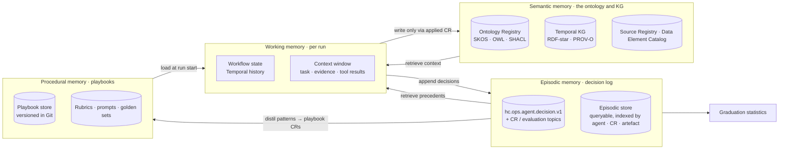

# Memory and State

Agents need to remember three things: what they are doing right now, what they and their peers decided before and
how it turned out, and how to do their job. They must remember **nothing** about patients, employees or suppliers.
This document defines the memory tiers, the stores behind them, retention, and how memory feeds evaluation and
autonomy graduation.

## 1. Memory tiers



| Tier | What it holds | Lifetime | Written by | Read by |
|------|---------------|----------|------------|---------|
| **Working** | The run's task, retrieved context, tool results, intermediate structured outputs, budget counters | One run (workflow); purged at close | Runtime | The running agent only |
| **Episodic** | Decision-log records: proposals, evaluations, approvals, vetoes, applies, releases, rollbacks, budget stops, with structured rationale and evidence *pointers* | 7 years (2,555 days) | Runtime on behalf of agents; cr-engine; evaluator | All agents (own and peers' records), evaluator, HITL console, graduation job |
| **Semantic** | The governed knowledge itself: SKOS schemes, OWL ontology, SHACL shapes, Source Registry, value sets, mappings, and the bitemporal knowledge graph | Versioned forever (releases), bitemporal | Only `cr-engine` applying approved CRs; `kg_builder.load_batch` for instance data | Everyone, through read tools |
| **Procedural** | Playbooks (how to onboard a LIS; how to resolve an unmapped lab code), rubrics, prompt versions, style guides, golden sets | Versioned in Git | Agent Operators; agents via `topic`-typed governance CRs (playbook changes are low-risk, auto-approvable) | Loaded into working memory at run start |

### 1.1 Working memory

Working memory is the Temporal workflow state plus the model context. Rules: it is **run-scoped**; the runtime
builds it from (a) the trigger payload, (b) retrieved episodic precedents (§3), (c) semantic context fetched through
tools, and (d) the applicable playbooks. Masked samples fetched during the run live only here and are dropped when
the run ends; they are never written to any other tier. Checkpoints (on budget exhaustion or failure) store the
structured intermediate outputs and tool-result *references* (tool, parameters, result hash), not the masked rows,
so a resumed run re-fetches through the gateway with fresh audit.

### 1.2 Episodic memory (the decision log)

Each record:

```yaml
decision_id: DEC-20261016-01J9ZK3R…          # ULID
at: "2026-10-16T02:58:00Z"
agent_id: agent.vocabulary_curator
run_id: run_01J9ZK2V7H3E9D5F8G1A2B3C4D
workflow_id: wf.vocabulary_harvest
prompt_version: vocabulary_curator/1.4.2
model: claude-sonnet-5-5                     # resolved from ${MODEL_MAPPING}
decision_type: propose                        # propose|withdraw|evaluate|route|approve|veto|apply|release|rollback|budget_stop|escalate|skip
cr_id: CR-20261017-01J9ZK3Q8X5W2M7N4P6R1T0V9B
target_ref: https://ontology.healix.example.org/scheme/encounter-class
rationale:                                    # structured, PHI-free
  summary: "New Cerner code set 71 value observed 1,842× in 7 d with no covering concept."
  alternatives_considered: ["altLabel on existing 'Observation Encounter' (rejected: distinct SNOMED concept)"]
  evidence_refs: [src.cerner.code_value.cs71.309308, prof_01J9ZK2W0A1B2C3D4E5F6G7H8J]
outcome: null                                 # filled by later records: evaluated 0.95 → auto_approved → applied → released
tokens: {input: 41210, output: 2890}
tool_calls: 37
trace_id: 4bf92f3577b34da6a3ce929d0e0e4736
phi_scan: pass
```

Records are appended to `hc.ops.agent.decision.v1` (keyed by `decision_id`, 7-year retention, compacted mirror
to the episodic store) and indexed in the episodic store by agent, CR, target artefact, decision type and time.
Episodic memory is the raw material for three things: precedent retrieval, evaluation of the agent, and
graduation.

### 1.3 Semantic memory

The ontology, the registries and the knowledge graph **are** the agents' long-term knowledge. There is no separate
"agent knowledge base" that could drift from governed truth. An agent that wants to "remember" that Cerner code
309308 means Observation Unit Encounter does so by getting a vocabulary CR applied; the next run finds the concept
through `ontology-registry.search_concepts`. This keeps all semantic learning versioned, evaluated, bitemporal and
provenance-linked by construction (module 08). Agent-generated embeddings used for retrieval over semantic memory
are derived caches, rebuilt from the registry on each release, never a source of truth.

### 1.4 Procedural memory

Playbooks are Markdown + YAML documents (`playbooks/<domain>/<name>.md`) with: trigger conditions, steps, tools to
use, known pitfalls, exit criteria, links to golden sets. Examples: *Onboard an HL7 v2 ORU feed*, *Resolve an
unmapped LOINC candidate*, *Promote a thesaurus relation to an OWL property*, *Add a conformed dimension member*.
Agents may propose playbook edits (distilled from repeated episodic patterns, e.g. "in 40 of 42 cases the fix for
UCUM case drift was deterministic normalisation") as low-risk governance CRs; the Agent Operator approves or they
auto-apply at threshold. Rubrics, prompts and golden sets are procedural memory too, but changes to them follow the
red-team gate (AGT-SAFE-017).

## 2. State stores

| Store | Technology (default; swappable) | Holds | Access |
|-------|--------------------------------|-------|--------|
| Workflow state | Temporal.io persistence | Working memory, timers, retries, checkpoints | Runtime only |
| CR store | `cr-engine` database (PostgreSQL) + compacted topic `hc.ops.agent.changerequest.v1` | All CRs, state history, locks | Via cr-engine tools |
| Evaluation store | `hc.ops.agent.evaluation.v1` + columnar mirror | Evaluations, calibration runs, regression results | Evaluator writes; all read |
| Episodic store | `hc.ops.agent.decision.v1` + indexed store (PostgreSQL/OpenSearch) | Decision log | Runtime writes; agents read via `cr-engine.list_crs` and a `recall` tool scoped to metadata |
| Semantic stores | Ontology Registry (Git + triple store), Terminology Service, Source Registry, Temporal KG, EDW metadata | Governed knowledge | Read tools; write via applied CR |
| Procedural store | Git (`playbooks/`, `rubrics/`, `prompts/`, `golden/`) | Playbooks, rubrics, prompts, datasets | Read at run start; write via CR |
| Retrieval cache | Vector index over semantic + procedural stores | Embeddings of concept labels/definitions, playbook chunks | Rebuilt per release; no PHI by construction (metadata only) |

All stores are per environment; `prod` episodic data is never copied to lower environments unredacted (it is
PHI-free by design but is treated as confidential operational data).

## 3. Retrieval and precedent

At run start the runtime assembles context in this order and within a token budget: (1) the trigger and target
artefact; (2) semantic neighbours of the target (nearest concepts, bound properties, shapes, existing mappings);
(3) up to 10 episodic precedents: prior CRs on the same target or siblings, with their outcomes (approved,
rejected with human comment, rolled back and why); (4) the applicable playbooks. Precedents are the main mechanism
by which agents improve without any model fine-tuning: a steward's rejection comment on a `skos:broader` proposal
last month is in the context the next time a similar placement is attempted.

## 4. What agents may remember about PHI

**Nothing.** Enforced by construction and by scanning:

- No tier other than working memory can receive masked rows, and working memory is purged per run (checkpoints
  hold references, not rows).
- Decision-log `rationale` fields are structured; the runtime rejects a record whose `phi_scan` is not `pass`
  (AGT-SAFE-004) and the privacy guardian's nightly scan re-checks all tiers.
- Evidence in CRs and decisions is stored as **pointers** (element ids, profiling run ids, topic/offset ranges,
  ticket ids), and profiling statistics are aggregates with small-cell suppression.
- The retrieval cache embeds only registry metadata and playbooks — never samples, never quarantined records.
- Agents have no per-agent scratch store outside these tiers; a manifest cannot declare one (`memory` block has
  `phi_retention: none` as a constant).

A single confirmed PHI write into episodic, procedural or cache tiers is a reportable incident under module 11 and
triggers PGV-012 (veto, demotion, agent-scoped kill switch).

## 5. Retention

| Data | Retention | Basis |
|------|-----------|-------|
| Working memory / workflow histories | 90 days after run close (debugging), then purged | Operational |
| Decision log, CRs, evaluations | 7 years (2,555 days), immutable | HIPAA documentation retention; audit of autonomous decisions |
| Semantic stores | Indefinite, versioned, bitemporal | Governed knowledge |
| Playbooks, rubrics, prompts, golden sets | Indefinite in Git | Reproducibility (AGT-ARCH-020) |
| Retrieval cache | Until next release rebuild | Derived |
| Calibration samples (human decisions) | 7 years | Evidence for autonomy decisions |

## 6. How memory feeds evaluation and graduation

The graduation job (weekly, run by the orchestrator, evidence summarised by the evaluator) computes per agent from
episodic and evaluation stores:

| Statistic | Source | Used in |
|-----------|--------|---------|
| Evaluated CR count and time span | CR store | Graduation volume criteria (manifest `graduation.criteria`) |
| Human agreement (κ) with evaluator verdicts on the agent's CRs | Evaluation store + HITL decisions | Graduation and auto-approval suspension |
| Rollback rate (rolled_back / released, trailing 30 and 90 days) | CR store | Graduation; demotion triggers |
| Veto count (trailing 90 days) | CR store (`privacy_review.decision = vetoed`) | Graduation (zero required); kill switch |
| Revise rate and mean revisions per CR | CR state history | Prompt/playbook improvement signals |
| Golden-set scores per rubric over time | Evaluation store | Regression detection |
| Budget stops and tool failures | Decision log | Operational tuning |

The resulting **graduation evidence summary** is itself a decision-log record and is attached to the governance CR
that changes `autonomy_level` in the manifest (README §4). Demotion uses the same statistics but is evaluated on
every run so it is immediate (AGT-SAFE-014).

Episodic memory also enables **retrospective evaluation**: when a rubric is revised, the evaluator can rescore
historical CRs to check the change does not reverse past human-agreed verdicts, and when a rollback happens, the
decision chain shows which evidence or rubric gap allowed the change through.

## 7. Requirements

> **AGT-MEM-001** (P0, test) — Working memory MUST be run-scoped; masked rows fetched in a run MUST NOT be written
> to any other tier or to checkpoints, which MUST store tool-result references and hashes only.

> **AGT-MEM-002** (P0, test) — Every consequential decision MUST be appended as a structured record to
> `hc.ops.agent.decision.v1` and indexed in the episodic store with agent, run, CR, target, prompt version, model
> and trace id.

> **AGT-MEM-003** (P0, test) — The runtime MUST reject any decision-log record whose `phi_scan` is not `pass`.

> **AGT-MEM-004** (P0, inspection) — Agents MUST have no long-term knowledge store other than the governed semantic
> stores (ontology registry, terminology service, source registry, knowledge graph, EDW metadata); semantic writes
> MUST occur only through applied CRs or `kg_builder.load_batch`.

> **AGT-MEM-005** (P0, test) — Retrieval caches MUST be built only from registry metadata and procedural documents,
> rebuilt on each release, and MUST never contain samples, quarantined records or free text from data.

> **AGT-MEM-006** (P0, test) — Manifests MUST declare `memory.phi_retention: none`; the schema MUST make any other
> value invalid.

> **AGT-MEM-007** (P0, inspection) — Decision logs, CRs, evaluations and calibration samples MUST be retained
> immutably for 7 years; workflow histories MAY be purged after 90 days.

> **AGT-MEM-008** (P1, test) — At run start the runtime MUST retrieve up to 10 episodic precedents for the target
> artefact (same target or siblings) including human rejection comments and rollback reasons, within the context
> budget.

> **AGT-MEM-009** (P1, test) — Playbook, rubric and prompt changes MUST be versioned in Git and applied through CRs;
> rubric and prompt changes for the evaluator and privacy guardian MUST pass the red-team gate (AGT-SAFE-017).

> **AGT-MEM-010** (P1, analysis) — The weekly graduation job MUST compute the statistics in §6 from episodic and
> evaluation stores alone, and MUST attach the evidence summary to any autonomy-level change CR.

> **AGT-MEM-011** (P1, test) — The nightly PHI leakage scan (AGT-SAFE-004) MUST cover the episodic store, the
> procedural store, the retrieval cache and workflow checkpoints.

> **AGT-MEM-012** (P2, test) — The evaluator MUST be able to rescore historical CRs against a revised rubric
> version and report verdict reversals before the rubric is promoted.

> **AGT-MEM-013** (P1, test) — `prod` episodic data MUST NOT be replicated to lower environments without the
> redaction and approval controls of module 11, even though it is PHI-free by design.
