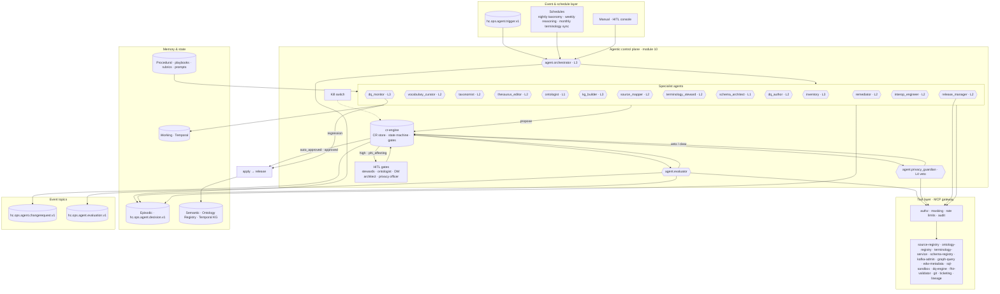

# Module 10 — Agentic Pipeline

## 1. Scope

This module specifies the **agentic control plane** that runs HEALIX: the LLM-driven agents that walk the six
Ontology Pipeline stages (metadata inventory → controlled vocabulary → taxonomy → thesaurus → ontology → knowledge
graph), keep source mappings, value sets, DQ rules, EDW DDL, Kafka topics and FHIR profiles current, and do so
under evaluation, privacy veto and human gates. It owns:

- the **agent architecture and runtime** (durable workflows, sandboxed tools, model routing, budgets) — `01`;
- the **agent catalog**: the 20 agents of `01-architecture-overview.md` §5 — `02`;
- the **Change Request (CR) contract** and the standard orchestration workflows — `03` (cross-module contract per
  ARC-01 §6, consumed by modules 02, 05, 06, 09, 11);
- the **tool layer** exposed through MCP servers and the permission matrix — `04`;
- **guardrails, HITL and evaluation**: privacy veto rules, prompt-injection defence, evaluator, datasets,
  thresholds, kill switch, red team — `05`;
- **memory and state** — `06`;
- machine-readable **agent manifests** and schemas — `agents/`.

Out of scope here: PHI policy content (module 11, consumed), topic catalog entries (module 07, this module
proposes `hc.ops.agent.*` topics), deployment and SLOs (module 12), acceptance thresholds (module 13).

| File | doc_id | Content |
|------|--------|---------|
| `README.md` | AGT-00 | Scope, control-plane architecture, autonomy ladder, requirement index |
| `01-agent-architecture.md` | AGT-01 | Agent anatomy, runtime, triggers, observability, environments |
| `02-agent-catalog.md` | AGT-02 | 20 agents: mission, triggers, tools, level, rubrics, failure modes; end-to-end scenario |
| `03-orchestration-and-workflows.md` | AGT-03 | CR schema and example, state machine, gates, six workflows, concurrency, SLAs |
| `04-tools-and-mcp.md` | AGT-04 | MCP tool catalog, permission matrix, PHI policy, I/O schemas, rate limits |
| `05-guardrails-hitl-evals.md` | AGT-05 | PGV veto rules, PHI minimisation, injection defence, evaluator, datasets, thresholds, HITL, kill switch, red team |
| `06-memory-and-state.md` | AGT-06 | Memory tiers, state stores, PHI (none), retention, graduation statistics |
| `agents/<role>.yaml` ×20 | — | Agent manifests (validated by `agents/agent.schema.json`) |
| `agents/change-request.schema.json` | — | CR JSON Schema 1.0.0 (the cross-module contract) |

## 2. Control-plane architecture

Reading the diagram: triggers reach the orchestrator, which starts specialist runs as durable workflows. Specialists
read through the MCP gateway (masked data only) and **propose** Change Requests; `cr-engine` holds the state machine.
The evaluator scores every CR; the privacy guardian reviews every CR and can veto; the gate policy (risk class ×
autonomy level × score) decides between auto-approval and a human gate. Applied CRs are bundled by the release
manager into signed releases, which is the only way semantic memory (the ontology, the KG) changes. The DQ monitor
watches each release and can trigger rollback. The kill switch halts approvals and applies at any scope.

## 3. Event topics owned or proposed by this module

| Topic | Key | Producer | Notes |
|-------|-----|----------|-------|
| `hc.ops.agent.changerequest.v1` | CR id | `cr-engine` | Full CR on every transition; compacted, infinite retention (named in ARC-01) |
| `hc.ops.agent.evaluation.v1` | evaluation id | `agent.evaluator` | Evaluation records, calibration and regression reports (named in ARC-01) |
| `hc.ops.agent.trigger.v1` | dedup key | Stream processors, agents | Normalised agent-facing events (`event_type` in AGT-01 §4.1); proposed to module 07 catalog |
| `hc.ops.agent.decision.v1` | decision id | Runtime | Episodic decision log; 7-year retention; proposed to module 07 catalog |

## 4. Autonomy ladder and graduation

| Level | Meaning | Who starts here | May auto-apply |
|-------|---------|-----------------|----------------|
| **L1** | Propose only; every CR needs a human approval gate | `ontologist`, `schema_architect` | Nothing |
| **L2** | Propose; auto-apply when evaluator score ≥ manifest threshold **and** `risk_class = low` | `vocabulary_curator`, `taxonomist`, `thesaurus_editor`, `source_mapper`, `terminology_steward`, `dq_author`, `remediator`, `interop_engineer`, `release_manager` | low |
| **L3** | Act within policy and report; auto-apply `low` (score ≥ 0.85) and `medium` (score ≥ 0.95, no warnings, non-breaking) | `orchestrator`, `inventory`, `kg_builder`, `dq_monitor` | low, medium |
| **L4** | Act and veto other agents | `privacy_guardian` (fixed by ADR-06) | low, medium; veto needs no gate |
| — | No autonomy level; never proposes | `evaluator` | — |

`high` and `phi_affecting` CRs are never auto-applied at any level (AGT-ORCH-007).

### 4.1 How agents graduate

Autonomy is a manifest field changed by a governance CR, backed by evidence computed weekly from the episodic and
evaluation stores (AGT-06 §6). General criteria, specialised per agent in `graduation.criteria`:

| Transition | Minimum evidence (trailing window) | Also required |
|------------|-----------------------------------|---------------|
| L1 → L2 | ≥ 150–200 human-approved CRs over ≥ 180 days with approval rate ≥ 0.90; zero released defects of the agent's artefact class (inconsistent ontology, failed migration) | Evaluator κ ≥ 0.90 for the CR type; PRD revision raising the agent's `autonomy_ceiling` (applies to `ontologist`, `schema_architect`) |
| L2 → L3 | ≥ 300–2,000 evaluated CRs (per manifest) over ≥ 90 days; human–evaluator agreement ≥ 0.97 on sampled CRs; rollback rate ≤ 0.5 % (≤ 0.3 % for terminology); zero privacy vetoes | Nightly/weekly validation suites green for 60 days where applicable; Agent Operator sign-off |
| L3 → L4 | Not available by graduation; L4 is reserved to the privacy guardian by ADR-06 | — |

**Demotion** is immediate and automatic on the manifest `demotion_triggers`: typically rollback rate > 2 % in 30
days (→ one level down), any PHI leakage or mis-routing (→ L1), a released artefact failing its class invariant
(cycle in a released taxonomy, inconsistent ontology, failed production migration). A demoted agent re-graduates on
the same criteria with the window restarted. The evaluator itself is not on the ladder, but its weekly calibration
(κ per CR type) gates **everyone's** auto-approval: if κ < 0.90 for a type, that type reverts to human review until
recalibrated (AGT-SAFE-009).

Graduation statistics are the "Autonomy" KPIs of VIS-00 §8: change acceptance rate, rollback rate, evaluator
agreement with human reviewers. G-06 targets ≥ 80 % auto-approval of vocabulary/mapping/DQ-rule changes with zero
unreviewed PHI-affecting changes.

## 5. Interfaces with other modules

| Module | This module provides | This module consumes |
|--------|----------------------|----------------------|
| 02 Ontology Pipeline | CR contract for vocabulary/taxonomy/thesaurus/ontology; Stage 0–5 agents; release events | Ontology Registry API, SKOS/OWL/SHACL skeletons, governance rules (ONT-07) |
| 03 Source Systems | `agent.inventory`, `agent.source_mapper` | Source Registry contract, extraction specs |
| 05 EDW Schema | `edw_ddl` CRs, `agent.schema_architect` | DDL conventions, migration tooling |
| 06 Interoperability | `mapping`/`value_set`/`profile` CRs; interop and terminology agents | FHIR TS API, profiles, validator |
| 07 Streaming | `topic` CRs; `hc.ops.agent.*` topic proposals | Topic catalog, Schema Registry, `hc.dq.*` feeds for triggers |
| 08 Temporal KG | `agent.kg_builder`, PROV-O activity per CR | Bitemporal model, SPARQL endpoint, load API |
| 09 Data Quality | `dq_rule` CRs; dq_author/dq_monitor/remediator | Rule pack format, DQ engine, quarantine topics |
| 11 Governance | Decision log, CR audit, privacy guardian decisions | PHI classification & policy (PGV source), masking projection, audit stream |
| 12 Platform | Workflow and schedule definitions, metrics, HITL console requirements | Deployment, secrets, SLOs |
| 13 Roadmap | Evaluation suite results | Acceptance thresholds for agent evaluation |

## 6. Requirement index

| Area | IDs | Document | P0 count |
|------|-----|----------|----------|
| Architecture & runtime | AGT-ARCH-001 … 020 | `01-agent-architecture.md` §7 | 14 |
| Catalog | AGT-CAT-001 … 010 | `02-agent-catalog.md` §20 | 5 |
| Orchestration & CRs | AGT-ORCH-001 … 023 | `03-orchestration-and-workflows.md` §8 | 17 |
| Tools & MCP | AGT-TOOL-001 … 015 | `04-tools-and-mcp.md` §7 | 10 |
| Safety, HITL, evals | AGT-SAFE-001 … 020 | `05-guardrails-hitl-evals.md` §10 | 15 |
| Memory & state | AGT-MEM-001 … 013 | `06-memory-and-state.md` §7 | 7 |

Key P0 requirements for a reader in a hurry:

- **AGT-ARCH-001/002** — every agent is a validated manifest; tools outside the manifest do not exist for it.
- **AGT-ORCH-001/005/007** — every governed change is a CR; auto-approval only for low/medium within policy;
  high and PHI-affecting changes always need a human.
- **AGT-TOOL-003/004/006** — mutation only via approved CRs; no SPARQL UPDATE for agents; masked data only.
- **AGT-SAFE-001/002/003/012** — privacy guardian reviews everything, fails closed, no raw PHI, kill switch.
- **AGT-MEM-001/004/006** — no PHI in any memory tier; the ontology/KG is the only long-term knowledge store.

## 7. Definition of done (module 10)

1. All P0 requirements above have an automated verification artefact (test id or inspection checklist) referenced
   in `13-roadmap-and-acceptance/02-acceptance-criteria.md`.
2. `agents/*.yaml` validate against `agents/agent.schema.json`; example CRs validate against
   `agents/change-request.schema.json`; the permission matrix in AGT-04 §3 regenerates from the manifests.
3. The end-to-end scenario (AGT-02 §19) runs in `test` on synthetic data with the expected gates.
4. Red-team scenarios RT-01…RT-12 pass; evaluator calibration κ ≥ 0.90 on every CR type with ≥ 30 human-reviewed
   samples.
5. Module 11 privacy review signed off on the PGV rules, masking bindings and memory design.
