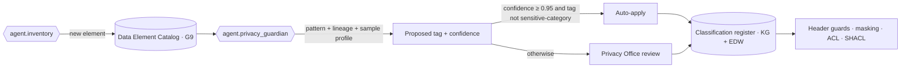

# HIPAA, PHI Classification and Privacy

This document is the **PHI classification & policy contract** named in ARC-01 §6. It defines the classification
taxonomy carried in the Kafka header `hc-phi-class`, the column and property tags used in the EDW and knowledge
graph, the purpose-of-use model, de-identification and pseudonymisation standards, consent gating, vendor
obligations, breach handling and jurisdictional overlays. Every producer, sink and agent in HEALIX is bound by it.

## 1. Regulatory alignment

| Rule | HEALIX obligation | Where enforced |
|------|-------------------|----------------|
| HIPAA Privacy Rule — uses and disclosures (§164.502) | Each flow declares a purpose of use; disclosures outside treatment, payment and operations (TPO) require authorisation or an exception | Purpose-of-use header, consent gates (§5), access policy (GOV-02) |
| Privacy Rule — minimum necessary (§164.502(b)) | Consumers receive only the PHI classes their role and purpose require; agents receive tokenised data unless a task is `phi-affecting` and approved | Masking views, agent tool policies (§4, §6) |
| Privacy Rule — de-identification (§164.514) | Safe Harbor and Expert Determination both supported as governed transforms | §6 |
| Security Rule — technical safeguards (§164.312) | Unique user/agent identity, encryption, audit controls, integrity, transmission security | GOV-02, GOV-03, ARC-NFR-003 |
| Security Rule — risk analysis (§164.308(a)(1)) | Annual platform risk analysis plus a per-release PHI impact assessment generated by `agent.privacy_guardian` | §10, module 10 CR |
| Breach Notification Rule (§164.400–414) | Detection, four-factor risk assessment, notification within 60 days (or shorter under state law) | §8 |
| 42 CFR Part 2 | SUD records from Part 2 programs segmented, consent-bound, re-disclosure notice attached | §3 `phi:sensitive-category/sud`, §5 |
| HITECH accounting of disclosures | Every disclosure outside TPO is reconstructible from `hc.ops.audit.v1` | GOV-03 |
| Information Blocking (45 CFR 171) | Governance controls MUST NOT prevent exchange the law permits; denials log an exception code | GOV-02 |

## 2. The 18 HIPAA identifiers and their HEALIX mapping

Each identifier is mapped to the FHIR R4 elements and EDW column patterns where it typically appears so that
`agent.privacy_guardian` can seed classification automatically from the data-element catalog (module 03).

| # | Identifier (§164.514(b)(2)) | Typical FHIR path(s) | Typical EDW column pattern | Default tag |
|---|-----------------------------|----------------------|----------------------------|-------------|
| 1 | Names | `Patient.name`, `RelatedPerson.name`, `Practitioner.name` (when patient-linked) | `*_name*`, `given_name`, `family_name` | `phi:direct` |
| 2 | Geographic subdivisions smaller than a state | `Patient.address.line/city/postalCode` | `address_*`, `postal_code`, `city` | `phi:direct` (ZIP first 3 digits may be `phi:quasi` under Safe Harbor rule) |
| 3 | Dates directly related to an individual (except year) | `Patient.birthDate`, `Encounter.period`, `deceasedDateTime` | `birth_date`, `admit_dt`, `discharge_dt`, `death_dt` | `phi:quasi` |
| 4 | Telephone numbers | `Patient.telecom[system=phone]` | `phone_*` | `phi:direct` |
| 5 | Fax numbers | `telecom[system=fax]` | `fax_*` | `phi:direct` |
| 6 | Email addresses | `telecom[system=email]` | `email*` | `phi:direct` |
| 7 | Social Security numbers | `Patient.identifier[system=SSN]` | `ssn`, `national_id` | `phi:direct` |
| 8 | Medical record numbers | `Patient.identifier[type=MR]` | `mrn`, `patient_bk` | `phi:direct` |
| 9 | Health plan beneficiary numbers | `Coverage.subscriberId`, `Coverage.identifier` | `member_id`, `subscriber_id` | `phi:direct` |
| 10 | Account numbers | `Account.identifier`, `Encounter.identifier[type=AN]` | `account_number`, `fin_nbr` | `phi:direct` |
| 11 | Certificate/licence numbers | `Patient.identifier[type=DL]` | `drivers_license` | `phi:direct` |
| 12 | Vehicle identifiers and serial numbers | extensions | `vin`, `license_plate` | `phi:direct` |
| 13 | Device identifiers and serial numbers | `Device.udiCarrier`, `Device.serialNumber` when patient-attached | `device_serial`, `udi` | `phi:direct` |
| 14 | Web URLs | `telecom[system=url]` | `url` | `phi:direct` |
| 15 | IP addresses | `AuditEvent.agent.network.address`, portal logs | `ip_address` | `phi:direct` |
| 16 | Biometric identifiers | `Observation` (biometric templates), `Patient.photo` | `biometric_*` | `phi:direct` |
| 17 | Full-face photographs and comparable images | `Patient.photo`, `Media`, `ImagingStudy` metadata referencing face | `photo_*` | `phi:direct` |
| 18 | Any other unique identifying number, characteristic or code | `Patient.identifier[other]`, `ResearchSubject.identifier` | `*_id` not otherwise classified | `phi:direct` unless certified as a non-derivable token |

Ages over 89 and all elements of dates except year are treated as identifier 3 and collapsed in Safe Harbor output.

## 3. PHI classification taxonomy

The taxonomy is a SKOS concept scheme `<base>scheme/data-classification` (G8/G9) and is the sole legal value set
for (a) the Kafka header `hc-phi-class`, (b) EDW column tags, (c) KG property annotations and (d) the agent tool
policy engine. Values are hierarchical; a record or column inherits the **most restrictive** tag of its elements.

| Tag (`hc-phi-class` value) | Definition | Examples | Default handling |
|----------------------------|------------|----------|------------------|
| `phi:direct` | Directly identifies an individual (HIPAA identifiers 1–2, 4–18) | MRN, name, SSN, member ID | Encrypted at rest with PHI key class; masked or tokenised outside `prod` and for agents; access requires purpose of use in TPO or authorised set |
| `phi:quasi` | Does not identify alone but does in combination (identifier 3, ZIP3, sex, race, rare diagnosis) | Birth date, admit date, 3-digit ZIP | Generalised in de-identified outputs; k-anonymity check before release |
| `phi:clinical` | Health information about an identified or identifiable individual that is not itself an identifier | Diagnosis codes, lab values, medications | Treated as PHI; may be released with `phi:direct` removed only under §6 |
| `phi:sensitive-category` | Specially protected categories requiring segmentation and consent | Sub-tags below | Segmented named graphs and row-level policies; consent gate mandatory; re-disclosure notice |
| `phi:sensitive-category/sud` | 42 CFR Part 2 substance use disorder records from Part 2 programs | SUD treatment encounters, MAT medications | Part 2 consent required; `hc-part2-flag=true`; excluded from HIE push without consent |
| `phi:sensitive-category/hiv` | HIV/AIDS status and treatment | HIV tests, ART regimens | State-law consent; masked in default clinical views |
| `phi:sensitive-category/mental-health` | Psychotherapy notes and behavioural health records | Psych notes (never shared without authorisation), BH encounters | Psychotherapy notes excluded from canonical flows entirely |
| `phi:sensitive-category/reproductive` | Reproductive and sexual health, including abortion, contraception, fertility (HIPAA 2024 reproductive health rule, state laws) | OB encounters, pregnancy tests | Attestation required for non-TPO disclosure; geofenced consumer restrictions |
| `phi:sensitive-category/genetic` | Genetic test results (GINA, state law) | Variant references, hereditary panels | Research use only with consent |
| `pii:workforce` | Personal data about employees, contractors, applicants (not PHI unless in a patient role) | Worker SSN, salary, home address, performance data | HR access policy; GDPR overlay for EU/UK staff (§9) |
| `confidential:financial` | Commercially sensitive, non-personal financial and contract data | GL detail, supplier pricing, payer contract rates | Finance role access; not PHI |
| `confidential:operational` | Internal operational data with no personal content | Bed capacity, inventory levels | Internal access |
| `internal` | Non-sensitive internal metadata | Topic names, rule definitions | Any authenticated principal |
| `public` | Approved for external publication | Published value sets, organisation directory | No restriction |
| `deidentified:safe-harbor` | Output of a certified Safe Harbor transform (§6.1) | Research extracts | Not PHI; re-identification prohibited by policy and DSA |
| `deidentified:expert` | Output of an Expert Determination transform with documented risk ≤ threshold | Limited data sets with dates | Governed by DSA; re-identification prohibited |
| `pseudonymised` | PHI replaced by reversible tokens held by the token vault | Non-prod data, agent working sets | Still PHI under HIPAA; vault access restricted |

### 3.1 Header and tag encoding

- Kafka header `hc-phi-class`: UTF-8 string, single most-restrictive tag for the record; additional tags in
  `hc-phi-tags` as a comma-separated list. Producers MUST set both; brokers reject (via Connect SMT / Flink guard)
  records in `canonical`, `kg`, `edw` layers lacking a valid value.
- Additional headers: `hc-part2-flag` (`true|false`), `hc-purpose-of-use` (§4), `hc-consent-ref` (FHIR `Consent.id`
  when a consent decision was applied), `hc-deid-method` (`safe-harbor|expert|none`).
- EDW: tags stored in `edw_g9_governance.ref_data_element_classification(column_fqn, tag, valid_from, valid_to,
  prov_activity_iri)` and surfaced as column comments `-- phi:direct`.
- KG: `healix:dataClassification` annotation property on each OWL data property and on named graphs; SHACL shape
  `healix:ClassifiedPropertyShape` fails any property without a tag.
- FHIR resources: `meta.security` carries the matching HL7 v3 `Confidentiality` (`N`, `R`, `V`) and `ActCode`
  sensitivity codes (`ETH`, `HIV`, `PSY`, `SEX`, `GDIS`) so downstream FHIR consumers honour the same labels.

### 3.2 Classification process



Unclassified elements default to `phi:direct` (fail-closed). Reclassification is a `phi-affecting` CR (GOV-00 §2.2).

## 4. Minimum necessary and purpose of use

Every access and every flow declares a purpose using FHIR R4 `v3-PurposeOfUse` codes. The header
`hc-purpose-of-use` and the ABAC attribute `purpose` (GOV-02) share this value set.

| Code | Meaning | Permitted PHI classes without additional authorisation | Typical consumers |
|------|---------|--------------------------------------------------------|-------------------|
| `TREAT` | Treatment | all `phi:*` except `sensitive-category/*` segmented by consent | Clinical consumers of `hc.canonical.clinical.*` |
| `HPAYMT` | Payment | `phi:direct` identifiers needed for billing, `phi:clinical` codes on claims | RCM, G3 EDW |
| `HOPERAT` | Healthcare operations | `phi:quasi`, `phi:clinical`; `phi:direct` only where necessary (quality review) | G6 pophealth, DQ pipelines |
| `HRESCH` | Research | `deidentified:*` or `pseudonymised`; identifiable only with IRB approval + consent | G7 research |
| `PUBHLTH` | Public health reporting | As required by the mandate | Immunisation registries, syndromic surveillance |
| `HMARKT` | Marketing | None without authorisation | Prohibited by default |
| `PATRQT` | Patient request / access | Own record | Portal |
| `SYSADMIN` | Platform administration | Metadata only; PHI payload never readable | SRE, module 12 |
| `HEALIX-AGENT-CURATE` (local extension) | Autonomous curation by agents | `pseudonymised` data; metadata; aggregates; PHI only via approved tool with `phi-affecting` CR | Module 10 agents |

Minimum necessary is implemented as **default-deny projection**: consumers receive a view containing only columns
and properties whose tags are permitted for their `(role, purpose)` pair. Wide access requires a documented
exception with expiry.

## 5. Consent and directives as flow gates

Consent is a first-class G9 entity modelled as FHIR R4 `Consent` (scope `patient-privacy`, category per LOINC
`59284-0` and Part 2 specific codes) and persisted bitemporally in the KG and EDW (`fact_consent_directive`).

| Consent / directive type | Source | Gates |
|--------------------------|--------|-------|
| HIE opt-out / opt-in | Cerner consent module, HIE registry | Suppresses publication of the patient's resources to partner-facing `hc.canonical.*` mirrors and outbound FHIR Bulk Data |
| 42 CFR Part 2 consent | Part 2 program consent forms | Required for any flow of `phi:sensitive-category/sud` beyond the originating program; routes to `hc.canonical.clinical.*.part2.v1` segmented topics |
| Research consent | Research systems (G7) | Required for identifiable `HRESCH`; de-identified extracts allowed without |
| Restriction requests (§164.522) | HIM | Row-level deny on specific encounters |
| Confidential communications | Patient portal | Masks contact channels in outbound messaging |
| Advance directives (not privacy) | Clinical | Not a gate; carried as clinical content |

Gate evaluation happens in the Flink canonicalisation job and again at the consumer boundary (defence in depth). A
flow blocked by consent emits an `AuditEvent` with `outcome=4` and `purposeOfEvent` and increments the
`consent_block_total` metric (module 12). Consent revocation propagates within 15 minutes to every live projection.

## 6. De-identification, tokenisation and pseudonymisation

### 6.1 Safe Harbor (§164.514(b)(2))

The `deid.safe_harbor` transform removes identifiers 1–18, generalises dates to year, truncates ZIP to 3 digits
(or `000` for populations < 20,000), caps ages at 90 and strips free text through a clinical NER redactor with
a measured recall ≥ 0.99 on the annotated test corpus. Output is tagged `deidentified:safe-harbor`.

### 6.2 Expert Determination (§164.514(b)(1))

Used for limited data sets that keep dates or ZIP5. A statistician documents the re-identification risk model
(k-anonymity ≥ 11, l-diversity on sensitive categories, population-uniqueness estimates). The determination,
its expiry (≤ 24 months) and the dataset fingerprint are stored in G9 and referenced in the `hc-deid-method`
header. Each release re-runs the risk metrics; a breach of threshold blocks publication.

### 6.3 Tokenisation and pseudonymisation

| Target | Method | Reversible? | Key custody |
|--------|--------|-------------|-------------|
| Non-production environments (`dev`, `test`, `uat`) | Format-preserving encryption (FF1) for identifiers; consistent surrogate names and addresses from a synthetic generator; date shifting ±0–365 days consistent per patient | FF1 yes (vault only); synthetic no | KMS key class `tok-nonprod`, no access from non-prod runtimes |
| Agent working sets (`HEALIX-AGENT-CURATE`) | Keyed HMAC-SHA-256 tokens per identifier type; free text redacted; aggregates with count suppression < 11 | No (one-way) for agents; vault can re-link for approved remediation | Token vault service; agents hold no keys |
| Cross-system linkage (EMPI, GOV-04) | Deterministic tokens from Bloom-filter privacy-preserving record linkage | No | EMPI service |
| Research pseudonymisation | Project-specific tokens so two studies cannot be joined | Re-linkable only by honest broker | Honest-broker vault |

A token MUST be stable within an environment and unstable across environments and across research projects.
Referential integrity is preserved: the same MRN maps to the same token in every topic, graph and table of an
environment.

## 7. Business associates and vendors

| Vendor category | Examples | BAA required | Additional controls |
|-----------------|----------|--------------|---------------------|
| EHR / ERP SaaS | Oracle Health (Cerner), Oracle Fusion Cloud | Yes | Data residency clause; CDC replica in customer tenancy |
| Cloud infrastructure | AWS / Azure / OCI | Yes (standard BAA) | Only HIPAA-eligible services; CMK encryption |
| LLM inference provider for agents | Anthropic or equivalent | Yes, or zero-data-retention agreement plus pseudonymised-only inputs | Prompt/response logging disabled on provider side; HEALIX logs locally (GOV-03) |
| Terminology and ontology tooling | Ontoserver, graph store vendor | Yes if hosted; No if self-hosted and vendor has no access | — |
| Clearinghouse, HIE | — | Yes (or participation agreement) | Part 2 re-disclosure notice |
| Analytics consultants | — | Yes | Named-user access, 90-day expiry |

The BAA register is a G9 entity (`ref_business_associate`) with expiry alerts at 90 and 30 days.

## 8. Breach and incident handling

```mermaid
sequenceDiagram
  participant Det as Detection (SIEM · agent.privacy_guardian · DQ)
  participant PO as Privacy Office
  participant IR as Incident Response
  participant DGC as Data Governance Council
  Det->>PO: Suspected impermissible use/disclosure (T0)
  PO->>IR: Contain (revoke creds, pause topic consumer, snapshot audit) ≤ 1 h
  IR->>PO: Scope via lineage + audit query ≤ 24 h
  PO->>PO: Four-factor risk assessment ≤ 5 business days
  PO->>DGC: Determination: breach / low probability of compromise
  DGC->>PO: Notification decision
  PO-->>Det: Individuals ≤ 60 days (or state deadline); HHS; media if ≥ 500
```

The platform MUST be able to answer, from `hc.ops.audit.v1` and the lineage graph alone, which individuals'
records were exposed, which PHI classes, by whom and when (GOV-03). Playbooks are maintained in the incident
runbook (module 12).

## 9. Jurisdictional overlays

| Overlay | Trigger | Effect |
|---------|---------|--------|
| State mental-health, HIV, genetic-testing statutes (e.g. CA CMIA, NY PHL Art. 27-F, IL GIPA) | Patient or facility in the state | Stricter consent for `sensitive-category/*`; facility attribute drives rule selection |
| State reproductive-health shield laws (CA, WA, IL, NY and others) | Reproductive-health data | Block disclosure to out-of-state law-enforcement purposes; attestation required |
| State breach laws (shorter deadlines, AG notification) | Breach involving residents | Notification timer uses the shortest applicable deadline |
| Texas HB 300 / TMRPA | Texas facilities | Training evidence retained; EHR access logs 6 years |
| GDPR / UK GDPR | `pii:workforce` records of EU/UK employees in Oracle HCM | Lawful basis recorded on the data contract; data-subject access, rectification and erasure workflows; EU data stays in EU region or under SCCs; DPIA on file; 72-hour supervisory notification |
| CCPA/CPRA | Workforce and non-patient consumer data (PHI exempt) | Notice at collection; retention limits |

Rules are parameterised by the ABAC attribute `facility` and the patient's state of residence (GOV-02).

## 10. Requirements

> **GOV-PHI-001** (P0, test) — Every record on `hc.canonical.*`, `hc.dq.*`, `hc.kg.*` and `hc.edw.*` topics MUST carry
> a valid `hc-phi-class` header drawn from §3; records lacking it MUST be rejected to a quarantine topic.

> **GOV-PHI-002** (P0, test) — Every EDW column and every KG data property MUST carry exactly one classification tag;
> deployment of an untagged column or property MUST fail CI (module 12).

> **GOV-PHI-003** (P0, inspection) — Unclassified data elements MUST default to `phi:direct` until reviewed.

> **GOV-PHI-004** (P0, test) — The 18 identifier patterns in §2 MUST be detected automatically with recall ≥ 0.98 on the
> annotated classification test set; precision ≥ 0.90.

> **GOV-PHI-005** (P0, test) — `phi:sensitive-category/*` records MUST be routed to segmented topics, named graphs and
> row-level-secured tables, never co-mingled with default clinical partitions.

> **GOV-PHI-006** (P0, test) — Psychotherapy notes MUST be excluded from all canonical, KG and EDW flows.

> **GOV-PHI-007** (P0, test) — Every consumer group, SPARQL role and EDW role MUST declare a purpose of use from §4;
> access without a declared purpose MUST be denied.

> **GOV-PHI-008** (P0, test) — Consumers MUST receive only columns/properties whose tags are permitted for their
> `(role, purpose)` pair (default-deny projection).

> **GOV-PHI-009** (P0, test) — A revoked or restricted consent MUST be enforced on all live projections within 15 minutes.

> **GOV-PHI-010** (P0, test) — 42 CFR Part 2 records MUST NOT leave the originating segment without a matching active
> `Consent` and MUST carry the re-disclosure prohibition notice in `meta.security`.

> **GOV-PHI-011** (P0, test) — Non-production environments MUST contain no `phi:direct` values; a scanner MUST run
> daily and fail the environment on any finding.

> **GOV-PHI-012** (P0, test) — Agents operating under `HEALIX-AGENT-CURATE` MUST receive only pseudonymised or
> aggregated data; any tool returning `phi:direct` MUST require an approved `phi-affecting` CR and emit an audit event.

> **GOV-PHI-013** (P0, test) — Tokens MUST be stable within an environment, unstable across environments and across
> research projects, and MUST preserve referential integrity across topics, graph and EDW.

> **GOV-PHI-014** (P1, test) — The Safe Harbor transform MUST remove all 18 identifier classes and achieve free-text
> redaction recall ≥ 0.99 on the test corpus.

> **GOV-PHI-015** (P1, inspection) — Each Expert Determination MUST be documented with model, thresholds, expiry ≤ 24
> months and dataset fingerprint, and re-evaluated at every release.

> **GOV-PHI-016** (P0, inspection) — No PHI MUST be transmitted to a vendor without an executed BAA or an equivalent
> agreement registered in `ref_business_associate`.

> **GOV-PHI-017** (P0, inspection) — LLM inference for agents MUST operate under zero-retention terms and MUST receive
> pseudonymised inputs only, unless GOV-PHI-012 conditions are met.

> **GOV-PHI-018** (P0, demo) — The platform MUST reconstruct the affected individuals, PHI classes, actors and time
> window of a suspected breach from audit and lineage data within 24 hours.

> **GOV-PHI-019** (P1, test) — State overlay rules MUST be selected by facility and patient residence attributes and
> MUST be unit-tested per jurisdiction.

> **GOV-PHI-020** (P1, test) — EU/UK workforce records MUST remain in-region (or under SCCs) and MUST support
> access, rectification and erasure requests with completion ≤ 30 days.

> **GOV-PHI-021** (P0, inspection) — `agent.privacy_guardian` MUST review every change request for PHI impact and MUST
> be able to veto any CR; vetoes MUST be logged and reviewable by the Privacy Office.

> **GOV-PHI-022** (P1, test) — FHIR `meta.security` labels MUST be derived from the classification tags for every
> canonical resource.

> **GOV-PHI-023** (P1, analysis) — An annual risk analysis and a per-release PHI impact assessment MUST be produced
> and retained for 6 years.

> **GOV-PHI-024** (P2, test) — Reproductive-health records MUST require an attestation of permitted purpose before
> any non-TPO disclosure.

## 11. Traceability

| Requirement | Verified by | Related |
|-------------|-------------|---------|
| GOV-PHI-001, 005, 010 | Header guard integration tests (module 07) | ARC-NFR-003, STR-* |
| GOV-PHI-002 | CI tag linter (OPS-02) | EDW-*, TKG-* |
| GOV-PHI-007, 008 | ABAC policy tests (GOV-02) | GOV-ACC-* |
| GOV-PHI-011, 013 | Non-prod PHI scanner (OPS-02) | OPS-ENV-* |
| GOV-PHI-012, 017, 021 | Agent eval suite (module 10) | AGT-* |
| GOV-PHI-018 | Breach drill (OPS-04) | GOV-LIN-* |
