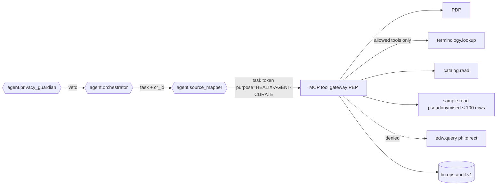

# Access Control, Identity and Platform Security

This document specifies how HEALIX authenticates humans, services and agents, how authorisation decisions are made
(RBAC combined with ABAC), and how those decisions are enforced in each store: Kafka topics, the temporal knowledge
graph, the EDW and the agent runtime. It also covers break-glass access, key management, secrets and network
segmentation. The PHI classes and purpose-of-use codes it relies on are defined in GOV-01.

## 1. Principles

1. **One identity model for people and agents.** Every principal — clinician, steward, SRE, Kafka Connect worker or
   `agent.source_mapper` — is an OIDC subject with a unique, non-shared identity (HIPAA §164.312(a)(2)(i)).
2. **Policy as code, decided centrally, enforced locally.** Policies are authored once (OPA/Rego bundle generated from
   the access matrix) and compiled into Kafka ACLs, SPARQL graph permissions, EDW row/column policies and agent tool
   policies.
3. **Default deny; least privilege; time-boxed exceptions.** Every grant has an owner, a justification and an expiry.
4. **PHI class is an input to every decision.** No decision is made without the `hc-phi-class` of the object.
5. **Every decision is auditable** (GOV-03) and every denial carries a reason code.

## 2. Identity

| Principal type | Identity provider | Protocol | Credential | Lifetime |
|----------------|-------------------|----------|------------|----------|
| Workforce users (stewards, analysts, SREs, clinicians) | Enterprise IdP (Entra ID / Okta / Oracle IAM) federated to Cerner and Oracle Fusion directories | OIDC (Authorization Code + PKCE) for apps; SAML 2.0 for legacy tools | MFA mandatory (phishing-resistant FIDO2 for privileged roles) | Access token 15 min; refresh 8 h; re-auth for break-glass |
| Platform services (Connect, Flink, sinks, Terminology Server) | Workload identity (SPIFFE/SPIRE or cloud workload identity federation) | mTLS + OIDC client credentials | X.509 SVID, rotated ≤ 24 h | Per-pod |
| Agents (`agent.*`) | Workload identity, one service account **per agent id and environment** | mTLS + OIDC; token exchange (RFC 8693) to obtain a task-scoped token carrying `purpose` and `cr_id` | Short-lived task token ≤ 1 h | Per task |
| Partners (HIE, payer, clearinghouse) | SMART Backend Services (RFC 7523 JWT bearer) | OAuth 2.0 client credentials with asymmetric keys | Registered JWKS | Token ≤ 5 min |
| Patients (portal, right of access) | Patient IdP (Cerner/Oracle Health identity) | SMART on FHIR | — | Standard SMART |

Group membership and attributes (role, facility, department, licence) are provisioned from Oracle HCM (workforce)
and the credentialing system (clinical privileges) into the IdP via SCIM; HEALIX never maintains a shadow directory.
Joiner/mover/leaver events arrive on `hc.canonical.workforce.assignment.fhir-ext.v1` (HCM assignments) and
`hc.canonical.party.practitionerrole.fhir.v1` (clinical privileges) and MUST deprovision within
24 hours of termination (immediate for involuntary).

## 3. Authorisation model: RBAC + ABAC

RBAC grants a principal a **role**; ABAC refines what that role may do using attributes of the subject, the object
and the environment. A request is permitted only if both a role permission and all attribute conditions hold.

```mermaid
flowchart LR
  SUBJ[Subject attributes<br/>role · purpose · facility · department · training_current · agent_id · cr_id]
  OBJ[Object attributes<br/>phi_class · group G1–G9 · domain · facility_of_record · part2_flag · consent_state · environment]
  ENV[Environment attributes<br/>time · network zone · device posture · break_glass_active]
  PDP[Policy Decision Point<br/>OPA · Rego bundle v{N}]
  SUBJ & OBJ & ENV --> PDP
  PDP -->|permit / deny + reason + obligations| PEP1[Kafka ACL + header guard]
  PDP --> PEP2[Graph store named-graph permissions]
  PDP --> PEP3[EDW RLS / column masking policies]
  PDP --> PEP4[Agent tool gateway MCP]
  PDP --> PEP5[FHIR facade / APIs]
  PDP -.-> AUD[(hc.ops.audit.v1)]
```

### 3.1 Roles

| Role id | Description | Typical members | Default purpose |
|---------|-------------|-----------------|-----------------|
| `role.clinical_consumer` | Reads canonical clinical resources for care delivery integrations | CDS services, care-team apps | `TREAT` |
| `role.rcm_analyst` | Revenue cycle and claims analytics | Billing analysts | `HPAYMT` |
| `role.quality_analyst` | Quality measures, pophealth, operations analytics | Quality department | `HOPERAT` |
| `role.researcher` | De-identified / pseudonymised research access | Investigators | `HRESCH` |
| `role.steward_gN` | Approves mappings, DQ, golden records for group N | Group stewards | `HOPERAT` |
| `role.ontologist` | Edits SKOS/OWL/SHACL; no instance PHI | Ontology Board | `HOPERAT` |
| `role.integration_engineer` | Configures connectors and topics; sees `std` payloads only in non-prod | Integration team | `SYSADMIN` |
| `role.platform_sre` | Operates infrastructure; metadata only | Platform team | `SYSADMIN` |
| `role.privacy_officer` | Reads audit, consents, classifications; approves `phi-affecting` CRs | Privacy Office | `HOPERAT` |
| `role.hr_analyst` | Workforce data (`pii:workforce`) | HR analytics | `HOPERAT` |
| `role.finance_analyst` | `confidential:financial`, G3/G4 | Finance | `HOPERAT` |
| `role.agent_<name>` | One role per agent id with its tool allowlist | Agent service accounts | `HEALIX-AGENT-CURATE` |
| `role.break_glass` | Temporary elevated clinical access | Granted ad hoc | `TREAT` (emergency) |

### 3.2 Access matrix (excerpt; the full matrix is the Rego bundle source)

| Role | `phi:direct` | `phi:quasi` | `phi:clinical` | `phi:sensitive-category/*` | `pii:workforce` | `confidential:financial` | `pseudonymised` | `internal` |
|------|--------------|-------------|----------------|----------------------------|-----------------|--------------------------|-----------------|-----------|
| `clinical_consumer` | R (facility match) | R | R | R if consent permits | — | — | R | R |
| `rcm_analyst` | R (billing identifiers only) | R | R (codes) | masked | — | R (own cost centres) | R | R |
| `quality_analyst` | masked | R (generalised) | R | masked | — | — | R | R |
| `researcher` | — | — (unless Expert Determination) | via `deidentified:*` | — | — | — | R (project tokens) | R |
| `steward_gN` | R (sample ≤ 50 rows, logged) within group | R | R | masked unless G2 steward with consent | G5 steward only | G3/G4 stewards only | R | R |
| `ontologist` | — | — | — | — | — | — | — | R |
| `integration_engineer` | — in prod | — in prod | — in prod | — | — | — | R | R |
| `platform_sre` | — | — | — | — | — | — | — | R |
| `privacy_officer` | R (audit scope) | R | R | R | R | — | R | R |
| `hr_analyst` | — | — | — | — | R | — | — | R |
| `finance_analyst` | — | — | — | — | — | R | — | R |
| `agent_*` | — (tool-gated, CR required) | aggregated | aggregated | — | — | aggregated | R | R |

Obligations returned with a permit (e.g. `mask:ssn`, `generalise:dates`, `log:elevated`) are applied by the PEP.

## 4. Enforcement per store

### 4.1 Kafka

| Layer | Producer principals | Consumer principals | ACL pattern | Notes |
|-------|---------------------|---------------------|-------------|-------|
| `hc.raw.*` | Connect workers for the named source only | Standardisation Flink jobs; replay tooling (approved) | `WRITE` on literal topic; `READ` on prefix `hc.raw.<source>.` | Raw payload is PHI; no human consumers in prod |
| `hc.std.*` | Standardisation jobs | Canonicalisation jobs; DQ engine | Prefixed ACLs per source | — |
| `hc.canonical.<domain>.*` | Canonicalisation jobs | Role-mapped consumer groups; KG and EDW sinks | `READ` granted per **domain** (`party`, `clinical`, `finance`, …) mapped to G1–G9 | Sensitive-category segments are separate topics with separate ACLs |
| `hc.dq.*` | DQ engine | Stewards' tooling; sinks; `agent.dq_monitor` | Per domain | Results reference record keys, not payloads |
| `hc.kg.*`, `hc.edw.*` | Sinks | Reconciliation jobs | Per domain | — |
| `hc.ops.audit.v1`, `hc.ops.lineage.openlineage.v1` | Every component (write-only) | SIEM, lineage service, `agent.privacy_guardian` | `WRITE` broad, `READ` restricted to `role.privacy_officer`, lineage service | Append-only; no `DELETE` ACL for anyone except retention job |

Brokers use SASL/OAUTHBEARER (OIDC) or mTLS; the authorizer is a custom `Authorizer` that calls the PDP for
consumer-group creation and for topic reads whose header policy requires a purpose-of-use check. Standard ACLs
remain as the fast path. Topic creation is GitOps-only (`topics.yaml`, module 07); `ALTER`/`CREATE` ACLs are
withheld from every runtime principal.

### 4.2 Knowledge graph (named-graph access)

Named graphs follow `<base>graph/<source>/<yyyy-mm-dd>/<batch-ulid>` and additionally are partitioned into
**access partitions** via the graph-level annotation `healix:accessPartition`:

| Partition | Content | Readers |
|-----------|---------|---------|
| `ontology` | SKOS/OWL/SHACL, no instances | Everyone authenticated |
| `instances/<G>/default` | Instance data for group G without sensitive categories | Roles permitted for G and PHI class, with property-level masking applied by a query-rewriting proxy |
| `instances/G2/sensitive/<category>` | Sensitive-category clinical instances | Only with consent-compatible purpose |
| `prov` | PROV-O activities, entities, agents | Privacy officer, lineage service, stewards (metadata only) |
| `governance` | Classification register, policies, consents | Privacy officer, stewards (read) |

The SPARQL endpoint sits behind a proxy that (a) authenticates via OIDC, (b) obtains the permitted graph list and
masking obligations from the PDP, (c) rewrites queries with `FROM`/`FROM NAMED` restrictions and property masking
functions, and (d) denies `SPARQL UPDATE` to all but the KG sink and `agent.kg_builder` under an approved CR.
Federated queries to external endpoints are disabled in prod.

### 4.3 EDW (row/column security and dynamic masking)

| Control | Implementation | Example |
|---------|----------------|---------|
| Row-level security | Policy functions on `facility_sk`, `group`, `part2_flag`, `consent_state`, applied to every `fact_*` and `dim_*` | `rcm_analyst` sees only facilities in its billing scope; `part2_flag = 1` rows hidden unless purpose permits |
| Column-level security | Grants generated from column tags; `phi:direct` columns revoked from roles lacking permission | `quality_analyst` cannot `SELECT dim_patient.ssn` |
| Dynamic data masking | Masking policies bound to tags: `phi:direct` → tokenised or `NULL`; `phi:quasi` dates → month/year; ZIP → ZIP3 | `SELECT birth_date` returns `1974-01-01` for generalised roles |
| Secure views per persona | `edw_gN_<subject>_v_<role>` views generated by `agent.schema_architect`; direct table grants only to sinks | — |
| Query auditing | Native audit log forwarded to `hc.ops.audit.v1` with user, purpose, SQL hash, rows returned | — |

Masking policies are generated from the classification register so a reclassification (GOV-01 §3.2) changes
masking automatically on the next migration; drift between tags and masking is a CI failure (OPS-02).

### 4.4 Agents, service identities and least privilege



- Each agent manifest (module 10) declares a **tool allowlist** with per-tool scopes; the gateway rejects any call
  outside it. The allowlist is the only mechanism by which an agent gains data access.
- Agents never hold long-lived credentials; the orchestrator exchanges its identity for a task token containing
  `agent_id`, `cr_id`, `purpose`, `environment` and `max_phi_class`.
- Tools returning samples enforce `max_phi_class` (default `pseudonymised`) and row limits (≤ 100 rows; aggregates
  with small-cell suppression < 11).
- Writes by agents go through the CR workflow; no agent has direct `WRITE` ACLs on `canonical`/`kg`/`edw` topics
  or direct DDL privileges, except `agent.kg_builder` and `agent.release_manager` for approved, signed CRs.
- `agent.privacy_guardian` has `READ` on audit and governance partitions and a `veto` scope on the orchestrator API;
  it has no write access to data.
- Prompt and tool-call transcripts are stored as audit evidence (GOV-03) in a store that itself applies masking.

## 5. Break-glass

| Aspect | Rule |
|--------|------|
| Scope | Clinical emergency access to `phi:*` including sensitive categories where consent would otherwise block |
| Activation | Self-service by licensed clinicians with attestation of reason code (`EMERGENCY`, `PATIENT_SAFETY`); MFA re-prompt |
| Duration | 4 hours, renewable once |
| Enforcement | PDP sets `break_glass_active=true`; all queries tagged; sensitive-category masking lifted for that patient only |
| Review | Every activation reviewed by the Privacy Office within 2 business days; patient notified where state law requires |
| Agents | Agents MUST NOT invoke break-glass |
| Platform admin break-glass | Separate: emergency root/KMS access via sealed credentials in a vault requiring two approvers; auto-expires 2 hours; full session recording |

## 6. Key management and encryption

| Data class / store | Key class | Mechanism | Rotation |
|--------------------|-----------|-----------|----------|
| Kafka at rest (PHI topics) | `kafka-phi` | Broker volume encryption (AES-256) **plus** envelope encryption of `phi:direct` fields in `raw`/`std` using a Connect SMT with per-source DEKs | KEK yearly; DEK 90 days |
| Kafka at rest (`internal`, `public`, `confidential:*` topics) | `kafka-std` | Volume encryption | Yearly |
| Graph store | `kg-phi` | Storage encryption; separate KEK per environment | Yearly |
| EDW | `edw-phi` | Transparent data encryption with CMK; column-level encryption for `phi:direct` identifiers (`ssn`, `mrn`) | Yearly; column keys 1 year |
| Token vault | `tok-prod`, `tok-nonprod` | HSM-backed; FF1 and HMAC keys; split-knowledge for export | 1 year; non-prod keys never reusable in prod |
| Backups (module 12) | `backup` | Encrypted with distinct KEK; restore requires two roles | Yearly |
| Transport | — | TLS 1.2+ (TLS 1.3 preferred) everywhere; mTLS between all platform services; MLLP wrapped in TLS or IPsec VPN | Cert ≤ 90 days |
| Signing | `release-sign` | Sigstore/cosign for ontology, DDL, topic and agent manifest releases (ARC-NFR-006) | Keyless or 1 year |

Keys live in a cloud KMS or on-prem HSM; HEALIX services receive only key *references*. No key material is present
in Git, container images or agent context.

## 7. Secrets

- All secrets (DB credentials for Debezium, BICC API keys, Terminology Server tokens, LLM API keys) are stored in a
  secrets manager (HashiCorp Vault or cloud equivalent) and injected at runtime via CSI driver or sidecar; never in
  environment variables committed to Git, Helm values or agent manifests.
- Dynamic database credentials with TTL ≤ 24 h for Debezium and EDW sinks where the database supports it.
- Secret scanning in CI (OPS-02) blocks commits containing credential patterns.
- Rotation is automated; a secret older than its TTL raises a `P2` alert, older than 2× TTL a `P1`.

## 8. Network segmentation

| Zone | Contents | Ingress | Egress |
|------|----------|---------|--------|
| **Source-connect zone** | MLLP listeners, Debezium, BICC poller, FHIR subscription bridge | From Cerner Millennium on-prem via IPsec VPN / private link; from Oracle Cloud via private endpoint | To platform zone Kafka only (mTLS) |
| **Platform zone** | Kafka, Schema Registry, Flink, Terminology Server, Ontology Registry, graph store, EDW, agent runtime | From source-connect and consumer zones via gateway | To LLM provider via egress proxy with allowlist and DLP inspection; to KMS |
| **Consumer zone** | BI tools, FHIR facade, SPARQL proxy, steward UIs | From corporate network via IdP-authenticated gateway | To platform zone APIs |
| **Management zone** | CI/CD runners, GitOps controllers, observability | From admin VPN | To all zones over mTLS |

Kubernetes `NetworkPolicy` default-denies pod-to-pod traffic; each component declares its allowed peers. Topology
detail is in OPS-01.

## 9. Requirements

> **GOV-ACC-001** (P0, test) — Every human, service and agent principal MUST authenticate with a unique OIDC or
> mTLS identity; shared accounts MUST NOT exist.

> **GOV-ACC-002** (P0, test) — Workforce access to any `phi:*` or `pii:workforce` data MUST require MFA; privileged
> roles MUST use phishing-resistant MFA.

> **GOV-ACC-003** (P0, test) — Authorisation decisions MUST evaluate role, purpose of use, PHI class, subject-area
> group and facility; a request missing any attribute MUST be denied.

> **GOV-ACC-004** (P0, test) — Kafka ACLs MUST be generated from `topics.yaml` and the access matrix; manual ACL
> changes MUST be reverted by reconciliation within 10 minutes and alerted.

> **GOV-ACC-005** (P0, test) — No runtime principal MUST hold `CREATE`, `ALTER` or `DELETE` ACLs on topics; `hc.ops.*`
> topics MUST be append-only for all principals except the retention job.

> **GOV-ACC-006** (P0, test) — The SPARQL endpoint MUST restrict queries to permitted named graphs and apply property
> masking obligations; `SPARQL UPDATE` MUST be denied to all but the KG sink and approved CR executions.

> **GOV-ACC-007** (P0, test) — EDW row-level and column-level security and dynamic masking MUST be generated from the
> classification register; a tag/masking mismatch MUST fail CI.

> **GOV-ACC-008** (P0, test) — Direct table grants in the EDW MUST be limited to sink and reconciliation principals;
> all persona access MUST go through secure views.

> **GOV-ACC-009** (P0, test) — Each agent MUST have its own service identity per environment and MUST obtain a
> task-scoped token carrying `agent_id`, `cr_id`, `purpose` and `max_phi_class`.

> **GOV-ACC-010** (P0, test) — Agent tool calls outside the manifest allowlist MUST be rejected by the gateway and
> audited.

> **GOV-ACC-011** (P0, test) — Agents MUST NOT hold direct write ACLs on `canonical`, `kg` or `edw` topics or DDL
> privileges, except `agent.kg_builder` and `agent.release_manager` executing a signed, approved CR.

> **GOV-ACC-012** (P0, test) — Break-glass activation MUST require attestation and MFA, MUST expire within 4 hours,
> MUST be reviewed within 2 business days and MUST be unavailable to agents.

> **GOV-ACC-013** (P0, inspection) — All PHI MUST be encrypted at rest with AES-256 under KMS/HSM-managed keys and in
> transit with TLS 1.2+ (ARC-NFR-003); `phi:direct` fields in `raw`/`std` MUST additionally be envelope-encrypted.

> **GOV-ACC-014** (P0, test) — Key material MUST NOT appear in Git, images, Helm values, logs or agent context; a
> scanner MUST enforce this in CI and at runtime.

> **GOV-ACC-015** (P1, test) — Keys MUST rotate at the intervals in §6; non-production token keys MUST never be valid
> in production.

> **GOV-ACC-016** (P0, test) — Secrets MUST be injected at runtime from a secrets manager; database credentials for
> connectors SHOULD be dynamic with TTL ≤ 24 h.

> **GOV-ACC-017** (P0, test) — Network zones MUST default-deny; the only path from the source-connect zone to the
> platform zone MUST be mTLS to Kafka.

> **GOV-ACC-018** (P0, test) — Egress to LLM providers MUST pass through a proxy enforcing an allowlist and DLP
> rules that block `phi:direct` patterns.

> **GOV-ACC-019** (P0, test) — Deprovisioning MUST remove all access within 24 hours of a leaver event and
> immediately for involuntary terminations.

> **GOV-ACC-020** (P1, inspection) — Access grants MUST have an owner, justification and expiry ≤ 12 months and MUST be
> recertified quarterly for roles with `phi:direct` access.

> **GOV-ACC-021** (P1, test) — Every denial MUST return a reason code and MUST be emitted as an `AuditEvent` with
> `outcome=4`.

> **GOV-ACC-022** (P2, test) — Device posture and network zone SHOULD be evaluated for interactive access to
> `phi:direct` data.

## 10. Traceability

| Requirement | Verified by |
|-------------|-------------|
| GOV-ACC-003, 006, 007, 008 | Rego policy unit tests; store-level integration tests (OPS-02 CI stage `security`) |
| GOV-ACC-004, 005 | ACL reconciliation test in module 07 |
| GOV-ACC-009, 010, 011 | Agent eval suite negative tests (module 10) |
| GOV-ACC-013, 014, 017, 018 | Security scan and penetration test (OPS-02); configuration inspection |
